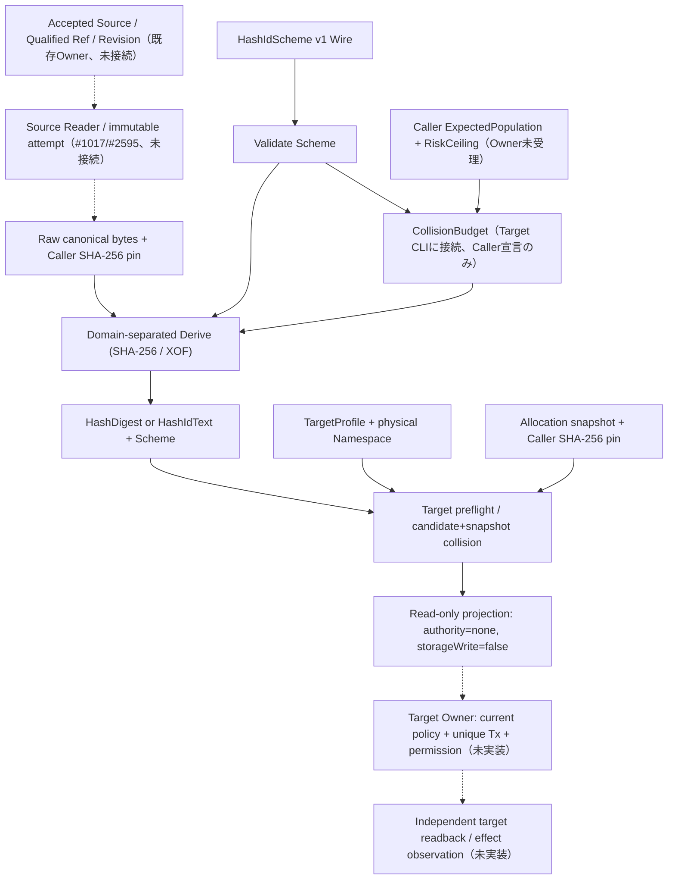
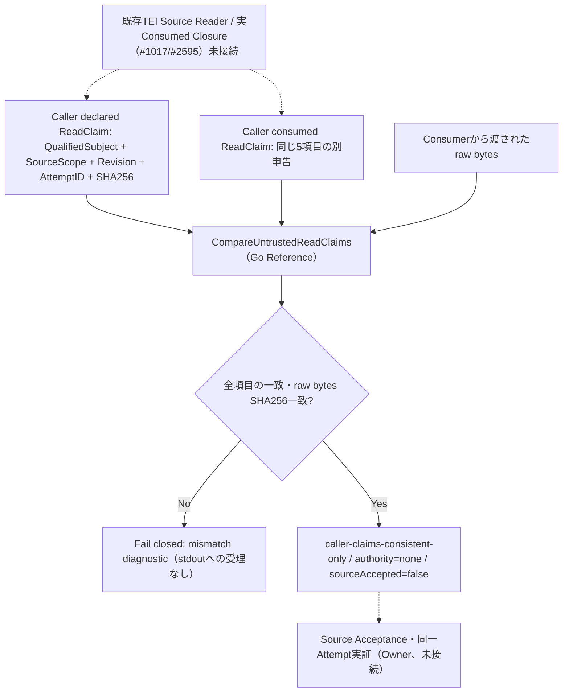
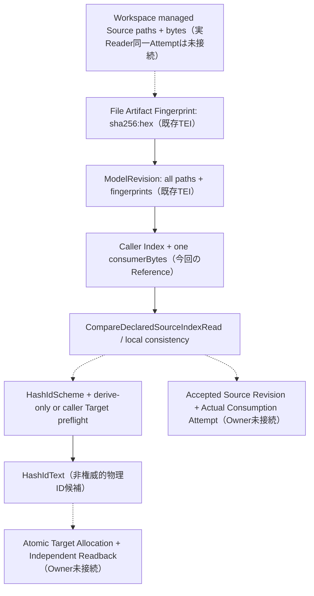

# 可変長・可変文字集合の内容導出ID：共通契約案（2026-11）

- **文書の性格**: 設計案と隔離Reference実験の記録・製品未採用。既存ID移行の決定や本番の意味的受理を含まない。試験実績は対応するDraft PRのexact headに限る。
- **作業の正本**: [#2814](https://github.com/hat47x/tei-platform/issues/2814)（受入条件・進捗）。
- **確認基準**: `main` commit `1f9f7d5d1876a0d0c420568bdf06becd96923b21`（2026-11-04 JST）。同時点の現行Referenceを変更しない。
- **関連する採用済み境界**: [#1120](https://github.com/hat47x/tei-platform/issues/1120)（論理ID・型付き参照）、[#1595](https://github.com/hat47x/tei-platform/issues/1595)（Canonical Capability ID）、[#2094](https://github.com/hat47x/tei-platform/issues/2094)（派生名の衝突検出）、[全体構成](../../docs/architecture.md)、[管理名前空間案](PLUGIN_NAMESPACE_AND_OPTIONAL_COMPOSITION_2026-10.md)。
- **既存の責務**: [#951](https://github.com/hat47x/tei-platform/issues/951)（Plugin/Contract identity）、[#943](https://github.com/hat47x/tei-platform/issues/943)（Artifact/Build/Lock）。これらの第二のAuthority・Resolver・Lockを作らない。
- **非主張**: 既存SHA-256やDigestが置換済み、新方式が採用済み、テスト/CI/Provider/Studioが成功済み、短縮IDが暗号学的完全性や権限を証明する、とは主張しない。

## 1. 必要性と解決する失敗

数字だけの外部ID、URL用の短い文字列、ケース非区別のDB、ファイル名、人が照合する短縮表示には異なる長さ・許容文字集合がある。一方、同じ内容の照合に使う暗号学的Digestと、編集を跨いで保持する論理IDと、個々の業務レコードのキーは異なる概念である。単なる`SHA256(hex)[:N]`は、暗黙の衝突リスク、異なるルールの混同、文字数と情報量の誤認を生む。

**中心原則**: 内容からのID生成を選択できるようにしながら、同一性の意味、生成規則、物理的な文字列表現を別の契約として保持する。

- `logical identity` / `qualified semantic ref`: 意味上の正本対象を識別。改名・内容更新時の継続性は#1120が決める。ハッシュを必須にしない。
- `content digest`: 規定した正規化済みbyteとアルゴリズムの照合値。対象の内容が変われば変化し得る。
- `hash-derived ID`: 内容/目的/スキームに拘束して生成する識別値。衝突確認と用途ごとの適格性が必要。
- `display alias`: 短縮・表示に使う補助。完全な正本IDへの単独逆解決、Authority、意味の受理を含意しない。
- `artifact integrity / publisher signature`: exact artifact byte・署名・Trust等を別途検証。短いIDから代替しない。

## 2. 最小型と責務（名前・JSONは候補）

| 概念 | 必要な情報 | 意味 |
| --- | --- | --- |
| `HashDigest` | algorithmId + algorithmVersion/profile + outputBits + rawBytes | バイナリの照合値。**encodingを含めない** |
| `HashIdScheme` | schemeId/version, inputKind, canonicalizationProfile/version, purpose, namespace/scope, generator, output rule, constraints | 入力と結果の再現規則。独立に識別・固定 |
| `HashId` | scheme identity, value, scope, optional source revision/provenance | 規則を伴う内容導出ID。裸の文字列の同値比較をしない |
| `HashIdText` | scheme identity, alphabet/encoding and serialized text | Targetに渡す表記。文字列表現だけで意味・権限を確定しない |
| `TargetIdConstraint` | allowed alphabet, min/max/exact length, case/collation, reserved names, path/URL safety | 外部制約。Schemeが表せてもTargetへ適用可能とは限らない |

`tei.std.hashId.*`は提案中の管理名前空間であり、現行`std.*`の自動改名も、Kernel固定型への組込みも決めない。標準のContractはProvider/Pluginとして再利用可能であることを優先する。UIやHostは不要。

## 3. 同一性の導出手順

```text
Source / approved input
  -> canonicalize(inputKind, profileVersion) -> canonicalBytes
  -> domain-separate(purpose, scope, inputKind, version)
  -> derive(mode, algorithm, digestBits OR alphabet+length)
  -> HashDigest or HashId
  -> target validation + collision check -> optional physical ID
```

- **入力を勝手に正規化しない**。raw bytes、JSON canonical、Unicode NFC等は異なる`canonicalizationProfile`を持つ。JSON等の重複キー・不正UTF-8・非対応型・不明versionは拒否。Unicodeの正規化表はversion固定。実装間で同じbyteを作る。
- **曖昧性を閉じる**。入力type、scope、purpose、正規化版を長さ付きのバイナリframe（big-endian整数、定めたUTF-8）で区切る。文字列連結の区切り曖昧性を許さない。例: `frame(x) = u64be(byteLength(x)) || x`。`a|bc`と`ab|c`が衝突してはいけない。
- **ドメインを分離する**。`tei.hashId.content.v1`と`tei.hashId.exact.v1`、各`purpose`、`inputKind`、`scope`、`canonicalizationProfile`を入力/Customizationへ機械可読に束縛する。単なる`hash(plainString)`を全用途で共有しない。
- **Schemeの版を固定する**。文字集合の**並び順**、case policy、出力長、XOF消費順序、leading zero、padding、ビット順も同じ仕様の一部。変更時は別schemeとして扱い、旧値を再解釈しない。
- **同一性の持続性**。内容から生成したIDは内容に依存する。内容が変わっても保持する意味ID、業務レコードID、外部の既存IDは別途保持・関連付ける。

### 3.1 モードA：`encodedDigest`

```json
{
  "format": "tei.hashid.scheme/v1",
  "scheme": {
    "schemeId": "tei.std.hashId.v1",
    "purpose": "example.artifact",
    "scope": "example.release",
    "inputKind": "bytes",
    "canonicalization": "raw-bytes/v1",
    "algorithm": "cshake256",
    "mode": "encodedDigest",
    "outputBits": 160,
    "encoding": "base32lower",
    "alphabet": "",
    "length": 0
  }
}
```

バイナリDigestを固定ビット長で作成し、Base16/Base32/Base64url等で**可逆に**表現する。encodingだけを切り替えた場合、Digestのバイナリ値は変えない。結果の文字列をDigestの代わりに無条件に比較しない。標準Base-NにはRFC 4648の非使用ビット0・case/padding規則を適用し、非正規の別表記を拒否する。

Base10/Base36/Base62の固定長変換も許すが、RFC 4648準拠とは称さない。big-endianの**非負整数**として符号なしに変換し、左側をalphabet[0]で指定文字数まで埋める。逆変換はbitsを超える値、非正規長、先頭ゼロ規則違反を拒否する。例えば128 bitはBase10で39桁、Base36で25桁、Base62で22桁、RFC 4648 Base32（paddingなし）で26文字、Base64url（paddingなし）で22文字を要する。

SHA-256は256 bit固定。短縮する場合は`sha256-truncated/v1`のように**明示的な別プロファイル**とし、SHA-256フルDigestと誤表示しない。可変出力のSHAKE256/cSHAKE256/BLAKE3は指定byteを導出できる。ただしXOFで出力長を変えたときのprefix関係に注意し、非互換な長さ変更はSchemeの新しい版として扱う。

### 3.2 モードB：`exactCharacters`

```json
{
  "format": "tei.hashid.scheme/v1",
  "scheme": {
    "schemeId": "tei.std.hashId.v1",
    "purpose": "example.external-record",
    "scope": "example.application",
    "inputKind": "bytes",
    "canonicalization": "raw-bytes/v1",
    "algorithm": "cshake256",
    "mode": "exactCharacters",
    "outputBits": 0,
    "encoding": "",
    "alphabet": "0123456789abcdefghjkmnpqrstvwxyz",
    "length": 32
  }
}
```

**このモードはDigestの可逆エンコーディングではない。** アルファベット集合`A`と正確な長さ`L`が固定され、XOF出力から一様に文字を選んで`A^L`通りの文字列へ写像する。

正確な候補アルゴリズム（PoCで固定する）:
1. 結果の文脈（`mode`、アルファベットの順序を含む正準表現、`L`）をdomain-separateしてXOFを初期化する。
2. `k`を`256^k >= A`となる最小の正整数、`M=256^k`、`T=floor(M/A)*A`とする。
3. XOFの出力を**連続したk byte big-endian単位**で読み、`x>=T`を棄却、そうでなければ`alphabet[x mod A]`を1文字追加する。
4. `L`文字で停止。上限内に達しない場合はエラー。拒否した候補のXOF消費位置も再現規則に含む。

この方法なら除算の剰余による文字頻度の偏りを回避できる。任意のUnicodeアルファベットを要求する場合、文字数の単位は**Unicode scalar value**であり、grapheme cluster/画面表示幅とは異なる。Unicode版、正規化、紛らわしい字形、結合文字、制御/方向制御文字、DB照合順序は独立Policyで検査する。PoCの最初の相互運用ProfileはASCII alphabetから開始し、Unicode完全対応は別の反例・ターゲット検証を条件とする。重複文字・空集合・上限超過・無効scalarは拒否する。

### 3.3 桁数・情報量・衝突

`A`種類・`L`文字なら最大`M=A^L`種類、理想的な情報量は `H=L*log2(A)` bit。誕生日近似は（生成対象数`n`が`sqrt(M)`より十分小さいとき）`P(collision) ≈ n(n-1)/(2M)`。一般には`1-exp(-n(n-1)/(2M))`を用いて概算する。**暗号強度・原像抵抗性そのものと同一ではない**。固定Digestを短縮すれば利用できる識別空間も縮小する。

例：数字20桁は約66.4 bit。Base32で32文字なら160 bit相当。事前の`ExpectedPopulation`と`MaxCollisionProbability`などはTarget/用途Policyが指定し、危険な短縮を表示警告だけで許さないPolicyでは生成を拒否する。生成後も永続側の一意制約/重複検査が必要。自動saltや連番再発行で既存意味IDを黙って変更せず、衝突時は両候補とScheme/Scopeを示してFail Closedする。再試行・割当を許す用途では、採用したsalt/nonce・再割当の記録とAuthorityを別に定義する。

### 3.4 版付きScheme JSONの限定Wire（PoC・製品未採用）

参照実装の *保存・再読込用* Wireとして`tei.hashid.scheme/v1`を導入した（[Go/TypeScript実装](../../tools/reference-hash-id/)）。上記の整形済み例は説明用であり、**実際に受理されるWireは空白を除いた1行の正規JSON**である。

- 外側は`{"format":"tei.hashid.scheme/v1","scheme":{...}}`。内側は`schemeId,purpose,scope,inputKind,canonicalization,algorithm,mode,outputBits,encoding,alphabet,length`を**この順序で全件必須**とする。使用しない数値や文字列も0/空文字で残す。省略・null・未知・重複・順序変更・非正規JSONエスケープ・末尾ごみは受理しない。
- 現`v1`の許可入力は`bytes/raw-bytes/v1`だけ。名前・scope・purposeは対応するASCIIトークン構文に制限。アルファベットは重複なしの印字可能ASCII 2〜94種類。Unicode scalar・JSON canonicalizationは後続の別版/別Profileであり、見かけ上同等でも暗黙移行しない。
- 数値はビット数・文字数の整数。 `encodedDigest`は`length=0`、`exactCharacters`は`outputBits=0, encoding=""`。違うModeのゼロ値を流用したデフォルト補完は認めない。
- Canonical WriterはUTF-8・ASCII値・上記固定キー順で`JSON.stringify`同等のエスケープとし、`<`/`>`/`&`も字面を維持する（HTML用追加エスケープなし）。4KiBを超えるDeclarationは拒否。Goの`MarshalSchemeJSON/ParseSchemeJSON`、TSの`serializeSchemeJSON/parseSchemeJSON`が同じ`scheme_wire_vectors.json`を参照する。
- **Wire版はHashの入力に追加しない**。ハッシュ導出の識別は既存の`tei.hashid.frame.v1`、`schemeId`、目的・scope・アルゴリズム・Mode・出力規則で固定する。表示Encodingだけ変更すると`encodedDigest`のバイナリは同一でも**Scheme Wire全体のバイト列は異なる**。どちらも意味上の論理IDの同値性を意味しない。
- v2へ変更する際は旧Wireを自動的に昇格させず、機械可読Migration宣言、旧新結果の照合、旧IDの保持、Consumer/Owner受理を別Gateとする。

**境界**: これはHash Id Schemeを保存・交換する際の正準形式の*実験契約*である。署名対象・Artifact Lock・Capability Identityに直接転用する決定ではなく、実認証・実DBの取得保証・既存アプリ受理に結線しない。

## 4. 方式の比較と導入順

| 候補 | 出力 | 導入位置 / 条件 |
| --- | --- | --- |
| SHA-256 | 256bit固定 | 既存互換・Golden比較。変更時は明示移行 |
| SHAKE256 (FIPS 202) | XOF | 可変長の基本比較 |
| cSHAKE256 (SP 800-185) | customizable XOF | 用途・契約を分離する新規ID候補。ただし仕様をPoCで決定 |
| BLAKE3 | XOF | 高速/大量処理時のProvider候補。SHAKE/cSHAKEとの同値性は主張しない |

外部標準: [FIPS 202](https://csrc.nist.gov/pubs/fips/202/final)、[SP 800-185](https://csrc.nist.gov/pubs/sp/800/185/final)、[RFC 4648](https://www.rfc-editor.org/rfc/rfc4648)。SP 800-185r1は2026-10-08公開の**初期公開草案**であり、既存正式版とは区別する。BLAKE3は[公開仕様](https://github.com/BLAKE3-team/BLAKE3-specs)を参照。

導入は(1)契約とGolden/負例 → (2)SHA-256/SHAKE256/cSHAKE256の限定Reference → (3)exactCharactersの文字集合・長さ試験 → (4)BLAKE3/Unicode/Target連携比較。固定アルゴリズムのKernel強制や新しいRegistryはしない。

## 5. 正本と実現先の境界

- 正本の`qualified ref`、構成のLogical Instance ID、Runtime View ID、Source Token、業務主キー、Artifact Digestを別種として扱う。表示IDでGraphの旧選択や異Scopeを再解決しない（#1120/#1124）。
- Plugin/Bundleの公開fingerprintやRuntime EngineのLock/署名を一律置換しない。旧識別子と新Schemeの**並存比較**は可能だが、同一性の結論は当該Owner/検証で確定する（#943/#951）。
- Targetへ適用する前に文字数、文字の許容性、予約語、case folding、Unicode normalization、DB collation、Path、URL、ファイル名の制約を確認。外部環境で`A`と`a`が同一視されるなら`A^L`の空間をそのまま評価しない。
- 内容を公開から推測できる deterministic hash IDは秘密値・認可証明ではない。署名・トークン・秘密鍵・認可情報は別の責務。
- 生成手順をAIが構成しても、生成したSchemeと入力/出力の宣言・選択されたProvider・検査結果を図表とログから辿れ、隠れたフックや暗黙の再ハッシュを設けない。

## 6. 最小受入試験表（Go/TypeScript参照試験を一部追加。全体受入は未実施）

| ID | 入力 / 条件 | 期待する証拠 |
| --- | --- | --- |
| H01 | raw byte同一、同一Scheme、二回生成 | binary/text完全一致 |
| H02 | 同一DigestのBase16/Base32/Base64url切替 | 復号byte一致、表記の違いだけを記録 |
| H03 | 128bit・Base10/36/62、先頭ゼロ | 固定長・逆変換、非正規文字列を拒否 |
| H04 | 任意Alphabet、Aが256の約数でない、length変更 | rejection samplingのGolden、modulo biasなし、長さ固定 |
| H05 | 同一値でもpurpose/scope/inputKind/profileが異なる | 異Schemeとして比較拒否。用途分離の正規化を再現 |
| H06 | UTF-8/NFC/NFD/重複JSONキー/曖昧frame | 固定profileで一致/差異/拒否を説明。曖昧連結なし |
| H07 | 数字20桁で大規模母集団、Target要求と不足 | 衝突リスク診断・Policyによる拒否 |
| H08 | case-insensitive DB、全角/大小文字、予約ファイル名 | 物理Target衝突・違反を適用前に拒否 |
| H09 | 生成後の同一文字列衝突、異scope/曖昧lookup | 黙った再割当・別対象上書きをしない |
| H10 | 旧Canonical ID、SHA-256 Fingerprint、Artifact/Scenario受入 | 非回帰、旧schemeの再発行なし |
| H11 | Go/TypeScript、OS・Unicode実装差、Golden fixtures | 同一input canonical bytes/同一output。非互換profileを拒否 |
| H12 | Studio/CLI/Provider複数Consumer | 同じScheme解決と診断。UI view IDを正本へ昇格させない |

Golden vectorはアルゴリズム別の**公開既知テストベクトル**と、TEI envelope/schemeの独立した合成vectorを分ける。双方が同じ誤った実装を共有しただけでは合格としない。Go参照と型付きTypeScript参照、Node.js独立SHAKE256実装・共有Golden fixtureを [`tools/reference-hash-id/`](../../tools/reference-hash-id/) に追加した。cSHAKE256の暗号PrimitiveはNIST公開ベクトルを用いるGo試験で独立検査する。TypeScript実装の暗号計算は注入されたProviderが担当し、TypeScriptコンパイラがない環境では型チェック試験を明示Skipする。**Go/TS/Nodeの同一HEADでの合格、独立cSHAKEのTEI frame照合、実DB/Windows/ブラウザ検証はCIと個別受入根拠が揃うまで未実証**。この表は全体受入の計画である。

## 7. 未決・停止条件

1. **製品の要件化**: 本設計から要求へ移すのはOwnerが用途・対象・非互換性を受理した後。まず#2814で比較。
2. **Exact-modeのUnicode Profile**: scalar vs grapheme、正規化版、DB collation、悪意ある文字列はPoC対象。ASCIIだけで本番の任意Unicode適合を宣言しない。
3. **識別とセキュリティの等価視を禁止**: 署名対象、Canonical ID、短縮表示、Artifact Digestを暗黙置換しそうな場合は作業停止。
4. **変更の計測**: 既存の契約の合成だけで同じ用途を実装できれば、新しいCore原語・新DB/Registryを増やさない。再利用できない失敗を実Consumerで示せたときだけ拡張する。
5. **資格**: 実装の合成試験が成功しても、実業務データの同一性、外部Provider、Owner意味受理、現在の実行権限を証明しない。

**現状（2026-11-04）**: `tools/reference-hash-id/` にraw-bytes/v1限定のGo Reference（生成、復号、Target制約・割当Snapshot比較）と、Host非依存の型付きTypeScript Reference（暗号PrimitiveはAdapter責務）、Go/Node共有Golden fixtureを追加した。SHA-256/SHAKE256の独立Node/Python系GoldenとNIST cSHAKE256公開ベクトルの試験を実装済み。Go1.26.10をローカル作業環境へ取得できず、Go全体テストの実績はCIで判定する。TypeScript型検査はコンパイラが利用可能な環境でのみ実行される。PR #2815の正確なHEADに対応するCI結果を見ずに成功とみなさない。全体受入、実Target同時登録、Unicode/OS、cSHAKE256の独立TypeScript Provider、既存Digest移行は未実証。本番適用はなし。

## 8. 製品採用の最小Gate（要求候補・未採用）

Referenceの成功を製品機能の完成に昇格させず、次のように**契約採用・実Consumer接続・外部Targetの権限ある保存**を分ける。

| Gate | 責務と必要な証拠 | 現状 |
| --- | --- | --- |
| W0: Scheme Wire | 正規JSON・未知/重複/null拒否、Go/TSの同一Wireと再導出、旧版拒否 | Reference実装・共有fixtureを追加。exact head CIで限定判定 |
| W1: 暗号/生成器 | NIST cSHAKE・SHAKE既知値、frame/golden、文字集合偏り・長さ/衝突予算 | Go/Node合成試験・標準ベクトル。一様性の包括的統計保証ではない |
| W2: Target受理前 | 許可文字・case/Unicode/予約語・想定人口/確率・旧キー衝突診断、各Provider宣言の真正性 | ASCII静的Profile＋SQLite NOCASE限定試験。Headless CLIはCaller宣言のpopulation/risk予算を必須検査するReference候補。**Owner Policyの資格、実Targetの衝突空間・容量は未確認** |
| W3: 保存のAuthority | 同一Scheme/Subject/Namespace/Source revisionをTarget Ownerが検証し、**実一意制約・transaction**で永続化。競合時fail-closed | SQLite単一接続の限定負例だけ。権限・マルチ接続/分散は未実証 |
| W4: Consumer境界 | CLI・Studio・生成器の同一Scheme入力・出力・エラー経路、view-ID→qualified ID昇格拒否、epoch/stale判定 | `cmd/hashid-probe`のread-only Headless参照Consumerを追加。実CLI/Studio/生成器・Source freshness・Authorityには未接続。合格はexact headのCIで判定 |
| W5: 更新/移行 | 旧Schemeと新Schemeの並存、旧値への参照維持、衝突時Rollback、移行・dual-read/Owner受理、Artifact/署名の非回帰 | 未実装・未実証。正式採用/移行の決定はしていない |

製品へ初めて提供する最小API候補は以下の**分割された意味境界**のみとする（公開API名・パッケージの確定ではない）。

1. `ValidateHashIdScheme(wire)` — Wireを解析し、Schemeと宣言した制約の適合を検査する。該当Providerが実在することやSourceの鮮度は別。
2. `DeriveHashId(scheme, canonicalBytes, provider)` — raw digestか文字列生成の結果と、そのScheme・入力版の根拠を返す。表示文字列だけは正本参照として扱わない。
3. `PreflightTargetId(result, targetProfile, bindingsSnapshot)` — 衝突候補/制約違反を診断する**非権威的Projection**。Snapshotが完全だとはみなさない。
4. `AcceptPhysicalId(qualifiedSubject, scheme, result, targetAuthority)` — **Target Ownerが独立に設計・受理する保存操作候補**。このReferenceには実装しない。原子的な一意制約、既存割当と旧版衝突、認可・Source freshness・監査・Rollbackを別途検証する。

`HashIdScheme`を選択できること自体は、`AcceptPhysicalId`の権限やSource Acceptanceにはならない。最初の実Consumerの採用決定が行われるまでは、`tei.std.hashId.*`を管理名前空間の提案のまま保ち、既存`core/identity`、Artifact/Lock/Plugin/Scenario Fingerprintに広域依存やデフォルト置換を導入しない。

### 8.1 最小Headless Consumerの確認条件（read-only）

`tools/reference-hash-id/cmd/hashid-probe`は製品CLIとは独立した実験用コマンドで、単一の正準`SchemeJSON`とsource raw bytesを読み取って決定的に`Derive`し、ローカルのTarget Snapshotが**明示されている場合だけ**静的`CheckTargetBinding`を実行する。

- 入力Scheme/Source/Targetに上限を設ける。非正準Scheme JSON、Unknown/Duplicate/Null/欠落のあるTarget Snapshot、旧Scheme/旧Profileの衝突、同一物理IDの異Subject、許可外文字、予約名を非0終了・stdout出力なしで拒否する。
- 成功出力は`status=derived-only`または`caller-pinned-budget-snapshot-preflight-only`、`authority=none`、`storageWrite=false`を固定し、呼出元申告のsubject、生成文字列、frameを決めるScheme、入力byte数と独立SHA-256値を提示する。入力Digestは、この実行が読んだbyte列の説明に過ぎない。
- Source fileの存在/改変防止/正本Revision、Target割当の現在性・完全性、呼出元subjectがTEI正本のqualified refであること、Authority/Owner受理、原子的DB書込やRollbackを**一切保証しない**。
- 受入候補の成功条件は、実Goコマンドとして同じFixtureを2度実行したときの出力一致、局所Source/Targetファイル不変、同名別Subject・旧Profile/別Scheme・不正Scheme JSON・巨大Inputを拒否する負例、`go test ./...`でのPackage実行の証拠。CLIの試験合格をW4の全Consumer接続済みとみなさない。
- caller-pinned preflightでは`-expected-source-sha256`と`-expected-target-sha256`を必須にし、現在読み取った2ファイルのbyte Digestと比較する。最後にScheme/Source/Targetをもう一度読み、**観測可能な変更だけ**を検出する。ピンの正当な発行者、Accepted SourceのRevision、Target割当の全量・現在性、symlink競合・ABA、最終照合直後の更新を保証しない。成功時も`callerPinsMatched=true`、`authority=none`、`storageWrite=false`を併記し、`fresh=true`や`accepted=true`を与えない。
- この段階で`AcceptPhysicalId`は実装しない。次に実Providerを選択するなら既存#2094の派生命名検証と共存し、独立した保存・認可・snapshotのfreshness/epochを実ConsumerのOwnerが検証する。


## 9. 他レーンとの統合設計（2026-11-06、採用済み境界と候補を区別）

この節は[Everything is Data #2619](https://github.com/hat47x/tei-platform/issues/2619)、
[三視点Source正本 #1124](https://github.com/hat47x/tei-platform/issues/1124)、
[Plugin Capability #951](https://github.com/hat47x/tei-platform/issues/951)、
[生成器の実入力束縛 #2595](https://github.com/hat47x/tei-platform/issues/2595)、
[版間Source対応 #2505](https://github.com/hat47x/tei-platform/issues/2505)、
[Driver Scenario #1180](https://github.com/hat47x/tei-platform/issues/1180)、
[Plugin self-build #943](https://github.com/hat47x/tei-platform/issues/943)を照合した**設計上の接合条件**である。各IssueのOwnerが未受理の意味・実行・資格をここで採用済みに変更しない。

### 9.1 標準データ／型付きPipelineとしての位置づけ

`HashIdScheme`と`TargetProfile`は、標準のRecord/集合/Relation/Graph構造上で読み書き可能な**宣言データの候補**である。意味づけは交換可能な解釈／Operation Pluginに担わせ、Kernelへ「汎用Hash ID」の特別分岐を足さない。GoとTypeScriptの現Referenceはこの考えを検証する独立実装であり、標準データ構造／Plugin Registryへの登録自体は**未実装**。

| ノード／値 | 型と出自（候補） | 変更時に区別すべきもの |
| --- | --- | --- |
| `QualifiedSourceRef + SourceRevision + Scope` | 既存のSource/typed-reference責務。Identity Ownerが決定 | `source path`、`view ID`、Hash文字列には昇格不可 |
| `CanonicalBytes + ReadEvidence` | 読込・正規化を行ったProviderが明示出力。v1はraw bytesのみ | Caller pin一致は`Source Accepted`や実Readerの同一Attempt保証ではない |
| `HashIdScheme` | 正準`tei.hashid.scheme/v1`＋Provider/version（候補）。同一`schemeId`でも全パラメータを比較 | algorithm/outputBits/mode/alphabet順序/length/purpose/scopeの変化は互換とは限らない |
| `HashDigest` | 入力frame＋暗号方式から導出したbyte列とbit長。表現Encodingから独立 | Plugin/Artifact/Scenario既存Fingerprintを置き換えない |
| `HashIdText` | `encodedDigest`または`exactCharacters`由来のScheme付き物理表現 | 非可逆exact文字列をDigestに復号したとみなさない |
| `TargetProfile + BindingsSnapshot` | Target Ownerに属する名前空間・照合規則・実割当候補 | Snapshotの全量性・時点・Owner権限は入力だけでは証明されない |
| `PreflightDiagnostic` | 制約違反・衝突の非権威的Projection | `AcceptedPhysicalBinding`やDB Commitではない |

処理の全体を次の**明示的な依存グラフ**として考える。実線はReferenceで機械的に実行可能な操作、破線は**別Ownerの接合が未実装**の操作を表す。Referenceから直接Productionへの隠れた経路は存在しない。



**注意**: 上図の`P`はTarget preflightを行う`hashid-probe`に**接続したReference検査**であり、`-expected-population`（2件以上）・`-max-collision-probability`（0〜1）を必須とし、birthday近似の上限超過を候補出力前に拒否する。`E→F`の直接辺は**derive-only**（Targetなし）の経路、`E→P→F`は**Target事前検査**（Caller予算あり）の経路。これで「Reference CLIに存在しない」とは判断しなくてよい。一方`Q`はCaller自身の申告であって、OwnerがPopulation・Policyを採用した証拠ではない。W2の製品受入完了・実Targetの衝突空間保証は依然として未実証。

**注意**: 上図の`C`/`I`へのPinはCallerが供給したbyte一致の検査に限り、Source Reader／割当Snapshotの真正な取得を保証しない。`K→L`は自動昇格を示す矢印ではなく、独立したOwner受入Gateが必要であることを表す。APIが`L`を持たない限り、実保存は存在しない。

### 9.2 Plugin／meta-generation／Targetとの組合せ

- **Pluginインスタンスの合成**：将来`tei.std.hashId.*`を採用する場合、Scheme Validator／Generator Adapter／Encoder／Target Validatorを型付きOperationの別インスタンスとして構成する候補とする。複数Targetや複数Schemeを同時に使え、1つのグローバルSchemeを前提にしない。これらの名前は**管理名前空間の提案**であり、現時点のCanonical Capability IDや#951のProvider/Grantを生成しない。
- **可視な生成パイプライン**：型付きData Operation→候補ID→TargetへのBinding Candidateという辺をGraph/表として列挙する。Generatorが内部で文字列を再ハッシュしたり、Scopeを補完したり、衝突時に自動salt・renameするような**隠れた処理を禁止**。汎用標準データ構造だけで表せないことが証明されるまで専用DSL／Core原語は追加しない（#2619/#2016）。
- **自己ビルドと公開Plugin**：Source closure／Generator version／Build Definition／Artifact Digest／Lock／署名は#943/#951のまま。ハッシュ由来の短いファイル名・Registry locatorを出せても、それをartifact integrity、publisher identity、Capability IDや検証済フィンガープリントへ暗黙昇格させない。Plugin配布の識別規則変更は別Ownerの独立比較と移行Gateを要する。
- **ETL/ELT・ファイルリレー・書籍出版**：バッチ出力名、転送ファイル名、PDF発行slugなどはTarget制約付き`HashIdText`の候補。ETLレコードの意味主キー、元ファイルのCheckSum、転送完了Receipt、PDFの内容Digestや署名は別値。画面系とバッチ系は共通Scheme Operationを使えても、実行TargetとObservation/失敗時再試行Policyを独立定義する。
- **Studio／Scenario**：StudioはScheme、候補、衝突予算、Target制約、Source revisionと失効診断をgeneric Record/Table/Graphとして投影するConsumer候補。Runtime View ID/選択epochでHashIdTextを正本参照に逆解決しない（#1124）。Driver ScenarioのSSOTとCLI/E2Eの派生物・Observationを混同せず、Golden/negative fixtureもScenarioから再生成できるようにする（#1180、未接続）。

### 9.3 Source変化／ABA／異Scopeの反証条件

| 反例 | v1 read-onlyで判定可能なこと | 製品受入に不足する証拠・Owner |
| --- | --- | --- |
| 同じSource内容Aを改名・別Scopeで再使用 | `purpose/scope`を変えれば生成規則を分離できる | 同じ意味Subjectの継続性や改名の受理は#1120/#2505。Hash一致をID継続性にしない |
| Source A→B→A（同じSHA-256へ戻る） | 同じbyte列のCaller Pinが一致することだけ | Source revision/selection epoch、Acceptance ledger、同一Attempt実Readerの独立証拠は#1124/#1017/#2595 |
| Sourceの一部を検査、別byteをBuild/Interpreterへ渡す | CLIの読込byteに対するSHA-256だけ | 実Generator/Toolの消費byte、Executable・Source閉包は#2595。Hash CLIから推定しない |
| SnapshotをPinした後に別プロセスがIDを確保する | 既存Snapshot内の重複・衝突は検出できる | Target Ownerの最新read／一意制約／Transaction／再試行／readback（W3）。Reader Pinでは保証不能 |
| 同一文字列で別Scheme／Target collationが異なる | Scheme全体とTargetProfileVersionを静的比較する | 実DB/OSのcollation、Unicode・case・予約規則の適格性とOwner宣言 |
| Plugin/Artifact/Scenario Digestを短いIDで置換する | 提案段階で責務違反を診断できる | 既存#943/#951/#1180のFingerprintと署名の非回帰試験。未実施の移行は拒否 |

### 9.4 Fit/Gapと後続の優先順（製品採用前）

| 順 | Gap／最小証拠 | 現行主担当との関係 |
| --- | --- | --- |
| P0 | Scheme／Generator／Target Snapshotの局所不変条件（重複した旧割当を含む）をGo・Node・TypeScript Goldenと負例で固定 | #2814 Draft内Reference。独立Output Oracleを維持 |
| P0 | Source Identity/Revision/Scopeと実Consumerが**同一Attempt**で読んだbyte列を結び付ける。HR-P0-01〜08（§9.11）を負例として限定し、A→B→A・別Workspace同Manifest・異Scope・宣言/実Tool消費不一致を別契約で追跡 | #2814はCaller `ReadClaim`と既存Source IndexのPath/Fingerprint/ModelRevision局所照合のみ実装。**実Reader同一Attempt／全Consumed Closure／Workspace physical Root／Owner受理は未実証**。#1017/#1124/#2595/#1163とDraft #3321/#3327/#3492を再利用し、第二Reader/Consumerを増やさない |
| P1 | Target Providerの現行Collation・既存割当・競合と実物理一意制約を検証、Owner Authorityと独立readbackを分ける | #2094を利用しW3を独立Gateへ。SQLite単一接続の合成試験を一般化しない |
| P1 | Script-first Studio／Headless Scenarioの同Scheme・同結果を投影し、TypeScriptの実Providerを独立検査 | #2619/#1124/#1180。表示の成否をSource Acceptanceへ昇格しない |
| P2 | バッチ・セルフビルド・Registry・公開物での必要性とコスト／効果を実測してから標準Plugin/Schemaを採否判断 | #943/#951/#2016。Coreに必須機能を導入しない |

**採用判定**: `HashIdScheme`は現在もDesign/Reference。初期成功条件は「1つの実Consumerで、Source revisionとTarget権限を偽らずに同じ結果を再現できるか」であり、「全プロダクトのIDを統一すること」ではない。実Target保存・Semantic Acceptance・既存Digest移行はOwner判断を伴う別作業のまま維持する。


### 9.5 想定規模を明示するCollision Budget（2026-11-06、Reference実装・製品Policy未採用）

桁数と文字集合の可変性は、Targetへ名前を配る母集団の規模とセットで評価する。見かけの表示幅だけから安全性を推定しない。従来からGo Referenceにある`CheckCollisionBudget`をread-only `hashid-probe`の**Target事前検査にのみ**結線した。追加したCLI入力は`-expected-population`と`-max-collision-probability`で、両方必須、予算違反／不正値／未指定／**ゼロリスク宣言**／**母集団が有限ID空間を超える場合**はfail-closed。Targetを使用しない`derived-only`では予算を実行しておらず、出力に予算検査済みと書かない。

- `CollisionBudget`という**別ノード**に、Scheme、Callerが申告したExpectedPopulation（2以上）、MaximumCollisionProbability（2件以上では0を拒否）を入力し、**保守的な衝突リスク上界**が最大値を超えれば後段のCandidate/Target診断へ流さない。成功時は`collisionBudget:{expectedPopulation,maximumCollisionProbability,estimatedCollisionProbability,collisionRiskUpperBound,policySource:"caller-declared-unverified"}`をJSONで返す。
- 表示する推定確率は一様・独立な出力を仮定するbirthday近似 `p≈1−exp(−n(n−1)/(2A^L))`（exact mode）、または`2^outputBits`（encoded digest）である。実Targetの照合規則による同値化、禁止文字／予約名／既存占有／攻撃者の選択入力／暗号学的第二原像強度まで含めて安全性を保証するものではない。Target ProfileがAlphabetを狭めたり正規化で衝突させたりする場合は**同Referenceの推定値から実空間の安全証明を導かない**。
- 合成反証として**数字24桁・10億件**では`p≈5×10^-7`となりCaller予算`10^-6`を満たすが、**数字20桁・10億件**では`p≈0.005`となり拒否する。これは学習用の比較であり、TEIや利用Targetの標準人口・許容確率を採用したわけではない。極端な過少申告`n=2`でもCLIはCallerの値を検査するだけで、権限ある業務Populationとはみなさない。
- **推定とConformance判定は別**：表示用の`CollisionProbability`はbirthday近似、`CheckCollisionBudget`の合否は`CollisionRiskUpperBound=min(1,n(n−1)/(2S))`（ペア衝突事象の合併上界、`S=A^L`または`2^bits`）で決める。2文字種×1桁・2件では近似約`0.393`と上界`0.5`が異なるため、上限`0.4`を**拒否**する。PopulationがID空間総数を超える場合、大整数で鳩の巣原理を検出し、上限`1`でも拒否する。
- **浮動小数点境界**：4,096bit等では確率表示がfloat64のアンダーフローで`0`になり得る。2件以上で`maximum=0`は拒否し、表示された`estimatedCollisionProbability=0`も`risk-free`を意味しない。ペア合併上界も「独立・一様な導出」というモデル上の上界であり、敵対的SourceやTargetの正規化・実装挙動には自動適用しない。
- Target Profileが現実にどのNamesを同一視し、何件を配るかは各Target Provider/Ownerの資格。長期運用での容量変化・再試行・同時確保に対し、原子的Unique制約・衝突の診断/再受理・独立readbackは引き続き**W3の別Gate**に属する。数値Policyの署名・承認は#951の権限系へ自動接続しない。
- Schemaへの昇格時には`CollisionBudgetPolicy`を独立した型付きRecordにする候補だが、現時点でのCLI argvはReference用の非権威的Projectionである。生成パイプラインの図からBudget検査を省略したConsumerは、そのTargetで予算検査が行われたと主張できない。

**追加受入**：不正な最大確率（NaN/Inf/負数/ゼロ/不正文字列）、Policy片側欠落、人口下限違反、有限ID空間超過は結果なしで拒否。正常な数字24桁と、予算超過の20桁は同じSource／Caller Snapshot上で独立試験。これはReferenceのコード合格条件であって本番Targetの受理ではない。


### 9.6 図表の被覆・セルフビルド・ETLとの追加反証（設計接合のみ）

他レーンの最新の限定結果を、このHash ID Pipelineの受入に過大適用しないための**接合条件**を追記する。

| 既存Owner・現状 | このPipelineに持ち込む条件 | 明示的に未保証なこと |
| --- | --- | --- |
| [複合図表の被覆Reference Draft #2881](https://github.com/hat47x/tei-platform/pull/2881) | Graph/Tableを共通Snapshotから派生させる場合、`scope/kind/qualified ID/relation role/endpoint`を保持。被覆情報が閉じた明示Scopeの場合のみ`absent-in-declared-snapshot`相当を返す | 図にHash IDのTarget保存ノードが無いからといって、外部Targetに保存済みIDが**存在しない**とは断定しない。Source/Reader/Disclosureが不完全なら`unknown` |
| [全体セルフビルド #2831](https://github.com/hat47x/tei-platform/issues/2831) | Build graphにScheme/入力版・生成文字列の出自を表せるが、実Toolが消費したSource Closure／Toolchain／Build Attempt・Artifactと別型にする | Hash textの一致やBuild図のDeclared edgeだけで実Toolの消費・自己ビルド収束・Artifact Lockの受理を証明しない |
| [ETL/ELT/MFT 統合済みPR #2827](https://github.com/hat47x/tei-platform/pull/2827) | 外部ファイル名・batch slugに派生IDを使っても、`content digest`、`file physical version`、`transfer attempt`、`delivery/ingest receipt`、`business effect`を別参照として結ぶ | 同じ内容hashから同じ名前を得てもDelivery/Publication/Importの完了・冪等性・Owner受理を推定しない |
| [複合図表の独立Source研究 統合済みPR #2966](https://github.com/hat47x/tei-platform/pull/2966) | 対応Graphが人・AIの誤選択・Unknown・変更波及を減らすか、独立Source/Expectedで比較する | ノード数や構造の短縮だけで認知負荷軽減・不在証明が成功したとみなさない |

**Hash IDの最小Scope付きProjection契約候補**：任意のViewで表示する`HashIdText`は`(scope, qualifiedSubject, schemeWire, sourceReadEvidence, targetProfileVersion, targetSnapshotEvidence, collisionBudgetEvidence)`の各構成要素に遡れる必要がある。ただし`sourceReadEvidence`などの実Source保証がない場合は、欠落欄を空文字で補完せず`unknown`として扱う。Canonical SubjectをHashIdTextから逆算しない。現在の`hashid-probe`はCaller宣言のsubject/raw bytes/pinのみで、Qualified Sourceの実Reader証跡や閉じたTarget割当集合を持たないため、この完全なProjection契約は**未実装**。

この記述は#2881/#2966/#2831/#2827の実装を本PRへ複製したものではない。#2827と#2966はmain統合済みだが、そこでの設計・研究成果をHash IDの実Target受理やSource Readerの保証へ自動転用しない。Hash IDのTarget適用を有効化するOwner Gateとは別であり、追加の管理レジストリ・Host・独自Source Readerは必要としない。


### 9.7 特性評価：Intent／Observed／Conformance／Unknownの分離（2026-11-06）

TEIの型付き特性識別の横断議論に照らし、Hash IDのConstraintを単一のbooleanに潰さない。既存のSource／Provider／OwnerのEvidenceを第二正本へ複製せず、どこまで機械判定できるかを明示する。

| 層 | 入力／証拠 | 局所的に判断できること | 判断できないこと |
| --- | --- | --- | --- |
| **Intent** | Caller宣言のScheme、TargetProfile、ExpectedPopulation、RiskCeiling | 形式・文字集合・桁数・予算値を表現する | 宣言がOwner承認済みであるか、Targetの実人口に合うか |
| **Observed-local** | CLIが読み取ったSource／Snapshot bytes、SHA-256、Derive結果、局所再読取 | Caller Pinと観測byteの一致、固定したSnapshotにおける既存割当の矛盾 | Accepted Revision、実Readerと同一Attempt、A→B→A、割当の完全性 |
| **Conformance-conditional** | SchemeとTargetProfile、局所Snapshot、`CollisionRiskUpperBound` | 一様独立性とCaller宣言という**条件下**での静的制約・予算適合 | 実DB collation／原子的な一意確保、敵対的入力、Owner意味判断 |
| **Unknown/unproven** | 正式Source Reader、Target Authority、独立readbackの証拠なし | `unknown`を維持し、`accepted`や`committed`へ昇格しない | Source鮮度や実登録成功を推測しない |

**Source ABA負例**：初回A→途中B→復元Aのあと、CallerがAのSHA-256を渡せば最終byte照合は再び一致する。このReferenceで再現した場合も`authority=none`と`storageWrite=false`のままであり、元のSource Revisionを継続的に占有したとは判断しない。#1124/#1017/#2595の同一Attempt Source証拠がConsumerで得られるまで、`CallerPinsMatched=true`は`SourceAccepted`を含意しない。

Schemeの静的制約をTEIの「強属性」等に特別昇格する案は、既存の特性識別レーン（#2496等）の定義・Owner決定に委ねる。未確定概念を新Core構文や第二Acceptanceへ取り込まない。


### 9.8 外部Source Readerと実Consumerの同一Attemptに向けた接合（2026-11-07）

[Source Index/TOCTOU #1017](https://github.com/hat47x/tei-platform/issues/1017)、
[Studio Source identity #1124](https://github.com/hat47x/tei-platform/issues/1124)、
[Generator実消費Source #2595](https://github.com/hat47x/tei-platform/issues/2595)を再利用する。既存のReaderやAcceptanceを別のSource正本へ複製せず、`HashId`を**実際に消費したSourceの派生値**として結ぶための最小条件を明確化する。

**今回の局所Reference**：`tools/reference-hash-id/read_claim.go` に `ReadClaim` と `CompareUntrustedReadClaims` を追加。独立に受け取った「宣言側」と「消費側」の `QualifiedSubject / SourceScope / SourceRevision / ReadAttemptID / SourceSHA256` の5項目が同一であり、Consumerから渡された実バイトが宣言Digestと一致する場合だけ、`status="caller-claims-consistent-only"` の**非権威的診断**を返す。必須フィールドの欠落／不正文字列、別Subject、異SourceScope、異Revision、別Attempt、異Digestや実消費bytes不一致は拒否。実Reader・実Generator・Studioには**まだ接続していない**。

**局所Referenceの処理図**（実線＝今回のGo関数が比較する入力、破線＝未実装の実Source Reader／Generator引渡し）。



この図の破線は「自動的な昇格経路」を意味しない。実Readerが供給していない申告を、同一の値が並んだという理由で証明済みとみなすことは禁止する。

**重要なScope分離**：`ReadClaim.SourceScope` はSourceが所属するWorkspace／Identity Scope。一方 `Scheme.Scope` はハッシュ導出のドメイン分離に使う用途Scopeであり、両者は同じ文字列である必要がない。SourceのScopeをSchemeへ暗黙代入したり、Scheme.ScopeでSourceの資格を補完したりしない。複数SourceをまとめるBuild/ETLでは、Source ClosureやConsumption Setの正式なOwner契約を利用し、この単一ファイルReferenceを全件証明へ昇格させない。

| 独立の確認 | 局所Referenceで検査可能 | 真正な製品受入に必要な外部証拠 |
| --- | --- | --- |
| 同じBytes、別Subjectまたは別SourceScope | 申告ラベル不一致を拒否 | 正本のqualified source identity、所属変更・renameのDecision |
| 同じBytes、別Revisionまたは別ReadAttemptID | 申告ラベル不一致を拒否 | 既存Source Readerが発行した版と、実Consumerが**同じAttemptで消費した**証拠 |
| A→B→A（同じDigestに復帰） | 新しいRevision/Attemptを申告すれば拒否。古い申告を再利用すると一致を返す可能性を明示 | Source Index版、Readerが観測したinode/record/attempt等の資格、実Consumer実消費とstale判定 |
| Source Digestが一致、Generatorが別Byteを消費 | 提供されたByteに対する照合不一致を拒否 | 別Readerではなく実Toolが消費したByte Closure・実行Hash。#2595のOwner |
| 始終Source申告が一致、Targetに競合Commit | このReferenceでは判定不能 | W3のTarget Ownerが原子的Unique制約・同一版受理・独立readbackを実証 |

`CompareUntrustedReadClaims` の成功は**二つのCaller申告が整合するだけ**であり、`authority="none"`、`sourceReaderVerified=false`、`sourceAccepted=false` を固定する。命名にVerified/Acceptedを用いず、単に一致した値へ権限を付与しない。実Provider/Source Readerの証拠がない場合は `unknown` のまま保持する。

**後続P0の最小接続順**：① 既存Reader/Source Indexが提供するqualified subjectとrevision/attemptを同一実行から取得、② 実Generator/Headless Consumerが読んだByteと独立に照合、③ A→B→A・別Scope・同名別Subject・一部Sourceだけ合致を反例に固定、④ 同一EvidenceをStudio/CLIでreadonly表示。W3のTarget保存とW5の旧ID移行は最後まで別Owner Gateとする。今回、既存Source Readerの公開APIやSource Index正本の変更、CLIの自動受理は実施しない。


### 9.9 既存TEI Source Indexによる局所束縛（2026-11-07、実Reader接続前のReference）

前節の`ReadClaim`比較を、既にmainに存在するSource Indexの**実関数に接合**した。目的は第二のSource Reader／ModelRevision計算系を作らず、Hash IDの派生結果がどの粒度の根拠から導かれたかを検証可能にすることである。

確認した既存実装：
- [`sourceindex.NewArtifact`/`Fingerprint`/`ModelRevision`](https://github.com/hat47x/tei-platform/blob/main/internal/sourceindex/model.go)：1ファイルのFingerprintは`sha256:<hex>`。ModelRevisionは管理対象Artifactの**PathとFingerprintの組をPath順に列挙した集合のDigest**である。`ReadClaim.SourceSHA256`（生byteのlowercase 64hex）と、1ファイルFingerprintと、管理集合ModelRevisionは**異なる意味の値**。ModelRevisionは単調増加する編集epochではない。
- [`operations.readWorkspaceSource`](https://github.com/hat47x/tei-platform/blob/main/internal/operations/trace_workspace.go)：Workspace rootを`os.OpenRoot`でピン留めし、正規化した相対Pathの単一通常ファイルを上限付きで開く実Read経路が存在する。ただし`Read`は`[]byte`を返し、`ReadAttemptID`・実Tool消費・複数ファイルの原子的Snapshotを発行するAPIではない。
- [`operations.WorkspaceTrace`](https://github.com/hat47x/tei-platform/blob/main/internal/operations/trace_workspace.go)：Snapshot/World/SourceIndex Fingerprintを持つread-only Projection。これらが同じ文字列でも、実Generatorの同一AttemptやTargetへの保存権限は得られない。

今回の`tools/reference-hash-id/read_claim_sourceindex.go`は既存`tei/internal/sourceindex`を**直接import**し、`CompareDeclaredSourceIndexRead(index, path, claim, consumerBytes)`として局所比較を行う。受け取ったIndexの全Artifact Pathを正準化・重複排除／fingerprint形式確認し、対象PathのArtifact Fingerprintと実引渡しbyteの`sourceindex.Fingerprint`、Caller申告のraw SHA-256、Caller申告Revisionと`sourceindex.ModelRevision(index)`を照合する。パスは正準Workspace相対Pathのみ。

| 反例 | 判定 | 未保証の正確な範囲 |
| --- | --- | --- |
| 対象Source Aは同一byte、別管理Source Bだけ変更 | 全Artifact集合のModelRevisionが変わるため、旧Claimは拒否 | 変更したBの実byteを本Referenceは読まない。Callerが新Indexを自己申告すれば真正性は不明 |
| ファイルBの内容は同じだが管理Pathをrename | ModelRevisionはPathも含むので旧Claimを拒否 | renameの意味的同一性・受理済み履歴・旧参照の移行は#1120/#2505 |
| 対象Artifactが欠落／重複／Path曖昧・不正Fingerprint | 静的Index整合性をfail-closedで拒否 | 正本Source集合の網羅性・Indexの出所・Disclosureの完全性は未保証 |
| 同一管理Source集合 A→B→A | ModelRevisionも元に戻り得る。旧Claimの再利用を受理済み改版とはみなさない | 単調なepoch/Attempt、実Readerと実Consumerの同一取得、Acceptance Ledgerが必要 |
| Indexの`References`からSource所属Subject／Scopeを推定 | 今回は実装しない。比較成功の`qualifiedSubjectVerified=false`、`sourceScopeVerified=false`を維持 | `Index.Artifacts`は`Scope`／`ReadAttemptID`を発行しない。型付き`modelref.Key`とReaderの同一Attempt証跡が必要 |

成功時も`status=caller-index-bytes-consistent-only`、`authority=none`、`sourceReaderVerified=false`、`sourceAccepted=false`、`allSourceBytesVerified=false`。これは**Index宣言と渡された一ファイルのbyteが局所的に一致した**という診断だけである。実際のPinned Readerによる取得、`Workspace.Load`と同一AttemptでのSource Index生成、Build/Interpreter実消費byteの同一性、実Target Provider一意受理は検証しない。

**工程別のフィンガープリントを混同しない**：


この図の`D→H`も**未接続の破線**である。`CompareDeclaredSourceIndexRead`は独立したGo Reference関数で、現`hashid-probe` CLI／正式Generatorへは結線していない。図中の`A`と`T`も別Ownerであり、図に記載があることは実行・許可を意味しない。

**次のP0受入条件**：既存#1017/#2595/#1124において、同一Case・Reader/Open Handle・Source Set・Consumed Bytes・Attempt／Revision証拠を観測し、`Index`をCallerが書き換えた場合と、変更後に同じContent Hashへ戻した場合の双方を反例にする。そこで初めて`Source Reader Verified`と`Accepted`を別の資格として論じる。Hash IDのReference側ではそれまで`unknown`とする。


### 9.10 論理Subsystem・物理Target・用途相対開示の分離（2026-11-07、採用前設計）

[Subsystem分割 #3250](https://github.com/hat47x/tei-platform/issues/3250)は、CRUD更新凝集度／越境CUD／Effect/Txを使う**論理的分割候補**と物理配置・Owner Authorityを明確に区別する。Hash由来IDはこの区別の境界に置く**Target物理名の候補**であり、Subsystemを分割しただけで正本ID・DB PK・Artifact Fingerprint・Delivery Keyを自動生成し直さない。

| 区分 | 使うべき独立の意味 | 自動同一視を禁止する相手 |
| --- | --- | --- |
| **Logical Subsystem** | Data/Function/Procedureの変更・更新責任、設計分割候補、受理済みMeaning | Source Scope、Deployment Unit、DB/Schema、Target物理Namespace |
| **Qualified Source Scope + Identity** | どのSource／Workspace／Roleに属する意味参照か。既存#1120/#1124 | Hash Scheme Scope、表示/行ID、短い生成文字列 |
| **Scheme.Scope + Scheme.Purpose** | ハッシュ計算の決定論的ドメイン分離。明示変化は異なる候補IDを作る | 変更後の業務Identity／Owner／Targetへの移動・移行受理 |
| **TargetProfile.Namespace** | 保存先側の実文字集合・照合順序・衝突空間／一意性の**Caller宣言** | Subsystem内所有、Source Rev、実DBやファイルストアの保存資格 |
| **Execution/Delivery Attempt** | 実Builder／ETL／MFTの消費・発行・配送・Receiptと現在性 | Hashの一致・ModelRevisionの一致 |

特に「Subsystem AのレコードをBへ分ける」変更は、業務Identityの移管、Sourceのrename/Scope変更、物理Targetの新配置・移行、旧IDの参照保持、権限・Effectの委譲という**独立したDecision**を要し得る。Hash IDの`Scheme.Scope`を新Subsystem名に自動変更して正本IDや物理名を一括再発行してはならない。旧表現と新表現の並存・dual-read／mapping／rollbackはW5の別Owner Gateに維持する。Read-only候補Projectionは受理前に旧・新SourceからのEvidenceを混同しない。

[用途相対Construction Context #2516](https://github.com/hat47x/tei-platform/issues/2516)および[認識的文脈 #958](https://github.com/hat47x/tei-platform/issues/958)も併用する。Studio／AI設計支援／CLI／ETL Consumerごとに、`HashIdText`だけでなく検証に必要な`SchemeWire`／Source Index・Revision／TargetProfile／上界／未決事項を**受理済み開示Policyに従って**投影する。公開できないSource/主体/割当を空文字や「存在しない」に置換せず、`withheld`または`unknown`と区別する。発行者が供給したClaimの一致はDisclosure済み・有効Grant・Verified Readerを示さない。

**後続の最小反証候補（未実行）**：同じSource BytesでSubsystemだけ変更／Scheme Scopeだけ変更／Target Namespaceだけ変更／表示レイアウトだけ変更の4件を直交させる。意図的にHash出力の変化を許す場合でも、Source Identity、既存Target Binding、実Effect、開示資格がその変更だけで確定しないことを確認する。適格性の最終判断は既存#3250/#1120/#2516/Target Ownerに委譲し、新Core Scope enumや第二Acceptanceを導入しない。


### 9.11 P0実Consumer接合のEvidence境界と反証Gate（2026-11-09）

2026-11-08〜09時点で確認した[Direct CLI Trace Draft #3321](https://github.com/hat47x/tei-platform/pull/3321)、
[Studio Workspace ABA Draft #3327](https://github.com/hat47x/tei-platform/pull/3327)、
[三視点実Relation Source Draft #3492](https://github.com/hat47x/tei-platform/pull/3492)、
[実Generator消費Source #2595](https://github.com/hat47x/tei-platform/issues/2595)、
[統合qualification #1163](https://github.com/hat47x/tei-platform/issues/1163)を踏まえる。これらは**別Ownerの実装・資格**であり、本Hash ID Referenceが代替実装・採用するものではない。

**目的**：ハッシュ由来の物理名Candidateが「どのSource/Scope/Revision/Attempt/Consumer/Targetに対して導出されたか」を**段階別に検証可能**にし、宣言や局所値の一致を、実Reader/実Generator/Owner Authorityに誤昇格させない。

| 観点 | 存在する証拠と実装場所 | 今回のReferenceで照合済み | 未充足の実受入 |
| --- | --- | --- | --- |
| 物理Source byte | `sourceindex.Fingerprint` とCaller提供の`consumerBytes` | 選択PathのHash一致 | 実ReaderからConsumeまで同じOpen/Read attemptか、別Toolの独立観測 |
| 管理Source集合の内容版 | 既存`sourceindex.ModelRevision` | 宣言IndexのPath＋Fingerprint全体とCaller Revisionの一致 | Indexの真正性、閉じたSource集合、**単調な変更epoch** |
| Workspace Loadの識別 | #3321のManifest Name/Path/Hash/FormatVersion＋World/SourceIndex FPの限定観測 | **未接続**。同じManifestの別物理Workspaceを区別する証拠ではない | Pinned Root/Read handleの同一性、実Readerの対象Root・Workspace identity |
| 消費したSource Closure | #2595 Generator宣言Source／Go `goSourceFiles`／Python/JS実Interpreterの独立残余 | **未接続**。単一ファイルのHash一致だけ | 実Toolの選択結果・Consumed Set全件・実行物identity・同一Attempt |
| UI Consumer freshness | #3327の`responses.ts` Workspace A→B→Aの旧応答拒否 | **未接続**。旧応答の失効とSource改版は別 | `/workbench/`実CLI→同一Consumerのevent・epoch連結(#1124) |
| Sourceの意味受理 | #1124/#267/#1163のShared Acceptance / Source・Ledger別readback | **未接続**。局所`ModelRevision`一致は受理状態ではない | Authority・受理済Revision・partial success・現在Grantを別ゲートで受理 |
| 物理Target確保 | `CheckTargetBinding` はCaller宣言のProfile/Snapshot衝突診断 | 局所静的検査まで | Providerの実Collation、一意Tx、現在割当、独立readback（W3） |

**Read Cohortの最小受渡し候補（新標準型・公開APIは未採用）**：既存Reader/Consumerが同一Attempt内で発行した`(workspace/root witness, qualified subject + source scope, managed Source Index revision, consumed source closure [canonical path, raw byte digest], consumer attempt id, tool/executable identity, observed reader/consumer boundary)`を読み取り専用に比較する。後続Snapshot/Revision/Scope/Discovery/Disclosureを**単一のBooleanに圧縮しない**。来歴が`caller-declared`のときは`sourceReaderVerified=false`を維持し、値の一致は`local-consistency`のまま。実Readerが発行していないAttempt IDをこのReferenceで生成しない。

**合格に必要な独立反証（計画・NOT RUN）**：

| ID | 変数を一つだけ変える負例 | 必ず拒否する強いClaim |
| --- | --- | --- |
| HR-P0-01 | 管理Source Aは不変、別管理Source Bのbyteまたはpathのみ変更 | 旧`ModelRevision`の現在性（局所Source Index検査は実装） |
| HR-P0-02 | 同じSource集合A→B→A、古いRevision/Attemptラベルを再利用 | 「同じbyteとModelRevisionなので同じ実行Attempt/現在Source」 |
| HR-P0-03 | 別WorkspaceにManifestとSourceを丸ごとコピー（Manifest/World/Source FPすべて同じ） | 「同じ物理Root／同じOpen handle」；#3321の局所観測に勝手に昇格しない |
| HR-P0-04 | `manifest.Source=audit.go` と実Build `main.go` のsource byteが異なる | 「宣言Sourceを実Toolも消費した」；#2595の既存Go反例を再利用 |
| HR-P0-05 | 実ConsumerがSource集合の一部だけを使い、未観測ファイルが存在 | 「全Source Closureを確認済み」；未被覆は`unknown` |
| HR-P0-06 | Studio A→B→A中、古い成功/失敗応答が新応答後に到着 | 「古いCandidate/Inspectも現在有効」；#3327はUI失効のみで実Effectを取消さない |
| HR-P0-07 | 同じHashIdTextで別Scheme/SourceScope/TargetNamespace/現在Grant | 「物理文字列が同じなら同じ正本・権限・保存」 |
| HR-P0-08 | Disclosureが一部`withheld`で表示に存在しないSource参照を含む | 「図・JSONに見えないからSource/Effectは存在しない」 |

**実施順と重複防止**：まず#2815の参照Go比較関数のGoFmt/Goテストとexact-head CIを確定（現在の実装範囲）。次に#2595の実Consumer/実Tool消費証拠と#1017のPinned Reader/Source snapshotを**既存Ownerが**同一Attemptに結線し、#1163で一版のSource→Model→CLI/Studio→Observationを独立再読。#3321/3327/3492のView/Workspace/Trace実装をHash ID PRにコピーしない。Target Authority・atomic save・dual-read移行はその後、W3/W5の別Gateに保持する。今回のReferenceは**Host必須化、新Source Reader、第二Acceptance、全域Registry、生成Pipelineの隠れたHook**を追加しない。

### 9.12 命名・衝突判定の安全性に関する次の研究課題（製品Policy未決）

可変長`HashIdText`の衝突上界は「独立・一様なScheme出力空間」という仮定に依存する。実Targetでの`TargetProfile`制約（casefold/予約名/長さ/OS/DB collation）が分布や同値類を変えた場合、その上界はTargetの実衝突率を保証しない。`HashIdScheme`の試験成功を、実Targetでの一意性やOwner Policyの採用へ昇格させない。

次の独立反証は、`TargetProfile`の同値関係と生成器実効Alphabet・Reserved値・既存占有を突き合わせること。実Targetの照合規則/Max length/予約語を**Providerが明示的に宣言・実測**し、宣言値が実DB/OSと食い違う場合は`unknown`または`reject`とする。現在のASCII局所ReferenceをUnicode/Windows/分散DBへの一般保証にはしない。案件ごとのPopulation/Collision RiskはOwnerが独立受理するまでCaller Claimである。

このHash ID基盤が最適化対象とするのは、**人とAIがDiagram/Table/Scriptを介して「欠落・曖昧・実際の結線」を識別しやすくすること**である。短い物理名を生成できること自体を成功条件にしない。必要な変換・外部依存・作用境界は型付きPipelineの明示的なNode/Edgeとして表し、暗黙のSource採用・自動Rename・別Scopeへの移動を禁止する。


### 9.13 HashIdの受入は単一ステータスではなく直交する証拠の接合（2026-11-09）

他レーンの [Verified Composition BOM](https://github.com/hat47x/tei-platform/issues/3267)、
[Workspace実CLI Trace #3321](https://github.com/hat47x/tei-platform/pull/3321)、
[Studio Workspace ABA #3327](https://github.com/hat47x/tei-platform/pull/3327)、
[Generator実Source消費 #2595](https://github.com/hat47x/tei-platform/issues/2595)、
[一版Source→Consumer統合Qualification #1163](https://github.com/hat47x/tei-platform/issues/1163)を踏まえる。HashIdの静的導出・Source実消費・Target実保存・Owner意味判断は**直交する証拠**であり、状態を `valid`／`accepted` の単一順序へ潰さない。BOMの個別Plugin/Release受理やRegistry上の配布物照合も、組合せの現在資格・実Tool呼出しの証明とは別である。

| 証拠軸 | 現Referenceの値 | 必須の追加資格 | 連結が失敗した場合 |
| --- | --- | --- | --- |
| **Derivation** | `SchemeWire`、input bytes、`HashIdText`、Go/Node Golden | Schemeを採用したConsumerの明示用途・現在Rule | 候補IDの局所再現は可能だが、正式運用への適合は`unknown` |
| **Source identity / content** | Caller `ReadClaim`／`SourceIndex.ModelRevision`／対象Artifact Fingerprint | 正本Qualified Subject、Scope、Root witness、同一Attemptで実消費した全Source Closure | `sourceReaderVerified=false`、意味Source受理不可。内容Hashの一致から再適格化しない |
| **Tool / composition** | 本PRに実Build/Registry/BOMの使用証拠なし | 選択されたPlugin/Generator/Toolchain/Selection Ruleの版・実呼出・実消費・実Artifact | 個別Pluginが検査済みでも、その合成で生成されたIDを正式Bindしない |
| **Target intent / policy** | Caller `TargetProfile`・想定件数・衝突確率上界 | 実Targetの許可文字集合・長さ・照合規則・Reserved/既存割当・現在Policy | `caller-declared-unverified`の静的Preflightに留める |
| **Target allocation / Effect** | read-only Snapshot衝突検査。`storageWrite=false` | Provider一意制約・単一Tx/競合時の再照合・独立readback・現在Grant | 割当成功を主張しない（不明・部分成功時は独立に観測） |
| **Owner meaning / disclosure** | `authority=none`。ローカル申告の一致のみ | 既存Shared Acceptance、Policy主体、実Consumer向け現在Disclosure | `accepted`、`visible`、`permitted`を推定しない |

**接合用の比較キー候補（設計のみ）**：少なくとも`(qualifiedSubject, sourceScope, sourceRevision, observedRootWitness, readAttempt, consumedClosureFingerprint, schemeWire, generator/selectionRuleFingerprint, targetNamespace, targetProfileVersion, observedTargetAllocationRevision)`と、検証者・開示主体・時点の出自を別列で保持する。各値が必要かどうかは用途のOwnerが決定する。現Referenceの`ReadClaim`にはRoot witness/実Tool/Target revisionが無いので、**この候補レコードは現行スキーマ/CLIの実装ではない**。不足欄は`unknown`に保ち、同じ文字列やFingerprintの再利用で補完しない。Source revとTarget allocation revは異なる所有者の版であり、同一のEpochを暗黙に共有させない。

**最小の横断負例（今後のOwner受入）**：
- 同じSource bytes／同じModelRevisionでWorkspaceを複製し、Observed Rootが違う場合：Root同一／Read Attempt同一というClaimを拒否する。
- 同じPlugin/Artifact digestでSelection Rule/Scope/Targetが変わった場合：過去の合成資格をそのまま再利用しない。
- Sourceが適格でもTargetがUnknown／競合している場合：Source側の緑色表示を全体Bind成功として見せない。
- Target Preflightが合格してもSourceのABA・Consumer実消費未観測がある場合：既存物理名の正式発行やSource Acceptanceを行わない。
- 現行Disclosureが`withheld`なら、図表上の未表示を「不存在」としない。

この設計はHash IDを標準型付きPipeline上の**派生Node**として表示するためのもの。実線は既存Referenceが実行する比較、破線は別Ownerが保有するEvidence取得／Acceptanceとする。実Target登録・権限・Source Reader・第二BOM/RegistryをこのPRへ追加しない。P0は#2595/#1163の実消費Closure/同一Attemptへの再利用、P1はTarget Ownerの実一意・独立readback、P2は対象案件の実必要性を測定したPlugin/ETL/Self-build適用の順とする。
