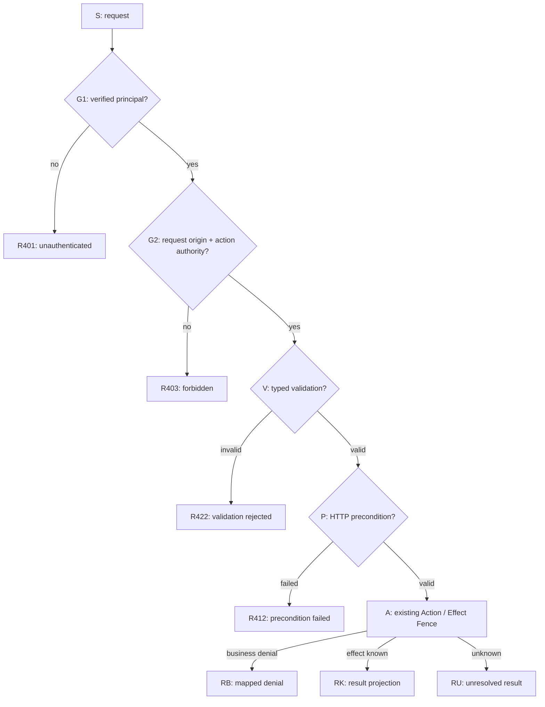

# HTTP Response Decision Graph：Server/Client例外契約とGraph/Table/Traceの相互検証（設計候補）

- **状態**：2026-11-07の横断設計候補。仕様採用・TEI標準Graphでの保存・実HTTP/GUI/実ProviderでのE2Eは **NOT RUN / NOT ACCEPTED**。
- **受入票**：[Issue #3274](https://github.com/hat47x/tei-platform/issues/3274)。この文書は複数Issueの接続と検証計画であり、新規Core ABI、第二Driver、第二Web Host/Authority、HTTP専用Workflow Engineの正本ではない。
- **前提**：[Web構成 #1043](WEB_APPLICATION_COMPOSITION_DESIGN.md)、[標準Web API #1656](WEB_READ_WRITE_API_ADAPTER_DESIGN.md)、[#1158 UI Adapter](https://github.com/hat47x/tei-platform/issues/1158)、[#1174 Effect Fence](https://github.com/hat47x/tei-platform/issues/1174)、[#2620 Everything is Data](https://github.com/hat47x/tei-platform/issues/2620)、[#2497 Projection](https://github.com/hat47x/tei-platform/issues/2497)、[#3262 Design Context Query](https://github.com/hat47x/tei-platform/issues/3262)、[#1180 Scenario](https://github.com/hat47x/tei-platform/issues/1180)。

## 1. 問題・価値・基準

OpenAPIはHTTPステータス・Media Type・Header・Schemaを表現できるが、業務上の拒否、効果の確定、通信断、再認証、再取得、再送可否までの**クライアント動作契約**を自動決定しない。Web/Desktopで共通Application Actionを呼ぶTEIでは、HTTP statusを業務結果の正本にすると、CLI・Wails IPC・非HTTP Consumerが不整合になる。

目指すのは、(a) ドメインの結果がTransportで変質しない、(b) Client Reactionを宣言し、書込み後の不明状態を自動再送しない、(c) 実用的なHTTP Decision FlowをTEIの標準データ構造でGraph/Table/Traceに投影し、欠落・保護迂回・誤投影をテストできること。

参考：Liberator（Clojure、Webmachineに着想）、WebmachineのDecision Flow / debugging。**参考実装の旧HTTP処理順を標準としてコピーせず**、RFC 9110、RFC 9457、適用するAPI profileとTEIの実契約で再判定する。

## 2. 境界と意味の最小分離

| 対象 | 持つ情報 | 関連Owner／禁止する短絡 |
| --- | --- | --- |
| Application Outcome | named Business Outcome、Validation、Business Denial | 既存Action/Capability。HTTP codeから推定しない |
| Execution / Effect Disposition | invoked / denied / error、known-not-applied / known-applied / unknown、partial | #1174等。受理=Commitではない |
| Operation / Evidence | operation identity、effect receipt、Host Grant、read-back、source/build/contract revision | #940/#1163/#1174。古いreceiptを現在の完了証明にしない |
| HTTP Response Projection | method/pathに応じたstatus、headers、media type、Problem Typeと公開可能なextension | #1656/#1043。第二の業務正本にしない |
| Client Reaction | display/field-focus、reauth、refresh/diff、reconcile、retry候補、operator escalation | #1158/#997/#1000。UIが認可や実効果を確定しない |
| Observation / Recovery | 独立した状態・Receiptの再取得と照合、保留、明示的補償 | #1174/#2597。無根拠なreplay/rollbackを行わない |
| Topology / Projection / Trace | graph identity、node/edge、条件、参照、差分、実行経路 | #2495/#2497/#1124/#2620。図=実行済み・受理済みとは言わない |

**特に区別すること**
- HTTP 202 Acceptedは要求受理を表すが、業務完了の証拠ではない。HTTP 2xx全体を「effect known applied」にしない。
- 送信前失敗は「送信前と観測できた場合」に限って効果不在を主張できる。Request送信後のTimeout・Connection reset・Proxy error・Malformed bodyは、writeの副作用について原則unknown（独立証拠が別にあれば再評価）。
- 既存のCommand Lifecycle（`dispatched / observed / unknown`）と`persistence / durability`は既存実装のまま尊重。ここで新しい共通enumに固定せず、候補の列で同一性・差を比較する。
- 業務拒否を、Actionで未宣言のOutcomeへ無断追加しない。Output-only Capabilityの拒否とExecution Errorの表現問題は#1174のOwnerへ戻す。
- OData Response/Errorの規格、GraphQL等のTransport独自エラーをRFC 9457で無条件に置換しない。採用profileと互換性は#1656で判定。

## 3. グラフは処理・提示・復旧を混同しない

同じAccepted Application Meaningに関連する **三つの別用途の部分グラフ**を扱う。
1. **Server Request/Response Decision Graph**：信頼済みRoute、必須Security Guard、Validation、条件付き要求、Application Actionの呼出し、response transform、short circuit、audit。
2. **Client Reaction Graph**：受信可能・不可、status/header/bodyの信頼できる解釈、操作契約・UI contextによる表示／再認証／再取得／状態照合。
3. **Recovery / Observation Graph**：OperationIDとReceiptの資格を調べ、独立した現在状態を確認。再送・補償は明示された許可・冪等性・現在の権限と必要な前提を別途満たす場合のみ。

これは同一巨大な「実行状態機械」へ統合する指示ではない。Server/Client/Recoveryで**時点と知識主体が異なる**。互いの境界を明示した参照エッジを持たせ、ContextやHTTP codeを共通中核型へ埋め込まない。

### 3.1 標準Graphの候補属性（新形式の採用ではない）

| 項目 | 意味上必要な性質 |
| --- | --- |
| Graph | ID、kind/role、Source refとfingerprint、Accepted/Provisional、version、適用scope |
| Node | stable ID（表示名と独立）、role（decision/action/handler/terminal等）、参照Function/Contract、入力/出力、effect、disclosure |
| Edge | stable ID、from/to、branch predicate、guard dependency、source span、priority/ambiguity rule（必要なときだけ） |
| Binding | 既存Action ID、typed Context、Operation identity、Guard proof / Provider contract、Target |
| Projection | Graph JSON / Table / Mermaid / StudioのTarget、保持した情報・欠落と逆書戻し可否 |
| Execution Trace | graph snapshot、実通過node/edge、request/responseの観測状態、受領完全性、runtime/provider revision、Evidence refs |

Graphの通常の有向辺、多重辺、同名Node、循環、分岐の排他性、別scopeの同名IDを明示する。ループは原則禁止ではなく、**当該Policyで許される有界retry/recovery**か、異常循環かを区別する。Graph/Traceはビジネス意味の受理根拠ではない。Node kindの一覧は表現例であり固定Core enum化しない。

### 3.2 例：order.submit のServer Graph（説明用。実装/受理された経路ではない）



上図は実コードの必須Guard順序を証明するものではなく、実Hostに対応するGuard Scope・依存証拠を#1043から照合するための候補。Authを通過しただけで業務実行のResource Grantを満たすとは言えない。未認証とResource非存在の判別方法はAPIのDisclosure policy次第で変わる。

| Node ID | 認知順 | 参照すべき既存契約 | 副作用 | 独立して検証する点 |
| --- | --- | --- | --- | --- |
| G1 | Principalの真正性 | #1043 verified principal | no | headerからの主体偽装拒否 |
| G2 | Origin/CSRF + Action認可 | #1043、実Security Capability | no | 全Action到達経路の必須Guard |
| V | typed payload検証 | #1158/#1656 | no | 不正JSON/NULL、Field mapping |
| P | resource/precondition version | #1174、HTTP ETag/If-Match profile | no | 412と409の誤一律化を防ぐ |
| A | Action + Effect Fence | #1174、existing Driver | **yes** | unknown/partialを成功扱いしない |
| RU | 不明状態の安全な公開 | #1656/#1178 | no | クライアント再送を誘発しない |

| Edge ID | From | To | 条件/照合事項 |
| --- | --- | --- | --- |
| E-01 | S | G1 | 信頼済みルーティング後 |
| E-02 | G1 | G2 | verified=true |
| E-03 | G1 | R401 | verified=false |
| E-04 | G2 | V | origin+authority valid |
| E-05 | G2 | R403 | 不成立（内部理由開示は別判定） |
| E-06 | V | P | typed input valid |
| E-07 | V | R422 | declarative validation failure |
| E-08 | P | A | precondition valid |
| E-09 | P | R412 | precondition false |
| E-10 | A | RU | effect disposition unknown |

**同じIDの参照解決と実配置の一意性は別問題**。Graph→Table→Mermaidへの変換でE-01等のID・多重辺が消えるならlossy projectionであり、Mermaidを変更して自動逆写像してはならない。

## 4. Response Mapping と Client Reaction

RFC 9457の`type`をProblem Typeの一次識別とする。Title/Detailは人間用で、Clientが本文の文字列を解析して分岐しない。`status`と実HTTP statusの不整合、未知extension、レスポンスなしを正常Resultと扱わない。URI形式・Problem定義・情報公開はprofile単位で管理する。実APIへの採用は#1656で検証する。

| ケース | HTTP候補 | Client Reaction候補 | 実行効果・安全条件 |
| --- | --- | --- | --- |
| 構文不正 | 400 | 入力修正／拒否説明 | 原則Action前 |
| 型は妥当だが入力が業務制約に違反 | 422候補 | Field mappingで補正 | Action内業務拒否との区分を定義 |
| 未認証 | 401（WWW-Authenticate要件に注意） | 認証状態の確認・明示再認証 | 弱い方式への自動降格禁止 |
| 権限不足 | 403／情報非公開なら404候補 | 操作停止・可能な範囲で説明 | Resource存在を漏らさない |
| 一般競合 | 409 | 最新版取得・差分提示 | 競合解決なしに再実行しない |
| If-Match等の前提条件失敗 | 412 | ETag/Revisionの再取得 | 409へ機械的に丸めない |
| レート制限 | 429 | 読込みbackoff／書込みは効果照合 | Retry-Afterは単なるhint |
| 一時障害 | 503 | 状態提示／read retry候補／write照合 | 冪等性・Authority確認なしの再送禁止 |
| HTTP 202 | 202 | 進捗・結果照会（対応時） | Accepted ≠ Completed |
| write後のtimeout / 破損応答 / transport disconnect | **応答なし、あるいは信用できない応答** | operation照合、保留、manual escalation | Commit **unknown**、自動重複送信禁止 |
| Desktop local IPC | HTTPなし | 同じmeaning resultをIPC表現で受領 | HTTP 401等をCanonical Outcomeへ逆流させない |

Client Reactionの採択条件は、Problem Typeだけでなく**Action effect、Subject/Instance Anchor、UI dirty、base Revision、Principal/Grant、OperationID、Receipt/Observationの現在資格、Target transport、Disclosure**を含める。Reactive refreshで編集途中のDirty Patchを上書きせず、古い選択epochのResponseを現在の画面へ誤適用しない（#2597/#2582）。Webセッション切れとDesktop Host IPC切断を同一の再認証経路へ潰さない。

Problem Detailsの最小サンプル（設計例、**TEI正式Schemaではない**）：

```json
{
  "type": "https://example.invalid/problems/revision-conflict",
  "title": "Precondition Failed",
  "status": 412,
  "instance": "/problem-occurrences/request-123",
  "operationId": "op-123",
  "expectedRevision": "rev-10"
}
```

`example.invalid`は外部のProblem定義ではないため、実配備で使わない。Serverの内部stack、実Resource ID、禁止Field、検証用Holdout、Grantのtoken、テナント存在、履歴を一般クライアントへ露出しない。

## 5. CLI/MCP/Studioを同じ設計Contextから駆動する

既存CLIには`commands`・`model catalog`・`inspect`・`trace`・`validate`等があるが、**Decision Graphの読み込み・完全性照会・実行経路可視化が完成したとは主張しない**。

1. #3262 Design Context Queryで必要なSubject、Node/Edge、既存Function/Action、Guard、Scenario、Source/Revision、権限Scope、covered/required集合を漏れなく**scope相対で**取得する。取得未了／権限による秘匿を明示。
2. 標準Data Structure Graphから、read-onlyなGraph表示・Node/Edge表・Mermaidテキストを同じtyped refで導出。出力形態と欠落／不完全を記録。
3. その後にTest Authoring。#1180の保存済みScenarioを唯一の受入ルートにし、Test候補とAccepted Scenarioは区別。生成AIが追加テスト案を出す場合、独立Expectedを参照する。
4. Synthetic dry-run trace（設計上の想定経路）とactual HTTP trace（実通過の証拠）を別レコードで結ぶ。受信したGraph snapshot/fingerprint、Target build、Generator version、Provider Lock、Grant/Subject scope、request identity、Trace completenessを表示。実HTTP EvidenceをGraph上に重ねても業務Completionを自動確定しない。

Web/Desktop UIに先行して、AI/CUIがNode IDで参照し、Branchの説明／依存／変更Impact／反例を整形して取得できることをP-1とする。Schema未採用のCLIサブコマンド名を本書で作って実在機能と称さない。

## 6. 確認すべきConformance Matrix（現状すべて NOT RUN）

| ID | 最小独立Expected / mutation | 期待する検出 |
| --- | --- | --- |
| HDG-01 | typed Application Outcome → CLI/Web/Desktop | 意味同一、HTTPだけが状態の正本にならない |
| HDG-02 | Guard bypass edge / 逆接続 | Actionへ到達する経路のGuard欠落を構造的拒否 |
| HDG-03 | 409/412とIF-Match/ETag | 更新前提条件と一般競合の区別 |
| HDG-04 | 400/422不正Field、未知problem type、不一致status | 合法な拡張と契約違反、開示制限の峻別 |
| HDG-05 | Effect前/後で通信断 | Client unknown、二重再実行なし、Operation/Receipt照合 |
| HDG-06 | 202/partial/旧receipt | Accepted/部分効果/現在のObservationを区別 |
| HDG-07 | 429/503 Retry-After、Grant失効 | Retry hintが権限・安全な再送へ昇格しない |
| HDG-08 | 同名Node/多重辺、表・図→表 | ID/方向/多重性の保存、lossy逆編集拒否 |
| HDG-09 | Graph/Source/Build/Plugin revision変更 | semantic acceptance、build/trace/evidenceの失効を独立判定 |
| HDG-10 | 部分Graph取得、秘密ノード、MCP/Tool途中切断 | 完全性を偽装せず、許可外情報を返さない |
| HDG-11 | 遅延Response後にUI選択とdirtyが変化 | responseの誤配置、dirty上書き、旧epochの採用を拒否 |
| HDG-12 | Source等価・Provider異版でTraceだけ流用 | 実走行経路の証拠を旧Providerから借用しない |

Coverageの分母を **required node / edge / guard path / named outcome / client reaction / effect disposition / requirement / NFR**に分離し、C0/C1（コードの行/分岐）とグラフのbranch coverageを混同しない。未取得・unsupported・disabled・not-runをcoverage 100%へ暗黙で足さない。Known mutant（Guard bypass、unconditional replay、Receipt stale、対象Anchor混同等）に対する検出力を記録し、独立ExpectedとActualの循環参照を避ける。

## 7. 着手順・停止条件・決定を戻す場所

| 段階 | 最小証拠 | 成果を戻すOwner |
| --- | --- | --- |
| P-1 現行調査 | 実CLI/既存Graph/Host/Command Lifecycleから対象設計Contextの一覧・欠落・受領完全性 | #3262/#2620/#1158 |
| P0 Graph/Tableの同一性 | 保存Sourceを実Loaderが読んだ証拠、Node/Edge ID/属性/Relationの同一性、GraphとTableのDiff | #1124/#2497/#2620 |
| P1 合成Contract | 代表Read/Write各1件、Result→HTTP→Client Reactionの正/負例と独立Expected | #1656/#1158 |
| P2 実Go HTTP | route、Auth/CSRF/Origin、受信失敗、Operation/Receiptの独立照合 | #1043/#1174 |
| P3 Target横断 | 同一ScenarioからCLIとWeb（後続Desktop）を生成・実行。実Target分のTrace・Guard・UI/transport Evidence | #1180/#1163/#1824 |

**Go単一バイナリ／外部Host非依存**という既存方針を維持。Decision GraphがGo/Wailsそのものに依存したり、HTTPのためにTEI独自Hostを必須にしたりしない。局所的に効果があるgraph roleやOperatorはPluginとして提供し、組合せの適合性とテストは既存Plugin/Verified Composition BOMの枠へ戻す。

**実行を停止・未検証とする例**：必須Guard証拠・生のAuthority欠損、Unknown commit、Receiptの実操作不一致、別revision/GrantのTrace混合、Graphを実Loaderが読まずに見た目だけ描いた、Secret漏出の疑い、部分取得の欠落、独立Expectedなし、Target固有の証拠なし。明示的に scope を絞った局所検証は継続可能とし、局所PASSを全体の成立へ昇格させない。

## 8. 参考資料と採否

- [Liberator repository](https://github.com/clojure-liberator/liberator) ― ClojureのREST decision modelの先行例。ライブラリ移植ではない。
- [Webmachine mechanics](https://webmachine.github.io/mechanics.html)、[Decision flow](https://webmachine.github.io/diagram.html)、[Resource functions](https://webmachine.github.io/resources.html) ― decision flow・契約・処理に分離する参考資料（古いHTTP版があるため仕様の正本にはしない）。
- [RFC 9110: HTTP Semantics](https://www.rfc-editor.org/rfc/rfc9110.html) ― HTTPの安全性/冪等性/条件付き要求/自動retry制約。
- [RFC 9457: Problem Details for HTTP APIs](https://www.rfc-editor.org/rfc/rfc9457.html) ― HTTPエラー表現。response失敗時のアプリ状態とClient Reactionまでは規定しない。
- [OpenAPI specification](https://spec.openapis.org/oas/latest.html) ― HTTP interfaceの記述。TEIのClient Reaction・effect dispositionの正本として単独利用しない。

**採否の分岐**：既存標準Graphで必要なidentity/branch/guardを保持できれば追加Core Typeは不要。保持できなければ喪失箇所と小さな改善案を#2620/#2497へ返す。Graphと表・実Traceの結合が実Consumerで有用と確認できなければ専用のHTTP Graph UIを採用しない。P-1〜P3が揃うまで「実装済み」「受理済み」とは記載しない。
