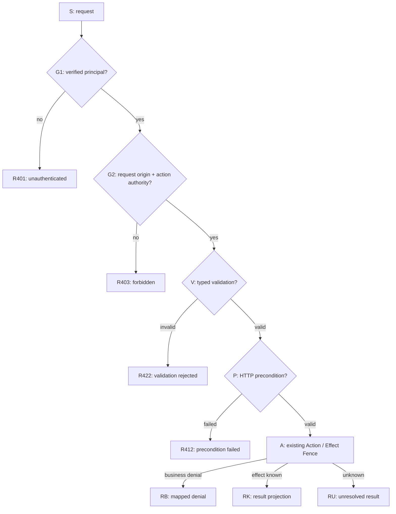
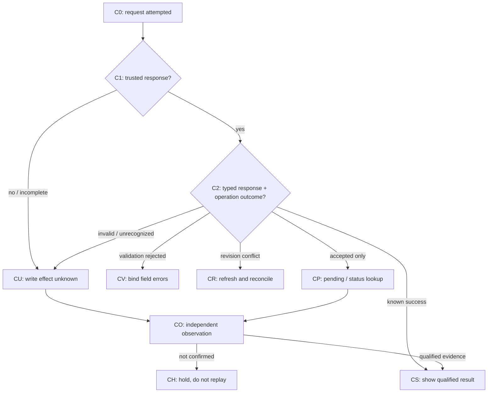

# HTTP Response Decision Graph：Server/Client例外契約とGraph/Table/Traceの相互検証（設計候補）

- **状態**：2026-11-07の横断設計候補。仕様採用・TEI標準Graphでの保存・実HTTP/GUI/実ProviderでのE2Eは **NOT RUN / NOT ACCEPTED**。
- **受入票**：[Issue #3274](https://github.com/hat47x/tei-platform/issues/3274)。この文書は複数Issueの接続と検証計画であり、新規Core ABI、第二Driver、第二Web Host/Authority、HTTP専用Workflow Engineの正本ではない。
- **前提**：[Web構成 #1043](WEB_APPLICATION_COMPOSITION_DESIGN.md)、[標準Web API #1656](WEB_READ_WRITE_API_ADAPTER_DESIGN.md)、[#1158 UI Adapter](https://github.com/hat47x/tei-platform/issues/1158)、[#1174 Effect Fence](https://github.com/hat47x/tei-platform/issues/1174)、[#2620 Everything is Data](https://github.com/hat47x/tei-platform/issues/2620)、[#2497 Projection](https://github.com/hat47x/tei-platform/issues/2497)、[#3262 Design Context Query](https://github.com/hat47x/tei-platform/issues/3262)、[#1180 Scenario](https://github.com/hat47x/tei-platform/issues/1180)。

## 1. 問題・価値・基準

OpenAPIはHTTPステータス・Media Type・Header・Schemaを表現できるが、業務上の拒否、効果の確定、通信断、再認証、再取得、再送可否までの**クライアント動作契約**を自動決定しない。Web/Desktopで共通Application Actionを呼ぶTEIでは、HTTP statusを業務結果の正本にすると、CLI・Wails IPC・非HTTP Consumerが不整合になる。

目指すのは、(a) ドメインの結果がTransportで変質しない、(b) Client Reactionを宣言し、書込み後の不明状態を自動再送しない、(c) 実用的なHTTP Decision FlowをTEIの標準データ構造でGraph/Table/Traceに投影し、欠落・保護迂回・誤投影をテストできること。

参考：Liberator（Clojure、Webmachineに着想）、WebmachineのDecision Flow / debugging。**参考実装の旧HTTP処理順を標準としてコピーせず**、RFC 9110、RFC 9457、適用するAPI profileとTEIの実契約で再判定する。

## 2. 境界と意味の最小分離

| 対象 | 持つ情報 | 関連Owner／禁止する短絡 |
| --- | --- | --- |
| Application Outcome | named Business Outcome、Validation、Business Denial | 既存Action/Capability。HTTP codeから推定しない |
| Execution / Effect Disposition | invoked / denied / error、known-not-applied / known-applied / unknown、partial | #1174等。受理=Commitではない |
| Operation / Evidence | operation identity、effect receipt、Host Grant、read-back、source/build/contract revision | #940/#1163/#1174。古いreceiptを現在の完了証明にしない |
| HTTP Response Projection | method/pathに応じたstatus、headers、media type、Problem Typeと公開可能なextension | #1656/#1043。第二の業務正本にしない |
| Client Reaction | display/field-focus、reauth、refresh/diff、reconcile、retry候補、operator escalation | #1158/#997/#1000。UIが認可や実効果を確定しない |
| Observation / Recovery | 独立した状態・Receiptの再取得と照合、保留、明示的補償 | #1174/#2597。無根拠なreplay/rollbackを行わない |
| Topology / Projection / Trace | graph identity、node/edge、条件、参照、差分、実行経路 | #2495/#2497/#1124/#2620。図=実行済み・受理済みとは言わない |

**特に区別すること**
- HTTP 202 Acceptedは要求受理を表すが、業務完了の証拠ではない。HTTP 2xx全体を「effect known applied」にしない。
- 送信前失敗は「送信前と観測できた場合」に限って効果不在を主張できる。Request送信後のTimeout・Connection reset・Proxy error・Malformed bodyは、writeの副作用について原則unknown（独立証拠が別にあれば再評価）。
- 既存のCommand Lifecycle（`dispatched / observed / unknown`）と`persistence / durability`は既存実装のまま尊重。ここで新しい共通enumに固定せず、候補の列で同一性・差を比較する。
- 業務拒否を、Actionで未宣言のOutcomeへ無断追加しない。Output-only Capabilityの拒否とExecution Errorの表現問題は#1174のOwnerへ戻す。
- OData Response/Errorの規格、GraphQL等のTransport独自エラーをRFC 9457で無条件に置換しない。採用profileと互換性は#1656で判定。

## 3. グラフは処理・提示・復旧を混同しない

同じAccepted Application Meaningに関連する **三つの別用途の部分グラフ**を扱う。
1. **Server Request/Response Decision Graph**：信頼済みRoute、必須Security Guard、Validation、条件付き要求、Application Actionの呼出し、response transform、short circuit、audit。
2. **Client Reaction Graph**：受信可能・不可、status/header/bodyの信頼できる解釈、操作契約・UI contextによる表示／再認証／再取得／状態照合。
3. **Recovery / Observation Graph**：OperationIDとReceiptの資格を調べ、独立した現在状態を確認。再送・補償は明示された許可・冪等性・現在の権限と必要な前提を別途満たす場合のみ。

これは同一巨大な「実行状態機械」へ統合する指示ではない。Server/Client/Recoveryで**時点と知識主体が異なる**。互いの境界を明示した参照エッジを持たせ、ContextやHTTP codeを共通中核型へ埋め込まない。

### 3.1 標準Graphの候補属性（新形式の採用ではない）

| 項目 | 意味上必要な性質 |
| --- | --- |
| Graph | ID、kind/role、Source refとfingerprint、Accepted/Provisional、version、適用scope |
| Node | stable ID（表示名と独立）、role（decision/action/handler/terminal等）、参照Function/Contract、入力/出力、effect、disclosure |
| Edge | stable ID、from/to、branch predicate、guard dependency、source span、priority/ambiguity rule（必要なときだけ） |
| Binding | 既存Action ID、typed Context、Operation identity、Guard proof / Provider contract、Target |
| Projection | Graph JSON / Table / Mermaid / StudioのTarget、保持した情報・欠落と逆書戻し可否 |
| Execution Trace | graph snapshot、実通過node/edge、request/responseの観測状態、受領完全性、runtime/provider revision、Evidence refs |

Graphの通常の有向辺、多重辺、同名Node、循環、分岐の排他性、別scopeの同名IDを明示する。ループは原則禁止ではなく、**当該Policyで許される有界retry/recovery**か、異常循環かを区別する。Graph/Traceはビジネス意味の受理根拠ではない。Node kindの一覧は表現例であり固定Core enum化しない。

### 3.2 例：order.submit のServer Graph（説明用。実装/受理された経路ではない）



上図は実コードの必須Guard順序を証明するものではなく、実Hostに対応するGuard Scope・依存証拠を#1043から照合するための候補。Authを通過しただけで業務実行のResource Grantを満たすとは言えない。未認証とResource非存在の判別方法はAPIのDisclosure policy次第で変わる。

| Node ID | 認知順 | 参照すべき既存契約 | 副作用 | 独立して検証する点 |
| --- | --- | --- | --- | --- |
| G1 | Principalの真正性 | #1043 verified principal | no | headerからの主体偽装拒否 |
| G2 | Origin/CSRF + Action認可 | #1043、実Security Capability | no | 全Action到達経路の必須Guard |
| V | typed payload検証 | #1158/#1656 | no | 不正JSON/NULL、Field mapping |
| P | resource/precondition version | #1174、HTTP ETag/If-Match profile | no | 412と409の誤一律化を防ぐ |
| A | Action + Effect Fence | #1174、existing Driver | **yes** | unknown/partialを成功扱いしない |
| RU | 不明状態の安全な公開 | #1656/#1178 | no | クライアント再送を誘発しない |

| Edge ID | From | To | 条件/照合事項 |
| --- | --- | --- | --- |
| E-01 | S | G1 | 信頼済みルーティング後 |
| E-02 | G1 | G2 | verified=true |
| E-03 | G1 | R401 | verified=false |
| E-04 | G2 | V | origin+authority valid |
| E-05 | G2 | R403 | 不成立（内部理由開示は別判定） |
| E-06 | V | P | typed input valid |
| E-07 | V | R422 | declarative validation failure |
| E-08 | P | A | precondition valid |
| E-09 | P | R412 | precondition false |
| E-10 | A | RU | effect disposition unknown |

**同じIDの参照解決と実配置の一意性は別問題**。Graph→Table→Mermaidへの変換でE-01等のID・多重辺が消えるならlossy projectionであり、Mermaidを変更して自動逆写像してはならない。

## 4. Response Mapping と Client Reaction

RFC 9457の`type`をProblem Typeの一次識別とする。Title/Detailは人間用で、Clientが本文の文字列を解析して分岐しない。`status`と実HTTP statusの不整合、未知extension、レスポンスなしを正常Resultと扱わない。URI形式・Problem定義・情報公開はprofile単位で管理する。実APIへの採用は#1656で検証する。

| ケース | HTTP候補 | Client Reaction候補 | 実行効果・安全条件 |
| --- | --- | --- | --- |
| 構文不正 | 400 | 入力修正／拒否説明 | 原則Action前 |
| 型は妥当だが入力が業務制約に違反 | 422候補 | Field mappingで補正 | Action内業務拒否との区分を定義 |
| 未認証 | 401（WWW-Authenticate要件に注意） | 認証状態の確認・明示再認証 | 弱い方式への自動降格禁止 |
| 権限不足 | 403／情報非公開なら404候補 | 操作停止・可能な範囲で説明 | Resource存在を漏らさない |
| 一般競合 | 409 | 最新版取得・差分提示 | 競合解決なしに再実行しない |
| If-Match等の前提条件失敗 | 412 | ETag/Revisionの再取得 | 409へ機械的に丸めない |
| レート制限 | 429 | 読込みbackoff／書込みは効果照合 | Retry-Afterは単なるhint |
| 一時障害 | 503 | 状態提示／read retry候補／write照合 | 冪等性・Authority確認なしの再送禁止 |
| HTTP 202 | 202 | 進捗・結果照会（対応時） | Accepted ≠ Completed |
| write後のtimeout / 破損応答 / transport disconnect | **応答なし、あるいは信用できない応答** | operation照合、保留、manual escalation | Commit **unknown**、自動重複送信禁止 |
| Desktop local IPC | HTTPなし | 同じmeaning resultをIPC表現で受領 | HTTP 401等をCanonical Outcomeへ逆流させない |

Client Reactionの採択条件は、Problem Typeだけでなく**Action effect、Subject/Instance Anchor、UI dirty、base Revision、Principal/Grant、OperationID、Receipt/Observationの現在資格、Target transport、Disclosure**を含める。Reactive refreshで編集途中のDirty Patchを上書きせず、古い選択epochのResponseを現在の画面へ誤適用しない（#2597/#2582）。Webセッション切れとDesktop Host IPC切断を同一の再認証経路へ潰さない。

Problem Detailsの最小サンプル（設計例、**TEI正式Schemaではない**）：

```json
{
  "type": "https://example.invalid/problems/revision-conflict",
  "title": "Precondition Failed",
  "status": 412,
  "instance": "/problem-occurrences/request-123",
  "operationId": "op-123",
  "expectedRevision": "rev-10"
}
```

`example.invalid`は外部のProblem定義ではないため、実配備で使わない。Serverの内部stack、実Resource ID、禁止Field、検証用Holdout、Grantのtoken、テナント存在、履歴を一般クライアントへ露出しない。

### 4.1 Client Graph：実行結果の認知状態で分岐する（説明用）



Client GraphはResponse codeごとの一律switch文ではない。例えば`C1 → CU`は、**書込みを送信した可能性がある**ときの経路であり、安全と証明されたread-only Requestとは別のRetry Policyを参照する。証拠が不明なら`CO`が成功とも不成功とも推定しない。Client Graphの実装は、Webの画面・CLIの終了コード・Desktop IPCのUI処理へそれぞれ投影する。

| Edge identity | 分岐 | 評価に必要なデータ／不正な推論 |
| --- | --- | --- |
| C-E01 | C1 → CU | write-dispatched可能性、OperationID。HTTPなし＝副作用なし、としない |
| C-E02 | C2 → CR | typed revision/ETag、未保存差分。旧結果を新選択へ適用しない |
| C-E03 | C2 → CP | accepted-but-not-completed。202をCommit Receiptにしない |
| C-E04 | CO → CS | 実Operationに束縛された現在資格の独立Observation。単なる過去Receiptでは不可 |
| C-E05 | CO → CH | 未観測、Denied、stale、不一致。無条件replayを禁止 |

ServerとClientのGraph間を結ぶのは、**宣言されたResponse Projection/typed Resultの参照関係**であり、一方のEdge IDをもう一方へ流用しない。Traceには「どこまで実観測できたか」を付け、ブラウザ外／Proxy上の障害やクライアント未受領をserver-sideの応答生成ログだけで否定しない。

## 5. CLI/MCP/Studioを同じ設計Contextから駆動する

既存CLIには`commands`・`model catalog`・`inspect`・`trace`・`validate`等があるが、**Decision Graphの読み込み・完全性照会・実行経路可視化が完成したとは主張しない**。

1. #3262 Design Context Queryで必要なSubject、Node/Edge、既存Function/Action、Guard、Scenario、Source/Revision、権限Scope、covered/required集合を漏れなく**scope相対で**取得する。取得未了／権限による秘匿を明示。
2. 標準Data Structure Graphから、read-onlyなGraph表示・Node/Edge表・Mermaidテキストを同じtyped refで導出。出力形態と欠落／不完全を記録。
3. その後にTest Authoring。#1180の保存済みScenarioを唯一の受入ルートにし、Test候補とAccepted Scenarioは区別。生成AIが追加テスト案を出す場合、独立Expectedを参照する。
4. Synthetic dry-run trace（設計上の想定経路）とactual HTTP trace（実通過の証拠）を別レコードで結ぶ。受信したGraph snapshot/fingerprint、Target build、Generator version、Provider Lock、Grant/Subject scope、request identity、Trace completenessを表示。実HTTP EvidenceをGraph上に重ねても業務Completionを自動確定しない。

Web/Desktop UIに先行して、AI/CUIがNode IDで参照し、Branchの説明／依存／変更Impact／反例を整形して取得できることをP-1とする。Schema未採用のCLIサブコマンド名を本書で作って実在機能と称さない。

## 6. 確認すべきConformance Matrix（現状すべて NOT RUN）

| ID | 最小独立Expected / mutation | 期待する検出 |
| --- | --- | --- |
| HDG-01 | typed Application Outcome → CLI/Web/Desktop | 意味同一、HTTPだけが状態の正本にならない |
| HDG-02 | Guard bypass edge / 逆接続 | Actionへ到達する経路のGuard欠落を構造的拒否 |
| HDG-03 | 409/412とIF-Match/ETag | 更新前提条件と一般競合の区別 |
| HDG-04 | 400/422不正Field、未知problem type、不一致status | 合法な拡張と契約違反、開示制限の峻別 |
| HDG-05 | Effect前/後で通信断 | Client unknown、二重再実行なし、Operation/Receipt照合 |
| HDG-06 | 202/partial/旧receipt | Accepted/部分効果/現在のObservationを区別 |
| HDG-07 | 429/503 Retry-After、Grant失効 | Retry hintが権限・安全な再送へ昇格しない |
| HDG-08 | 同名Node/多重辺、表・図→表 | ID/方向/多重性の保存、lossy逆編集拒否 |
| HDG-09 | Graph/Source/Build/Plugin revision変更 | semantic acceptance、build/trace/evidenceの失効を独立判定 |
| HDG-10 | 部分Graph取得、秘密ノード、MCP/Tool途中切断 | 完全性を偽装せず、許可外情報を返さない |
| HDG-11 | 遅延Response後にUI選択とdirtyが変化 | responseの誤配置、dirty上書き、旧epochの採用を拒否 |
| HDG-12 | Source等価・Provider異版でTraceだけ流用 | 実走行経路の証拠を旧Providerから借用しない |

Coverageの分母を **required node / edge / guard path / named outcome / client reaction / effect disposition / requirement / NFR**に分離し、C0/C1（コードの行/分岐）とグラフのbranch coverageを混同しない。未取得・unsupported・disabled・not-runをcoverage 100%へ暗黙で足さない。Known mutant（Guard bypass、unconditional replay、Receipt stale、対象Anchor混同等）に対する検出力を記録し、独立ExpectedとActualの循環参照を避ける。

## 7. 着手順・停止条件・決定を戻す場所

| 段階 | 最小証拠 | 成果を戻すOwner |
| --- | --- | --- |
| P-1 現行調査 | 実CLI/既存Graph/Host/Command Lifecycleから対象設計Contextの一覧・欠落・受領完全性 | #3262/#2620/#1158 |
| P0 Graph/Tableの同一性 | 保存Sourceを実Loaderが読んだ証拠、Node/Edge ID/属性/Relationの同一性、GraphとTableのDiff | #1124/#2497/#2620 |
| P1 合成Contract | 代表Read/Write各1件、Result→HTTP→Client Reactionの正/負例と独立Expected | #1656/#1158 |
| P2 実Go HTTP | route、Auth/CSRF/Origin、受信失敗、Operation/Receiptの独立照合 | #1043/#1174 |
| P3 Target横断 | 同一ScenarioからCLIとWeb（後続Desktop）を生成・実行。実Target分のTrace・Guard・UI/transport Evidence | #1180/#1163/#1824 |

**Go単一バイナリ／外部Host非依存**という既存方針を維持。Decision GraphがGo/Wailsそのものに依存したり、HTTPのためにTEI独自Hostを必須にしたりしない。局所的に効果があるgraph roleやOperatorはPluginとして提供し、組合せの適合性とテストは既存Plugin/Verified Composition BOMの枠へ戻す。

**実行を停止・未検証とする例**：必須Guard証拠・生のAuthority欠損、Unknown commit、Receiptの実操作不一致、別revision/GrantのTrace混合、Graphを実Loaderが読まずに見た目だけ描いた、Secret漏出の疑い、部分取得の欠落、独立Expectedなし、Target固有の証拠なし。明示的に scope を絞った局所検証は継続可能とし、局所PASSを全体の成立へ昇格させない。

## 8. 2026-11-07 P-1a：現行コードに対するread-only Gap監査（**実コード読取のみ**）

この監査は[現状資料](../../docs/status.md)・該当Sourceを同じ`main`から照合したもので、テストや新Parserの実行ではない。特に「構成Graph」は「HTTPリクエストの分岐実行Graph」と同じではない。

| 実在箇所（観測したGit Blob） | 読み取れた事実 | 今回の要求に不足する部分／次のOwner |
| --- | --- | --- |
| `reference/web-composition/plan-check.mjs` (`cadfe94900fae4a7adc4fe99ddd27d27e087b5ea`) | `composeRequestPlan`は契約`requires`で必須GuardのActionへの因果的な祖先関係を検査。ルート分類、ステップID、Provider競合、依存DAG、順序の循環を検査する | **これは構成時のDAG**。実HTTPのYes/No/short-circuitをたどるDecision Graphではない。Terminalイベントは`onTerminal`の全集合の存在確認で、各Terminal経路が監査を通ることの証拠ではない。#1043 |
| `reference/web-composition/go-host/host.go` (`407aadbb87fdee4f59f96cf2d2b2f8115ed31281`) | Session verifierとContext markerが合成Host側境界にある。Contextの現在資格を説明する仕組みがある | 実IdP/Browser/Proxyの安全性や、分岐Graph上でのRuntime Guard通過とClient受領は、この静的読取だけでは確定しない。#1043 |
| `reference/web-api-contract/README.md` (`af7a96edbdab04f2f93a56d39fbff2fa6d14f2ad`) | Read/Command Binding、実Driver Resolverと合成認可・Scoped Providerへの接続が分かれている | RFC 9457 Response Mapの正式採用・Actual HTTP Handler／Client Reaction／Effect recoveryは未成立とのREADME記述。#1656 |
| `docs/status.md` (`ab349b8ea778adb550be4600c17c99de21821fc4`) | Command `dispatched/observed/unknown`、`persistence=not-applicable/not-observed/receipt-observed/resource-observed`、実PostgreSQLでの一部receipt/read試験を記載 | HTTP 2xx／HostによるCommit呼出し／Receipt確認／独立Resource確認の4者を一つの「成功」に統合できない。#1174/#2999 |
| 本文のGraph/Table例 | 保存可能なID・Edge・Branchに必要な属性を定義した | **TEI実Loaderが保存した受理Sourceを消費した証拠がない**。構想上のMermaidを実TEI Graphとしてカウントしない。#2620/#2497/#3262 |

**静的に発見した限定Gap（新規テストは未実施）**：`composeRequestPlan`は`terminalEvents`をStepから集めて集合包含で検査するが、「`rejected`に到達する**すべての実行経路**で実際にAudit/Recoveryが発火するか」は判定していない。構成の必須証拠とRuntime Path Coverageを分離する必要がある。現在の実コードに脆弱性が実在すると断定するものではない。

P-1bの第一歩として、[HDG-21 characterization test](../../reference/web-composition/plan-check.terminal-gap.test.mjs)を追加した。①Guard依存DAGが成立する一方、②terminal宣言だけを持ちActionの因果祖先にならないStepを置いた場合、③現行E1構成器は宣言済Terminal集合を受理する。独立した`requires`祖先探索では`invoke`へのAudit前提がないことを確認する。実HostがTerminal eventを別方式で必ず監査する可能性は残るため、この局所GapをRuntime脆弱性と呼ばない。

**限定実行Evidence（2026-11-07）**：GitHub取得Blob `plan-check.mjs=cadfe94900fae4a7adc4fe99ddd27d27e087b5ea`、`plan-check.terminal-gap.test.mjs=e2fd7f571783f64332649dfb275c28e6e803aff2`をV8上で直接評価し、2件PASS/0 FAIL。Nodeの`node --test`、実Host分岐、Goテスト、実Provider・実Clientは**NOT RUN**。このPASSは**現在の静的Plannerの成立範囲を表すCharacterization**に限り、Audit Coverage適合のPASSではない。

## 9. Failureを三つの直交軸で表す：知っていること・運ぶこと・できること

Serverの応答生成に成功してもClient受信に成功したとは限らず、Clientが2xxを受信しても業務上の結果は確定しない。このため以下を**既存Result/Receiptの読み取り専用な投影**として比較する。

| 軸 | 区別する状態の例 | 独立に必要な証拠 |
| --- | --- | --- |
| **Effectの確定性** | 実行前の拒否が確定／効果が確認された／部分適用／未確定・不明 | Effect Fence・Operation identity・Receipt・資源再読取、同じResource/Versionの条件 |
| **Transportの受領性** | 応答未生成／Host生成／送出試行／Client全体受領／Parser解釈失敗 | HostとClient双方のtrace、payload framing/headers、response bodyの完全受領 |
| **Client現在資格** | Context最新／選択epoch・baseRevision不一致／Grant失効／Actionの再試行資格不明 | Instance anchor、dirty set、current policy/grant、Retry contract、現在のContext |

この三軸は単純な大小関係ではない。たとえば`Receipt observed`は当該操作の結果に関する証拠であり、`Resource observed`はある時点の資源状態の証拠である。両者は異なる観測対象を持つため、無条件の全順序や、`status=success`への収束を禁じる。

**再送の決定**：呼出し側・HTTP Client・Proxy・Service Worker・Runtimeの再試行動作をすべて射程に入れ、単なる`Retry-After`や`Idempotency-Key`の存在を安全な自動再送の証明としない。RFC 9110 §9.2.2の非冪等メソッドの制約が基線。実業務のEffect Contract、同一Operationの重複抑制範囲、現在Authorization、payload指紋、Provider側確定・結果照会の可用性を確認する。POSTでも明示的に冪等な業務契約がある場合は再試行可能性を検証してよいが、**未知Commitの自動再送は既定禁止**。安全な再照会は業務Actionの再実行とは区別する。

### 9.1 例外の優先順位と秘密情報の非干渉

同一Requestに不正JSON・禁止Resource・Revision不一致・無効Sessionが同時に存在する場合、どの情報が外部へ見えるかは単なるStatus優先順位表からは導けない。Context検証・認証／対象開示・Action認可・Validation等の**順序と短絡**を、Hostごとの信頼境界と開示Policyで確定させる。未認証のCallerにSecret Field名・存在・Count・ETag・Transaction情報を返さない。

二つのWorldでPublic情報が一致しPrivate対象が異なる場合、Clientへ出るProblem Type、Detail、Headers、Trace、Graph TableのID/Count、Timingによる観測差を限定比較する。Timingの完全な非干渉は難しいため、初期は意図しない明白な差異を検出する負例とし、本番の情報漏洩不存在を主張しない。

## 10. Trait義務・標準Plugin・検証済みBOMへの引渡し（候補）

他の設計で検討中の**Traitを原子的な実装・検証契約**として扱う発想を、HTTP Graphにも適用できるか比較する。Traitの正式なDefinition/Intent/Observation/AssessmentのOwnerは既存の[Draft #3027](https://github.com/hat47x/tei-platform/pull/3027)等であり、本書で第二Trait体系を作らない。

| Trait相当の義務（**識別子は例示**） | 具体的なFulfillment | 必須のConformance |
| --- | --- | --- |
| GuardEvidence | 既存`security.authorize`等の既定/独自実装、実Guard witness | 全Action到達経路の因果Guard；宣言だけのGuardは拒否 |
| TerminalCoverage | Serverが各実行経路でAudit・Responseを行う | short-circuit、内部Failure、Client切断、Response headers送出後の失敗を区別 |
| TypedResponseProjection | Application Result → HTTP status/body/Problem Type | JSON schema、HTTP semantics、redaction、未宣言Outcome拒否 |
| ClientReactionPolicy | typed Result＋Action効果＋受領資格 → 対応動作 | 書込みunknown時の再送防止、dirty/epoch保護 |
| EffectReconciliation | Operation identity / Receipt / Resource観測 | Provider固有のObservation保証、Grant現在資格、部分成功 |
| TraceEmission | Graph Node/Edge、Operation、Build/Plugin Lockに束縛したtrace | 観測された経路とExpected/モデル上の経路を混同せず開示制限 |

この表は**義務と実装が一対一である必要を意味しない**。Traitは`Definition → Binding → Fulfillment（Generated / Provided / Manual / External）→ Evidence`を分け、手動実装でも実装義務とテストを省略しない。Providerが対応宣言しただけでは実行保証としない。

**Dogfoodingの順序**：CLI/Studio開発環境のHTTP/IPC Error Adapterを標準Plugin構成候補として利用し、同じTraitとScenarioを生成アプリTargetへ適用。Host-specificの認証・Origin・Cookie責務やLocal IPC障害はAdapterに保持する。新しいHTTP Response Registry、全Client共通Framework、Universal Hostを生やさない。

**BOMへの引渡し**（#3267/#951/#1251）：`Client Reaction Provider × HTTP Response Provider × Host Guard Provider × Effect Provider × Target/version`という**exact組合せ**に対してBuild/Artifact/Runtime Conformanceの実際の範囲を記録する。2×2の最初の行列には、`Problem Typeを追加したが旧Clientが未知typeを安全に扱う`、`Host Guard更新で必須経路が途切れない`を含める。型だけの互換性やSchemaのハッシュ一致では、Effect/安全性の互換性は宣言できない。未選択Plugin追加時にRuntime Buildが変化しないかも比較する。

## 11. RFC／Transportの細部とGraphに追加する反証

**RFC 9457の厳密化**：`type`は一次識別子、欠落時は`about:blank`。未知Problem TypeはProtocolエラーと決めつけず、既知の安全な一般処理へ落とす。**未知extensionは無視すること**が規格上の原則であり、未知extensionがあるだけでレスポンスを拒否しない。既知拡張の型が間違っていれば、それに依存するReactionを実行せず安全な処理へ落とす。`status`はadvisoryで、Origin generatorはHTTP Responseと一致させる義務があるが、中継で書換えられたケースでは両者が不一致になる。クライアントは不一致を診断し、業務効果や再送資格をどちらからも推定しない。出典：[RFC 9457 §3](https://www.rfc-editor.org/rfc/rfc9457.html)。

| 圧力ケース | Expectedに含める区別 | 既存Owner |
| --- | --- | --- |
| HDG-13 | `type`省略＝`about:blank`、未知extensionはignore、未知typeの一般安全処理 | #1656 |
| HDG-14 | actual HTTP statusとProblemの`status`不一致、Proxyのstatus書換え | #1656/#1043 |
| HDG-15 | `401`のWWW-Authenticate、`403/404`の情報開示差、`428`前提条件要求 | #1043/#1656 |
| HDG-16 | `204/304/HEAD`のbody非依存、cache/ETagの鮮度、Response statusと業務状態の混同 | #1656/#2582 |
| HDG-17 | Body/Streaming途中切断、headers送信後の失敗、Client断のServer実行継続 | #1043/#1174 |
| HDG-18 | HTTP client, proxy, service workerの再試行とIdempotency契約の不一致 | #1174/#1145 |
| HDG-19 | 2 WorldのPrivate情報差がError body/header/trace/Graphへ漏れる | #2516/#1178/#1043 |
| HDG-20 | Target別OpenTelemetry traceのstatus意味とBusiness Outcomeを混同 | #1163/#2845 |
| HDG-21 | あるTerminalの`onTerminal`を未到達Stepに付与しても総集合だけ成立する | #1043/#3274 |
| HDG-22 | Provider A/B更新・BOM 2×2でClient Reactionが変質、未知typeで無根拠retry | #3267/#1158 |

`428`は全APIへの義務ではなく、HTTP前提条件を要求するprofileの一候補。`304`は再利用可能な既存Representationの鮮度判定に依存するため、単独の成功業務Payloadとして解釈しない。`204`やHEADのbodyなしは通常のProtocol経路であり、Problem Detailsがないだけでエラーにしない。

**TelemetryとEvidence**：OpenTelemetry HTTP Semantic ConventionsはHTTP Serverの4xxを常にSpan Errorへ写すものではなく、HTTP Client/Serverの文脈差もある。したがってSpan Status→Business Denial/Effect dispositionを逆推定しない。保存するtraceの`http.route`は高Cardinalityの生URIを避け、Secret/個人情報を必要範囲外へ出さない（[OTel HTTP Spans](https://opentelemetry.io/docs/specs/semconv/http/http-spans/)）。Graph/TraceのSource identityとRun identityは別参照とする。

## 12. 独立Expectedの固定と次の一手（Issue #3274）

既存HDG-01～12と追加HDG-13～22は**要求候補**で、実テストの合格ではない。最初の実行可能な対照は、`reference/web-composition/plan-check.mjs`の**構成DAG**と実HTTP **Decision path**の違いを明示する`HDG-21`を優先する。

1. **P-1b（限定V8 Characterizationを追加）**：現行`plan-check.mjs`でGuard因果関係とTerminalイベント集合を分離する2ケースを実評価。次はリポジトリ実ファイルを`node --test reference/web-composition/plan-check.terminal-gap.test.mjs`で走らせ、同一HEADのRunner exitと限定Evidenceを記録する。疑義を実Runtimeの監査迂回と断定しない。
2. **P0**：必須Guard・Terminal Auditについて、実分岐の経路が観測できる場合だけPath Coverageを判定。未知・未ロードのBranchを見なかったことにしない。対象が構成DAGのままなら「経路の静的検査はできない」という明示Resultを返す。
3. **P0/P1並行**：HTTP Client/Server/Recoveryの三つのGraphに、責務・Version・開示・Effect stateを含むread-only Diagram/Tableを同じModelから投影。現行Loaderに不存在ならまずそのGapを確定し、別のGraph専用正本を作らない。
4. **P1**：成功・Validation・競合・Unknown Effectの4系統から`typed Result → Transport Mapping → Client Reaction`の最小Contractケースを選ぶ。Problem Detailsの拡張互換を独立Expectedで評価。
5. **P2/P3**：同じOperation・同じPlugin/BOM・同じGraph Revisionの実Go HTTP/Studio IPCとRecovery Observationを比較。Sourceが同じでもBuilder/Providerの違うtraceや、受領できなかったTool結果をPASSの根拠に混ぜない。

**受入の反証条件**：独立ExpectedをActualから作った／Loader未消費の図をCanonicalと称した／短絡TerminalからAuditまでの証拠が途切れた／有効な旧Clientの未知extensionを不正として拒否した／unknown commitをRetry-Afterで再実行した／別TargetのGrantや旧Receiptを現在へ使い回した、のいずれかが検出されたら該当資格は不成立。最小作業単位で修正し、合成Fixture PASS、実Host Path PASS、実Provider Effect PASS、Owner正式受理を別に記録する。

## 13. 2026-11-07 後続横断：設計Contextの実Consumer、Graph受領資格、回復・Plugin版の合成

前段で「Design Context Queryは未実装」と表現していた箇所は、**製品の完全な共通Queryが未実装**という意味に限定する。現在、[#3262](https://github.com/hat47x/tei-platform/issues/3262)には[merged #3284](https://github.com/hat47x/tei-platform/pull/3284)および[merged #3296](https://github.com/hat47x/tei-platform/pull/3296)の既存CLI応答を入力にした**試験用read-only Context Consumer**がある。#3296の専用CIに16件のsynthetic／transport負例が記録されている。ただし、Graphの全Node/Edge・Business Rule・依存Sourceの必要閉包を資格化したものではない。局所Go C0やT0/T0.5の合格を「Graph実Loaderが意味を受け取った」とは扱わない。

**設計書の出力が存在することと、Consumerに必要な関係が渡り切ったことは別である。** 今回のHTTP Graphに関しては、最低でも次の**異なるID・証拠**を分離する。

| 別個の識別と証拠 | 必須の確認／失ってはならないこと |
| --- | --- |
| Semantic Node/Relation occurrence | 元Sourceのstable ref、役割、Source revision、必要な重複と向き。同じ表示ラベルの別Nodeは別 |
| Graph edge / branch instance | 多重辺のEdge ID、from/to、Branch条件、Evaluation context。表・Mermaidの描画用IDを元Relation IDへ逆流させない |
| Response / Client Reaction binding | Action/Outcomeの型付きref、Problem typeとHandler版、クライアントのInstance anchor・Selection epoch |
| Actual execution path | 実際のHost／Target／Plugin artifactとRun/Operation ID、同一Attemptの通過Edgeと受領状態 |
| Qualification/Disclosure | Required vs discovered/loaded/parsed/bound/returned、Tool complete/end marker、Policy/Grant revision、現在の開示可能範囲 |

この区別は、#2497の「構造の非単射なProjectionから原Sourceへ書き戻せない」、#1124の「古い応答の適用拒否と**既表示**の開示失効は別」、#3262の「CLI応答の個数や`ok:true`は必要Source閉包を証明しない」という反例に基づく。Graph v4等の関連ConsumerでEdge表現が改善されていても、**実TEI Loader→現行Graph→実Consumer受領**がこのHTTP案件で成立したとはまだ主張しない。各Consumerの実Source/Graph版と結果を個別に資格化する。

### 13.1 Client Reactionの二段階判定：理解できることと、今できること

1. **Response interpretation**：Transportで全Responseが受領されたか、Media Type・Envelopeが適格か、既知のProblem Typeまたは安全な未知Type処理へ分類できるか。ここでは業務効果の現在値や再実行許可を推論しない。
2. **Reaction qualification**：同じOperationに属するEffect disposition、Receiptと独立Read、現在のSubject/Target/Grant、User Action/Dirty Patch/Instance epoch、Provider実装のConformanceを照合し、表示・再認証・再取得・結果照合・明示再試行の可否を決める。

例えば`401`が到着しても、直前の**write**要求がすでに適用されたか分からなければ、再認証後に**同じ注文を自動POSTしない**。先に同Operationの結果を照合する。更新競合後の再取得も、別Instanceへの旧Response上書きやdirty消失を引き起こさない。

[#1174](https://github.com/hat47x/tei-platform/issues/1174)では [merged #2853](https://github.com/hat47x/tei-platform/pull/2853) により、**特定の**`CommitUncertainError`が`COMMAND_COMMIT_UNCERTAIN`へ伝播する現実装の限定修正がある。したがって「CommandがすべてUnknownをExecution Errorへ丸める」は現在の事実ではない。一方、**すべてのProvider／HTTP切断でUnknown伝播・再照合が成立した**という主張もできない。現行Command `dispatched / observed / unknown`、`persistence`の区分をそのまま受け渡すのが先で、Graph内に第二Lifecycleを実装しない。

### 13.2 Trait/BOM：実装契約と現在の資格を別々に検査

[#3279](https://github.com/hat47x/tei-platform/issues/3279)と[#3278](https://github.com/hat47x/tei-platform/issues/3278)のAtomic Trait案を引用し、`TerminalCoverage`、`TypedResponseProjection`、`ClientReactionPolicy`、`EffectReconciliation`を**原子的な義務候補**として比較する。義務を満たす実装がGenerated/Manual/Providedのどれであっても、同一Conformanceに通る必要がある。単なる`retryable`ラベル、Provider宣言、BOMの型整合を現在のEffect/Grant保証へ昇格させない。

[#3267](https://github.com/hat47x/tei-platform/issues/3267)の2×2版行列を借用し、例えば`Client V1/V2 × HTTP Response Provider A/B`で未知のProblem Type、Extensionの追加、既存ClientのUnknown-write停止を測る。同じProvider/Consumer version名でも実Artifact/Target/Source/Scope/Grantが違えば再資格化が必要。**本件専用BOM Registryは作らない**。

### 13.3 追加する独立Expected（全件NOT RUN）

| ID | ケース | 独立Expected・停止条件 |
| --- | --- | --- |
| HDG-23 | Design Context CLI replyが全件parseableでも一つの必須Rule/Branch未Loaded | `complete=false`／テスト生成資格なし。未取得を0件と扱わない |
| HDG-24 | 同ラベルNode二つ＋並列Edge二本をGraph→表→Mermaidへ投影 | Semantic ref・Edge occurrence ID・方向・Branch条件保存。Lossy表示から自動逆Patchなし |
| HDG-25 | POST送出後、サーバが401／Proxy disconnect、後続Clientが再認証成功 | 旧Writeの効果は未確定のまま照会。認証成功だけで再POSTしない |
| HDG-26 | 412応答の後でSelection epoch変更・Dirty Patch保持 | 旧対象のConflictとして保存し、新対象へ差分適用・Dirty上書きをしない |
| HDG-27 | 公開Graph同一、Private Guard/Routeだけ異なる二World | Public Graph/JSON/Problem/診断・件数・TraceにPrivate情報を漏らさない。未測定のTimingはunknown |
| HDG-28 | Provider A/B × Client V1/V2、未知Problem Type／旧Receipt | 正確な4 tupleそれぞれの独立Expectedで合否・SKIPを分け、旧証拠を流用しない |

これらのGraph/Client/Permission/Plugin Matrixは**Ownerへの適用ケース**であり、汎用Core State・専用SchemaをこのIssueで決定しない。

### 13.4 実行可能性の前進：HDG-21正式Node Runner

以前のHDG-21はGitHub Sourceを隔離V8に取り出した2件のCharacterizationだった。今回、同じ実Source・同じテストを**Node内蔵test runnerで実行する限定CI Workflow**を追加する。[Workflow](../../.github/workflows/tei-http-decision-characterization.yml)は、PRとmainの関連Source変更時だけ実行し、checkout HEAD・Planner Blob・Test Blob・Node version・`node --check`・`node --test`の結果を記録する。**CIの実成否が取得できるまではNode本RunnerはNOT VERIFIED**。PASSしても合格するのは構成DAGのCharacterizationだけで、Runtime Audit Path・実HTTP・実DB・Graph Loaderの資格にはならない。

**次に必要な最小一往復**：必要なHTTP Graph Contextの取得→Source/Graphの本物のLoader消費→Node/Edge/Function/Guardの同一性確認→静的構成とshort-circuit経路の差→既存Go HostでのRuntime audit/witness→ClientでのResponse受領＋Effect unknownの保持、という順に段階分けする。1段階だけ成立しても次段階へ無条件に昇格させない。

## 14. 2026-11-08：実Node完了・実Go Hostの分岐観測へ進む（P-1c）

### 14.1 前回CIの完了資格を更新

PR [#3382](https://github.com/hat47x/tei-platform/pull/3382) exact head `c31ade7851a4de5576845a88ee2ac0e9f2772f56` に対する[専用CI #42396614454](https://github.com/hat47x/tei-platform/actions/runs/42396614454) は**completed/success**。実Nodeのcheckout・版記録・`node --check`・`node --test`各Stepはsuccess。これによりHDG-21の**現在の構成器の限定Characterization**は、V8だけでなく実Node test runnerの成功として報告できる。ただしSourceで明示される`configurationAccepted=true, pathAuditProof=false, runtimeAudit=unknown`を上書きしない。

同PRの[全体Health #42396614480](https://github.com/hat47x/tei-platform/actions/runs/42396614480)は**completed/failure**。Jobログでは`go vet ./...`、`go test -count=1 -timeout 60m ./...`、参照Workspace validateがそれぞれPASSし、失敗したのは`gofmt -l . is empty`（`tools/reference-plugin-capability-coverage/coverage_test.go` の整形ドリフト）。**当該PRのGo/HTTP機能が全体資格を獲得したという意味ではない**。整形ドリフトの所有範囲と、HTTP実証の対象変更は分離する。

### 14.2 現行Go Hostの実装を読んだFit/Gap

現行 `reference/web-composition/go-host/host.go` blob `407aadbb87fdee4f59f96cf2d2b2f8115ed31281` は `NewHost`で必須Callbacks（`VerifySession`・`VerifyCSRF`・`Authorize`・`Invoke`・`Audit`）の非nilを要求し、**各request handlerに`defer`で`AuditRecord`を一回出力する**実装を持つ。認証失敗・Issuer差・CSRF拒否・Authorize障害・Handler成功・panicの経路を通る。既存`host_test.go` blob `d1abb5db50ec523c61a784c8a5dad30c1779c93c`には、拒否Pathの監査、Loopbackの202/403、レスポンス開始後のpanicを検査するGo試験がすでにある。

**以前の『実Hostの監査は全く未検証』という表現は不正確**。正確には、合成Go Hostに**監査の実装と既存試験はある**が、**E1静的構成DAGの`onTerminal`宣言がこのGo Hostの実際の分岐/監査にBindingされ、すべての必要なRuntime/Effect経路で強制されるという縦断証拠がない**。ここを#1043が担当する。独立Graph Runnerや第二Audit Engineを作る理由にはならない。

さらに、`AuditRecord.Stage`はこのHostでは**HTTP Handler処理の終了状態**であり、正式Business OutcomeやEffect確定状態ではない。HTTP 202と`Stage=completed`が同時に現れても、Business Commit/独立read証拠は存在しない。Handlerが202を送出してからpanicすると、**Client visible statusは202のまま、Host監査は`Stage=error`**になり得る。この差は既存の`TestPanicAfterResponseStartedRemainsAuditError`にも現れる。Problem Details/WWW-Authenticate等のProtocol conformanceは、実際の採用Auth Scheme・HTTP API profileが未決の段階でこのsynthetic Hostへ一律強制しない（#1656）。

### 14.3 Go Hostの分岐Witnessを同じ受入軸へ追加

[新テスト `decision_path_test.go`](../../reference/web-composition/go-host/decision_path_test.go)は、現行Go HostのCallback実通過順とAuditを**独立した期待順序**で比較する（Go HTTP Handlerを実際に動かす）。実行対象と独立Expectedは次の10経路に限定する。

| Path ID | 期待HTTP | 通過Callbackの要点 | 最低限の資格 |
| --- | ---: | --- | --- |
| HDG-H01 | 404 | Auditのみ | route不一致で他Guard不実行 |
| HDG-H02 | 405 | Auditのみ | method不一致でAction不実行 |
| HDG-H03 | 401 | Session→Audit | Session拒否 |
| HDG-H04 | 401 | Session→Audit | Issuer不一致 |
| HDG-H05 | 403 | Session→CSRF→Audit | Origin/CSRF拒否 |
| HDG-H06 | 403 | Session→CSRF→Authorize→Audit | Action認可拒否 |
| HDG-H07 | 503 | Session→CSRF→Authorize→Audit | 認可Service障害 |
| HDG-H08 | 202 | Session→CSRF→Authorize→Invoke→Audit | `Audit.Stage=completed`だがEffect未確定 |
| HDG-H09 | 422 | Session→CSRF→Authorize→Invoke→Audit | Handler呼出後の拒否、no-effectは未証明 |
| HDG-H10 | 202 | Session→CSRF→Authorize→Invoke→Audit | Header送出後panic、`Audit.Stage=error` |

このWitnessは**Go Reference HostのCallbackのみ**の実観測。Route/Methodの内部処理、Authorization Providerの本物の妥当性、任意のMiddleware/Proxy、Browserでの完全受領、実業務Action Effect、TEI標準Graph Loader、全可到達Pathの網羅性は証明しない。Sourceに安定Node/Edge IDを新設していないため、表のPath IDも**テストケース識別子**に限り、TEI Canonical Edge identityへ昇格させない。

既存専用Workflowは**NodeのHDG-21限定テストとGo Hostのこの限定経路試験の双方**を同一checkoutで走らせる候補へ拡張する。結果が得られるまではGo新テストを実Go PASSと記載しない。全Repo HealthとGo Host局所PASSは別資格とする。

### 14.4 他チャットで成熟した計画との統合と、次の一辺

- **#3262 / merged #3354**：実CLI11種と必要Validation/Relation/Sourceの限定Context Consumerを活用するが、そのTT-56の一部のSource集合が**HTTP GraphのRequired Node/Edge/Guard分母**に一致するわけではない。`required/discovered/loaded/parsed/bound/returned`をHTTP対象で独立に固定し、未消費GraphはUNKNOWNのまま保留する。
- **#1124 / #2497 / SUI・SHO Consumer**：同名Nodeと多重Edge、Graph→表→Markdownの非単射、Canvas/OccurrenceのUI選択とSemantic Subjectの区別を維持。CLIから実Graph Edge identityがLoaderを経由して来るまで、Mermaidの見た目やテストPath名で欠落したRelationを補わない。投影表示の現在資格と、過去に受信したエラーの保持を別に検証する。
- **#3278 / #3279 / #951 / #3267**：`TerminalCoverage`と`ClientReactionPolicy`をatomic Traitの**義務候補**として保持する。Plugin宣言・Provider選択・実呼出・Conformance・Runtime Grant・BOM exact tupleを区別し、標準Pluginへ移すのは現Hostの実Callback Evidenceから必要な不足が特定できた後。
- **#1174 / #1158 / #997 / KON/SEI**：ClientはBusiness Decisionの正本でも分散Effect coordinatorでもない。将来KON Dataspace等がData Provider、SEIが意思決定先となっても、Response Interpretation → Reaction Qualification → 認可済みAction/Effect → 独立Observationの分離を維持し、それら別製品のHostや認可正本をHTTP Graphへ移植しない。

次のP0最小縦切りは**既存Go Hostの10経路Witnessを基線に、E1構成DAG側のRoute/Guard/Terminal宣言とRuntime実装をread-onlyの照合票で結ぶ**こと。対応が証明できない項目は`unbound/unknown`として停止し、同名のGuardやHTTP statusからBindingを捏造しない。続いて1 Functionの実TEI Source Reader→Required Relation/Edge/Guard→Graph/Table投影を実Consumerで通してはじめてP0 Graph資格を評価する。既存の三視点・Scenario・Effect EvidenceのOwnerを維持する。

## 15. 2026-11-08 P0-R：E1宣言とGo Hostの明示Route照合（Source二視点・限定PoC）

### 15.1 今回の最小実験と資格の限界

前回統合PR [#3478](https://github.com/hat47x/tei-platform/pull/3478)の専用CI [#42461546535](https://github.com/hat47x/tei-platform/actions/runs/42461546535) は**completed/success**。その実行でNodeの2件Characterizationと、Go Hostの実Callback順序10経路がPASSした。これらは**別々の試験**であり、E1 `composeRequestPlan`のGuard/TerminalがGo Hostの同名実処理へ*選択・ロード・束縛*された証拠ではない。前段§14の「Go新テストは未実行」は**当時の記録**として読み、現在の限定証拠をこの節で更新する。PR全体Healthは本節作成時点では継続確認中であり、専用CIのPASSを全体Healthyへ昇格しない。

そこで[二視点の合成Fixture](../../reference/web-composition/e1-go-route-pair.fixture.json)を共有して、[実Node試験](../../reference/web-composition/e1-go-route-pair.test.mjs)と[Go Host試験](../../reference/web-composition/go-host/e1_go_route_pair_test.go)で、**現行コードが受け入れる宣言と、比較可能なRouteの差**を確認する。Fixtureに同じRoute/Actionが書かれていても、それは**Reference内で宣言上の値が一致する**ことを示すだけ。TEIの実Source Reader、正式Binding、Provider選択・実呼出、Endpoint生成の経路を通っていない。

| 独立に判定する段階 | 現在の実証／これからの実証 | 合格しても成立しないこと |
| --- | --- | --- |
| E1 declaration qualified | 実`composeRequestPlan`とrequired Guard DAG / Terminal label集合 | Terminal全経路強制、Runtime Grant |
| Go Host construction qualified | 実`NewHost`で構成拒否／受理を観測 | そのHostがE1選択結果から作られたこと |
| Route pair identity qualified | E1とGoそれぞれのRoute method/path/actionIdを独立比較 | Auth/CSRF/Issuer/Effect Providerの同一性、Source意味の正式受理 |
| Runtime path observed | 10経路のGo Callback順・Audit Stage | Graph実Edge、Client応答完全受領、業務Commit/部分適用 |
| Semantic / Effect / Consumer qualified | **未達**：実TEI Source→Role/Edge→Host Binding→Client/Receipt/独立Read | 前段の局所PASSから推測しない |

### 15.2 Counterfactual：構成双方が局所PASSでも対応付けはFAIL

| ID | 独立Expected（Fixtureは固定、変更は一方だけ） | 局所で成立すること／拒否する推論 |
| --- | --- | --- |
| HDG-B01 | E1のRoute `POST /scenario/submit` とGoのPath/Actionが一致 | 宣言Routeだけpaired。Runtimeは未資格 |
| HDG-B02 | E1またはGoのPathを別の**有効な**Pathへ変更 | 両者は各々構成可能、明示ペアの同一性はFAIL |
| HDG-B03 | 一方のAction IDを別の**有効な**IDへ変更 | 各側の構成可能性は残る、Action BindingはFAIL |
| HDG-B04 | Go Host MethodをGETへ変更 | E1 pairは不一致、Go Host自身もProtected Writeとして拒否 |
| HDG-B05 | Route等値のままGo Hostのissuer/providerを改版 | route pairingは同一でも、Subject/Provider/Grant/実Invocation資格はUNKNOWN |

これらは**テスト専用の比較関数**であり、公開Resolver、共通Graph Registry、第二Web Host、正式Schemaではない。今の`Graph Edge`識別子をRoute IDと同一にしない。#1124/#2497の同名Node・多重Edgeの原Source Occurrenceが実Loaderから届くまでは、分岐関係の`stable ID`を捏造しない。#3263の三視点Graph/CRUD計画はDraft段階なので、同PRにあるEdge identity検討をmain正式機能として数えない。

### 15.3 TEI/SHO/SUI/SEI/KONとの責務分離

今回の「構成＝実Bindingではない」は、他チャットの構想にもそのまま適用する。TEIのモデル・DSLがデジタルツインと意思決定候補を記述しても、SUIの提示済みCardやSHOの草稿、SEIへ送るメッセージ、KON DataspaceのObject/Revision保存は、**業務上のDecision採用・現在のGrant・実Effectの証拠ではない**。SUI Canvas上の表示EdgeやDocument内のリンクから元Relation/Authorityが逆復元できるとしない。

SEIを意思決定の主体とする構想は、本件では**Candidate decision→権限ある主体の判断→認可済みAction→現在Effectの独立観測**の境界として参照する。KONはデータ保存・履歴や取得Providerの候補であって、本件のAuth/Commit authority正本を代替しない。EKI等のMessagingがRetry/Redeliveryしても、HTTPのACKだけを理由に非冪等Actionを再実行しない。これらの製品の実接続・Ontology DSL実装・SEI意思決定の実運用は**NOT RUN**。HTTP案件専用の分散Transaction Coordinatorや第二意思決定主体を増やさない。

### 15.4 次のP0ゲート（Owner別、第二正本なし）

1. **本PRの局所実Node/Go CI**：HDG-B01〜05と旧HDG-21/Go 10経路についてexact HEAD / Source Blob / runner exitを確認。Failedまたは未受領なら本段階は不成立。
2. **#1043/#951**：実際のHost Compositionが`E1 plan→selected Plugin/provider→Go Host Policy/Callback`を消費・実結合する証拠を得る。現在のRoute二視点fixtureを本番Runtime入力へ昇格させない。
3. **#3262/#1124/#2497/#2620**：HTTP対象1 Functionで独立Required / discovered / loaded / parsed / bound / returned / disclosableを固定し、実TEI SourceからのNode・多重Edge・Branch/Guard・Relation occurrenceを同じConsumerが受け取る。部分・不明なら合格停止。
4. **#1158/#1174/#1656/#1180/#2514**：同じOperationのtyped Result→HTTP/IPC→Client Reaction→Receipt/独立Readを結合。202/401/422/Response loss/再送の各場合にExpectedとActual、Run Receiptを別々に照合。
5. **#3278/#3279/#3267**：上述の必要実装が存在すると確認してからAtomic Trait fulfillmentとProvider/Client exact BOMを検証。選択済み／宣言済みを実利用可能、またBOM同名を同一実Artifactと呼ばない。

**停止・撤回条件**：Routeペアの比較だけでSecurity/Audit/Effectが保証されたと記録する、同一FixtureからExpectedを自動生成して独立証拠と呼ぶ、E1/Host二側のSourceを本実装の単一Canonicalモデルへ無根拠に統合する、Scope/Grant変更に対し旧Bindingを再利用する、これらのいずれかが起きた場合は資格を撤回。局所PoCの価値が低ければFixtureはtest-onlyに留め、プロダクト側へ移植しない。

## 16. 参考資料と採否

- [Liberator repository](https://github.com/clojure-liberator/liberator) ― ClojureのREST decision modelの先行例。ライブラリ移植ではない。
- [Webmachine mechanics](https://webmachine.github.io/mechanics.html)、[Decision flow](https://webmachine.github.io/diagram.html)、[Resource functions](https://webmachine.github.io/resources.html) ― decision flow・契約・処理に分離する参考資料（古いHTTP版があるため仕様の正本にはしない）。
- [RFC 9110: HTTP Semantics](https://www.rfc-editor.org/rfc/rfc9110.html) ― HTTPの安全性/冪等性/条件付き要求/自動retry制約。
- [RFC 9457: Problem Details for HTTP APIs](https://www.rfc-editor.org/rfc/rfc9457.html) ― HTTPエラー表現。response失敗時のアプリ状態とClient Reactionまでは規定しない。
- [OpenAPI specification](https://spec.openapis.org/oas/latest.html) ― HTTP interfaceの記述。TEIのClient Reaction・effect dispositionの正本として単独利用しない。

**採否の分岐**：既存標準Graphで必要なidentity/branch/guardを保持できれば追加Core Typeは不要。保持できなければ喪失箇所と小さな改善案を#2620/#2497へ返す。Graphと表・実Traceの結合が実Consumerで有用と確認できなければ専用のHTTP Graph UIを採用しない。P-1〜P3が揃うまで「実装済み」「受理済み」とは記載しない。
