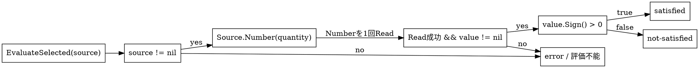

# TEI自身の実装を、意味を保ったモデル・図・DSLへ折り返すdogfooding

**位置づけ：2026年11月15日の実装から導いた検証計画。** 既存の[自己記述と有限Bootstrap](ROLE_BOOTSTRAP_AND_SELF_DESCRIPTION_2026-11.md)、[宣言的な合成とノード表現](DECLARATIVE_COMPOSITION_AND_NODE_SURFACE_CONTRACT_2026-11.md)、[Rule→生成Go→実Builderの第一縦断](PLUGIN_RULE_PRODUCT_VERTICAL_SLICE_2026-11.md)を補う。本書は新しいMeaning、Go解析Engine、DSL文法、Builder、試験正本を作る宣言ではない。実装済みの事実と、まだ検証していない逆写像を区別する。

## 1. dogfoodingの中心は「コード生成」だけではない

TEIが本来提供する価値は、実際に開発し運用しているアプリケーションの構造と業務判断を、**コードに比べて読みやすく、変更に強く、意味と実行上の責務が正確なモデル**へ引き上げることである。TEI自身のソースコードと生成物を最初の題材とする。宣言をGoへLoweringできるだけでなく、現に動いているGoから実装上の事実を採取し、標準Data／Function／Business・Rule／Operator／Process・Plugin／Build／Runtimeとの対応を示し、理解しやすいDSL・Markdown・Graphviz／Node Viewとして提示する。

ただし**任意のGoプログラムの意味を静的に完全復元できる、とは主張しない**。ASTから確実に分かる構文、型解決・実行観測で確認できる振る舞い、設計者が受理すべき業務意味を別票にする。リフレクション、動的Dispatch、外部IO、並行実行、未取得の入力、未確認の副作用は補完しない。根拠が不足した部分は`opaque`／`unknown`として残し、その境界より先の自動編集・生成・実行を認めない。

このためdogfoodingは、「実装コード→見栄えのよい図」という一方向変換でも、「DSLの行数を減らすこと」だけでもない。**実コードで発生した責務のうち、どの業務的・技術的判断をTEIの標準表現へ移せたか**、その結果に対する独立Expectedと実Consumerの証拠を測る。

## 2. 一つの標準構造から、複数の見方を導出する

同じ実装について、次を段階的に得る。これは**証拠の流れ**であって、すべてが同じ業務Meaningだという図ではない。

```text
実TEI Go Source／現行の生成Go Artifact
   │ Go AST・型／呼出関係・Source位置・実行Traceを観測（観測範囲を明記）
   ▼
実装構造の観測事実（Function／Read／Branch／Return／Error／Effect候補）
   │ 元Source spanと実装Revision、観測の欠損・不確実性を保持
   ▼
既存の標準Data／Function／Business・Rule／Processへの対応候補
   │ 明示Role、IDと型、入力Scope、NULL・Failure、OwnerのReview
   ├──> Markdown／Graphviz／Node View（read-only・lossを明示）
   ├──> 既存`*.tei.md`・型付きDSLへの移行案（一意Slotだけ編集候補）
   └──> 同じ意味に基づくTarget Goの再生成（受理後）
                      │
                      ▼
          実Builderの入力／Artifact／実Consumer
                      │
                      ▼
           独立Expected／実Read・結果・Effectの対照
```

「実装構造の観測事実」は既存のSource／型付きGraph／Traceから組み立てる**導出View**とし、第二の業務意味正本にしない。Node IDは元コードのSource occurrence、RuleのCanonical ID、実CallのAttempt IDと別々に保持する。Graphvizの描画Edge IDやラベルを正式Relation／Function Bindingに転用しない。抽出精度とOwner受理は、図が描画できたことでは置き換えられない。

最初はread-onlyの`Go AST / go/types / Source Index`を利用する。構文・型の抽出に新規Go文法Parserを作らない。SSA／静的解析／動的Traceは、必要な意味の判別に寄与する例を示してから追加する。実装を推測的に書き換える前に、既存の実Build・CLI・Providerを通した負例を固定する。

## 3. 初回対象を現に存在する二つのコードに固定する

### 3.1 生成器自身：`GeneratePositive`

現行[`internal/semantic/validationgen/positive.go`](../../internal/semantic/validationgen/positive.go)の`GeneratePositive`はTEI自身の手書きGo実装である。業務のRuleを実装するものではなく、**選択された型付きRuleをGoへLoweringする生成処理**である。コードから観測できる確実な条件は、Go package名の妥当性、Rule kindの`positive`限定、Rule ID・Attributeが必要でRelationを持たないこと、解決済み型`std.decimal`限定、生成したGoを`format.Source`へ通すこと。この関数のSourceへ現れる`strings.Builder`や`fmt.Fprintf`は**生成器の実装詳細**であって、利用者に提示すべきDSL意味ではない。

抽象化する際は、少なくとも次の二つを異なるFunctionとして扱う。

| 対象となる実コード | 標準モデルでの意味候補 | 同一視してはいけないもの |
| --- | --- | --- |
| `validationgen.GeneratePositive`（TEI自身のGo） | 型付きValidationとTarget Packageを入力しGo Sourceを出力するpureな**生成Function**。未対応のKind・型はFailure | `value.Sign() > 0`の業務判定そのもの、生成先RuntimeのAuthority |
| `EvaluateSelected`（実際に生成したGo） | `Source.Number(Attribute)`を読み、NULL／Read失敗を区別し、正値なら`satisfied`、0／負値なら`not-satisfied`とする**評価Function** | 生成器が実行されたこと、Business Owner受理、公開Capability、Providerの実Read |

双方を同一の「Rule処理」として圧縮すると、Source変更が生成処理に与える影響と、生成後の業務判断への影響が区別できない。**生成FunctionをTEIで再記述するdogfooding**は、まずこの二階の意味を分離するところから始める。

### 3.2 生成された業務判断：既存`quantity_positive`

入力Sourceは[`order-line-rules.tei.md`](../../internal/workspace/testdata/tei-md-rule/semantic/sales/order-line-rules.tei.md)の次の正式なRule宣言と、同じWorkspaceで解決する`std.decimal`のAttributeである。**これは現行Readerが読む構文**であり、後述の実装Viewを新DSLの受理済み文法として混ぜない。

```tei
rule sales.order_line.quantity_positive:
  sales.order_line.quantity is positive
```

実際の生成Goの判定構造から、次のようにGraphvizで**読み取り専用の説明候補**を描ける。矢印の意味は制御／Read／Resultであり、正式業務Relationではない。図のNode IDは図内だけの識別子で、Canonical IDとの対応はRule IDと元Sourceへ別に束縛する。



この図とDSLは、**コードとSourceを人が照合して作った基線候補**である。現状の製品がGo ASTからこのGraphvizを自動生成・受理できるとの主張ではない。自動化する場合、実Codeから抽出した分岐・Read・Failureをまず出典付きの構造事実にし、既存`semantic.Validation`へ一意に結べた分だけDSL候補を出す。結べないReturn・IO・別経路は可視化したまま残す。

初回の独立Expectedは、`Source.Number(quantity)`の正値、ゼロ、負値、NULL、未取得を区別する。前者3件は`satisfied / not-satisfied / not-satisfied`、NULL／未取得はErrorであり、値を0に補完しない。元Ruleの単語から結果を推定した同一実装を期待値の発生源として使わず、既存#1180/#2514の独立Expectedと実Go Processを突き合わせる。

## 4. 変換に与える資格を四段階に分ける

| 到達段階 | 許可できる用途 | 停止線 |
| --- | --- | --- |
| **C0：コードの観測** | Go AST／型・Source位置・同一Artifactと対象ProcessのRead／分岐／結果を列挙 | 静的に観測できない呼出し先やEffectを推定確定しない |
| **C1：標準構造への候補投影** | typed Function／Read／Branch／Data Context／Failureの関係をGraphや表で提示 | Source位置やラベル一致を業務Identity、Relation確定、Runtime Grantにしない |
| **C2：DSL／図の意味受理** | 既存TEI意味モデルと独立Expectedに基づき、正しいSlotのDSL候補をOwnerがReview。表層間のLossと変更範囲を明示 | AST構造一致・生成Goの結果一致だけで業務上の正当性を自動受理しない |
| **C3：生成・実行による置換** | 受理した意味から既存Target Generator→実Builder→実Consumerを検査し、手書きGoの該当責務を段階的に置換 | 旧Goへ委譲するだけ、見本コード生成だけ、正式Providerなしのテスト用実行を「セルフビルド」と数えない |

C0/C1は人とAIの分析支援としてすぐ利用できる。C2/C3は、対象を一意に選べるSource Mapping、現在のMeaning受理、Build版の閉包、Consumerでの結果を要求する。DSLを編集して元Goへ逆パッチする操作はさらに別Gateであり、**元Codeへの一意でlosslessなSlot対応が確認できないときはread-only**とする。フォーマットや図のレイアウトだけを変えても業務意味が変わらないよう、Source Revision、Model Revision、Artifact Revisionを分離する。

## 5. 「意味保存」を値の一致から広げる

コード⇔標準モデル⇔DSL⇔生成コードの対照では、少なくとも次を別票とする。

- **構造**：Canonical IDとSource occurrence、型、nullable、Relation identity・向き・多重性、Input／Outputと失敗経路。
- **評価**：値だけでなくNULL・欠損・partial／空集合、短絡、順序、精度、Read Footprint、時点、同じ入力への実結果。
- **作用**：read-onlyとEffectfulを分け、外部Call／Transaction／Commit／Receipt／不確定作用を明示。コードだけで現在Grantを証明しない。
- **変更**：意味を変えないGoの局所リファクタやMarkdown説明変更では、意味・生成Goの同値とSource再確認を独立に判定。`Sign() > 0`→`Sign() >= 0`のような境界値0の意味変更では新しいExpectedとArtifact失効を要求する。
- **証拠**：同じRule ID、生成Goのdigest、Goバイナリ、実Builder Source closure、製品CLI／Provider、実Consumer、Owner受理を一つの万能PASSにまとめない。A→B→Aで同byteに戻っても旧Grantは復活しない。

**「静的に構造が似ている」≠「観測可能な振る舞いが同じ」≠「業務上正しい」**という三つの区別を変換の検収票に必ず残す。証明できない範囲は一つの`opaque`領域として明示し、そこで勝手にDSLの安全な置換を認めない。表示だけに必要な情報はModelへ戻さず、View Profileへ分ける。

## 6. TEI自身を段階的に置き換える実装順

最初は一般のGo逆コンパイラを作らず、**既存のReader／Generator／Builderの実コード一件**を対象とする。

1. **I2M-0：実装の観測票。** `GeneratePositive`のGo Sourceと、同関数が現に出力した`EvaluateSelected`のGo ASTから、関数の入出力、失敗、Read、条件・戻り値、Source spanをread-only抽出する。Goのコード整形・変数名・コメント変更を一因子として試し、構造の差分とSourceの差分を分ける。実行していない動的経路には`not-observed`を記録。
2. **I2M-1：Graph／DSL候補。** 構造候補を既存Data／Function／Ruleに対応付け、§3の図と既存`*.tei.md` Rule宣言を導出表示する。専門家が読む順序で「入力→読取り→判断→結果→評価不能」を示す。表示用IDと正式Role・Canonical IDは分け、意味不足・不一致は診断する。
3. **I2M-2：独立対照。** 同じ入力の手書きGo、現行`GeneratePositive`生成Go、採用予定のDSL再生成Goを別々の実Processで比較する。少なくとも正値／0／負値／NULL／未取得と、Read回数・エラーを照合する。条件を変えた場合は生成Goの分岐と実Consumerの結果が変わること、説明文だけ変更した場合はGo判断が不変なことを確かめる。
4. **I2M-3：製品R2との接続。** 既存[§14.6](PLUGIN_RULE_PRODUCT_VERTICAL_SLICE_2026-11.md)に従い、Generator自身のSource/版と、入力Meaningから出力Go、実Builderが読んだGo byte、Artifact digestを結び付ける。参照BuilderがGoをビルドしただけでは、元DSLの現在性・Owner受理は証明できない。
5. **I2M-4：自己記述の拡大。** 一つのloweringで分かる成功を確認してから、`workspace.Load`／Source Index、Plugin選択、BuildPlan、CLI Entry、StudioのUI生成へ対象を増やす。**TEIで置換できた実装責務**を増やし、最終的にTEI Studio Stage1がStage2を生成・実Windowsで起動する既存P0を補強する。初回I2MをStage2の新しい前提条件にはしない。

最初のコード差分は、既存Go ASTパーサを用いたread-onlyの**出典付き構造投影**に限定する。正式なDSLへの逆変換は対象Functionごとに、型・評価・作用の保存を確認してから進める。抽出したGo ASTの型をTEIの新しい普遍型階層として採用したり、Goの`struct`／`func`を業務DSLへ露出したりしない。

## 7. 実装量よりも「判断の移転」と維持費を測る

比較する方式は、(A) 手書きGo、(B) TEI定義＋手書きGo委譲、(C) TEI意味からGoの判断を生成、(D) TEI自身の生成・確認機構も段階的にTEIで記述、である。対象となる**独立した判断／Read／Failureの義務の総数を固定**し、各方式でTEIが実際に責任を持てた義務、残った不透明な手書き実装、変更後の修正箇所、レビュー時間、試験数、Build時間・実行性能を測る。生成行数、図の数、モデルのノード数だけを進捗にしない。

強い結果とは、業務専門家が理解できる定義を少なく保ちながら、元コードに含まれていた判断が**実装の正しさ・変更追随・テスト生成・診断・図解・異Target生成**に共通利用され、実装を追加せずに受理可能な対象が増えることである。特定の抽象化がかえって制限・例外・メンテナンス負担を増やす場合は、Opaque Goとして残す選択を認める。

**Ownerと並行性**：Everything is Data／標準構造 #2619/#2620、Language／構文 #988/#2621、コード生成・Build #1121/#4544/#2595、独立Expected #1180/#2514、製品実Call #4495、Studio Stage1→Stage2 #2831/#4583へ接続する。I2Mはこの共通成果の観測・移転を検証する作業であり、新たな全製品Hard Gateを課さない。**本書自体は設計・受入条件であり、Code-to-DSLの自動生成機能やOwnerの意味受理を実装・実証したものではない。**

## 8. 実行図の検証契約へ接続する（2026-11-15）

[プロセス実行図の因果・意味保存・証拠照合](PROCESS_EXECUTION_CAUSAL_PROJECTIONS_2026-11.md)により、I2Mは「Goから図を導く」だけでなく、**観測したGoの構造→受理された業務意味→Target生成→実Consumer**のどこまで対応が成立しているかを、疑わしい結合を残したまま表示する。

最初の二対象は区別する。生成器 `GeneratePositive` には入力Ruleの型適格性、拒否分岐、生成byteを確認する。生成された `EvaluateSelected` には入力Attributeの実Read、NULL/Read失敗、正数判定と独立Expectedを確認する。前者のGo ASTから判断Ruleの正当性を自動受理したり、後者の `go run` 成功を製品Builder／通常CLI Providerの受領と同一視したりしない。

| I2Mで確認すること | 実行図に出すもの | まだ合格を付けないもの |
| --- | --- | --- |
| 元Goから抽出できた分岐と出典 | AST／型付きCallの候補、元Source位置、非解析領域 | 業務上のRule意味、全分岐の到達性 |
| 受理されたRuleと生成Goの対応 | Rule/Attribute/生成byte／Read先と変更前後の差 | 実Builderの入力消費・選択Provider |
| Go判断を外部Hostへ移す | 正確な型、NULL、Read／Failure、公開APIとAdapterの差 | 異言語での意味同値、現在Grant、実Effect |
| Studioのモデル・図・DSL相互参照 | Stable SubjectとSource byte範囲、表示損失と編集可能範囲 | Lossのある図からの自動逆編集 |

この対応表をI2M-0〜4の提出物へ追加する。**図が何を省略したか、どの意味上の義務を引き受けたか、どの実Targetでは未確認か**を同じ対象で比較し、図の簡潔さやGoの生成行数だけで成果を測らない。実装は既存#2619/#2620、#1124、#1121、#4495、#1180/#2514の担当に接続し、追加のCore型・Runner・Acceptance正本は作らない。

## 9. 二つの表現と一つの判断を照合する最初のdogfooding（2026-11-15）

### 9.1 同じGoを作ることと、同じSourceであることを分ける

前節の`GeneratePositive`／生成された`EvaluateSelected`を、[Rule第一縦断](PLUGIN_RULE_PRODUCT_VERTICAL_SLICE_2026-11.md)のR1と[文書手法からの抽象化](APPLICATION_ABSTRACTION_DOCUMENT_METHOD_WEAVING_2026-11.md)のD0〜D3へ結び直す。今回は新しい言語処理系や図面正本を提案しない。すでに存在する`Workspace.Load`、内蔵Markdown Reader、従来の`validation`構文、`semantic.Validation`、`sourceindex.Index`、`validationgen.GeneratePositive`、`go/parser`を使い、**一つの意味上の判断が二種類の記述からどこまで再現できるか**を、原文ごとに検証する。

具体的な比較対象は`sales.order_line.quantity_positive`の`positive` Ruleと解決済み`std.decimal`の属性である。[PR #4973](https://github.com/hat47x/tei-platform/pull/4973)は、明示選択した`tei.rule-authoring/v0`のMarkdownと従来の`validation`構文を**別々の実Workspace**でLoadし、生成Goのbyte一致とSource Index／指紋の差を検査する回帰の候補である。**提案PR #4973はclosed／unmergedだが、同名の回帰ファイルは現行mainに存在する。** PRの状態、実ファイルの存在、対象HEADでのテスト合格は別々に記録し、両表記の製品受入済み同等性とは記載しない。

比較では次の四つを独立に判定する。

| 対象 | 同一と認める根拠 | 同一視しないもの |
| --- | --- | --- |
| 型付き意味 | 両Readerが得たRuleの`Kind`、`ID`、`Attribute`、`Relation`と解決済み属性型が一致 | 元ファイル・言語Plugin・説明文・Reader選択 |
| Target生成結果 | 同じGenerator／Target条件で実際に生成したGo byteが完全一致 | 元Source byte、Source Span／Occurrence、取得時点 |
| 実装構造 | 生成Goを`go/parser`で検査し、Read先、NULL／error、分岐、Resultを出典付きで対応付ける | ASTからの業務意味受理、外部IOや到達性の証明 |
| 実行と製品資格 | 既存R1の別Process実評価を、R2の実Builder消費、R3の実Provider／通常CLI、実Consumerから分離して提示 | 生成Goの一致だけによるBuilder／Plugin／Grant／Effect／Owner受理 |

**意味上は同等でも、出典は別**である。同一Sourceの説明だけを変更した場合は、生成Goが不変でも元byteとSource Indexの現在性は再確認が必要。意味条件・参照属性を変更した場合は、生成Go・依存Closure・独立Expectedを再検証する。`A→B→A`やOperator／Generatorの改版では、元のbyteが再び一致しても旧Attemptや古いAuthoritative判断が復活するとは限らない。World Fingerprint／Model Revision／Artifact Revision／現在Grantを同じ一つの「版」にまとめない。

### 9.2 図とDSLは、保持した情報と失った情報が分かる投影にする

表示する一つの対象は「Ruleを読む→`GeneratePositive`でGoを生成する→生成`EvaluateSelected`が数値を読む→結果を返す」という**生成時と実行時の二つのProcess**である。Graphviz、Markdown表、関数チェーン、Studio Node Viewは、既存Data／Function／Process／Relationをそれぞれ用途に適した形へ投影したものとして比較する。Goの`fmt.Fprintf`や`strings.Builder`をDSLへ写すのではなく、**型付きRuleをGoにLoweringする生成Function**と**生成されたGoが担う評価Function**を分離する。

read-only投影を作る場合に必要な最小列は、対象Kind/ID、元Source path／byte span、Reader／Generator版、確定した型とRead/Branch/Failure、観測に使ったArtifact／Attempt、非解析領域、Projectionで省略した情報、**逆編集を許可できる範囲**である。これは既存Source Index、標準モデル、Builder Evidenceからの導出列であり、別の中央台帳や新Core Schemaの提案ではない。Go ASTのLocal ID、GraphのEdge ID、Studio選択EventのSubjectは、正式なRule occurrenceと自動的に同一とはしない。

同じ意味を持つ二表現を一つの図に重ねる場合も、**Sourceへ戻る矢印は二本のまま残す**。生成Goのbyteが等しいからといって、片方のSourceへ注釈や編集を自動転記してはいけない。Source位置や編集対象が一意に決まらないProjectionはread-onlyとし、編集・再生成の提案は元SourceのDiffとOwner判断を伴わせる。

### 9.3 まず固定する独立反証と停止条件

| 比較入力・変異 | 独立Expected候補 | 合格と誤認してはいけないこと |
| --- | --- | --- |
| Markdownと従来構文で同じ型付き`positive` | 選択・型付きRule・Go byteの同等性を各々証明し、Source Evidenceは分離 | 言語表記が違っても現在の出典資格が同じ |
| 説明文だけ改版 | 業務判断とGoが不変でもSource byte・Source Indexの古い証拠を再使用しない | Artifactが不変ならIndexも現行 |
| 参照属性を`quantity`から`second_quantity`に変更 | 型解決・Read先・生成byte・結果変化を別々に照合 | Rule IDが不変なら依存も同じ |
| Goから読み取れないEffect・間接呼出・並行処理 | 未確定区間を`opaque/unknown`と表示し、意味・逆編集を保留 | 図にしたことでEffect不存在を証明 |
| 別Workspace同名Subject／A→B→A／古いUI Event | 元Source Revisionと現在Selection/Pin/epochを再確認。旧Eventを新Inspectとして採用しない | 同じラベルやTarget byteだけで現在性を回復 |
| Canvas配置や表示テーマだけ変更 | 型付きMeaningと業務Goの不変性、表示Artifactの要再検証を分離 | Layout変更でRule Sourceを書き換える |
| 選択Build Bに対して旧生成物Aを実行 | Generator出力・Builder実入力・実Image／Attemptが違えば結果が同じでも不合格 | 生成Goの単体`go run`成功を製品R2/R3へ加算 |

実装の第一差分はI2M-0の**出典付き構造観測だけ**とし、対象を`GeneratePositive`と、選択されたRule一件から生成した`EvaluateSelected`に限定する。独立Expectedは既存#1180/#2514、正式Readerは#2621、生成は#1121、実Builderは#4544、通常CLI／Providerは#4495、Studio実Consumerは#1824に委ねる。新しいCode-to-DSL Writer、Graph Runner、Proof Store、業務DSLへのGo構文露出を先行させない。

### 9.4 Studioとの接続と採否の物差し

[Web標準UI設計](WEB_STANDARD_COMPONENT_AND_AGENT_HARNESS_2026-11.md)の§13で実装済みのread-only選択Event`tei:inspector-selection-request`を使用する。これはWorkspace ID/epochとSubjectを伝えるIntentであり、出典・業務Meaning・Grantを受理するものではない。次のInspector Presenterは、**選択済みSubject→検証済みRule／Source候補→生成Goと元Sourceの対応→証明済み／未確認の境界**をread-onlyで表示する方向へ段階拡張する。ただし実配布Bundle・実Windows WebView2・Stage2再構築の資格は別票であり、こちらのD0図解を先行Hard Gateにしない。

成功を「Goの行数削減」「図表の数」「見かけの抽象率」で計らない。**同じ意味上の義務を固定したとき、手書きGoでしか説明できなかった判断を何件標準モデルに移し、複数表現・Target・変更に再利用できたか**を数える。判断単位ごとに、(a)出典と型の確かさ、(b)生成／実行で使われた実体、(c)反例が検出した誤接続、(d)残る`opaque`、(e)可読性・レビュー費用・性能を記録する。移転した判断に対する独立Expectedが無い場合は、実用化したと扱わない。

二つの表記を保つ費用やSource位置の曖昧さが得られる再利用を上回る場合は、表現を増やさず既存表記を維持する。Go ASTから業務意味を確定できない場合は、構造投影だけで停止する。この**拡張しない判断**も、dogfoodingから得た有効な設計結果として残す。


<!-- tei-i2m0-ast-first-witness-20261115 -->
### 9.5 Go ASTから実際に抽出できた構造だけを図・DSL候補へ渡す

第9.3節のI2M-0を最小のGo回帰へ落とす。対象は`GeneratePositive`が出力する`EvaluateSelected`一関数とし、Go標準の`go/parser`／`go/ast`で**生成Goそのもの**を解析する。`Source.Number`の呼出し先・回数、`value.Sign() > 0`の分岐、成立／不成立の返却、Source／値のNULLおよびRead失敗の判別と、実コード内のbyte位置を観測する。手書きのGraphvizがそれらを記述していても、実ソースで確認できない要素は説明候補へ昇格させない。

最初の限定回帰`internal/semantic/validationgen/positive_ast_projection_test.go`は現行mainに存在する（提案PR [#4986](https://github.com/hat47x/tei-platform/pull/4986)はclosed／unmerged）。元の`positive.go`にある**生成FunctionのAST**も別に読み、生成された評価Functionの構造と混同しない。観測範囲は次の三つの反証で固定する。

| 変えるもの | Go ASTの観測条件 | 保持する資格の区別 |
| --- | --- | --- |
| 先頭の説明コメント | Source byte位置だけが変わり、Read対象・条件・結果構造は不変 | 元Source版／再受理が不要になるわけではない |
| 型付きRuleの参照Attribute | `Source.Number`の引数に現れる元コード文字列と位置が変わる | 生成器と実Providerの選択・実Callは未証明 |
| 実生成Goの比較`> 0`を`>= 0`へ改変 | 元の厳密な正値条件として**拒否**し、古い図の正当性を主張しない | 一件のAST反例を全経路の意味同値証明とは呼ばない |

この検査は第4節の**C0：read-only構造観測**までである。抽出された局所変数名やGo ASTのNode IDをCanonical IDへ転用せず、業務MeaningのC2受理、逆編集、実Builder受領、実Provider／Consumerは後続として維持する。Go回帰の実行合格は当該コードを含むPRの**exact HEAD**で判定し、設計への追記やGitHubにテストが置かれた事実だけでPASSとしない。

## 10. I2M-1：同じ意味・別出典・別構造位置を結合する（2026-11-15）

### 10.1 実装済み足場の正確な位置づけ

現在のmainには、提案PRのマージ状況とは独立して、次の**テストファイルそのもの**が存在する。

| 現存する実テスト | 実際に検査する範囲 | 製品機能と混同しないこと |
| --- | --- | --- |
| `internal/semantic/validationgen/positive_surface_identity_test.go` | `TestSameRuleFromTwoProductSurfacesGeneratesIdenticalGoButDistinctSourceEvidence`：別WorkspaceのMarkdown／従来構文を実`Workspace.Load`し、型付きRule・生成Goのbyte一致・異なるSource Evidence・説明文変更後のIndex失効を比較 | 追加の正式Reader、業務Ownerの意味受理、現在Grant |
| `internal/semantic/validationgen/positive_ast_projection_test.go` | `TestGeneratedPositiveASTHasTraceableReadAndDecision`および`TestGeneratorSourceAndGeneratedDecisionRemainDistinct`：生成GoからRead先・回数・厳密な正値条件・NULL／失敗分岐・Go側byte位置を観測 | 汎用Code-to-Model解析器、編集可能DSL、正式Builder／実Provider |

いずれも**テスト内に閉じたread-only観測**であり、製品が返す共通ViewModelやStudioの公開APIではない。提案PR #4973／#4986はclosed／unmergedであるため、変更の来歴は実Blobとmainの履歴で検査する。今回の静的確認だけで、対象HEADのGoテストがPASSしたと主張しない。

### 10.2 原Sourceの位置と生成Goの位置を同じものにしない

最初の結合で守るべき条件は、**原記述→型付きRule**と**生成されたGo→Go AST**が、それぞれ異なるSource対応であることだ。Goの`Source.Number`に付くbyte offsetは生成Goファイル内の位置であり、`*.tei.md`や`*.tei`のRule出現位置ではない。二つの異なるDSLから同じGoが生成されても、その位置を元Sourceへ流用すると誤った編集対象を選んでしまう。

最小のread-only照合では、次の情報を既存の構造から取得し、検証時の一時的な比較票に保持する。新しい永続Schemaは作らない。

| 観測の段階 | 既存構造から確認すること | 結合を止める条件 |
| --- | --- | --- |
| 元Source | Workspace Root、選択Reader／版、Source Index・元byte・Rule Range、World／Modelの版 | Reader未束縛、旧Index、別Rootや不完全な出典 |
| 意味の候補 | `semantic.Validation`のID/Kind/Attribute/Relation、型解決済み`std.decimal` | 名前や表示ラベルだけの一致、型の不一致 |
| Target生成 | `GeneratePositive`への実入力、Generator版、生成Goの実byteとDigest | 旧出力・別Target・別Generatorを現行として流用 |
| Go構造 | その生成GoのASTによるRead、正値分岐、NULL／Error／Return、Go側Span | 未観測Effectや間接Callを業務上の事実に昇格 |
| 実Consumer | R2実Builder入力、Artifact／Image、R3実Provider選択・Attempt、受領先 | ローカル`go run`／テストの成功を製品受理と同一視 |

同一型付きRule・同一生成Goは、**Meaning候補とTarget出力に限った等価性**である。原文・Reader・Source位置・現在性は引き続き各Sourceに所属する。Go ASTとDSLの間に完全な双方向対応があるかは別に検証する。

### 10.3 次の実装Packetを一つに絞る

次は、既存の二テストを拡張して**「選択済みRuleの原Source Rangeと、同じRuleから生成したGoのAST上のRead先・条件」を一試行で照合する**、I2M-1の限定回帰を追加する。まず一Rule・一Attribute・一生成Functionに限定し、試験内の導出情報をそのまま公開製品APIにしない。

独立Expectedは、(1)正常な型／Rule ID／二種類のSpanの結合、(2)同じGo byteを持つ別Sourceの出典分離、(3)説明改版だけで旧Source Indexが失効すること、(4)属性変更で旧GoのRead先との結合を拒否すること、(5)比較演算子`> 0`→`>= 0`や失敗Return削除の検出、(6)部分Index／同名異ID／異Workspaceの扱いをそれぞれ別にする。

**注意**：最初のGoテストが観測できるのはWorkspace／Source Index／型／生成byte／ASTの範囲である。Host Grant、古いBrowser Event、実DB、Builder選択B／実行A、WindowsのStage2は同じ回帰でPASSにできない。未接続は`NOT RUN／unknown`として残し、それぞれ既存の検証Ownerへ返す。Sourceからの独立ExpectedをAIが自己承認しない。

### 10.4 Studioへの投影と、一般化を止める基準

[Web標準UI設計§14](WEB_STANDARD_COMPONENT_AND_AGENT_HARNESS_2026-11.md)の既存`tei:inspector-selection-request`は、利用者の選択Intentを渡すだけである。現在のInspectorに存在しない生成GoやASTの列を**想像で補って表示しない**。まず現行Product InspectとPresenterのFit/Gapを確認し、取得できない列は未取得・未接続と表示する。Goテスト内部の観測器をフロントエンドへ直結するために新Host／Registryを設けない。

Markdown表・Graphviz・Node ViewのProjectionは、それぞれ省略した情報と逆編集可能な範囲を明示する。Goの変数名やGraph描画IDを業務RelationやRule occurrenceの正本にしない。別Sourceの対応が曖昧ならread-onlyに留める。

判断の移転は、生成コード行数や図面数ではなく、**TEI定義で表現・変更・独立検証できるようになった実装上の義務**の増加と、残る手書きGo／差分調整／レビュー費用で測る。二つ目の異質Domainで有益性が確認できるまでは、汎用Go解析器や新Core型を採用しない。

実装のOwnerは#2621（Reader）、#1121（Generator）、#4544（Builder）、#4495（Provider）、#1824（Studio）、#1180／#2514（独立Expected）。**正式Reader→実Builder→通常CLI実Provider、および非Plugin Studio Stage1→Stage2 WindowsのP0を優先**し、I2M-1を新たなHard Gateにしない。

## 11. I2M-1の実回帰と製品CLIビルドの到達点（2026-11-15）

### 11.1 第一回帰を既存Reader・AST観測器の合成として実装する

前章で計画したI2M-1を、`internal/semantic/validationgen/positive_source_ast_binding_test.go`の限定Go回帰として追加する（本ブランチの新規テスト。**exact HEADのCIと独立レビューが済むまでは合格未確認**）。

テストは、既存`Workspace.Load`／`BuildSourceIndexFromLoad`／`GeneratePositive`と、I2M-0のテスト内観測器`observeGeneratedPositiveGo`を使用する。**新しい製品Reader・AST Engine・一般化されたViewModelではない**。比較の一試行に、選択Reader、Rule IDと型、元SourceのDefinition Span・Fingerprint／Model Revision、生成Go byte、AST上のRead先・呼出回数・分岐条件とGo Spanを含める。

| 独立した反証 | 実際の期待結果 | 判断を広げない範囲 |
| --- | --- | --- |
| Markdownと従来`validation` | 実Loadした型付きRule・生成Go・ASTの構造は一致し、原Source path／指紋／Revisionは別 | Readerの出典を一本化・元Sourceへ自動逆編集しない |
| 説明文の追記 | 旧Source Indexを拒否し、再Load後の意味／生成Go／ASTが不変 | 旧Source Grant・旧Attempt・旧Build資格を復活させない |
| 生成GoのRead先を別Attributeへ改変 | Go ASTによる構造観測はできても、選択RuleとのBinding不一致を検出 | Goが構文上正しいことを業務上の正当性にしない |
| 生成Goの`> 0`を`>= 0`へ改変 | 正の値のみを成立とする元Ruleの説明として採用しない | 局所AST検査で全Control Flowを証明したと主張しない |

一つのローカルなGo testで全機能の資格を証明しない。とくにSource Indexがない／partial、同名異Subject、Host側の現在Disclosure、実Builder選択B／実Image A、実DB、Windows Wails Stage2は、各Ownerの別試験へ渡す。共通Expectedの採否は#1180／#2514に戻し、検証不能な列を`PASS`にしない。

### 11.2 通常tei CLIの実ビルドは前進。ただしR2の出典閉包が残る

[PR #5009](https://github.com/hat47x/tei-platform/pull/5009)がmainへマージされ、`cmd/tei/cli_self_build_generated_rule_go_test.go`が存在する。同回帰は`tei.rule-authoring/v0`が選択した`quantity_positive`／`std.decimal`から意味付きGoを生成し、**通常製品`tei self-build`のBuild Intent経路**でGoの成果物を構築、完成したBinaryを起動して正・ゼロ・負・NULL・未取得の5例を比較する。既存Catalog/Builderを利用し、Entrypoint Sourceの選択も実Packageに合わせて修正している。

これは参照Builderに生成Goを渡すだけだった段階より進んだ、**製品CLIによる限定的R2-Pの証人**である。ただしテストはLinux/amd64の既存Catalog条件へ限定され、対象外OSではSkipする。さらに、生成GoをBuild Intentの入力として明示しても、**元のRule Markdown Source、選択Reader、Generator実装・版、生成Go、選択Builderの実入力が一つの正式Build Intent／Attemptで完全に束縛された**ことまでは実証していない。これらを満たす正式R2-Pは引き続き#4544等のOwnerである。

実行されたBinaryが業務上の判断を返したことと、**公開Function Entryが正式選択Providerのactual Invokeを受けたこと（R3）**、現在Grant／業務Ownerの意味受理、実Studio Stage1→Stage2 Windowsは、さらに別の資格である。CLI実行の合格をこれらへ加算しない。

### 11.3 次の検収は「I2M-1の結合」から「R2正式出典閉包」へ

I2M-1回帰が対象HEADで成立した場合の次の一件は、`sales.order_line.quantity_positive`を変更した同一Attemptで、**原Source/Reader/Generator→生成Go→BuildIntentに選ばれたSource→実Builder消費Byte→Artifact／実Image**の対応を既存#4544に引き渡す。別のAnalyzerやBuilderを増やすのではなく、既存BuildIntent、Source Index、実CLI・ArtifactSetの不足する束縛だけを補う。

変異は、(1)同じ生成Go・別Source、(2)説明のみ改版、(3)Ruleが参照するAttribute改版、(4)選択生成物B／実Build A、(5)同一DigestでもAttempt・Generator版が異なる、を別々に判定する。この五件を一つの「再利用可否」へ丸めず、World/Model／Artifact／Current Authorityを分ける。

成功指標は、**手書きのGoへ委譲せずTEIの定義から実生成された判断が、どの製品実行段階で実際に消費されたか**と、その判断を変更したときの修正点・独立検査・負例検出数である。StudioのPresenter分離、Node Editorや外部API公開は既存Consumer側へ段階的に接続し、これらをR2／R3／非Plugin Stage1→Stage2の新Hard Gateにしない。
