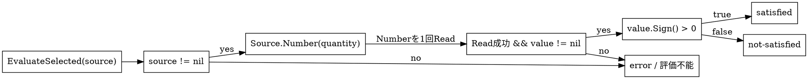

# TEI自身の実装を、意味を保ったモデル・図・DSLへ折り返すdogfooding

**位置づけ：2026年11月15日の実装から導いた検証計画。** 既存の[自己記述と有限Bootstrap](ROLE_BOOTSTRAP_AND_SELF_DESCRIPTION_2026-11.md)、[宣言的な合成とノード表現](DECLARATIVE_COMPOSITION_AND_NODE_SURFACE_CONTRACT_2026-11.md)、[Rule→生成Go→実Builderの第一縦断](PLUGIN_RULE_PRODUCT_VERTICAL_SLICE_2026-11.md)を補う。本書は新しいMeaning、Go解析Engine、DSL文法、Builder、試験正本を作る宣言ではない。実装済みの事実と、まだ検証していない逆写像を区別する。

## 1. dogfoodingの中心は「コード生成」だけではない

TEIが本来提供する価値は、実際に開発し運用しているアプリケーションの構造と業務判断を、**コードに比べて読みやすく、変更に強く、意味と実行上の責務が正確なモデル**へ引き上げることである。TEI自身のソースコードと生成物を最初の題材とする。宣言をGoへLoweringできるだけでなく、現に動いているGoから実装上の事実を採取し、標準Data／Function／Business・Rule／Operator／Process・Plugin／Build／Runtimeとの対応を示し、理解しやすいDSL・Markdown・Graphviz／Node Viewとして提示する。

ただし**任意のGoプログラムの意味を静的に完全復元できる、とは主張しない**。ASTから確実に分かる構文、型解決・実行観測で確認できる振る舞い、設計者が受理すべき業務意味を別票にする。リフレクション、動的Dispatch、外部IO、並行実行、未取得の入力、未確認の副作用は補完しない。根拠が不足した部分は`opaque`／`unknown`として残し、その境界より先の自動編集・生成・実行を認めない。

このためdogfoodingは、「実装コード→見栄えのよい図」という一方向変換でも、「DSLの行数を減らすこと」だけでもない。**実コードで発生した責務のうち、どの業務的・技術的判断をTEIの標準表現へ移せたか**、その結果に対する独立Expectedと実Consumerの証拠を測る。

## 2. 一つの標準構造から、複数の見方を導出する

同じ実装について、次を段階的に得る。これは**証拠の流れ**であって、すべてが同じ業務Meaningだという図ではない。

```text
実TEI Go Source／現行の生成Go Artifact
   │ Go AST・型／呼出関係・Source位置・実行Traceを観測（観測範囲を明記）
   ▼
実装構造の観測事実（Function／Read／Branch／Return／Error／Effect候補）
   │ 元Source spanと実装Revision、観測の欠損・不確実性を保持
   ▼
既存の標準Data／Function／Business・Rule／Processへの対応候補
   │ 明示Role、IDと型、入力Scope、NULL・Failure、OwnerのReview
   ├──> Markdown／Graphviz／Node View（read-only・lossを明示）
   ├──> 既存`*.tei.md`・型付きDSLへの移行案（一意Slotだけ編集候補）
   └──> 同じ意味に基づくTarget Goの再生成（受理後）
                      │
                      ▼
          実Builderの入力／Artifact／実Consumer
                      │
                      ▼
           独立Expected／実Read・結果・Effectの対照
```

「実装構造の観測事実」は既存のSource／型付きGraph／Traceから組み立てる**導出View**とし、第二の業務意味正本にしない。Node IDは元コードのSource occurrence、RuleのCanonical ID、実CallのAttempt IDと別々に保持する。Graphvizの描画Edge IDやラベルを正式Relation／Function Bindingに転用しない。抽出精度とOwner受理は、図が描画できたことでは置き換えられない。

最初はread-onlyの`Go AST / go/types / Source Index`を利用する。構文・型の抽出に新規Go文法Parserを作らない。SSA／静的解析／動的Traceは、必要な意味の判別に寄与する例を示してから追加する。実装を推測的に書き換える前に、既存の実Build・CLI・Providerを通した負例を固定する。

## 3. 初回対象を現に存在する二つのコードに固定する

### 3.1 生成器自身：`GeneratePositive`

現行[`internal/semantic/validationgen/positive.go`](../../internal/semantic/validationgen/positive.go)の`GeneratePositive`はTEI自身の手書きGo実装である。業務のRuleを実装するものではなく、**選択された型付きRuleをGoへLoweringする生成処理**である。コードから観測できる確実な条件は、Go package名の妥当性、Rule kindの`positive`限定、Rule ID・Attributeが必要でRelationを持たないこと、解決済み型`std.decimal`限定、生成したGoを`format.Source`へ通すこと。この関数のSourceへ現れる`strings.Builder`や`fmt.Fprintf`は**生成器の実装詳細**であって、利用者に提示すべきDSL意味ではない。

抽象化する際は、少なくとも次の二つを異なるFunctionとして扱う。

| 対象となる実コード | 標準モデルでの意味候補 | 同一視してはいけないもの |
| --- | --- | --- |
| `validationgen.GeneratePositive`（TEI自身のGo） | 型付きValidationとTarget Packageを入力しGo Sourceを出力するpureな**生成Function**。未対応のKind・型はFailure | `value.Sign() > 0`の業務判定そのもの、生成先RuntimeのAuthority |
| `EvaluateSelected`（実際に生成したGo） | `Source.Number(Attribute)`を読み、NULL／Read失敗を区別し、正値なら`satisfied`、0／負値なら`not-satisfied`とする**評価Function** | 生成器が実行されたこと、Business Owner受理、公開Capability、Providerの実Read |

双方を同一の「Rule処理」として圧縮すると、Source変更が生成処理に与える影響と、生成後の業務判断への影響が区別できない。**生成FunctionをTEIで再記述するdogfooding**は、まずこの二階の意味を分離するところから始める。

### 3.2 生成された業務判断：既存`quantity_positive`

入力Sourceは[`order-line-rules.tei.md`](../../internal/workspace/testdata/tei-md-rule/semantic/sales/order-line-rules.tei.md)の次の正式なRule宣言と、同じWorkspaceで解決する`std.decimal`のAttributeである。**これは現行Readerが読む構文**であり、後述の実装Viewを新DSLの受理済み文法として混ぜない。

```tei
rule sales.order_line.quantity_positive:
  sales.order_line.quantity is positive
```

実際の生成Goの判定構造から、次のようにGraphvizで**読み取り専用の説明候補**を描ける。矢印の意味は制御／Read／Resultであり、正式業務Relationではない。図のNode IDは図内だけの識別子で、Canonical IDとの対応はRule IDと元Sourceへ別に束縛する。



この図とDSLは、**コードとSourceを人が照合して作った基線候補**である。現状の製品がGo ASTからこのGraphvizを自動生成・受理できるとの主張ではない。自動化する場合、実Codeから抽出した分岐・Read・Failureをまず出典付きの構造事実にし、既存`semantic.Validation`へ一意に結べた分だけDSL候補を出す。結べないReturn・IO・別経路は可視化したまま残す。

初回の独立Expectedは、`Source.Number(quantity)`の正値、ゼロ、負値、NULL、未取得を区別する。前者3件は`satisfied / not-satisfied / not-satisfied`、NULL／未取得はErrorであり、値を0に補完しない。元Ruleの単語から結果を推定した同一実装を期待値の発生源として使わず、既存#1180/#2514の独立Expectedと実Go Processを突き合わせる。

## 4. 変換に与える資格を四段階に分ける

| 到達段階 | 許可できる用途 | 停止線 |
| --- | --- | --- |
| **C0：コードの観測** | Go AST／型・Source位置・同一Artifactと対象ProcessのRead／分岐／結果を列挙 | 静的に観測できない呼出し先やEffectを推定確定しない |
| **C1：標準構造への候補投影** | typed Function／Read／Branch／Data Context／Failureの関係をGraphや表で提示 | Source位置やラベル一致を業務Identity、Relation確定、Runtime Grantにしない |
| **C2：DSL／図の意味受理** | 既存TEI意味モデルと独立Expectedに基づき、正しいSlotのDSL候補をOwnerがReview。表層間のLossと変更範囲を明示 | AST構造一致・生成Goの結果一致だけで業務上の正当性を自動受理しない |
| **C3：生成・実行による置換** | 受理した意味から既存Target Generator→実Builder→実Consumerを検査し、手書きGoの該当責務を段階的に置換 | 旧Goへ委譲するだけ、見本コード生成だけ、正式Providerなしのテスト用実行を「セルフビルド」と数えない |

C0/C1は人とAIの分析支援としてすぐ利用できる。C2/C3は、対象を一意に選べるSource Mapping、現在のMeaning受理、Build版の閉包、Consumerでの結果を要求する。DSLを編集して元Goへ逆パッチする操作はさらに別Gateであり、**元Codeへの一意でlosslessなSlot対応が確認できないときはread-only**とする。フォーマットや図のレイアウトだけを変えても業務意味が変わらないよう、Source Revision、Model Revision、Artifact Revisionを分離する。

## 5. 「意味保存」を値の一致から広げる

コード⇔標準モデル⇔DSL⇔生成コードの対照では、少なくとも次を別票とする。

- **構造**：Canonical IDとSource occurrence、型、nullable、Relation identity・向き・多重性、Input／Outputと失敗経路。
- **評価**：値だけでなくNULL・欠損・partial／空集合、短絡、順序、精度、Read Footprint、時点、同じ入力への実結果。
- **作用**：read-onlyとEffectfulを分け、外部Call／Transaction／Commit／Receipt／不確定作用を明示。コードだけで現在Grantを証明しない。
- **変更**：意味を変えないGoの局所リファクタやMarkdown説明変更では、意味・生成Goの同値とSource再確認を独立に判定。`Sign() > 0`→`Sign() >= 0`のような境界値0の意味変更では新しいExpectedとArtifact失効を要求する。
- **証拠**：同じRule ID、生成Goのdigest、Goバイナリ、実Builder Source closure、製品CLI／Provider、実Consumer、Owner受理を一つの万能PASSにまとめない。A→B→Aで同byteに戻っても旧Grantは復活しない。

**「静的に構造が似ている」≠「観測可能な振る舞いが同じ」≠「業務上正しい」**という三つの区別を変換の検収票に必ず残す。証明できない範囲は一つの`opaque`領域として明示し、そこで勝手にDSLの安全な置換を認めない。表示だけに必要な情報はModelへ戻さず、View Profileへ分ける。

## 6. TEI自身を段階的に置き換える実装順

最初は一般のGo逆コンパイラを作らず、**既存のReader／Generator／Builderの実コード一件**を対象とする。

1. **I2M-0：実装の観測票。** `GeneratePositive`のGo Sourceと、同関数が現に出力した`EvaluateSelected`のGo ASTから、関数の入出力、失敗、Read、条件・戻り値、Source spanをread-only抽出する。Goのコード整形・変数名・コメント変更を一因子として試し、構造の差分とSourceの差分を分ける。実行していない動的経路には`not-observed`を記録。
2. **I2M-1：Graph／DSL候補。** 構造候補を既存Data／Function／Ruleに対応付け、§3の図と既存`*.tei.md` Rule宣言を導出表示する。専門家が読む順序で「入力→読取り→判断→結果→評価不能」を示す。表示用IDと正式Role・Canonical IDは分け、意味不足・不一致は診断する。
3. **I2M-2：独立対照。** 同じ入力の手書きGo、現行`GeneratePositive`生成Go、採用予定のDSL再生成Goを別々の実Processで比較する。少なくとも正値／0／負値／NULL／未取得と、Read回数・エラーを照合する。条件を変えた場合は生成Goの分岐と実Consumerの結果が変わること、説明文だけ変更した場合はGo判断が不変なことを確かめる。
4. **I2M-3：製品R2との接続。** 既存[§14.6](PLUGIN_RULE_PRODUCT_VERTICAL_SLICE_2026-11.md)に従い、Generator自身のSource/版と、入力Meaningから出力Go、実Builderが読んだGo byte、Artifact digestを結び付ける。参照BuilderがGoをビルドしただけでは、元DSLの現在性・Owner受理は証明できない。
5. **I2M-4：自己記述の拡大。** 一つのloweringで分かる成功を確認してから、`workspace.Load`／Source Index、Plugin選択、BuildPlan、CLI Entry、StudioのUI生成へ対象を増やす。**TEIで置換できた実装責務**を増やし、最終的にTEI Studio Stage1がStage2を生成・実Windowsで起動する既存P0を補強する。初回I2MをStage2の新しい前提条件にはしない。

最初のコード差分は、既存Go ASTパーサを用いたread-onlyの**出典付き構造投影**に限定する。正式なDSLへの逆変換は対象Functionごとに、型・評価・作用の保存を確認してから進める。抽出したGo ASTの型をTEIの新しい普遍型階層として採用したり、Goの`struct`／`func`を業務DSLへ露出したりしない。

## 7. 実装量よりも「判断の移転」と維持費を測る

比較する方式は、(A) 手書きGo、(B) TEI定義＋手書きGo委譲、(C) TEI意味からGoの判断を生成、(D) TEI自身の生成・確認機構も段階的にTEIで記述、である。対象となる**独立した判断／Read／Failureの義務の総数を固定**し、各方式でTEIが実際に責任を持てた義務、残った不透明な手書き実装、変更後の修正箇所、レビュー時間、試験数、Build時間・実行性能を測る。生成行数、図の数、モデルのノード数だけを進捗にしない。

強い結果とは、業務専門家が理解できる定義を少なく保ちながら、元コードに含まれていた判断が**実装の正しさ・変更追随・テスト生成・診断・図解・異Target生成**に共通利用され、実装を追加せずに受理可能な対象が増えることである。特定の抽象化がかえって制限・例外・メンテナンス負担を増やす場合は、Opaque Goとして残す選択を認める。

**Ownerと並行性**：Everything is Data／標準構造 #2619/#2620、Language／構文 #988/#2621、コード生成・Build #1121/#4544/#2595、独立Expected #1180/#2514、製品実Call #4495、Studio Stage1→Stage2 #2831/#4583へ接続する。I2Mはこの共通成果の観測・移転を検証する作業であり、新たな全製品Hard Gateを課さない。**本書自体は設計・受入条件であり、Code-to-DSLの自動生成機能やOwnerの意味受理を実装・実証したものではない。**
