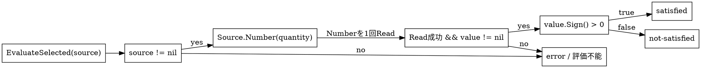

# TEI自身の実装を、意味を保ったモデル・図・DSLへ折り返すdogfooding

**位置づけ：2026年11月15日の実装から導いた検証計画。** 既存の[自己記述と有限Bootstrap](ROLE_BOOTSTRAP_AND_SELF_DESCRIPTION_2026-11.md)、[宣言的な合成とノード表現](DECLARATIVE_COMPOSITION_AND_NODE_SURFACE_CONTRACT_2026-11.md)、[Rule→生成Go→実Builderの第一縦断](PLUGIN_RULE_PRODUCT_VERTICAL_SLICE_2026-11.md)を補う。本書は新しいMeaning、Go解析Engine、DSL文法、Builder、試験正本を作る宣言ではない。実装済みの事実と、まだ検証していない逆写像を区別する。

## 1. dogfoodingの中心は「コード生成」だけではない

TEIが本来提供する価値は、実際に開発し運用しているアプリケーションの構造と業務判断を、**コードに比べて読みやすく、変更に強く、意味と実行上の責務が正確なモデル**へ引き上げることである。TEI自身のソースコードと生成物を最初の題材とする。宣言をGoへLoweringできるだけでなく、現に動いているGoから実装上の事実を採取し、標準Data／Function／Business・Rule／Operator／Process・Plugin／Build／Runtimeとの対応を示し、理解しやすいDSL・Markdown・Graphviz／Node Viewとして提示する。

ただし**任意のGoプログラムの意味を静的に完全復元できる、とは主張しない**。ASTから確実に分かる構文、型解決・実行観測で確認できる振る舞い、設計者が受理すべき業務意味を別票にする。リフレクション、動的Dispatch、外部IO、並行実行、未取得の入力、未確認の副作用は補完しない。根拠が不足した部分は`opaque`／`unknown`として残し、その境界より先の自動編集・生成・実行を認めない。

このためdogfoodingは、「実装コード→見栄えのよい図」という一方向変換でも、「DSLの行数を減らすこと」だけでもない。**実コードで発生した責務のうち、どの業務的・技術的判断をTEIの標準表現へ移せたか**、その結果に対する独立Expectedと実Consumerの証拠を測る。

## 2. 一つの標準構造から、複数の見方を導出する

同じ実装について、次を段階的に得る。これは**証拠の流れ**であって、すべてが同じ業務Meaningだという図ではない。

```text
実TEI Go Source／現行の生成Go Artifact
   │ Go AST・型／呼出関係・Source位置・実行Traceを観測（観測範囲を明記）
   ▼
実装構造の観測事実（Function／Read／Branch／Return／Error／Effect候補）
   │ 元Source spanと実装Revision、観測の欠損・不確実性を保持
   ▼
既存の標準Data／Function／Business・Rule／Processへの対応候補
   │ 明示Role、IDと型、入力Scope、NULL・Failure、OwnerのReview
   ├──> Markdown／Graphviz／Node View（read-only・lossを明示）
   ├──> 既存`*.tei.md`・型付きDSLへの移行案（一意Slotだけ編集候補）
   └──> 同じ意味に基づくTarget Goの再生成（受理後）
                      │
                      ▼
          実Builderの入力／Artifact／実Consumer
                      │
                      ▼
           独立Expected／実Read・結果・Effectの対照
```

「実装構造の観測事実」は既存のSource／型付きGraph／Traceから組み立てる**導出View**とし、第二の業務意味正本にしない。Node IDは元コードのSource occurrence、RuleのCanonical ID、実CallのAttempt IDと別々に保持する。Graphvizの描画Edge IDやラベルを正式Relation／Function Bindingに転用しない。抽出精度とOwner受理は、図が描画できたことでは置き換えられない。

最初はread-onlyの`Go AST / go/types / Source Index`を利用する。構文・型の抽出に新規Go文法Parserを作らない。SSA／静的解析／動的Traceは、必要な意味の判別に寄与する例を示してから追加する。実装を推測的に書き換える前に、既存の実Build・CLI・Providerを通した負例を固定する。

## 3. 初回対象を現に存在する二つのコードに固定する

### 3.1 生成器自身：`GeneratePositive`

現行[`internal/semantic/validationgen/positive.go`](../../internal/semantic/validationgen/positive.go)の`GeneratePositive`はTEI自身の手書きGo実装である。業務のRuleを実装するものではなく、**選択された型付きRuleをGoへLoweringする生成処理**である。コードから観測できる確実な条件は、Go package名の妥当性、Rule kindの`positive`限定、Rule ID・Attributeが必要でRelationを持たないこと、解決済み型`std.decimal`限定、生成したGoを`format.Source`へ通すこと。この関数のSourceへ現れる`strings.Builder`や`fmt.Fprintf`は**生成器の実装詳細**であって、利用者に提示すべきDSL意味ではない。

抽象化する際は、少なくとも次の二つを異なるFunctionとして扱う。

| 対象となる実コード | 標準モデルでの意味候補 | 同一視してはいけないもの |
| --- | --- | --- |
| `validationgen.GeneratePositive`（TEI自身のGo） | 型付きValidationとTarget Packageを入力しGo Sourceを出力するpureな**生成Function**。未対応のKind・型はFailure | `value.Sign() > 0`の業務判定そのもの、生成先RuntimeのAuthority |
| `EvaluateSelected`（実際に生成したGo） | `Source.Number(Attribute)`を読み、NULL／Read失敗を区別し、正値なら`satisfied`、0／負値なら`not-satisfied`とする**評価Function** | 生成器が実行されたこと、Business Owner受理、公開Capability、Providerの実Read |

双方を同一の「Rule処理」として圧縮すると、Source変更が生成処理に与える影響と、生成後の業務判断への影響が区別できない。**生成FunctionをTEIで再記述するdogfooding**は、まずこの二階の意味を分離するところから始める。

### 3.2 生成された業務判断：既存`quantity_positive`

入力Sourceは[`order-line-rules.tei.md`](../../internal/workspace/testdata/tei-md-rule/semantic/sales/order-line-rules.tei.md)の次の正式なRule宣言と、同じWorkspaceで解決する`std.decimal`のAttributeである。**これは現行Readerが読む構文**であり、後述の実装Viewを新DSLの受理済み文法として混ぜない。

```tei
rule sales.order_line.quantity_positive:
  sales.order_line.quantity is positive
```

実際の生成Goの判定構造から、次のようにGraphvizで**読み取り専用の説明候補**を描ける。矢印の意味は制御／Read／Resultであり、正式業務Relationではない。図のNode IDは図内だけの識別子で、Canonical IDとの対応はRule IDと元Sourceへ別に束縛する。



この図とDSLは、**コードとSourceを人が照合して作った基線候補**である。現状の製品がGo ASTからこのGraphvizを自動生成・受理できるとの主張ではない。自動化する場合、実Codeから抽出した分岐・Read・Failureをまず出典付きの構造事実にし、既存`semantic.Validation`へ一意に結べた分だけDSL候補を出す。結べないReturn・IO・別経路は可視化したまま残す。

初回の独立Expectedは、`Source.Number(quantity)`の正値、ゼロ、負値、NULL、未取得を区別する。前者3件は`satisfied / not-satisfied / not-satisfied`、NULL／未取得はErrorであり、値を0に補完しない。元Ruleの単語から結果を推定した同一実装を期待値の発生源として使わず、既存#1180/#2514の独立Expectedと実Go Processを突き合わせる。

## 4. 変換に与える資格を四段階に分ける

| 到達段階 | 許可できる用途 | 停止線 |
| --- | --- | --- |
| **C0：コードの観測** | Go AST／型・Source位置・同一Artifactと対象ProcessのRead／分岐／結果を列挙 | 静的に観測できない呼出し先やEffectを推定確定しない |
| **C1：標準構造への候補投影** | typed Function／Read／Branch／Data Context／Failureの関係をGraphや表で提示 | Source位置やラベル一致を業務Identity、Relation確定、Runtime Grantにしない |
| **C2：DSL／図の意味受理** | 既存TEI意味モデルと独立Expectedに基づき、正しいSlotのDSL候補をOwnerがReview。表層間のLossと変更範囲を明示 | AST構造一致・生成Goの結果一致だけで業務上の正当性を自動受理しない |
| **C3：生成・実行による置換** | 受理した意味から既存Target Generator→実Builder→実Consumerを検査し、手書きGoの該当責務を段階的に置換 | 旧Goへ委譲するだけ、見本コード生成だけ、正式Providerなしのテスト用実行を「セルフビルド」と数えない |

C0/C1は人とAIの分析支援としてすぐ利用できる。C2/C3は、対象を一意に選べるSource Mapping、現在のMeaning受理、Build版の閉包、Consumerでの結果を要求する。DSLを編集して元Goへ逆パッチする操作はさらに別Gateであり、**元Codeへの一意でlosslessなSlot対応が確認できないときはread-only**とする。フォーマットや図のレイアウトだけを変えても業務意味が変わらないよう、Source Revision、Model Revision、Artifact Revisionを分離する。

## 5. 「意味保存」を値の一致から広げる

コード⇔標準モデル⇔DSL⇔生成コードの対照では、少なくとも次を別票とする。

- **構造**：Canonical IDとSource occurrence、型、nullable、Relation identity・向き・多重性、Input／Outputと失敗経路。
- **評価**：値だけでなくNULL・欠損・partial／空集合、短絡、順序、精度、Read Footprint、時点、同じ入力への実結果。
- **作用**：read-onlyとEffectfulを分け、外部Call／Transaction／Commit／Receipt／不確定作用を明示。コードだけで現在Grantを証明しない。
- **変更**：意味を変えないGoの局所リファクタやMarkdown説明変更では、意味・生成Goの同値とSource再確認を独立に判定。`Sign() > 0`→`Sign() >= 0`のような境界値0の意味変更では新しいExpectedとArtifact失効を要求する。
- **証拠**：同じRule ID、生成Goのdigest、Goバイナリ、実Builder Source closure、製品CLI／Provider、実Consumer、Owner受理を一つの万能PASSにまとめない。A→B→Aで同byteに戻っても旧Grantは復活しない。

**「静的に構造が似ている」≠「観測可能な振る舞いが同じ」≠「業務上正しい」**という三つの区別を変換の検収票に必ず残す。証明できない範囲は一つの`opaque`領域として明示し、そこで勝手にDSLの安全な置換を認めない。表示だけに必要な情報はModelへ戻さず、View Profileへ分ける。

## 6. TEI自身を段階的に置き換える実装順

最初は一般のGo逆コンパイラを作らず、**既存のReader／Generator／Builderの実コード一件**を対象とする。

1. **I2M-0：実装の観測票。** `GeneratePositive`のGo Sourceと、同関数が現に出力した`EvaluateSelected`のGo ASTから、関数の入出力、失敗、Read、条件・戻り値、Source spanをread-only抽出する。Goのコード整形・変数名・コメント変更を一因子として試し、構造の差分とSourceの差分を分ける。実行していない動的経路には`not-observed`を記録。
2. **I2M-1：Graph／DSL候補。** 構造候補を既存Data／Function／Ruleに対応付け、§3の図と既存`*.tei.md` Rule宣言を導出表示する。専門家が読む順序で「入力→読取り→判断→結果→評価不能」を示す。表示用IDと正式Role・Canonical IDは分け、意味不足・不一致は診断する。
3. **I2M-2：独立対照。** 同じ入力の手書きGo、現行`GeneratePositive`生成Go、採用予定のDSL再生成Goを別々の実Processで比較する。少なくとも正値／0／負値／NULL／未取得と、Read回数・エラーを照合する。条件を変えた場合は生成Goの分岐と実Consumerの結果が変わること、説明文だけ変更した場合はGo判断が不変なことを確かめる。
4. **I2M-3：製品R2との接続。** 既存[§14.6](PLUGIN_RULE_PRODUCT_VERTICAL_SLICE_2026-11.md)に従い、Generator自身のSource/版と、入力Meaningから出力Go、実Builderが読んだGo byte、Artifact digestを結び付ける。参照BuilderがGoをビルドしただけでは、元DSLの現在性・Owner受理は証明できない。
5. **I2M-4：自己記述の拡大。** 一つのloweringで分かる成功を確認してから、`workspace.Load`／Source Index、Plugin選択、BuildPlan、CLI Entry、StudioのUI生成へ対象を増やす。**TEIで置換できた実装責務**を増やし、最終的にTEI Studio Stage1がStage2を生成・実Windowsで起動する既存P0を補強する。初回I2MをStage2の新しい前提条件にはしない。

最初のコード差分は、既存Go ASTパーサを用いたread-onlyの**出典付き構造投影**に限定する。正式なDSLへの逆変換は対象Functionごとに、型・評価・作用の保存を確認してから進める。抽出したGo ASTの型をTEIの新しい普遍型階層として採用したり、Goの`struct`／`func`を業務DSLへ露出したりしない。

## 7. 実装量よりも「判断の移転」と維持費を測る

比較する方式は、(A) 手書きGo、(B) TEI定義＋手書きGo委譲、(C) TEI意味からGoの判断を生成、(D) TEI自身の生成・確認機構も段階的にTEIで記述、である。対象となる**独立した判断／Read／Failureの義務の総数を固定**し、各方式でTEIが実際に責任を持てた義務、残った不透明な手書き実装、変更後の修正箇所、レビュー時間、試験数、Build時間・実行性能を測る。生成行数、図の数、モデルのノード数だけを進捗にしない。

強い結果とは、業務専門家が理解できる定義を少なく保ちながら、元コードに含まれていた判断が**実装の正しさ・変更追随・テスト生成・診断・図解・異Target生成**に共通利用され、実装を追加せずに受理可能な対象が増えることである。特定の抽象化がかえって制限・例外・メンテナンス負担を増やす場合は、Opaque Goとして残す選択を認める。

**Ownerと並行性**：Everything is Data／標準構造 #2619/#2620、Language／構文 #988/#2621、コード生成・Build #1121/#4544/#2595、独立Expected #1180/#2514、製品実Call #4495、Studio Stage1→Stage2 #2831/#4583へ接続する。I2Mはこの共通成果の観測・移転を検証する作業であり、新たな全製品Hard Gateを課さない。**本書自体は設計・受入条件であり、Code-to-DSLの自動生成機能やOwnerの意味受理を実装・実証したものではない。**

## 8. 実行図の検証契約へ接続する（2026-11-15）

[プロセス実行図の因果・意味保存・証拠照合](PROCESS_EXECUTION_CAUSAL_PROJECTIONS_2026-11.md)により、I2Mは「Goから図を導く」だけでなく、**観測したGoの構造→受理された業務意味→Target生成→実Consumer**のどこまで対応が成立しているかを、疑わしい結合を残したまま表示する。

最初の二対象は区別する。生成器 `GeneratePositive` には入力Ruleの型適格性、拒否分岐、生成byteを確認する。生成された `EvaluateSelected` には入力Attributeの実Read、NULL/Read失敗、正数判定と独立Expectedを確認する。前者のGo ASTから判断Ruleの正当性を自動受理したり、後者の `go run` 成功を製品Builder／通常CLI Providerの受領と同一視したりしない。

| I2Mで確認すること | 実行図に出すもの | まだ合格を付けないもの |
| --- | --- | --- |
| 元Goから抽出できた分岐と出典 | AST／型付きCallの候補、元Source位置、非解析領域 | 業務上のRule意味、全分岐の到達性 |
| 受理されたRuleと生成Goの対応 | Rule/Attribute/生成byte／Read先と変更前後の差 | 実Builderの入力消費・選択Provider |
| Go判断を外部Hostへ移す | 正確な型、NULL、Read／Failure、公開APIとAdapterの差 | 異言語での意味同値、現在Grant、実Effect |
| Studioのモデル・図・DSL相互参照 | Stable SubjectとSource byte範囲、表示損失と編集可能範囲 | Lossのある図からの自動逆編集 |

この対応表をI2M-0〜4の提出物へ追加する。**図が何を省略したか、どの意味上の義務を引き受けたか、どの実Targetでは未確認か**を同じ対象で比較し、図の簡潔さやGoの生成行数だけで成果を測らない。実装は既存#2619/#2620、#1124、#1121、#4495、#1180/#2514の担当に接続し、追加のCore型・Runner・Acceptance正本は作らない。

## 9. 二つの表現と一つの判断を照合する最初のdogfooding（2026-11-15）

### 9.1 同じGoを作ることと、同じSourceであることを分ける

前節の`GeneratePositive`／生成された`EvaluateSelected`を、[Rule第一縦断](PLUGIN_RULE_PRODUCT_VERTICAL_SLICE_2026-11.md)のR1と[文書手法からの抽象化](APPLICATION_ABSTRACTION_DOCUMENT_METHOD_WEAVING_2026-11.md)のD0〜D3へ結び直す。今回は新しい言語処理系や図面正本を提案しない。すでに存在する`Workspace.Load`、内蔵Markdown Reader、従来の`validation`構文、`semantic.Validation`、`sourceindex.Index`、`validationgen.GeneratePositive`、`go/parser`を使い、**一つの意味上の判断が二種類の記述からどこまで再現できるか**を、原文ごとに検証する。

具体的な比較対象は`sales.order_line.quantity_positive`の`positive` Ruleと解決済み`std.decimal`の属性である。[PR #4973](https://github.com/hat47x/tei-platform/pull/4973)は、明示選択した`tei.rule-authoring/v0`のMarkdownと従来の`validation`構文を**別々の実Workspace**でLoadし、生成Goのbyte一致とSource Index／指紋の差を検査する回帰の候補である。**提案PR #4973はclosed／unmergedだが、同名の回帰ファイルは現行mainに存在する。** PRの状態、実ファイルの存在、対象HEADでのテスト合格は別々に記録し、両表記の製品受入済み同等性とは記載しない。

比較では次の四つを独立に判定する。

| 対象 | 同一と認める根拠 | 同一視しないもの |
| --- | --- | --- |
| 型付き意味 | 両Readerが得たRuleの`Kind`、`ID`、`Attribute`、`Relation`と解決済み属性型が一致 | 元ファイル・言語Plugin・説明文・Reader選択 |
| Target生成結果 | 同じGenerator／Target条件で実際に生成したGo byteが完全一致 | 元Source byte、Source Span／Occurrence、取得時点 |
| 実装構造 | 生成Goを`go/parser`で検査し、Read先、NULL／error、分岐、Resultを出典付きで対応付ける | ASTからの業務意味受理、外部IOや到達性の証明 |
| 実行と製品資格 | 既存R1の別Process実評価を、R2の実Builder消費、R3の実Provider／通常CLI、実Consumerから分離して提示 | 生成Goの一致だけによるBuilder／Plugin／Grant／Effect／Owner受理 |

**意味上は同等でも、出典は別**である。同一Sourceの説明だけを変更した場合は、生成Goが不変でも元byteとSource Indexの現在性は再確認が必要。意味条件・参照属性を変更した場合は、生成Go・依存Closure・独立Expectedを再検証する。`A→B→A`やOperator／Generatorの改版では、元のbyteが再び一致しても旧Attemptや古いAuthoritative判断が復活するとは限らない。World Fingerprint／Model Revision／Artifact Revision／現在Grantを同じ一つの「版」にまとめない。

### 9.2 図とDSLは、保持した情報と失った情報が分かる投影にする

表示する一つの対象は「Ruleを読む→`GeneratePositive`でGoを生成する→生成`EvaluateSelected`が数値を読む→結果を返す」という**生成時と実行時の二つのProcess**である。Graphviz、Markdown表、関数チェーン、Studio Node Viewは、既存Data／Function／Process／Relationをそれぞれ用途に適した形へ投影したものとして比較する。Goの`fmt.Fprintf`や`strings.Builder`をDSLへ写すのではなく、**型付きRuleをGoにLoweringする生成Function**と**生成されたGoが担う評価Function**を分離する。

read-only投影を作る場合に必要な最小列は、対象Kind/ID、元Source path／byte span、Reader／Generator版、確定した型とRead/Branch/Failure、観測に使ったArtifact／Attempt、非解析領域、Projectionで省略した情報、**逆編集を許可できる範囲**である。これは既存Source Index、標準モデル、Builder Evidenceからの導出列であり、別の中央台帳や新Core Schemaの提案ではない。Go ASTのLocal ID、GraphのEdge ID、Studio選択EventのSubjectは、正式なRule occurrenceと自動的に同一とはしない。

同じ意味を持つ二表現を一つの図に重ねる場合も、**Sourceへ戻る矢印は二本のまま残す**。生成Goのbyteが等しいからといって、片方のSourceへ注釈や編集を自動転記してはいけない。Source位置や編集対象が一意に決まらないProjectionはread-onlyとし、編集・再生成の提案は元SourceのDiffとOwner判断を伴わせる。

### 9.3 まず固定する独立反証と停止条件

| 比較入力・変異 | 独立Expected候補 | 合格と誤認してはいけないこと |
| --- | --- | --- |
| Markdownと従来構文で同じ型付き`positive` | 選択・型付きRule・Go byteの同等性を各々証明し、Source Evidenceは分離 | 言語表記が違っても現在の出典資格が同じ |
| 説明文だけ改版 | 業務判断とGoが不変でもSource byte・Source Indexの古い証拠を再使用しない | Artifactが不変ならIndexも現行 |
| 参照属性を`quantity`から`second_quantity`に変更 | 型解決・Read先・生成byte・結果変化を別々に照合 | Rule IDが不変なら依存も同じ |
| Goから読み取れないEffect・間接呼出・並行処理 | 未確定区間を`opaque/unknown`と表示し、意味・逆編集を保留 | 図にしたことでEffect不存在を証明 |
| 別Workspace同名Subject／A→B→A／古いUI Event | 元Source Revisionと現在Selection/Pin/epochを再確認。旧Eventを新Inspectとして採用しない | 同じラベルやTarget byteだけで現在性を回復 |
| Canvas配置や表示テーマだけ変更 | 型付きMeaningと業務Goの不変性、表示Artifactの要再検証を分離 | Layout変更でRule Sourceを書き換える |
| 選択Build Bに対して旧生成物Aを実行 | Generator出力・Builder実入力・実Image／Attemptが違えば結果が同じでも不合格 | 生成Goの単体`go run`成功を製品R2/R3へ加算 |

実装の第一差分はI2M-0の**出典付き構造観測だけ**とし、対象を`GeneratePositive`と、選択されたRule一件から生成した`EvaluateSelected`に限定する。独立Expectedは既存#1180/#2514、正式Readerは#2621、生成は#1121、実Builderは#4544、通常CLI／Providerは#4495、Studio実Consumerは#1824に委ねる。新しいCode-to-DSL Writer、Graph Runner、Proof Store、業務DSLへのGo構文露出を先行させない。

### 9.4 Studioとの接続と採否の物差し

[Web標準UI設計](WEB_STANDARD_COMPONENT_AND_AGENT_HARNESS_2026-11.md)の§13で実装済みのread-only選択Event`tei:inspector-selection-request`を使用する。これはWorkspace ID/epochとSubjectを伝えるIntentであり、出典・業務Meaning・Grantを受理するものではない。次のInspector Presenterは、**選択済みSubject→検証済みRule／Source候補→生成Goと元Sourceの対応→証明済み／未確認の境界**をread-onlyで表示する方向へ段階拡張する。ただし実配布Bundle・実Windows WebView2・Stage2再構築の資格は別票であり、こちらのD0図解を先行Hard Gateにしない。

成功を「Goの行数削減」「図表の数」「見かけの抽象率」で計らない。**同じ意味上の義務を固定したとき、手書きGoでしか説明できなかった判断を何件標準モデルに移し、複数表現・Target・変更に再利用できたか**を数える。判断単位ごとに、(a)出典と型の確かさ、(b)生成／実行で使われた実体、(c)反例が検出した誤接続、(d)残る`opaque`、(e)可読性・レビュー費用・性能を記録する。移転した判断に対する独立Expectedが無い場合は、実用化したと扱わない。

二つの表記を保つ費用やSource位置の曖昧さが得られる再利用を上回る場合は、表現を増やさず既存表記を維持する。Go ASTから業務意味を確定できない場合は、構造投影だけで停止する。この**拡張しない判断**も、dogfoodingから得た有効な設計結果として残す。


<!-- tei-i2m0-ast-first-witness-20261115 -->
### 9.5 Go ASTから実際に抽出できた構造だけを図・DSL候補へ渡す

第9.3節のI2M-0を最小のGo回帰へ落とす。対象は`GeneratePositive`が出力する`EvaluateSelected`一関数とし、Go標準の`go/parser`／`go/ast`で**生成Goそのもの**を解析する。`Source.Number`の呼出し先・回数、`value.Sign() > 0`の分岐、成立／不成立の返却、Source／値のNULLおよびRead失敗の判別と、実コード内のbyte位置を観測する。手書きのGraphvizがそれらを記述していても、実ソースで確認できない要素は説明候補へ昇格させない。

最初の限定回帰`internal/semantic/validationgen/positive_ast_projection_test.go`は現行mainに存在する（提案PR [#4986](https://github.com/hat47x/tei-platform/pull/4986)はclosed／unmerged）。元の`positive.go`にある**生成FunctionのAST**も別に読み、生成された評価Functionの構造と混同しない。観測範囲は次の三つの反証で固定する。

| 変えるもの | Go ASTの観測条件 | 保持する資格の区別 |
| --- | --- | --- |
| 先頭の説明コメント | Source byte位置だけが変わり、Read対象・条件・結果構造は不変 | 元Source版／再受理が不要になるわけではない |
| 型付きRuleの参照Attribute | `Source.Number`の引数に現れる元コード文字列と位置が変わる | 生成器と実Providerの選択・実Callは未証明 |
| 実生成Goの比較`> 0`を`>= 0`へ改変 | 元の厳密な正値条件として**拒否**し、古い図の正当性を主張しない | 一件のAST反例を全経路の意味同値証明とは呼ばない |

この検査は第4節の**C0：read-only構造観測**までである。抽出された局所変数名やGo ASTのNode IDをCanonical IDへ転用せず、業務MeaningのC2受理、逆編集、実Builder受領、実Provider／Consumerは後続として維持する。Go回帰の実行合格は当該コードを含むPRの**exact HEAD**で判定し、設計への追記やGitHubにテストが置かれた事実だけでPASSとしない。

## 10. I2M-1：同じ意味・別出典・別構造位置を結合する（2026-11-15）

### 10.1 実装済み足場の正確な位置づけ

現在のmainには、提案PRのマージ状況とは独立して、次の**テストファイルそのもの**が存在する。

| 現存する実テスト | 実際に検査する範囲 | 製品機能と混同しないこと |
| --- | --- | --- |
| `internal/semantic/validationgen/positive_surface_identity_test.go` | `TestSameRuleFromTwoProductSurfacesGeneratesIdenticalGoButDistinctSourceEvidence`：別WorkspaceのMarkdown／従来構文を実`Workspace.Load`し、型付きRule・生成Goのbyte一致・異なるSource Evidence・説明文変更後のIndex失効を比較 | 追加の正式Reader、業務Ownerの意味受理、現在Grant |
| `internal/semantic/validationgen/positive_ast_projection_test.go` | `TestGeneratedPositiveASTHasTraceableReadAndDecision`および`TestGeneratorSourceAndGeneratedDecisionRemainDistinct`：生成GoからRead先・回数・厳密な正値条件・NULL／失敗分岐・Go側byte位置を観測 | 汎用Code-to-Model解析器、編集可能DSL、正式Builder／実Provider |

いずれも**テスト内に閉じたread-only観測**であり、製品が返す共通ViewModelやStudioの公開APIではない。提案PR #4973／#4986はclosed／unmergedであるため、変更の来歴は実Blobとmainの履歴で検査する。今回の静的確認だけで、対象HEADのGoテストがPASSしたと主張しない。

### 10.2 原Sourceの位置と生成Goの位置を同じものにしない

最初の結合で守るべき条件は、**原記述→型付きRule**と**生成されたGo→Go AST**が、それぞれ異なるSource対応であることだ。Goの`Source.Number`に付くbyte offsetは生成Goファイル内の位置であり、`*.tei.md`や`*.tei`のRule出現位置ではない。二つの異なるDSLから同じGoが生成されても、その位置を元Sourceへ流用すると誤った編集対象を選んでしまう。

最小のread-only照合では、次の情報を既存の構造から取得し、検証時の一時的な比較票に保持する。新しい永続Schemaは作らない。

| 観測の段階 | 既存構造から確認すること | 結合を止める条件 |
| --- | --- | --- |
| 元Source | Workspace Root、選択Reader／版、Source Index・元byte・Rule Range、World／Modelの版 | Reader未束縛、旧Index、別Rootや不完全な出典 |
| 意味の候補 | `semantic.Validation`のID/Kind/Attribute/Relation、型解決済み`std.decimal` | 名前や表示ラベルだけの一致、型の不一致 |
| Target生成 | `GeneratePositive`への実入力、Generator版、生成Goの実byteとDigest | 旧出力・別Target・別Generatorを現行として流用 |
| Go構造 | その生成GoのASTによるRead、正値分岐、NULL／Error／Return、Go側Span | 未観測Effectや間接Callを業務上の事実に昇格 |
| 実Consumer | R2実Builder入力、Artifact／Image、R3実Provider選択・Attempt、受領先 | ローカル`go run`／テストの成功を製品受理と同一視 |

同一型付きRule・同一生成Goは、**Meaning候補とTarget出力に限った等価性**である。原文・Reader・Source位置・現在性は引き続き各Sourceに所属する。Go ASTとDSLの間に完全な双方向対応があるかは別に検証する。

### 10.3 次の実装Packetを一つに絞る

次は、既存の二テストを拡張して**「選択済みRuleの原Source Rangeと、同じRuleから生成したGoのAST上のRead先・条件」を一試行で照合する**、I2M-1の限定回帰を追加する。まず一Rule・一Attribute・一生成Functionに限定し、試験内の導出情報をそのまま公開製品APIにしない。

独立Expectedは、(1)正常な型／Rule ID／二種類のSpanの結合、(2)同じGo byteを持つ別Sourceの出典分離、(3)説明改版だけで旧Source Indexが失効すること、(4)属性変更で旧GoのRead先との結合を拒否すること、(5)比較演算子`> 0`→`>= 0`や失敗Return削除の検出、(6)部分Index／同名異ID／異Workspaceの扱いをそれぞれ別にする。

**注意**：最初のGoテストが観測できるのはWorkspace／Source Index／型／生成byte／ASTの範囲である。Host Grant、古いBrowser Event、実DB、Builder選択B／実行A、WindowsのStage2は同じ回帰でPASSにできない。未接続は`NOT RUN／unknown`として残し、それぞれ既存の検証Ownerへ返す。Sourceからの独立ExpectedをAIが自己承認しない。

### 10.4 Studioへの投影と、一般化を止める基準

[Web標準UI設計§14](WEB_STANDARD_COMPONENT_AND_AGENT_HARNESS_2026-11.md)の既存`tei:inspector-selection-request`は、利用者の選択Intentを渡すだけである。現在のInspectorに存在しない生成GoやASTの列を**想像で補って表示しない**。まず現行Product InspectとPresenterのFit/Gapを確認し、取得できない列は未取得・未接続と表示する。Goテスト内部の観測器をフロントエンドへ直結するために新Host／Registryを設けない。

Markdown表・Graphviz・Node ViewのProjectionは、それぞれ省略した情報と逆編集可能な範囲を明示する。Goの変数名やGraph描画IDを業務RelationやRule occurrenceの正本にしない。別Sourceの対応が曖昧ならread-onlyに留める。

判断の移転は、生成コード行数や図面数ではなく、**TEI定義で表現・変更・独立検証できるようになった実装上の義務**の増加と、残る手書きGo／差分調整／レビュー費用で測る。二つ目の異質Domainで有益性が確認できるまでは、汎用Go解析器や新Core型を採用しない。

実装のOwnerは#2621（Reader）、#1121（Generator）、#4544（Builder）、#4495（Provider）、#1824（Studio）、#1180／#2514（独立Expected）。**正式Reader→実Builder→通常CLI実Provider、および非Plugin Studio Stage1→Stage2 WindowsのP0を優先**し、I2M-1を新たなHard Gateにしない。

## 11. I2M-1の実回帰と製品CLIビルドの到達点（2026-11-15）

### 11.1 第一回帰を既存Reader・AST観測器の合成として実装する

前章で計画したI2M-1を、`internal/semantic/validationgen/positive_surface_identity_test.go`の限定Go回帰として追加する（既存テストにAST照合を追加する変更。**exact HEADのCIと独立レビューが済むまでは合格未確認**）。

テストは、既存`Workspace.Load`／`BuildSourceIndexFromLoad`／`GeneratePositive`と、I2M-0のテスト内観測器`observeGeneratedPositiveGo`を使用する。**新しい製品Reader・AST Engine・一般化されたViewModelではない**。比較の一試行に、選択Reader、Rule IDと型、元SourceのDefinition Span・Fingerprint／Model Revision、生成Go byte、AST上のRead先・呼出回数・分岐条件とGo Spanを含める。

| 独立した反証 | 実際の期待結果 | 判断を広げない範囲 |
| --- | --- | --- |
| Markdownと従来`validation` | 実Loadした型付きRule・生成Go・ASTの構造は一致し、原Source path／指紋／Revisionは別 | Readerの出典を一本化・元Sourceへ自動逆編集しない |
| 説明文の追記 | 旧Source Indexを拒否し、再Load後の意味／生成Go／ASTが不変 | 旧Source Grant・旧Attempt・旧Build資格を復活させない |
| 生成GoのRead先を別Attributeへ改変 | Go ASTによる構造観測はできても、選択RuleとのBinding不一致を検出 | Goが構文上正しいことを業務上の正当性にしない |
| 生成Goの`> 0`を`>= 0`へ改変 | 正の値のみを成立とする元Ruleの説明として採用しない | 局所AST検査で全Control Flowを証明したと主張しない |

一つのローカルなGo testで全機能の資格を証明しない。とくにSource Indexがない／partial、同名異Subject、Host側の現在Disclosure、実Builder選択B／実Image A、実DB、Windows Wails Stage2は、各Ownerの別試験へ渡す。共通Expectedの採否は#1180／#2514に戻し、検証不能な列を`PASS`にしない。

### 11.2 通常tei CLIの実ビルドは前進。ただしR2の出典閉包が残る

[PR #5009](https://github.com/hat47x/tei-platform/pull/5009)がmainへマージされ、`cmd/tei/cli_self_build_generated_rule_go_test.go`が存在する。同回帰は`tei.rule-authoring/v0`が選択した`quantity_positive`／`std.decimal`から意味付きGoを生成し、**通常製品`tei self-build`のBuild Intent経路**でGoの成果物を構築、完成したBinaryを起動して正・ゼロ・負・NULL・未取得の5例を比較する。既存Catalog/Builderを利用し、Entrypoint Sourceの選択も実Packageに合わせて修正している。

これは参照Builderに生成Goを渡すだけだった段階より進んだ、**製品CLIによる限定的R2-Pの証人**である。ただしテストはLinux/amd64の既存Catalog条件へ限定され、対象外OSではSkipする。さらに、生成GoをBuild Intentの入力として明示しても、**元のRule Markdown Source、選択Reader、Generator実装・版、生成Go、選択Builderの実入力が一つの正式Build Intent／Attemptで完全に束縛された**ことまでは実証していない。これらを満たす正式R2-Pは引き続き#4544等のOwnerである。

実行されたBinaryが業務上の判断を返したことと、**公開Function Entryが正式選択Providerのactual Invokeを受けたこと（R3）**、現在Grant／業務Ownerの意味受理、実Studio Stage1→Stage2 Windowsは、さらに別の資格である。CLI実行の合格をこれらへ加算しない。

### 11.3 次の検収は「I2M-1の結合」から「R2正式出典閉包」へ

I2M-1回帰が対象HEADで成立した場合の次の一件は、`sales.order_line.quantity_positive`を変更した同一Attemptで、**原Source/Reader/Generator→生成Go→BuildIntentに選ばれたSource→実Builder消費Byte→Artifact／実Image**の対応を既存#4544に引き渡す。別のAnalyzerやBuilderを増やすのではなく、既存BuildIntent、Source Index、実CLI・ArtifactSetの不足する束縛だけを補う。

変異は、(1)同じ生成Go・別Source、(2)説明のみ改版、(3)Ruleが参照するAttribute改版、(4)選択生成物B／実Build A、(5)同一DigestでもAttempt・Generator版が異なる、を別々に判定する。この五件を一つの「再利用可否」へ丸めず、World/Model／Artifact／Current Authorityを分ける。

成功指標は、**手書きのGoへ委譲せずTEIの定義から実生成された判断が、どの製品実行段階で実際に消費されたか**と、その判断を変更したときの修正点・独立検査・負例検出数である。StudioのPresenter分離、Node Editorや外部API公開は既存Consumer側へ段階的に接続し、これらをR2／R3／非Plugin Stage1→Stage2の新Hard Gateにしない。

## 12. I2M-1から正式R2-Pへ渡す出典・実消費の検収票（2026-11-15）

### 12.1 合格した単位を起点に、まだ閉じていない一辺を選ぶ

現行mainの`internal/semantic/validationgen/positive_surface_identity_test.go`には、I2M-1で追加した「実WorkspaceのRule出典→型付きRule→生成GoのAST上のReadと条件」の照合がある。**コミット`68af02259129f2f415f07a33d2186ab876c5ca32`に対するActionsのRepository Health実行ログでは、`tei/internal/semantic/validationgen`パッケージがPASS**している。一方、Repository Health全体はFAILで、Go整形差分、REA・Studio構成・Schema Coverage等の別領域の失敗が残る。Goパッケージ一件の成功から製品全体の健全性を主張しない。記録の正本は[該当Actions実行](https://github.com/hat47x/tei-platform/actions/runs/43707552248)とexact SHAとする。

また[PR #5009](https://github.com/hat47x/tei-platform/pull/5009)でmainに入った`cmd/tei/cli_self_build_generated_rule_go_test.go`は、選択したMarkdown Ruleから生成Goを作り、通常の`tei self-build`／既存Build Intent・Catalog・`buildintent.Resolve`経由で実Builderを起動し、生成バイナリの正値・ゼロ・負値・NULL・未取得を判定する**Linux/amd64限定の試験実装**である。コードには`definitionSource`が実EntrypointのGo packageを指すこと、Plan Cross-check、Artifact Binding、L2-b、再現性、隔離されたGo依存Closureを検査する条件がある。テストが存在することと、今回のmainで対象テスト単独のexact HEAD PASSを観測したことは別の資格である。

この二つの実装の間で残る中心課題は、**Ruleの原文・Reader・生成器を、実Builderが選択したGo入力と同じBuild Attemptの証拠へ結び付けること**である。現在のCLI試験は生成したGo packageをBuild Intentの入口に置くが、元のMarkdown ReaderとGenerator実装の出典が同じ正式Build Intentへ束縛されたことまでは検査していない。したがって「生成Goの実ビルド」と「Authoringからの正式な再現可能ビルド」を混同しない。

### 12.2 最小の実装引渡し：別資格を一枚で照合する

次のR2-P作業票は新しい製品Schemaや中央Evidence Storeを導入せず、既存`Source Index`、`Build Intent`／`ResolvedBuildReceipt`、Plan／Artifact照合、CLI実行結果を**同じ対象・同じ試行の出典付き列**で比較する。原文や生成器のメタ情報を後から説明文に追記しただけでは、実Builderの入力閉包を受理しない。

| 経路 | 現在の実観測 | 次に照合するもの | 未達なら表示する結果 |
| --- | --- | --- | --- |
| **A 原文選択** | `Workspace.Load`と選択済み`tei.rule-authoring/v0`、原文byte／Definition Range、Source Index指紋 | 実際に生成へ渡したRule・解決型・Reader版と同一のRoot／World・Model Revision | Source未取得・失効・選択不一致 |
| **B 意味からGoへ** | `semantic.Validation`と`GeneratePositive`の実Go byte／ASTのRead・分岐 | AのRuleとGenerator版／Target／生成物Digestが現在の選択と一致 | 生成元不明・条件不一致 |
| **C Build Intentへ** | 実`definitionSource`・`IntentSource`・依存Go Closure、`buildintent.Resolve` | A・Bの入力と生成Goを実Build Intentがどう参照し、どのbyteをBuilderへ渡すか | 原文・生成器の未束縛、選択A／消費B |
| **D Builder実消費** | Plan Cross-check・Artifact Binding・ChildRun・再現性・隔離情報 | 同一Attemptの選択Plan、実Builder入力、完成Artifact／Image Digest | 実消費未観測、別Attempt、旧Artifact |
| **E 実Consumer** | Linux/amd64の完成バイナリを起動する限定試験 | 同一Imageから観測した正・ゼロ・負・NULL・未取得と独立Expected | 未起動・他Target・別Binary |
| **F 公開・Desktop** | R3公開Entry／actual ProviderとStage2 Windowsは別Owner | 現在Grant・実Provider Call／Receipt、Windows実Desktopの再構築と受領 | **未受理**。A〜Eの結果で代用しない |

この表にある「一致」「失効」「不一致」「未取得」は**報告上の判定**であって、新しい共通Result enumやHost APIの追加を要求するものではない。特に、字面が同じ`Rule ID`や同一Go byteを、別Root・別Reader・別Generator・別Attemptの代替資格としない。

### 12.3 失敗を作り分け、再利用可否を一つの真偽値にしない

独立Expectedは既存#1180／#2514に紐付け、次の一因子変更を順に検証する。

| 変更・反例 | 失効・拒否すべき資格 | 変わらない可能性のあるもの |
| --- | --- | --- |
| Markdown説明文のみ改版 | 旧Source Index・以前の取得事実 | 型付きRule、生成Go byte、Artifactの内容 |
| Ruleの参照Attributeまたは`positive`条件を変更 | 型付き意味の前提、生成Go、Build依存、独立Expected | 表示部品の共通Contract |
| 元DSLは同じでGenerator実装／版を変更 | 旧Generator受理・生成資格・Build入力証拠 | 偶然同じ生成Go byte |
| 正しいGo package Bを宣言し、実Builderが旧Aを消費 | 選択Plan→実入力→Artifact Binding | 単体Goテストの結果 |
| Workspace A→B→A、または同名別Sourceで再実行 | 旧Index・旧Attempt・現在Grantへの自動復帰 | Source／生成Goの内容一致 |
| 同じDigestの成果物が異なるTarget／Attemptで現れる | 実Consumer／配送資格・現在実行の主張 | byte一致それ自体 |

次の**一つの実装Packet**は、A・B・CのSource/Generator出典を同一Attemptの`Build Intent`に正しく束縛し、Dで選択した入力の一致を確かめる限定回帰とする。現状の`definitionSource`は生成GoのEntrypointを示すため、**これを原DSL Source IDへ差し替えることはしない**。Entrypointと生成元は別の参照義務として保持し、既存Resolver／Builderのどの欄で結べるかを実コードで検証してから、最小差分を実装する。

その後、公開したpure Function Entry→正式Providerのactual Invoke（R3）と、TEI定義によるStudio Stage1→Stage2／Windows実Consumer（G6）を**別の独立受入**として進める。Builderの試験に無関係なREA、Node Editor、SUI、Wailsの失敗をこの作業で便宜上修正・無視したことにしない。新たなGraph Runtime、別Host、逆解析Writer、意味・権限の第二正本は追加しない。

### 12.4 手書きの試験Driverを自己構築の成果に数えない

現在の`cli_self_build_generated_rule_go_test.go`は、`GeneratePositive`が生成した実判断Goと、試験用に手書きした`generatedRuleDriver`を一つのGo packageへ配置し、既存Build Intentでバイナリ化する。**生成できたのはRule由来の評価Functionであり、Driver、Application Composition、公開Function Entry、ProviderやStudioまでTEIから生成したわけではない。**

dogfoodingの進捗は、(1)対象の判断義務、(2)元TEI定義、(3)生成が担ったGoの範囲、(4)依然として手書き／試験Driverが担う範囲、(5)実BuilderとConsumerが受領した範囲、(6)独立Expectedの範囲を一件ずつ対応付ける。表現・図面・生成Goの行数が増えても、**手書きの業務判断が実際に減らなければ自己構築の前進として加算しない**。

G6のStudio Stage1→Stage2では、同じ原則を非Plugin Desktopへ適用し、TEIで定義した部品がStage2に実際に組み込まれ、実Windows WebView2のConsumerで受領された範囲だけを評価する。RuleのCLIバイナリをStage2の実証へ流用しない。

## 13. 生成元の閉包とコンパイル入力の閉包を分ける（2026-11-15）

### 13.1 同じBuild Intentに名前を並べることは、同じ変換を証明することではない

前節のR2-P引渡しを実APIに照らして確認した。`internal/buildintent/intent.go`の`BuildIntent.Sources`は、Sourceの`Kind/ID/Ref`を宣言し、`definitionSource`にはrecipeに応じた種類のSourceを要求する。`go-command`のdefinitionSourceが指すのは**GoのEntrypoint package**である。`internal/buildintent/catalog.go`の`DirSourceResolver`は参照ファイル／ディレクトリの実byteを読み、相対member名とbyte長を含めたDigestを導出するが、**Language Readerで意味が受理されたことや、Generatorがその原文を使ったことは証明しない**。

ここで区別する二つの閉包は次のとおりである。

| 閉包 | 対象 | 責任を負う証人 |
| --- | --- | --- |
| **生成元の閉包（derivation）** | 選択Rootと原Markdown byte／Source Index、Reader ID・版、選択された型付きRule・属性型、実Generator実装／版・Target、生成Go byte | 現行`Workspace.Load`／`sourceindex`／`validationgen.GeneratePositive`の一試行に由来する観測。型付き意味受理はOwner別 |
| **ビルド入力の閉包（consumption）** | 実`BuildIntent`、Go Entrypoint・依存package／module、`buildintent.Resolve`のPlan、Builderが実際に読んだ入力、Artifact Digest・実Image | 既存`tei self-build`のEntry・Resolver・Builder報告・Artifact Binding・再現性の一試行 |

両者をつなぐ接続点は**ある試行で得た生成Goの実byteと、そのbyteを含むGo Source packageを実Builderが消費したという一致**である。生成Goが同じbyteでも、その生成元が別Root・別Reader・別Generatorであれば出典を併合しない。逆に、説明文だけが変わった場合は出典の現在性を再検証するが、Go byteが不変だからといって不要な再ビルドを機械的に要求しない。Artifact再利用、旧Evidence再利用、現在Grantはそれぞれ別の判断となる。

**設計選択**：原MarkdownとGenerator実装を、現在の`go-command`の`definitionSource`へ代入しない。さらに、現在の`IntentSource`が任意の`Kind`を構文上受け付けることを、正式な「Rule Source」「Generator Source」の型・解決・コンパイル閉包対応が製品で成立した証拠にしない。新しい種類を試験の都合で追加して完了扱いにせず、まず既存Source/Builderのどの出典欄に情報が欠けるかをread-onlyで観測する。

### 13.2 最小実装：生成時と実Builder時の証人を同じAttemptで突き合わせる

実装Owner #2621／#1121／#4544へ渡す最小Packetは、`cmd/tei/cli_self_build_generated_rule_go_test.go`の**現在のテスト・Builder・Catalogを保持**したまま、実Build Attemptに対する検証用の対応表を一つ作るものとする。表の列は次に限定し、正式な新Core Schema・Receipt format・別Generatorを提案しない。

| 列 | 観測の取得元 | 反証に必要なこと |
| --- | --- | --- |
| 原文とReader | 同じ`Workspace.Load`のAuthoringSources、原byte・Source Index・Rule Definition Range | 同名別SourceやA→B→Aで旧Range／Fingerprintを使えない |
| 型付きRuleと生成元 | 同じLoadから選択した`semantic.Validation`、型解決、Generatorの実Source／選択版 | 参照Attribute・Generator改版が旧出典の受理を失効させる |
| Goの受渡し | 実`GeneratePositive`のbyte／Digest、試行用packageに書いた`generated.go`の再読byte | 生成B／配置Aを拒否。AST上のSource位置は元Markdown位置でない |
| Plan選択 | 実`BuildIntent`のEntrypoint Source ID、`Resolve`のSource Closure FingerprintとPlan | `definitionSource`を誤って原Ruleへ振り替えない。別package／moduleを混ぜない |
| 実Builder消費 | Builderの実入力／Isolation member、Plan Cross-check、Artifact Binding、ChildRun | 申告Digest一致だけでは不十分。異なるActual Byte／Attempt／Targetを拒否 |
| 結果と受領 | 出力Artifact／Imageと独立5入力の観測 | 正しい結果を返す別Binaryを、当該Build Attemptのものとして受理しない |

着手は**最初の3列（原文・型・Go配置）と既存Plan・Builder観測の突き合わせ**に絞る。Generation Observerが保存していない版情報は「未取得」、Builderが本当に読んだbyteを示せない箇所は「未証明」とする。出典を後からJSONに書き足すだけではConsumptionを証明できない。検査用の対応表は既存の試験内部で導出し、Ownerが正式なProduction契約を選択するまでは公開APIにしない。

### 13.3 一つの同一性判定から、三つの資格を作らない

| 一因子変更 | 出典の現在性 | 生成Go／コンパイル資産 | 実Provider／Consumerの現在性 |
| --- | --- | --- | --- |
| Markdown説明文のみ | **旧Source Indexは失効**、新byteで再読込 | 型・Go byteが同じ可能性。再利用可否は実依存と生成器版で評価 | 旧AttemptのGrantや実受領を自動更新しない |
| Rule参照先／正値条件 | Rule型・依存・独立Expectedを再評価 | 生成Go差分とBuilder入力差分を実測 | 旧Imageや古いRead先のCallを現在の判断としない |
| Generatorだけ更新、出力Goが偶然同じ | Generator資格の再評価が必要 | Artifact byte再利用候補はあり得るがGenerator受理の流用は不可 | 実Providerの版・受領とは別 |
| EntrypointをBへ変更、Builderは旧Aを使用 | 原Sourceが正しくても無関係 | Plan／実入力／Artifactの一致が破れるため停止 | バイナリの結果一致で救済しない |
| Operator実装選択のみ変更 | Ruleの同一意味IDは残り得る | 選択を持つGenerated Command・Scenario Artifactを再資格化 | 実Called ImplementationとOwnerのLaw適合を再確認 |

[宣言的構文・Operator選択の横断設計](DECLARATIVE_COMPOSITION_AND_NODE_SURFACE_CONTRACT_2026-11.md)§22〜23と[派生Projection・Runtime・移行の受入](DERIVED_PROJECTIONS_RUNTIME_AND_MIGRATION_ACCEPTANCE_2026-11.md)§13のPQ-A／PQ-Bは、この表の別々の行・Ownerに対応する。P0の**正式pure Functionの公開Entry→実Provider→独立Consumer**と、**非Plugin Studio Stage1→Stage2 Windows WebView2**は引き続き並行する。自分自身をGoでビルドできた事実を、生成Pluginの正規配布・Studio全体の自己生成に拡大しない。

新たに確定したのは**「Source解決が存在する」ことと「業務言語の出典が正式Buildに連続している」ことの差**である。後者が確かめられるまでは正式R2-Pの完了とはしない。

## 14. Data表からRule生成Goへの接続を、最初の実装差分として数える（2026-11-15）

### 14.1 一つの定義ファイルを、型付きRuleと生成処理の共通入力にする

既存`tei.authoring/v1`は`*.tei.md`の項目定義表を`semantic.Data`として読み、同じ文書にあるRuleを`semantic.Validation`として読める。これまでの実装はネイティブDataとの意味同値性とSource位置、限定したRule→Go loweringを**別々に**実証していた。

新しい[Data表のGo回帰](../../internal/workspace/tei_md_data_table_test.go) `TestTEIMDDataTableRuleGoLoweringAndSourceRevision`は、一回の実`workspace.Load`が返したData属性の型と、その属性を参照するRuleを選び、既存`GeneratePositive`へ渡す。生成Goの判断分岐、参照先、Data・Attribute・Ruleの元Source位置を照合する。設計図や表を二重のMeaningへコピーせず、**表をそのまま型付き生成の入力にできる領域**を一つ広げる。

### 14.2 次のR2-Pは「生成コードが同じ」と「Build入力が現在のSourceを使用した」を分ける

| 段階 | 今回の実装・証拠 | なお必要な次の実証 |
| --- | --- | --- |
| A：入力選択 | `tei.authoring/v1`がData表とRuleを一つの`*.tei.md`から読み、独立したIDと位置を返す | 他の形式／外部Pluginを暗黙に同一契約へ昇格しない |
| B：意味／型／Lowering | 現在のAttribute TypeRefがDecimalならGoを生成、Textなら拒否 | 新しいOperatorやDatatypeの受理は別 |
| C：Source改版 | 説明のみの改版でGo byteが同じでも旧Index失効 | Generator資格・Plan再利用可否とArtifact再利用可否は別 |
| D：実Build | 既存Rule由来Goを`tei self-build`等で受け取る局所試験は存在 | **Data表＋Ruleの同じLoadの原byte・Generator・Build Intent・Builder実消費を一つのAttemptで閉じる** |
| E：実Consumer | 既存参照Binaryでの判断例がある | 選択したProviderの通常CLI実Callと独立Consumerを別に検証 |
| F：Studioセルフビルド | 生成Desktop PoCの限定Windows試験は進展 | 正式Studio Stage1→Stage2の自己再生成・実Windows受領は別 |

**次の小さな実装パケット**は、既存Builder・Build Intent・CLIの経路を改造する前に、今回の表由来の生成Goと原Sourceを、その経路に必要な既存Plan Source／消費byteの中へ束縛できるかを固定Fixtureで調べることとする。Bindingができない理由は、不足する辺の名前で記録する。結果一致だけのGo testや、別のネイティブRuleから生成したGoを、この一辺の完了とは呼ばない。

### 14.3 セルフビルドの価値として測るもの

今回の追加で数えられるのは、**Data項目表とRuleという二つの宣言が、一つの正式Reader／Meaningを通じて生成Goの判断へ至った**という狭い範囲である。全体のGo行数削減、Plugin自己生成率、手書きDriver削減、Builder／Runtimeからのdelegate排除まで達成したとはしない。今後は同じ機能について、定義量・生成量・手書きの責務・実行時に解釈される範囲を改訂前後で比較し、コード生成と汎用関数による直接実行のどちらが単純かを機能ごとに選ぶ。

独立Expectedは#1180/#2514、構文／型のOwnerは#2621/#2495、Builder/CLIは#1121/#4495、Studioは#2831/#4583、設計上の受入は#4350へ引き渡す。この追補は新しいBuild Gate、Generator Registry、Graph Runtime、Hostの導入やOwnerの意味受理を決定するものではない。DFG-02〜04のGo回帰はPR #5077のexact HEADで確認するまで合格扱いにしない。

## 15. 検査義務を一つTEIへ移し、次のTEIで使う（2026-11-15）

これまでに実証してきた「TEIのRuleからGoの判断処理を生成する」能力を、**その生成器を構成する手書きGoの判断を減らす**段階へ進める。最初から生成器全体の自己記述や万能Interpreterを目指さない。実装義務一件を置き換え、旧Goと同じ負例を拒否できること、次世代のTEI自身がその検査器を使えることを別々に検証する。生成型・解釈型・外部委譲型の区分と計測は[製品完成計画](../workstreams/PRODUCT_COMPLETION_PLAN.md)を再利用する。

### 15.1 最初に移す義務と、意図的に移さない義務

現行`internal/semantic/validationgen/positive.go`の`GeneratePositive`には、positive RuleのID・Attributeが存在し、Relationが存在しないことを検査する手書きGo条件がある。**最初の移管対象は、このRequired Shape検査一件**とする。既存標準Data／Record／Rule／Roleが表す形状として宣言し、選択済みRuleの型付き意味へ結び付ける。利用者向けDSLへGoの`struct`や`func`を露出させず、既存Readerで読めない表を実行可能な宣言として黙って採用しない。

`Kind=positive`の演算Law、`std.decimal`の型解決、NULL／未取得の評価、Goターゲットの`packageName`識別子検査は**別々の義務**として残す。Goからなくした分岐と、新しくTEIが担えるようになった分岐を一対一で確認するためである。Go単一バイナリや既存Goライブラリの使用は妨げない。

基線として、`internal/semantic/validationgen/positive_shape_obligation_baseline_test.go`の`TestPositiveRuleShapeIndependentBaseline`（正常形、6種類の形状／型に関する拒否、別のGo package名拒否）と、`cmd/tei/cli_self_build_generated_rule_go_test.go`の`TestSelectedRuleGoThroughRealCLISelfBuild`（正値・ゼロ・負値・NULL・未取得）を使う。**独立Expectedを新Generatorの出力から作り直さない。** 業務Ownerの意味受理は別資格とする。

### 15.2 自己置換は四段階で合格を判定する

| 段階 | 実際に確認するもの | 成功と認めないもの |
| --- | --- | --- |
| **M0 出典固定** | 既存`Workspace.Load`、元Source byte／Source Index、選択Reader、型付きRule、旧Go分岐と独立Expectedを対応付ける | 未選択のMarkdown表、説明図からの暗黙の意味採用 |
| **M1 TEIによる検査** | 既存Role／Operatorの解釈か既存Target Generatorを用いて、TEI定義がRequired Shapeの受理・拒否を**実際に決める**。選択実装と版を固定 | Descriptorを書いただけ、判断を丸ごと旧Goへ委譲しただけ |
| **M2 手書き条件の置換** | 本来の`GeneratePositive`の実経路でTEI由来の検査を使用し、同義の旧Go判断を外す。独立Expectedと実Builder入力の一致を維持 | 新実装をテスト時だけ呼び、実製品では旧Go分岐が判定する。条件の二重保守 |
| **M3 実再入と継続変更** | Stage0 Seed→Stage1実TEI→Stage2実TEIの**実Invoker／Source／Builder／Artifact／利用Plugin**を照合し、Stage2が当該検査を使って次の定義変更を処理する | Seedが二回ビルドした、Stage2が旧Pluginを使う、成果物の同値だけで実利用を主張する |

M1には生成型・解釈型の両方を許すが、**M3のセルフビルド合格には意味のあるコード生成と実Builder消費を少なくとも一経路必要**とする。どちらの実現方式でも、検査器が未選択・失効・適合不能になった場合に旧Goへ**無言でフォールバックしない**。旧実装をSeed・比較用Referenceとして残すことは認め、製品の二重の意味正本にはしない。

### 15.3 自己認証の循環とBuild入力を分ける

自己記述した検査器が「自分自身の定義は正しい」と申告するだけでは検証にならない。**M0の旧Go基線と固定Independent ExpectedでM1候補を先に検査し、M2の実置換を別Attemptで確認する。** Role／Operatorの有限Bootstrap、SourceとGeneratorの実装版、選択Plugin Lockは既存#2620/#988/#1018の責務に留める。

元RuleとReader／Generatorの出典閉包、生成したGo、`BuildIntent`のEntrypoint Source、Builderが実際に消費したGo byte、完成Artifactは一つのAttemptで照合する。`go-command`の`definitionSource`はGo Entrypointを指すので、ここへMarkdownのRule IDを代入しない。原文の同梱／Hashは**実byteの消費**を示す限定証拠であり、意味受理、実Generator資格、秘密の原文を公開してよいことまで保証しない。

説明文だけ変えた場合は旧Source Indexを失効させ、意味上同じ生成Go／Artifactの再利用資格は別に判断する。Generator実装だけ変わって出力byteが偶然同じでも、旧Generator資格の再利用は不可。Operator選択A→B→Aでも旧実行資格は自動復活しない。

### 15.4 最初のPR、比較方法、次の対象

**初回のコード差分はM1だけ**とする。既存RuleのID／Attribute必須とRelation禁止を標準の形状条件として一つ表現し、実Goのテストに閉じたRunnerを新設せず、既存Role/Operatorの適用可能性を調べる。実行経路がない場合は`unsupported`を明示し、既存Reader・Generatorの不足する一点へ差分を返す。M1が独立Expectedを満たした後、別PRでM2の旧Go分岐を削減し、M3のStage再入へつなぐ。

移管前後に、義務の固定分母、TEI由来の実判断、委譲・手書き・未実装、**実際に削減したGoの条件分岐**、TEI定義・例外設定・改版時の修正箇所、独立検収・レビューの実作業、生成・実行性能を記録する。手書き条件を別の設定やAIプロンプトへ移しただけなら簡素化としない。全指標の単調改善は要求せず、同じ機能を維持する総負担を測る。

第二の異質な対象は、既存`testdata/tei-md-graph`の**6つのGraph入力**とする。そこには限定Reader／生成実験があるが、正式`*.tei.md` Readerはまだ未接続であり、`TEI_MD_PARSER_UNBOUND`を維持する。API PluginはWailsの機能へ固定せず、CLI／MCP／Studioは共通Operationへの別入口として展開する。最終Windows Studio Stage1→Stage2は#2831/#4583の独立P0に留める。

**実装担当**：#2620/#4359（Shape／Role）、#2621/#988/#1018（Reader）、#1121/#4544（Generator）、#943/#951/#1251（Plugin）、#2595/#2831（実Build）、#2600（失効）、#1180/#2514（独立Expected）。#5056の生成Goと実入力の取り違え拒否、#5054のOperator選択後の旧Scenario失効は別PRとして扱う。新Host・Registry・万能Meta Interpreter・独立Expected正本は増やさない。

**現状**：手書きGoのShape検査、独立基線、Rule生成Goの実CLI Buildは存在する。M1〜M3の移行、Generator自身のTEI実セルフビルド、定義簡素化の実測、正式R3 Provider／Windows Studio Stage2の成立をこの追補では主張しない。

### 15.5 自己構築した成果物を、TEIなしでも使い続けられるか

セルフビルドが成功しても、完成したアプリケーションの保守にTEIが必須であれば、既存プロジェクトへの導入や段階的な撤退が難しくなる。通常の案件ではTEI DSLを主な実装手段としつつ、**納品物は標準の言語・ビルドツール・Markdown設計書だけでも利用できる**ことを目指す。TEI自身を構築する工程の再帰性と、生成物がTEIから独立して存続できることを、同じ成功判定にまとめない。

| 検収 | 独立に確かめること |
| --- | --- |
| **E1 実行** | TEI CLI／Studio／専用Hostが入っていない環境で、生成した実行ファイルまたはLibraryを起動し、独立Expectedと一致する |
| **E2 ビルド** | 生成されたSourceと通常のToolchain・公開依存だけで再ビルドできる。TEI本体のGo内部packageや専用Runtimeを必要としない |
| **E3 保守** | TEIを使わず、生成した通常コードを変更してビルド・試験できる。変更を再びTEIへ取り込めることは別の受入とする |
| **E4 意味の継承** | 同梱したMarkdown・生成元との対応・独立Scenarioにより、TEI固有の画面を開かなくても実装の業務上の意味と未解決点を辿れる |

**実装済みの限定経路（[#5787](https://github.com/hat47x/tei-platform/pull/5787)）**：`internal/codegen/goemit.Emit`は、選択済みの`positive` Ruleから、判定関数・確認関数と標準部品（Result／ParseDecimal）をGo Sourceとして返す。`validationgen.GeneratePositive`は当面この生成器の呼出し口として残る。新しい生成Goには`tei/` importがなく、`TestEmittedPackageBuildsAndTestsInAStandaloneModule`はTEIの外に作った一時Goモジュールで通常の`go build`／`go vet`／`go test`を実行し、依存一覧にTEIが含まれないことを検査する。**E2は、この正値Ruleの生成パッケージに限って動く。** 独立の確認関数は、値がなければ`Undecided`を返す。旧GeneratorのNULL／未取得時のGo errorと同一の結果契約だとは扱わず、利用先のAdapterと受入Scenarioで状態の保存を確認する。

**引き続き未実証の範囲**：生成した業務アプリケーション全体をTEIなしで起動するE1、生成コードを通常の開発者が変更して継続保守するE3、設計書・Scenarioだけから成果物の意味と制約を辿るE4。外部Goモジュールでの一Ruleの実行はE1の先行証拠に留める。既存の`TestSelectedRuleGoThroughRealCLISelfBuild`も、製品CLIによる実Buildの一経路であり、公開Runtime Provider／Owner意味受理／すべてのTargetの適合を示さない。E1〜E4はM1のRequired Shape実判断、M2の手書き条件置換、M3のStage再入を妨げる先行必須条件にはしない。

### 15.6 Studioから独立したビルドの起点と、実計画の引渡し

ビルドの起動主体はCLI、CI、Studioのどれでもよい。StudioはSourceを編集・表示するConsumerであり、ビルドの意味やBuilder選択の正本ではない。既存の[Process Lifecycle／Trigger設計](PROCESS_LIFECYCLE_TRIGGER_OPERATION_SEMANTICS_2026-11.md)が扱う契機から、型付きOperationとして既存`Build Intent`へ接続する。通常の処理と共有するのは「何をきっかけにどの契約を起動し、どの版・入力・結果を観測したか」という関係であり、ビルド専用Event Loopや別のPipeline Runnerは不要である。

最低限必要な縦断は、**Trigger → 選択済みSource／Target → EntryによるBuild Intent解決 → Plan引渡し → 選択Builderの実入力 → Artifact → 実Consumer**。各段階のAttempt・資格・失効は既存のExecution／Evidence／Artifactへ返す。Build Intent解決と生成器の意味受理、Planを渡したことと子Builderがそのbyteを実読取したこと、Artifactの再利用とEvidenceの再利用を同じ成功条件へまとめない。

[#5786](https://github.com/hat47x/tei-platform/pull/5786)で、`tei self-build -hand-over-plan`は**Entryがin-processで解決したPlanを子Builderへ引き渡す**限定経路を持った。変更前の`TestSelfBuildFullChainOnTheRealSubject`は、試験が別Resolverで書いた`plan.json`を子へ渡していたため、この経路の証拠にはならない。**次の製品コード差分**は、同じ全鎖試験の実`./cmd/tei`を対象に、呼出側の`-plan`と別Resolverを取り除き、`-hand-over-plan`を指定すること。Entryが解決・書出し・子へ指定したPlanの同一性、子のPlan報告、既存のBuilder入力閉包・隔離・実Artifact・再現性を同じAttemptで検収する（`cmd/tei/cli_self_build_full_chain_test.go`）。この全鎖試験は環境変数`TEI_SELF_BUILD_FULL_CHAIN=1`の明示実行を要する。コードが存在することと、試験を実行して合格したことは分けて記録する。

汎用パイプラインをDSLとして書く場合も、まず標準のOperation／依存Edge／Triggerへの投影として検討する。括弧なしClojureのような表記は、同じ意味構造に対するAuthoring候補であり、意味・実行・依存解決を別実装する理由にはしない。言語別のGenerator／Builder／Target Adapterは既存Plugin Contributionで差し替える。独自のBuild Plugin階層、すべての言語に共通のRuntime、Studio専用Builderを先行追加しない。導入の判断は、Goの実全鎖が通り、次に異なるTargetで**既存契約だけでは表現できない差分**が確認された段階へ送る。

---

<!-- data-form-path-dogfood-20261116 -->
## 17. 標準データ様式を実装の接続証拠へ折り返す（2026-11-16）

### 17.1 採用するのは新しいモデルではなく、既存の接続契約

[標準フロー設計§12](SERVICE_FLOW_STANDARD_COMPOSITION_2026-11.md)で、Record全体・Field・Adapterの各接続を通じて、型以外に保持しなければならない条件を整理した。TEIのdogfoodingでは、これを新しい汎用Port型・Flow Engineとして作るのではなく、現行の型付きRuleと生成Go、既存のData Context／Mapping／Operator／Buildの根拠へ照合する。**「同じ型でつながる」「同じ結果を返す」「選択された実装が実際に使われた」を分ける**ことが狙いである。

最初の対象は既存のTransferRequest項目定義表と allocation_positive Ruleとする。現行の製品Readerは、同じMarkdown Sourceから属性型とRuleを選び、生成Goの局所Loweringでその型を使う。ここへ別の項目定義言語や全用途の変換Engineを持ち込まず、標準データ様式に必要な境界だけを検査する。

| 観点 | 既存の観測可能な足場 | まだ主張できないこと |
| --- | --- | --- |
| 構造と型 | 項目定義表→semantic.Data／Attribute、同じSourceのRule、Decimal型からのGo生成（PR #5077） | 実Recordの取得、全FieldのValue／Presence、業務Keyの確定 |
| 二方式の実現 | 同じRuleを既存Evaluatorと生成Go実Binaryで比較する限定回帰（PR #5087） | 任意のAdapter・Graph変換・Provider族の意味同値 |
| 出典とBuilder | 原Source／Index改版、生成Goと実Build入力の限定照合 | 「表＋Rule→生成→正式Builder→通常CLI実Provider」を一Attemptで閉じること |
| 配線と公開 | 既存Node View／Plugin接続票、CLI directのOperationという設計上の入口 | Product CLIとHTTP公開の同一権限、非Builtin Provider／Consumerの実Call |

### 17.2 最小の実装Packet

既存の[§13〜15](IMPLEMENTATION_TO_MODEL_DOGFOOD_2026-11.md)を維持し、まず **DPC-01／02／05のread-only判別票を、実Workspace.Loadから得た一つのSource版に束縛する**。属性型・Rule ID・Required条件・元byte範囲と、呼出し側が必要とするValue／Presenceを別列で示す。Dataの「定義表」を実Recordと誤認していれば不合格にする。

その後、同一Ruleの生成Go・汎用Evaluator比較に接続する。正値／ゼロ／負値／NULL／未取得を独立Expectedで判定し、Read先と回数、Source改版、型変更を確認する。直結とAdapter経由で同一の結果になるケースでも、Adapterの選択とその実Law・Source・Lossの証拠が無ければ「接続確定」としない。DPC-08はGraph描画を新実装せず、表示を折り畳むだけでMappingやRead数が変わらないという既存Projectionの契約から始める。

この最小Packetが進む順番は、**read-only接続票 → 独立Expectedによる拒否 → 既存Ruleの実Build消費を同一Attemptで照合 → 通常CLI実Provider／独立Consumer → Studio read-only Node投影** とする。最初の二段は型付きモデルとRead閉包の検査であり、実Provider実行済みと報告しない。後段は既存#1121／#4495／#2586／#2831へ引き渡す。

### 17.3 保存される条件を測る

成果は新しいDSLの行数やNode数ではなく、**同じ業務判断を説明するために残った手書きの分岐、二重の契約、欠落した根拠、実際に削れた変換・検証作業**で比較する。Sourceの説明だけが変わって生成Goが同じなら、Source Indexは改版に追随させ、Artifact再利用可否は別に判定する。型やOperatorが変わった場合は再適合を求める。外部Providerや更新を扱う場合はScope・Grant・Effectと失敗後の再読取を別票にする。

**採否を見直す条件**：既存の標準Data／Facet／Mapping／Operatorでは、DPCのどの条件も表現できず、同じ欠落が異なる二Consumerで実測されたときのみ、最小のCore拡張または標準Pluginの責務を比較する。Graph／SQL／時間・数量・N次元などの構造族をCoreに一括追加しない。実装済み部分は現行mainのPRと試験を根拠に記述し、DPC-01〜08の新規実装・独立Expected検証、正式R2-P／R3、Studio Stage2の成立は未検収とする。

### 17.4 自己記述と実行判断の境界を、データ様式から検証する

TEI自身のValidation宣言の構造をData表で記述する並行PR #5097は、自己記述に有効な一歩だが、**「定義の形を説明できる」ことと「その規則で判断できる」ことは異なる**。例えば`relationId`が任意という記述は、positive RuleでRelationを指定してはならないという禁止条件を意味しない。この禁止はShape／Law／Bindingの確認によって初めて実装義務になる。未選択Markdown表を、記述されているという理由で実行可能な規則へ昇格させない。

| 段階 | 受理対象 | まだ成立しないこと |
| --- | --- | --- |
| 定義 | Readerが選択したData／Attribute／Rule、Source Index、元byte | 実Recordの存在、制約Law、業務Ownerの意味受理 |
| 判断 | Shape・型・Law・対象Readの要求 | 入力の完全性、実Provider選択、現在Grant |
| 経路 | 全体Port／Field／Adapter、Identity・Presence・Coverageの保存 | 損失のあるProjectionからの一意な逆編集 |
| 実現 | 同じMeaningのEvaluator／生成Go、実Builderの消費byte | 結果一致からの実選択・実呼出し認定 |
| Consumer | CLI、HTTP、Studioのそれぞれの受領 | CLI可読性からHTTP公開・更新権限への昇格 |

ScenarioのOperator選択Pinを追加する並行PR #5114は、データ経路の構造適合とは独立の資格を扱う。同PRがこのdogfooding文書の§16を使用するため、データ様式側は**§17**として衝突を回避する。ただし#5114は未統合であり、これを既存mainの機能とは記述しない。選択A→B→Aの出力や指紋が以前と一致しても旧資格の自動復活を認めず、World／Model／Artifact／Evidenceそれぞれの失効を既存#2600へ引き渡す。

直近の最小実装は、選択済みData表＋Ruleのread-only要求／保証票を実Sourceに束縛し、正常例・不足Field・Presence未確定を独立Expectedで判別することに限定する。その先のSource→生成Go→実Builder同一Attempt、正式Provider／通常CLI・独立Consumer、Windows Studio Stage1→Stage2は別の検収を維持する。

### 17.5 記述できる例と、読み取った事実を別の根拠として検証する（2026-11-16）

[標準フロー設計§12.6〜12.8](SERVICE_FLOW_STANDARD_COMPOSITION_2026-11.md)を、TEI自身のData／Ruleのdogfoodingへ戻す。以前の最小PacketはData表→Rule→生成Goの接続を中心にしていた。現行mainでは、`validationeval.Decide`が値のNULL・未取得とRelationの部分取得を区別し、`example of <data>`の記録例を正式Readerが選択して `tei validate` から照合できる。したがって、**「Data定義の読取」「例による判断の照合」「実際に読んだ値」**を三種類の入力として捉える必要がある。

| 確認項目 | mainで利用できる実装の足場 | 次の検収で必要なこと |
| --- | --- | --- |
| 定義の来歴 | `tei.authoring/v1`、`Workspace.Load`、Source Index、型付きData／Rule | 同一LoadのSource byteと対象IDを固定し、未選択文書を混ぜない |
| 例と期待 | `RuleExamples`、`CheckRuleExamples`、原文の期待結果位置 | 例の追加・期待変更とWorld意味変更を分離し、独立Expectedへ照合 |
| 取得状態と判断 | `StatefulSource`／`Decide`、NULL・not-fetched・partialと理由 | 決定可能な不成立／成立と判定不能を混同しない |
| 実装同値の限定検証 | PR #5118のG/P別Process・Read Attribute ID検査、#5129のPlan後Source改版拒否 | 結果一致だけでSource／Builderの全閉包・実Providerを受理しない |

この表が意味するのは、既存製品コードへの**接続点が明らかになった**ということに限る。直近のmainは日付前後や期間非重複にも対応を拡張しているが、各RuleのTarget／Reader適合、ProviderのSnapshot、完全な組織二時点の受理を一括で主張しない。従来の `Evaluate` と状態を明示する `Decide` も、入力境界が異なるので全状態について自動的な同値を主張しない。 `withheld` とレコード不存在は現行`ValueState`の三状態に含まれないため、公開・取得側の別資格として保持する。

### 17.6 次に実装する最小単位を一件に絞る

`internal/workspace/testdata/tei-md-data-table`の `TransferRequest` Dataと `allocation_positive` Ruleを最初の対象にする。実`Workspace.Load`が選んだ属性型・Rule・Source Rangeを入力として、読み取り専用の検収票へ次の欄を出す。

1. **宣言された事実**：Data／Rule ID、Attribute TypeRef、Required、Source byte Range、選択Reader・モデル版。
2. **判断に必要な情報**：対象Attribute、値の状態（present／NULL／未取得）、Ruleが必要とするReadとOperatorの適用条件。
3. **観測された根拠**：実Read／例／未観測の区別、判断した場合の`satisfied`／`not-satisfied`、判断できない場合の理由。実Readがない場合にCalledを捏造しない。
4. **失効条件**：定義の変更、例と期待結果だけの変更、Operator選択の変更、生成Go／Build入力の変更を別に表示する。

最初の独立ExpectedはDPC-09〜11の値・Relationの判断例と、DPC-12の例改版に限る。DPC-13の時間・期間条件は既存のdate／no-overlapのOwnerへ渡す。新しいValueState、第二Mapping Engine、Runner、Evidence Storeを作らない。検収票が通った後も、正式なSource→生成Go→Builder、通常CLIのactual Provider→独立Consumer、Studio Stage1→Stage2の実Windows受領は独立P0として維持する。

**現状の区別**：mainに存在する関数とGoテストは実装上の足場であり、このPacketの新規E2Eは未実施。直近のmainのセルフビルドおよびWails HostのCIには失敗が観測されているため、部分的なmain統合を製品全体の合格に読み替えない。並行PR #5097（自己記述のData表）と #5114（Scenarioの実装選択Pin）はclosed/unmergedであり、実装済みとして数えない。元Sourceの現在性は別のmain回帰で確認する。

### 17.7 最初の小コード差分：選択済みDataと状態付きRuleを接続する

DPC-09の着手点として、`internal/operations/inspect_markdown_data_rule_decision_trace_test.go`へ、実Readerから得たData／Ruleと状態付きEvaluatorを結ぶ回帰を追加する。最初の試行は、`tei.authoring/v1`で選んだ`TransferRequest`の属性型・required・Rule ID・Source byte位置、共通World／Source Index、正値・ゼロ・NULL・未取得の四つの独立期待値、および実Read対象IDを同じ検収にする。

ここでは既存Productの`InspectionFromLoad`を用い、読み取り専用であることとSource fingerprintを検査する。式の結果が正しくても別項目を読めば不合格にする基準は#5118を再利用し、Goの生成・実Binaryの二方式比較を重ねて作らない。`Decide`の`undecided`とGo errorを区別し、`required`を「NULLなら必ず業務違反」に拡張しない。

本実装は**新しい表示用検収票APIの完成ではなく、既存Inspectorにある項目とRuleの根拠を、同じ試行の判断へ結ぶテスト**である。Go試験の実行可否、exact HEAD CI、mainへの統合を別の観測として記録する。次段は、Provider実Read・Source occurrence・Snapshot・Coverageを持つ同一Attemptを構成し、CLIと独立Consumerに受領させる。M1自己記述のShape/Law実置換、正式R2-P Builder、Windows Stage2は独立P0とする。

### 17.8 次のConsumer実証と対象選択の停止線

最初のGo回帰はProduct Reader／Inspectorが実際に選んだ型付きAttribute・Ruleの出典と、テスト用StatefulSourceを通した判断理由を照合する。一方で、**Source位置が分かったことと、現在の原文をHostから安全に開けたことは別の観測**である。DesktopのSL-1表示はread-onlyな根拠提示として再利用し、SL-2のRoot／byte／Occurrence再照合、SL-3の編集・Windows受領は#5178のOwnerへ引き渡す。

| 検収段階 | 成立を要求すること | 停止線 |
| --- | --- | --- |
| DPC-14（今回） | 一つの選択済みSource版のData／Rule ID、Source fingerprint・byte位置、属性Read ID、present／NULL／未取得時の判断と理由 | 実DB Provider・実CLI外部Consumer、Builderまでは数えない |
| DPC-15（次） | Source位置一覧の省略・未取得を明示し、Hostが原byteと対象を再照合 | 位置表示を実Openや編集資格に昇格させない |
| Provider二入口（後続） | 同じFunction／Query選択、実Read対象・Value State・Scope／Snapshot・Consumer受領 | 記録例やテストSourceから実Readを推定しない |

新しいInspector APIや第二Evidence Storeを作る前に、既存の選択済みSubjectとSource位置の投影が不足する箇所を具体的な独立Expectedで示す。正式R2-P、通常CLI実Provider、Windows Stage1→Stage2は独立P0であり、今回の文書追補により完了状態は変わらない。

### 17.9 選択した意味と、実SQLの取得範囲を同じ検収へ結ぶ（2026-11-17）

[標準フロー設計§12.11〜12.13](SERVICE_FLOW_STANDARD_COMPOSITION_2026-11.md)と[DB適合計画§7](DATA_PROVIDER_CROSS_DB_CONFORMANCE_2026-11.md)に接続する。前段のDPC-14では、`TransferRequest`の項目定義表・Ruleとテスト用`StatefulSource`のRead ID・判断理由を一Loadで照合した（main #5179）。その次の段階は、**実SQLから得たデータの取得範囲を、選択済みの意味・Queryとともに検収すること**である。

mainの`internal/driver/validationread/sqlite_path_test.go`は実SQLiteのSQL Executor→Contract Query結果→列Mapping→状態付きReader→Ruleという狭い実行経路を持つ。しかし、その試験ではRelationの全件性を呼出し側が申告しており、`LIMIT 2`を`complete`と誤申告すると誤った「一意」が成立し得る。ここが次の実装で閉じるべき一辺になる。

| 検証対象 | 使う既存の実装・試験 | 未成立の資格 |
| --- | --- | --- |
| 定義とRule | #5179の選択済みMarkdown Data／Rule、Source Index、`Decide` | 実SQL Readerの入力が同一Meaningであること |
| 実SQLの値と状態 | #5149のSQLite Executor→`FromHeaderDetail`、列Mapping、NULL／not-fetched | Queryの正式Pattern・環境選択、現在Scope |
| Relationの完全性 | 既存`members_first_page`の2/4行・`partial`、および誤`complete`の反例 | Callerによる完全性申告の根拠 |
| 表示・Plugin | #5156のWhole／Field純粋投影、#5212のSource位置Presenter、審査中#5214の状態損失負例 | 出力形状からの公開Grant、実Open、欠損状態の復元 |
| 実Consumer | #2586／#4496の通常CLI実Providerと独立受領 | 同じAttemptでの取得→判断→消費 |

次はDPC-16の**呼出し側の完全性資格**を最小のコード差分とし、既存テストの誤`complete`ケースが「Ruleへ渡せば成立する」だけで終わらないようにする。ただし、Reader自身へ推測による`complete`自動判定を持たせない。Query／Contextの実際の選択・呼出し記録を照合し、証拠不足なら保留する。X-TEA由来の条件付き必須Rule（審査中#5187）や期間Ruleの一般化は、現行のRule種別と実現方式の能力範囲を確認して別段階で扱う。

**現在の受入上限**：#5179／#5149／#5156／#5212は各自の限定範囲でmainへ統合されている。一方で、SQL行の全件性を自動証明する製品経路、実Providerを通常CLIと独立Consumerで同一Attemptに束縛するR3、正式BuilderのR2-P、実Windows Stage2の完成は未認定である。
