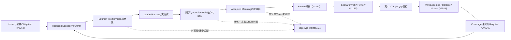

# TEI自身を題材とするIssue→設計文書ドッグフーディング（P0縦切り）

- 状態：**探索・受入条件候補**。本書の作成自体はTEI CLI/MCP実行、全設計情報の取得、意味受理、自己構築成立を意味しない。
- 作成日：2026-11-07（JST）
- Issue要件：[#3262](https://github.com/hat47x/tei-platform/issues/3262)（2026-11-07 08:28:31 UTC観測）、[#2605](https://github.com/hat47x/tei-platform/issues/2605)、[#1119](https://github.com/hat47x/tei-platform/issues/1119)、[#2831](https://github.com/hat47x/tei-platform/issues/2831)。
- 比較したmain：`96d276b74d338f47b2027d66a6dc7eedb24faa45`。比較した具体的Sourceは `cmd/tei/cli_contract.go`（blob `f1c167c56005da7f204f310078d3f2c3853d6848`）、`skills/yi-tei-modeling/SKILL.md`（blob `a49c111ff318fc83987de5f95e07d02dd86ff10d`）、`docs/status.md`（blob `ab349b8ea778adb550be4600c17c99de21821fc4`）。
- 関連する既存計画：[#3223](https://github.com/hat47x/tei-platform/pull/3223)はテスト生成前のDesign Contextを担当するDraft。本文の§14を置き換えない。本書は**TEI自身のIssueから設計票を作る一件**と工程上のBlockerを扱う。

## 1. このドッグフーディングで実際に解く課題

**要求入力**：「Issue #3262 の『対象Scopeに必要な設計情報を確実に読めること』を、最短の一Subjectで示し、足りない機能・証拠を設計文書と既存Issueへ戻す」。

**固定実例**：公開合成Reference `reference/workspace` と、`semantic-data:sales.order`。最初はTEI自身のCLIとProduct Skillの動作確認に限定し、対象Domain全件やIssue全件・実顧客データは使わない。Function/Business/Rule/Procedureの存在・不存在や意味受理は、Data Subjectが一件読めたことから推定しない。

**期待する成果物**：要求と根拠が紐付く設計票（本書）、一度ビルドした実TEI CLIからの読み取り結果と閉包診断（CIのStep Summary）、未充足条件を担当Issueへ戻す差分、およびG1/G2/G4へ至る到達基準。JSONをMarkdownへ整形しただけで設計完成としない。

## 2. ユーザー要求→設計義務→既存Owner

| 義務 | 必ず区別するもの | 今回の結果・担当 |
| --- | --- | --- |
| ID-01 要求の同定 | Issue URL/観測時刻/要求Scopeと、モデル内Subject ID | 本書に固定。現在のIssue全件を取り込んだとは主張しない。#3262 |
| ID-02 Sourceの到達 | 宣言されたroot、管理Inventory、実Loader Read、Parser/Role/Accepted Meaning | 現行`workspace-files`の`readByLoader`と`validate`診断は利用可能。Parser完了・Required全件は別。#2822/#2823/#2620 |
| ID-03 同一版参照 | CLI実行物のbyte/checkout、Workspace、World/SourceIndex fingerprint、Tool受領 | 単一実行物で限定比較。fingerprint一致だけでWorkspace全Byteの同時Snapshotは言えない。#2354/#2605 |
| ID-04 三視点と依存閉包 | Data/Function/Business、manual、Rule、隠れたPredicate、Relation、Requirement | 初回Dataのみ実取得し、それ以外は`unknown/not-queried`。依存先推測は禁止。#3262/#1125/#1132/#2582 |
| ID-05 開示・配送 | local read-only、外部Harness送出許可、全Reply、page end | CLI smokeは外部受信資格でない。8,192 byte途中切断・56/55が既知の負例。#2509/#2516 |
| ID-06 設計文書の採否 | Source-backed事実、生成AIの推論、未決、Ownerの意味受理 | 文章化は候補、正式意味受理は別。#1803/#1124/#2514 |
| ID-07 再入力と差分 | 旧結果、新Source、変更影響、再資格化 | fixed refからの再収集・差分が必要。#1119/#2600 |
| ID-08 セルフビルド接続 | 実行Graph、実消費byte、生成Artifact、再入可能な実TEI Process | 文書生成とGo buildは全体Self-Buildではない。#2831 |

## 3. 実行できる範囲の最小手順

既存の `tei.cli.discovery/v0` は `selected-read-only-commands` のみ。外部に使えるTool/認可全体を示さない。`version -json` は通常の `ok/result` EnvelopeではなくIdentity形、`world` はraw、`source-index` はmode依存である。全結果を無条件で同一JSON schemaと仮定しない。

このPRの `.github/workflows/tei-issue-design-dogfood.yml` で、一つのcheckoutからTEIを一度ビルドして次を実行する（新しいTEIコマンドは追加しない）。

1. `tei commands` と `tei version -json` で公開範囲・実Binaryを確認する。
2. `tei workspace-files -workspace reference/workspace` でInventory/Loader読取区別を残す。
3. `tei model catalog` から `semantic-data:sales.order` の曖昧でない存在を検査する。
4. `tei inspect` と `tei source-index` を同じSubjectに実行してSourceと意味要素を**別の観測**として保持する。
5. `tei trace` の公開合成Relationと `tei requirements` を補助観測し、`tei validate -json` のWarning/diagnosticsも出す。
6. 既存 `skills/yi-tei-modeling/verify_skill.py` と14件の合成静的試験も同じcheckoutで実行する。**Product Skillの文書整合検証であり、AI HarnessがSkillを実Loadしたことではない。** 必須なfingerprint位置と型を照合し、欠落/不一致なら失敗。取得していないFunction/Business/Requirement coverageを`complete`にしない。
7. CI Step Summaryへ「要求→実観測→未解決→追加Issue」を機械作成する。外部AI Harnessや実MCPを呼んだと主張しない。

これは**P-1aの限定実装**であり、P-1bの製品共通Design Context Queryそのものではない。Pythonで補助的に行う比較は既存CLIの内部Resolverを再実装せず、試験用の消費者検査のみとする。

## 4. 発見された初期阻害点と直近の対処

| 阻害点 | 診断・反例 | 最短の対処 | Exit |
| --- | --- | --- | --- |
| B1 宣言件数を完全性と誤認 | empty Workspaceでも`validate.ok=true`、builtin Catalogのみ、managedかつ未Load | `workspace-files.readByLoader`と宣言数・必要なSubjectを照合。未解析はunknown | Required集合に対する欠落が診断に残る。#3262/#2822/#2823 |
| B2 Command別JSON形の差 | version identity、mode、raw world | Discoveryの`jsonContract/successShape/modes`に従う。共通Responseを捏造しない | 誤Envelope・schema変更を検出。#2354 |
| B3 Tool受領欠落 | 切断・Reply欠落・stderr混入 | CIでは実Byte/Exit/JSONを別保存。Harnessでは分割・terminal markerを後続実証 | 欠落時`delivery-complete=false`。#2509/#2605/#3262 |
| B4 Issue→正本の飛躍 | AI生成文の「受理済み」偽装 | Source-backed/推論/未取得/Owner判断の独立列を保持 | 採否をAIが偽装しない。#2514/#1124 |
| B5 自己記述から自己構築への飛躍 | Go build/Plugin SB-3のみでG4合格と誤る | #2831のL1/L2/L3、SB-A/B/Cに成果物を渡す | stage1実TEI Processがstage2を駆動する独立証拠。#2831 |
| B6 Skillは設計情報を閉包しない | 現行`yi-tei-modeling`はcatalog/inspect/trace/validate中心 | この実験を既存Skillへ参照追加するのは#2605で行う。新Core Readerを追加しない | 同一TaskのH2/H3比較で未カバー/誤答と呼出負荷を測定 |
| B7 Skill検査がcheckoutを汚す可能性 | #42357274048はSkill静的14/14合格後、clean working tree検査で停止 | `PYTHONDONTWRITEBYTECODE=1`を適用。検査前後の状態と実行物を区別 | #42357337108で再試験成功。OS副作用全体の不存在は未確認 |

## 5. 独立Expectedと圧力ケース（同じ実CLIの結果から自明に作らない）

| Case | 操作 | 判定 |
| --- | --- | --- |
| DF-01 正常 | 固定Public Workspaceで`sales.order`をcatalog→inspect | Subject ID一致、非曖昧、World/SourceIndex照合。これだけで三視点完成とはしない |
| DF-02 必須対象欠落 | 独立Requiredに記したSubjectをCatalog投影から消す（合成Mutation） | 欠落を`incomplete`。空の意味モデルとして成功扱いしない |
| DF-03 版不一致 | inspectのSourceIndex fingerprintだけを別値にする（合成Mutation） | 異版接合拒否。古い説明を継承しない |
| DF-04 非照会領域 | Business/Functionを取得しない | `not-queried/unknown`。未存在と確定しない |
| DF-05 受領切断 | JSON受領を8,192 byteで切断 | JSON parse/terminal失敗をdelivery不適格へ分離。実Harness試験は#2509 |
| DF-06 欠落意味 | NOT EXISTS・手作業・Ruleが出力列に現れない | 欠けた意味/非出力依存を`none`へ正規化しない。#2582/#3262 |
| DF-07 二重の権限 | read-only Commandが実行可能、現開示Grantは未確認 | Tool成功から外部開示の正当性を推定しない |
| DF-08 自己構築 | stage1/stage2のdigestが一致、Stage1実TEI再入場未確認 | L2/L3を混同しない。#2831 |
| DF-09 必須Source未読込 | Required Source `semantic/sales/order.tei`をInventoryに残し、`readByLoader`だけfalseへ変える合成Mutation | Loader消費が失われた事実を`not-loaded`と検出。Parser受理や全閉包には拡大しない。#3262/#2823 |

DF-02/03/09はこのPRのCIで**JSON投影に対する合成Mutation**として実装する。DF-04は明示的にunknownで出力。その他は要求として記録し、実行したか否かを分ける。

## 6. クリティカルパスと一回ごとの受入

| 順 | 実行面 | 通過条件 | 次の担当 |
| --- | --- | --- | --- |
| D0 | Issue要求を仕様義務へ翻訳 | 各義務にSource、既存Owner、独立ExpectedとUnknownがある | #3262 |
| D1 | 実TEI read-only CLI | 1 binary、限定Subject、9結果、独立SourceのLoader確認、世界/入力元指紋の比較、意図的破壊3件検出 | #3262/#2605 |
| D2 | Product Skillが同じ調査を指示 | CLI実出力と同じ報告、欠けた情報・Scopeを隠さずH2/H3で測定 | #2605/#2509、TAI #168 |
| D3 | Issue→採否待ち設計文書 | Data/Function/Business・Requirementsの出典と未取得を表示、意味候補を正本にしない | #1803/#1124 |
| D4 | 一件のSource変更→再検査 | Preview/Acceptance/再解析/影響/Driver/独立Observationが同版で接続 | #1119 G1/G2、#1124、#1180 |
| D5（並行） | TEI全体Build Graph | Graph→実消費→TEI Binary Artifact（L1/L2）→Stage1実TEIの再入場（L3） | #2831 G4 |

**D5はD1〜D4のハード前提ではない**。D1で得た実Binary/Source Fingerprint・使用ツール版は、#2831でBuild Artifactと設計根拠を結合するための入力にできるが、G4の結果へ自動昇格はしない。TEIのGo単一バイナリ配布を基本とし、Go toolchain自体のself-hostingや専用TEI Hostを必要条件にしない。

## 7. 計測と撤回条件

- 実CLI呼出回数、失敗/Warning、未取得義務件数、CLI応答byte、生成する設計票のSource対応率・誤ったcomplete宣言数を記録する。
- H2/H3では実Tool呼出・Skill読込・Token/時間・独立Expected一致を別計測（既存TAI #168/#2018の分母を使う）。AIが答えを書いただけではTool実行済みとしない。
- 初回は**TEI実CLIだけを使用**。整形投影が既存Reader出力だけで成り立てば新Product Queryは後続圧力まで見送る。不足が具体的に観測された範囲だけ、#3262で共通Reader投影を増やす。
- 独立Requiredを満たせない場合、空結果を成功にしない。誤った外部開示・別版混合・Issue意味受理の捏造を検出したら、その成果物の適格性を撤回する。
- 完了区分は**実装・合成試験・実CLI CI・実Harness・Owner受理・製品G1/G2/G4**を別々に記録する。

## 8. 初回の事実資格

2026-11-07の設計前調査では、GitHub接続を使って上記IssueとCLI契約・Skill・既存CIを読み、設計のFit/Gapを作成した。**この時点でGitHub文書に対するread-only調査は実施済み**だが、接続はTEI CLI/MCPの実行口ではないため、本書の起票時点では新しい実TEI CLI・MCP/Harness・Self-Build/Host/Provider試験を実行したとは主張しない。CIを実行した場合は、対象Run・exact commit・結果を本書の歴史的な本文へ上書きせず、PR/Issueへ追加記録する。

## 9. 段階的な実証記録（時点ごとに上書きしない）

- **初回の限定実CLI結果**：Draft [PR #3264](https://github.com/hat47x/tei-platform/pull/3264) head `4677b56d1093eccbaac53873c59ed55ee575b156`、[実CI #42356836861](https://github.com/hat47x/tei-platform/actions/runs/42356836861) Job `128356649098` が `completed/success`。実checkoutはPR仮統合 `2d7b6d642e11a7a0b8575cfebc1fb1b62bafbb1b`、Go `1.26.10`、実TEI Binary SHA256 `c9f745982a616fac0e7c0a996b24192b70b04a4070615477fc9a176a7dcd9071`。9種類のread-only JSON、DF-02/DF-03合成負例がPASS、Validate診断3件、Claim=partial。**当該RunにSkill静的検査とDF-09は含まない**。
- **第二段階（実CI成功）**：既存Product Skill静的チェッカーと14件の合成テスト、独立Required Source `semantic/sales/order.tei` のInventory/実Loader読取、DF-09未読込Mutationを追加。[修正後実CI #42357337108](https://github.com/hat47x/tei-platform/actions/runs/42357337108)／Job `128358194403` は **completed/success**。対応PR Head `470cc8c167fc3beca3bf90af528e8eac323ce9d3`、実checkout（PR仮統合）`64b1f98c9b43959b2e040085a4de2c128cf84006`、実CLI Binary SHA256 `7c881ddd9dbe454d345f3c2bcc4f123e3b97a5a9a45fd5f39b1927eef4485860`。14/14静的負例PASS、9件の実CLI応答、DF-02/03/09すべて検出。固定Sourceの `readByLoader:true` を確認したが、Parser/Owner Meaningや全Requiredは未証明。
- **途中失敗の負例**：[CI #42357274048](https://github.com/hat47x/tei-platform/actions/runs/42357274048)ではSkill静的検査・14テストはPASSしたが、その後の実CLI工程でexit 1。ログ上は `git status` の清潔性確認後、Go buildに達する前に停止。Python testが作る`__pycache__`による作業ツリー汚染を有力原因とみて `PYTHONDONTWRITEBYTECODE=1` を追加し、再試験が成功した。失敗時の`git status`実行出力は未保存のため汚染ファイルの実名までは断定しない。AI Harness/Skillの読取り宣言でも検査補助過程の副作用を独立に点検する必要がある。
- **未実行**：実HarnessのSkill Loader、外部MCP、実OS/Disclosure、全SourceのParsed/Meaning/Rule依存閉包、Stage1実TEI Process再入場はこのCIの受入外。

## 10. テスト能力そのもののドッグフーディング（#2514 / #1180 / #3223）

**動作するテストが存在するだけでは、必要な不具合を発見できるとは限らない。** Issue→Design Context→Scenario/Case候補→実行→独立Expected→Mutant判別→未カバー逆引きまでを独立したProduct能力として検証する。今回は既存のScenario CLIと公開合成Sourceだけを用い、新Test Runner/Scenario SSOT/Oracle Engine/Hostは増設しない。

### 10.1 テスト能力を検証する四つの別の主張

| 能力 | この実験の最小確認 | 合格と取り違えないこと |
| --- | --- | --- |
| 発見・Coverage要求 | Issue #3262 / #1180 / #2514から既知の6 Scenario stepと追加負例を独立義務として固定 | 6 stepの実行をTEI全機能/全要求/非機能の100% Coverageとしない |
| 生成・実行 | Scenario SSOTから生成したCLI argvと各Source/World/Lock/Fixture pinを実ビルド済み`tei`別プロセスから実行 | 単なる`scenario verify`、in-process Go test、synthetic実行を実DB/Web/Host副作用としない |
| 判別力 | 正常／業務拒否と、故意の誤データ・誤Expected・古いpin・改変Planを別の検証基準で識別 | exit非0の件数だけではバグを検出した証拠でない。理由/対象Rule/期待差を照合する |
| 範囲・費用・再資格化 | C0相当のGo statement coverageの局所値、C1未計測、要件/NFR未検証、binary+source hash、失敗理由を記録 | C0をC1と呼ばない。未知の要件分母、未取得Rule、実Provider/開示資格を0件として処理しない |

### 10.2 独立Expectedと既知Mutantの最小試験

`reference/driver-scenarios/order-entry-pattern-smoke.json`はScenario正本の**公開Reference**であり、検証の唯一の正答供給元にはしない。独立Expectedとして、数量>0、行番号>0、同一Relation内の行番号一意を、固定既知ケースに対して別の簡易Property判定と具体的なExpectedにする。これらは製品の業務意味Owner受理ではなく、限定的な合成独立検証基準。

| ID | 意図的な差分 | 必須の判別 |
| --- | --- | --- |
| TA-01 | 有効Fixture（数量2.5、行番号1、Key 1/2） | **実CLI**の版固定`validate-positive`で3 Rule satisfied |
| TA-02 | 数量0、他は同じ | **実CLI**の版固定`validate-denied`で数量だけnot-satisfied。業務拒否を技術エラーにしない |
| TA-03 | 有効FixtureのRelation Keyを1/1へ差替え | **実CLI**が一意Rule `result=not-satisfied` を検出し、元Scenario期待に反するため拒否 |
| TA-04 | 数量0のScenario Expectedだけをsatisfiedと偽装 | **実CLI**が実Evaluator結果と差分を検出し、Expected自己申告を採用しない |
| TA-05 | 版固定コマンド生成後にFixtureだけ変更 | **実CLI**が古いFixture pinを拒否し、前回成功を再利用しない |
| TA-06 | 生成済みCLI Planのargvを勝手に変更 | **実CLI** `scenario check` が生成元との不一致を拒否 |
| TA-07 | 必須6 stepのうち`validate-denied`を候補から削除 | **独立Requirement集合**と比較して未カバー。短い候補が実行可能でもcompleteにしない |
| TA-08 | テスト用判定器を全Rule常時satisfiedへ置換 | **独立Property**がゼロ数量の偽陽性を検出。実TEI EvaluatorのMutation killとは区別 |

実装対象は`tools/reference-issue-test-ability/probe.py`と、既存`.github/workflows/tei-issue-design-dogfood.yml`の限定CI Step。実Binaryは前段と同一、Source改変はrunner一時領域のコピーだけ、実Provider/Secret/DBは使わない。

**独立性の上限**：TA-03/04は実Evaluatorが意図的に壊されたScenario/Fixtureを区別する検査であり、Production実装のあらゆるコードMutantを検出したことにはならない。既知の**実EvaluatorコードMutant kill**は#2514 / 禁止merge Draft #3017の既存実証を参照し、本PRでは再導入しない。TA-08は補助テスト用判定器の反例であってGoの実Mutantではない。

### 10.3 C0/C1、要求・非機能Coverage、テスト生成の未成立点

- `go test ./cmd/tei -run '^TestRegenerateScenarioArgvAndStdinPlan$' -coverprofile=...`で、**この限定テスト選択に対するGo文coverage（C0相当）**を取得する。`go tool cover -func`の`total: (statements) ...%`だけを局所Evidenceに記録。全Package・全TargetのC0とは違う。
- Go標準statement coverageの値をC1分岐Coverageへ流用しない。**C1はunmeasured**。必要なら既存#3223/#1180でBranch Toolや重要分岐の明示Negative Scenarioを検討するが、今回の実験では一般C1達成率を宣言しない。
- 機能要件Coverageの分母はIssue Requirement→Qualified Contextで解決した義務であり、Sourceを1件取得しただけでは未知のRequirement/Rule/Business Procedureを含められない。NFR（性能・可用性・セキュリティ・開示）も今回の合成CLIで測定していない。
- 将来のProduct Test Pattern Recommendation：独立Required/Source閉包→未達義務と適用述語→Pattern候補最大3件の理由付き提案→候補Scenario Review→再生成CLI/Web等→同じ独立Holdout/Mutantで判別。その比較は#3223/#1180/#2514の既存Ownerで行い、専用Product Skillやハーネスには**正答Holdoutを渡さない**。
- 測定する生成AI Test Capability：独立義務からの候補発見率、C0/C1の実測範囲、既知Mutant kill/survive、false-qualified、不要Case重複、実行時間・Token・人手、対象Source/Expected/Runner版の一致。候補数やコード量だけはKPIにしない。

### 10.4 昇格の条件

**T0（今回）**：固定Scenarioの実Binary pin付き6 step＋4種の実CLI誤り検出＋2種の独立判別基準＋C0局所計測（C1未計測）。これは**限定Test Ability**であり、Issueからテストを生成AIが自動設計した証明ではない。

**T1（次）**：Design ContextのRequired集合から、AI/人間がテストパターンを選び、既知Holdoutを見せず独立Scenario候補を作る。候補に同一固定Referenceの正答をあらかじめ埋め込まない。実CLIによる生成・実行・独立Expectedとの比較、false-qualifiedとuncoveredを#2514へ提出。

**T2（後続）**：同一ScenarioからCLI/Web/Studio/外部Targetへ投影・実行し、Provider/Host/Effect/Receipt/Readの別証拠を保持する。G1/G2業務一往復へ接続するが、未知の外部結末とMeaning Owner受理は別。

**T3（Self-Build並行）**：TEI自身のTest CapabilityのSource・Scenario・Build定義・実ArtifactをTEI標準構造で管理し、Stage1実TEIがテスト能力も再現する。#2831のL1/L2/L3とは異なる資格を混同しない。

**現時点**：本節は実装PR候補として作成。新たなCIの実検証結果はこの文書に履歴として追記する。MCP/SkillによるAIテスト自動生成、C1計測、実DB/Host、正式Owner意味受理は**NOT RUN**。

## 11. テスト能力の初回実行記録（2026-11-07、Run単位で区別）

- **最初の失敗Run [#42358779661](https://github.com/hat47x/tei-platform/actions/runs/42358779661)**：Job `128362515378`の既存Product Skill/Design Context StepはPASS、限定`TestRegenerateScenarioArgvAndStdinPlan`のGo testもcoverage `10.1% statements`でPASS。ただし新Test Ability Probeは実`observe-synthetic`の`observationResult`を`{"kind":"string","data":"pending"}`と期待してFAIL。実装はTyped Valueの`Decode()`後、値`"pending"`を返す。**テスト側がTyped Input表現と観測Value表現を混同していた**。正本実装のSourceを確認し、独立Expectedを修正。旧失敗を製品Failと断定しない。
- **修正後実Run [#42358886968](https://github.com/hat47x/tei-platform/actions/runs/42358886968)**：Head `5d06a49a99f988946fe778fec4e32197bd6e7718`、Job `128362831125`は`completed/success`。PR仮統合Checkout `54ab2672550ea828f27506cc9dc1e70f3a6bdb67`、実Binary SHA256 `058d205707194c0a36b3bcb99fada7ccbc33a7c5f9c543e2a9a8ae9ba7c7ecb9`。Generated-pinned Scenarioの6 stepを実TEI CLI別プロセスで実行し、正常Validation／数量0の業務拒否／Browse／Observationの状態を確認。**実CLIで4種の負例**（Key重複・Expected嘘・古いFixture・改変Plan）を検出。**独立限定検証で2種**（必須step欠落・常時satisfied）を検出。計6件の判別Control。Go局所statement C0相当`10.1%`、**C1未計測**、全業務要求/NFR未計測。
- **第三段階のEvidence保存**：実Runの`test-ability.json`、`report.json`、`tei-scenario-c0.cover`は従来runner一時領域にあり、Action Artifactとしては保存されていなかった。新commitでGitHub Actionsの公開合成テスト証拠のみを7日間のArtifactとして保持するStepを追加。これ以降のPR HEAD/Runは**別Evidence**とし、上記旧Runの成功を代用しない。

この限定検証が証明するのは**テスト実行と既知負例を見分ける能力**であり、生成AIがIssueから適切なテストを新規生成できる能力ではない。T1では既知HoldoutをSkill/生成Agentへ見せず、同じQualified Sourceから提案されたテストが独立Mutantを判別するかを比較する。実Go EvaluatorコードMutantについては#2514/#3017の独立証拠を維持する。

## 12. テストが存在しても起動されない問題（CI Trigger Closure）

**2026-11-07 の初回Fit/Gap**：実CLI/Scenarioのテスト能力T0をCIで確認できても、Workflowの元の`pull_request.paths`は主にScenario/Validator/Test Toolだけであり、`reference/workspace/**`、`internal/driver/**`、`internal/workspace/**`、`cmd/tei`の全入口、`go.mod/go.sum`、Product Skill本体の変更では**自動起動が保証されなかった**。結果として、一部の実装・構成変更でテストが存在するのに再実行されない「発火Coverage」のギャップがある。これはC0/C1、テストCaseの判別力とは別の品質義務。

- 今回は現行Workflowの`pull_request`と`push`にSource/CLI/Scenario/Skill/Build依存を覆う保守的なpath集合を追加し、`main`へのpushで**統合後mainを再検証**する。既存の実行Step・Expected・Runnerは変更しない。
- 既存CIが監視する`cmd/tei/**`、`internal/**`、`reference/workspace/**`、`reference/driver-scenarios/**`、`skills/yi-tei-modeling/**`、`tools/reference-issue-test-ability/**`、`go.mod`、`go.sum`を明示。新しいトップレベル依存が増える場合は完全な静的依存Graphによる対象判定がないため、`paths`の資格を再検討する。
- 粗い保守的path集合での追加CI起動回数/費用は#2018に記録し、**正しさを落とさずに**後から対象を絞る。緩いworkflow filterを`CI成功`より上位の品質資格としない。
- 同じCIのPR仮統合checkoutと`main push`checkoutは別版・別Run。PR合格をそのまま統合後mainの実測値に転用しない。
- Scope外：GitHub Actions起動サービス全体の可用性、秘匿データへの外部送出、実H3 Harness Skill、Go以外のTarget/GUI/NFRの全Dependency closureを証明するものではない。

現時点では新Trigger契約を設計・Workflowへ保存した段階。実`push main`の成功は該当Runを確認するまで**NOT RUN**。

## 13. 横断設計の成熟判断とテスト生成前の資格ゲート（2026-11-07）

### 13.1 他レーンから取り込む「既に検証された範囲」

| 既存Owner | 取り込む実証済み範囲／未実証との境界 | 今回の扱い |
| --- | --- | --- |
| #3262 / #2605 / #2509 / TAI #168 | 実TEI read-only CLIによる一Subject/Source照合と、限定H3 Skill Tool Readは存在。外部Harnessでは`model catalog` 8,192byte切断、Tool Request/Reply 56/55、許可範囲外canary読取、4Sessionの適格比較0/4の問題が残る。 | **ローカルCLI応答完整性とHarness実Deliveryを別資格**にする。Skill読取の事実を回答全文受領や漏えい防止へ昇格させない。 |
| #2514 / #1180 / #3223 | main上のgenerated-pinned Scenario 6 Step、4実CLI負例＋2独立義務負例、局所statement C0相当10.1%は実証済み。別Draft #3017には実EvaluatorコードMutantでAI Scenarioが失敗した証拠がある（意図的FAIL・merge禁止）。 | **「実行できる」→「既知欠陥を見分ける」**の次に**「Requiredから未知Caseを発見する」**を置く。C1は独立測定までunknown。 |
| #2586 / #3238 / #2853 | 局所実PostgreSQL ReadやCommand/Receiptの限定観測は存在しても、製品Function→Query→Provider Readerの実Read、同一Scopeの全件性、DB現在値の独立再読取までが一連の合格とは限らない。 | 合成Browseを実Function/Provider Readにしない。`Query output=0`から不存在を主張しない。 |
| #2831 / #1119 | `go build`とStage1 Binary再実行は異なる。Stage1実TEIプロセスがStage2 Build Planと既存Adapterを駆動するL3は未検証。 | テスト自己記述・CI成功をG4全体Self-Buildへ昇格させない。 |
| Plugin／Trait／Data/Presentation | 拡張型の実装強制、原子的Trait合成、Data↔Function内Presentation↔操作/Authorityを分ける方針は候補。選択済Pluginと実Consumer Load、データの存在と画面/操作・実Providerアクセスを同一視しない。 | 将来のTest Pattern選択に`Applicability`、`Required Capability`、実Load/権限の別条件を追加する。新Core Type/Registry/Authorityを先行しない。 |

この表は異なるRunのPASSを合算した製品E2E証明ではない。設計上の候補は**実証済み**と表示しない。人間Ownerが判断する業務意味、正式な対応付け、拒否可能なGrantは自動承認しない。

### 13.2 「Issue→テスト」の実行可能性を独立した有向グラフとして扱う

このグラフはMermaidによる**読みやすい投影候補**であって、TEIの標準Graph/Relation IDの正本ではない。将来のTEI Graphでは、各Nodeの`identity/type/source/revision/state`、各辺の`kind/required/observed/ownership`、Rule/Scenario/Caseの多重参照、順序差を保持する。SHO図面等への投影でも「描画されなかった辺＝存在しない」を許さない。

**基本決定**：当面のテスト生成には、未解析な全Workspaceを静かに補完するAIを使わない。取得済みのBounded Contextから局所的なテスト候補を作る場合でも、必要Requiredの不足を`unknown`として先頭に表示する。Issue記述をLLMで要約しても、その文章はSource/Ownerの受理証拠ではない。

### 13.3 最初の実装差分：Test-readiness Consumer（T0.5）

`tools/reference-issue-test-ability/context_gate.py`は前節で実行済みの**同一9つの既存CLI JSON Replyだけ**を消費し、必要な対象の独立義務と照合するテスト専用Consumerである。TEIの第2 Parser、Function/Rule Resolver、共通Query Engine、Scenario正本を実装しない。

| 軸 | 現行CLIで観測可能な要素 | 未資格化・混同防止 |
| --- | --- | --- |
| Transport | 9件すべての応答、JSON型、終端改行、Schema version、コマンド実行結果 | 外部LLMへの完全受領、stdout/stderr再結合、Network/Disclosure/Grantは**未測** |
| Source | 必須`semantic/sales/order.tei`のInventoryと`readByLoader:true` | 管理/読込だけでParser・業務Role・全Required閉包まで主張しない |
| Subject | `semantic-data:sales.order`のCatalog非曖昧存在とInspect対応 | 他のFunction/Business/Rule/Rule出典とScenario実行先は別 |
| Freshness | catalog/inspect/trace/validateが持つWorld/Source Index FP一致 | A→B→A、別Consumer/別時刻、実ProviderのSource Revision/Grantの現資格まで言えない |
| Validation | 成否、Source Root欠損、診断件数 | `validate.ok=true`を正式なMeaning Acceptanceや全Productテスト適格にしない |

CIの最小Negative集合は、①Required Subject欠落、②Inventory掲載だがLoader未消費、③FP新旧混合、④Tool Reply欠落、⑤Schema Drift、⑥Source Root欠損、⑦外部Harness/Provider/Grant未観測でも完全受理しないこと、の7種類。**①〜⑥は既存実CLI Replyのtest-onlyコピーを改変して拒否判定、⑦は現資格を保留する静的資格負例**であり、各Originの実Source、権限、DB、外部Networkを改変したE2Eテストではない。

「探索用の限定Contextが揃った」場合は`boundedReference=partial`／`testExecutionAdmission=exploration-only`とし、既存生成済pinned ScenarioのT0を走らせられる。いずれかの必須Replyが失われたら`blocked`。いずれも`qualifiedTestGeneration=false`、`independentFullRequiredSetProven=false`、`externalHarnessDeliveryComplete=null`であり、**未観測のFunction/Provider、認可、Owner Meaningを成功へ自動昇格しない**。実ProviderでのQuery→Rowset/Completenessは#2586が引き続きOwner。

Provenanceは観測した各Replyの実Bytes/sha256と評価したSubject/Source/FP/不足Claimを記録し、CLIの内部Index構造を再解釈するParserを作らない。公開合成Fixtureのみを使い、外部Sinkへ原Rawを送出しない。ResultはActions Artifact（7日保持）で再読取可能にし、Run SHAとBinary SHAは既存T0へ連結する。

### 13.4 次の段階を受け入れる条件（T1/T2、導入順は変えない）

1. **T1a: Required→Context**。#3262の最小Read-only Queryを既存typed Application Serviceから返し、Data/Function/Business/Rule/Source Anchorの**少なくとも1つずつの独立Expected**についてLoader/Parser/Meaning/Bindingの不足を列挙。同じQueryのCLI・将来MCP・人向け図表では`identity/revision/unknown/disclosure`の同値を先に確認。まだ全Workspace対象ではない。
2. **T1b: AI Test Patternの発見**。同一Subjectの固定Task・同一Read-only Tool Budget・同一Disclosureを与えた2条件（Skill利用なし／既存Product Skill利用）で最小指示からCandidateを生成。**独立Holdout/誤実装は生成Agentと外部Harnessに渡さない**。選択理由・Rule/Relation/Source・候補の重複・未カバーRequired・誤受理を採点し、#2018にTool/Token/時間/人手を別々に記録。#2509のH2/H3はSkill実LoadだけでなくResponse End/Permission/Reply Countがそろうまで比較適格にしない。
3. **T1c: 実行と判別**。候補をOwner Reviewしたうえで#1180のDriver Scenario SSOTへ採用し、同一版から各Targetへ再生成。#2514独立Expectedが真のCode Mutant/Fixture改変/NULL/未取得/部分Rowset/0件誤不存在をどれだけ検出するか確認。検出したMutantの対象Version・実行Bytes・Failure理由を固定する。単にexit 1を返すだけの常時拒否をPASS扱いしない。
4. **T2: Cross-routeと実Read/Effect**。Data構造とFunction内Presentation、画面Action、現在Grant、実Provider Read、Command Effect、Receipt、独立Resource再読取を段階別に試す。HTTP API例外応答は成功/業務拒否/技術失敗/効果不明を区別したScenario Branchとし、Node＋Transition＋Expectedの対応をTEI Graph/表でdogfoodする。旧Receiptで現資源状態を証明しない。
5. **T3: Self-description → Self-build**。Case/Rule/Build Graphを標準構造で記述・別表現へ投影してもID/Source/Roleが変わらず、Stage1実TEI ProcessがStage2を駆動したL3の別証拠を#2831に残す。Go Build単体、Graphの描画、Plugin選択だけでG4を閉じない。

**P0実装停止線**：本項のT0.5が成立しても、正式なTest Pattern推薦/テスト生成機構・Design Contextの製品API・MCP・実H3外部回答・Source/Grant/Provider完全性を実装済みと記載しない。とくにHTTPの正常/例外グラフ、Trait強制、標準表現型のE2Eは次段階の**設計義務**であり、今回の新実Go/Provider試験には含まれない。

### 13.5 実行記録・測定範囲（2026-11-07／T0.5）

[PR #3284の初回実Workflow #42370357906](https://github.com/hat47x/tei-platform/actions/runs/42370357906)、Job `128397031005` は **completed/success**。PR HEAD `d81385e72c8b0b54a6eb83b073e92c41c2796dac` の仮統合Checkout `e640348f6f2cef648b365c5c6739bba20cb52928`、実TEI CLI Binary SHA256 `19e189661d7b410f16ab78011d09938d78450c2c6e49d5f6c32f361dbf325e06`。

- Product Skill静的検査、9 read-only実CLI、`Design Context partial`の正常資格と7負例/未知検査、generated-pinned Scenarioの実6 Step、元のTest Ability判別Control6件が**同一CI**で成功した。Go局所statement C0相当10.1%、**C1 unmeasured**。
- 期待どおりの重要な負の結果：`qualifiedTestGeneration=false`、`externalHarnessDeliveryComplete=null`。CLIが正常応答したことは**全Required Source/業務Meaning/実Provider/実Harnessでの受領/Grant**の確認ではない。
- Artifact `tei-issue-test-ability`、ID `13573890404`（当該Runから7日間保持）は、限定`context-readiness.json`、既存`test-ability.json`、元の`report.json`、C0 profileを保存。ファイルそのものが永続Evidence Serviceや製品の検証正本とはならない。
- **注意**：上記は最初のPR HEADの実測。証拠追補によってGit commitは変わるため、最終HEADのmerge/main実行は別Runを確認する。異なるRun/Headの結論を合算して完了宣言しない。

<!-- design-intake-crosslane-20261108 -->
## 14. 横断設計取込：Raw Itemから意味候補・実Consumerまで（2026-11-08）

### 14.1 取込原則と責務

この節は、既存Issueと設計書の間で失われやすい意味・証拠の継ぎ目を整理する。新しいMeaning正本、Importer、Parser、Registry、Resolver、Runner、Host、Gateを作らない。対象は #2619 Everything is Data、#3262 Design Context、#2621 Authoring、#1125/#1126 三視点、#2586 実Read、#1180/#2514 Scenarioと独立Expectedの既存Ownerである。

設計取込は一括変換・一括受理ではない。未整理の情報をRaw Itemとして忠実に保管する経路と、必要な用途についてRole付きの意味候補を生成する経路を併設する。原文の保管、構文の読取、構造候補の成立、Ownerの意味受理、選択Providerの実行、外部Consumerへの完全受領は異なるClaimである。Action/Event/Taskは普遍的な基底型と決めず、Itemに適用する役割・Relation・時点として表せるかをまず検証する。Rawのまま全文閲覧できればよく、巨大Itemの全内容をカード化する必要はない。

TEIはSource/Reference/Revision、Structural Candidate、Accepted Meaning、依存とEvidenceを表す。SEIは問い・未知・矛盾・次のProbeを扱う。CLI/MCP/Harnessは実際に読んだ範囲、結果完全性、Grant/Disclosure、Consumer受領を検証する。AIの推論やTool到達だけでOwner AcceptanceやHost認可に昇格しない。

### 14.2 共通の取込照合票

| 領域 | 必須の区別・不変条件 | 担当と停止条件 |
| --- | --- | --- |
| Raw/Authoring | 原bytesまたは形式忠実性、Source occurrence/locator、版、読取時点、非公開情報、Draft/Requiredの別 | #2621/#2823。意味Role未選択ならRawとして保管し、実行しない |
| Role/Meaning | Subject identity、Structure Candidate、Role/Operator pin、Source location、曖昧な対応・Owner受理 | #988/#2620/#267。構文や同名の一致を意味受理としない |
| Data/Function/Business | Key/Relation/History、Function Data Context/Operation、Actor/DFD/手作業/起動契機を分離 | #1125/#1126/#1129。三図・CRUDは同一SourceからのProjectionで実Effectではない |
| 標準Dataと標準表現 | Data topology・grain・relation occurrenceとRepresentation topology・Function-owned instance・loss・選択epochを別管理 | #2497/#2506/#2507/#2500。Chart集計やDAG→Treeの曖昧な編集を拒否 |
| Canvasと媒体 | 同Itemの複数Canvas表示は表示occurrence。多重辺のidentity/direction、Source時間/取得epoch/Media clock/文書位置/単位を区別 | #1124/#997/#2495。配置変更をDomain mutationにしない。TTSを原音源と同一視しない |
| Plugin/Tool | Contract/Provider/Bundle、selected/resolved/linked/invoked/authorized、atomic Trait・Verified BOM | #951/#1251/#3267/#3278。存在・選択・CI成功を実Consumer適合に代用しない |
| 実Read/Write | Function→実Query SQL bytes/args→実Provider Rowset/Completeness→Consumer。書込はtyped Intent/現Grant/Receipt/独立Read | #2586/#1174/#2516。参照PG成功や旧Receiptで製品実効果を主張しない |
| 検証とHarness | Required、Loaded、Executed、Observed、Qualified、独立Expected、Coverage分母、Source/Test/Build版とTool完全受領 | #3262/#1180/#2514/#1163。C0はstatement、C1はbranchの別計測。未知を不存在にしない |

特に、Canvasの分割によって同一Subjectを複数表示しても、Subject/Business identityやHistoryは増えない。Graphの同名別Node、同じNodeの複数描画、多重有向辺、非公開・省略Edgeを区別し、選択同期をそのまま更新対象決定に使わない。表示に失われる情報がある場合はread-onlyまたは明示的な逆写像契約を要求する。

### 14.3 Source形式と保存の責務

2026-11-06にTEI向けの標準Authoringを *.tei.md へ移す方針が決まった。一般の .md は独立し、旧 *.tei は段階移行する。#3030は移行計画、Draft #3031はParser未束縛の *.tei.md を無音で読み飛ばさない暫定Guardであり、正式Markdown ParserやSource span/Role lowering/意味移行は実装済みとしない。

初期検証は、説明表と正式定義表の同形、Root内RequiredとRoot外Raw Draft、旧形式の継続、Parser未束縛時の明示停止、原文の移動・装飾変更・A→B→A、同名異bytesの保存後再Readを比較する。Draft保管成功とBuild Sourceとしての実消費を一つの資格にしない。SHOの文書受理とTEI Owner Meaningは独立に判定する。

### 14.4 実装順：P0-MとP0-Rは並列、接合はP0-C

| 段階 | 固定する対象と操作 | Exit・未充足時の止め方 | Owner |
| --- | --- | --- | --- |
| P0-I Raw/Context | 公開 reference/workspace の semantic-data:sales.order。Inventory、Loader、実CLI、Required Source/Role/Rule/Relation差分 | JSON/schema正常でも未取得のRole/Sourceをunknownへ。独立Required無しで全体Completeを主張しない | #2621/#2823/#3262 |
| P0-M 三視点 | 同一Source/Meaning/RevisionのData/Function/Business図、CRUD表、標準表現へのread-only投影 | 同名Node・多重Relation・人手Procedure・CRUDの宣言と実効果を混同しない。Provider実Readを先行Gateにしない | #1124/#1125/#1126/#2497 |
| P0-R 製品実Read | order_entry実Function、Productで選択したQuery/SQL bytes/params、Provider Rowset、Scope/Claim | 別Sourceの tei_web_scoped_orders_reference PG成功をProduct recent_orders.sqlの実Read資格へ流用しない | #2586/#2622/#2506 |
| P0-C 接合 | P0-MとP0-Rの同一Subject/Function/Query/Revision/grain/Scopeを結び、Consumerへ渡す | 別World・別epoch・部分受領を統合PASSへ合算しない。実Consumer Disclosureを別観測 | #3262/#2516/#1163 |
| P1 Plugin dogfood | CLI inspectとStudio Bridgeから、同一Pinned Contract/Providerをそれぞれ実呼出 | 旧CLI直結やMockの共通利用は不合格。別Provider選択でもCoreに新固定Kindを増やさない | #1251/#951/#1824 |
| P1 Edit/Effect | 可逆単一occurrenceのみPreview→Intent→現Grant→実Write→Receipt/独立Read | 部分・集計・同名別対象のWrite、commit unknownの新ID盲再送は拒否 | #2500/#1174 |
| P2 Consumers | SHO保存・再開、MCP/Harness完全受領、異Target/異Domainへの投影 | 保存成功やローカルJSON正常だけで外部受領・全Source Closure・Owner意味受理にしない | #2516/#2509/#2831、SHO担当 |

P0-MとP0-Rは別々に着手可能だが、P0-Cが成立するまでは同一シナリオの統合成功を主張しない。#1119の既存Gate G0〜G4は変更しない。#1251のPlugin inspector縦切りは並行し、既存Service Contractと独立Expectedを利用する。

### 14.5 既存Scenarioへ引き渡す判別観点（新Test SSOTではない）

- 未整理Item・説明表・Role未選択の *.tei.md を有効なFunctionとして実行しない。一方、Raw本文は欠落なく保存・閲覧できる。
- 同一Itemの複数Canvas表示、DAG→Tree、同名Node・多重有向RelationでSubject/EdgeのidentityとSourceへの追跡を失わない。
- partial Rowset、非可逆Chart集約、単位不適合Slider、時計の変換が未定義のAudio/Videoは、不正なWrite/同一軸の断定を拒否する。
- 正常Schema・同Fingerprintでも必須Rule/Relationだけ抜けた応答を不完全と判定する。個別Readが成功しても共同Snapshotを推定しない。
- Pluginの発見・選択・実Link・実Invoke・現Grantの未充足を別々に表示する。Tooling側の限定PASSを生成RuntimeのPASSへ広げない。
- 同じLogical IDや似たRow IDでも、別SQL/別Provider/別Rowsetを製品Readとして取り違えない。0行、格納NULL、未選択、非公開、unknownを別状態とする。
- Source/Test/Build/Operator/Consumerの変更・A→B→Aで旧Test PASSや旧Receiptを現在資格へ再利用しない。
- Tool途中切断、SHO保存後別Read失敗、外部Referenceの同名異内容差替えをローカル成功から隠さない。
- C0満点でもC1未計測、欠落Requirementと未検証NFRを別の未Coveredとして示す。既知Case実行T1-Aと、盲検の未知不足を探すT1-Bは分ける。

これらは#1180/#2514が独立Expectedと実Scenarioを管理するための要求入力である。本節を新たなCase正本にしない。

### 14.6 計画・資格の現在位置

採用する設計方向は、Raw保全から選択Roleへ、三視点とFunction内表現の同Source投影、CLI/StudioのPlugin-first、Context/実Read/Consumer/独立検証の同一Attempt照合である。実装優先は#3262のRequired Rule/Source閉包、#2586のProduct実Read、P0-M/P0-Cの接合であり、#1251のinspect実Providerを並走させる。

Itemの正式Role体系、Canvas API、Media clock実装、*.tei.md正式Grammar、Go以外のPlugin ABI、全Required Closure、AI未知Rule発見、実Target/HostとOwner Acceptanceは保留する。

**この追補のEvidence ceiling**：既存チャット、GitHub Issue、mainの設計・実装記録に基づく文書更新のみ。新しいGo/PG/Studio/SHO/Browser/Harness実行や実Provider/本番Grant/正式Meaning受理は行っていない。各ClaimはOwnerのexact Source・Build・Run・Consumerと独立Expectedによってのみ昇格させる。

<!-- design-intake-second-pass-20261108 -->
### 14.7 P0-D：設計文書が管理されていても「設計として読めない」断絶

前節のP0-Iは既存のStructured TEI Subjectを使う初回Readであり、通常の設計文書そのものをTEIが読む資格をまだ示さない。ドッグフーディング #3149 の新Issue [#3346](https://github.com/hat47x/tei-platform/issues/3346)では、docs/plan MarkdownをWorkspace sourcesへ追加してもmanagedFilesには列挙されるがreadByLoader:false、catalog/inspect/trace/source-indexで意味定義にならず、未知Rootのwarningが出ることが観測された。これは**ファイル不存在**でも**設計内容が空**でもない。「原文は管理Inventoryに存在するが、意味的な解釈経路はunsupported/not-loaded」を厳密に報告する。

最初のP0-Dは、新しい汎用Markdown Parserや外部File Readerを追加する前に、既存Workspace Inventory/Source Reader・Source Index/Role Readerの到達可能な操作を調べる。原Byteまたは位置付きReadを既存契約から提供できるかを判定し、できない場合はそのReadability GapをJSONと人間向け要約に両方明示する。一般の `.md`（自由文書/Raw/SHO）、`*.tei.md`（TEI Authoring候補）、`*.tei`（旧Native Source）、`*.sql`（Native asset）の用途・管理Root・必要Readerを**拡張子による意味受理を伴わず**区別する。未整理Item/OKF ConceptをTEI定義へ強制Loweringしない。

| 入力の例 | Inventory/保存 | Meaning/実消費 | 必要な限定判断 |
| --- | --- | --- | --- |
| docs/plan 内の自由Markdown | 管理対象となり得る | 現状、Loader解釈・design catalog到達は未成立 | #3346でread-only原文到達・unsupported診断を検証。無断で *.tei.md に改名しない |
| 管理Root内の Required *.tei.md | 存在だけは取得できる | #3031の暫定Guardはunboundを拒否する候補。正式Parserではない | #2621/#2823でParser選択とRole/Spanの実消費まで停止 |
| 旧 *.tei / 選択 *.sql | 現行Loader/Queryの各限定経路 | 実消費があっても受理済Meaning、Function→実RowsetやConsumer受領は別 | #2622/#2586の実入力Bytes/Scope/SQL選択を測定 |
| OKF交換Markdown/未知タイプItem | 元形式で保管できることを優先 | Exchange形式適合とTEI Role/Meaning/Operation admissionは別 | #2619/#2621/#2516。未知type/追加属性/壊れたlinkを無条件にSyntax ErrorまたはTEI Meaningとしない |

**読み取れることと正しいことの二段階では足りない**。ItemのRaw byte保管、Role候補、Meaning受理、適用先Function Context、実Operation、現在Grant、外部Sinkを各々独立に資格化する。非管理Draftの存在で必須SourceのLoaderを無条件停止する副作用も、必須Sourceを単に無視する動作も、Ownerの形式/Root Policy決定前に正当化しない。

### 14.8 Design Contextの「虚偽の欠落」とJSON指紋・応答形式

[#3345](https://github.com/hat47x/tei-platform/issues/3345)によれば、現行 `view -format json` の `semanticFingerprint` はApplicationが使用する名前空間だけの値であり、`catalog` 等の `worldFingerprint` と範囲が違う。値が異なることだけでVersion Driftと判定しない。一方、`view` にWorld/Source Index FPがない場合、**同一Worldの検証ができた**とも主張しない。#3345は同範囲の値を追加・明示するOwnerであり、本設計取込に第二Fingerprint計算器を作らない。

[#3347](https://github.com/hat47x/tei-platform/issues/3347)のCLI JSONの診断二重構造、`result` 配列/オブジェクト、Builtinと利用者定義の混在、Schema版とLock版の差は、Raw Replyを**実Command＋mode＋SchemaVersion**とともに保持して扱う。初期Consumerが勝手に平坦化して意味を上書きせず、Command互換を守る正規化は既存CLI Contract Ownerへ戻す。

[検討に用いた[#3324](https://github.com/hat47x/tei-platform/pull/3324)と[#3326](https://github.com/hat47x/tei-platform/pull/3326)のTT-56案は双方closed/unmerged。ただし**後継[#3354](https://github.com/hat47x/tei-platform/pull/3354)は両案の検証要点を一つの既存Consumerへ統合し、main統合済み**。旧二案の成功を二重計上しない。特に`source-index`のsubjectモードを全件Indexと誤認してRuleが不存在だと判定するのは**Consumerの誤り**である。必要Rule/Relationを独立Requiredとして先に固定し、要求に合うSource Indexモードで実Readして初めて「不足」を評価する。単一World FPの一致だけでは、全Rule/Relationの列挙、複数Replyの同時Snapshot、必要集合の網羅性は証明できない。

用途相対の判定を次のように整理する（正式Schema名は未採用）。

| Read/Requirementの状態 | 誤った結論 | 必須の扱い |
| --- | --- | --- |
| 原資料があるがReader未対応 | 対象自体が存在しない | unsupported/not-loaded、原資料参照は保持 |
| ReadモードがRequiredと不一致 | Ruleなし | wrong-mode / inconclusive。正しいmodeで再Read |
| Readは成功、独立Requiredが未定義 | 必須情報100% | denominator unknown。Complete資格なし |
| Requiredは確定、Replyに必須Rule欠落 | 全情報取得済み | missing required。候補生成前に閉包保留 |
| 別範囲FP・別時点を同一視 | 一致またはDrift | scope-incomparable。共通Revision/意味対象が必要 |
| 非公開・部分/0行・Page末尾未取得 | 0件なので不存在 | withheld/partial/unknown。秘匿件数自体も無許可開示しない |

この判定は#3262のContext QueryがOwnerであり、#2514の独立Expectedに対して**欠落を正しく発見するだけでなく、誤った不存在判定を抑える**ことを別指標で評価する。Partial Contextの`qualifiedTestGeneration=false`を変えない。

### 14.9 read-onlyの意味、Providerと受信Sinkの効果を分離

PluginとToolの宣言上のread-only、実argv/FlagによるFile/Network等のEffect、Tool受信者によるSession Log・ファイル保存・外部AI送出・再開時再提示は別の実際の経路である。mainに統合された [#3333](https://github.com/hat47x/tei-platform/pull/3333) の`view`書込Flag診断、未統合の[Plugin Offer/Binding計画 #3338](https://github.com/hat47x/tei-platform/pull/3338)、[OKFと情報流計画 #3329](https://github.com/hat47x/tei-platform/pull/3329)を参照する。Catalog上read-onlyでも実行VariantがFile Writeを選べば純粋Readの資格にはしない。ProviderがReadのみでもConsumerが永続化したり、前Sessionの内容を再投入すれば情報の移動が生じる。

P0-D/P0-IのRaw Item取得は未信頼Sourceの文字列をデータとして扱い、そこに含まれた命令をTEI/AI/CLIの新しい権限として実行しない。原資料のRead、外部Reference解決、Preview、実Operation、Save、Export/Egressは別の明示Operationと現在Grantに従わせる。これは新Auth Engineの実装ではなく#2515/#2516/#1178/#951へ渡す検査である。未観測SinkやSession再提示について「漏洩なし」は推定しない。

### 14.10 短期の引渡しと独立判別（#1180/#2514へ接続）

P0-M三視点の先行作業やP0-R製品実Readを停止させず、**P0-D（設計文書可読性のGap表示）とP0-I（既存Structured Subjectの必要集合）を並走**させる。P0-Cで同じWorld/Revision/Scope/Consumer資格が揃った部分だけ昇格し、Raw文書をTEI Meaningにすること自体を全P0の必須前提にしない。

| 反証観点 | 固定する条件と独立Expected | Ownerと現資格 |
| --- | --- | --- |
| DI-01 管理文書未解釈 | docs/plan RawがmanagedFilesに存在、readByLoader:falseでもnot-foundにしない。本文を見ずにMeaning成功を宣言しない | #3346/#2621。現状はGap観測、製品Reader未完成 |
| DI-02 Authoring Admission | 同形の説明表/正式表、*.tei.mdのunbound、旧 *.tei の継続、原文byteとRoleの別Revision | #2621/#2823。正式Markdown Reader未実証 |
| DI-03 Wrong-mode | subject Indexのみ→必要Ruleが欠けたように見えるケースと、indexモードでの独立Required全Rule照合を比較 | #3262/#2514。後継main #3354で単一Gateへ統合済み |
| DI-04 Fingerprint比較 | viewのnamespace FPとcatalog World FPを比較不可と診断。同Scope World/Index FPが取得できた場合だけ同版を評価 | #3345。新統一応答は未実装 |
| DI-05 JSON互換 | diagnostics二重・result配列・Builtin混在を受信側が欠落/重複と誤変換しない。互換変更は契約版で区別 | #3347/#2605。旧Consumerとの回帰必須 |
| DI-06 実Operation | Offer宣言はread-onlyでもwriteFlag選択/保存Sinkを別Effectとして報告。selected Provider B→actual A呼出を拒否 | #1251/#951/#2515。D1実Providerは未接続 |
| DI-07 公開・再開 | Tool Replyが保存/再開時モデル入力に再出現、外部送出や権限失効の有無を別観測 | #2515/#2516/#2509。実H3完全受領は未資格 |
| DI-08 意味上の閉包 | 同じRule/Relation/Sourceを保持し、Function Context→実Query/RowsetとModeler図/CRUDを同一Revisionで接合 | #3262/#2586/#1124。製品端から端はNOT RUN |

**計測列**は、必要集合の出所と件数、実取得数、不足・誤不存在・false missing、正しいmodeへ到達する追加Read回数、World/Source FPの比較適格性、Tool Replyの完全受領、実Provider選択とInvoke一致、Consumer保存・開示状態、exact Source/Build/Run SHAと独立Expectedを想定する。数値は事前に閾値を創作せず、#2514/#2018/#2600の既存評価範囲へ渡す。

直近の担当順は、①#3346の未解釈文書が「不在」でないことの正確なCLI診断、②#3262のRequired/Mode誤不存在と実Reader閉包、③#3345/#3347の比較資格とCLI JSON互換、④#2586実Readと#1124 Modeler read-onlyをP0-C接合、⑤#1251 Inspector実Providerの二Consumer、⑥#2515/#2516の受信Sink/外部開示資格である。重複する新Test SSOT/Loader/Hostは作らない。

**本追補の検証限界**：2026-11-08時点のGitHub Source/Issue/PRと会話上の設計を照合した文書計画のみ。新Product CLI/DB/Studio/HTTP/SHO/OS/Egress/Harness試験はNOT RUN。公開合成と元Sourceの相互検証、OwnerによるMeaning採用、現Grant、正式Gateは未受理。

<!-- tei-design-intake-third-pass-20261108 -->
### 14.11 取込の「適格性」は用途とClaimごとに計算する

P0-D/P0-IのReadが一部成立したとき、Workspace全体を「未完成」または「完成」の二択にしない。以下の区別は既存Source/Role/Context/Evidenceに対する**Queryと診断の投影**であり、新しい状態管理表や万能Admission Engineを追加する提案ではない。

| 対象Claimと用途 | 要求される実証 | 許可できる作業の例 | 不足時に拒否する昇格 |
| --- | --- | --- | --- |
| Raw保存・再閲覧 | 出典/byte・Source identity・許可されたRead/Save・保存後別Read | 非管理Draftや未分類Itemを全文で保管・閲覧 | Role自動確定、Function実行、Rawの無許可外部送出 |
| 構造の暫定探索 | Parser/Reader実到達、位置/Role候補、unknown・曖昧さ、Source版 | Candidate図、説明表、質問・次Probe | Canonical Meaningの正式採用、偽の「不存在」 |
| 特定Roleの意味的利用 | 対象のSource/Role/Operator/Owner Decisionと、用途相対Required閉包 | 受理済み部分に対するinspect/静的な照合 | 未受理部分の自動Lowering、他Function全域の受理 |
| テスト候補の作成 | Case対象の必要Rule/Relation/Sourceと独立Required、適用条件、未知領域 | 部分ContextのGap報告と局所的な提案 | 独立Expected無しの合格認定、未知Ruleの盲検発見達成 |
| 実Read・Build/Plugin | Function→Query/SQL→実Provider Rowset、またはContract→選択→実Link/Invokeの同一Attempt | 観測されたTarget/Providerの限定主張 | 同Logical IDの別SQLやselectedのみのProviderを実利用とする |
| Write・公開・外部Consumer | 対象/版/Scope/Host Grant、実Effect/Receipt、開示Policy、受領End/別Read | 資格化したOperationとConsumerだけ利用 | Receiptを現在値/許可とする、未観測Sinkで漏洩なしとする |

同じDocument内の`total`だけ意味受理済みで`discount`は未受理、という場合は`total`への限定Queryを阻害しない。一方、`discount`を利用するFunction/Build/Testについては明示的に停止する。既存[#2621](https://github.com/hat47x/tei-platform/issues/2621)/[#3030](https://github.com/hat47x/tei-platform/pull/3030)の部分受理・Loader仕様を再利用し、現行`*.tei.md` Loaderの一括拒否を「部分Meaning利用できた」と読み替えない。**Raw保存可能という将来要件と、現行Loaderが意味Sourceとして受理する能力は別**である。

「読取らない」を意図して選んだ非管理Draftと、必要なのに読取れなかったSourceは別である。前者を常時Build Errorにしないことと、後者を無音で飛ばさないことは両立する。未読込・部分・未許可の件数やIDを外部Consumerへ開示するかどうかも用途別Policyに従う。

### 14.12 OKF交換とTEI Authoringを、同じRawから異なる用途へ分岐させる

横断で既に提案された[OKF導入Draft #3329](https://github.com/hat47x/tei-platform/pull/3329)のK0/K1を、設計取込が対応すべき**異質な入力の圧力試験**に使う（新しいFixtureは作らず、同Draftの公開合成資産を再利用する）。同Draftが記録するcanonical OKF v0.2 Source固定は**上流形式へのPin**であり、TEI World/Plugin/Host/意味の固定とは別。K1のroot index＋3 ConceptにはData Entity、Function、未分類Draft、未知追加key、broken link、scope-only resource、単一`verified`を含む。FixtureとExpected候補が同じ作成Attempt由来で、正式な独立Oracle資格はない。

| 比較する段階 | 既存Fixtureで問いにすること | 不正な自動昇格 |
| --- | --- | --- |
| K0・形式としての読取 | 未知type/追加key、broken link、Raw bytesを保存し、形式の未知を欠落/TEI構文エラーへ安易に畳まない | OKFを読めた→TEI Role/Meaningを受理 |
| K1・Role候補と関係 | Data/Function/未分類Draftをそれぞれ出典へ辿り、同ID/同名・Referenceの未解決を表示 | 未分類Draftを強制Concept/Function化。未解決linkを「参照先なし」と確定 |
| K1・利用Admission | `verified`・scope-only resourceと実Source Read/Authority/Owner Decisionを別に検査 | OKF `verified`をTEI Accepted Meaningや本人認証とみなす |
| K2・二Consumer | TEI CLIの原資料・Role候補・UnknownとSHO/外部Consumerの同一対象・Revision・欠落表示を比較 | Markdown化・保存完了だけでSource→Consumer同一世代の完全受領を宣言 |

OKF Reader/Attested Computation、SHO保存、外部Provider Fetch、Tool Egressの適合は各既存Owner（#2619/#2621/#2514/#2515/#2516、SHO #18、TAI #514）の担当とする。P0-IにOKFの全面対応を強制しない。まず**同じ原資料がReaderなしでも安全にRaw保存されること**、Role選択後に必要な依存と欠落を表示することを別検証する。Attesterの決定論的実行が成立しても、独立ExpectedやOwner Acceptanceは導出できない。

### 14.13 変化時の局所失効と再資格化（Source固定だけで済ませない）

「Sourceに変更があったらすべて再構築」でも「Source byteが同じなら旧PASSを再利用」でもない。#2582/#2600/#3271のDependency/Cache、#1163のEvidence、#3262のContext、#951/#1251のPlugin、#2516のConsumerが所有する既存範囲で、**何を変え、どのClaimが旧結果に依存していたか**を明示する。以下は新しい世界状態・変更エンジンの仕様でなく、再検証対象を見つける比較票である。

| 変化・反例 | 再確認の対象 | 不変のまま保持し得る対象／禁止する推論 |
| --- | --- | --- |
| Source移動・同bytes、Reference解決先変更・A→B→A | Source locator、read actual path、Ref availability、Read cohort、Meaning依存、現在のGrant | 既存Source原byteの値自体は保持可能。ただしAに戻ったことから過去の未観測変更を消せない |
| 構造CandidateやRole/Operator pin変更、未受理Meaning更新 | 当該Role/Meaningを使うContext、診断、Generated artifact、資格付きScenario | 無関係なRaw保存は保持可。Meaning DecisionをAI候補で自動上書きしない |
| RequiredにRule/Relationを追加、Reader modeやTool schema変更 | Required−Loaded/Parsed/Bound/Returned差分、Mode、Result format、Consumerの実パース | 旧CLI JSON正常/FP一致が新Requiredの全閉包を保証しない |
| 同Logical Query IDにDB専用SQLを追加、Provider選択・Plugin/traitの版変更 | Negative dependency（候補探索）、実SQL/args、Provider selection/Link/Invoke/BOM、Target | 旧common SQL bytesが同じでも新Realization候補・Build/Runtime資格の再検査が必要 |
| FunctionのSelection epoch、Result grain/Scope、非公開PredicateやTime軸変更 | Claim成立域、Graph/Tab/Chart表示、可逆Write範囲、現在Disclosure | 画面だけの位置変更からDomain Mutationを推論しない。片側局所Claimの維持と撤回を分離 |
| 実Effect/ACK unknown、Consumer受信・Session再開・公開Policy変更 | 同OperationID Receipt Lookup、別Readの現Resource、Reply完了、Sink/Log、現在Grant | 過去Effect事実を撤回したと推論しない。一方旧Receipt/旧Replyから現在値・再送資格・公開可を導かない |

とくに、[merged #3337](https://github.com/hat47x/tei-platform/pull/3337)のPlugin選択集計は12宣言・6未選択という**その集計規則下での観測**であり、[merged #3350](https://github.com/hat47x/tei-platform/pull/3350)でDatabase Provider技術適合を既存Validationの`SupportsDatabaseProvider`へ接続した結果、同Fixtureの未選択は4となった。**観測規則・Provider能力の意味が変われば、Source Worldが同じでも集計結果が変わる**。新対応表を増やさず、選択済みと実Link/Invoke/Grantを別に保持する。この2つの歴史的数値を「以前の履歴が誤り」「今の4件は欠陥」「全Provider実利用」と扱わない。

またSourceが不変でも、`go test`で選択されるテストのProfile/テスト実装自体、Build toolchain、出力を受け取るConsumer、公開Policyが変化すればEvidenceの現在資格は再判定する。#2533/#2514の独立Test/Expectedを再利用し、当該ScopeのPASS/Fail/未Runを別記録にする。

### 14.14 実証の最短単位と、生成AIが読む結果の形

**最初の2ケースは別の問いである**。Case Aは現行`reference/workspace`の一Structured Subjectについて既存CLI Reader・独立Required・Rule/Relationの正負対照を使う（#3262）。Case BはMarkdown/OKFのRaw保管と、Reader/Role未対応診断、原文/参照未解決を確かめる（#3346/#2621/#3329）。Bが未成立でもAの限定Inspector/Modeler/実Read実験は進められる。両者を「TEIがMarkdownを完全に理解できた」一件として足さない。

各Caseの内部的な検証票は、既存のSource/Scenario/Evidenceから導く**利用者・生成AI向けの投影候補**とし、新たな保存Schemaを定義しない。最低限、`task + required scope`、実際に呼んだ`command/mode/args`、対象`source/role/revision`、`required/observed/missing/unknown`、`test/expected provenance`、`consumer/end-of-reply`、`current claim ceiling`、`next concrete probe`を自然な認知順に返す。CLI JSONは型付きrefとstatusを持ち、Markdown/Studio/SUIでは同情報の読みやすい投影を行う。未知の件数や秘密のIDを無許可Consumerへ出すことは要求しない。

P0の完了は「全Domainへ一般化」ではなく、**どの根拠が揃えばこの用途のClaimに進めるか、揃わなければどこで停止するかを実CLIから独立に判定可能**な最小例とする。T1-Aの既知Rule実走は到達済みの限定証拠だが、未知RuleをAIが発見するT1-B、C1/NFR全被覆、正式Markdown Reader、異Provider E2E、Owner受理は後続。新たなT1期待値/Fixtureは#2514/#1180が検証し、本文はCaseの複製正本にしない。

**本追補の資格**：GitHub mainの現行計画・関連PRの実証範囲と、他チャットの設計方針を突合した文書上の成熟差分。OKF K1のTEI Reader/SHO二Consumer、再資格化の全負例、実Product Function/Plugin/Host、追加Go/DB/GUI/Harness試験を今回実行したものではない。

<!-- tei-design-intake-cli-only-mcp-read-closure-20261108 -->
### 14.15 CLI/MCPの実在、Readerの意味到達、SourceとConsumerの受領を一つの実験で分離

**現在の最も重要な新しい不足Edge**：#3149ドッグフーディング第2ラウンドの[未統合PR #3356](https://github.com/hat47x/tei-platform/pull/3356)は、現mainの実TEI CLIを同じ手順で走らせて旧D-1〜D-10を再点検した。現時点で`commands`は19件、MCPサーバーに対応するCommand／実Go Serverを発見できず、**再現できたのはCLI経路だけ**。MCPについては「入口なし／NOT RUN」であって、CLIが使えることをMCPの実Tool受領やHarnessの動作へ昇格させない。MCP採用を全P0のブロッカーにするのでもない。将来必要なら**既存TEI CLI/Query/Providerの同じ意味・認可・診断契約を呼ぶ薄いAdapter**とし、第二のMeaning/Required Registryを作らない。#3356の専用Health／実測の資格はその固定Binaryに限る。
**当時の不足Edge（2026-11-07時点の実測、後続§14.22で更新）**：#3149ドッグフーディング第2ラウンドの[未統合PR #3356](https://github.com/hat47x/tei-platform/pull/3356)は、現mainの実TEI CLIを同じ手順で走らせて旧D-1〜D-10を再点検した。当時`commands`は19件で、当該調査範囲内ではMCPサーバーCommand／実Go Serverを発見できず、**その第2ラウンドで再現できたのはCLI経路だけ**。MCPについては当時「入口なし／NOT RUN」であって、CLIが使えることをMCPの実Tool受領やHarnessの動作へ昇格させない。MCP採用を全P0のブロッカーにするのでもない。将来必要なら**既存TEI CLI/Query/Providerの同じ意味・認可・診断契約を呼ぶ薄いAdapter**とし、第二のMeaning/Required Registryを作らない。#3356の専用Health／実測の資格はその固定Binaryに限る。

**限界が解消された範囲**：main統合[PR #3354](https://github.com/hat47x/tei-platform/pull/3354)は旧#3324/#3326のRule/Relation/Source照合を単一`tools/reference-issue-test-ability/context_gate.py`へ集約。固定HEAD `0ab2b99f028a867da6681239f8b79691b9a877b4`の[専用CI #42391707962](https://github.com/hat47x/tei-platform/actions/runs/42391707962)では**実read-only CLI 11 Reply／32合成Consumer判別Controls**と既存Pinned Scenario・既知Rule T1-Aが成功した。ただし検査のRequiredは**公開合成3 Validation RuleとFocused Canonical/Relation**に限定され、全Function/Business/Design Source Closure、原子的Snapshot、外部H2/H3のTool完全受領、C1/NFR、未知Ruleの盲検発見T1-Bには及ばない。実行の結果は引き続き`boundedReference=partial`・`qualifiedTestGeneration=false`。

**既存Issueに直結する、最小の「期待と実測」対照**：

| 入力／操作 | 同一Attemptで別々に保持する事実 | 停止線・Owner |
| --- | --- | --- |
| P0-D：Rawの任意Markdownをsourcesに登録 | Original location/byte・`managedFiles`・`readByLoader`・Source Index/Meaningの各段。管理済み未読込なら`not-loaded`、原文も取れないなら`unavailable` | #3346/#2621。Inventory成功≠設計Parsed/Accepted。未分類Itemも原文保持、勝手にTask/Actionへ強制しない |
| P0-I：同一World FP、適切なRuleを含む11 Reply | `command+args+mode+schemaVersion`と実受領byte・必要3 Rule/Definition Role/Focused Relation・途中欠落。異Scope FPの`view`と`catalog`は比較不可 | #3262/#3345/#3347/#2514。全件Index ModeとSubject Modeを取り違えたFalse Missing、不完全Tool受領のFalse Completeを別負例にする |
| P0-M：同一Subjectを2 Canvas／2 Viewへ投影 | Subject ID、各Canvas View Occurrence ID、Edge Role/向き/多重性、Projection Source/Revision、元Sourceへの逆参照、Consumer実受領 | #3263/#1124/#2497。Viewが複数でも根拠Subjectは増えない。Graph→Tree/Chartの非単射から書込対象を逆推定しない |
| P0-R：`recent_orders`のProduct SQL/args→Provider | Environment/Provider宣言、selected、**actual invoked binary/instance**、SQL原byte+`:from`、Rowset/Field/Scope/Read Cohort、Function Context、実受領 | #2586/#1251/#951。main[#3350](https://github.com/hat47x/tei-platform/pull/3350)のCapability未選択6→4補正は**選択計算の成果**だけ。隔離PG Reference成功やPlugin selectedはProduct E2の証拠でない |
| P1：CLI`view`／将来MCP／Studioから操作・保存 | 読取命令・`-execute`等の実Variant、`writeFlags`、OSファイル、Provider効果、Session/Tool Sink、独立再Read、現在Grantをそれぞれ別に観測 | #3182/#2515/#1174。read-onlyは業務意味の非変更であり、Named Output／外部転送の不存在を保証しない。MCP入口がない現状は`unsupported` |
| P1：CLI`view`／将来MCP／Studioから操作・保存 | 読取命令・`-execute`等の実Variant、`writeFlags`、OSファイル、Provider効果、Session/Tool Sink、独立再Read、現在Grantをそれぞれ別に観測 | #3182/#2515/#1174。read-onlyは業務意味の非変更であり、Named Output／外部転送の不存在を保証しない。当時のProduct MCP入口は`unsupported`（現在の参照Adapterは§14.22を参照） |
| Handoff／Completion：対象0件のBusiness Procedure | `Targets=[]`、Expected Coverageの根拠、`EmptyJustified`、`HandoffConfirmed`、実Receiver Receipt、Business Effectの実証を区別 | [main統合 #3353](https://github.com/hat47x/tei-platform/pull/3353)/#2386。空集合+Handoff未確認時のCompletionUnverifiedへの限定修正であり、実Receiverの独立Receiptや組織業務完了の資格に流用しない。Caller確認フラグは受信者の独立観測ではない |

**到達順は変更しない**：P0-D/Raw Source ReadとP0-I/実CLI Contextを並走し、その証拠を使用してP0-M三図・CRUDとP0-R一Function実Product Readを並行する。接合P0-CはWorld/Source/Role/Scope/Read Epochが一致したときだけ。P1のCLI/Studio共通Inspectorの**selected Provider＝actual Invoke**試験を次のPlugin-first縦切りとし、MCP/SHO/H3は利用できる入口と完全受領が観測できる場合だけ独立判定する。P0-M／P0-RをMCPや新Markdown Parserの完成待ちにしない。

**判定原則**：存在しないSource、存在するがReaderが読んでいないSource、Requiredを設定していないSource、Requiredだが受領不足のSource、権限で非公開のSource、意味採用されないSourceは互いに異なる。成功を示すのは、用途と範囲を明示したRequiredから**初めて欠ける受渡し辺までを検査した実Witness**であって、ファイル数・JSON正常・Fingerprints一致・旧CI成功のいずれか単独ではない。正式API/Status enum/第二Runner/Source Registry/Host/Proof Storeの追加は行わない。

**この節の証拠上限**：main統合PR・専用限定CIと#3356の公開合成CLIドッグフーディング記録を照合して追加したdocs-onlyの受入順。新Go/CLI/MCP/PG/Studio/SHOの製品E2E、外部H3、生Provider Write/Read、Ownerの正式Meaning受理は**今回NOT RUN**。

<!-- tei-intake-physical-to-meaning-inspector-coverage-20261108 -->
### 14.16 物理DB観測から三視点への受渡しと、Inspectorの実呼出しを別々に完成させる

**実コードで見つかった二つの最初の不足辺（ともにDraft、未統合）**：

- [Workbench #3372](https://github.com/hat47x/tei-platform/pull/3372) は、従来の`physical.SchemaSnapshot`に存在しながら`databaseworkbench.SchemaView`へ転送されていなかった**FK/UNIQUE／CapturedAt／Fingerprint**をread-only Projectionへ追加する。Fake PostgreSQL Catalog→既存`Introspect`→`index.Derived`→Workbenchという実Go経路のテストを含むが、実PG接続ではない。Schemaを含む`QualifiedName`、複合FKの列順、同じ二端点間の複数Relation、Source slice非aliasを維持する。これは**Physical Observationの受渡し成功**であり、業務Key・Function CRUD・Modeler Accepted Relationには自動昇格しない。
- [Studio Inspector #3371](https://github.com/hat47x/tei-platform/pull/3371) は、非nil`ServiceFactory`を受けても従来の直接`operations.InspectSubject`へ逸れる経路を閉じ、Host側`RootServices.Inspection`を選択した場合はそこからのみ取得し、未登録/誤Subject/誤Schema/Effect/Fingerprintを拒否する候補。Factory=nilの旧PoCは維持。**Hostの型付きServiceまでのルーティング**であり、実Plugin Provider B選択→B実Invoke、CLIとStudio二Consumer、Host Grant、実DB Resultの証拠ではない（#1251/#951/#1824）。

**同じ受入Fixtureへ繋ぐ最初の一回**：`public.orders`/`reporting.orders`同名別Schema＋独立した二FKを持つ限定カタログと、明示Sourceで受理済みのData Relation/Function Operationを**別の根拠**として用意する。①物理CatalogのObserved Source/Provider/Principal/CapturedAt/取得Scope、②Workbenchに保持した複合Constraint・観測Revision、③別受理されたData Key/Relation/Function CRUDと未解決候補との差、④三視点Projection上のEdge ID/Relation Role/CRUD Cell Source、⑤CLI/Studio InspectorのRequest・実選択Service・Reply完全受領を、それぞれ独立Expectedで照合する。途中が未接続なら**最初の欠けた辺**で止め、FK=0を業務Relation=0、見えたNodeを更新可能Object、Inspectorが応答したことを実Plugin Invokeとしない。

同時に、CLI JSON契約の部分改良候補[PR #3366](https://github.com/hat47x/tei-platform/pull/3366)（`view`へのWorld/SourceIndex FP追加）と[PR #3370](https://github.com/hat47x/tei-platform/pull/3370)（`requirements.result`の配列ShapeをDiscoveryで明示）は**別の互換性判断**とする。`semanticFingerprint`の用途範囲とWorld Fingerprintを混同せず、未指定Shapeをobjectと推論せず、同じ`v0`でも旧Consumerの実JSON Decodeを要検証（#3345/#3347/#2824）。これらのCI成功はTool Replyが完全配送された証拠ではない。
同時に、CLI JSON契約の後続統合成果[main #3366](https://github.com/hat47x/tei-platform/pull/3366)（`view`へのWorld/SourceIndex FP追加）と[main #3370](https://github.com/hat47x/tei-platform/pull/3370)（`requirements.result`の配列ShapeをDiscoveryで明示）は**別の互換性判断**とする。`semanticFingerprint`の用途範囲とWorld Fingerprintを混同せず、未指定Shapeをobjectと推論せず、同じ`v0`でも旧Consumerの実JSON Decodeを要検証（#3345/#3347/#2824）。これらのCI成功はTool Replyが完全配送された証拠ではない。

### 14.17 「未観測」と「未テストを確定」を分けるCoverageの受入

[Draft #3365](https://github.com/hat47x/tei-platform/pull/3365)のTT-105/106は、実CLI pinned Scenarioの受領済み6 Stepを対象に、**局所観測済みStepの肯定**を保持しつつ、受領目録が部分的なときの未出現Stepを`untestedConfirmed`へ格上げしない限定対照。固定PR HEADの専用Dogfood CI/Healthは成功しているが、実Harness途中切断、全Requirement/Function Coverage、C1、未知Rule T1-Bの達成ではない。Source digest・受領終端・独立Required Step IDがそろわないなら全体Coverageは`unknown`に留める。

この列は#3262のRequired Contextと#1180/#2514の独立Scenario/Expectedの**既存分母**へ接続するだけで、新しいCoverage正本・Rule Registryは作らない。P0-Mの三図/CRUD、P0-RのProduct `recent_orders`、Inspector D1の実Provider選択にそれぞれ**実Attemptと適切なExpectedの組**ができたときのみ、局所Coverageを追加する。参照実装の合成Controlsの個数をProduct Mutation Killや業務完了率へ転換しない。

**この追補のEvidence ceiling**：GitHub上の既存実装差分、担当PR試験、fixed-head CI結果を比較した計画接続。#3372/#3371/#3366/#3370は確認時点未統合で、新たなGo/PG/CLI/Studio/SHO/外部Harnessの製品横断E2E、Owner正式意味受理は**NOT RUN**。#3372の物理Catalog Test・#3365の限定Scenario Controlを、Diagram/CRUD製品合格やR1 E2に加算しない。
**この追補のEvidence ceiling**：GitHub上の既存実装差分、担当PR試験、fixed-head CI結果を比較した計画接続。#3372/#3371は当該節の確認時点未統合（#3366/#3370は後続main統合済み）で、新たなGo/PG/CLI/Studio/SHO/外部Harnessの製品横断E2E、Owner正式意味受理は**NOT RUN**。#3372の物理Catalog Test・#3365の限定Scenario Controlを、Diagram/CRUD製品合格やR1 E2に加算しない。

<!-- tei-intake-projection-proof-selection-discovery-20261108 -->
### 14.18 部分的に分かっている設計を保持する：三視点・CRUDのOpen-world検収

**今回追加する設計判断**：欠けた設計定義があるとき、対象Model全体を空にすることも、欠けた行・関係を「存在しない」と断定することもしない。**観測済みの肯定的事実はSource/Role/Revision付きで保持し、未列挙の関係は用途相対にunknownとする**。一方で、公開・実行・自動編集には必要集合の閉包が成立するまで進めない。これは「すべてを強制Stop」でも「部分知識から全体を推測」でもない。

三視点の[Draft #3263](https://github.com/hat47x/tei-platform/pull/3263)は、Entity 9／Relation 7／Function 4／Business Action 3／Canvas 2・9 occurrenceの合成JSON、既知CRUDのRを残したまま欠けた宣言をunknownにするGo Fixture Auditと破損負例を持つ。これは**正式TEI Sourceから製品Parser/Loader経由でGraph/CRUDを導出した証拠ではない**。当該PRの最新HEADでCIが失敗/取消になっていても、Fixture観測の意味を製品合格へ強めず、最新HEADのJob/統合後mainを別確認する。

| 推論する内容 | 十分な根拠／必要な観測 | 根拠が不足した時の正しい扱い |
| --- | --- | --- |
| Data/Function/Businessの既知Node・Relation・Business Action | 受理できた個々のSource宣言と参照、Read mode、Meaning Role/Version | **既知宣言は維持**。未読込Rootや他分野の全宣言を空とみなさない |
| CRUDのR/C/U/Dセル | 対象FunctionとDataが同一Meaning Contextで宣言したDependency/操作と、その根拠 | 宣言されたRは残す。未列挙セルはunknown。Declared Rを実DB Read Receiptとしない |
| そのFunctionが特定データを「使わない」 | 対象Functionの必要Dependencyが用途相対に完全、Scope/Revisionと否定根拠が一致 | 0件やempty Tableからnegative membershipを導かない |
| 1 Subjectを2 Canvasへ表示 | Semantic Subject ID、Canvas内Occurrence ID、View/選択epoch、Source locator | 表示複製はSubject複製でない。片方を閉じてもSource Delete/業務Deleteにならない |
| 多重Edge／同名Node | Source Relation Identity、向き・端点・Multiplicity、各表示Projectionの対応 | 現製品のEdgeに独立Stable IDが無ければ「ある」と偽装せず不足として報告 |
| Business Task/Procedureの完了 | 受理済業務条件、必要依存、空集合正当性、独立Receiver/Effect観測 | [main #3353](https://github.com/hat47x/tei-platform/pull/3353)のHandoffFlag修正だけでは実Receiver Receiptにならない |

**P0-Mの最小縦断（#1124/#1125/#1126/#3263）**：既存の実TEI Structured Sourceを一件固定し、(1) Source/Loader実Read → (2) Semantic Identity/Role/Relationの既存Queryで確認 → (3) 同じSourceからData/Function/BusinessとCRUDのread-only headless Projection → (4) 元のSource位置への逆参照 → (5) 意図的な未読込Relation／同名Node／二Canvasを加えた差分検査、の順で進める。段階(3)で製品の対応実装がなければ**first missing edge = Source→Graph/CRUD Projection**として停止し、#3263の合成期待値を実装済みReaderと称さない。既存Fixtureは試験入力候補であり、独立Expectedとしての資格は#2514 Owner判断待ち。

**P0-Cの接合基準（#2586/#3262）**：CRUD RのSourceと実Product `order_entry.recent_orders` Query/SQL/args/Provider Rowsetの実際のSource・Function Context・Scope・Read epochを照合する。Query ID同名、Reference PostgreSQL成功、Graph生成だけでは一件の接合にならない。データの一部のみ分かる場合、局所的な肯定Claimは保持してよいが、全件不存在、全体完了、Write eligibilityは推論しない。

### 14.19 Plugin選択の実測を、Inspector実InvocationとVerified BOMへ過大転記しない

[main #3363](https://github.com/hat47x/tei-platform/pull/3363)は既存`Capability.Supports*`を使い、参照Workspaceの6種類の環境Bindingを一括して評価した。公開Fixtureの内訳は**24 Binding／selected 22／missing 2／ambiguous 0**。missingはdevelopment/productionそれぞれの`editor.database_workbench`だが、現製品Validatorは`editor.sql_analysis`だけ能力適合を照合し、`editor.database_workbench`にはKnown値検査のみを適用している。この**参照調査と製品Validationの検査対象差**を無条件の設定欠陥と判定しない。今回の参照工具は診断のOwnerではない。

この結果は[main #3337](https://github.com/hat47x/tei-platform/pull/3337)/[#3350](https://github.com/hat47x/tei-platform/pull/3350)の「12宣言・未選択6→4」という別の問い（宣言Capabilityがどの環境でも選択されない）と分母が違う。**前者24はBinding数、後者12はCapability宣言数**であり、22 selectedを12/12のProvider Conformanceと合算しない。

P1 Inspectorでまず判別するのは、①Contractと対象Operationの宣言、②同Scopeの実Binding選択（複数候補はambiguous）、③CLIとStudio Hostそれぞれが同じPinned Provider実装に到達したこと、④actual Handler/IOのInvoke/Result/Effect、⑤現GrantとConsumer Disclosure、の別々のWitness。Provider B selectedでもactual Aが呼ばれたら出力が同じでも不適格。選択されないPluginをBuild Artifactから物理除外できたかは#1251/#2831側の別テストである。

#3267のVerified Composition BOMはさらに**組合せのexact tuple**（Contract/Provider/Consumer/Target/Source/Build/Test独立Expected）に束縛する。今回の24/22/2一覧からVerified BOM行を生成しない。最小の2 Provider版×2 Consumer版を同じExpectedで実行し、4件それぞれのPASS/FAIL/SKIP/NOT-RUN・actual Artifact/Runtime Invokeを検収するまではCandidateのままにする。参照選択表が多少拡張されても第二Resolver/Validation Authorityは作らない。

### 14.20 CLI Discoveryの応答型と、設計Contextを読むConsumerの契約を合わせる

[#3347](https://github.com/hat47x/tei-platform/issues/3347)から切られた[Draft #3370](https://github.com/hat47x/tei-platform/pull/3370)は、実`requirements`の`result`が**配列**であることを`commands` Discoveryの任意`resultShape: "array"`として明記する狭い実装案である。未指定のCommandは**object確定ではなくunspecified**として扱う。JSONの外Envelope、Command固有result Shape、実Reply bytes、意味的なRequired Closure、Consumer最後までの受領は互いに独立のClaim。
[#3347](https://github.com/hat47x/tei-platform/issues/3347)から切られた[main統合 #3370](https://github.com/hat47x/tei-platform/pull/3370)は、実`requirements`の`result`が**配列**であることを`commands` Discoveryの任意`resultShape: "array"`として明記する狭い実装案である。未指定のCommandは**object確定ではなくunspecified**として扱う。JSONの外Envelope、Command固有result Shape、実Reply bytes、意味的なRequired Closure、Consumer最後までの受領は互いに独立のClaim。

| 圧力試験 | Consumerがすべきこと | 禁止する判断 |
| --- | --- | --- |
| `requirements`で`result: []` | 実Command/mode/Schemaと、検証したDiscovery shapeに従って配列と解釈 | 空配列=世界にRequirementがない、JSON失敗 |
| `validate.diagnostics`のラップ | 現v0契約の形を保持し、互換変更かv1移行かOwnerが決める | 受信側の独自平坦化で診断件数・出典を破損 |
| `model catalog`の組込定義混在 | builtin/user-declaredを区別できる既存欄・Source参照を照合 | builtinの件数を業務Model完全性とみなす |
| `view`のnamespace fingerprint | namespace使用範囲とWorld/Index Scopeを別に記録 | 文字列不一致だけでstale、出力成功だけでWorld一致 |
| JSON受信の成功と11 CLI Replies | 生byte/取得mode/Response Shape/Requiredの積み重ねを比較 | HTTP/Tool Deliveryが途中切断していてもcomplete |

#3370の`resultShape`は、**実CLI追加Testとexact HEAD CIが成功し、Ownerがv0互換を認めた場合のみ**現行製品契約として扱う。提案中のoptional Hintを、CLI実行やMCP実装、Context完全性の証拠へ昇格しない。#3354の11 Reply/32 Controlsは継続利用できるが、Discoveryが返すShapeとConsumerの実Read/受領にずれがあればQualified Test Generationは保留する。
#3370の`resultShape`はmainのCLI Discoveryに統合済み。ただしoptional Hintを個別Commandの実Reply／MCP実装／Context完全性の証拠に昇格しない。v0の受け手で実Decodeを再確認する。#3354の11 Reply/32 Controlsは継続利用できるが、Discoveryが返すShapeとConsumerの実Read/受領にずれがあればQualified Test Generationは保留する。

### 14.21 次の一件に絞った実装・検収引渡し

対象は新規全機能の一括実装ではなく**既存一Structured Functionで、最初に欠ける受渡し辺を計測すること**。着手順は以下とし、既存OwnerのIssue/Fixture/SSOTを利用する。

1. **Context Reader（#3262）**：main #3354の11 Repliesと3 Rule独立Requiredを基点に、#3370の`requirements`配列が実Consumerで誤欠落にならないか（または未統合として保留）を実CLIで再検査。unknownとfalse-missingを別カウント。
2. **三視点（#3263/#1124）**：同一Sourceの観測済みData/Function/Business/CRUDをRead-onlyで照合。合成Fixtureではなく実Parser/Loader→Graph/CRUDへの未接続Edgeを明示し、Unknown Cellでも既知CRUD Rを失わない。
3. **実Provider（#2586）**：別Reference SQLではなくProduct `recent_orders`の実Byte/params/Environment/Read Scope→Rowset→Function Contextに到達したかを判別。到達していなければUnsupported/Not-runを返す。
4. **Plugin Inspector（#1251）**：#3363のBinding参照表の限界を保ったまま、CLI/Studioの同一Provider実Invokeに対するselected B/actual A負例を実行。BOMのverifiedへはまだ昇格しない。
5. **Cross Consumer（#2516/#2509）**：同Source/Role/World Scopeと同Consumer受領の範囲でP0-Cを構成。MCP入口がない時点ではCLIを検証入口とし、将来MCP/SHO/AI HostへClaimだけ移送しない。

試験結果の対人表示は、**何が分かったか→何が分からないか→使ってよい用途→最初のMissing Edge→次に必要なProbe**の順を推奨する。既知情報を消さず、ただし未資格な使用を進めない。既存の#1180/#2514のScenario/独立Expected、#1163のEvidence、#1119のGateに属し、新統一Test Engine/BOM Authority/Graph Storeは設けない。

**今回のEvidence ceiling**：この§14.18〜14.21はmain #3353/#3354/#3363とOpen Draft #3263/#3370、関連Issueの限定観測に基づくdocs-only追補。合成FixtureのGo Test、実Provider/CLI/Studioの新Call、Cross-view Product E2E、独立Oracle・Owner業務意味の受理は今回NOT RUN。開いているDraftをmerge済みと扱わず、各exact HEADのCIとmainの互換を別検証する。
<!-- tei-intake-currentmain-mcp-source-import-sho-rea-20261108 -->
## 14. 現行mainの設計取込・実Consumer接続に必要な最小資格（2026-11-08）

**採用範囲と正本**：旧[設計取込Draft #3355](https://github.com/hat47x/tei-platform/pull/3355) §14.1〜14.21の成熟内容を、現行mainで成立した実装と突き合わせて**最短の受入順**に凝縮する。詳細履歴を再挿入しない。TEIの既存Source/Reference、Semantic Model、Function Context、Plugin Contract、Host/Consumer、#1180 Scenario、#2514独立Expectedを再利用する。**Rawの所在、Structural Candidate、Ownerが受理したMeaning、Build/Hostでの現在実行資格、Tool/保存後の実効果**を異なるClaimとして保持し、第二Meaning Store・Reader Registry・Resolver・Host・Test Runner・Policy Engineを作らない。

### 14.1 成立した実観測と、その厳密な上限

| 現行mainの根拠 | 成立した範囲／禁止する推論 |
| --- | --- |
| [#3354](https://github.com/hat47x/tei-platform/pull/3354) Design Context Gate | 同一実CLIの**11 read-only Reply**、公開3 Validation RuleとFocused Source/Relation、32合成Consumer対照が成立。全Data/Function/Business Required閉包、全Test Coverage、T1-B未知Rule発見、実外部Tool配送は未実証。 |
| [#3403](https://github.com/hat47x/tei-platform/pull/3403) MCP参照Adapter＋[#3439](https://github.com/hat47x/tei-platform/pull/3439) ADR-0048 | 現在は**MCPのread-only 4 Toolの参照実入口がある**。旧「MCP入口なし」は#3356以前の歴史的観測。ADRはCLI/MCP/API/Web/Desktopが**共通Application APIを呼ぶ**方針を採用。全Transportの同値・製品MCP Host・現認可・外部Harness完全受領は未成立。 |
| [#3458](https://github.com/hat47x/tei-platform/pull/3458) CLI↔MCP `validate` | 最上位診断/エラー文字列/意味エラーの成否を共通投影に統一し、実CLIとAdapterで局所対照。残る`catalog/inspect/trace`や異版・部分配送・外部Grantを全件同値と扱わない。 |
| [#3366](https://github.com/hat47x/tei-platform/pull/3366)・[#3370](https://github.com/hat47x/tei-platform/pull/3370) | `view`にWorld/Source Index Fingerprint、`requirements.result`の**array shape**をDiscoveryへ追加。Application範囲の`semanticFingerprint`とWorld全体を比較しない。`resultShape`未指定をobject確定へ変換しない。旧ConsumerのJSON解釈は別検証（#3345/#3347/#2824）。 |
| [#3477](https://github.com/hat47x/tei-platform/pull/3477) 同一Workspace Source-only失効 | Canonical Worldが同じでも原文だけ変わる場合、実CLI/Source Indexの版ずれを限定検出。ただし**importされた別Provider原文**はConsumer Indexの二指紋だけでは監視できない。[Draft #3479](https://github.com/hat47x/tei-platform/pull/3479)の独立負例は未統合。A→B→A履歴、複数Sourceの同時Snapshot、現在Grantを証明しない。 |
| [#3372](https://github.com/hat47x/tei-platform/pull/3372) Workbench Draft＋[#3371](https://github.com/hat47x/tei-platform/pull/3371) Inspector Draft | 前者は物理Catalogの複合FK/UNIQUE/Index・CapturedAtを**構造観測として**保持する候補。後者はStudioのHost選択Inspection Serviceへの強制Routing候補。いずれも**現main製品E2E完成ではない**。物理FK→業務Relation/CRUD自動採用、Service到達→selected Pluginの実Provider呼出しは飛躍。 |

### 14.2 最初の一Subject・一Revision・一Attemptで測る受入順

| 順位 | 同じ証拠に束縛する実作業と負例 | Owner／停止条件 |
| --- | --- | --- |
| **P0-D Raw/Source** | 一般Markdown・未分類Raw Item・旧`*.tei`・TEI Authoring候補`*.tei.md`・SQL・外部リバースEvidenceを**元byte/Location/Revision/Reader資格**付きで保持。管理Inventoryにあるが`readByLoader=false`のMarkdownを「存在しない」と表示しない。 | #3346/#2621/#2823。原資料の読取とParsed Role/Accepted Meaningは別。外部REA等のReverse解析はPlugin由来の**Observation→Candidate**まで、業務意味はOwner受理が必要。正式`*.tei.md` Readerは未完了。 |
| **P0-I Scope相対のDesign Context** | `Subject/用途/必要Rule/Relation/Function/Source/Actor/Scope`を独立Requiredで固定。CLIとMCP 4操作の共通意味・Raw Reply/Mode/Schema/各FP・Source Range・受信終端を確認。さらに**import先Provider Sourceの原byte/位置/改訂**をConsumerのWorld/Indexとは別に照合。 | #3262/#2514/#3479/#3420。wrong-mode、未読込、permission-denied、部分配送、Scope違いをnot-found/zero/completeに縮約しない。MCP参照実装の成功から外部Harnessの完遂を主張しない。 |
| **P0-M 三視点・標準表現** | 同一Accepted Data/Function/Business Sourceから三図とCRUD、Functionに束縛されたForm/Tableをread-onlyで投影。物理FK・UNIQUE・Index・ログ関係は**別色の観測候補**に留め、同名別Subject、二Canvas occurrence、多重有向辺、部分CRUDの既知Rと未知セル、Edge/CellのSource逆引きを保持。 | #1124/#1125/#1126/#3263/#3372/#2507。physical PK≠業務Key、同名Node≠同一Entity、描画できた≠実更新可能、Source未列挙≠Relationなし。三図の実TEI Loader→Consumer E2Eは未受入。 |
| **P0-R 実Function Read** | `order_entry.recent_orders`のFunction→**実際に選んだQueryとSQL原byte+bind `:from`**→選択Instance/Plugin/physical Provider**実Invoke**→Rowset/Field Presence/Scope/Cohort→Function Data Contextを同一Attemptで比較。 | #2586/#2611/#1251/#951。Isolation PG Reference・DB Capability selected・Schema投影・合成ResultだけでProduct E2をPASSにしない。複数Aliasに曖昧な選択があれば拒否。 |
| **P0-C Crossview接合** | P0-MとP0-Rの**Source/Meaning Revision/Subject/Occurrence/Function/Scope/Read Epoch/Consumer Disclosure**が比較可能な部分だけ接合。Provider Row1件と画面上Node1個のIdentityを無根拠に同一化しない。 | #3262/#2507/#2516/#2582。同じWorld Fingerprintだけで外部Provider Source変更や現在権限を承認しない。旧Receiptの再読取≠業務Recordの現在値再読取。 |
| **P1 Inspector・編集／SHO** | 同じPinned Tooling ContractをCLIとStudioの**別の実Call Site**で使い、選択B→実呼出Aを結果同値でも拒否。SHOではEditorのSource byte-span、差分候補/明示承認、Working Copy実書込み/別Open再読取、Owner/Source Revisionを独立に検証。 | #1251/#1824/#1174、SHO [Draft #25](https://github.com/hat47x/sho-composer/pull/25)。SHO G2-W1は**別名Working Copyの限定試験**。本番Writer、原子的Publish、A→B→A検出、保存後Source資格、TEI意味採用・SUIとの連携は別受入。 |
| **P2 他Domain／複数Transport** | 原資料のRaw保管と、ItemのTask/Action/Event等の**複数Role**、Canvas上の表示Occurrence、SHO本文の位置、実Execution/Event/Receiptを分離。異DomainのSource→Candidate→受理→独立Consumerを再利用検証する。 | #2619/#2620/#2516/#1180。SUI探索からTEI Meaningへの自動昇格なし。SEI判断・Host実EffectとTEIモデルの関係はProposal/Grant/Outcomeで別途検証。 |

**判別に必要な独立負例を新Case番号なしで渡す**：同一World/別Provider raw改訂（#3479）、管理ファイルだがLoader未読込（#3346）、正しいRequiredが一件欠けた正常JSON（#3354）、同名別Schema/二つのFKで物理Relationから業務CRUDを過大合成（#3372）、選択B/実Invoker A（#1251）、部分Scenario目録から未試験を確定（#3365）、CLI/MCP `validate`の成否分岐（#3458）、Working Copyの同bytes異FileとA→B→A（SHO #25）。**#1180のScenario正本と#2514独立Expectedの既存Ownerにのみ試験採否を返す**。

**最短の次の実行**：P0-DとP0-Iを並列、P0-MとP0-Rも並列とし、**最初に不足する接続辺**（Source/Provider/Tool/Consumer）を1つずつ閉じる。P0-Cは先行する両方の実証が揃った後だけ。外部Parser、全UI、全MCP Tool、分散SEI、BOM完全組合せ、Generated Runtime Self-build完成をP0-Rの前提に増やさない。正式Owner Meaningと現在Host Grantは各々別Claim。これは**現行main根拠を整理したdocs-only計画**であり、新Go/実DB/Studio/SHO/外部H3実行・本番認可・製品E2E・Owner正式受理は**今回NOT RUN**。
<!-- tei-dogfood-t1-new-test-20261107 -->
## 13. T1に進むための最小実証：未カバー設計義務から新しいScenario負例を作る（2026-11-07）

### 確認したT0の到達点と、T1の非同一性

[#3264](https://github.com/hat47x/tei-platform/pull/3264)、[#3266](https://github.com/hat47x/tei-platform/pull/3266)、[#3268](https://github.com/hat47x/tei-platform/pull/3268)はmain統合済み。main exact SHA 69a2996187852a036057b7155d6e847527b67346 の[Push CI #42359610226](https://github.com/hat47x/tei-platform/actions/runs/42359610226)は completed/success。同一checkoutで、9件のread-only CLI、Skill静的14件、既存6 Stepの生成済みpinned実CLI、4件の実CLI拒否・2件の独立義務負例を照合した。Go文Coverageは一つの選択テストに対するC0相当10.1%、C1は未計測。これは**限定T0の実績**であり、全設計取得・新規AIテスト生成の成功ではない。

**T1の新しい合格条件**は、Issueと設計から未カバー義務を特定→独立Expectedを先に別担当で固定→許可されたSource ContextだけでAIが候補を提案→Scenario候補のレビュー→既存の生成器でpinned CLIを生成・実行→独立判別・未カバー差分を示すこと。既存の固定Step再実行や、[#2901](https://github.com/hat47x/tei-platform/pull/2901)で実証した既知Candidateの直接実行だけではこの合格条件を満たさない。

### 最小実例：行番号の正数制約について「正常は検証済、ゼロの拒否は未実証」

- 対象は公開合成の sales.order_line.line_number_positive。既存の6 Step Scenarioは、行番号1の正常を確認し、数量0による拒否は別のRuleで確認する。行番号0による業務拒否の実行は既存T0には含まれていない。
- P-1aでIssue・Ruleと元Source、実Loader/Parser、Role/Operator Pin、対象Source revisionを読取る。取得されなかったRule・未読込のSource・非公開対象はunknownとし、要求0件と扱わない。read-only Skillの説明文だけでSource closure completeとは判定しない（Owner [#3262](https://github.com/hat47x/tei-platform/issues/3262)）。
- 独立Expectedを作成担当が事前に固定する：数量は正で数量Rule=satisfied、行番号0なので行番号正数Rule=not-satisfied、Relation Keyは重複せず一意Rule=satisfied。このPropertyは公開合成Referenceの有限範囲であり、業務意味のOwner受理ではない。
- 候補生成担当AIへは、実取得できた設計Context・未カバーの義務・合法なBaselineだけを渡す。Expected/Mutant holdoutや実Evaluator出力を与えず、新規FixtureおよびScenario候補と「なぜその値・Ruleを選んだか」を生成する。AIがToolを呼んだことは実ログで証明し、人間が作った場合はhuman-authoredと記録する。
- Candidateは受理済みDriver Scenario SSOTを上書きせず、[#1180](https://github.com/hat47x/tei-platform/issues/1180)の verify → generate → check → 実pinned argv で検査。Case中の自己申告Expectedを独立Expectedの代わりにしない。採否後だけScenario ID/Revisionを固定してCLI/Webを再生成。
- 実CLIでは業務拒否と技術エラー、Rule別Resultと独立Expected、stdout/stderr/exit、実Binary・Source/Fixture digest、Tool replyの完全受領を別Witnessとする。Host/Provider/Consumer/Current Grantの合格には昇格しない。

### 判別用の最小Case（新規テストSSOTを作らない）

| ID | 注入と照合 | 拒否する誤った合格 |
| --- | --- | --- |
| TG-01 | 行番号0・数量正・Key一意の新Candidate。実CLIでRule別に独立Expectedと比較 | 単にValidation全体がfailedなら正しいRuleを検出したとみなす |
| TG-02 | 当該新Candidateを採用候補集合から除外 | Scenario実行成功を未カバー義務の消滅とみなす |
| TG-03 | 当該Ruleだけ常時satisfiedにする既知Mutant、Expectedのみ反転させるCandidateも対照 | AI生成Expectedの自己整合、またはテストを壊すだけで独立Mutant Killと宣言 |
| TG-04 | Source/Operator Pinを変える、またはA→B→Aで元Byteに戻す | 同じScenario JSON・同じ末尾Byteから旧Evidenceを自動復活 |
| TG-05 | 対象Rule/Sourceが未Load、Tool Replyが途中切断、別Snapshot pageが混在 | 未発見＝不存在、Tool exit0＝完全受領、部分Scope＝全Scope |
| TG-06 | Quantity分岐だけでなく行番号の正負を実行 | 実Branch Coverage計測なしにGo C1の網羅率を宣言 |

「新Caseを増やした」と認めるのは**対象の未カバー義務に紐付く新しい入力差分と、旧Suiteでは区別できなかった誤りを独立Expectedで判別した場合**に限定する。Productコードに意図的なMutationを入れる実験は[#2514](https://github.com/hat47x/tei-platform/issues/2514)の隔離手順を適用し、Mutantをmainへmergeしない。テスト手法・パターンの比較は[Draft #3223](https://github.com/hat47x/tei-platform/pull/3223)に委譲する。

### 成果物と資格の分離

一つのCaseの証拠票は、Issue Requirement/Source exact revision、Requiredと読めた集合・不明集合、未カバーObligation、AI/人間のCandidate作成者とPrompt/Input Scope、Ownerレビュー、独立Expectedの固定根拠、Scenario/Fixture/Artifact Lock、実CLI Invocation/Exit/Result、Known Mutant検出、残るC0/C1/機能/NFR/Host/Consumer未実施を並記する。これは**既存[#2514](https://github.com/hat47x/tei-platform/issues/2514)／[#1163](https://github.com/hat47x/tei-platform/issues/1163)の検証・Evidenceへの受渡し形式**であり、新しい中央Oracle/Registry/Runner/Hostの導入ではない。

**最初の実装順**：① #3262で当該Ruleの実Source/Required Closureを照合→② 候補1件＋誤期待/未Loadの負例→③ #1180の実pinned CLIで実行・独立Expected/Mutant対照→④ 既存Suiteに採択するかOwnerが判断→⑤ #2018で人手手作業B0とAI+CLI/Skill B1の指示数・誤合格・費用・追加判別力を比較。実H2/H3 Harnessのモデル・Tool受領差は[#2509](https://github.com/hat47x/tei-platform/issues/2509)/TAI #168で別途測定する。

**Evidence ceiling**：本節は既存mainのT0実証を反映した、T1の具体的受入計画。TG-01〜06の新規試験、AIからの新Candidate、実H2/H3、C1、Web/実DB/Provider、Owner正式意味受理は**NOT RUN**。G1/G2業務一往復とG4 TEI Self-Buildに新しいHard依存を増やさない。
1. **Context Reader（#3262）**：main #3354の11 Repliesと3 Rule独立Requiredを基点に、#3370の`requirements`配列が実Consumerで誤欠落にならないかを実CLIで再検査。unknownとfalse-missingを別カウント。
2. **三視点（#3263/#1124）**：同一Sourceの観測済みData/Function/Business/CRUDをRead-onlyで照合。合成Fixtureではなく実Parser/Loader→Graph/CRUDへの未接続Edgeを明示し、Unknown Cellでも既知CRUD Rを失わない。
3. **実Provider（#2586）**：別Reference SQLではなくProduct `recent_orders`の実Byte/params/Environment/Read Scope→Rowset→Function Contextに到達したかを判別。到達していなければUnsupported/Not-runを返す。
4. **Plugin Inspector（#1251）**：#3363のBinding参照表の限界を保ったまま、CLI/Studioの同一Provider実Invokeに対するselected B/actual A負例を実行。BOMのverifiedへはまだ昇格しない。
5. **Cross Consumer（#2516/#2509）**：同Source/Role/World Scopeと同Consumer受領の範囲でP0-Cを構成。参照MCP Adapter #3403がある現状でもCLIを根拠の基線とし、実Tool delivery／外部Harness／SHO／AI HostへのClaimを無根拠に移送しない。

**今回のEvidence ceiling**：この§14.18〜14.21はmain #3353/#3354/#3363とOpen Draft #3263とmain統合 #3370、関連Issueの限定観測に基づくdocs-only追補。合成FixtureのGo Test、実Provider/CLI/Studioの新Call、Cross-view Product E2E、独立Oracle・Owner業務意味の受理は今回NOT RUN。開いているDraftをmerge済みと扱わず、各exact HEADのCIとmainの互換を別検証する。

<!-- tei-intake-rebaseline-imported-source-mcp-crossboundary-20261108 -->
### 14.22 現行mainへの再基準化：CLI・MCPの実到達を新しい証拠に更新

旧§14.15の「MCP入口なし」は[#3356](https://github.com/hat47x/tei-platform/pull/3356)で実測した**その時点のCLIとGo Sourceの範囲**である。後続で[main #3403](https://github.com/hat47x/tei-platform/pull/3403)は既存Operationを用いる独立の**read-only MCP参照Adapter**を提供した。これは`cmd/tei`の全製品MCP公開、外部Harness H3、Trusted Hostでの実Grantを意味しない。4 Tool（model catalog/inspect/trace/validate）の同一`reference/workspace`でCLI/MCPの選択フィールドは局所的に一致し、write/accept/deploy/grant/executeは公開していない。従って現状は「MCP全経路が無い」でも「実外部MCP Consumer完成」でもない。

同じ期間に[main #3366](https://github.com/hat47x/tei-platform/pull/3366)は`view -format json`へWorld/SourceIndex Fingerprintを追加し、[main #3370](https://github.com/hat47x/tei-platform/pull/3370)は`requirements.result`の配列を`commands` Discoveryの任意`resultShape=array`で広告した。一方、[Open #3469](https://github.com/hat47x/tei-platform/pull/3469)のSource Index空参照`null→[]`は未統合の局所提案である。未指定Shapeはobjectと断定せず、`null`／空集合／未取得／対象外／非公開をConsumer独自の共通置換で混同しない。

| 観測境界 | 現時点の成果 | 残る実証・停止条件 |
| --- | --- | --- |
| CLI Design Read | main #3354の11実Reply/32合成対照、#3366の同Scope比較可能FP、#3370の配列形状広告 | Scope相対Required、実Replyの`command/mode/args`、Source意味閉包、同一Snapshotは別 |
| MCP Reference Adapter | main #3403の4 read-only Toolと限定CLI同値 | 実Host/外部HarnessのRequest/Reply終端、Scope/Grant/Disclosure/秘密開示はNOT RUN |
| Typed APIの変更・実行 | [ADR-0048／#3422](https://github.com/hat47x/tei-platform/issues/3422)でCLI/MCP/HTTP/IPC共通境界を検証対象にする | read-only Tool一致からChange Acceptance、Command Receipt、Host認可を自動公開しない |

<!-- tei3483-validate-cli-mcp-parity-specific-20261108 -->
**CLI/MCPで何が一致したか**：[main統合 #3458](https://github.com/hat47x/tei-platform/pull/3458)は`validate`の実CLI JSONを共通`WorkspaceValidationReport`から投影し、MCP参照Adapterでも同じ**最上位のdiagnostics、World/Source Index Fingerprint、文字列error.code、意味不成立の`ok:false/isError:true`**を限定試験した。正常・Load失敗・重複宣言の三系統が対象で、旧「MCPはValidate失敗も成功のように返す」状態はこの範囲で改善済み。ただし他3 Toolの全Body同値、SDKの互換、外部HarnessでのReply End/Grant、HTTP/Desktop Client Reactionには一般化しない。

第一の製品縦断ではCLIと参照MCPを**同一実Source/Role/Revisionの二つのRead Consumer**として比較できる。ただし出力Bodyが等しいだけではTool配送完全性・秘匿・実Provider接続を証明しない。MCP採用はP0-M／P0-Rの前提にしない。

### 14.23 取込Providerの原文変更が、Consumer二指紋から見えない反例

[main #3477](https://github.com/hat47x/tei-platform/pull/3477)では、**同一Workspace内**のSource-only変更（`validation.tei`末尾改行のみ）に対して、World FPが不変でもSource Index FPの差によって古いDesign Context→Scenario引渡しを拒否する限定実Go/CLI経路が統合された。これは「二指紋で外部Sourceも検出できる」ことの証明ではない。

[main統合 #3479](https://github.com/hat47x/tei-platform/pull/3479)（旧Draft #3386はclosed/unmerged）は、`workspace.Load`でimportする**別ProviderのRaw Source**だけを改版した場合、ConsumerのWorld／Semantic Digest／Source Index Artifact・Reference・ModelRevisionが不変になり得る一方、Provider Raw SHAと`LocateImportedSource`の現行Fingerprintは変わる、という再現試験を新たに提案した。現行`BuildSourceIndexFromLoad`の`ErrImportsNotBound`も、Consumer IndexがProvider全入力を覆わないことの区別に使う。**同PRの固定HEAD Health #42474407926はcompleted/success**。ただし実外部Import Consumerへの統合Source鮮度通知、原子的Nested Load、実BOM／Host資格は未実装・未受理。

| 外部Referenceの変化 | Context/意味Claim | 引用・再利用の資格 |
| --- | --- | --- |
| 同一Workspace内Rawのみ改版 | main #3477の同一Scope Source Indexでは失効を検知した限定例 | 古いContextを拒否。A→B→Aで旧Hash復帰しても中間履歴／現在Grantは未証明 |
| Imported Provider Rawだけ改版・Consumer二指紋不変 | Consumer側のFP一致はMeaning不変の限定根拠にしかならない | 必要なProvider occurrence/実Read Digest/Import mappingを独立に確認。現在のSource引用・合成Bundle/Runnable Claimに旧証拠を流用しない |
| Provider未取得／offline／権限拒否／部分read | 既知の過去観測・既受理意味の履歴まで自動消去はしない | 現在のSource fresh、現在のProvider使用・Build/Runtime admission、公開資格はunknown/保留。秘匿Subjectの存在や件数も漏らさない |
| 別Source版で同じMeaningに解釈された | Semantic EqualとSource Occurrence Equalは別 | 原文引用とSHO文書Anchor、実Context、BOM各Tupleの根拠を個別再検証。必要な範囲のみ失効 |

**既存#3262/#2600/#1163/#1251/#3267へ返す最小Expected**：Imported Provider Rawの末尾改行差、同名異byte、Source移動、Source A→B→A、Required Provider不達、同一Sourceから複数Consumerを固定し、`Consumer World/Index`、`Provider Raw/LocateImportedSource`、`actual loaded/parsed/used`、`independent Required`、`output/receipt`の不一致を別票にする。新たな中央Registryや万能なSource FPを導入しない。Source-only driftにより全Artifactを常に再ビルドする案も、Digest一致だけで過去Claimを自動復活する案も採用しない。

### 14.24 実コードで特定できた3つの異なる「最後の未接続辺」

1. **三視点の可逆同定**：Draft [#3263](https://github.com/hat47x/tei-platform/pull/3263)は合成Graphを実`internal/modelref.Graph/Validate/Diff`へ渡す局所Go試験に進んだが、現`modelref.Edge`は独立`EdgeID`が無く、同端点・同型の2本から元のSource Relationを一意逆参照できない。Diffによる欠落検出≠書戻し対象の決定。新Core IDを即追加せず、既存Graph/Relation identityの別経路を#1124/#2497で比較する。
2. **Inspectorの実呼出**：Draft [#3371](https://github.com/hat47x/tei-platform/pull/3371)はStudio Host選択`RootServices.Inspection`へ到達させる候補だが、CLIの直結`inspectWorkspaceJSON`、selected Plugin Providerの実Composition、CLI/Studio同一Pinned Providerのactual Invokeが残る。[main #3435](https://github.com/hat47x/tei-platform/pull/3435)／[#3446](https://github.com/hat47x/tei-platform/pull/3446)の依存・呼出し箇所の静的調査では`servicehost`の非試験importerや`NewSelectedServiceCarrierInvoker`実組立てが0。**接続されていない構成**と**既存Service Carrier部品がない**ことを混同しない。
3. **配備ExecutorのBinding実消費**：[main #3468](https://github.com/hat47x/tei-platform/pull/3468)／[#3474](https://github.com/hat47x/tei-platform/pull/3474)の静的調査では、環境`deployment-executor` Bindingは検証・実行計画までで、非試験の`routing.Router`組立てやBindingからExecutorを解決して実Executeへ進む製品経路は観測されない。参照実装の直指定Capabilityでの実行は、そのBinding選択の実利用資格と別。ただしIntentに応じ外部Hostへ委任する設計かはOwner判断であり、直ちに欠陥とはしない。

これらは同じ「Plugin-first不足」でも実装Owner・負例が異なる。先にD1 Inspector一Operationの**selected B→actual A**拒否を実試験し、別途Graphの元Relation同定と配備Executor実Host／Scopeの接続を計測する。三件を同じDemoやCI Greenから一括で合格させない。認証方式は[Issue #3412](https://github.com/hat47x/tei-platform/issues/3412)のPlugin適合／Host認証に委譲し、Provider選択を認証／業務許可の取得に置換しない。

### 14.25 SUI／TEI／SEI／SHOの境界を設計取込の受入に接続する

[SUI情報統合 #3401](https://github.com/hat47x/sui-sensemaking/issues/3401)および[意味形成 #3400](https://github.com/hat47x/sui-sensemaking/issues/3400)は、未整理Raw、複数Sourceの対象同定**候補**、矛盾・違和感・仮説、Viewの変化をまず保存し、早期に確定させない製品方向を具体化している。TEI側は**観測資料→Structural Candidate→Owner Accepted Meaning→Function/Rule/Action候補**の既存境界を尊重し、SUIの配置／クラスタ／同名Entityを業務同一性やTEIのAccepted Relationへ自動昇格しない。SUIの製品価値の採用権限はSUI側ADRに残す。

そのうえでTEIのOntology/REA Role候補（Resource/Event/Agentや業務Relation）を使う場合でも、外部RDBのPK/FK/時点観測（#3372）はPhysical Observationであり、Business Event・経済的意味・代理権限ではない。受理済みRoleと条件がある部分だけ、TEI標準Data/Function/Businessと実Read/Scenarioの候補へ接続する。**逆設計書を出力できたこと自体は業務意味受理でも実DB移行成功でもない**。

意思決定や予測の提案はSEI等の外部主体の責務とし、TEIから引き渡すのはSource/Role/Scope/Revision/Uncertainty/Allowed Actionの型付き根拠まで。実Operationは現在のHost/Provider/EKI等の権限・Idempotency/Receiptに従う。SHOの文章・Diagram引用OccurrenceにはSource版/現在の開示/保存後Readを保持し、保存済文書の意味をTEIが無断更新しない。SUI→TEI→意思決定→実Effect→新Observationの一往復は提案の検証軸であり、現行の製品E2E合格ではない。

<!-- tei3483-sho-g2w1-workingcopy-evidence-20261108 -->
**SHO編集とTEI Meaningの受入を分ける独立Writer境界**：[SHO Draft #25](https://github.com/hat47x/sho-composer/pull/25)では、G1b Reader/G2-Pの固定Source byte spanとSHAを利用し、**別名のWorking Copy**へ実書込み→close→別FD再Open→独立Expectedによるbyte照合をUbuntu/Windowsで限定実証した。移動後に同bytesの別ファイルへ置換された場合のSource File Identity差と、出力を別Open前に改変する負例は検出可能な範囲がある。一方、同一File内A→B→Aは最終SHA/FD Identityが一致して**中間改訂を証明できない**。これは正式Editor Save/atomic publish/fsync/CAS/Grant/Source History、TEI Accepted Meaning更新、二Consumerの保存後実Readまでの資格ではない。P1 Writer実証は#25のOwnerに残し、TEI P0-DのSource Location/byte、P0-Cの引用Revision/Scopeの再照合と必要なときだけ接続する。SUIのRaw ItemやCanvas Occurrenceと文書Spanを同じIdentityとして黙って扱わない。

**判別する一件**：同名だが異なる対象がSUIに2件、関係候補が複数、外部RDBに同端点を持つ2 FK/Relation、TEI Meaningは片方だけ受理済みというFixture。TEI三視点/CRUDでは既知肯定だけを示し、未受理Role・多重Edgeをunknown/Source参照付きで残す。SEIの提案と実Action/Host Receiptの差を保ち、SHOへ出すときに引用と情報損失を明示する。#1180/#2514の独立Expectedを通すまで実行資格を与えない。

### 14.26 直近の検収順・止まる場所・証拠上限（最新版）

| 順 | 実対象 | 当面のDone条件 | 停止線・Owner |
| --- | --- | --- | --- |
| C0 | main #3354/#3477 + #3366/#3370から11 CLI ContextとSource-only失効、参照MCP #3403で同一Read Scopeを照合 | 同一Workspace/Mode/Requiredの限定KnownとFalse-Missingを正確に分類 | Import ProviderのSource-only driftは#3479/#3262へ別資格。外部Tool配送・T1-B・全C1は未合格 |
| S0 | 既存Structured Source→実ModelRef/Graph→三図/CRUDとSource locator | 同一Sourceで既知CRUD R保持、Edge identityとunknownの正直な表示。最初の未接続Edgeを実コードで特定 | #1124/#3263/#2497。合成Fixture/ModelRef Go TestをProduct Graph/CRUD E2Eにしない |
| R0 | Product `order_entry.recent_orders` Function→Query/SQL bytes/args→Provider Read→Data Context | 別Reference Queryではなく製品同一Attemptの実RowsetとScope・粒度 | #2586/#2506。実Provider未接続ならNOT RUN |
| P0 | CLI/Studioが同ScopeでPinned Inspector Providerを実Invoke | B selected→A actualの負例拒否、Host/Scope/実Handler/Resultの一致 | #1251/#951/#3371。Studio Host Service経由だけでConformanceを認めない |
| X0 | 上記の資格済み結果だけを2 Consumerと検証済みBOM候補へ接続 | 必要なSource/Plugin/Build/Test/Consumerのexact tupleと独立Expected | #2514/#1180/#3267/#2516。Main G0〜G4のGateは新設・変更しない |

**受領・表示契約**は「分かったこと／unknownの理由／許可された用途／first missing edge／次のProbe／引用元Version」の順。C0/S0/R0/P0は並行実験が可能だが、X0で同一Source/World/Role/Scope/Read Cohort/実Consumerの関係が成立した部分以外を一括PASSにしない。Open Issues/Draftsを統合実装とみなさない。現在はDesign Context一部/CLI・MCP参照/Go型試験/物理Workbench Candidateに有限の証拠があり、実Modeler三図/CRUD、実Product Function Read、CLI/Studio同一Plugin、二Target Verified BOM、Owner正式受理は未資格。

**今回の変更の資格**：本節は2026-11-08時点の現行main/既存Issue・PRの新事実を、以前の§14.1〜14.21の上に付加する**計画文書**。本作業自体は新しいGo/PG/Studio/MCP/SHO/外部Host H3/Owner試験を実施していない。実Go TestやCLI/HTTP/CIの成功は各該当PRのexact HEADと既存Ownerの範囲に限定し、別系統の成果を加算しない。旧Draft #3355を後継へ移す場合、その差分/PR状態と新CIを別に確認する。

<!-- tei-intake-legacy-decision-role-proof-20261108 -->
### 14.27 REA移行で比較する三つの世界を、同じ「現行仕様」に畳まない

[REA外部逆解析Owner #3394](https://github.com/hat47x/tei-platform/issues/3394)と横断計画#2667の成熟判断を受け、設計取込から移行の比較票へ引き渡すのは**Legacy Observed Actual／Owner Accepted Desired／Target Observed Actual**の三つの別世界とする。さらに、LegacyやTargetを観測するためのRaw Source/REA Evidence・TEIのStructural Candidate・SHO文書Occurrenceを別レイヤーとする。REAの出力を`*.tei.md`へ改名するだけではTEI正式Sourceにならず、Legacyの実動作（バグ・一時的運用・旧仕様を含み得る）をDesiredへ自動昇格しない。

| 比較対象 | 必要なSource／観測／判断 | 進めてよいことと停止条件 |
| --- | --- | --- |
| Legacy Observed Actual（現状） | 原Binary/SQL/DB Snapshot、実観測の入力・出力・時点/範囲/未知、REA Provider版と実Call、Raw byte/Source locator | 証拠のある振舞いを記述。静的SQLのUPDATE発見は潜在的CRUDであり、実DB更新Receiptではない |
| Owner Accepted Desired（移行後の意図） | 明示された変更要求、Owner Decision/受理Scope、TEI Role/Rule/Context・意味版、未解決差分 | Legacyから維持する部分と意図的に変更する部分を分ける。未受理のRoleやKeyを「旧新同値」の基準にしない |
| Target Observed Actual（移行後の実装） | 受理済みTarget版、実Provider/Host/Schema/Grant、同等入力・Scope、実Rowset／Effect Receipt／別Read | LegacyとTargetの同一入力比較と、Desiredとの別比較を行う。Generated Code完成やSHO保存だけで移行成功としない |

**三つの比較は別判定**：Legacy↔Targetの実振舞い同値、Desired↔Targetの要求適合、Legacy↔Desiredの変更差分を独立Expectedで扱う。例：旧実装が割引の誤丸めを持つ場合、Targetが誤丸めを再現してもDesired適合は不合格となり得る。逆に意図的に修正したTargetはLegacyと不一致でもDesired適合になり得る。REAの解析結果と異Source同名の対応・部分SQLite Snapshot／未観測行、業務有効日と観測日が異なるケースを`unknown`に留める。三視点/CRUDの既知肯定Relationを維持しつつ、Physical FKとBusiness Relationの間にはOwner受理が必要。

初手は#3394既存T0→T2と#3263/#1124のRead-only図面に**実REA Source/実TEI Sourceの二つの出典を同じCaseで並べる**こと。REA未実行ならExternal ObservationはSynthetic候補であると明示し、実解析・旧Runtime・移行Target・SHO二Consumerの合格に偽装しない。新Importer/Grammar/Reverse Engine、第二Meaning正本、独立Test SSOTは作らない。

### 14.28 TEIからSEIへ「判断の問い」を渡す際の受信・判断・実効果の分離

[Ontology/Decision Twinの長期Owner #3475](https://github.com/hat47x/tei-platform/issues/3475)とSUI/SEI/SHO連携の成熟成果を、**P0-CがConsumerへ渡す証拠の検収条件**だけに還元する。SUIはRaw・矛盾・複数仮説を保持、TEIはOwnerが受理したData/Function/Business・Rule・State/Action候補と根拠を提供し、SEIは主体としての記憶・知識照合・判断を担う。外部Host/Provider/EKIは現在の権限のもと実Operation/Deliveryを担当し、SHOは説明・引用・改訂履歴を表示する。KON Dataspaceは必要時のData Provider/共通データ基盤であり、P0-Cの必須Host/判断正本にはしない。

| 境界 | 最低限別々に検証すること | 禁止する昇格 |
| --- | --- | --- |
| TEI→SEI Decision Handoff | question/目的、Subject/Scope、Source/Meaning/Role/Rule版、観測/推論/提案、必要Evidence・unknown、allowed response、current disclosure | TEI Rule合格／生成AI回答をSEI自身の採用判断とみなさない |
| Message Delivery→SEI受信 | Sender/recipient identity、Message/Attempt identity、送信・到達・受領・順序/期限/重複、受信側が実ReadしたEvidence範囲 | EKI送信ACK／キュー格納だけでSEIの根拠確認・判断済みとはしない |
| SEI判断→Operation Offer/Host | 採用/差戻し/保留/拒否のDecision ID・理由・対象Revision、Hostの現在Grant/Target/Precondition | 判断採用を実行許可やProvider Commitとみなさない。古いGrant・別Scopeで再利用しない |
| Host Effect→独立Observation | Operation ID/Attempt/EffectUnknown/Receipt、独立Read、Consumerの実受領・開示と次のSource Revision | HTTP 202/Audit終了・旧Receipt・表示UpdatedからBusiness完了を推定しない |

**二つの偽陽性を先に潰す**：①SEIが同一メッセージを二度受信し、二度採用しても同一操作の多重効果を許可しない（#1174のOperation Identity/Fenceを利用）、②TEIの元Sourceが保持されたままRequired/Provider Raw・Policy・Grantが失効したとき、旧SEI Decisionの採用結果を現在のAction Eligibilityへ復活させない。実SEI Message受信、EKI再送、Host Effect/Receiptは本計画では未実行であり、仮のJSON同値やSource digestだけでは資格化しない。

Ontology DSL／Decision Twin／外部シミュレーションSDKの本格製品化は#3475が明示する**TEI全体セルフビルドとSUI基礎完成後**の研究・後続工程に置く。神経反射的な現場即応が必要な場合も、既存Hostの明示的なScope/Authority/Guardと独立安全試験に委ね、TEIから中央判断を無条件に迂回する新しい実行経路をP0へ持ち込まない。

### 14.29 Trait履行・情報完全性・Self-buildの3つを「存在した」だけで合格にしない

[main ADR-0048 #3439](https://github.com/hat47x/tei-platform/pull/3439)はCLI/MCP/HTTP/Desktopが**同じApplication Operation契約を異なるAdapterで公開**する方針を採用した。[main #3480](https://github.com/hat47x/tei-platform/pull/3480)は原子的Required Trait→既存Contract/Composition/Provider選択→Default/Generated/Manual/External履行→actual Invoke→独立Expectedの足りない辺を計画へ結合した。Operation/Resultの入口同値は、Traitの実実装、Host Current Grant、Provider Effectを証明しない。

意味役割の既存実装についても、特定RoleがGoの業務固有処理へ接続されていても、任意のRole/Operatorを汎用Interpreterが実行可能という意味ではない。Readerが返した型付き値と、その**集合の母数/粒度/完全性・未取得/NULL/非公開**を別に扱う。空集合0行を「この対象は存在しない」、一部取得のRuleを「全体で成立」としない。構造/型一致から単位・丸め・業務受理・実Permissionを導かない。

一方[main #3440](https://github.com/hat47x/tei-platform/pull/3440)/[#3463](https://github.com/hat47x/tei-platform/pull/3463)は`tei self-build`の子Process・Artifact実測とCLI外形を進めたが、**Build Intentの意味的解釈、Supplyの完全照合、独立環境、G4資格は未成立**。Buildが再現可能でもProvider実Invocationの資格やTrait Manual Required履行を代替しない。

| 対照ケース（#2514/#1180へ引渡し、ここにTest SSOTを複製しない） | 独立Expected／停止線 |
| --- | --- |
| Required Trait宣言、Provider能力選択済み、Manual実装なし | 必要Impl missingを拒否。HintやDefault候補があっても手動義務を暗黙充足しない（#3278/#3480） |
| CLI/MCPのInspector Result一致、selected B／actual A | 結果が同値でもD1不適格。実Provider/Version/Artifact/Scopeと二Consumer受領の同一Attemptを要求（#1251/#951） |
| Function結果0行、Source/Providerはpartialまたはwithheld | 局所0行は保持。全域不存在、CRUD none、Test Coverage completeは未証明（#2586/#3262） |
| Self-build stage0→1→2 artifact同値、Intent未解決 | 限定Build witnessは保持、TEI-defined build/Source closure/G4を不合格・未資格のまま表示（#2831） |
| Imported Provider Rawのsource-only改変、Consumer二Fingerprint一致 | #3479が検証するProvider occurrence/実Readを再照合。旧Accepted Meaningそのものを自動抹消・再受理しない（#3262/#2600） |

### 14.30 次の実証を「一Functionの条件付き比較」に限定する

**受入Fixtureは一つに絞り、Owner別の実験を合算せず接合する**。対象は既存のProduct Query `order_entry.recent_orders`を使用する一Functionと、そのData/Function/Businessの必要Source/Relationを明示した限定Read Scenario。外部REA観測・SEI判断委譲は**別入力として任意に追加できる**が、先行するP0-M／P0-R／Plugin D1の実装前提にはしない。

- **A：Design側**：main #3354の11実CLI/限定Requiredから（後続main #3482の13実CLIは`sales.order.submit`宣言専用の追加2検査として別計上し、`recent_orders`へ横流ししない）Source/Role/Relationと欠落を取得し、Source IndexとImported Provider occurrenceが必要な場合は別照合。図面/CRUDで既知Rとunknownを保ち、同じSource locatorへ逆参照。Reader unsupportedなら最初の欠けた辺を止める（#3262/#3263）。
- **B：Runtime側**：同じFunctionが選んだProduct SQL原byte/params/実Provider/Rowset/grain/scopeを取得し、AのData Contextと比較する。別Reference SQLのPG成功はProduct R0の代用にならない（#2586）。
- **C：Plugin側**：ADR-0048共通Operationの`inspect`一件について、CLI/Studioからexact selected Provider Bをactual Invokeできたかを照合し、A呼出し/暗黙Builtin fallbackを拒否。Trait manual-required欠落は別資格（#1251/#3480/#3267）。
- **D：Consumer側**：実CLI/参照MCP/SHO等のうち、**実際に存在し同一Source/ScopeのReplyを完全受領したConsumer**だけ比較に入れる。Source版混合、未許可情報の件数漏れ、受信終端欠落、保存後別Readの不在を未合格にする（#2516/#2509）。
- **E：将来の移行・意思決定側**：同じSubjectについてLegacy Actual・Owner Desired・Target Actualと、SEI Handoff/Decision/Host Effectを別Attemptとして記録する。各段階に必要な独立Expectedと実Receiverがなければ探索候補までに止める（#3394/#3475）。

**Exitの最小単位**は、`actual observed Source/World/Role/Scope/Reader mode + required+observed+missing + exact consumed implementation/Result + independent Expected + Claim ceiling + first missing edge`の組である。これを既存Evidence #1163／Test SSOT #1180/#2514と既存Gate #1119へ引き渡す。新Test Runner・認可Engine・Runtime Host・Registry・グラフ正本・万能Reasonerを追加しない。

**本追補の資格**：2026-11-08の他チャットで成熟した判断とGitHub各Issue/PRの現在状態を照合した設計・計画追補。新REA実行、SEI/EKI Message Delivery、実Plugin Runtime、Product recent_orders実DB/Studio、異Target Verified BOM、セルフビルド再実証、Owner正式Meaning受理、外部H2/H3完全受領は**今回NOT RUN**。本追補のCIもexact HEADごとに別確認。

<!-- tei-intake-submit-versus-recent-import-manifest-20261108 -->
### 14.31 既知Functionの設計充足と、別Functionの製品Readを連続成功として数えない（2026-11-08）

**mainで新たに限定実証された範囲**：[PR #3482](https://github.com/hat47x/tei-platform/pull/3482)は既存の`context_gate.py`で`semantic-capability:sales.order.submit`の入力`order:sales.order`／出力`sales.order`、`application:order_entry`の`uses semantic sales`・必要Validation 3・`sales_core` DB requirementを、Source Location/Definition Roleと独立Requiredで突き合わせた。従来11に同じ`inspect`を2件追加した**13実CLI Reply／42限定Consumer Controls**が[main push専用CI #42462861657](https://github.com/hat47x/tei-platform/actions/runs/42462861657)で成功した。Local Go statement C0相当9.4%、C1/NFR・全Business/Function Closure・外部Tool完全受領は未測定。**`uses semantic sales`はCapabilityの具体的なInvocation Bindingではない**。Business Ruleの用途・依存が見えるだけでは選択Queryや実Providerへ到達しない。

**別Claimのまま保持する対象**：P0-Rの`order_entry.recent_orders`（実SQL byte／`:from`／physical Provider／Rowset/Scope/Function Data Context）は上記`sales.order.submit`と同じFunction IDでない。両者が同じ`order_entry` Applicationや`sales.order`に関係しても、#3482の13 Replyを`recent_orders`のRequired閉包／実Read合格へ無音で再利用しない。必要なら**別独立Required Slice・別Attempt**で追加し、#2586に一番早い未接続辺を示す。

| 現物からつなぐ辺 | すでに確認できた範囲 | 受入の次の負例と停止線 |
| --- | --- | --- |
| **宣言→Function Entry**（#3262/#2586） | main #3482の`sales.order.submit` Source/Role/Required限定照合 | 同名Namespaceが`uses`にあっても、呼出し先Capability Entryが未Bound／別Capabilityなら拒否。Build・Host/Grant・実Effectは未実証 |
| **別Function→実Read**（#2586） | Product `recent_orders`の業務SQL/Providerを現物で一連に繋ぐ受入条件がある | 別`submit` Requiredが合格でも`recent_orders`のSQL実選択・`:from`・実Rowsetが無ければR0は未成立 |
| **Imported Provider Source/Manifest→Consumer**（#3479/#3262/#2600） | main #3477は同一Workspace SourceIndex改版を検出。main統合#3479の限定Source-only／Manifest-only Go反例は固定HEAD Health成功 | Imported ProviderのRaw Source末尾改行だけ／Manifest末尾改行だけ変えても、Consumer World/Source Index FPが不変となる反例を別々に固定。Provider Source raw fingerprint、Manifest identity、実Nested Readを混ぜずに追跡。#3479固定HEAD Health #42474407926は成功、Product自動失効は未実装 |
| **E1 Plan Route/Action→Go Host**（#3274/#3485） | main統合[#3485](https://github.com/hat47x/tei-platform/pull/3485)はNodeのE1 PlanとGo Hostのmethod/path/actionIdという**独立の宣言**を合成Fixtureで対照する | 二側が個別PASSでもペア不一致なら統合PASSとしない。これはTest-onlyのRouteペア判別であり、実Hostが選択したProviderのInvoke、HTTP Client Reaction、DB Effect/Receiptは未証明 |
| **Physical Schema→Meaning/Diagram**（#3270/#3486） | [Draft #3486](https://github.com/hat47x/tei-platform/pull/3486)は旧#3372を置換し、Workbenchへ物理FK/UNIQUE/Index・観測版を伝える候補。Fake Catalog経路のTestに限定 | 物理FKやIndexから業務Relation／Function CRUDを自動受理しない。別Accepted Meaning Sourceが無いならGraph/CRUDの未確定Roleはunknown、実PG/Studio/SHOのE2EはNOT RUN |

**判別の単位**：`exact subject/function ID + Required Purpose + source occurrence + imported provider raw/manifest revision + invoked implementation/target + read cohort/scope + consumer receipt + independent Expected`を既存#1163/#1180/#2514の証拠と比較する。必要な情報が一つでも不足した辺で`partial/unknown`として停止。これを**一つの巨大な新しい公開Status SchemaやTest Harnessへ実装せず**、既存Ownerの判定列に分配する。先行P0-M/R/DとP1 Inspector D1を並行で進め、実SEI／SHO・異Targetへの転記は該当Consumer受領とOwner受理が可能な段階まで保留する。

**本節の上限**：main #3482の限定専用CI／#3485の合成Route Test、#3479のmain統合済み局所Go反例と#3486の未統合候補を照合した計画更新。実Go/CLI/PG/Studio/HTTP/MCP/SHO/H3の新規Product E2E、実Provider Rowset・現在Grant、Legacy/Target実比較、Owner Meaningの正式受理は**今回NOT RUN**。

<!-- tei3483-m1a-typed-subject-handoff-20261108 -->
### 14.32 実Workspaceの「二つのSubjectを読めた」を、一つのFunctionの依存・実Readと取り違えない

**新たに確認された最小M1a入口**：[置換Draft #3492](https://github.com/hat47x/tei-platform/pull/3492)は旧#3263を現行mainへ移植し、`reference/diagram-crossref/real_workspace_admission_test.go`を追加した。既存`operations.InspectSubject`で**`query:order_entry.recent_orders`**と**`semantic-relation:sales.order.lines`**を各々実Workspaceから読み、Canonical JSON／Source refs／Workspace identity／World・Source Index FPを検査する限定Goテストである。これはSynthetic Graphだけではない**実Source Readerの入口**だが、当該Draftの**最新HEAD CIはまだ未確定**。仮に局所Goテストが成功しても、以下は別の未成立Claimとなる。

**Identityを先に型で分ける**：`semantic-capability:sales.order.submit`（#3482でRequired/Source宣言を確認）、`application:order_entry`、`query:order_entry.recent_orders`、`semantic-relation:sales.order.lines`はそれぞれ**異なる種類・異なるIDのSubject**である。Applicationの`uses semantic sales`は名前空間の使用宣言であり、特定Capability→特定Query→Relation pathの実Bindingを立証しない。`recent_orders`は**Query Subject**であって、存在するFunction Instanceや実行Entryと自動的に同一視しない。#3482の13実CLI/42局所Controlと#3492の2実Inspectを足して「一Functionの全Designが揃った」とは言えない。

| 接続辺／別々の問い | 証拠候補と独立Expected | 不足時の停止・次の実証Owner |
| --- | --- | --- |
| **M1a: Subject実Read** | 同一既知WorkspaceのQuery/Relationそれぞれの`InspectSubject`、原Source ref、Reader mode、実取得byte/FP | #3492/#3262。各Subjectの限定肯定事実は保持。別々のRead＝原子的同時Snapshot／必要Closureではない |
| **M1b: Function→Query/Relation** | 対象**Function stable ID**・実Function Data Context・Query Bindingと必要Relation Role/Path・Accepted Meaning/依存を明示的に解決 | #2586/#2506/#1124。名前・Namespace・Applicationが似るだけなら`unbound/unknown`。ここが現段階の最初の実証不足辺 |
| **M2: Graph/CRUD Projection** | M1bで確認したSource/Roleに沿うTyped Edge、方向/多重性/RoleとStable Source locator、宣言Rと未列挙unknownの別表示 | #3492/#1124/#2497。合成Graphで元の多重Relation IDを逆引きできないならSource-edit/writeback不可 |
| **R0: 実Product Read** | 実Bindingが選択した`recent_orders` SQL原bytes/`:from`引数・Target Provider/Scope・Rowset/Grain/Completeness・同AttemptのContext | #2586/#2622。Query静的解析や他SQLのPG成功は不可。実Provider接続以前は`NOT RUN` |
| **X0: Cross-view/Consumer** | M1a/M1b/M2/R0の実際に一致したRevision/Source occurrence/Scope/Read cohort・完全受領・独立Expected | #3262/#2516/#1163/#2514。世界FPの文字列一致だけでは別Reader時点の原子性を宣言しない |

この連結には**誤陽性と過剰拒否の両方の反例**を置く。①`submit`が完全に宣言されても`recent_orders`のFunction→Query Bindingが無ければX0へ進めない、②Query/RelationのSource refsが両方存在してもそれらのRelation Roleが当該Queryで本当に使用されたとは言えない、③Relation Sourceが移動・変更／Imported ProviderのRaw・Manifestだけ改版した場合、現在のRead cohort/引用資格だけを影響に応じ再評価し、無関係なAccepted Meaningを自動抹消しない、④当該Contextに必要なRule/Relationがないという**独立に閉じたRequired**が提示されている場合に限り、非該当を確定できる。否定証拠がなければ既知の肯定Edgeは維持し、未取得部分はunknownにする。

**最小実験の順**は、mainで合格済みの`submit`限定13 Reply/42 controlsはDesign側のSource構造回帰として維持しつつ、#3492のM1a限定実Readを別実験として計測→#2586でFunction stable IDと`recent_orders`の明示Binding有無を実コード・Sourceで確認→あれば同一Contextの三図/CRUDと実Product SQL Readへ、無ければ**このBindingの不足をfirst missing edgeとしてOwnerへ返す**。新しい共通Provider/Query Resolver、証明エンジン、Graph SSOTは作らず、#1180/#2514の独立Expectedと既存Scenarioにのみ検査を引き渡す。

**資格上限**：今回の追補は#3492のDraft実装内容、main #3482の限定CLI証拠、既存#2586/#3262の実装計画を照合したdocs-only。新しいGo/CLI/Provider/Studio/MCP/DB実走・原子的多Reader Snapshot、Owner Meaning受理は**今回NOT RUN**。#3492の新HEAD専用CIがPASSになるまではM1a局所Goも未合格として扱う。

<!-- tei3483-modelmap-query-host-qualified-20261108 -->
### 14.33 全体Model Map・実Query・実Host分岐を別々の局所証拠から接続する（2026-11-08）

**標準要求と実装資格を分ける**：[main統合 #3505](https://github.com/hat47x/tei-platform/pull/3505)／RQ-036はData/Function/Businessに加え、Event Group・State/Lifecycle・Operation/Pattern/Rule・Provider/Target/Pluginを**利用者が全体像から相互探索できる図表**として標準化した。固定／設定可／Hook拡張可／案件置換可／観測のみの位置を凡例で分け、標準フロー・改訂差分・合成後の実効フローを示す。「全体」はWorld・Source・Scope・Consumerに相対的であり、未取得/非公開/未実装を不存在と扱わない。

[Draft #3518](https://github.com/hat47x/tei-platform/pull/3518)の**read-only typed Model Map M0**は、既存World/Source Index/CatalogからPattern→Data/Query/Capability、Relation/Field、Navigationの型付き参照を導出する実Goの初期片である。Resolved＝Catalogに一意の宣言があるだけで、OwnerのMeaning受理・Provider実Call・現在Grantではない。UnresolvedとAmbiguousを保持し、Coverageは常にpartial-projectionでEvent/State/実Hook/Receipt/Disclosureは未収録。最新HEADの一部限定CI成功は、Repository Healthの完了やRQ-036のMAP-01〜16全実装・Studio/SHO/CLIの全容表示の合格ではない。

**実Readの一段進展**：[Draft #3500](https://github.com/hat47x/tei-platform/pull/3500)は実TEI組織CaseのNative Browse Pattern→既存Postgres Executor→名前付き引数→明示Result Mappingを、合成instrumented SQL Connectorで観測する局所Go試験へ接続した。[専用CI #42469646869](https://github.com/hat47x/tei-platform/actions/runs/42469646869)と[Health #42469646964](https://github.com/hat47x/tei-platform/actions/runs/42469646964)は固定HEADでsuccess。ただし隔離実PostgreSQLのオプトイン試験はSKIPであり、Tenant/Host Grant・実DB行・Function Data Contextは未資格。別SubjectのCase C1→D1から、#2586のorder_entry.recent_orders製品SQLのRead成功を推論しない。

**実Actionの一段進展**：[main統合 #3506](https://github.com/hat47x/tei-platform/pull/3506)と[#3516](https://github.com/hat47x/tei-platform/pull/3516)は、実WorkspaceのPattern/Capability/Go Bindingから、既存Go Host Handler→Canonical Authorizer→Driver→合成Adapter実Callの有限7経路を検証した。#3516の[専用CI #42474818698](https://github.com/hat47x/tei-platform/actions/runs/42474818698)はsuccess、同HEADの[Health #42474818899](https://github.com/hat47x/tei-platform/actions/runs/42474818899)はfailure。202やAudit completed／合成Adapter到達は、本番Provider実行・Business Commit・現在のHost Grant・Client完全受領の証拠にならない。

| 最初に埋める受渡し辺 | 最小の正負対と停止線 | 既存Owner |
| --- | --- | --- |
| **Model Map M0→M1と三視点** | 同名別Subject・多重Edge・Target未宣言・Partial CRUDを保持。M0でDeclaredが解決しても元Relation/Source Occurrenceを特定できなければSource reverse editingは不可。Event/State/実効Hookが抜けたMapを全容図と呼ばない | #1124/#2497/#3263/#3518 |
| **Native Query→Physical Provider** | 実TEI Query/SQL byte/Alias/bind/明示Mapping、合成Connector到達と実PG SKIPを別欄に。別Functionの成功をrecent_ordersのR0へ横流ししない | #2586/#3500/#2622 |
| **HTTP Host→Effect/Consumer** | Canonical認可拒否、Adapter前後例外、202後の不確実、Client未受領とReceiptを別々に判定。実Go HostテストからProduct DB/Runtime Permissionを推測しない | #3274/#1174/#1656/#2516 |
| **AI性能改善の観測Consumer** | [main #3520](https://github.com/hat47x/tei-platform/pull/3520)の19合成Join対照（Source/World/Scope、Selected対Invoked申告、Grant/Window、Reply parts）は後段Packetの**入力整合**まで。本当にProvider Bが呼ばれた実Host Witness、独立Benchmark、実Collectorと性能改善はNOT RUN | #3271/#2582/#2514 |

**利用者向けの共通Navigation契約**：各図表のNode/Edge/Actionから、Source Occurrence→Required/Observed/Missing→Accepted Meaning Revision→選択実装と実Call→Effect/Consumer→独立Expectedへ段階的に辿れるようにする。宣言だけのResolved、実行可能性、取得済みResult、業務効果を単一の「動作中」へ縮約しない。標準フロー・変更差分・実効フローの3面を保持し、変更できない固定部分と正当なPlugin Hookだけを明示する。M0→M1をP0-Mとして、同一Function実ReadのP0-Rと並列に進め、P0-Cは同Source/Scope/Revision/Read Cohort/実Consumerの一致する部分のみ接合する。

**Evidence ceiling**：採用済みRQ-036とmain #3516/#3520、未統合#3518/#3500の実装・限定CI記録を既存計画へ反映したdocs-only更新である。新Go/実PG・Studio/SHO UI・Product実Provider/Grant/Effect・AI Benchmark・外部H3・正式Owner受理は今回NOT RUN。新Diagram正本・万能Resolver/Host/Runnerや独立Expectedの第二正本は作らない。

<!-- tei3483-qualified-m1b-s2-20261108 -->
### 14.34 M1bの欠落を「Model Map解決」と「Inspector実呼出し」で埋めたことにしない（2026-11-08）

直近の他Ownerの実装は、M1b/R0を進める**別々の足場**として扱う。[main統合 #3381](https://github.com/hat47x/tei-platform/pull/3381)と[main #3531](https://github.com/hat47x/tei-platform/pull/3531)により、既存Compositionが選んだInspector BとHost登録Go Bの局所実Call、CLI型付きHelper・Studio Host APIの6 Subject×2 call-site、B選択→A登録/Scope/Epoch/Host撤回時の拒否が**Go実装としてmainに存在する**。ただし、通常CLI dispatch／実Wails BridgeのProduct配線は**S2未実証**であり、実Plugin Artifact/Current Grant/Qualified BOMではない。旧Draft #3517はclosed/unmergedで、別の実装成果として二重計上しない。

一方[採用済みRQ-036 #3505](https://github.com/hat47x/tei-platform/pull/3505)の全体Model Map要件に対し、[Draft #3518](https://github.com/hat47x/tei-platform/pull/3518)は`MapWorkspace/MapWorld`で**同一Load/Source Indexから**Data/Query/Pattern/Relation等のread-only typed linkを導くM0候補を実装した。`resolved`はCatalog内の宣言先発見であって、Accepted Meaning／Function Data Context Binding／Provider Invoke／全体Closureではない。`unresolved/ambiguous/partial-projection`を残し、Event/State/Hook・全体ナビ・Generatorは後段とする。#3518はDraftであり、exact-head CIとmain統合は別確認。

さらに[Draft #3500](https://github.com/hat47x/tei-platform/pull/3500)は、**別の`org_view.case_browse`**についてNative Pattern→既存Driver Resolver→Postgres Executor→明示Semantic mappingをinstrumented Connectorで局所接続した。専用Go CIは成功したが、isolated PostgreSQL opt-inは**SKIP**。これは`order_entry.recent_orders`のFunction Binding／実PG Rowset／Consumer実Readではない。別Function/別WorkspaceのReferenceをR0の合格に転用しない。

| 既存成果を受ける境界 | 今回採用する判定 | 追加する一つの反証 |
| --- | --- | --- |
| M1a→M1b：Source/Model Map | #3492の二Subject個別Readと#3518のtyped Linkは**宣言・投影の局所肯定**。Function stable ID→Query/Relationの必要Context/Bindingは#2586の別Expected | `MapWorld`が`resolved`でもFunction Data ContextにQuery Bindingが無ければ`unbound`。同名ApplicationやPatternでは補完しない |
| M1b→R0：Native Query/Driver | #3500のCase Browse instrumented Callbackは異SubjectのE1f候補。Product `recent_orders`のSQL原byte/`:from`/Provider/Scope/Rowsetを#2586で独立計測 | `org_view.case_browse`がPASSしても`recent_orders`は`NOT RUN`。opt-in PGのSKIPを実DB成功にしない |
| M1b→P1-P：Plugin D1 | main #3381のSelected B→Host Go Bの局所実Invokeは採用。通常CLI/Studio Product S2は#1251/#1824のOwnerで検収 | 同じ結果を返すBuiltin Aを通常CLIが使っても、選択BのProduct Invokeと認めない。実Wails Bridgeが未接続ならStudio S2未合格 |
| Source鮮度→Consumer | main [#3479](https://github.com/hat47x/tei-platform/pull/3479)のConsumer FP不変でもProvider raw/Manifest driftの負例は採用。[Draft #3524](https://github.com/hat47x/tei-platform/pull/3524)のprivate same-Load parsed-byte/Manifest witnessは未統合の実装候補 | 別Loadの二fingerprint一致をatomic Snapshotと呼ばない。private witnessを外部CLI/MCP/SHOへ無条件公開しない |
| Graph/Hook/性能の横断 | main [#3525](https://github.com/hat47x/tei-platform/pull/3525)/[#3530](https://github.com/hat47x/tei-platform/pull/3530)の全Path Obligation、WIT-01〜09、AI T0〜T4/AT-01〜24は既存Ownerで受入。#3507はDraftのGraph Patch計画 | Lifecycle DiagramやAI統計が一致しても実Target Path・Current Grant・Provider Call/Effectは別。P0-M/R/S2を新Graph Engineの完成待ちにしない |

**実装への最短引渡し**：まず#2586で`order_entry.recent_orders`の**Function stable IDとQuery Bindingの有無**を実Source/Operationから判定する。存在しない場合は`first missing edge = Function→Query`として止める。存在する場合だけ、その同じFunction/Scopeで実SQL/Provider Rowsetを読み、#3492/#3518のMap/Graph候補へSource locator付きで逆照合する。並行して#1251のS2では通常CLIと実Studio Bridgeから**同じ選択済みB**を実呼出ししたかを別Attemptで検証し、双方の実Consumerを満たした部分だけX0へ引き渡す。既存#1180/#2514の独立Expected、#1163のEvidence、#1119のGateを使い、新しいResolver/Runner/Host/Registry/Graph正本を作らない。

**本節の資格上限**：GitHub上のmerged/Draft・Go限定CI・SKIP・docs-onlyを区別した計画更新。新Go/PG/Studio/Wails/CLI/MCP/外部Consumer/Plugin Artifact/Host Grantの製品E2E、Owner Meaning受理は**今回NOT RUN**。本Draftのexact HEAD CIは別確認し、既存局所成功を横断PASSへ加算しない。

<!-- tei3483-p0-contract-one-attempt-20261108 -->
### 14.35 「一Functionの実証」を操作・設計・実Read・受領の一Attempt契約に収束する（2026-11-08）

直近[main #3532](https://github.com/hat47x/tei-platform/pull/3532)は、Inspector局所Go 2 Consumerを原子的Trait履行の**製品S2未成立**として更新した。[Draft #3486](https://github.com/hat47x/tei-platform/pull/3486)は物理Schema FK/Indexのread-only Workbench保持と同一Function M1bの受入境界を定義したが、実PostgreSQL・DDL Apply・Owner Meaningは未実証。したがって、図面・Workbench・Trait・Inspector・実Queryを別々に進めても、**一つのFunctionにおける実行・受領の一貫した資格**を失わないよう、既存#2586/#1251/#3262の共通引渡しを次の最小契約に固定する。

| 一Attemptで確認する項目 | 必須の観測 | 成功と見なさない代替 |
| --- | --- | --- |
| **F：Function Identity** | Stable Function ID、Application/Operation、実SourceとAccepted Meaning Role、必要Dependencyの独立Required | `sales.order.submit`の宣言成功を`recent_orders`のFunction成功へ流用 |
| **M：Model Binding** | 当該Function→Query/Relationの明示型付きLink、Source locator、Context Scope/Revision、unknown/ambiguousの診断 | Model Mapの`resolved`、同名Application、物理FKからの業務Relation推測 |
| **S：Source Cohort** | Reader実取得Source bytes/Index mode/外部Provider parsed Source・Manifest revisionと同Load資格、変化時の局所失効 | World/Source Index FP文字列一致、別Loadの原文を一時点Snapshotと呼ぶ |
| **P：Provider実Invoke** | Contract/Operation/Selection/Scope/Epoch、実Provider B/Host Callback、実SQL byte・bind・RowsetとCompleteness | 選択Bだけ、Builtin A同値出力、instrumented別Case Query、PG opt-in SKIP |
| **C：Consumer/Effect** | 通常CLI／実Studio Bridgeの各受信・部分Reply/失効Grant・Disclosure・Read/Effect種別、同Attempt Receipt | Go helperだけの2 call-site、HTTP送信成功、画面表示、Observer統計だけ |
| **E：Independent Expected** | #1180/#2514の独立Expectedと失敗負例、未実行と不合格の区別、#1163への引用 | 合成SourceからExpectedを自己生成、別Function/別HEADの成功の合算 |

**必要な反例**：①`M`がunboundならPを走らせず、既知F/Sourceを保持してX0を不適格とする。②選択Bに対し通常CLIがBuiltin Aを使えば結果同値でもS2失敗。③Provider Manifestのみ改訂されても旧P/Cの再利用資格を再判定する。④物理FKがあるだけで業務RelationやCRUD Rを受理しない。⑤`provided/manual-required` Traitは手動履行の独立証拠がなければ未充足。⑥Consumerが途中切断された場合、Provider成功を完全受領に昇格しない。⑦実Rowset 0件は適切なScope/Required Closureがなければ不存在証拠でない。

**実装優先順**：まず既存`order_entry.recent_orders`に対するF→Mの有無を#2586の実Source/Operationで調べる。Mがあれば同一Functionに限りPとCを追加し、三視点/CRUDは同じF/M/Sのread-only Projectionに限定する。Mがなければ**first missing edge = Function→Query Binding**を返し、別の`org_view.case_browse`のGo局所成功で埋めない。並行する#1251の製品S2は、通常CLI dispatchと実Wails Bridgeで**selected B = actual B**を独立Expectedで実証する。実Product二Consumerが成立する前にVerified BOM、Effect許可、AI判断移譲の完了を宣言しない。

**記録の最小単位**：既存Evidence/RunLog/Source Indexに、`Attempt ID／Function ID／Query ID／Source Cohort／Selection Epoch／actual Provider／Consumer／Required Closure／Expected ID／Result(PASS|FAIL|SKIP|NOT-RUN|UNKNOWN)`を**read-onlyで照合**する。これは新しい共通Ledger・Schema・Runnerを義務化するものではない。証拠が複数Attemptに分散する場合は一Attemptと偽装せず、比較可能な範囲だけ引用する。

**今回の資格上限**：#3532はmain統合済みの設計更新、#3486はDraftの実装候補。ここで追加したのはdocs-onlyの検収契約であり、新Go/CLI/Wails/実PG/Provider/Receipt/Owner意味受理は**NOT RUN**。本PRのexact-head CI/現在mainとの整合を別途検証する。

<!-- tei3483-optional-headless-kon-sho-consumer-20261108 -->
### 14.36 標準UIを必須としないConsumerと、KON・SHO・B2Cの任意連携を受入に接続する

**採用する製品境界**：TEIは受理済みData/Function/Businessの意味、型付きOperationと共通Application APIを提供するが、エンドユーザーの標準Form/Panel/Table採用を要求しない。RQ-036の全体Model Mapは設計・理解・診断の標準であって、個別の高付加価値B2C画面にTEI WebViewやTEI/KON JSを組み込む義務ではない。完全Headless/独自UX・独自Design System・頻繁なExperimentは第一級のConsumerとして受入対象にする。Experience Intent、Conversion指標と業務Meaning/Current Grant/実Effectは別々に評価する。B2C詳細の正本は[Issue #3509](https://github.com/hat47x/tei-platform/issues/3509)、[設計Draft #3512](https://github.com/hat47x/tei-platform/pull/3512)、[横断Draft #3529](https://github.com/hat47x/tei-platform/pull/3529)に残す。

**基盤の非強制性**：KON Dataspaceは必要時に選べるStorage/Version/Publish/Data Providerであり、TEIの必須Host/中央Meaning Registryではない。SHO ComposerはSource引用を保持する文書構成Consumerであり、TEIの解析・意味受理を上書きしない。CLI→Git→静的Artifact配信はKONなしで独立受入でき、非技術者向けWeb画面が必要な場合も編集・Preview・Revision・公開操作だけを既存共通Application APIと選択Adapterから提供する。全TEIをWebアプリ化すること、第二Parser・第二TEI Runtime・第二Auth Engineの先行実装は避ける。詳細は[横断Draft #3528](https://github.com/hat47x/tei-platform/pull/3528)／#943に委譲。

| 消費経路 | 必要な独立Expected・負例 | 先行条件と停止線 |
| --- | --- | --- |
| CLI生成→静的配信 | 実Artifact byte/配備Revision/外部Consumer再取得を区別。Git Push/Publish ACK成功でも実配信Byteが違えば不合格。外部Provider原文改版とCache旧版を拒否 | #943/#1163/#3479/#2516。KON/Studio/全TEI Web化は前提にしない |
| 完全Headless B2C | 独自UIで同じOperation/Scope/Grant/実Readを利用、TEI UI部品ゼロでも成立。A/B結果、Conversion/CVRを独立Experimentで比較。別Audienceの非公開情報流用を拒否 | #3509/#3512、ADR-0048、#1251。実CVR上昇は未検証 |
| 任意KON付きWeb編集 | Document Storage byte/Revision/条件付き更新/公開権限とTEI Source・Meaning版を分離。KON未接続のCLI Routeを不当に拒否しない。版競合と取消を別判定 | KON Dataspace／#1124。正式KON実Service APIの存在を仮定しない |
| SHO文書出力・引用 | Original Source location/byte span、文書Occurrence、Working Copy、別Open再Read、Publisher/開示Scopeを分離。SHO Draft #25の限定保存を正式Publishとしない | [SHO #25](https://github.com/hat47x/sho-composer/pull/25)／#2621。正式Writer・Source再資格は別 |

**初回一Functionの優先順位は不変**：#2586の実Function→Query→Provider Read、#1124の三視点Source/Meaning、#1251の通常CLI・実Wails S2を並走し、同じActor/Scope/Source Revision/Read Cohortが確認された部分だけP0-Cで接合する。静的公開／KON／B2C／SHO／AI性能改善は任意のPressure/Consumer試験であり、初回Product R0のHard Gateに追加しない。標準表現の変更とBusiness Meaning/Effectの変更を自動同一化しない。

**資格上限**：#3505/#3439の採用設計と#3528/#3529/#3512の未統合Draftから抽出した受入境界のみ。新Web/KON/静的配信/B2C商用Checkout/SHO正式Writer/Browser/実CVRの製品E2E・Owner Meaning受理は今回NOT RUN。新独立Expected正本、万能Gateway、専用Runner、Auth/Runtimeを追加しない。

## 15. TEI MVP dogfoodingの実行順と製品資格（2026-11-13 横断統合）

### 15.1 このdogfoodingで最終的に示す価値

TEIを使ってTEI自身の設計を読み、必要な変更を検証し、TEI Studioの代表部品を生成し、さらにTEI自身が次段のStudioを構築できることを目指す。Go単一バイナリ配布を標準としつつ、実Buildには明示的に選択されたGo/Node/esbuild/Wails等のtoolchainを用いてよい。「単一バイナリで配布する」と「すべての生成工程が外部ツール無しで完結する」は別要件である。

専門家可読のSource／DSLを正本とし、Go特有の構文を日常記述へ強制しない。Everything is Data／Role／Plugin-firstを利用しても、Sourceの保存、構造候補、業務意味の受理、実Provider選択、実呼出し、実行許可、成果物の再利用資格を同一の事実として扱わない。

初回は完全なTEI製品全体ではなく、一つのSource-backed Inspector部品と一つの実Read Functionを選ぶ。これらは**別のSubject・別のAttemptで実証済み**なので、接続後に同一Attemptで観測し直すまでは一件の製品E2E合格に合算しない。既存#1119のG0〜G4と#1163のEvidence Packetを維持し、本節独自のGate／Runner／意味正本は作らない。

### 15.2 2026-11-13に確認できる実績とその上限

| 系統 | 既存結果 | 製品として残る断線・判断 |
| --- | --- | --- |
| CLI自己調査 | #3149の実測記録と`plan/workstreams/TEI_DOGFOODING_CLI_SELF_DESIGN_2026-11.md`第78ラウンドまで。古い証拠、孤児テスト、赤が常態化する問題を再現 | TEI自身の全設計をCLIから完全発見・編集可能とはしない。未対応Kindと存在しないSubject、Tool返答欠落を区別 |
| 実Function Read | #2586 / merged PR #4539：`order_entry.recent_orders`を明示Environment→実PostgreSQL→Rowset→一時Function Data Contextへ。参照CLIと実Reader試験の限定成功 | 通常の製品`tei` CLI／Studioにはまだ未接続。取得結果のclosed-world資格、現在Grant、業務意味受理は未成立 |
| 生成Inspector | Draft PR #4572：Source→決定論的Inspector reader→Windows WebView2で実使用、局所Stage1実Process→Stage2部品再生成 | Node/esbuildとnested Wails Buildが同一TEI Build Graphの外。Stage2 Desktopの一巡ではない |
| 生成Desktop・Inspector同居 | Draft PR #4587 の固定HEAD `b26e87781e00b19bf142b22a35cfc62a857e88a3` で、Windows native WebView2上の生成Inspector契約／使用回数と、実配信JS byte（682,327 bytes、SHA-256 `755e5e85f8487d4e5361fe4262c77595c3ebc048068f2647b0b27862de804299`）を**同じgenerated Job**で検証。ordinary JobもPASS | **B0限定PASS（Draft未統合）**。後続B1-A/N0追加コミットのCI、TEI Build Intent全工程、Stage1起動のStage2 Desktopは別資格 |
| Studio全体セルフビルド | #2831/#4583に既存B0〜B3とI0〜I3の実装・受入順あり | 単一Build IntentのStage1 TEI実ProcessがStage2 Studio artifactの実Builderを発行し、実Windows Consumerが受け取る証拠はNOT RUN |

### 15.3 既存P0で進める最小接続順

| 作業順・既存Owner | 実際に接続するもの | 受入時に必ず観測するもの |
| --- | --- | --- |
| **A／自己調査（#3149終了分の再利用、#3262／#3419）** | TEI CLIのcatalog→inspect→trace／source-index→元Sourceへの復帰。Studioも同一Application Operationへ | Subject kind/id、Workspace実Root、Source location、World/Index版、未対応／not-found／unknown／partial。0件を不存在としない |
| **B／製品実Read（#2586、#1251、#951）** | `order_entry.recent_orders`のFunction→Query Source→Environment/選択Provider→実Invoke→SQL/params→Rowset→Context→製品`tei` CLI実受領 | 選択Providerと実Invoke先が一致。実Query byteと選択時点、RowsetのNULL/0件/拒否、Contextの`unestablished`を保持。B選択時A実行を失敗にする |
| **C／実Desktop（#1824、#1251、#3419）** | Windows Wails Studio→実IPC→共通型付きOperation／Source-backed Inspector→画面表示 | 実WebView2のRPCと同一Workspace/Source/Subject、生成JS byte、旧応答残留拒否。CLI側の同一JSON・Error意味との比較は実際に両Consumerを走らせてから |
| **D／Studio再生成（#4583／#2831）** | #4572+#4579の統合HEAD→既存Build Intent／Builder→Stage1 TEI実Process→Stage2 Studio exe→実WebView2 Consumer | 宣言Build Graphと実消費input／toolchain／nested module／embed／artifactの一致、Stage1実Process/argv/child builder、Stage2 exeと配信JSのSHA、生成Inspector実使用。外部Launcherの二重buildは不合格 |
| **E／利用者体験の再帰dogfood（#1124、#1163）** | 出来上がったStudioから同じTEI Source-backed Subjectをinspect／参照元へ移動し、変更差分と診断を確認。編集・再生成は実経路が整った後に段階拡張 | 説明や図だけでなく元Sourceへ移動できること。編集候補、保存実Effect、Owner受理を混同しない。TEI全体の設計が既にモデル化されているとは主張しない |

A/B/Cは独立に実証を進める。DをMVP最優先の到達目標とするが、Bの業務Readや通常CLIの利用をD完成まで停止しない。Eの本格的なModeler編集、SHO正式保存、実DB Write、外部Harness／MCP完受を初回Dの先行条件にはしない。

### 15.4 反例は既存Scenario／独立Expectedへ渡す

新しいTest SSOTは起こさず、#1180のDriver Scenarioと#2514の独立Expectedで次を判別する。

- **対象・Source**：同名別Workspace、Source位置移動、A→B→A、0件／未取得／NULL／permission-denied／unsupported、読込前の見かけ上の成功。
- **Provider・Read**：選択Bなのに実呼出しA、Environment/Provider未結合、SQL raw byte変更、SQL/params不一致、Provider結果未到着を空集合として表示する誤り。
- **Consumer**：同じSourceでもCLIとDesktopが異なるWorkspace／版を使用、旧RPC受領、生成済みbundleや契約digestの不一致、Tool途中切断・stderr混入・recipient側未受領。
- **Build**：Node/esbuild/nested `go.mod/go.sum`／Wails／embed／build tagがGraph外、Stage2のBuilderをStage0 seedから直接起動、実WindowsでないServer-only検証、Source一致だがtoolchain/engineが異なる。
- **許可・資格**：read-only説明でも指定出力先へファイルを書いた場合、Allow表示でも実Provider Commit未確認、旧Evidence／Cache hitから現行Grant・Owner受理を復活させる誤り。

対象Revisionに対する既存Expectedと実観測を別に保つ。正しい限定PASSを残しながら、接続されていない辺はNOT RUN／UNKNOWN／FAILのいずれかに分類する。失敗した試験を安易に常態的な許容赤として扱わず、未統合実装／テスト先行／実退行を切り分ける。

### 15.5 同一Attemptで残す検収票（#1163を使い、第二Ledgerを作らない）

各実行について、目的のClaim、exact repo/PR HEAD、実行OS/arch、Go/Node/Wails/WebView2版、選択Workspaceのrealpath、Source/World/Index identity、required集合／解決範囲、選択Contract/Provider/Plugin／lockと実Invoke、SQL/params／Raw Rows／Context、Build Intent/実input／Toolchain／Stage identity、artifact digest、実Consumer request/response、Independent Expected、負例結果、SKIP/NOT RUN、現在のGrant／Owner意味受理の有無を**そのClaimに必要な範囲で**記録する。

収集できない欄を架空の値で埋めない。実行されたCLI・Server・Windows・PG・Harness等の**別Attemptの局所PASSを加算して最終製品合格にしない**。生成されたソースのbyte一致はBuildの閉包、Studio実使用、Seed Trust、正式Meaningのいずれの代理証明でもない。

### 15.6 今回の反映と実装引渡し

1. #4583のB0は#4587の固定HEADで**限定合格**。後続HEADを再検証してから継承し、B1で現Build Catalog／GraphへNode/esbuild・Wails/nested moduleを収録する。B2/B3でStage1起動と**Stage2生成物の**Windows Consumerを接続する。#2831/#1824の既存Ownerを変更しない。
2. #2586のmain実Read Referenceを通常`tei` CLIの**実Product Operation**から起動できる最短Adapterでつなぐ。Provider選択と実Invokeを#951/#1251の既存経路で照合する。新Query Engine、第二Source Storeは追加しない。
3. #3262ではAの設計Context/Required/Source/Result statusを同一Subjectで確認し、CのStudioとの比較は実Consumerを通した場合にのみ資格を付ける。
4. 完了報告は#1163の既存Packetで統合。#1119既存G0〜G4を再定義せず、セルフビルド、製品実Read、Studio表示、現在の作用許可を別Claimとする。

**現時点の判定**：今回の追補はGitHub既存main・Issue・Draft PRの結果を踏まえた**設計計画の再基準化**。この追補に伴う新しいGo/Node/実PG/Windows/Studio/Harnessの実行、単一AttemptのE2E、製品Build Graphの閉包、Owner意味受理は実施していない。実測値は既存PR/Issueが示す限定対象にのみ帰属する。

### 15.7 第2次横断実証：B0の限定成立から、B1の「実消費」に焦点を移す（2026-11-13）

**更新された事実**：#4587の固定HEAD `b26e87781e00b19bf142b22a35cfc62a857e88a3` に対応する[Windows Workflow #43368714294](https://github.com/hat47x/tei-platform/actions/runs/43368714294)は、`generated-desktop-webview2-smoke`と元`desktop-webview2-smoke`がともにsuccess。生成版1 Job内で生成Inspector契約／usage count、same-origin JS配信byte、StudioBridge／Graphを確認した。#4572と#4579の別HEADでのPASSを単純加算した状態から**前進した**。ただしmain未統合のDraftであり、#4587が後から追加したB1-A/N0再生成の**新HEAD**に旧HEADの合格は転用しない。

**次の断線は、単一のRecipe名ではなく、実際に動いた多工程の入力・出力・Invokerにある。** 現`internal/buildintent/intent.go`／`resolve.go`／`catalog.go`と`internal/plugin/build.go`、`cmd/tei/cli_self_build_outer.go`は、単一Recipe／Outputを扱う現行機構と、Node/esbuild→embed→nested Wails Windows exeの全工程に差がある。#4593の`MASTER_PLAN`更新Draftと#4583のB1-A〜Cを**実装計画の主線**とし、本節はdogfoodingの観測と接合判断だけを所有する。

| 既存#4583の作業 | 現在の固定された対象 | 何を確認したら次へ進めるか |
| --- | --- | --- |
| **B0（済、固定HEAD限定）** | #4587 `b26e877`の生成Inspector＋生成Workbench同一実Windows WebView2 | 古いbundle・別契約・pyc混入の負例とordinary smokeを保存し、後続HEADでは再CI |
| **B1-A（最初の実装圧力）** | N0: Inspector契約／Transform→実TS、N1: PoC B Go/TS、N2: Node24／lock／esbuild→JS、N3: nested Go 1.26.11／Wails／embed／build tag→Windows exe | 各Nodeの**宣言Source、実際に読んだbyte、実Invoker、Output role、Digest、依存Edge**を、同一Attemptで対照。N0だけのbyte一致はN1〜N3の閉包ではない |
| **B1-B（不足Adapter）** | 既存BuildIntent／BuildPlanとArtifactSet／BuilderへN0〜N3をFit/Gap | Graph外・unsupportedを隠さず、必要な薄いTarget Adapterのみ導入。CI shell手順を「正式Build Plan」と名前だけで置換しない |
| **B2（再入）** | Stage1生成TEIの**実プロセス**が同じBuild Planを解決し、Stage2 Windows Studioの実Builderを発行 | Stage0が2回ビルドしただけでは不合格。Process image/argv、actual child、Build Input／Output／Stage identityを照合 |
| **B3（再使用）** | B2で出来た**Stage2 exe**をWindows WebView2で起動 | Stage2実Artifact digest／配信JS byte／Source-backed Inspector実使用を照合。B0の別exeを代用しない |

N0〜N3のClosureには実行時に消費されるnested `go.mod/go.sum`、Go build tag、Node lock、Toolchain、`//go:embed`の対象byteを含める。宣言Graphの完全性と、実生成Artifactの一致・Runtimeの稼働・現在の実行権限は別Claimである。Wails v3 beta.29を使った旧版実機再現と安定版更新S0-Uは#1824の別レーンであり、B0が配布資格を認めたわけではない。

### 15.8 Dogfoodを「利用できたこと」で評価する三つの実作業

1. **設計調査dogfood（既存#3149／#3262／#2605）**：開発担当の生成AIが通常`tei` CLIから、自分が修正するTEI Subjectの宣言・参照・依存・Source位置を発見する。書き換えたSourceへ戻り同一版を再解決する。実Toolの部分切断・`source-index`の参照0件・`inspect`によるSubject不存在を区別し、見かけの`ok:true`だけで対象が実在するとしない。#4577/#4584の回帰は正式採用まで別資格。
2. **実Function dogfood（#2586／#1251）**：mainへ入った#4539の`order_entry.recent_orders`実PostgreSQL Readを、通常製品`tei` CLI→選択Provider実Invoke→Query Source/params→Rowset→Function Contextまで繋ぐ。#4559の別Draftは同Functionの**生成read-only Go CLI**でSource→Target実行を検証した有用な対照群だが、Environment経由の実Provider選択・製品CLI結線・実Write拒否の動的検証・Owner受理は別。二経路の「同じ行数」をProvider同一性の代用にしない。
3. **Studio利用dogfood（#1824／#4515／#1124）**：固定SubjectをCLI/Studioから同じSource-backed `inspect`で確認する。#4597はPin/Unpin/Undo/ABAの**純粋状態モジュールだけ**で、`main.ts`のPin操作や実Windowsでの復帰・Grant/Source資格は未接続。#4570のX-TEA三視点Pluginは実Server／合成Workspaceの三視点→CRUD→Source位置ナビゲーション候補であり、Windows実Desktop、原典実Source、製品受理は未実証。両者はB1/B2を阻害しない後続dogfoodとして実Targetまで追う。

**MVPの最小利用単位**は、ひとつの実修正作業について「対象を見つける→必要Sourceを読む→変更候補と影響を確かめる→元Sourceへ戻る→実Builderまたは実Providerを呼ぶ→結果を同じSubject／Scopeで再確認する」。GUIやAIの説明だけで完了とせず、実Process／Consumer受領の観測値を使う。Studioの編集・保存・外部送出・SHO文書作成を、このread-only利用の必要条件にはしない。

### 15.9 信頼できる検収のための回帰衛生

CLI自己dogfood第78ラウンドと[Issue #4455](https://github.com/hat47x/tei-platform/issues/4455)では、`rea-evidence`を呼ぶ二つのテストだけがmainに入り、コマンド実装と依存パッケージは未統合ブランチに残ったことを実測した。この状態を「既知の赤」として恒久的に許容すると、Studio/Builderの実退行を識別できなくなる。実装統合かテストの一時隔離かは当該Ownerが決める。スタブを置いて「動く」ように見せて合格させない。

- **同一HEADの試験表**：GitHub上のPR CI、実行環境でのGo/Node/Windows/PG、mainの`repository-health`をそれぞれHEAD・Workflow／Case・失敗理由付きで分ける。未実行とskipをPASSに数えない。
- **失敗の原因**：実装欠落／テスト先行／Fixture Drift／Toolchain環境差／本来の回帰を分け、親Gateを不当に再定義しない。
- **Required集合と合格分母**：#1180/#2514のCase／独立Expectedを再利用。実行したCase 100% PASSでも、未読込Source、Required外に追い出した試験、Tool Reply切断、実Consumer未受領があれば上位Claimは未成立。
- **変更の品質**：Owner以外のブランチに混在させず、`main`との差分、exact HEAD、ドキュメント・実装・テストの採用状態を同時に明記する。PR #4598と#4593は管理対象が異なり、同じ受入条件の二重正本を作らない。

### 15.10 次の実装引渡しと製品化の停止線

**最短作業票**：

- **第1手：#4583／#4587**。B1-AでN0〜N3のSource→actual consumed input→Invoker→Artifact対応票を採り、追加されたN0生成同値検査の**新HEAD** CIを確かめる。B0の履歴的Greenで代替しない。
- **第2手：#4583／#2831**。B1-Bで既存Build Provider/Adapterの不足だけ実装。B2をStage1 TEI imageの実呼出しから起動し、B3のStage2 exeを実WebView2で確認する。外部Launcher二重Build・Graph外Node・古いbundleを独立負例にする。
- **並行第1手：#2586／#1251／#951**。実Readの通常`tei` CLI接続を最小の一Function／一Providerで行う。生成CLI #4559は別Targetの対照、X-TEA三視点 #4570はStudio Pluginの任意Consumerとして並走。既存Application API／Resolverを再使用する。
- **並行第2手：#3262／#3419／#4515**。同一Subjectを実CLI→Studioで再照合し、Pin Intent／再解決済みSource資格／実返信受領の寿命を別に確認。未評価、同名別Root、Workspace ABA、描画edge IDを意味Relation IDとする誤りを拒否する。
- **最終横断：#1163／#1119**。上記のうち同一Attemptで観測されたClaimをEvidence Packetへ。Stage1→Stage2 Desktopの製品資格と、Function実Provider Read／三視点Modeler／AI Harness／正式Owner Meaningを別々に示す。

**依存を増やさない**：AI生成Generatorの一般規約（G1）は既存担当の検討とし、dogfooding側で第二のGenerator標準を作らない。X-TEA移管、SHO、KON、外部Harness、B2C、全Target配布を初回StudioセルフビルドのHard Gateに追加しない。標準データ構造・Role/DSLの改良は、上記の実Source/Build/Readから実際に表現不能が見つかった場合だけ#2620/#988へ差分を返す。自然な認知順とノイズの少ない専門家可読表記を評価し、Goの内部実装都合でDSLを複雑化しない。

**判定（本追補）**：#4587の**旧固定HEAD B0**に加えて**新HEAD `708ca27e`／Windows CI #43385876034でN0のSource実再生成・使用TSのbyte一致・同Job実WebView2配信Byte検査が限定PASS**。#4539 mainの実Read、#4559の別Draftによる実PG生成CLI、#4570のServer／合成GUIは別々の限定実証。B1全工程BuildIntent、B2 Stage1実Process→Stage2 Windows exe、B3 Stage2実Consumer、通常`tei` CLI実Read、Studio Pin製品実装、X-TEA実Source、Owner意味受理は**今回NOT RUN／未資格**。計画の更新だけで実行・採用・配布を宣言しない。

<!-- tei-mvp-dogfood-20261113-loop-witness-review-v1 -->
### 15.11 再基準化：生成Inspector N0の現行実Windows PASSとB1の残り

[Draft #4587](https://github.com/hat47x/tei-platform/pull/4587) の**新HEAD `708ca27eb39ae31a039565429876f214a421ca52`**で、[Windows Actions #43385876034](https://github.com/hat47x/tei-platform/actions/runs/43385876034)の生成版・通常版WebView2 Jobがともにcompleted/success。生成版JobではSourceに基づくInspector N0再生成と使用TSのbyte一致（SHA-256 `6d3dfe806ef758dc4746ccc34b5ae646533eb056b78cbbc098630993d384586b`）、実配信JS検査（682,327 bytes、SHA-256 `755e5e85f8487d4e5361fe4262c77595c3ebc048068f2647b0b27862de804299`）が同一Jobで確認されている。**この限定N0＋実Windows ConsumerはPASS**。旧B0だけの証拠ではない。ただしDraft未統合、同HEADでのTEI BuildIntentによるN0〜N3実駆動とStage1→Stage2 Desktopは未実施である。

B1の次の検収票では工程を**正本Source／実入力／実起動者／出力Artifact／実Consumer**の五列で固定する。N0=Inspector契約・transform→生成TS、N1=PoC B生成Go/TS、N2=Node24・固定lock・esbuild→JS、N3=nested `cmd/tei-studio` Go module・Wails・embed→Windows exe。現行`tei self-build`の単一Recipe/Output表現とCIの多工程を混同せず、既存BuildIntent/Build Execution/ArtifactSetへ接合可能なもの、薄いTarget Adapterが必要なもの、未表現・未観測のものを分ける。Source変更・生成器変更・依存lock変更・生成JSだけの旧版混入を個別に拒否する。

工程票の完成は製品PASSそのものではない。B2では**Stage1で構築したTEIの実Process imageが**Stage2のPlan解決と既存Builderへの要求を駆動したことを確認し、B3ではそのStage2実exeから同一生成部品を実Windows WebView2が消費する。外部CI・Pythonが二回のビルドを手配しただけならB2不成立。

### 15.12 dogfoodingの単位を「実際の作業一往復」にする

dogfoodingをコマンド一覧の操作確認で終わらせず、開発者や生成AIがTEI自身の設計・変更・検証を進められたかを見る。ただし、異なるSubject・別Attemptの成果を一件の一往復に合算しない。

| 仕事 | 一往復の開始・完了の形 | 初回に実証しないもの | 主担当 |
| --- | --- | --- | --- |
| **SELF-R：自分の設計を読む** | TEI自身のCLI契約の宣言・文書・実コマンドを固定実行物で発見→inspect/trace/source-index→原Source位置へ戻り、差分・診断を記録。既知Subjectと未対応Kindを別診断 | リポジトリ内の全MarkdownがTEI Roleとして読めること、全設計の意味受理 | #3149の既存実測を継続利用、#3262/#3419 |
| **SELF-G：部品を変えて自分で使う** | Inspector契約Sourceに非破壊変更→N0再生成→N2/N3生成→実Windows Consumerが新Byteを使用。B1成立後はStage1 TEIがStage2全体を構築し、同じ変更を再検証 | 初回から全Studio UIの自己記述、Goコンパイラの自作、すべてのPlatformでの配布適格 | #4583/#2831/#1824 |
| **SELF-D：一Functionで実DBを読む** | `order_entry.recent_orders`のQuery Source/明示Environment/選択Provider→通常`tei` CLIの実Invoker→typed params/実SQL/Rowset/Contextを受領。独立Readで同じ対象範囲を比較 | DB Commit、全レコード不存在、X-TEA別Queryとの同一視、Studio全CRUD | #2586/#1251/#951 |
| **SELF-S：Studioで固定対象を調べる** | 明示Subject Pin意図→Host `InspectSubject`実再解決→Source-backed Inspector→Source参照。Workspace A→B→Aと後着返信で現在資格を取り戻さない | 描画用edge IDの意味Relation化、PinによるGrant/AI外部送信許可 | #4515/#1824/#2516 |

SELF-Rは既存`.tei`とCLI実契約を先に扱い、`*.tei.md`の一般Markdown管理・Loader読取・Role解析を同一視しない。SELF-Gは現在実証済みのN0を第一対象にし、IDE全機能の完成を待たない。SELF-Dの実Read Referenceがmain統合済みである事実と、製品CLI実受領の未接続を区別する。

全仕事で、操作回数・最初の有用な応答までの時間・再試行回数・対象へ戻れなかった理由・Source改版時の誤成功・必須試験のSKIPと未実行を記録する。速度の基準値は事前に固定せず、正しさの検証と実測性能を別表にする。Cache/Incrementalのcold/warm比較と不正skip検知は#2600の既存Ownerへ渡し、初回B1/B2のHard Gateにはしない。

### 15.13 Build Graphの完全性を三種類の証拠に分ける

[#4486](https://github.com/hat47x/tei-platform/issues/4486)が示したとおり、**子Processの申告と成果物digestだけでは、未宣言の工程やstate共有の不存在は証明できない**。最初に主張する範囲W（OS、Process、Read/Write/Network、実toolchain、対象Workspace）を明記する。

| 証拠区分 | 確認できること | それだけでは言えないこと |
| --- | --- | --- |
| Declared | Build Graphの型・選択・依存・Output roleが整合する | 現実にすべてのInputを消費したこと |
| Observed | entryがbyteを読み実Processを起動した、実Artifact/Consumerが一致した | 監視していない子Process・隠れた入力／書込が無かったこと |
| Enforced（限定W内） | OS等の境界によって、指定資源への未宣言アクセスを実際に禁止した | 観測・隔離していない読取、ネットワーク、別OSでの同等保証 |

#4486のLinux user/mount namespaceで負例が落ちた**限定実測**は、Windows WailsのBuild全体に自動移転しない。B1/B2で境界を強制できない場合は`unknown/unperformed`として保持し、Stage1→Stage2の**実再入**と、Build閉包の**強制保証**を別々に判定する。新Sandbox Engineや全OS同時実装をMVPの追加必須課題にしない。OS境界を使用した場合はObserver/Process/Artifactのexact版とscopeを#1163 Packetに記録する。

既存のL1/L2/L3は再定義しない。Stage1 Image digestと実Process Imageの一致、選択Builderと実Invoker、Nested module、実生成Desktop、Source Closureに未知が残る場合は、限定PASSと未確認を併記する。内容一致、Graphの整合、Stage再入、Seed Trust、実Host利用許可は異なる主張である。

### 15.14 誤成功を修正対象として循環させる：MVPドッグフードの運用

一つのdogfooding Attemptで見つけた不具合は、**再現のための固定入力→実Observed→独立Expected→最初に途切れた辺→既存Owner→次の確認試験**の順に切り分ける。新しいTriage Ledgerは作らず、既存#3149の実測記録と#1163のEvidence Packet、修正先Issueへ残す。

[#4455](https://github.com/hat47x/tei-platform/issues/4455)のように**テストだけがmainに入り実Commandが未統合で常時赤になる例**は、Baseline failureとして出典と現在性を固定し、全体をGreenと偽称しない。実装なしの成功スタブ、既知赤の無条件SKIP、別PRのPASS合算は禁止。修正Ownerは、対象実装を統合するか、未実装の契約をテスト対象から明示的に除外するかを選び、変更後のmain exact HEADで再検証する。dogfooding担当が独断で機能の意味を確定しない。

Studioの#4597 Pin stateは状態遷移だけのDraftであり、実`main.ts`/Inspector/Windowsへ接続されていない。Pinしたというユーザー意図はSourceが改版しても残せるが、旧Reader Replyや元の現在資格を復活させない。SELF-Sを今後実装する際も、実Root/Subjectを再解決したこと・当該Source改版を観測したこと・現在のDisclosure/Grantを確認したことはそれぞれ別に示す。

**近接する実行順**は、(1) #4587の現HEAD限定PASSを#4583 B1-Aの入力証拠として固定、(2) B1-Bの既存Builder/Adapter Fit/Gapと製品CLI実Readを並行、(3) B2/B3の実Desktop再入、(4) SELF-R/SELF-G/SELF-D/SELF-Sの利用実績を既存Packetで比較、の順である。#4359のDSL構文選定、#2620の自己記述、#2600のCache性能は**実際に表現できない事象や誤再利用が判明した場合の既存改良先**とする。Source表現の可読性は専門家の認知順を最優先し、Go構文に引きずられた改変は求めない。

**この追補の証拠上限**：#4587の新HEAD/Windows CIを既存PRから参照し、#4486/#4455/#4597等の現行Issue/PRとのFit/Gapを整理した計画変更。今回独自のGo/Node/Windows/実PG/実Sandbox/Studio/Harness/Owner意味受理試験は**NOT RUN**。既存の限定PASSは保持し、単一BuildIntent Stage1→Stage2 Windows Desktopは未資格。

<!-- tei-dogfood-20261113-b1-observation-role-ux-nextpass -->
### 15.15 新B1-A実測から次の一手を決める（2026-11-13、PR #4587固定HEAD）

[Draft #4587](https://github.com/hat47x/tei-platform/pull/4587) exact HEAD `d7ad13ceabc39b3917a129409630879564f8384c` の [Windows CI #43388804188](https://github.com/hat47x/tei-platform/actions/runs/43388804188) では、generated/ordinary WebView2 Jobsがsuccess。生成版では `b1-stage-input-observation.json` をArtifactとして出力し、N0 Inspector Source/Transform/Generated TS、N1 PoC B fixture/生成Go+TS、N2 Node lock/生成JS、N3 root+nested Go module/JS+生成Go/実Windows exeの**指定ファイル**のSHAを実測した。実exe SHA-256 `9c86cd2b4e3894eb9dcca1f5c7fd5a7ed18d0c274af068a83406e9f25967f437`、配信JS SHA-256 `755e5e85f8487d4e5361fe4262c77595c3ebc048068f2647b0b27862de804299`。これらの「指定ファイル観測＋WebView2実受領」は限定PASSとして保持する。

**ただしこの観測票の `qualifiedBuildIntent=false`／`dependencyClosure=unknown`／`ownerAcceptance=not-evaluated` を維持する。** CIが実行した外部Go/Node/Wails、間接import/lock/CAS/Embed、Process image、OS境界、外部入出力をすべて網羅したという主張ではない。#4486の観測・強制区分と結合せず、指定SHAの存在をGraph完全性に昇格しない。

**次の一件（B1-B）**：新しい中間Graph Schemaを先に設計せず、#2831/#4583の既存 `BuildIntent → Resolve → Builder`、#1080/#1097のBuild Execution・ArtifactSet・subject bindingを調査する。まずN0だけで、(i)選ばれたBuild Subject/Source/Toolchain、(ii)実Invocation/入力、(iii)生成TS artifact/member、(iv)N2の実消費の同一性を**同じAttempt**で接続する。既存型が受け付けないN1〜N3は `unsupported` と分類し、解消すべき最小Target Adapter一件を特定してから実装する。`tools/reference-build-execution-binding/main.go` の `package main` の参照型を直接製品ライブラリとしてimportできると仮定しない。必要な抽出／Adapter移行はOwnerが差分で決める。

**B1-C→B2→B3**：N0〜N3の因果・Source/Artifact role・実Invokerが一つのBuild Attemptで接続されてから、WindowsでStage1 TEI **実Process image**にStage2計画の解決・Builder実発行を担わせる。Stage2 exeを別AttemptのWindows smokeへ渡し、そのexeが同じ生成Inspectorを実使用することを検証する。初回は実行可能な一つのWindows構成に対象を限定し、multi-OS、全Plugin配布、汎用Cache最適化をHard Gateにしない。旧bundle、未宣言Node step、選択B/実A、Stage0 Launcherが2回builderを起動するだけの各負例は#1180/#2514の既存Expectedへ引き渡す。

### 15.16 Plugin-firstで「作るための部品」と「動く成果物」を分ける

[Draft #4601](https://github.com/hat47x/tei-platform/pull/4601)の用途別Role分離を、MVP利用体験の**選択・実使用の比較対象**として採用候補にする。Authoring／Generator／Runtime Provider／Presentationは新しいCore固定enumではなく用途ごとの役割であり、一つのBundleが複数役割を担ってよい。**Stage1のGeneratorがStage2の配布実行物に必ず含まれる必要はない**。逆にStage2の実行に必要なRuntime Provider・資産が欠落したときは、Generatorのビルド成功だけで配布可能としない。

| 判別する構成 | 最低限の確認 |
| --- | --- |
| GeneratorのみStage1で選択 | 生成したbytesとsource/transform pinを照合。Stage2に不必要なGenerator実装が同梱されなくても実Consumerが動作する |
| Runtime ProviderをStage2が実選択 | Contract/BOM上の選択と実Process/Call site、artifact member、Host側の現在利用資格を区別 |
| Build Subject=Studio exe | 非PluginのTarget実行ファイルを偽Plugin IDで束縛せず、BuildIntent→ArtifactSetに実Targetを持たせる |
| X-TEA三視点Plugin | #4570の合成/Serverの成功は実Windows native Pluginの製品受入ではない。原典のData/Function/Business・CRUD・項目逆引きを#1124で別途検収 |

この整理で、Everything is Pluginの**実装・構成原則**と、すべてをStudio実行物に詰め込む誤解を切り離す。Plugin選択#951/#1016、CLI/Studio実Invoke#1251、Build#2831/#4583、X-TEA#1124のOwnerを変更しない。Plugin Role名を増やしただけでは実Target/Grantの資格は生まれない。

### 15.17 人間・生成AI双方の「実作業」を、AIなしでも再現できる基線から評価する

[協業UX計画 Draft #4605](https://github.com/hat47x/tei-platform/pull/4605)のHuman-only／AI-only／Human+AIを、SELF-R/SELF-Sの利用環境別観測に接続する。**最初にAIや外部Harnessなしで同一Subjectを発見→Inspectorで確認→参照元へ戻る**最短操作を成立させる。次いでPin Intent、Task/Activity、用途限定Handoff、AI差分候補、通常の開発レビューへ段階拡張する。Focus（一時対象）/Pin（明示意図）/Activity（作業文脈）/Review（変更の採否）は異なる。新たなTask正本、Approval Engine、Agent Hostは作らない。

最小圧力試験は、同じ `Workspace/Subject kind/id/Source Revision` について（a）CLIだけ、（b）実Wails UI、（c）任意AI Harnessの三経路から、**同一意味の必要情報へ辿り着けるか**を比較する。ただし同一Subject・Source範囲・Grant・実Reader受領が揃った経路のみ比較適格。CLIの合格をAIの情報完全受領へ、Pinの合格を変更適用資格へ転用しない。描画用Relation edge IDを意味IDに昇格せず、複合キー・多重Relation・参照0件／未読込を区別する。

**REA/X-TEAの追加圧力**：[main統合済みREA R1/R2](https://github.com/hat47x/tei-platform/pull/4548)と[Draft #4603](https://github.com/hat47x/tei-platform/pull/4603)のR3独立Consumer検収を、将来のSELF-R/SELF-Sへ**任意の現実的題材**として接続する。同一EvidenceのObservation 1＋有向Relation 1を通常CLIと独立Studio/Transport Consumerが実際に受信できるまで二Consumer合格とは呼ばない。未確認の旧新Function対応、手作業とFunctionの違い、原典三要素分析法の意味を推測で埋めない。SHO保存再開・KON・B2C・実DB Writeはセルフビルドの先行条件ではない。

### 15.18 Failure・実Read・Evidenceの一往復を止める条件

実Readの製品CLI接続（#2586/#1251）では `Query Source→明示Environment→選択Provider→実Invoker→typed SQL/params→Rows→Function Context→Consumer` を同Attemptで照合する。Rowset 0件、NULL、部分取得、権限拒否、未取得は別結果。#4559の生成read-only CLI成功は通常 `tei` の実Read資格の代替にしない。将来の編集操作はPending ChangesとCommit/Receipt/独立再Readを分離し、初回Read-only dogfoodのGateにしない（#4496）。

[Draft #4602](https://github.com/hat47x/tei-platform/pull/4602)のHook Failure保全を横断の**拒否条件候補**として再利用する。内側の `effectUnknown`／`lookup_first` を `warn` や業務不成立へ降格させず、照会前の自動再試行・後続Effect継続を禁止する。これは局所Failure変換のPRであり、実Command/DB/Receipt/全Lifecycleの検証済み資格ではない。#1129/#1174に判断・試験を委ねる。

各dogfood結果は#1163の既存Evidence Packetで `Source/Subject/Required/Selection→actual invocation→Consumer receipt→independent expected→first missing edge` をClaim相対に突合。Source閲覧の可読性、読取完結までの操作数・所要時間、偽成功、ビルド待ち時間のcold/warm計測は別指標として保持。外部根拠（OKF等）の版・引用、AI候補、通常のOwnerレビュー、実実行権限は別管理とし、生成AIの誤推測対策として承認階層を増殖させない。

**この追補の上限**：#4587新HEADのWindows実測、#4601/#4605/#4603/#4602等の既存PR記録を**文書に反映**したもの。今回この文書を用いたGo/Node/Windows/PG/実Harness/OS分離・実Stage2セルフビルド試験はNOT RUN。mainへの自動統合、正式DSL採用、Owner意味受理・配布資格の付与は行わない。
