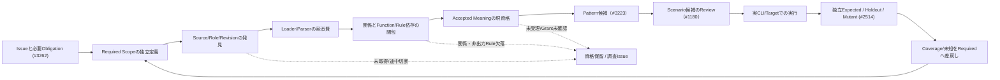

# TEI自身を題材とするIssue→設計文書ドッグフーディング（P0縦切り）

- 状態：**探索・受入条件候補**。本書の作成自体はTEI CLI/MCP実行、全設計情報の取得、意味受理、自己構築成立を意味しない。
- 作成日：2026-11-07（JST）
- Issue要件：[#3262](https://github.com/hat47x/tei-platform/issues/3262)（2026-11-07 08:28:31 UTC観測）、[#2605](https://github.com/hat47x/tei-platform/issues/2605)、[#1119](https://github.com/hat47x/tei-platform/issues/1119)、[#2831](https://github.com/hat47x/tei-platform/issues/2831)。
- 比較したmain：`96d276b74d338f47b2027d66a6dc7eedb24faa45`。比較した具体的Sourceは `cmd/tei/cli_contract.go`（blob `f1c167c56005da7f204f310078d3f2c3853d6848`）、`skills/yi-tei-modeling/SKILL.md`（blob `a49c111ff318fc83987de5f95e07d02dd86ff10d`）、`docs/status.md`（blob `ab349b8ea778adb550be4600c17c99de21821fc4`）。
- 関連する既存計画：[#3223](https://github.com/hat47x/tei-platform/pull/3223)はテスト生成前のDesign Contextを担当するDraft。本文の§14を置き換えない。本書は**TEI自身のIssueから設計票を作る一件**と工程上のBlockerを扱う。

## 1. このドッグフーディングで実際に解く課題

**要求入力**：「Issue #3262 の『対象Scopeに必要な設計情報を確実に読めること』を、最短の一Subjectで示し、足りない機能・証拠を設計文書と既存Issueへ戻す」。

**固定実例**：公開合成Reference `reference/workspace` と、`semantic-data:sales.order`。最初はTEI自身のCLIとProduct Skillの動作確認に限定し、対象Domain全件やIssue全件・実顧客データは使わない。Function/Business/Rule/Procedureの存在・不存在や意味受理は、Data Subjectが一件読めたことから推定しない。

**期待する成果物**：要求と根拠が紐付く設計票（本書）、一度ビルドした実TEI CLIからの読み取り結果と閉包診断（CIのStep Summary）、未充足条件を担当Issueへ戻す差分、およびG1/G2/G4へ至る到達基準。JSONをMarkdownへ整形しただけで設計完成としない。

## 2. ユーザー要求→設計義務→既存Owner

| 義務 | 必ず区別するもの | 今回の結果・担当 |
| --- | --- | --- |
| ID-01 要求の同定 | Issue URL/観測時刻/要求Scopeと、モデル内Subject ID | 本書に固定。現在のIssue全件を取り込んだとは主張しない。#3262 |
| ID-02 Sourceの到達 | 宣言されたroot、管理Inventory、実Loader Read、Parser/Role/Accepted Meaning | 現行`workspace-files`の`readByLoader`と`validate`診断は利用可能。Parser完了・Required全件は別。#2822/#2823/#2620 |
| ID-03 同一版参照 | CLI実行物のbyte/checkout、Workspace、World/SourceIndex fingerprint、Tool受領 | 単一実行物で限定比較。fingerprint一致だけでWorkspace全Byteの同時Snapshotは言えない。#2354/#2605 |
| ID-04 三視点と依存閉包 | Data/Function/Business、manual、Rule、隠れたPredicate、Relation、Requirement | 初回Dataのみ実取得し、それ以外は`unknown/not-queried`。依存先推測は禁止。#3262/#1125/#1132/#2582 |
| ID-05 開示・配送 | local read-only、外部Harness送出許可、全Reply、page end | CLI smokeは外部受信資格でない。8,192 byte途中切断・56/55が既知の負例。#2509/#2516 |
| ID-06 設計文書の採否 | Source-backed事実、生成AIの推論、未決、Ownerの意味受理 | 文章化は候補、正式意味受理は別。#1803/#1124/#2514 |
| ID-07 再入力と差分 | 旧結果、新Source、変更影響、再資格化 | fixed refからの再収集・差分が必要。#1119/#2600 |
| ID-08 セルフビルド接続 | 実行Graph、実消費byte、生成Artifact、再入可能な実TEI Process | 文書生成とGo buildは全体Self-Buildではない。#2831 |

## 3. 実行できる範囲の最小手順

既存の `tei.cli.discovery/v0` は `selected-read-only-commands` のみ。外部に使えるTool/認可全体を示さない。`version -json` は通常の `ok/result` EnvelopeではなくIdentity形、`world` はraw、`source-index` はmode依存である。全結果を無条件で同一JSON schemaと仮定しない。

このPRの `.github/workflows/tei-issue-design-dogfood.yml` で、一つのcheckoutからTEIを一度ビルドして次を実行する（新しいTEIコマンドは追加しない）。

1. `tei commands` と `tei version -json` で公開範囲・実Binaryを確認する。
2. `tei workspace-files -workspace reference/workspace` でInventory/Loader読取区別を残す。
3. `tei model catalog` から `semantic-data:sales.order` の曖昧でない存在を検査する。
4. `tei inspect` と `tei source-index` を同じSubjectに実行してSourceと意味要素を**別の観測**として保持する。
5. `tei trace` の公開合成Relationと `tei requirements` を補助観測し、`tei validate -json` のWarning/diagnosticsも出す。
6. 既存 `skills/yi-tei-modeling/verify_skill.py` と14件の合成静的試験も同じcheckoutで実行する。**Product Skillの文書整合検証であり、AI HarnessがSkillを実Loadしたことではない。** 必須なfingerprint位置と型を照合し、欠落/不一致なら失敗。取得していないFunction/Business/Requirement coverageを`complete`にしない。
7. CI Step Summaryへ「要求→実観測→未解決→追加Issue」を機械作成する。外部AI Harnessや実MCPを呼んだと主張しない。

これは**P-1aの限定実装**であり、P-1bの製品共通Design Context Queryそのものではない。Pythonで補助的に行う比較は既存CLIの内部Resolverを再実装せず、試験用の消費者検査のみとする。

## 4. 発見された初期阻害点と直近の対処

| 阻害点 | 診断・反例 | 最短の対処 | Exit |
| --- | --- | --- | --- |
| B1 宣言件数を完全性と誤認 | empty Workspaceでも`validate.ok=true`、builtin Catalogのみ、managedかつ未Load | `workspace-files.readByLoader`と宣言数・必要なSubjectを照合。未解析はunknown | Required集合に対する欠落が診断に残る。#3262/#2822/#2823 |
| B2 Command別JSON形の差 | version identity、mode、raw world | Discoveryの`jsonContract/successShape/modes`に従う。共通Responseを捏造しない | 誤Envelope・schema変更を検出。#2354 |
| B3 Tool受領欠落 | 切断・Reply欠落・stderr混入 | CIでは実Byte/Exit/JSONを別保存。Harnessでは分割・terminal markerを後続実証 | 欠落時`delivery-complete=false`。#2509/#2605/#3262 |
| B4 Issue→正本の飛躍 | AI生成文の「受理済み」偽装 | Source-backed/推論/未取得/Owner判断の独立列を保持 | 採否をAIが偽装しない。#2514/#1124 |
| B5 自己記述から自己構築への飛躍 | Go build/Plugin SB-3のみでG4合格と誤る | #2831のL1/L2/L3、SB-A/B/Cに成果物を渡す | stage1実TEI Processがstage2を駆動する独立証拠。#2831 |
| B6 Skillは設計情報を閉包しない | 現行`yi-tei-modeling`はcatalog/inspect/trace/validate中心 | この実験を既存Skillへ参照追加するのは#2605で行う。新Core Readerを追加しない | 同一TaskのH2/H3比較で未カバー/誤答と呼出負荷を測定 |
| B7 Skill検査がcheckoutを汚す可能性 | #42357274048はSkill静的14/14合格後、clean working tree検査で停止 | `PYTHONDONTWRITEBYTECODE=1`を適用。検査前後の状態と実行物を区別 | #42357337108で再試験成功。OS副作用全体の不存在は未確認 |

## 5. 独立Expectedと圧力ケース（同じ実CLIの結果から自明に作らない）

| Case | 操作 | 判定 |
| --- | --- | --- |
| DF-01 正常 | 固定Public Workspaceで`sales.order`をcatalog→inspect | Subject ID一致、非曖昧、World/SourceIndex照合。これだけで三視点完成とはしない |
| DF-02 必須対象欠落 | 独立Requiredに記したSubjectをCatalog投影から消す（合成Mutation） | 欠落を`incomplete`。空の意味モデルとして成功扱いしない |
| DF-03 版不一致 | inspectのSourceIndex fingerprintだけを別値にする（合成Mutation） | 異版接合拒否。古い説明を継承しない |
| DF-04 非照会領域 | Business/Functionを取得しない | `not-queried/unknown`。未存在と確定しない |
| DF-05 受領切断 | JSON受領を8,192 byteで切断 | JSON parse/terminal失敗をdelivery不適格へ分離。実Harness試験は#2509 |
| DF-06 欠落意味 | NOT EXISTS・手作業・Ruleが出力列に現れない | 欠けた意味/非出力依存を`none`へ正規化しない。#2582/#3262 |
| DF-07 二重の権限 | read-only Commandが実行可能、現開示Grantは未確認 | Tool成功から外部開示の正当性を推定しない |
| DF-08 自己構築 | stage1/stage2のdigestが一致、Stage1実TEI再入場未確認 | L2/L3を混同しない。#2831 |
| DF-09 必須Source未読込 | Required Source `semantic/sales/order.tei`をInventoryに残し、`readByLoader`だけfalseへ変える合成Mutation | Loader消費が失われた事実を`not-loaded`と検出。Parser受理や全閉包には拡大しない。#3262/#2823 |

DF-02/03/09はこのPRのCIで**JSON投影に対する合成Mutation**として実装する。DF-04は明示的にunknownで出力。その他は要求として記録し、実行したか否かを分ける。

## 6. クリティカルパスと一回ごとの受入

| 順 | 実行面 | 通過条件 | 次の担当 |
| --- | --- | --- | --- |
| D0 | Issue要求を仕様義務へ翻訳 | 各義務にSource、既存Owner、独立ExpectedとUnknownがある | #3262 |
| D1 | 実TEI read-only CLI | 1 binary、限定Subject、9結果、独立SourceのLoader確認、世界/入力元指紋の比較、意図的破壊3件検出 | #3262/#2605 |
| D2 | Product Skillが同じ調査を指示 | CLI実出力と同じ報告、欠けた情報・Scopeを隠さずH2/H3で測定 | #2605/#2509、TAI #168 |
| D3 | Issue→採否待ち設計文書 | Data/Function/Business・Requirementsの出典と未取得を表示、意味候補を正本にしない | #1803/#1124 |
| D4 | 一件のSource変更→再検査 | Preview/Acceptance/再解析/影響/Driver/独立Observationが同版で接続 | #1119 G1/G2、#1124、#1180 |
| D5（並行） | TEI全体Build Graph | Graph→実消費→TEI Binary Artifact（L1/L2）→Stage1実TEIの再入場（L3） | #2831 G4 |

**D5はD1〜D4のハード前提ではない**。D1で得た実Binary/Source Fingerprint・使用ツール版は、#2831でBuild Artifactと設計根拠を結合するための入力にできるが、G4の結果へ自動昇格はしない。TEIのGo単一バイナリ配布を基本とし、Go toolchain自体のself-hostingや専用TEI Hostを必要条件にしない。

## 7. 計測と撤回条件

- 実CLI呼出回数、失敗/Warning、未取得義務件数、CLI応答byte、生成する設計票のSource対応率・誤ったcomplete宣言数を記録する。
- H2/H3では実Tool呼出・Skill読込・Token/時間・独立Expected一致を別計測（既存TAI #168/#2018の分母を使う）。AIが答えを書いただけではTool実行済みとしない。
- 初回は**TEI実CLIだけを使用**。整形投影が既存Reader出力だけで成り立てば新Product Queryは後続圧力まで見送る。不足が具体的に観測された範囲だけ、#3262で共通Reader投影を増やす。
- 独立Requiredを満たせない場合、空結果を成功にしない。誤った外部開示・別版混合・Issue意味受理の捏造を検出したら、その成果物の適格性を撤回する。
- 完了区分は**実装・合成試験・実CLI CI・実Harness・Owner受理・製品G1/G2/G4**を別々に記録する。

## 8. 初回の事実資格

2026-11-07の設計前調査では、GitHub接続を使って上記IssueとCLI契約・Skill・既存CIを読み、設計のFit/Gapを作成した。**この時点でGitHub文書に対するread-only調査は実施済み**だが、接続はTEI CLI/MCPの実行口ではないため、本書の起票時点では新しい実TEI CLI・MCP/Harness・Self-Build/Host/Provider試験を実行したとは主張しない。CIを実行した場合は、対象Run・exact commit・結果を本書の歴史的な本文へ上書きせず、PR/Issueへ追加記録する。

## 9. 段階的な実証記録（時点ごとに上書きしない）

- **初回の限定実CLI結果**：Draft [PR #3264](https://github.com/hat47x/tei-platform/pull/3264) head `4677b56d1093eccbaac53873c59ed55ee575b156`、[実CI #42356836861](https://github.com/hat47x/tei-platform/actions/runs/42356836861) Job `128356649098` が `completed/success`。実checkoutはPR仮統合 `2d7b6d642e11a7a0b8575cfebc1fb1b62bafbb1b`、Go `1.26.10`、実TEI Binary SHA256 `c9f745982a616fac0e7c0a996b24192b70b04a4070615477fc9a176a7dcd9071`。9種類のread-only JSON、DF-02/DF-03合成負例がPASS、Validate診断3件、Claim=partial。**当該RunにSkill静的検査とDF-09は含まない**。
- **第二段階（実CI成功）**：既存Product Skill静的チェッカーと14件の合成テスト、独立Required Source `semantic/sales/order.tei` のInventory/実Loader読取、DF-09未読込Mutationを追加。[修正後実CI #42357337108](https://github.com/hat47x/tei-platform/actions/runs/42357337108)／Job `128358194403` は **completed/success**。対応PR Head `470cc8c167fc3beca3bf90af528e8eac323ce9d3`、実checkout（PR仮統合）`64b1f98c9b43959b2e040085a4de2c128cf84006`、実CLI Binary SHA256 `7c881ddd9dbe454d345f3c2bcc4f123e3b97a5a9a45fd5f39b1927eef4485860`。14/14静的負例PASS、9件の実CLI応答、DF-02/03/09すべて検出。固定Sourceの `readByLoader:true` を確認したが、Parser/Owner Meaningや全Requiredは未証明。
- **途中失敗の負例**：[CI #42357274048](https://github.com/hat47x/tei-platform/actions/runs/42357274048)ではSkill静的検査・14テストはPASSしたが、その後の実CLI工程でexit 1。ログ上は `git status` の清潔性確認後、Go buildに達する前に停止。Python testが作る`__pycache__`による作業ツリー汚染を有力原因とみて `PYTHONDONTWRITEBYTECODE=1` を追加し、再試験が成功した。失敗時の`git status`実行出力は未保存のため汚染ファイルの実名までは断定しない。AI Harness/Skillの読取り宣言でも検査補助過程の副作用を独立に点検する必要がある。
- **未実行**：実HarnessのSkill Loader、外部MCP、実OS/Disclosure、全SourceのParsed/Meaning/Rule依存閉包、Stage1実TEI Process再入場はこのCIの受入外。

## 10. テスト能力そのもののドッグフーディング（#2514 / #1180 / #3223）

**動作するテストが存在するだけでは、必要な不具合を発見できるとは限らない。** Issue→Design Context→Scenario/Case候補→実行→独立Expected→Mutant判別→未カバー逆引きまでを独立したProduct能力として検証する。今回は既存のScenario CLIと公開合成Sourceだけを用い、新Test Runner/Scenario SSOT/Oracle Engine/Hostは増設しない。

### 10.1 テスト能力を検証する四つの別の主張

| 能力 | この実験の最小確認 | 合格と取り違えないこと |
| --- | --- | --- |
| 発見・Coverage要求 | Issue #3262 / #1180 / #2514から既知の6 Scenario stepと追加負例を独立義務として固定 | 6 stepの実行をTEI全機能/全要求/非機能の100% Coverageとしない |
| 生成・実行 | Scenario SSOTから生成したCLI argvと各Source/World/Lock/Fixture pinを実ビルド済み`tei`別プロセスから実行 | 単なる`scenario verify`、in-process Go test、synthetic実行を実DB/Web/Host副作用としない |
| 判別力 | 正常／業務拒否と、故意の誤データ・誤Expected・古いpin・改変Planを別の検証基準で識別 | exit非0の件数だけではバグを検出した証拠でない。理由/対象Rule/期待差を照合する |
| 範囲・費用・再資格化 | C0相当のGo statement coverageの局所値、C1未計測、要件/NFR未検証、binary+source hash、失敗理由を記録 | C0をC1と呼ばない。未知の要件分母、未取得Rule、実Provider/開示資格を0件として処理しない |

### 10.2 独立Expectedと既知Mutantの最小試験

`reference/driver-scenarios/order-entry-pattern-smoke.json`はScenario正本の**公開Reference**であり、検証の唯一の正答供給元にはしない。独立Expectedとして、数量>0、行番号>0、同一Relation内の行番号一意を、固定既知ケースに対して別の簡易Property判定と具体的なExpectedにする。これらは製品の業務意味Owner受理ではなく、限定的な合成独立検証基準。

| ID | 意図的な差分 | 必須の判別 |
| --- | --- | --- |
| TA-01 | 有効Fixture（数量2.5、行番号1、Key 1/2） | **実CLI**の版固定`validate-positive`で3 Rule satisfied |
| TA-02 | 数量0、他は同じ | **実CLI**の版固定`validate-denied`で数量だけnot-satisfied。業務拒否を技術エラーにしない |
| TA-03 | 有効FixtureのRelation Keyを1/1へ差替え | **実CLI**が一意Rule `result=not-satisfied` を検出し、元Scenario期待に反するため拒否 |
| TA-04 | 数量0のScenario Expectedだけをsatisfiedと偽装 | **実CLI**が実Evaluator結果と差分を検出し、Expected自己申告を採用しない |
| TA-05 | 版固定コマンド生成後にFixtureだけ変更 | **実CLI**が古いFixture pinを拒否し、前回成功を再利用しない |
| TA-06 | 生成済みCLI Planのargvを勝手に変更 | **実CLI** `scenario check` が生成元との不一致を拒否 |
| TA-07 | 必須6 stepのうち`validate-denied`を候補から削除 | **独立Requirement集合**と比較して未カバー。短い候補が実行可能でもcompleteにしない |
| TA-08 | テスト用判定器を全Rule常時satisfiedへ置換 | **独立Property**がゼロ数量の偽陽性を検出。実TEI EvaluatorのMutation killとは区別 |

実装対象は`tools/reference-issue-test-ability/probe.py`と、既存`.github/workflows/tei-issue-design-dogfood.yml`の限定CI Step。実Binaryは前段と同一、Source改変はrunner一時領域のコピーだけ、実Provider/Secret/DBは使わない。

**独立性の上限**：TA-03/04は実Evaluatorが意図的に壊されたScenario/Fixtureを区別する検査であり、Production実装のあらゆるコードMutantを検出したことにはならない。既知の**実EvaluatorコードMutant kill**は#2514 / 禁止merge Draft #3017の既存実証を参照し、本PRでは再導入しない。TA-08は補助テスト用判定器の反例であってGoの実Mutantではない。

### 10.3 C0/C1、要求・非機能Coverage、テスト生成の未成立点

- `go test ./cmd/tei -run '^TestRegenerateScenarioArgvAndStdinPlan$' -coverprofile=...`で、**この限定テスト選択に対するGo文coverage（C0相当）**を取得する。`go tool cover -func`の`total: (statements) ...%`だけを局所Evidenceに記録。全Package・全TargetのC0とは違う。
- Go標準statement coverageの値をC1分岐Coverageへ流用しない。**C1はunmeasured**。必要なら既存#3223/#1180でBranch Toolや重要分岐の明示Negative Scenarioを検討するが、今回の実験では一般C1達成率を宣言しない。
- 機能要件Coverageの分母はIssue Requirement→Qualified Contextで解決した義務であり、Sourceを1件取得しただけでは未知のRequirement/Rule/Business Procedureを含められない。NFR（性能・可用性・セキュリティ・開示）も今回の合成CLIで測定していない。
- 将来のProduct Test Pattern Recommendation：独立Required/Source閉包→未達義務と適用述語→Pattern候補最大3件の理由付き提案→候補Scenario Review→再生成CLI/Web等→同じ独立Holdout/Mutantで判別。その比較は#3223/#1180/#2514の既存Ownerで行い、専用Product Skillやハーネスには**正答Holdoutを渡さない**。
- 測定する生成AI Test Capability：独立義務からの候補発見率、C0/C1の実測範囲、既知Mutant kill/survive、false-qualified、不要Case重複、実行時間・Token・人手、対象Source/Expected/Runner版の一致。候補数やコード量だけはKPIにしない。

### 10.4 昇格の条件

**T0（今回）**：固定Scenarioの実Binary pin付き6 step＋4種の実CLI誤り検出＋2種の独立判別基準＋C0局所計測（C1未計測）。これは**限定Test Ability**であり、Issueからテストを生成AIが自動設計した証明ではない。

**T1（次）**：Design ContextのRequired集合から、AI/人間がテストパターンを選び、既知Holdoutを見せず独立Scenario候補を作る。候補に同一固定Referenceの正答をあらかじめ埋め込まない。実CLIによる生成・実行・独立Expectedとの比較、false-qualifiedとuncoveredを#2514へ提出。

**T2（後続）**：同一ScenarioからCLI/Web/Studio/外部Targetへ投影・実行し、Provider/Host/Effect/Receipt/Readの別証拠を保持する。G1/G2業務一往復へ接続するが、未知の外部結末とMeaning Owner受理は別。

**T3（Self-Build並行）**：TEI自身のTest CapabilityのSource・Scenario・Build定義・実ArtifactをTEI標準構造で管理し、Stage1実TEIがテスト能力も再現する。#2831のL1/L2/L3とは異なる資格を混同しない。

**現時点**：本節は実装PR候補として作成。新たなCIの実検証結果はこの文書に履歴として追記する。MCP/SkillによるAIテスト自動生成、C1計測、実DB/Host、正式Owner意味受理は**NOT RUN**。

## 11. テスト能力の初回実行記録（2026-11-07、Run単位で区別）

- **最初の失敗Run [#42358779661](https://github.com/hat47x/tei-platform/actions/runs/42358779661)**：Job `128362515378`の既存Product Skill/Design Context StepはPASS、限定`TestRegenerateScenarioArgvAndStdinPlan`のGo testもcoverage `10.1% statements`でPASS。ただし新Test Ability Probeは実`observe-synthetic`の`observationResult`を`{"kind":"string","data":"pending"}`と期待してFAIL。実装はTyped Valueの`Decode()`後、値`"pending"`を返す。**テスト側がTyped Input表現と観測Value表現を混同していた**。正本実装のSourceを確認し、独立Expectedを修正。旧失敗を製品Failと断定しない。
- **修正後実Run [#42358886968](https://github.com/hat47x/tei-platform/actions/runs/42358886968)**：Head `5d06a49a99f988946fe778fec4e32197bd6e7718`、Job `128362831125`は`completed/success`。PR仮統合Checkout `54ab2672550ea828f27506cc9dc1e70f3a6bdb67`、実Binary SHA256 `058d205707194c0a36b3bcb99fada7ccbc33a7c5f9c543e2a9a8ae9ba7c7ecb9`。Generated-pinned Scenarioの6 stepを実TEI CLI別プロセスで実行し、正常Validation／数量0の業務拒否／Browse／Observationの状態を確認。**実CLIで4種の負例**（Key重複・Expected嘘・古いFixture・改変Plan）を検出。**独立限定検証で2種**（必須step欠落・常時satisfied）を検出。計6件の判別Control。Go局所statement C0相当`10.1%`、**C1未計測**、全業務要求/NFR未計測。
- **第三段階のEvidence保存**：実Runの`test-ability.json`、`report.json`、`tei-scenario-c0.cover`は従来runner一時領域にあり、Action Artifactとしては保存されていなかった。新commitでGitHub Actionsの公開合成テスト証拠のみを7日間のArtifactとして保持するStepを追加。これ以降のPR HEAD/Runは**別Evidence**とし、上記旧Runの成功を代用しない。

この限定検証が証明するのは**テスト実行と既知負例を見分ける能力**であり、生成AIがIssueから適切なテストを新規生成できる能力ではない。T1では既知HoldoutをSkill/生成Agentへ見せず、同じQualified Sourceから提案されたテストが独立Mutantを判別するかを比較する。実Go EvaluatorコードMutantについては#2514/#3017の独立証拠を維持する。

## 12. テストが存在しても起動されない問題（CI Trigger Closure）

**2026-11-07 の初回Fit/Gap**：実CLI/Scenarioのテスト能力T0をCIで確認できても、Workflowの元の`pull_request.paths`は主にScenario/Validator/Test Toolだけであり、`reference/workspace/**`、`internal/driver/**`、`internal/workspace/**`、`cmd/tei`の全入口、`go.mod/go.sum`、Product Skill本体の変更では**自動起動が保証されなかった**。結果として、一部の実装・構成変更でテストが存在するのに再実行されない「発火Coverage」のギャップがある。これはC0/C1、テストCaseの判別力とは別の品質義務。

- 今回は現行Workflowの`pull_request`と`push`にSource/CLI/Scenario/Skill/Build依存を覆う保守的なpath集合を追加し、`main`へのpushで**統合後mainを再検証**する。既存の実行Step・Expected・Runnerは変更しない。
- 既存CIが監視する`cmd/tei/**`、`internal/**`、`reference/workspace/**`、`reference/driver-scenarios/**`、`skills/yi-tei-modeling/**`、`tools/reference-issue-test-ability/**`、`go.mod`、`go.sum`を明示。新しいトップレベル依存が増える場合は完全な静的依存Graphによる対象判定がないため、`paths`の資格を再検討する。
- 粗い保守的path集合での追加CI起動回数/費用は#2018に記録し、**正しさを落とさずに**後から対象を絞る。緩いworkflow filterを`CI成功`より上位の品質資格としない。
- 同じCIのPR仮統合checkoutと`main push`checkoutは別版・別Run。PR合格をそのまま統合後mainの実測値に転用しない。
- Scope外：GitHub Actions起動サービス全体の可用性、秘匿データへの外部送出、実H3 Harness Skill、Go以外のTarget/GUI/NFRの全Dependency closureを証明するものではない。

現時点では新Trigger契約を設計・Workflowへ保存した段階。実`push main`の成功は該当Runを確認するまで**NOT RUN**。

## 13. 横断設計の成熟判断とテスト生成前の資格ゲート（2026-11-07）

### 13.1 他レーンから取り込む「既に検証された範囲」

| 既存Owner | 取り込む実証済み範囲／未実証との境界 | 今回の扱い |
| --- | --- | --- |
| #3262 / #2605 / #2509 / TAI #168 | 実TEI read-only CLIによる一Subject/Source照合と、限定H3 Skill Tool Readは存在。外部Harnessでは`model catalog` 8,192byte切断、Tool Request/Reply 56/55、許可範囲外canary読取、4Sessionの適格比較0/4の問題が残る。 | **ローカルCLI応答完整性とHarness実Deliveryを別資格**にする。Skill読取の事実を回答全文受領や漏えい防止へ昇格させない。 |
| #2514 / #1180 / #3223 | main上のgenerated-pinned Scenario 6 Step、4実CLI負例＋2独立義務負例、局所statement C0相当10.1%は実証済み。別Draft #3017には実EvaluatorコードMutantでAI Scenarioが失敗した証拠がある（意図的FAIL・merge禁止）。 | **「実行できる」→「既知欠陥を見分ける」**の次に**「Requiredから未知Caseを発見する」**を置く。C1は独立測定までunknown。 |
| #2586 / #3238 / #2853 | 局所実PostgreSQL ReadやCommand/Receiptの限定観測は存在しても、製品Function→Query→Provider Readerの実Read、同一Scopeの全件性、DB現在値の独立再読取までが一連の合格とは限らない。 | 合成Browseを実Function/Provider Readにしない。`Query output=0`から不存在を主張しない。 |
| #2831 / #1119 | `go build`とStage1 Binary再実行は異なる。Stage1実TEIプロセスがStage2 Build Planと既存Adapterを駆動するL3は未検証。 | テスト自己記述・CI成功をG4全体Self-Buildへ昇格させない。 |
| Plugin／Trait／Data/Presentation | 拡張型の実装強制、原子的Trait合成、Data↔Function内Presentation↔操作/Authorityを分ける方針は候補。選択済Pluginと実Consumer Load、データの存在と画面/操作・実Providerアクセスを同一視しない。 | 将来のTest Pattern選択に`Applicability`、`Required Capability`、実Load/権限の別条件を追加する。新Core Type/Registry/Authorityを先行しない。 |

この表は異なるRunのPASSを合算した製品E2E証明ではない。設計上の候補は**実証済み**と表示しない。人間Ownerが判断する業務意味、正式な対応付け、拒否可能なGrantは自動承認しない。

### 13.2 「Issue→テスト」の実行可能性を独立した有向グラフとして扱う

このグラフはMermaidによる**読みやすい投影候補**であって、TEIの標準Graph/Relation IDの正本ではない。将来のTEI Graphでは、各Nodeの`identity/type/source/revision/state`、各辺の`kind/required/observed/ownership`、Rule/Scenario/Caseの多重参照、順序差を保持する。SHO図面等への投影でも「描画されなかった辺＝存在しない」を許さない。

**基本決定**：当面のテスト生成には、未解析な全Workspaceを静かに補完するAIを使わない。取得済みのBounded Contextから局所的なテスト候補を作る場合でも、必要Requiredの不足を`unknown`として先頭に表示する。Issue記述をLLMで要約しても、その文章はSource/Ownerの受理証拠ではない。

### 13.3 最初の実装差分：Test-readiness Consumer（T0.5）

`tools/reference-issue-test-ability/context_gate.py`は前節で実行済みの**同一9つの既存CLI JSON Replyだけ**を消費し、必要な対象の独立義務と照合するテスト専用Consumerである。TEIの第2 Parser、Function/Rule Resolver、共通Query Engine、Scenario正本を実装しない。

| 軸 | 現行CLIで観測可能な要素 | 未資格化・混同防止 |
| --- | --- | --- |
| Transport | 9件すべての応答、JSON型、終端改行、Schema version、コマンド実行結果 | 外部LLMへの完全受領、stdout/stderr再結合、Network/Disclosure/Grantは**未測** |
| Source | 必須`semantic/sales/order.tei`のInventoryと`readByLoader:true` | 管理/読込だけでParser・業務Role・全Required閉包まで主張しない |
| Subject | `semantic-data:sales.order`のCatalog非曖昧存在とInspect対応 | 他のFunction/Business/Rule/Rule出典とScenario実行先は別 |
| Freshness | catalog/inspect/trace/validateが持つWorld/Source Index FP一致 | A→B→A、別Consumer/別時刻、実ProviderのSource Revision/Grantの現資格まで言えない |
| Validation | 成否、Source Root欠損、診断件数 | `validate.ok=true`を正式なMeaning Acceptanceや全Productテスト適格にしない |

CIの最小Negative集合は、①Required Subject欠落、②Inventory掲載だがLoader未消費、③FP新旧混合、④Tool Reply欠落、⑤Schema Drift、⑥Source Root欠損、⑦外部Harness/Provider/Grant未観測でも完全受理しないこと、の7種類。**①〜⑥は既存実CLI Replyのtest-onlyコピーを改変して拒否判定、⑦は現資格を保留する静的資格負例**であり、各Originの実Source、権限、DB、外部Networkを改変したE2Eテストではない。

「探索用の限定Contextが揃った」場合は`boundedReference=partial`／`testExecutionAdmission=exploration-only`とし、既存生成済pinned ScenarioのT0を走らせられる。いずれかの必須Replyが失われたら`blocked`。いずれも`qualifiedTestGeneration=false`、`independentFullRequiredSetProven=false`、`externalHarnessDeliveryComplete=null`であり、**未観測のFunction/Provider、認可、Owner Meaningを成功へ自動昇格しない**。実ProviderでのQuery→Rowset/Completenessは#2586が引き続きOwner。

Provenanceは観測した各Replyの実Bytes/sha256と評価したSubject/Source/FP/不足Claimを記録し、CLIの内部Index構造を再解釈するParserを作らない。公開合成Fixtureのみを使い、外部Sinkへ原Rawを送出しない。ResultはActions Artifact（7日保持）で再読取可能にし、Run SHAとBinary SHAは既存T0へ連結する。

### 13.4 次の段階を受け入れる条件（T1/T2、導入順は変えない）

1. **T1a: Required→Context**。#3262の最小Read-only Queryを既存typed Application Serviceから返し、Data/Function/Business/Rule/Source Anchorの**少なくとも1つずつの独立Expected**についてLoader/Parser/Meaning/Bindingの不足を列挙。同じQueryのCLI・将来MCP・人向け図表では`identity/revision/unknown/disclosure`の同値を先に確認。まだ全Workspace対象ではない。
2. **T1b: AI Test Patternの発見**。同一Subjectの固定Task・同一Read-only Tool Budget・同一Disclosureを与えた2条件（Skill利用なし／既存Product Skill利用）で最小指示からCandidateを生成。**独立Holdout/誤実装は生成Agentと外部Harnessに渡さない**。選択理由・Rule/Relation/Source・候補の重複・未カバーRequired・誤受理を採点し、#2018にTool/Token/時間/人手を別々に記録。#2509のH2/H3はSkill実LoadだけでなくResponse End/Permission/Reply Countがそろうまで比較適格にしない。
3. **T1c: 実行と判別**。候補をOwner Reviewしたうえで#1180のDriver Scenario SSOTへ採用し、同一版から各Targetへ再生成。#2514独立Expectedが真のCode Mutant/Fixture改変/NULL/未取得/部分Rowset/0件誤不存在をどれだけ検出するか確認。検出したMutantの対象Version・実行Bytes・Failure理由を固定する。単にexit 1を返すだけの常時拒否をPASS扱いしない。
4. **T2: Cross-routeと実Read/Effect**。Data構造とFunction内Presentation、画面Action、現在Grant、実Provider Read、Command Effect、Receipt、独立Resource再読取を段階別に試す。HTTP API例外応答は成功/業務拒否/技術失敗/効果不明を区別したScenario Branchとし、Node＋Transition＋Expectedの対応をTEI Graph/表でdogfoodする。旧Receiptで現資源状態を証明しない。
5. **T3: Self-description → Self-build**。Case/Rule/Build Graphを標準構造で記述・別表現へ投影してもID/Source/Roleが変わらず、Stage1実TEI ProcessがStage2を駆動したL3の別証拠を#2831に残す。Go Build単体、Graphの描画、Plugin選択だけでG4を閉じない。

**P0実装停止線**：本項のT0.5が成立しても、正式なTest Pattern推薦/テスト生成機構・Design Contextの製品API・MCP・実H3外部回答・Source/Grant/Provider完全性を実装済みと記載しない。とくにHTTPの正常/例外グラフ、Trait強制、標準表現型のE2Eは次段階の**設計義務**であり、今回の新実Go/Provider試験には含まれない。

### 13.5 実行記録・測定範囲（2026-11-07／T0.5）

[PR #3284の初回実Workflow #42370357906](https://github.com/hat47x/tei-platform/actions/runs/42370357906)、Job `128397031005` は **completed/success**。PR HEAD `d81385e72c8b0b54a6eb83b073e92c41c2796dac` の仮統合Checkout `e640348f6f2cef648b365c5c6739bba20cb52928`、実TEI CLI Binary SHA256 `19e189661d7b410f16ab78011d09938d78450c2c6e49d5f6c32f361dbf325e06`。

- Product Skill静的検査、9 read-only実CLI、`Design Context partial`の正常資格と7負例/未知検査、generated-pinned Scenarioの実6 Step、元のTest Ability判別Control6件が**同一CI**で成功した。Go局所statement C0相当10.1%、**C1 unmeasured**。
- 期待どおりの重要な負の結果：`qualifiedTestGeneration=false`、`externalHarnessDeliveryComplete=null`。CLIが正常応答したことは**全Required Source/業務Meaning/実Provider/実Harnessでの受領/Grant**の確認ではない。
- Artifact `tei-issue-test-ability`、ID `13573890404`（当該Runから7日間保持）は、限定`context-readiness.json`、既存`test-ability.json`、元の`report.json`、C0 profileを保存。ファイルそのものが永続Evidence Serviceや製品の検証正本とはならない。
- **注意**：上記は最初のPR HEADの実測。証拠追補によってGit commitは変わるため、最終HEADのmerge/main実行は別Runを確認する。異なるRun/Headの結論を合算して完了宣言しない。

<!-- tei-intake-currentmain-mcp-source-import-sho-rea-20261108 -->
## 14. 現行mainの設計取込・実Consumer接続に必要な最小資格（2026-11-08）

**採用範囲と正本**：旧[設計取込Draft #3355](https://github.com/hat47x/tei-platform/pull/3355) §14.1〜14.21の成熟内容を、現行mainで成立した実装と突き合わせて**最短の受入順**に凝縮する。詳細履歴を再挿入しない。TEIの既存Source/Reference、Semantic Model、Function Context、Plugin Contract、Host/Consumer、#1180 Scenario、#2514独立Expectedを再利用する。**Rawの所在、Structural Candidate、Ownerが受理したMeaning、Build/Hostでの現在実行資格、Tool/保存後の実効果**を異なるClaimとして保持し、第二Meaning Store・Reader Registry・Resolver・Host・Test Runner・Policy Engineを作らない。

### 14.1 成立した実観測と、その厳密な上限

| 現行mainの根拠 | 成立した範囲／禁止する推論 |
| --- | --- |
| [#3354](https://github.com/hat47x/tei-platform/pull/3354) Design Context Gate | 同一実CLIの**11 read-only Reply**、公開3 Validation RuleとFocused Source/Relation、32合成Consumer対照が成立。全Data/Function/Business Required閉包、全Test Coverage、T1-B未知Rule発見、実外部Tool配送は未実証。 |
| [#3403](https://github.com/hat47x/tei-platform/pull/3403) MCP参照Adapter＋[#3439](https://github.com/hat47x/tei-platform/pull/3439) ADR-0048 | 現在は**MCPのread-only 4 Toolの参照実入口がある**。旧「MCP入口なし」は#3356以前の歴史的観測。ADRはCLI/MCP/API/Web/Desktopが**共通Application APIを呼ぶ**方針を採用。全Transportの同値・製品MCP Host・現認可・外部Harness完全受領は未成立。 |
| [#3458](https://github.com/hat47x/tei-platform/pull/3458) CLI↔MCP `validate` | 最上位診断/エラー文字列/意味エラーの成否を共通投影に統一し、実CLIとAdapterで局所対照。残る`catalog/inspect/trace`や異版・部分配送・外部Grantを全件同値と扱わない。 |
| [#3366](https://github.com/hat47x/tei-platform/pull/3366)・[#3370](https://github.com/hat47x/tei-platform/pull/3370) | `view`にWorld/Source Index Fingerprint、`requirements.result`の**array shape**をDiscoveryへ追加。Application範囲の`semanticFingerprint`とWorld全体を比較しない。`resultShape`未指定をobject確定へ変換しない。旧ConsumerのJSON解釈は別検証（#3345/#3347/#2824）。 |
| [#3477](https://github.com/hat47x/tei-platform/pull/3477) 同一Workspace Source-only失効 | Canonical Worldが同じでも原文だけ変わる場合、実CLI/Source Indexの版ずれを限定検出。ただし**importされた別Provider原文**はConsumer Indexの二指紋だけでは監視できない。[Draft #3479](https://github.com/hat47x/tei-platform/pull/3479)の独立負例は未統合。A→B→A履歴、複数Sourceの同時Snapshot、現在Grantを証明しない。 |
| [#3372](https://github.com/hat47x/tei-platform/pull/3372) Workbench Draft＋[#3371](https://github.com/hat47x/tei-platform/pull/3371) Inspector Draft | 前者は物理Catalogの複合FK/UNIQUE/Index・CapturedAtを**構造観測として**保持する候補。後者はStudioのHost選択Inspection Serviceへの強制Routing候補。いずれも**現main製品E2E完成ではない**。物理FK→業務Relation/CRUD自動採用、Service到達→selected Pluginの実Provider呼出しは飛躍。 |

### 14.2 最初の一Subject・一Revision・一Attemptで測る受入順

| 順位 | 同じ証拠に束縛する実作業と負例 | Owner／停止条件 |
| --- | --- | --- |
| **P0-D Raw/Source** | 一般Markdown・未分類Raw Item・旧`*.tei`・TEI Authoring候補`*.tei.md`・SQL・外部リバースEvidenceを**元byte/Location/Revision/Reader資格**付きで保持。管理Inventoryにあるが`readByLoader=false`のMarkdownを「存在しない」と表示しない。 | #3346/#2621/#2823。原資料の読取とParsed Role/Accepted Meaningは別。外部REA等のReverse解析はPlugin由来の**Observation→Candidate**まで、業務意味はOwner受理が必要。正式`*.tei.md` Readerは未完了。 |
| **P0-I Scope相対のDesign Context** | `Subject/用途/必要Rule/Relation/Function/Source/Actor/Scope`を独立Requiredで固定。CLIとMCP 4操作の共通意味・Raw Reply/Mode/Schema/各FP・Source Range・受信終端を確認。さらに**import先Provider Sourceの原byte/位置/改訂**をConsumerのWorld/Indexとは別に照合。 | #3262/#2514/#3479/#3420。wrong-mode、未読込、permission-denied、部分配送、Scope違いをnot-found/zero/completeに縮約しない。MCP参照実装の成功から外部Harnessの完遂を主張しない。 |
| **P0-M 三視点・標準表現** | 同一Accepted Data/Function/Business Sourceから三図とCRUD、Functionに束縛されたForm/Tableをread-onlyで投影。物理FK・UNIQUE・Index・ログ関係は**別色の観測候補**に留め、同名別Subject、二Canvas occurrence、多重有向辺、部分CRUDの既知Rと未知セル、Edge/CellのSource逆引きを保持。 | #1124/#1125/#1126/#3263/#3372/#2507。physical PK≠業務Key、同名Node≠同一Entity、描画できた≠実更新可能、Source未列挙≠Relationなし。三図の実TEI Loader→Consumer E2Eは未受入。 |
| **P0-R 実Function Read** | `order_entry.recent_orders`のFunction→**実際に選んだQueryとSQL原byte+bind `:from`**→選択Instance/Plugin/physical Provider**実Invoke**→Rowset/Field Presence/Scope/Cohort→Function Data Contextを同一Attemptで比較。 | #2586/#2611/#1251/#951。Isolation PG Reference・DB Capability selected・Schema投影・合成ResultだけでProduct E2をPASSにしない。複数Aliasに曖昧な選択があれば拒否。 |
| **P0-C Crossview接合** | P0-MとP0-Rの**Source/Meaning Revision/Subject/Occurrence/Function/Scope/Read Epoch/Consumer Disclosure**が比較可能な部分だけ接合。Provider Row1件と画面上Node1個のIdentityを無根拠に同一化しない。 | #3262/#2507/#2516/#2582。同じWorld Fingerprintだけで外部Provider Source変更や現在権限を承認しない。旧Receiptの再読取≠業務Recordの現在値再読取。 |
| **P1 Inspector・編集／SHO** | 同じPinned Tooling ContractをCLIとStudioの**別の実Call Site**で使い、選択B→実呼出Aを結果同値でも拒否。SHOではEditorのSource byte-span、差分候補/明示承認、Working Copy実書込み/別Open再読取、Owner/Source Revisionを独立に検証。 | #1251/#1824/#1174、SHO [Draft #25](https://github.com/hat47x/sho-composer/pull/25)。SHO G2-W1は**別名Working Copyの限定試験**。本番Writer、原子的Publish、A→B→A検出、保存後Source資格、TEI意味採用・SUIとの連携は別受入。 |
| **P2 他Domain／複数Transport** | 原資料のRaw保管と、ItemのTask/Action/Event等の**複数Role**、Canvas上の表示Occurrence、SHO本文の位置、実Execution/Event/Receiptを分離。異DomainのSource→Candidate→受理→独立Consumerを再利用検証する。 | #2619/#2620/#2516/#1180。SUI探索からTEI Meaningへの自動昇格なし。SEI判断・Host実EffectとTEIモデルの関係はProposal/Grant/Outcomeで別途検証。 |

**判別に必要な独立負例を新Case番号なしで渡す**：同一World/別Provider raw改訂（#3479）、管理ファイルだがLoader未読込（#3346）、正しいRequiredが一件欠けた正常JSON（#3354）、同名別Schema/二つのFKで物理Relationから業務CRUDを過大合成（#3372）、選択B/実Invoker A（#1251）、部分Scenario目録から未試験を確定（#3365）、CLI/MCP `validate`の成否分岐（#3458）、Working Copyの同bytes異FileとA→B→A（SHO #25）。**#1180のScenario正本と#2514独立Expectedの既存Ownerにのみ試験採否を返す**。

**最短の次の実行**：P0-DとP0-Iを並列、P0-MとP0-Rも並列とし、**最初に不足する接続辺**（Source/Provider/Tool/Consumer）を1つずつ閉じる。P0-Cは先行する両方の実証が揃った後だけ。外部Parser、全UI、全MCP Tool、分散SEI、BOM完全組合せ、Generated Runtime Self-build完成をP0-Rの前提に増やさない。正式Owner Meaningと現在Host Grantは各々別Claim。これは**現行main根拠を整理したdocs-only計画**であり、新Go/実DB/Studio/SHO/外部H3実行・本番認可・製品E2E・Owner正式受理は**今回NOT RUN**。
