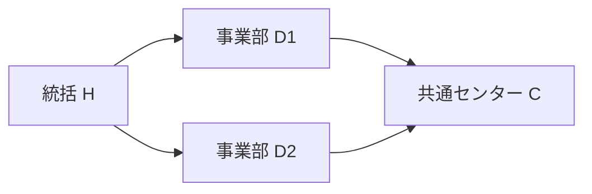

# 組織ドメインの表現力：トポロジー・量／単位・標準表現型の合成Profile（2026-11-07）

**状態：採用前の横断設計と独立Expected。** 既存Organization Source・汎用Data Facet・Representation/Function・Measure契約の組合せで十分な表現力を得られるかを反証する。新Core型、全組織共通Ontology/権限正本、第二Measure/Query/Renderer Engine、独立Test SSOT、TEI独自Hostの採用ではない。新たな実Go/DB/GUI/SHO/Owner試験は **NOT RUN**。

**一次資料の位置づけ**： [W3C ORG](https://www.w3.org/TR/vocab-org/) は組織階層・Role・Post・Membership・履歴の再利用可能な語彙を持つが、すべての説明責任・権能を完結させない。[QUDT 2026](https://qudt.org/doc/2026/02/DOC_SCHEMA-QUDT.html) はQuantity Kind／Unit／Dimensionの違いをモデル化する。[W3C RDF Data Cube](https://www.w3.org/TR/vocab-data-cube/) はDimension／Measure／Attributeを分ける。TEIはこれらの内部スキーマをコピーせず、必要な区別と反例を既存Facetの**適合試験**へ取り込む。BIPMの[SI Brochure](https://www.bipm.org/en/publications/si-brochure/)は物理量に関する参考であり、「人」「FTE」「案件」や組織上の業務意味をSI単位へ無理に還元しない。

## 1. 継承すべきものは「グラフ型」ではなく、構造・数量・意味・用途の合成能力

同一のOrgUnit D1が、指揮階層のノード、費用帰属先、法的事業所、案件の取扱担当、プロジェクト共同体、集計のDimension Memberとして現れる。これらは同じIDを参照し得るが、**異なるRelation Role／時点／責務の別グラフ**を形成する。基本の意味Carrierを一つの巨大な`Organization`オブジェクト階層へ押し込めない。

- **構造Facet**：Node/Edge/多項Relation、直接参照とIDを持つ実体化関係、方向・参加者Role・多重度、Pathと重複、閉路、集合／Bag、順序、接続性・到達可能性、Graph/Tree/DAG/Network。単なる関係Graphと数学上の位相空間（開集合族を持つTopology）を同一視しない（#2495/#2544）。
- **時間・空間Facet**：validAt／knownAt／decisionAt、構造版・公開版・観測時点、予定/Actual、位置Site／座標系／区域。所在地の包含・地理的隣接とOrgの上下関係、歴史組織のas-ofと現在Host Grantを混同しない。
- **Quantity/Measure Facet**：Quantity Kind／Unit／基準量・期間／精度・換算・丸め、Fact identity、集計の粒度と許された演算、集計軸別の加法性、必要な独立対象集合・属性値の完全性。数字／単位文字列／列名の一致で自動換算しない（#1705/#2593/#2544）。
- **Normative/Business Facet**：所属、雇用、役職、指揮、責任、予算帰属、委任・規範とその成立条件。関係・役職の事実から現在Principal・Grantを作らず、業務DFDの授受矢印からWorkflow Instanceを自動生成しない（#2386/#1125/#1174）。
- **Representation/Interaction Facet**：Function所属の表現インスタンスと型付きData Context、意味を保つ／失うProjection、Consumer別Scope/Disclosure、読み取りと逆編集の適格性。SHOは派生文書Consumerであり、TEI Function Instanceと無条件に同じSession／Grantにしない（#3236/#2497/#2506/#2507）。

**「継承」の実用的な意味**：一般標準の複数Facetを型付き参照で**合成・制約強化・Profile適用**する。OO継承・固定`OrganizationTree` Core kind・すべてのProfileへの必須Facet列挙を意味しない。必要なときだけOrgUnit/LegalEntity/Person/Membership/Position/Occupancy/CaseRecord等のドメイン意味Roleを追加する。特定業種/外部製品の既定値はAdapter/Profileに留める。

## 2. 組織が持ち得るトポロジーは一つではない

| 構造層／用途 | 期待される構造と制約候補 | 一つのTreeへ還元したとき失われるもの |
| --- | --- | --- |
| 法人・企業集団 | 法人格の同一性、持分・支配・共同契約などの型付き多項／多重Relation | 組織に含まれることと、持分比率・法的責任・Tenantを混同する |
| 人事/指揮 | 目的別階層、単一親Treeが必要なProfileと、複数Reporting辺が有効なDAG/Profile | 複数の上司、発令時点、同種の二経路と単一役職の違い |
| 配属・在任 | Person×OrgUnit×Role×期間の実体化Membership、Person×PositionのOccupancy、複数Employment | Person=Position、Membershipの1行=1人、空席の不存在 |
| 財務・予算・費用帰属 | 部門・費目・Project・会計期間をまたぐAllocation/Cost Center、経路別の係数と加法性 | 経路を削ることによる配賦損失、同じ費用の無条件重複加算 |
| 責任・承認・代理 | 業務Roleと行為の対象関係、任務／職務分掌・委任の方向、例外と失効時点 | 下位組織へ到達できることを行為権限とする |
| 案件・手順 | CaseのhandlingUnitという直接Relation、Procedure Step/Handoff/Workflow Instanceの別ID | Case移管=部門後継、業務手順=物理更新という誤同一化 |
| 場所・管轄 | Site、拠点のGeo、管轄区域、移動・在宅・複数勤務地と期間 | 地理的包含=指揮系統、拠点=唯一OrgUnit |
| 仮想・計画組織 | 提案Graph/Actual Graph、候補Revision／公開Revision、複数Scenarioの独立世界 | Preview案を確定組織や旧レコードの実更新へ昇格 |

**組織トポロジーの検査単位（正式Schemaではなく既存参照に渡す項目）**：`subject identity / relation role & participants / n-ary or direct / axis & purpose / direction / multiplicity / allowed cycles / path vs entity identity / valid & known time / tenant & source provenance / cardinality and closure`。

同じH→D1→CとH→D2→Cでは、**CというNodeは一つ、CへのPathは二つ**。Treeの経路複製表示は正当なUI手法にもなり得るが、複製された行を別OrgUnitや別の費用Factにしない。権限のScope/Relation到達も、後継組織の業務責任の自動継承も、Path存在だけでは決まらない。

## 3. 単位系は数値型より多層：Quantity Kind、Measure、集計法則

現在mainの`reference/org-headless-workspace/semantic/organization/model.tei`には`Membership.allocation type std.decimal`がある。しかし**0.6/60/60%のどれを採るか、週40時間に対する比率か、契約上の配賦か、Actual工数かはこのSourceだけでは確定していない**。これを本番FTEと自動認定しない。

| 組織のMeasure例 | 種別・単位・基準 | 合法な比較・集計に必要な条件 |
| --- | --- | --- |
| **Headcount** | 相異なるPersonの数［人］。Person occurrenceのdistinctが必要 | 所属Role、対象集合、時点、複数Orgをまたぐ重複排除の範囲。部署別人数の単純合計は全体人数とは限らない |
| **Membership/Assignment Count** | 所属発生件数［件］。人とは異なる | Materialized Relation IDが数えられているか、同じ関係の期間分割・重複Pathはどう扱うか |
| **FTE** | フルタイム相当量［FTE］。比率は表面上無次元でも業務上はPeople Countと別Quantity Kind | Fractionの分母となる基準労働時間、対象期間、Contract/Actualの別、跨Org配賦係数、精度・丸め、比較可能性 |
| **Work Hours / Capacity** | 稼働・要員容量［時間/期間］、定員［枠・FTE等］ | 工数とFTEの変換基準、予定/実績、休暇・残業、期間積分。容量超過を人数だけから計算しない |
| **Cost / Budget** | 金額［JPY等/対象期間/シナリオ］。レートは金額/時間や金額/FTE等 | Cost Center/期間/通貨/為替基準日/配賦、残高対フロー。JPYとUSDをそのまま加算しない |
| **Share / Allocation Rate** | 持分・費用配賦・労働比率・承認クォーラムは**異なるRatio Kind** | 0.4、40%、40を単位宣言なしで同一視しない。経路別係数の合計1.0はOwner規程・対象集合完全性のもとでだけ保証 |
| **Span / Layers / Coverage** | 管理範囲［直接配下のPosition/Person/OrgUnit数］、深さ［辺数］、被覆率［対象/母集団］ | どのGraph axisか、占有職位/空席、DAGの複数Path、集計する母集団・Source閉包・有効時点 |

**単位系は三段階で扱う**：(1) `QuantityKind`が何を量っているか、(2) `Unit/Basis/Period`が尺度と換算を規定し、(3) `Measure × Rollup Axis × Operation`が加法性／重複・重み付け／再集計可否を決める（#1705/#2593）。FTEと費用配賦率はともにDecimal/Ratioでも、互いの値を直接足す・入替えることは原則不可。期間末のHeadcount Snapshotを12月分足して「年間人数」とすることも不可。平均を再集計するには分子・分母や重み等の十分統計量が必要になる。

### 小さな独立Expected（閉じた合成World限定）

試験として一つの同時点・同Source/Scopeの完全な集合を仮定する：P1はD1にA1=0.6 FTE、D2にA2=0.4 FTE、P2はD1にA3=1.0 FTE。ここで**合成Fixtureは「値がFTE fraction、全3 Membershipを漏れなく取得」と明示**する。

- D1：Unique Person=2人、Membership=2件、FTE=1.6。D2：Unique Person=1人、Membership=1件、FTE=0.4。
- D1∪D2：Unique Person=**2人**（各部門Headcountの単純合計3ではない）、Membership=**3件**、FTE=**2.0**。HeadcountとFTEは同じ数値2でも同種の量ではない。
- 同じデータをPeople Table／Matrix／FTE Chartへ出す際、**3行・2人・2.0 FTEを1つの`count`へ潰さない**。別Tenant/Partial/未読込のA2があれば、完全な全社Claimは`unverified`。P1が0.6+0.4=1.0であることは、この合成Owner Rule下の局所説明であり全企業の労働配分規則にはならない。
- 別GraphでH→D1→CとH→D2→Cがあり、C固有の0.4 FTE Factを両Pathが参照しても、HでのUnique Entity集計は**0.4**。0.8は二重計上。配賦係数をOwnerが明示的に`0.5,0.5`と受理したとき、経路別の0.2+0.2=0.4を比較可能とする。Pathの重複を一律DISTINCTして係数を失うことも不合格。
- `allocation`が60、null、未取得、観測済み0、またはFTE以外の費用配賦率である負例では、前述のFTE結果へ自動換算・自動代入しない。Ruleに必要なFieldと対象集合を同じ適格Cohortで実ReadしていないClaimは`unverified`。

この独立Expectedは#2593のMC-01/03/05/07、#2510のORG Corpus、既存§16/39/53に**差分として引き渡す**。新たな本番FTE計算エンジン・集計正本や新Scenario IDを作らない。

## 4. 標準表現型の能力・適合・損失と組織向けProfile

`Data topology → Function Data Context/Result Slice → Function-owned Presentation Instance → Consumer output` の各写像で、**表現可能（representable）・用途に適切（fit）・意味を保存（preserving）・逆編集できる（editable）を独立に判定**する。「描けるが、編集には使えない」ことを正常な結果として許す。対応資格は`supported / conditional-with-evidence / lossy-read-only / unsupported / unresolved`等の**説明用の分類**であり、新Core Enumの提案ではない。

| Representation | 適切な組織上の利用・必要条件 | Loss／編集停止条件 |
| --- | --- | --- |
| **Tree / Org Chart** | 目的/時点を選択した単一親Hierarchy、またはDAGをPath重複として明示するread-only Tree | 多重Parent/異軸の辺を隠して唯一親と宣言しない。Path複製から無根拠なOrg移動を生成しない |
| **Graph / Network / Hypergraph View** | 複数Relation Role/方向/Occurrence、多辺、必要時のn-ary関係の中間表示 | 辺の外観・ラベルやNode配置だけではMembership等のRelation ID・業務意味・Targetが確定しない |
| **Matrix / Pivot / Heatmap** | Person×OrgUnit×Position×期間、MeasureとFact/Cellのgrainを明示 | 0・非開示・空・未取得のセルを同値化しない。多次元を潰したCell値から元の複数行へ自動PATCHしない |
| **Table / Detail / Form** | Membership/Position/Occupancyの独立ID、Field presence、期間、Root/Scope、read-only/編集対象の区別 | QueryのJOIN重複行を別の実体行とみなさない。値の不正な単位変換は表示上も警告 |
| **Chart / KPI / Sankey** | Headcount/FTE/Cost等のQuantity Kind・Unit・Rollup lawを表示。Sankeyは明示したFlow/保存則があるときのみ | 費用帰属や指揮線を根拠なく「流量」と表し、幅の保存則を捏造しない。期間末Snapshot/金額の直接積算を不許可 |
| **Timeline / Gantt / Scenario Diff** | valid/known/decision/published/actualの別、Versionと変更前後のRelationship | 計画上の部門新設や辞令候補を実採用済み・外部DB更新済みとしない |
| **Map / Spatial** | Site/拠点・管轄Geometry、座標系と時点を明示した空間の表現 | 地理的に包含/隣接するだけで指揮階層、企業内所属、行政上の管轄を作らない |
| **SHO／Mermaid風テキスト・図解** | 人が読める概要を生成し、Source/Role/Path/Quantity/Time/Disclosureの必要な来歴を残す | 多重Edgeが1本に簡約された図やMarkdownを正本へ逆編集しない。SHOからTEIモデルのOwner意味受理を自動付与しない |

**Mermaid風の糖衣例（説明用、正式TEI DSLではない）**：

同じCを2経路で表しても、**Graphに現れたNode Cは1個、Pathは2本**。テキストがDiagramを生成できることと、Relation purpose/occurrence・有効期間・係数・非表示Edge・現在Read Scope・編集Targetの全情報を保持したことは別。元Dataへの参照と適格な補助メタデータが欠ける場合はread-only説明に留める。Mermaid/Graphviz/Markdown等の文面は標準Dataの**表現上の糖衣**に留め、Source同一性や必要な編集逆写像は#2497/#2621・SHO Composer Owner側へ委譲する。

## 5. 生成AIと人間が迷わず選択するための最小判断票

AI/CUI/Studioには、新しい「組織専用Widget一覧」の網羅を要求する代わりに、既存Facet/Function/Representationの候補から**目的に対する最小適合理由**を提示させる。

1. **何を答えたいか**：単なる所属の説明／正確な承認候補／Headcount／費用配賦／履歴比較／編集Intent。Claimと業務目的を特定。
2. **どのStructure/Quantityか**：Node/Relation occurrence、軸、方向、時間、Measure kind、単位・分母・Rollup law、必要な必須/非表示依存を列挙。未知は補完せず診断。
3. **どこまで読んだか**：元Source/World、Query/Providerの実Read、対象集合とFieldの完全性、Tenant/Scope、必要なRead cohort・Consumer disclosureを確認。
4. **表現の条件を照合**：複数親ならGraphまたはloss明示付きTree、Unique Person数とFTEなら別Measure、期間あるならTimelineなど。図解の視認性と意味保存の優先を混同しない。
5. **操作の逆写像**：対象Relation/Case/Row/版が一意か、粒度は保持されたか、現在Host Grantと実Effectの境界があるか。満たさなければread-only／明示的な再選択・追加Read。
6. **説明・学習に利用**：同じSourceからTable/Graph/KPI/SHOへ出したとき、何が一致し、何が損失・非開示・未確認かを理由付きで示す。標準表現型候補はLLMが生成できても、その適合証拠をAI自身の言明で代替しない。

これは#2507のFunction Pattern選定と#2497のProjection説明へのread-only引渡しであり、AIによる画面選択を即座に本番実行資格へ変える仕組みではない。

## 6. 検収順序と責務：新機構なしに最大の表現域を反証する

| 段階 | 最小の独立検証 | Owner／不合格条件 |
| --- | --- | --- |
| **P0 構造・数量の合成対照** | 同じPersons/Membershipsから、Tree/Graph/Matrix/TableとHeadcount/FTEが**異なるが正しい**結果を返す。多重Path、n-ary、NULL、既知0、partialを一因子ずつ変える | #2510/#2495/#2593/#2514。構造・単位の無宣言な補完、全件判定の自己申告が不合格 |
| **P0 Native Source照合** | main #2681の実`model.tei`に存在するRelation/Attributeと、Profileで**まだ宣言されていないAllocation basis/Unit/Policy/Geo**を分類する | #1126/#2386。合成Fixtureを実Source capabilityへすり替えるのは不合格 |
| **P1 二つのFunction／二つの表現** | Org ExploreのGraph/TreeとCase HandlingのTable/Pickerが、必要なSubject/Path/Relation粒度、Source/Scope/epochとLossを保持する。外部SHOには別Disclosure | #2506/#2507/#2497/#2516/#3236。図の見かけの一致から編集Targetを導出するのは不合格 |
| **P1 実Readの縦切り** | C1→D1の一件を実Function→Query選択→Provider Read→Consumerへ結び、必要なField presence/rowset/時点を独立観測。追加Count/FTE Claimには依存閉包を要求 | #2586/#2622/#2628/#2611。合成や別FixtureでのPG PASSをOrg Product Readと呼ぶのは不合格 |
| **P2 編集・発火・更新後観測** | 元のMembership/Case Relationへ一意に戻せるIntentだけを送出候補とし、Owner業務Rule、現在Host Grant、Receipt、独立Resource Readを別資格とする | #2500/#2598/#1129/#1174/#1163。Tree移動やChart数値編集から自動Effectは禁止 |
| **P2 異業種への耐性** | 企業・行政・非営利・研究組織・共同事業で同じFacetを使い、特有RuleのみProfile差分にする。意味型/演算の不足を反証する | #2510/#2493/#2018。小PoCの範囲を製品の表現力上限にしない |

**採用停止線**：現mainのNative Org E1は実在するが、組織用FTEのQuantity Kind/基準・多軸Hierarchy・新Representation Instance/SHO出力・実Case Provider E2/Host Actionがすべて実装済みという主張はできない。正式な組織集計式、重複Pathの会計扱い、承認・委任、数値の演算則はOwnerの意味受理が別に必要。P0のC1→D1実Provider Readを妨げる大規模Core改造は行わない。

## 7. 三要素図面と組織Measureのクロスリファレンス：同一Meaningから異なる線・数値・操作を導く

他チャットのX-TEA三要素分析法（Data／Function／Business各モデルの図面表示・編集、CRUD等のクロスリファレンス生成）とSHOの平易なテキスト図解要求を、**既存#1124三視点Modeler／#1125一階層業務DFD／#1803設計書導出の受入に接続**する。§1〜6の「Dataの構造・数量・表現型」の上に、どの**Function/Procedureが、どのData/Relation occurrenceを、何の目的で利用するか**という型付き依存関係を投影する。ModelerのData/Function/Business図、CRUD表、SHOの組織図は別正本ではなく、Script/DSLを含む同一のauthoritative Sourceから導く。

| クロスビュー対象 | 必要な型付き関係／粒度 | 生成図・表 | 誤った自動同一視 |
| --- | --- | --- | --- |
| Data View | Person／OrgUnit／Membership／Position／Occupancy／CaseRecordとRole別Relation、時点・Source ID | ER/Graph／関連詳細／組織構造Diagram | 同じGraph線を雇用・所属・指揮・費用配賦・Case担当と判定する |
| Function View | Function ID、Data Context、Query/Operation Role、依存するRead Set、Case/Relation変更Intent、Quantity種別 | Function→Data/Operationの参照図、入力出力表、CRUD候補 | Tree/Pickerが表示できることを物理CRUD実行・現行Grantと判定する |
| Business View | Business Procedure／一階層DFDのBusiness Step/Actor/Trigger、対象Dataの授受、手作業/外部Step、責任 | 手順DFD、Handoff説明、職務別担当表 | DFD矢印をData Relation、Transaction、Workflow実行順や引継ぎ完了と判定する |
| Cross Reference | 同じCanonical Subject／Role ID、Source locator/revision、Function→Data用途、Procedure→Function/Manualの明示Binding | CRUD/Role/Step表、Source追跡、差分・影響表 | SQL JOIN/SQL UPDATE字面からOwner受理済みの業務CRUDと推定する |
| Quantitative Projection | Measure Ref、Fact/Occurrence、Unit/Basis、Rollup Axis、演算法則と必要集合のRead Witness | 人数・FTE・工数のMatrix/Chart/KPI、SHO図解 | 同じ「2」でUnique Person数、Relation件数、FTEを同一Quantityとする |

### 7.1 CRUD表は「宣言・導出・実測」を混ぜない

**設計時の合成例**（既存mainに実Functionや実書込が存在すると主張しない）。`R`は「明示的に設計上Readを必要とすること」、`U?`は「明示意味の採否・実装・Grant未確認の更新候補」、`—`は「この例から宣言なし」。`U?`をC/U/Dの実実行実績として扱わない。Relationの`Link/Unlink`はRow CRUDの`U`と等価とは限らない。

| Function／Business step | OrgUnit | Membership | Position/Occupancy | CaseRecord | Measure／依存 |
| --- | --- | --- | --- | --- | --- |
| Org Explore（Function候補） | R | R | R（表示目的が明示された場合） | — | PathとAs-of、Entity/Occurrenceを区別 |
| Case Handling（Function候補） | R | — | — | R、担当`U?` | Case→Orgの直接Relation、実TargetとCurrent Grantが必要 |
| Workforce Report（Function候補） | R | R | 必要なReportのみR | — | Unique Person CountとFTEを別に算定、非出力allocationを含む |
| 引継ぎを受領する（Business Procedure） | 業務参照 | — | — | 業務参照 | 人手/外部確認をSystem Uと自動対応させない |

行と列の交差は`Declared / Derived Candidate / Actual Read / Actual Effect / Not observed / Unknown`等の**別資格**を参照できなければならない（正式なCRUDセルSchema新設を意味しない）。設計書Generator #1803は、未取得／未宣言セルを「C/R/U/Dなし、確実に使わない」と断定しない。Queryに非出力のPredicateやJOIN依存がある場合、出力Fieldに現れなくてもRead Setへ残す。Business Actor・Procedure役割と物理Principal/Grantは同じ列へ潰さない。

### 7.2 数量付き図の一貫性は射影と集計の交換可能性を要求する

一般には「GraphをTree展開した後にSUM」と「元の実Fact集合にSUM」の結果が一致するとは限らない。**投影してから集計することと、集計してから投影することが等価なのは、Subject/Fact identity・path係数・集計軸/基準時点・Read集合完全性・NULL規則が保存される場合に限る。** 同じ数値が描画されるだけでは十分でない。

§3のH→D1→CとH→D2→Cにおいて、Cに固有の0.4 FTE Factが一件なら、Pathを2行へ複製した後に単純SUMする0.8は、Ownerが「経路ごとに全量計上する」と受理した特別な場合を除いて元Factの0.4と同値でない。逆に経路別の明示重み付けが業務上の意味なら、Nodeの単純重複排除は経路係数を失う。SHOのDiagramでEdgeを一本に畳む表示は許せても、失われたRole/Path/係数の再生成・逆編集は不許可。

これを組織の標準構造が持つべき**数量操作の適合性**として#2593/#2544へ渡す。新たな数式解釈器やGeneral Graph Engineを組織側で作らない。

### 7.3 図上編集の資格とCRUDの影響解析

同じMeaningに対応する複数の投影を保持する場合でも、図形移動や数値変更を直接Source改変にしない。

1. **D1への構造Edge付替え**：Relationship occurrence/Role、対象Graph axis、有効・認知時点、Source span/revisionを一意に逆引きできるならtyped changeの**候補**。多重ParentのTree展開行／Projection-only配置は編集不資格。#1124の既存Preview→Acceptance→reparse/reproject経路へ渡す。
2. **MatrixのD1 FTE=1.6セル変更**：複数Membershipが寄与した集約であるため、対象Fact/演算の逆写像が一意でない。独立した配置配分のOwner操作が宣言されない限り、元の0.6/1.0への自動PATCHは拒否しSource/Contributorへnavigateする。
3. **Business DFDの「D1→D2引継ぎ」線編集**：Procedure/授受契約の変更候補であり、CaseRecord.handlingUnit D1→D2の実Writeとは別。手順図の変更だけではWorkflow Instanceを実行しない。
4. **CRUD表の`U?`セル編集**：派生された利用状況の表そのものを正本とせず、元のFunction Operation／Rule BindingのSourceへnavigateして変更案を示す。意味受理→生成／実効果を別に表示する。

### 7.4 独立Expected／変異の最小集合（#2514/#1180へ引渡し）

| 対照（公開合成、原実装由来のExpectedではない） | 変えた因子 | 不変でよいもの／更新・停止すべきもの |
| --- | --- | --- |
| **ORG-XV-01 組織Graphの目的変更** | H→Cの同じ端点を`command`→`budget` Relationへ変更 | Node IDは同じでも指揮Tree/Business権能候補は失効。費用配賦図は別Purposeとして再評価。軸を無視したRendererは不合格 |
| **ORG-XV-02 FTEだけ変更** | A1.allocation 0.6→0.5（基準／時点／集合は同一と仮定） | Unique Person／Membership件数は不変、D1 FTE=1.5・全体FTE=1.9へ改訂。Graphの所属線に無関係な再描画を安全違反とはしないが、旧FTE表示/SHO数値維持は不合格 |
| **ORG-XV-03 Path fanout** | Cへの二PathをTree出現行として展開 | CのEntityは一つ／Path二つ、未配賦Fact0.4を0.8にしない。二行を別組織とするCRUD/Chartは禁止 |
| **ORG-XV-04 DFD矢印編集** | 人手Handoffの送り先D1→D2を変更 | Business Procedure/責任の候補差分だけ。CaseのhandlingUnit/Host Grant/Provider Effectは不変（別操作がない前提） |
| **ORG-XV-05 非可逆集計セル編集** | D1 FTE Chartの1.6を1.4へドラッグ | 元A1/A3への一意な更新候補なし→read-only/ambiguous。独立Actionが新設されていない限り自動更新しない |
| **ORG-XV-06 表示一致・内部差異** | 同じPublic Treeを保ち非公開Membership/委任・時点/Sourceのみ変える | 外部SHO/AI/Tool Logに非許可情報・件数が漏れない。Private依存の承認候補は再資格化 |
| **ORG-XV-07 Source版ABA／後着** | A→B→AのSource/Selection復帰と旧Response到着 | 出力一致だけで旧Owner Meaning・Receipt・現在Grant・編集Offerを復権させない |

上記は**既存§16/39/84/85、#2593 MC、#3236 CX、#1124 M0〜M3、#1125 DFD、#2514独立検証**へ交差参照するための診断対照で、第二Fixture SSOTではない。最初のP0は構造・Measure・図/表のread-only反証、P1は#2586の実一件Read→Function Contextからの三視点/Quantity導出、P2は一意なモデル変更候補と受理後再Projection。Modeler/SHO/外部Hostでの実一往復とCRUD実更新、Owner正式受理は**NOT RUN**。

## 8. モデルから導く組織検証義務とC0/C1・業務Coverage（2026-11-07、他チャットのAI-firstテスト設計との接合）

### 8.1 実装を自己採点させない導出順序

他チャットの[モデル由来テスト生成Draft #3258](https://github.com/hat47x/tei-platform/pull/3258)・[#3259](https://github.com/hat47x/tei-platform/pull/3259)・[#3260](https://github.com/hat47x/tei-platform/pull/3260)・[#3261](https://github.com/hat47x/tei-platform/pull/3261)は、三要素の制約からDataset/Scenario/独立期待値候補を作る**未統合・互いに重複し得る設計案**である。組織側は第二のAI Generator・Driver Scenario・独立Expected Storeを採用せず、**検証義務の判別対象と合成World**だけを提供する。

導出手順は、(a) **実際に取得・受理された**Data/Function/Businessの意味制約とSource/Role/時点を固定、(b) Required Obligationと必要入力・対象集合・未取得依存を列挙、(c) 独立した固定Expected（本節の手書き有限値・Ownerに受理されたRule等）と既知Mutantを対応づけ、(d) #1131が型付きDataset/Snapshotの**候補**を生成、(e) #1180の保存Driver Scenarioが受理されてから各TargetのCLI/Web等を導出、(f) #2514の独立検証基準でMutant検出力と適用範囲を測り、(g) #1163のexact-HEAD/Attempt/Provider/Consumer証拠へ接続する順とする。

**Important**：モデル由来の説明を読んだLLMが、Candidate/Implementation/Expectedの三者を同じ推論で作った場合は独立検証としない。未受理の「強属性」・FTE換算・組織の権限継承規程を生成時に補完しない。Syntactic `std.decimal` から業務FTEの正例・負例を生成するためには、別途受理されたFixture契約が必要になる。

### 8.2 独立Expectedと故意の誤実装を最小に揃える

§3/§7で定義した閉じた合成World W0（P1→D1=0.6 FTE、P1→D2=0.4 FTE、P2→D1=1.0 FTE、同時点・同Scope・全3 Membership実体が揃う）に基づき、最初の**固定Expected**は全体Unique Person=2人、Membership=3件、FTE=2.0、D1 FTE=1.6とする。これらは本番TEI意味やProviderのActualではなく、**テスト独立期待値の候補**である。

| 義務（#1131/#2514への引渡し識別用） | 一因子変更・正例と固定Expected | 落とすべき既知Mutant／停止線 |
| --- | --- | --- |
| **ORG-TG-01｜対象同一性** | W0の全体Unique Person=2、Relation件数=3。Person P1は2つのMembershipを持つ | `COUNT(Membership)`をHeadcountとして3と出す／JOINの同じPersonを別ID扱いする |
| **ORG-TG-02｜FTEと数量型** | W0のFTE=2.0。A1だけ0.6→0.5なら独立Expectedは全体FTE=1.9、D1=1.5、Unique Person=2、Membership=3 | 同じ行数で旧FTE=2.0をキャッシュ継続／FTEとHeadcountを同一Quantityとして比較／60を0.6へ無宣言換算 |
| **ORG-TG-03｜二経路と配賦係数** | 同じCへ2つのPath、C固有の一Fact=0.4。Entityに相対した集計=0.4。OwnerがPath重み0.5/0.5を明示した場合のみ0.2+0.2=0.4 | Graph展開行数×0.4=0.8を無条件に合格／`DISTINCT`で正当な経路係数まで消去 |
| **ORG-TG-04｜用途別Relation** | H→Cの端点とIDを保ち、Axisだけ`command`→`budget`。Command到達の依存Claimは再資格化、同一MembershipからのHC/FTEは別条件が変わらない限り維持可能 | 軸を無視したTreeを同じ指揮図として通す／全Facetの不必要な失効／Axisの変更から新Grantを発行 |
| **ORG-TG-05｜不完全な取得** | Required IDs={A1,A2,A3}、Observed={A1,A1,A3}／またはTOP1のみ。A2の完備を独立に証明できないので全体FTE/全件所属は`unverified`。A1の存在という局所Claimは維持し得る | 件数3一致で`CoverageComplete`自己申告／不足Allocationを0へ置換／Partialの局所正例も一律偽にする |
| **ORG-TG-06｜非単射の図と編集** | Cに至る2経路をSHOの1行へ簡約／D1 FTE1.6のChart Cellを1.4へ編集。元Node IDを保持したread-only説明は可能、直接更新先は`ambiguous` | 1行表示から一意の関係Edge／A1・A3の更新値を創作し、画面編集を直接PATCH |
| **ORG-TG-07｜業務DFDと実効果** | D1→D2の引継ぎProcedureの矢印だけ変更、CaseRecord C1の実DB/Hostに操作なし。業務Designの差分のみ | DFDの見た目変更をCase担当移管Commit／人手受領の完了とする |
| **ORG-TG-08｜現在資格と公開範囲** | Public図は同一でPrivate Membership/Delegationだけ異なる2 World。許可されたPublic Consumerに差がない範囲だけ表示可能。Grant/Policy版・Source/epoch ABAではAction Eligibilityを再検査 | 非公開関係の個数がTooltip・SHO・diagnostics/Tool Logへ漏れる／旧Action Offerを現行Grantとして再利用 |

**空虚なVerifierを落とす正例**：A1だけFTE変更したとき、旧FTEを維持する実装と、何も出力しない実装の双方を不合格とする。Axisがbudgetへ切り替わった場合は、新たなbudget表示が必要ならそのPurposeで出力が変わる正例を別途固定する。「一律unverifiedなら安全」という実装も合格にしない。変異実装のExpected自体をCandidate Generatorへ再生成させない。

### 8.3 Coverageは三種類の分母と一つの証拠列を分ける

- **C0／C1（コード側）**：**C0=実行されたコードの文/命令、C1=実行された分岐の真偽（分岐Coverage）**を、具体的な生成Go/Target／Plugin／Runnerのexact Artifact/Versionごとに測る。組織のMeaning SourceからC0/C1達成を推定しない。異TargetのC1はInstrumentation/分母が違うため総計を無条件に合算しない。
- **意味・要件Coverage（モデル側）**：受理済みOrg Relation/Role／Measure/単位・Rollup／Function Operation／Business Procedure・Handoff/現在Grantの各Obligationが分母。関連Data/Function/Businessの同じMeaning IDを参照し、未受理・unsupported・未読込を分母から無言で消さない。
- **判別力（独立検証側）**：独立Expectedに対する正例・一因子負例の両方、既知Mutantの`killed/survived/not run`を記録。UI表示テスト件数・Go PASS件数だけで「この組織ドメインをカバーした」と宣言しない。

**検証状態を同じ一枚にする列（新Core schemaではない）**：`Obligation / Domain Source+accepted meaning ref / required population & fields / generated dataset & seed / independent Expected ref / known mutant / required consumer + branch / located & loaded / actual executed target+HEAD+Attempt / actual Provider/Disclosure/Receipt if relevant / C0-C1 instrumentation / observation / qualified or unresolved`。分母不明ならCoverage率を100%と算出しない。必要なのに存在しないRule・未出力Predicate・手作業Step・実Provider Readerは`not run`や`unsupported`のまま報告する。生成したテストがすべてSKIPでもCoverageを加算しない。

### 8.4 最短実行順：構造→数量→三視点→Product E2

1. **P0-a／モデル探索**：main統合済み#2681 Native `model.tei`を実CLI/Sourceから取得し、存在するPerson/OrgUnit/Membership/Position/Occupancy/CaseRecordと、**存在しない**FTE QuantityKind・Allocation分母・正式Org Parent Graph/Procedure Bindingを観測資格つきで区別する。合成W0のFTE契約は本番Nativeへ暗黙移入しない。
2. **P0-b／独立Expected**：ORG-TG-01/02/03/05の固定正常値と故意の誤結果を、#1131/#2514の既存Fixture/Expectedへ渡し、#2811のAI-first候補でどのMutantが落とせるか比較する。生成候補が受理前なら`candidate`、新Go/CI未実行なら`NOT RUN`。
3. **P1／三視点と変更検証**：#1124/#1125/#1803にORG-TG-04/06/07の型付きGraph/Tree/Function/CRUD/DFDのRead-only OutとSource/Role/版を渡す。SHOは別Consumer資格、図面上で一意なSourceがない変更はPreviewまでに留める。
4. **既存最重要Product E2**：#2586のC1→D1実Function→Query→Provider Read→Consumerを同一Attemptでつなぎ、FTE/人数等の追加Claimは必要な実Field/Scope/Populationを別々に観測した後に限り組み込む。P0-a/bの別合成PASSをProduct E2へ足し込まない。
5. **P2／Effectと受入**：実関係更新、Host Grant、Receipt、独立再Read、Owner業務Ruleは#1174/#1163/Org Ownerの既存境界を通す。#3258〜61の複数Draftから新Org専用Test Generator/SSOTを作らない。

**受入状態**：本節は**既存Org Profileの追加診断・適合計画**であり、ORG-TG-01〜08の新実行・C0/C1測定・AI Generator実装・Product SQL/Org DB/GUI/SHO/Owner Meaning受理は **NOT RUN**。既存完了・実証済みの局所テストと混ぜて新たな一気通貫PASSを宣言しない。

## 9. 製品到達の三ゲート：三視点生成（M）と実Read（R）を別成立させてから接合（C）する（2026-11-08、受入提案）

### 9.1 現行Sourceで確認できる上限

2026-11-08照合時のmain `reference/org-headless-workspace/semantic/organization/model.tei` は、Person／OrgUnit／Membership／Position／Occupancy／CaseRecordと、それぞれの型付きRelationを宣言している。CaseRecordには `caseId`、`handlingUnitId`、`handlingUnit to organization.org_unit one` と参照Keyがある。一方、**このSource単体にはCase用Function/Query、物理Persistence Mapping、対象Case行・Provider、Host Grant、Business Handoff実施証拠はない**。既存 `internal/operations/org_headless_characterization_test.go` が確認するread-only Operation SurfaceもMembershipを中心とするもので、CaseのProduct Readを宣言・実行していない。したがって `C1→D1` は組織的な意味候補／独立Expectedの例として有用でも、現mainで取得されたCase行ではない。

これは「当該機能が全Workspaceに存在しない」という全称証明ではなく、上記**検査済みSourceと既存Operation Surfaceの範囲内**での否定である。#3262のDesign Contextで他のSource/Plugin/Functionの必要集合を調べる際は、未探索・未Load・未Parseを不存在へ変換しない。

### 9.2 P0-M／P0-R／P0-Cの依存と独立検収

| ゲート・既存Owner | 必要な最小成果物と観測 | この段階で主張できないこと |
| --- | --- | --- |
| **P-1：設計入力の閉包** #3262 | 一つの対象Function/DomainについてRequired Data/Function/Business/Relation/Rule/Sourceを独立に固定し、found/loaded/parsed/bound/returnedと欠落理由、実消費Source revision、Scopeをread-onlyで提示する。完全なTool Reply受領も別確認 | 空欄を「設計上存在しない」とすること、許可範囲外の存在/件数の開示、AI生成されたExpectedの正式受理 |
| **P0-M：三視点の実Source生成** #3263/#1124/#1125 | 同一Semantic SourceからData Relation図、Function→Query/Context参照、Business DFD/ProcedureとCRUDを機械取得し、各ノード/辺/セルにSubject/Occurrence/Role/Sourceと宣言R・未受理U?を保持。複数Canvasに現れる同一要素は同一ID | DFD矢印をCase移管Effect、CRUDのRを実SQL Read、図上同一位置を同一Relation/権限とすること |
| **P0-R：実Function Readの受渡し** #2586/#2622 | **既存汎用Referenceの受注例**なら選択Query/args→実PostgreSQL Provider→物理行ID/必要Field/Scope/Read extent→Function Data Context/Consumerを同一Attemptで観測。**組織Case例**には別途Case Function/Query/実Persistence Bindingを明示してC1を同様に観測する | 受注の実PG成功を組織Case Product E2 PASSへ転記、静的Browse/SQL metadataを物理Readと呼称、ページ1件をOwner全件の証明とすること |
| **P0-C：MとRの意味・範囲接合** #2586/#2514/#1180 | Diagram/CRUDのSource／Role／Quantity Kindと実ReadのSource/Target/Row identity/Field/Scope/epoch、Consumerの公開Scopeを**同一Meaning ID・対象版・粒度**で照合。独立Expectedの正例・欠損/重複/TOP1/非出力Predicate負例を判別する | 取得列不足のFTE・業務権限を補完、Callerの`CoverageComplete`だけから全件引継ぎ完了を断言、Receiptから独立再Read/人手確認を推定 |
| **P1/P2：表示・逆編集・Effect** #2497/#2507/#1174/#1163 | 同一DataをTree/Table/Graph/SHOへ再Projectionし、失われたRelation/Unit/Disclosureと一意な変更候補を判定。実更新は別Host Grant/Operation/Receipt/独立Read、手作業は別Handoffで確認 | Non-injective図の直接書戻し、旧Session/旧Grantの再利用、Rule Attachmentからの自動業務Effect |

**並行化と接合順**：P0-MとP0-Rの個別Fixture／コード／CIは互いの完成を待たず進めてよい。P0-Cだけは**同じ受理意味・Scope・Source revision・Attemptに結びつく実成果物**が揃ってから成立判定する。#3330の横断優先と#3263のDiagram Fixtureを参照するが、両Draftは現mainで実製品生成を証明していない。#3238の実PostgreSQL TOP1／非出力述語試験は**汎用Referenceの読取境界**であり、組織Caseの完成証拠へ流用しない。

### 9.3 最初に必要な再現可能な受入票（Issueで運用し、第二正本は作らない）

単一Case `C1` の存在証人の検収は、まず `CaseRecord.caseId=C1` と `handlingUnitId=D1` が**どの実Read SQL/args・Provider・対象Schema/Field・Request/Attempt・Source/Scope/snapshot**から得られたかを同一試行で追跡する。必要なSource/Binding/権限/Fieldが一つでも欠けるなら `product-read-not-connected` または `unverified`。その後、二件集合 `L={C1,C2}` の全件Claimへ進むときは**ID集合と実Read範囲の独立照合**を追加し、`{C1,C1}`／TOP1／非表示Predicateを不足とする。Local `EvaluateCompletion` に完全性を入力する前に、このProducer側の照合を完了する。

**ゲート別の最低報告単位**：`source revision & actual input / accepted meaning ID / graph-or-CRUD provenance (M) / physical query+args, rowset+fields, scope+extent (R) / independent Required IDs+Expected, mismatches, unknowns (C) / executed target+CI/attempt / Owner qualification`。M、R、Cそれぞれ `not-run / failed / partial / qualified` を**別に**記す。今回の追加は設計上の検収票と依存の明文化のみであり、実組織SQL/DB/Host/GUI、E2統合、正式Owner受理は **NOT RUN**。

### 9.4 Empty Handoffの実装上の誤完了境界：空集合と受領証拠を別々に検査（2026-11-08）

**現mainの実コード照合**：`internal/semantic/completion.go:EvaluateCompletion` は非空Targetの `EmptyPolicyHandoff` では `HandoffConfirmed` を確認するが、0件の分岐では `EmptyJustified`／`CoverageComplete` による `CompletionHolds` の前後に確認ガードがない。そのため **`Targets=[]; EmptyJustified=true; HandoffConfirmed=false` の局所入力が `holds` になり得る**。現mainにある`completion_test.go`の旧Testは非空Handoffしか確認していない。これを受領済み業務・実Providerの完了保証と呼ばない。

**既存Coreの最小修正は [#3353](https://github.com/hat47x/tei-platform/pull/3353) でmain統合済み**（squash `6cf510d6301a1e133ebbe69ad7bf004f03361b54`）。0件分岐で評価結果が`holds`かつ`HandoffConfirmed=false`のときだけ`unverified`へ格下げする（`deny`による確定`fails`は維持）。要求される受入対照は以下6条件で、実コード・同一テストOwnerは#3353／`internal/semantic/completion_test.go`。この組織Profileにはコードや第二Fixtureを置かない。

| 独立入力（局所Completion APIの限定例） | Expected |
| --- | --- |
| Handoff／0件／独立空集合証拠あり／人手受領なし | `unverified` |
| Handoff／0件／独立空集合証拠あり／人手受領あり | `holds`（**Caller提供の受領情報を信頼した局所判定のみ**） |
| Handoff／0件／明示Allow／全件Scope／人手受領なし | `unverified` |
| Handoff／0件／明示Allow／全件Scope／人手受領あり | `holds`（局所判定のみ） |
| Handoff／0件／明示Deny／全件Scope／受領なし | `fails` |
| Handoff／0件／独立空集合証拠なし／人手受領あり | `unverified` |

**さらに外側の未解決資格**：`HandoffConfirmed`、`EmptyJustified`、`CoverageComplete` はすべてCaller提供のフラグであり、`EvaluateCompletion` は外部の人手受領、必須Target集合の閉包、実Provider同一ScopeのRead、現在Host Grantを証明しない。したがって新回帰がPASSしてもProduct E2／Case移管／Business Completionは未成立。#2586/#2622の実Read Producer、#1125/#1444の受領証拠、#1174の実Effect、#2514の独立Expectedを**別々の観測**としてP0-R→P0-Cで組み合わせる。空対象が正式に許容され、かつ別途受領を要しない業務はOwnerの別条件・別Kindとして表現し、Handoff条件を無音で緩めない。

**状態**：本Profileは採用前の検収計画。#3353の修正はmainに統合済み。PR HEAD `cf3de9a61906167b3b5cc2fbd246e238a5018d5f` に対する [Repository Health #42391982442](https://github.com/hat47x/tei-platform/actions/runs/42391982442) は **completed/success**（`gofmt`／`go vet ./...`／`go test -count=1 -timeout 60m ./...`）。この合格は旧PR検証対象のGo局所回帰であり、実業務の受領、組織E2、正式Owner受理は **NOT RUN**。

### 9.5 一括Handoff確認フラグの集合帰属と鮮度：全件Caseの誤完了を防ぐ（2026-11-08、P0-C）

**修正後も残る実装境界**：mainに統合済みの`EvaluateCompletion`では、`HandoffConfirmed`が**Claim単位の真偽値**であり、確認の出典・確認者・対象ID集合・Ownerの受領規程・時点・期限・Revision・実Operationに結びついた証跡を入力として受け取らない。したがって`Targets=[C1,C2], CoverageComplete, HandoffConfirmed=true`は局所Evaluatorで`holds`になり得ても、**C1だけの受領ACKを呼出元が全体確認と取り違えた場合、C2の引継ぎは証明されていない**。これは今回の#3353（空集合ガード）とは独立の、Evidence Producer／Handoff Binding側の不足である。

**新Coreフィールドを追加する前に、既存Read/Procedure/Receipt経路で二つの集合を閉じる**。業務Ownerが定めた必要対象`L`、同じMeaning/Source/Scope/snapshotで実Readした対象`R`、受理済み手順に従う確認対象`H`を混同しない。`R`は#2586/#2622が実取得を観測し、`H`は#1125/#1444で、対象別の確認証跡、または**Ownerが明示的に認めた正確な集合への一括確認**として観測する。案件DB値がD2、Command Receiptが成功、人手ACKがあるという3種類の記録だけで**同じ`L`・版に属することを証明した**とはしない。最後に#2514の独立Expectedが`L/R/H`の閉包・一致と逆例を判別し、その結果が必要条件を満たす範囲に限って既存`HandoffConfirmed`へ渡す。単純な件数一致や公開Viewの件数を集合の証明にしない。

| 合成した受入対照（全件Case Handoff） | 独立Expected／停止条件 |
| --- | --- |
| **ORG-HC-01 基本正例**：`L={C1,C2}`、`R={C1,C2}`、同一Scope/必要版の正当な受領`H={C1,C2}` | 受領出典・Owner規範・相手方・適用時点まで照合して初めて全件確認候補。局所`holds`だけではBusiness Completionではない |
| **ORG-HC-02 一件のみACK**：`L=R={C1,C2}`、`H={C1}` | `unverified`。単一Global boolをtrueにして全体成功へ昇格しない |
| **ORG-HC-03 ACK重複**：`H=[C1,C1]`を件数2として使用／`C2`なし | `unverified`。ACK件数とDistinct Scope-bound Case IDを分離 |
| **ORG-HC-04 一括ACKの対象が曖昧**：バッチ受領あり、対象ID/Revision未束縛 | `unverified`。一括確認が禁止ではないが、確認の適用集合が不明なら全件Claimを確定しない |
| **ORG-HC-05 途中改訂・ABA**：C1の担当/版が変わり、旧`H`を再利用 | 現行Claimの資格を失効。現在値D2だけで前回の受領を新Operationに移植しない |
| **ORG-HC-06 公開範囲と異なるH**：Tenant/Disclosure/非表示依存が`L`と異なる | 全体確認を主張しない。秘匿対象のID・件数・ACK詳細を低権限Consumerへ返さない |
| **ORG-HC-07 空対象で明示的な手順完了**：`L=R=∅`、Ownerが空集合のHandoff条件を要求 | 空集合資格と別に相手方/人手の確認を要求（#3353で局所判定修正済み）。確認不要の業務なら別Condition/PolicyとしてOwnerが明示 |

**既存Ownerと受入経路**：#2386は組織意味とL、#3262はDesign Contextで必要Sourceの列挙、#2586/#2622はRの実Read、#1125/#1444はHの業務上の確認契約、#1174/#1163はProvider Effect/Receipt、#2514/#1180は独立ExpectedとMutant。#3353のGo CI成功は空集合ガードに限定し、HC-01〜07や実確認Providerの実装を「済」にしない。**新Handoff Ledger/万能Receipt Engine/組織専用Completion APIを増設しない**。必要になった時点で汎用Handoff Evidenceの最小型を各Ownerで判断する。

**段階**：P0は合成受入票と既存Source/Reader契約照合、P1は#2586の実Case Read後に同一Attemptと受領証跡を対応付け、P2で異Provider/人手の不確実性を扱う。実`L/R/H`の一気通貫、外部受領、Owner正式採用は **NOT RUN**。

## 10. 組織の二時点と重複有効期間：兼務・異動・在任を関係単位で検収する（2026-11-08、採用前）

### 10.1 第9節のM/R/Cを時間意味へ拡張するときの追加境界

本節は[組織意味Issue #2386](https://github.com/hat47x/tei-platform/issues/2386)のS1〜S7、[Corpus #2510](https://github.com/hat47x/tei-platform/issues/2510)のOPC-A/C・CM-02/03/05、[main統合済み合成Reference #2596](https://github.com/hat47x/tei-platform/pull/2596)の `org-synthetic-r7`、[main統合済みNative E1 #2681](https://github.com/hat47x/tei-platform/pull/2681)を**別々の資格**として照合する。従来の一般的なas-of／遡及訂正の説明へ新たなTemporal Engineや固定Org型を追加せず、**重複時点における関係Identity・Business Rule・実Provider読取の不足**だけを具体化する。

| 関係の実体とRole | 既存Native Sourceで観測できること | 同じこととみなさないもの |
| --- | --- | --- |
| `Person P2` | `personId`を持つ主体Data | `Employment`・`Membership`・`Principal`・他TenantのAccountに自動同一化しない |
| `OrgUnit D1/D2` | `orgUnitId`を持つ組織Data | 同一名・後継RelationからEntity同一性/Host Grantを生成しない |
| `Membership A2/A3` | 独立`membershipId`、`personId/orgUnitId`、`allocation/validFrom/knownFrom` | A2/A3の二本をP2一件へ畳まない。`validTo/knownTo`や時点照会はNative製品に存在するとはみなさない |
| `Position M1` | 独立`positionId`とOrgUnitへのRelation | Positionの存在＝着任者の存在ではない |
| `Occupancy O1/O2` | 独立`occupancyId`、Person/PositionへのRelation、`validFrom` | 職位在任＝所属・本務・権限ではない。Nativeに`validTo/knownFrom/knownTo`が実装済みともみなさない |

**判断**：複数Orgへの兼務、同じPositionへの同時Occupancy、同じPerson×OrgUnitに見える複数Membershipは、すべて一律の重複エラーではない。重複禁止は `relation role / participating identity / authority source / valid-time / known-time / multiplicity / purpose` を指定してOwnerが受理する**業務規範**であり、一般のGraph JoinやUI Treeを規範の代わりにしない。属性の一致だけで二つのOccurrenceを消したり、一方をPrimaryと推測したりしない。

### 10.2 既存合成Sourceの固定Expectedを時間境界まで展開

合成Referenceに限り、`[start,end)`（開始を含み終了を含まない、null終了は無期限）を`valid`・`known`の**比較用規約**として用いる。日付と日時、タイムゾーン、発効の粒度・締め時刻が案件ごとに異なるため、これをTEI全体の固定時間型・DB仕様としては採用しない。元Source `membershipVersions`のA2は **known 2027-07-02以前はvalid終期なし**、**同日以降はvalid終期2027-06-01** の二版。A2は同じOccurrence IDの**記録版**であって二人目のMemberではない。

| `validAt` | `knownAt` | D1のMembership occurrence | D2のMembership occurrence | Position M1のOccupancy | 検収上の意味 |
| --- | --- | --- | --- | --- | --- |
| 2027-05-15 | 2027-07-03 | A1, A2 | A3, A4 | O1=P2 | 遡及訂正後でも6/1以前のA2は有効 |
| 2027-06-15 | 2027-07-01 | A1, A2 | A3, A4 | O1=P2 | 当時認識のA2は有効、P2の兼務は二本 |
| 2027-06-15 | 2027-07-02 | A1 | A3, A4 | O1=P2 | `known`切替境界で旧A2版を選ばない |
| 2027-06-15 | 2027-07-03 | A1 | A3, A4 | O1=P2 | 同`validAt`でも遡及訂正でD1からA2が消える |
| 2027-07-01 | 2027-07-03 | A1 | A3, A4 | O2=P3 | O1は終了境界、O2は開始境界。O2をP3のD1 Membershipへ変換しない |

ここでのD1/D2は**閉じた合成Source・二時点に対する局所Expected**。実DBの完全集合・低権限Consumerへの開示・許可される承認者を示すものではない。`validAt=2027-06-15`・`knownAt=2027-07-01`のSource側Expectedと、Replica/Primaryの読み出しCohort/実Rowsetを同一視しない。

### 10.3 最小の変異と既知の誤実装：ORG-TM-01〜08（追加実行NOT RUN）

| Case | 単一差分・故意のMutant | 独立Expected／拒否する誤推論 |
| --- | --- | --- |
| **TM-01** | P2にA2(D1)とA3(D2)、同じvalid期間。`GROUP BY personId`で一行化 | **Person distinct=1、Membership occurrence=2**。兼務を1本へ消さず、本務も暗黙選択しない |
| **TM-02** | A2の旧版/new版をknown境界7/2で同時採用 | A2は一つのOccurrenceで、選ばれる記録版は時点相対。二重Membership・二重FTEにしない |
| **TM-03** | A2のvalid境界6/1をinclusive-endとして選択 | 現合成Referenceの半開規約では7/3認識・valid6/1のA2は非有効。別終端規約はOwner宣言とExpected変更を必要とする |
| **TM-04** | O1(M1/P2)終期7/1とO2(M1/P3)開始7/1を重複／空白扱い | 合成半開規約では同じ瞬間にO2のみ。在任変更からMembership更新やGranted Principalを導かない |
| **TM-05** | 変異O3(M1/P1, valid6/30〜7/2)を加え、O1/O2と実期間が重なる | **single-incumbent(M1,当該Role)がOwner受理済みなら衝突**。multi-incumbent受理済みなら両者保持。Rule不明なら`unresolved`で、先頭行を自動選択しない |
| **TM-06** | 変異A5(P2,D1)をA2と有効期間重複で追加。IDはA5 | 異なるOccurrenceは保持。Primary/重複禁止/配賦上限の**対象Role・Source・基準期間**が不明なら不適合断定も自動dedupも不可 |
| **TM-07** | 同じA2の競合版が**同一knownAt・同じSource権威範囲**で相反する値を持ち、優先順未定 | Source側の衝突を`ambiguous/unresolved`。ファイル順/最新時刻/DB行順で勝者を黙示確定しない。補正Priorityが受理された場合はその契約で再評価 |
| **TM-08** | 部分Page／別knownAt Provider Cohort／隠れたMembershipで重複検査が0件 | 実際に読めた正の重複例は限定Witnessになり得るが、**期間内に重複なし**は当該Relation/Role/対象範囲/時間区間の完全Readが要る。0件を全体不存在と断定しない |

特に**半開区間の点照会で数件PASSしても、時間区間全体について重複がないことは証明できない**。区間交差、記録版の共存範囲、Authority source別の優先規則、Read completenessを併せて比較する。相反する同時在任が判明しても、正式な業務制度が複数在任を認めるならその正例を過剰拒否しない。これらの変異とExpectedは既存合成Sourceを手で拡張する**提案**であり、正式Owner受理済みOracleやNative製品実テストではない。

### 10.4 成立Claimと責任境界、実装順

- **P0-M（意味・構造）**：現Native Dataで関係ID・属性・出典位置・時間情報の存在と欠落を一覧化する。`knownTo/validTo`・Occupancyの記録時点・Position移管履歴がない場合は`unsupported/unknown`とし、AIが期間終端やEmployment/Grantを補完しない。#2386/#1126/#2510のOwnerで、排他/兼務/Primary/役割ごとのルールは**受理待ち**。
- **P0-T（独立Temporal Expected）**：既存`org-synthetic-r7`の5行の確定比較、TM-01〜08の単一因子Mutantと過剰拒否を#2510 Corpus/#2514へ引き渡す。Referenceの既存Node CIは固定コミットに限る。今回の8変異は新Node/Goで**未実行**。Scenario母集団、Known Mutantの判別力、Test C0/C1・業務Obligation Coverageを別報告する（#1180/#2514）。
- **P0-R（実Read）**：#2586で実Function→Query→DB Instance/Provider→`validAt/knownAt`・Relation ID・actual Row+Field/Scope・Read Cohort→Consumerを一Attemptで観測する。現組織Case C1→D1も未接続であり、Source定義や合成as-of PASSで置換しない。実DBに有効期間を投入していないのにTemporal Queryを製品合格と主張しない。
- **P0-C（接合）**：P0-M/Rと同じMeaning、関係Occurrence、valid/known、Owner受理済みRole・期間Rule、Producerの実完全性/Reader証拠、独立Expectedを一件ごとに結合。表示のGraph/Tree/SHOが同じでも、失われた多重関係・非公開Field・履歴は別のClaim（#3263/#2516）。
- **P1（判断・作用）**：業務上の承認候補/未決Caseと、Tenant Private/Shared、現在Host Grant、Effect/Receipt/外部Handoffは別資格。P2がO1の在任者だった記録や新任O2から現Grantを推定しない（#1174/#1125/#2499）。

**履歴上の状態訂正**：第9.4節の『#3353はDraft・未統合』は当時の記録である。[PR #3353](https://github.com/hat47x/tei-platform/pull/3353)は**2026-11-08 JST時点でmerged**。現main `internal/semantic/completion.go`に空Handoffで`HandoffConfirmed=false`なら`unverified`へ変更する限定修正が存在する。ただし`HandoffConfirmed`はCaller申告で、独立受領・実Provider集合の完全性・組織業務完了は未実証。既存第9節のP0-R→P0-Cを維持する。

**採用・未検証の境界**：採用済みなのはADRに従う共通Data/Plugin/Host非必須の基本方針であり、本節の半開規約・Position排他/兼務制約・TM-01〜08は**参考合成契約／受入候補・Owner未受理**。固定Synthetic Reference/Native E1/Completion局所修正が存在しても、今回の時間重複の実Go/Node Mutant試行、実DB/Provider/Host/SHO、全体Owner Meaning受理は**NOT RUN**。新Org Temporal Engine／第二Grant／Root Registryを作らず、#1119のCritical Pathと現行mainを変更しない。

### 10.5 当時の現在性・Provider観測・履歴の保存資格を分ける（2026-11-08、他チャットのTemporalData設計との交差）

**新しい差分**：§10.2〜10.4の`validAt/knownAt`と時点境界を実行可能なReferenceに接続したうえで、他Workstreamの「時点SnapshotはTemporalDataとして扱い、削除によって当時の現在性を失わない」「Origin（Original/Derived）、Temporal Semantics（Current/Historical/Observational/Bitemporal）、Preservationは別軸」を、組織Modelの具体的な**再現可能なClaim**へ写像する。この節は新しいTemporalData Core型／全Target共通履歴DB／Snapshot保存義務の採用ではない。

- **Business-valid**：D1のMembership A2が業務上いつ有効か（`validAt`）。組織発効日とDB切替時点は異なる。
- **Knowledge-known**：その業務事実のどの記録版を、判断当時知り得たか（`knownAt`）。遡及訂正により現在の再解釈が変わっても、過去に実際に知り得た記録・判断の出典を「新しい現在値」で上書きしない。
- **Read-observed**：どのSource/実Provider/DB alias/physical snapshot・取得時刻・rowset・field・Scope/Cohortから観測したか。これは業務有効期間でも`knownAt`の記録版でもない。Providerの`snapshot=s7`ラベルだけでは実Cohortの同一性も履歴保存も証明できない。
- **Decision/Effect**：その時点の業務判断・Owner受理、現在Host Grant、実Operation/Commit・Receipt/独立再Readはさらに別。過去OccupancyやMembershipで現在Grantを復元しない。

合成のA2は`knownAt=2027-07-01`で`validAt=2027-06-15`のD1所属に数えられ、`knownAt=2027-07-03`で同`validAt`のD1から外れる。これは**当時の認識と後日の遡及訂正の両方を同一Referenceから再現できる**試験用正例であり、旧Version/観測証拠を削除・書換してよい根拠ではない。ただしNative `model.tei`のMembershipは`validFrom/knownFrom`を宣言していても`validTo/knownTo`・物理History/Provider読取保証がなく、実行先が「当時の現在性」を再取得できるとは主張しない。

| 既存Fixtureからの追加試験 | 固定Expected | 未検証の範囲 |
| --- | --- | --- |
| **ORG-TS-01** A2遡及訂正後に同じvalidAtを過去knownAtと最新knownAtで照会 | D1のOccurrenceは当時`{A1,A2}`、訂正後`{A1}`。過去の認識切り口を現在値で潰さない | 実DB履歴保持、Source Evidence保全、Ownerの遡及訂正規範 |
| **ORG-TS-02** 合成ReplicaとPrimaryの`snapshot=s7`が同名で、`knownAt`は7/1と7/3 | 前者のD1は`{A1,A2}`、後者は`{A1}`。同名Snapshotや同一validAtはRead Cohortの同一性でない | 実PG/Replicaの一貫性、Provider内部履歴/読取、Current Host Authority |

この2件は既存[#2596](https://github.com/hat47x/tei-platform/pull/2596)のSource/Scenarioを直接使う[#3380](https://github.com/hat47x/tei-platform/pull/3380)の`verify-temporal.mjs`へ追加した。**先行HEAD** `0fabf18b`ではNode Reference workflow [#42396433833](https://github.com/hat47x/tei-platform/actions/runs/42396433833)がcompleted/success（`node --test` 215件／fail 0、うちTM 10件）だった一方、Repository Health [#42396433705](https://github.com/hat47x/tei-platform/actions/runs/42396433705)は**別領域`tools/reference-plugin-capability-coverage/coverage_test.go`のgofmt差分**で失敗（Go vet/test/Workspace validateはPASS）。当該Goファイルは後続mainで整形済みだったため、#3380はmain更新分を**履歴保持の二親merge**で取り込み、PR差分を従来3ファイルのみに保った。最新のTS-01/02追加HEADに対するexact-head CI結果は**別途検収するまで未資格**とする。古いHEADのNode成功を最新HEADへ流用しない。

**受入の区分**：合成で再構成可能な時点値を`TemporalData`の普遍的保存契約と呼ばず、Snapshot削除・再生成については「Source fact原文・当時の知識版・観測Receipt・Derived Cache」のどの保持資格が必要かを対象Consumerごとに選ぶ。Derived Cacheは再生成可能でも、独立Provider観測や当時の受理・送出が再現可能とは限らない。Historyを失うと当時認識を再現できないClaimでは、欠落を`unavailable/unqualified`として残し、現在値から偽の過去を補完しない（#2582/#2516/#2600/#1163）。

**次の既存Owner**：#2510はTM/TS Corpus、#2514/#1180は固定Expected・不適切な常時unknownの検出・必要検証集合、#2586/#2622/#2611は実Function→Query→Provider Read/時点Cohort、#2386は業務期間規範と意味受理、#1174は現在Grant/実Effectを担う。P0-M/R→P0-Cの接合は同一Meaning・Source版・Row/Field/Scope・Provider/Observation・Consumerの一致後とし、Node合成PASSだけで組織Product E2を満たさない。**新Core/別Temporal Engine/追加Runtime/第二Ledgerなし**。12件のTS/TM合成・実DB/Host/SHO・正式Owner受理を混同しない。

### 10.6 Sourceに記された認識時点とTEIが観測した時点：外部逆解析・Item・SHO経由の遡及データを誤って「当時知っていた」証拠にしない（2026-11-08、受入提案）

§10.5は業務`validAt`／記録`knownAt`／Provider観測／判断・実行を分けた。しかし、外部システムのREA結果やSUI Item／SHO文書から取り込んだ`knownFrom`は、**そのSourceが主張する記録時点**であり、**TEI自身・特定の操作者・判断者がその時点で観測していた証拠ではない**。二時点を使う場合は、「誰／どのAuthorityにとっての`knownAt`か」をSource provenance・実観測Evidence・Consumer開示とともに限定する。

例えば外部HR SourceがMembership A2に`knownFrom=2027-04-01`を記録していても、TEIによる実受信が`2027-07-05`のみなら、**2027-06-15時点にTEIや担当者がA2を知っていた**とは断言できない。逆に2027-05-01付のHR保存原本が確かに存在すれば、**HR側の当時の記録候補**の根拠にはなるが、それだけでTEIへの送達・当時のConsumerの閲覧・業務判断の根拠を証明しない。後日の取込時点で`knownFrom`を書き換える必要はなく、**Sourceが述べる時点とTEIが観測した時点を別々に残す**ことが重要である。

既存の`org-synthetic-r7`を改変せず、[#3380](https://github.com/hat47x/tei-platform/pull/3380)へ試験用`ORG-KH-01〜04`を追加した。これらのExpectedは「後日取込を当時のTEI知識へ遡及させない」「上流アーカイブ≠TEIの閲覧」「当時のTEI観測があってもSubject/Scope/Source版に束縛された**存在Witness候補**にすぎない」「版・Scope・Occurrence不一致なら同じ表示でも不適格」の4対照である。合成`observer/observedAt`値は自己申告の例であり、実受信Receiptや実Providerトレースとして使わない。Source版や配布先Consumerの実観測がなければ、`knownAt`からの当時開示・業務承認を`unknown/unqualified`に保つ。

**既存基盤への最小引渡し**：外部REA Evidence・SUI Item・SHO文書からTEI Source候補への橋では、原本版／所在・実取得時点・内容fingerprint、Sourceが述べる記録時点、TEIでの受理時点、Consumer Disclosureを混ぜない。Read-only Readerで得た候補はまだOwnerに採用された`*.tei.md`意味ではない。#2510がOrganization Corpus、#2514/#1180が独立Expected、#2586/#2622が実Provider Read、#2516がConsumer Disclosure、#2386が業務意味受理を担当。TEIは新しい汎用履歴Store／Source別Temporal Engine／専用Approval Runtimeを追加しない。実外部Reader、HR原本Archive、DB History、User/Host Grant、各Consumer実送出、Owner Acceptanceは**NOT RUN**。

## 11. 組織のSource閉包・二時点・実Read・引継ぎを同一主張へ結ぶ：独立Producer資格（2026-11-08）

### 11.1 既存実装の成熟部分と、そのまま移せない証拠

他チャットのDesign Context [#3482](https://github.com/hat47x/tei-platform/pull/3482) はmain統合済み。公開Reference `sales.order.submit` の**Capability宣言・入出力型・Application用途・必要Rule・Source/Role**を、実CLIの13 Replyと42個の局所判別Controlで**限定Required**へ照合する。ただしApplicationの`semanticUses=sales`はCapability呼出Bindingではなく、Case実Query/ProviderとFunction Data Contextまでの到達を証明しない。組織へそのまま「閉包達成」とコピーせず、まず`organization.case_record`と実Case Functionが**同じWorkspace／実Loader消費／Source revision**に含まれるかを別件Requiredとして固定する（#3262）。

main統合済み[ADR-0048](https://github.com/hat47x/tei-platform/blob/main/plan/adr/0048-shared-application-api-and-transport-adapters.md)およびCLI/MCPの4 read-only参照操作[#3403](https://github.com/hat47x/tei-platform/pull/3403)は、**共通アプリケーション操作の意味**とCLI/MCP/将来Studio/SHOのTransportを分ける。Workspace名・一致するJSON・MCP Tool広告は、同じ実Consumer受信・実Provider読取・Current Authorityの資格ではない。MCPをOrg P0-Rの前提にはしない。

組織二時点の[Draft #3380](https://github.com/hat47x/tei-platform/pull/3380)では、合成Fixtureに対するTM/TS/KH（valid/known／Source記録時点／TEI観測時点）の16 Node試験がある。**現HEAD `8e4d44162f9c483479590602611d3ad003751a13` の[Node CI #42462892409](https://github.com/hat47x/tei-platform/actions/runs/42462892409)はcompleted/success**だが、同HEADの全体Repository Healthは確認時点in_progress、かつ合成値は実HR受信・実DB履歴・Ownerの当時の認識の証拠ではない。

実CatalogをWorkbenchへ導出する[Draft #3486](https://github.com/hat47x/tei-platform/pull/3486)は、複合/並列FK・Unique/Index・Source fingerprintの保持を検査する。ただし**物理FKは受理済みOrg Relation/Business Roleではない**。外部ProviderのSource-only改訂を、ConsumerのWorld/Source Index/Import Digestだけでは見落とす[Draft #3479](https://github.com/hat47x/tei-platform/pull/3479)の負例も重要。後者はProvider Manifest・Source occurrenceを**別に読んで版帰属を確認**する必要があることを示すが、単一原子Snapshotや実Read/外部送出を保証していない。

### 11.2 一つのCase Claimを提出する際の照合順序

**対象は組織C1／D1の既存最小例**。P0-Dで取れた宣言上の必要Source集合を `D`、業務Ownerが受け入れる対象集合を `L`、実Function/Providerが観測したCase集合を `R`、人手・外部受領の適用集合を `H` とする。これは**照合用の4集合であって新Core型や権限正本ではない**。P0-MはSource/Meaningの派生Diagram/CRUDであり、`D`の存在だけで実`R`の非空や`H`の成立を導かない。

| 照合対象 | P0で必要な最低資格 | 接続できない場合 |
| --- | --- | --- |
| **D：定義の必要閉包** #3262 | `CaseRecord.caseId/handlingUnitId`・Relation Role、対象Function/Query/Provider Bindingの原Source、`found/loaded/parsed/bound/returned`と不明理由、受理意味の版。未存在と未探索/未権限を区別 | `product-read-not-connected`。Design Contextがpartialでも確認済みRelationの説明は維持 |
| **P：外部Source版・物理Schema** #2622/#2611/#3479/#3486 | Provider/Database Aliasと実物理Target、Source/Manifest/Schema fingerprint、複合FKの向きと粒度、同一Read Cohort。FKだけから受理されたCase Relationを作らない | `provider-input-unqualified`、手元のWorld/Import Digest一致だけで再利用禁止 |
| **R：実行された読取** #2586 | 同一Function Attemptでの実Query ID/SQL/args、行ID/必要Field、Tenant/Scope、ページ・predicate・snapshot、実Producerと受信Consumerを照合 | `physical-read-unavailable`／`partial`／`unverified`。Rの件数一致はLの完全性でない |
| **時間と判断** #2510/#2386 | Sourceが述べる`validFrom/knownFrom`、TEIが実観測した時刻、照会時点、判断時点/Owner Meaningを**別の根拠**として保持 | 後日のHR記録から「当時TEIが知っていた」や現在Grantを自動推定しない |
| **H：受領の適用範囲** #1125/#1444 | 個別ACKまたはOwnerが認めた一括ACKの対象ID/版/Scope/相手方/時点、必要な現在資格 | `HandoffConfirmed=false/unverified`。同一ACK二重計上や旧版ACKは全件真としない |
| **Consumer／実Effect** ADR-0048/#1174/#1163 | M/R/Hの当該Consumerへの許可された投影・実受領、WriteのOperation ID/Receipt/独立Resource再Readをそれぞれ独立観測 | CLI/MCP JSON一致やRead/Receiptだけから完了・外部副作用を主張しない |

`P`は上表のProvider観測欄の略記であり、`R`とは別の独立した業務対象集合を増やすものではない。**最初の成立判定はC1を一件実Readした局所証人**に限定し、`L={C1,C2}`の全件Handoffへ飛躍しない。構文的なSourceあり・Graph表示あり・Constraint一致はProduct E2の代替にならない。

### 11.3 一因子負例と受入・撤回線（既存Ownerへの引渡し）

| Case | 一因子だけ変える合成状況 | 独立Expected |
| --- | --- | --- |
| **ORG-EC-01** | ConsumerのWorld/Source Index不変、Imported ProviderのSource/Manifestのみ改訂 | 新しいPを要する。旧Context／旧実Read資格を再使用せず`unqualified`（#3479）。同一値でも可 |
| **ORG-EC-02** | 物理FKがC1→D1に一致するが、OwnerのhandlingUnit Roleの意味が未受理 | 構造候補・物理観測に留める。Grant/承認候補/Case移管を生成しない（#3486） |
| **ORG-EC-03** | HR `knownFrom=4/1`、TEI実観測`7/5`、業務照会`6/15` | HRが当時記録した可能性は残すがTEI当時の知識／閲覧／承認は未確認（#3380 KH） |
| **ORG-EC-04** | L={C1,C2}、R={C1,C2}、H={C1}。CallerのGlobal Handoffフラグだけtrue | 全件完了は`unverified`。#3353の空集合修正だけでは足りない（§9.5） |
| **ORG-EC-05** | Design Contextの必須Functionは存在するが、実Invocation/Query Bindingなし | Dの宣言レベルだけ確認済み。Rの実Product Readは不成立（#3482） |
| **ORG-EC-06** | CLI/MCPのRead結果値が一致するが、受信先のWorkspace/Source revまたは権限が異なる | Transport・Workspace/Scope・現在Disclosureを再照合。値一致だけで同一資格へしない（ADR-0048） |
| **ORG-EC-07** | 実C1 Readは成立したが、Case側Source/Scopeに対応する図面Edge・CRUDセルが欠落 | P0-Rを局所合格のまま保持し、P0-M/P0-Cは未確定。read-onlyモデル表示でSource/Relationを補完しない（#3263） |

**工程順は変更しない**：P0-DのCase定義・取得資格調査、P0-MのData/Function/Business projection、P0-Rの**実C1一件Read**をそれぞれ並行実証し、P0-Cで同じMeaning/Source/Provider・Scope/時点の証拠だけを接合。Handoff全件・SHO/Studio二Consumer・Current Host Effectは後続。ORG-EC-01〜07は**独立Expected／担当Issueへの提案であって実Go/DB/Host/CLI/外部Consumerの新試験ではない**。#2514/#1180が独立Scenario、#2510が組織Corpus、#2586がRead、#3262がD、#1125/#1444がHを所有し、第二Runner/TempStore/Org専用Completion/新Plugin Hostは作らない。

### 11.4 Native Case Queryの実Executor到達と、実DB Readの間の資格差（E1d→E2a）（2026-11-08、#2586の最短切片）

新規[Draft #3500](https://github.com/hat47x/tei-platform/pull/3500)は、mainの`internal/operations/org_case_mapping_bridge_test.go`が`workspace.Load`で実際に解釈する**同一**`CaseRecord`／Persistence／`org_view.case_read`／`case_read.sql`を使い、既存`application.DatabaseByAliasExact`・`postgresquery.Executor`・`queryresult.Map`へC1を引き渡す局所実Go試験を追加した。第二のCase用Query正本やOrg専用Providerは設けていない。

| 段階 | この試験が対象とする技術的Witness | Product E2へは持ち越せない点 |
| --- | --- | --- |
| **E1c** Native LoaderとSQL Source | `org_view.case_read`、`case_id` input、`org_read→org_store`、raw列→Semantic fieldの明示マッピング、独立SQL byte/Source位置 | Query存在・Case Relation・Operation候補だけではFunction Bind・Provider実行不可 |
| **E1d** 実PostgreSQL Executorへの引渡し | named `:case_id`→`$1`、C1という物理parameter、instrumented `database/sql` Connectorが受信したSQL・args、raw列順入替でも`caseId=C1 / handlingUnitId=D1`を`queryresult.Map`で検証。別Database identityや余剰Parameterは実dispatch前に拒否 | Connectorは**試験用であり実PostgreSQLではない**。テストのD1結果はtest doubleが生成したので実DBのRow/Field/Completenessを証明しない |
| **E2a** 実Provider取得 | 同じSource/SQL/Query/Database aliasで選択した物理Instance・Current Scope・real SQL/params・raw rows/fields・実DB版・完全性・Read attemptを**実際に観測**。0行は件数0の実Readであって全業務対象不存在の根拠とは限らない | 実Function Data ContextやConsumerが接続しなければ、Readを実行しただけではProduct E2成立なし |
| **E2b** Function／Consumer | 対象FunctionのContext slot、Case C1というRelation occurrence、必要Field/Scope/Cohort、実Provider結果・正しい独立Expected、受信Consumerを同一Attemptへ束縛 | 受理意味・Host現在Grant・外部Effect／全件Handoff／SHO/Studioの実開示は別判定 |

**受入負例と実装順**：今回のE1dでは別Database/余分なparameterを実行前拒否し、Case RelationのBusiness IDからTenant Grantや任意OrgUnit全件取得を推定しない。#2586で次に必要なのは、現Test Connectorを`実物理DB`と見せかけることではなく、(a)Case Function Data Contextの明示Binding、(b)既存Scoped Provider/Driverを**そのBindingから**選定し現在Scopeを失わずread、(c)C1→D1のRow/Field/Source/Query/Provider/Consumerを独立期待と同一試行で照合すること。普通の`BrowseQueryExecutor`単体はTenant Scope適格Providerの代用品にしない（#1656/#2622）。Queryの選択・物理Schema・Credential/Authorityは表示用Org図面から推測せず、環境で注入した実Targetと同一のProvider版を要求する（#2611/#2862）。既存Script Queryの結果だけでFunctionが暗黙実行可能にはならない。

**E1e／物理Readの再現手順**：[Draft #3500](https://github.com/hat47x/tei-platform/pull/3500)に、上記E1dの同じNative Loader結果を使う**実PostgreSQL任意実行**を追加した。`TEI_ORG_CASE_PG_DSN`と確認変数`TEI_ORG_CASE_PG_CONFIRM_ISOLATED=tei_org_case_e2e`の両方を必須とし、`current_database()=tei_org_case_e2e`かつ`public.org_case_records`の**既存テーブル不存在**を確認した場合のみ新規作成して最後に削除する。既存テーブルへの変更・削除を拒否する。C1→D1、C2→D2、C3→物理0行を実`postgresquery.Executor`＋`queryresult.Map`で検査する。環境未設定時は`SKIP`であり、これを実DB PASSと数えない。実行コマンドはPR本文に保持し、秘密のDSNはIssue／CIログに出さない。仮に物理Readが成功しても、Scoped Provider/Function Context/Consumer／現在Grantは別資格のままで、Product E2は未成立。**実PG SKIPなしの結果は確認前なのでNOT RUN**。

**資格記録**：#3500は現在**Draftのテスト変更**。E1dのGo局所試験・exact-head CIの成功／失敗は当該PRの現HEAD実績で判断し、CIのない状態ではNOT RUNとする。実DB PostgreSQL、実Function→Context→Provider→Consumer、Tenant/Host Grant、SHO/Studio、業務Owner受理は未実証。#2586がP0-R／E2製品接続、#2514が独立Expected、#2386が組織Meaning、#1174がCurrent Grant/Effectを担当し、P0-D／M／R→P0-Cの区分は維持する。

### 11.5 共通Application PatternとQuery実行を同一Native Sourceから接合する（E1f）――ただしFunction Data Context・Host権限・Consumer受信は別

他チャットの[ADR-0048（共通Application APIとTransport Adapter）](https://github.com/hat47x/tei-platform/blob/main/plan/adr/0048-shared-application-api-and-transport-adapters.md)と[#2586](https://github.com/hat47x/tei-platform/issues/2586)の単一Function縦断を接合するため、[Draft #3500](https://github.com/hat47x/tei-platform/pull/3500)をE1dから**実Native Pattern→Driver→ExecutorのE1f**へ拡張した。

- **E1dまで**は既存Loaderが読む`CaseRecord`／`org_view.case_read`／SQL／Application Aliasから既存PostgreSQL Executorへ直接渡していた。必要な実行契約の一部分であって、Application FunctionやConsumerが解決した証拠ではない。
- **E1f追加**は**同じ一時Workspace**へ、製品DSLの`pattern org_view.case_browse browse { data organization.case_record; query org_view.case_read }`相当を別ファイルとして**明示Authoring**し、再度`workspace.Load`したものを`driver.NewResolver(World).ExecuteBrowseQuery`へ入力する。Runtime Driverは既存Query/DB Aliasの対応をそのまま使い、Postgres Executor/Test Connectorが受け取った`C1`/SQL、逆順Raw列から明示Result Mappingした`C1→D1`を照合する。Pattern Source位置・ModelRevisionの帰属とOperationSurfaceのread-only/AuthorityLimits不変も検査する。
- **E1f負例**は未宣言Patternと間違った`Database`を明示的に拒否し、SQL Test Connectorへの到達も禁止する。受理していないRelationの自動走査や、語の一致によるFunction Query推測ではない。
- **E1e（物理Read）の再接合**では、`verifyNativeCaseReadWithPostgres`の厳格な隔離PGオプトインを、E1fでAuthoringした**同一Native Browse Pattern／`driver.NewResolver(World).ExecuteBrowseQuery`**へ付け替えた。実DBを使用できる場合、C1→D1・C2→D2・C3→0行が実PostgreSQLから正しいQuery／Data／Aliasへ帰属するかを確認する。合成ConnectorのPASSと物理PGのSKIP／PASSは独立に採点する。PGの0行もそのScopeの物理結果であり、全案件・全時点の不存在証明ではない。

**重要な不成立**：Browse Patternは利用者機能への**入口候補**であり、#2506で扱うFunction Data Context Definition/Instance・Selection Epoch・Result Slice/Completeness・対象Principal・現在Scope・Consumer受信の証拠を自動生成しない。また、物理`postgresquery.Executor`は未スコープの実行器なので、Web/APIへ公開する場合は[#1656](https://github.com/hat47x/tei-platform/issues/1656)の適切なTrusted Read Plan/Scoped Provider・先行Authorizationが別途必須。Node Synthetic Temporal 16件（#3380）はこのGo Pattern実行が二時点Queryに対応している証拠にはならない。

**最短の次工程（#2586 Owner）**：E1fの同一Native Query/Patternを起点に、既存Contextのtyped Binding／Case ID→Relation occurrence、Provider実ReadのSource・Physical Row/Field／時点・Cohort・Result Slice、実受信ConsumerのDisclosureを一つのAttemptとして観測する。技術上の`Function Data Context`を新たな第二意味正本／第二API/Host/Plugin Resolverとして構築せず、既存[#2506](https://github.com/hat47x/tei-platform/issues/2506)とADR-0048の責務に委ねる。採用済みの`org_view` DSLを勝手に永続書換せず、`t.TempDir()`へのSourceコピーでPressureする。

**結果帰属**：#3500のE1f・E1d・E1eは同一Go Testから開始されるが、E1eは実PGと確認変数がない限りSKIP、CI全体・実DB／Scope・Owner受理はそれぞれ独立判定。第9節のP0-D/M/R→P0-Cは変更しない。新しい組織専用実行RuntimeやFile正本は作らない。

## 12. TEI標準の全容モデルマップを組織・イベント・状態遷移へ適用する（2026-11-08、基本機能要求からの組織受入）

利用者から**TEI標準機能として**「組織モデリング、Event Group、状態遷移の全容はTEI自身が図表に表示し、個別Patternをすべて全体の中へ位置づけ、予備知識のない利用者がガイド／ナビゲーションとして理解でき、標準固定節とカスタム可能節の境界を明示する」と指定された。[横断設計PR #3505](https://github.com/hat47x/tei-platform/pull/3505)の[三要素Method設計§19](https://github.com/hat47x/tei-platform/blob/docs/standard-complete-model-map-20261108/plan/design/THREE_ELEMENT_METHOD_DIAGRAM_CONTRACT_2026-10.md)を**共通受入正本**とし、本節では組織の最小データで検収する差分だけを記す。Org専用Map Engine、別Canonical、独立ガイド文書正本は作らない。

### 12.1 初めて見る利用者の全容ガイドと、現在のAuthoringで説明できる限界

最上位の案内は「誰が、どの部署に、いつ所属・在任し、案件の担当がどう変わるのか」。説明を次の関係へ段階的に結ぶ。

| ガイド上の問い | TEIで参照する意味対象 | データ／図上の位置と不足情報 |
| --- | --- | --- |
| 人・組織とは何か | `Person`、`OrgUnit` | Data/Organization Graphと定義元。単なる表示LabelではIDを代用しない |
| 所属と役職はどう違うか | `Membership`（Person→OrgUnit）、`Position`（OrgUnit）、`Occupancy`（Person→Position） | 兼務・異動・後任交代は**関係Occurrenceごと**に扱う。Person件数でMembershipを代替しない |
| いつの所属・認識なのか | `validAt`、`knownAt`、Source記録・TEI観測 | §10のTM/TS/KH。実Sourceが二時点履歴を保持しない場合は`history-unverified` |
| 案件は誰が扱うか | `CaseRecord`→`OrgUnit`のhandlingUnit Relation | C1→D1。Relation＝現Tenant/Host Grantではない |
| どのイベントで変化するのか | 所属発効／所属訂正／在任開始・交代／担当変更／引継ぎ確認の**候補群** | **現在のNative Sourceに業務Event Group/Transitionを全件受理済みとする証拠はない**。Event Flowには未定義候補枠として示し、勝手に実Functionを生やさない |
| どの機能から見て・変えられるか | `org_view`、`Query`、`Pattern`、`OperationSurface` | 現NativeではMembership list/read候補。C1 `case_browse`は[Draft #3500](https://github.com/hat47x/tei-platform/pull/3500)の一時Workspaceに限った検証用追加で、製品Sourceへ受理された標準Functionとは表示しない |
| 誰が何をカスタムできるか | Standard/Custom Hook、Typed Change Intent、Guard/Effect | Owner承認された意味の可変部／描画設定を区別。未定義Slotなら「ここに追加できる」と偽表示しない |

**必須画面・出力の組**は、組織全体マップ、Data階層/兼務Graph、Event Group一覧＋Flow、State Transition Graph＋Transition表、Function/Patternの配置図、Data×Function CRUD表、Event×State×Action Matrix、固定/Custom差分図、Source/Read/Disclosure Traceとする。完全に認識できた`(World,Scope,SourceRev,Consumer)`の範囲だけを「全容」と呼び、観測したEntityが少ない場合も**不明のイベント・状態・Patternがあるか**をCoverage表で明示する。Model Mapの根からすべての表示へリンクし、逆にPatternから元の業務イベントとData/Stateへ戻れるようにする。

### 12.2 固定／変更可能なフローを組織Exampleで区別する

**固定の横断契約**：Identity・Relation粒度・Sourceの出典・時点帰属、Stateの許可と現在認可の分離、遷移前提／Commit時ガード／Effect/Receipt、Source変更による失効、欠落の可視化。業務上どの部署がどの案件を承認するかという具体値は一律固定せず**意味として受理された構成**を参照する。

**カスタム可能とする候補**：組織固有の追加Membership/Position Role、Event Triggerの別実装、受理されたState/Transition追加、案件別Approvalルート、Pattern合成、表示Layout／用語表記、Target別の実装Plugin。ただしそれぞれ`configuration`・`extension hook`・`explicit replacement`・`layout only`を分け、Hookの契約／配置位置／発火条件／Owner／版を実効Flowのノードとして示す。例として「担当変更に承認を一段追加する」場合、標準State遷移の前後条件を黙って飛ばさず、**標準の受理済み流れ → 追加承認Stepと失敗・未承認分岐 → 合成後の有効流れ**の3視点を生成する。未受理Event/Hookは`candidate/unbound`の点線相当の表記と説明に留め、実行可能と表示しない。

同じPatternをWeb/CLI/MCP/Desktop/VUIから使う場合にも、そのPatternがData/Business/State中で何を担当するかは同一。VUIの「聞く→確認→送信」等の媒体対話状態と、業務Caseの正式状態・Commitを別に描く。Diagram上の遷移矢印から現UserのGrant、Provider実ReadやHandoff完了を推論しない。

### 12.3 最初の受入（共通MAP-01〜10のOrg Case）

- **ORG-MAP-A**：`Person/OrgUnit/Membership/Position/Occupancy/CaseRecord`を同一Model/Scopeの俯瞰マップからData、Business、Functionへ辿れる。`Membership`と`Occupancy`を同Label・同線へ潰したら不合格。
- **ORG-MAP-B**：例示Event「部署異動→有効期間→担当変更→Handoff」から、それを受け取るRole・State・Guard・Function/Pattern・結果をMatrixで辿る。ただし現Sourceに存在しない意味は明示Gapとして残す。存在しないEventから実Actionを自動生成したら不合格。
- **ORG-MAP-C**：`case_browse`は仮置きPatternとしてCase/handlingUnit/Query/Provider候補へ位置づけるが、[Draft #3500](https://github.com/hat47x/tei-platform/pull/3500)の試験用一時Workspaceにしか存在しない場合は**採用済みモデルの全Pattern数へ計上しない**。
- **ORG-MAP-D**：標準/設定可/追加Hook/業務置換/観測限定を、フロー・遷移表・CLI表示で同義に区別する。標準GuardをCustom Stepで無効化した場合はPreview拒否。
- **ORG-MAP-E**：2つの`knownAt`、Source記録時刻とTEI観測時刻、曖昧Overlap、未取得、partial結果で、同じ表示IDでも適用Scope/Claim資格を区別し、図表とPatternナビが古い現在状態を提示しない。
- **ORG-MAP-F**：UI未表示のSource/Element／Event候補／Pattern Hookがあるとき「全体図として完全」と主張せず、欠落数・理由・定義への導線をガイドに残す。

**工程**：P0-D（対象の必要閉包）→P0-M（Data/Business/Function/Event/State/Patternのread-only Catalog＋Matrix、Unknown表示）とP0-R（C1実Read）を並行→P0-C（同一World/Source/Scope/Consumerへの照合）→合成Hook差分Preview→Typed Intentの既存受理→実Target／複数Consumer検証。図が美しいだけでP0-M合格ではなく、**各Event/State/Patternの説明・位置づけ・出典・欠落**を確認する。独立Expectedは#2514/#1180、Modeler #1124、業務Flow #1125、状態 #2620、Pattern #2507/#1127、Read #2586の既存Ownerが担う。**ORG-MAP-A〜Fは新規受入提案／実TEI生成・GUI・外部Consumer試験NOT RUN**。

### 12.4 Lifecycle Graphの構成変更は、表示変更でも単純なPattern選択でもない

[TEI標準RQ-036と三要素Method§19.7](https://github.com/hat47x/tei-platform/pull/3505)の不変保証とTyped Graph構成を、組織の「異動・在任交代・担当移管」に当てはめる。**固定すべきものは全業務に共通のStep順ではなく**、(1)Person／OrgUnit／Case Relation occurrenceとSource／時点の整合、(2)受理済みGuardと現在のAuthority照合、(3)Effect/Receipt／引継ぎの完了条件、(4)既知の失敗／未知／部分受領を成功へ丸めないこと、(5)実行中AttemptのRevision固定などの保証である。

**構成候補**：`異動Event → 有効時点の評価 → 新Membershipの受理 → Case担当の再割当候補 → 承認Hook（構成時選択） → Action/Effect → 受信・Handoff ACK`。これは**説明用のGraph Patch候補**であり、現Native Org SourceでこれらのEvent/Stateが全件受理済みとか実行できるという意味ではない。Ownerが追加Approval Stepを受理した場合は`standard / custom diff / effective graph`の三つを生成対象とし、差し込みの前提・出力・順序・失敗と権限を明示。単一受信Eventを多重に取り込む場合のCorrelation、時間点のずれ、以前の担当者の未完了Work、重複ReceiptをConflict/Unresolvedとして残す。

**組織の追加独立負例（ORG-MAP-G〜J、新規NOT RUN）**：

| 受入 | 期待／失格にする挙動 |
| --- | --- |
| G：形の変更と保証 | 承認Stepを追加してもGuardとCommit条件を維持できれば有効候補。順序が変わったという理由だけで拒否する実装、またはGuard飛ばしで承認済みにする実装は不合格 |
| H：Hook競合と実効Graph | 競合Pluginが異なる承認先／Effectを同じSlotに設定すれば曖昧として拒否。宣言されたPluginが未選択・未Invokeの場合、実行済みとして描かない |
| I：古い担当・時間点 | Bの担当変更時にA向け遅延処理が到着しても、当時のSource known/observed、現在Scope、Case Selection epochを混同しない。新Graphに実行中Attemptを無断で移さない |
| J：多Consumerと図面 | StudioのFlowとCLIの表が同一Typed Identity/Scope/Gapsを示し、SHOの説明文を第二のBusiness正本にしない。EventやState Source未受理なら両者とも`unresolved`を保持 |

この検証は#1124（Graph/Navigation）、#1125（Event Flow）、#2620（Lifecycle Role）、#2507（Plugin/Pattern）、#1174（実Effect/Host）、#2514（独立Expected）の共通受入へ戻す。新たなOrg専用状態機械／API／Generatorは追加しない。P0-MでRead-only Graph／欠落と競合、P0-Cで同一Source／Provider／Consumer資格、P1でTarget生成と実行中移行の境界をそれぞれ確認する。**受入案の追加のみで実Graph生成やOwner受理はNOT RUN**。

<!-- org-causal-cutover-fence-20261109 -->
## 13. 組織改編・担当移管・承認の改訂境界：Readと実行時判断の因果関係（2026-11-09、採用前）

### 13.1 既存時点の区別だけでは判別できない反例

案件C1の担当がD1からD2へ変更され、D1の承認候補が失効する。旧C1→D1を表示した画面からD1担当者が承認を送った時点では、別Providerに新C1→D2が公開済みかもしれない。**画面の表示成功／同じ業務validAt／同じWorld Fingerprint／Query IDの一致は、Commit時の業務判断やGrantの現在性を保証しない**。一方、監査用の過去表示を現在状態へ無断置換するのも誤り。

「全Providerが共有する強整合Snapshot」「グローバルな単一時計」「TEI独自の認可Engine」は前提にしない。必要なのは、当該Operationが依存する改訂を実際に観測したか、**改訂間の比較が契約上可能か**という用途別の判定である。異なるDB/APIの時刻・revision番号・digestの大小から因果順序を推論しない。比較可能なtokenや同一Cohortの証人が欠けるなら unknown/unverified とする。上流SourceのknownAtとTEI observedAtは別（§10.6）。

参考は[W3C ORG](https://www.w3.org/TR/vocab-org/)のPost/Membership区別、[NIST SoD](https://csrc.nist.gov/glossary/term/Separation_of_Duty)の静的・動的・履歴に依存する職務分掌、[Zanzibar論文](https://research.google/pubs/zanzibar-googles-consistent-global-authorization-system/)のACL変更と対象Content変更の因果順序。これらは**設計上の反例・参考**であって、TEIがW3C内部Schema／NIST RBAC Engine／Zanzibarのtokenやストレージを採用する意味ではない。

### 13.2 同じAttemptで照合する5つの独立した観測

| 観測 | 必要な束縛 | 停止すべき誤推論 |
| --- | --- | --- |
| Meaning/Target | C1のhandlingUnit Relation occurrence、Person/Membership/Occupancy、Accepted Meaning、Source revision、業務有効時点 | 名称／グラフ到達／旧担当を現在責任としない |
| Read | Function→Query/Patternの明示Binding、Selected/Invoked Provider、実SQL/args、Scope/Tenant、read cohort、Result Slice/Field Presence/完全性 | 同じQuery ID・画面JSON・0行を同じ実対象集合としない |
| Business Decision | Rule版、判断時点、必要Relation、候補選定とその根拠、申請者・代理・承認者の関係 | 通知先／Position／候補を現在承認可能としない |
| Host Authority/Effect | 実Principal、acting/delegationの源と範囲、現Grant、対象Case/Relation改訂、条件付き更新とReceipt | Role／委任候補／事前許可をCommit成功としない |
| Handoff | Owner必要集合L、実Read集合R、相手方受領集合H、ACK対象・版・Scope・時点 | 受領bool・ACK件数・旧担当のACKを全件完了としない |

同一Authority domainが比較可能なrevision/epochを保証するときに限り「改訂X以降を読んだ」と記録できる。別Provider間では共通の時刻値だけからこの主張を立てない。副作用を伴うOperationは実Host/Providerの現在GrantとEffect前条件を再照合する。遠隔更新をまたぐ全体原子性がない場合は、各Effect・Receipt・補償の資格を分ける。TEI Coreへ新しい分散Transaction・Global Clock・第二Ledgerを導入しない。

**用途別の結論**：historical readは時点と取得範囲を明示した過去事実、previewは現在性不足を表示した候補、commitは実行境界で必要なRule・Scope・Grant・対象改訂を再確認した結果、handoff completionは同一対象・版・範囲でL/R/Hの照合を終えた結果、として分ける。比較不能なときは hold/unverified。業務上の明示deny、実Host deny、未確認を一つのfalseに丸めない。

### 13.3 ORG-CF-01〜08：独立Expected案（既存C1/D1/D2合成Worldを再利用）

| ID | 対照入力 | 独立Expected／落とす誤実装 |
| --- | --- | --- |
| CF-01 正常Read | C1→D1が同一Bound Source/Scopeで実ReadされConsumerへ届く | read-onlyの局所Claimのみ候補。Grant/業務完了に自動昇格しない |
| CF-02 担当切替 | Preview後C1→D2。旧D1担当が送信 | old-readで新Caseを承認せず、実行境界で現在Case/Rule/Grantを再照合 |
| CF-03 Grant失効 | Caseは不変、表示後に代理権限取消 | 旧委任／旧Grantの根拠をCommitへ再利用しない |
| CF-04 Replica遅延 | ReplicaがD1、PrimaryがD2。validAtとQuery IDは一致 | Provider/actual scope/cohortを照合。同一現在状態の主張を保留 |
| CF-05 改訂比較不能 | Case DB revision 8、IdP epoch 12 | 数字の大小で新旧を決めない。比較不能をUnknownとして返す |
| CF-06 動的SoD | 作成者と承認者が兼務・代理で同じ実Principal | Ownerが要求した実行時SoDなら自己承認を拒否。PersonとPrincipalを混同しない |
| CF-07 遅延・重複ACK | L={C1,C2}、C1のACKが2通／旧D1のC1 ACK | 重複をH={C1}として全件完了を拒否。ACK scope/revision不明はunverified |
| CF-08 遡及訂正 | Source knownFromを過去に訂正、TEIは後日初取得 | 当時のTEI既知／Consumer受領／当時Grantを遡及して捏造しない |

既知Mutantは latestTimestampWins、sameWorldMeansSameSnapshot、candidateMeansGrant、ackCountMeansCoverage、samePersonMeansSamePrincipal、validTimeMeansObservedTime。**各試験の実行資格**は source-only / synthetic / instrumented / actual Provider / actual Host / Owner accepted を別々に記録する。全SKIP、別々の局所PASS、設計Expectedだけでは製品のE2成立を宣言しない。

### 13.4 既存Ownerへ渡す最小順序

1. **P0-Rを優先維持**：[Draft #3500](https://github.com/hat47x/tei-platform/pull/3500)のE1f（Native Pattern→既存Driver→instrumented DB）を実PG opt-inとは別資格のまま、[#2586](https://github.com/hat47x/tei-platform/issues/2586)でC1一件のFunction Data Context→実Provider/Scope→Consumerを同一Attemptで接合。まずCF-01/CF-04の観測欄を加える。現在のE1f CI結果をFunction Context/Trust Scope/物理PG資格へ転記しない。
2. **P1**：CF-02/03/05/06の業務Rule・代理・SoD・現在Host Grant/Effectの実行時判定を[#1174](https://github.com/hat47x/tei-platform/issues/1174)/[#2499](https://github.com/hat47x/tei-platform/issues/2499)へ引継ぎ。新Authorization Engineは作らない。
3. **P1/P2**：CF-07/08を[#1125](https://github.com/hat47x/tei-platform/issues/1125)/[#1444](https://github.com/hat47x/tei-platform/issues/1444)、[Draft #3380](https://github.com/hat47x/tei-platform/pull/3380)、[#2514](https://github.com/hat47x/tei-platform/issues/2514)/[#1180](https://github.com/hat47x/tei-platform/issues/1180)の既存確認・Temporal・Independent Expectedへ差分として還流する。

**資格**：本節は既存Source/PRと公開研究に基づく採用前の設計・独立Expected案であり、ORG-CF-01〜08の新たなGo/Node/実DB/Host/外部Consumer実行、Owner意味受理、全件Handoffは **NOT RUN / NOT ACCEPTED**。§11のinstrumented Test Connectorは実PostgreSQL／Trusted Scope Provider／現在Authorizationの代用ではない。
