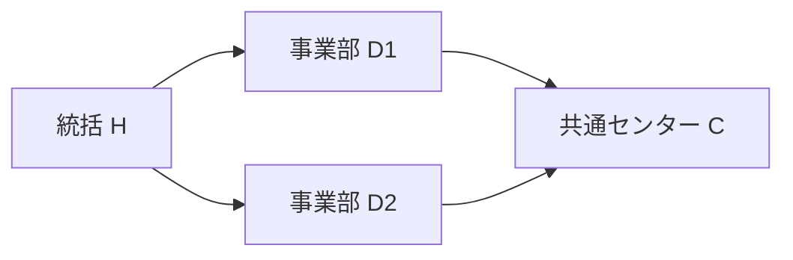

# 組織ドメインの表現力：トポロジー・量／単位・標準表現型の合成Profile（2026-11-07）

**状態：採用前の横断設計と独立Expected。** 既存Organization Source・汎用Data Facet・Representation/Function・Measure契約の組合せで十分な表現力を得られるかを反証する。新Core型、全組織共通Ontology/権限正本、第二Measure/Query/Renderer Engine、独立Test SSOT、TEI独自Hostの採用ではない。新たな実Go/DB/GUI/SHO/Owner試験は **NOT RUN**。

**一次資料の位置づけ**： [W3C ORG](https://www.w3.org/TR/vocab-org/) は組織階層・Role・Post・Membership・履歴の再利用可能な語彙を持つが、すべての説明責任・権能を完結させない。[QUDT 2026](https://qudt.org/doc/2026/02/DOC_SCHEMA-QUDT.html) はQuantity Kind／Unit／Dimensionの違いをモデル化する。[W3C RDF Data Cube](https://www.w3.org/TR/vocab-data-cube/) はDimension／Measure／Attributeを分ける。TEIはこれらの内部スキーマをコピーせず、必要な区別と反例を既存Facetの**適合試験**へ取り込む。BIPMの[SI Brochure](https://www.bipm.org/en/publications/si-brochure/)は物理量に関する参考であり、「人」「FTE」「案件」や組織上の業務意味をSI単位へ無理に還元しない。

## 1. 継承すべきものは「グラフ型」ではなく、構造・数量・意味・用途の合成能力

同一のOrgUnit D1が、指揮階層のノード、費用帰属先、法的事業所、案件の取扱担当、プロジェクト共同体、集計のDimension Memberとして現れる。これらは同じIDを参照し得るが、**異なるRelation Role／時点／責務の別グラフ**を形成する。基本の意味Carrierを一つの巨大な`Organization`オブジェクト階層へ押し込めない。

- **構造Facet**：Node/Edge/多項Relation、直接参照とIDを持つ実体化関係、方向・参加者Role・多重度、Pathと重複、閉路、集合／Bag、順序、接続性・到達可能性、Graph/Tree/DAG/Network。単なる関係Graphと数学上の位相空間（開集合族を持つTopology）を同一視しない（#2495/#2544）。
- **時間・空間Facet**：validAt／knownAt／decisionAt、構造版・公開版・観測時点、予定/Actual、位置Site／座標系／区域。所在地の包含・地理的隣接とOrgの上下関係、歴史組織のas-ofと現在Host Grantを混同しない。
- **Quantity/Measure Facet**：Quantity Kind／Unit／基準量・期間／精度・換算・丸め、Fact identity、集計の粒度と許された演算、集計軸別の加法性、必要な独立対象集合・属性値の完全性。数字／単位文字列／列名の一致で自動換算しない（#1705/#2593/#2544）。
- **Normative/Business Facet**：所属、雇用、役職、指揮、責任、予算帰属、委任・規範とその成立条件。関係・役職の事実から現在Principal・Grantを作らず、業務DFDの授受矢印からWorkflow Instanceを自動生成しない（#2386/#1125/#1174）。
- **Representation/Interaction Facet**：Function所属の表現インスタンスと型付きData Context、意味を保つ／失うProjection、Consumer別Scope/Disclosure、読み取りと逆編集の適格性。SHOは派生文書Consumerであり、TEI Function Instanceと無条件に同じSession／Grantにしない（#3236/#2497/#2506/#2507）。

**「継承」の実用的な意味**：一般標準の複数Facetを型付き参照で**合成・制約強化・Profile適用**する。OO継承・固定`OrganizationTree` Core kind・すべてのProfileへの必須Facet列挙を意味しない。必要なときだけOrgUnit/LegalEntity/Person/Membership/Position/Occupancy/CaseRecord等のドメイン意味Roleを追加する。特定業種/外部製品の既定値はAdapter/Profileに留める。

## 2. 組織が持ち得るトポロジーは一つではない

| 構造層／用途 | 期待される構造と制約候補 | 一つのTreeへ還元したとき失われるもの |
| --- | --- | --- |
| 法人・企業集団 | 法人格の同一性、持分・支配・共同契約などの型付き多項／多重Relation | 組織に含まれることと、持分比率・法的責任・Tenantを混同する |
| 人事/指揮 | 目的別階層、単一親Treeが必要なProfileと、複数Reporting辺が有効なDAG/Profile | 複数の上司、発令時点、同種の二経路と単一役職の違い |
| 配属・在任 | Person×OrgUnit×Role×期間の実体化Membership、Person×PositionのOccupancy、複数Employment | Person=Position、Membershipの1行=1人、空席の不存在 |
| 財務・予算・費用帰属 | 部門・費目・Project・会計期間をまたぐAllocation/Cost Center、経路別の係数と加法性 | 経路を削ることによる配賦損失、同じ費用の無条件重複加算 |
| 責任・承認・代理 | 業務Roleと行為の対象関係、任務／職務分掌・委任の方向、例外と失効時点 | 下位組織へ到達できることを行為権限とする |
| 案件・手順 | CaseのhandlingUnitという直接Relation、Procedure Step/Handoff/Workflow Instanceの別ID | Case移管=部門後継、業務手順=物理更新という誤同一化 |
| 場所・管轄 | Site、拠点のGeo、管轄区域、移動・在宅・複数勤務地と期間 | 地理的包含=指揮系統、拠点=唯一OrgUnit |
| 仮想・計画組織 | 提案Graph/Actual Graph、候補Revision／公開Revision、複数Scenarioの独立世界 | Preview案を確定組織や旧レコードの実更新へ昇格 |

**組織トポロジーの検査単位（正式Schemaではなく既存参照に渡す項目）**：`subject identity / relation role & participants / n-ary or direct / axis & purpose / direction / multiplicity / allowed cycles / path vs entity identity / valid & known time / tenant & source provenance / cardinality and closure`。

同じH→D1→CとH→D2→Cでは、**CというNodeは一つ、CへのPathは二つ**。Treeの経路複製表示は正当なUI手法にもなり得るが、複製された行を別OrgUnitや別の費用Factにしない。権限のScope/Relation到達も、後継組織の業務責任の自動継承も、Path存在だけでは決まらない。

## 3. 単位系は数値型より多層：Quantity Kind、Measure、集計法則

現在mainの`reference/org-headless-workspace/semantic/organization/model.tei`には`Membership.allocation type std.decimal`がある。しかし**0.6/60/60%のどれを採るか、週40時間に対する比率か、契約上の配賦か、Actual工数かはこのSourceだけでは確定していない**。これを本番FTEと自動認定しない。

| 組織のMeasure例 | 種別・単位・基準 | 合法な比較・集計に必要な条件 |
| --- | --- | --- |
| **Headcount** | 相異なるPersonの数［人］。Person occurrenceのdistinctが必要 | 所属Role、対象集合、時点、複数Orgをまたぐ重複排除の範囲。部署別人数の単純合計は全体人数とは限らない |
| **Membership/Assignment Count** | 所属発生件数［件］。人とは異なる | Materialized Relation IDが数えられているか、同じ関係の期間分割・重複Pathはどう扱うか |
| **FTE** | フルタイム相当量［FTE］。比率は表面上無次元でも業務上はPeople Countと別Quantity Kind | Fractionの分母となる基準労働時間、対象期間、Contract/Actualの別、跨Org配賦係数、精度・丸め、比較可能性 |
| **Work Hours / Capacity** | 稼働・要員容量［時間/期間］、定員［枠・FTE等］ | 工数とFTEの変換基準、予定/実績、休暇・残業、期間積分。容量超過を人数だけから計算しない |
| **Cost / Budget** | 金額［JPY等/対象期間/シナリオ］。レートは金額/時間や金額/FTE等 | Cost Center/期間/通貨/為替基準日/配賦、残高対フロー。JPYとUSDをそのまま加算しない |
| **Share / Allocation Rate** | 持分・費用配賦・労働比率・承認クォーラムは**異なるRatio Kind** | 0.4、40%、40を単位宣言なしで同一視しない。経路別係数の合計1.0はOwner規程・対象集合完全性のもとでだけ保証 |
| **Span / Layers / Coverage** | 管理範囲［直接配下のPosition/Person/OrgUnit数］、深さ［辺数］、被覆率［対象/母集団］ | どのGraph axisか、占有職位/空席、DAGの複数Path、集計する母集団・Source閉包・有効時点 |

**単位系は三段階で扱う**：(1) `QuantityKind`が何を量っているか、(2) `Unit/Basis/Period`が尺度と換算を規定し、(3) `Measure × Rollup Axis × Operation`が加法性／重複・重み付け／再集計可否を決める（#1705/#2593）。FTEと費用配賦率はともにDecimal/Ratioでも、互いの値を直接足す・入替えることは原則不可。期間末のHeadcount Snapshotを12月分足して「年間人数」とすることも不可。平均を再集計するには分子・分母や重み等の十分統計量が必要になる。

### 小さな独立Expected（閉じた合成World限定）

試験として一つの同時点・同Source/Scopeの完全な集合を仮定する：P1はD1にA1=0.6 FTE、D2にA2=0.4 FTE、P2はD1にA3=1.0 FTE。ここで**合成Fixtureは「値がFTE fraction、全3 Membershipを漏れなく取得」と明示**する。

- D1：Unique Person=2人、Membership=2件、FTE=1.6。D2：Unique Person=1人、Membership=1件、FTE=0.4。
- D1∪D2：Unique Person=**2人**（各部門Headcountの単純合計3ではない）、Membership=**3件**、FTE=**2.0**。HeadcountとFTEは同じ数値2でも同種の量ではない。
- 同じデータをPeople Table／Matrix／FTE Chartへ出す際、**3行・2人・2.0 FTEを1つの`count`へ潰さない**。別Tenant/Partial/未読込のA2があれば、完全な全社Claimは`unverified`。P1が0.6+0.4=1.0であることは、この合成Owner Rule下の局所説明であり全企業の労働配分規則にはならない。
- 別GraphでH→D1→CとH→D2→Cがあり、C固有の0.4 FTE Factを両Pathが参照しても、HでのUnique Entity集計は**0.4**。0.8は二重計上。配賦係数をOwnerが明示的に`0.5,0.5`と受理したとき、経路別の0.2+0.2=0.4を比較可能とする。Pathの重複を一律DISTINCTして係数を失うことも不合格。
- `allocation`が60、null、未取得、観測済み0、またはFTE以外の費用配賦率である負例では、前述のFTE結果へ自動換算・自動代入しない。Ruleに必要なFieldと対象集合を同じ適格Cohortで実ReadしていないClaimは`unverified`。

この独立Expectedは#2593のMC-01/03/05/07、#2510のORG Corpus、既存§16/39/53に**差分として引き渡す**。新たな本番FTE計算エンジン・集計正本や新Scenario IDを作らない。

## 4. 標準表現型の能力・適合・損失と組織向けProfile

`Data topology → Function Data Context/Result Slice → Function-owned Presentation Instance → Consumer output` の各写像で、**表現可能（representable）・用途に適切（fit）・意味を保存（preserving）・逆編集できる（editable）を独立に判定**する。「描けるが、編集には使えない」ことを正常な結果として許す。対応資格は`supported / conditional-with-evidence / lossy-read-only / unsupported / unresolved`等の**説明用の分類**であり、新Core Enumの提案ではない。

| Representation | 適切な組織上の利用・必要条件 | Loss／編集停止条件 |
| --- | --- | --- |
| **Tree / Org Chart** | 目的/時点を選択した単一親Hierarchy、またはDAGをPath重複として明示するread-only Tree | 多重Parent/異軸の辺を隠して唯一親と宣言しない。Path複製から無根拠なOrg移動を生成しない |
| **Graph / Network / Hypergraph View** | 複数Relation Role/方向/Occurrence、多辺、必要時のn-ary関係の中間表示 | 辺の外観・ラベルやNode配置だけではMembership等のRelation ID・業務意味・Targetが確定しない |
| **Matrix / Pivot / Heatmap** | Person×OrgUnit×Position×期間、MeasureとFact/Cellのgrainを明示 | 0・非開示・空・未取得のセルを同値化しない。多次元を潰したCell値から元の複数行へ自動PATCHしない |
| **Table / Detail / Form** | Membership/Position/Occupancyの独立ID、Field presence、期間、Root/Scope、read-only/編集対象の区別 | QueryのJOIN重複行を別の実体行とみなさない。値の不正な単位変換は表示上も警告 |
| **Chart / KPI / Sankey** | Headcount/FTE/Cost等のQuantity Kind・Unit・Rollup lawを表示。Sankeyは明示したFlow/保存則があるときのみ | 費用帰属や指揮線を根拠なく「流量」と表し、幅の保存則を捏造しない。期間末Snapshot/金額の直接積算を不許可 |
| **Timeline / Gantt / Scenario Diff** | valid/known/decision/published/actualの別、Versionと変更前後のRelationship | 計画上の部門新設や辞令候補を実採用済み・外部DB更新済みとしない |
| **Map / Spatial** | Site/拠点・管轄Geometry、座標系と時点を明示した空間の表現 | 地理的に包含/隣接するだけで指揮階層、企業内所属、行政上の管轄を作らない |
| **SHO／Mermaid風テキスト・図解** | 人が読める概要を生成し、Source/Role/Path/Quantity/Time/Disclosureの必要な来歴を残す | 多重Edgeが1本に簡約された図やMarkdownを正本へ逆編集しない。SHOからTEIモデルのOwner意味受理を自動付与しない |

**Mermaid風の糖衣例（説明用、正式TEI DSLではない）**：

同じCを2経路で表しても、**Graphに現れたNode Cは1個、Pathは2本**。テキストがDiagramを生成できることと、Relation purpose/occurrence・有効期間・係数・非表示Edge・現在Read Scope・編集Targetの全情報を保持したことは別。元Dataへの参照と適格な補助メタデータが欠ける場合はread-only説明に留める。Mermaid/Graphviz/Markdown等の文面は標準Dataの**表現上の糖衣**に留め、Source同一性や必要な編集逆写像は#2497/#2621・SHO Composer Owner側へ委譲する。

## 5. 生成AIと人間が迷わず選択するための最小判断票

AI/CUI/Studioには、新しい「組織専用Widget一覧」の網羅を要求する代わりに、既存Facet/Function/Representationの候補から**目的に対する最小適合理由**を提示させる。

1. **何を答えたいか**：単なる所属の説明／正確な承認候補／Headcount／費用配賦／履歴比較／編集Intent。Claimと業務目的を特定。
2. **どのStructure/Quantityか**：Node/Relation occurrence、軸、方向、時間、Measure kind、単位・分母・Rollup law、必要な必須/非表示依存を列挙。未知は補完せず診断。
3. **どこまで読んだか**：元Source/World、Query/Providerの実Read、対象集合とFieldの完全性、Tenant/Scope、必要なRead cohort・Consumer disclosureを確認。
4. **表現の条件を照合**：複数親ならGraphまたはloss明示付きTree、Unique Person数とFTEなら別Measure、期間あるならTimelineなど。図解の視認性と意味保存の優先を混同しない。
5. **操作の逆写像**：対象Relation/Case/Row/版が一意か、粒度は保持されたか、現在Host Grantと実Effectの境界があるか。満たさなければread-only／明示的な再選択・追加Read。
6. **説明・学習に利用**：同じSourceからTable/Graph/KPI/SHOへ出したとき、何が一致し、何が損失・非開示・未確認かを理由付きで示す。標準表現型候補はLLMが生成できても、その適合証拠をAI自身の言明で代替しない。

これは#2507のFunction Pattern選定と#2497のProjection説明へのread-only引渡しであり、AIによる画面選択を即座に本番実行資格へ変える仕組みではない。

## 6. 検収順序と責務：新機構なしに最大の表現域を反証する

| 段階 | 最小の独立検証 | Owner／不合格条件 |
| --- | --- | --- |
| **P0 構造・数量の合成対照** | 同じPersons/Membershipsから、Tree/Graph/Matrix/TableとHeadcount/FTEが**異なるが正しい**結果を返す。多重Path、n-ary、NULL、既知0、partialを一因子ずつ変える | #2510/#2495/#2593/#2514。構造・単位の無宣言な補完、全件判定の自己申告が不合格 |
| **P0 Native Source照合** | main #2681の実`model.tei`に存在するRelation/Attributeと、Profileで**まだ宣言されていないAllocation basis/Unit/Policy/Geo**を分類する | #1126/#2386。合成Fixtureを実Source capabilityへすり替えるのは不合格 |
| **P1 二つのFunction／二つの表現** | Org ExploreのGraph/TreeとCase HandlingのTable/Pickerが、必要なSubject/Path/Relation粒度、Source/Scope/epochとLossを保持する。外部SHOには別Disclosure | #2506/#2507/#2497/#2516/#3236。図の見かけの一致から編集Targetを導出するのは不合格 |
| **P1 実Readの縦切り** | C1→D1の一件を実Function→Query選択→Provider Read→Consumerへ結び、必要なField presence/rowset/時点を独立観測。追加Count/FTE Claimには依存閉包を要求 | #2586/#2622/#2628/#2611。合成や別FixtureでのPG PASSをOrg Product Readと呼ぶのは不合格 |
| **P2 編集・発火・更新後観測** | 元のMembership/Case Relationへ一意に戻せるIntentだけを送出候補とし、Owner業務Rule、現在Host Grant、Receipt、独立Resource Readを別資格とする | #2500/#2598/#1129/#1174/#1163。Tree移動やChart数値編集から自動Effectは禁止 |
| **P2 異業種への耐性** | 企業・行政・非営利・研究組織・共同事業で同じFacetを使い、特有RuleのみProfile差分にする。意味型/演算の不足を反証する | #2510/#2493/#2018。小PoCの範囲を製品の表現力上限にしない |

**採用停止線**：現mainのNative Org E1は実在するが、組織用FTEのQuantity Kind/基準・多軸Hierarchy・新Representation Instance/SHO出力・実Case Provider E2/Host Actionがすべて実装済みという主張はできない。正式な組織集計式、重複Pathの会計扱い、承認・委任、数値の演算則はOwnerの意味受理が別に必要。P0のC1→D1実Provider Readを妨げる大規模Core改造は行わない。
