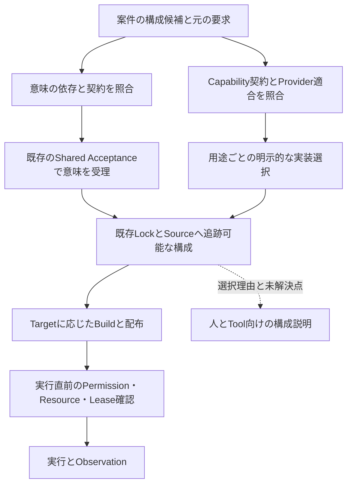

# DeepSeek Harnessのプラグイン構成からTEIへ取り入れる設計の研究

- 調査日: 2026-10-08
- 追試: 2026-10-09。[既存Referenceの検証と責務の整理](PLUGIN_COMPOSITION_CONVERGENCE_2026-10.md)を追加した。本書の「未実施」は初回調査時点を指す。追試の結果と限界は別途記録している。
- 状態: 評価待ち。外部実装の調査とTEIへの適用候補をまとめた研究資料であり、採用済み設計ではない。
- 役割: プラグイン機構の設計を比較し、既存の要件・作業で次に確かめる点を示す。
- 正本との関係: 要求は[Product Requirements](../../requirements/TEI_PRODUCT_REQUIREMENTS.md)、原則は[Product Principles](../../product/principles/TEI_PRODUCT_PRINCIPLES.md)、実装状況は[status](../../docs/status.md)、採用判断は[ADR](../adr/README.md)を正とする。本書から実装変更やGate通過を承認しない。
- 対象: Capabilityの契約、構成、依存、登録の寿命、構成の説明、権限と実装方式の境界。DeepSeekのモデル性能やTEIへのLLM導入は対象外。

## 1. 結論と減らしたい不確実性

DeepSeek Harnessは、TEIのプラグイン機構を考えるうえで参考になる。契約・実装・利用側の分離と、依存関係に基づく起動は有望である。登録を所有者の終了時に解除する仕組みや、構成を展開して説明する仕組みも参考になる。これらをTEIの既存境界へ当てはめて検証することを勧める。Cordis全体の導入や、実行中にあらゆる機能を交換する方式を、今回の調査だけで採用する根拠は得ていない。

TEIには、標準機能も第三者拡張と同じ契約で扱う方針がすでにある。今回は、その方針に対して実装のどこが不足し、どの機構から改善すると効果があるかを調べる。

| 要件 | 今回確かめる問い |
| --- | --- |
| RQ-031 / RQ-032 | 新しい契約を加えるたびにCoreを変更せず、標準と第三者の拡張を同じ解決・適合確認へ載せられるか |
| RQ-033 | どの要求から実装が選ばれ、何が不足し、変更がどこへ及ぶかを人とToolが追えるか |
| RQ-019 / RQ-020 | 構成変更や登録解除が、権限の拡大や外部処理の二重実行につながらないか |
| RQ-023 / RQ-024 | 一人でも維持できる規模で、Targetごとの配布量・起動時間・常駐資源を抑えられるか |

ここでいうCapability Contractは、ある機能を呼び出す際の入力、結果、失敗などを定める契約である。Providerはその実装、Consumerは契約を使う側を指す。契約の存在、実装の適合、実行してよい権限はそれぞれ別に確認する。

## 2. 調査対象と根拠の範囲

DeepSeek Harnessについては、公式サイト、公式Repositoryの設計文書、チュートリアル、選んだ実装コードを読んだ。外部資料の識別子D0〜D9は末尾の出典に対応する。

| 対象 | 調査で固定した版 | 確認した範囲 |
| --- | --- | --- |
| DeepSeek Harness | `5badb15009ae1756c3afe0ae0cef1faafc290ccc` | Architecture、Cordisのサービス・イベント・寿命管理、app-boot、Plugin Manager、scopeとagent-loopの実装 |
| Cordis論文 | arXiv `2608.25512v1` | 要旨。形式体系や証明の全文は未検証 |
| TEIの基線 | `fbcf4b8fc02e205ec624cd68a39b6c642c4d34b9` | Product原則・要求、Plugin文書、関連Issue、Productionの型・解決・Lock・Runtime境界 |
| TEI PR #963 | `b2172847990bf9bea71971a2709fa02408e81543` | 変更対象と説明を確認。基線上のISSUE-000080と照合。PR全体の実装監査・実行は未実施 |
| TEI PR #1020 | `ccc3a8c70209969bd4ff07375189ad0a365d770d` | 案件構成の設計候補本文と変更対象を確認。Production機構とは扱わない |
| TEI PR #991 | `4da94f892b8262d2d99a23a787659b548d42294e` | 言語PluginのReference候補の説明と変更対象を確認。実行は未実施 |

公式サイトでは調査時点でpublic previewと案内されている。APIや構成方式が変わり得るため、本書の技術的な参照は原則として上記commitへ固定した。[D0]

外部Repositoryの部分cloneはcheckout中に通信エラーとなった。そのcheckoutを完全な検証環境とは扱わず、commitを特定したうえで、以下の調査に使うファイルを同じcommitの公開URLから読み直した。DeepSeek Harnessの起動、テスト、モデル呼び出し、TEIとの接続は行っていない。

本文の「確認した事実」は文書またはコードで確認した内容、「適用候補」はTEIの要求から導いた提案である。資料に書かれた性質を、今回の実行で実証したとは扱わない。

## 3. 「すべてがプラグイン」の具体的な意味

### 3.1 製品の中心機能にも同じ構成機構を使う

Harnessでは、モデルAdapter、ツール登録、セッション保存、実行ループもCordisのプラグインとして構成する。`core/agent`が公開契約を持ち、`core/agent-loop`が標準実装を持つため、利用側はループの具象実装への依存を避けられる。[D1]

実装でも、`AgentLoop`は`Service`を継承し、`agents`、`sessions`、`llm`、`tools`、`systemPrompt`、`sessionProjections`を依存として宣言する。factoryの登録と終了処理には`ctx.effect()`を使う。中心機能のプラグイン化は、このコードでも確認できた。[D6]

起動・ロード・寿命管理を担うCordisとlauncher、実際にコードを実行するHostは残る。「製品の機能を交換できること」と「信頼の基盤を構成から自由に迂回できること」は分けて読む必要がある。

### 3.2 契約・実装・利用側を一組で設計する

公式Architectureは、交換可能な接続点をService Definition、Service Provider、Consumerの三つの役割で説明する。一つのpackageが複数の役割を持ってもよいが、実装だけを追加しても接続点の設計は完了しない。[D1]

サービスの利用側は具象Providerをimportする代わりに、`ctx`のサービスを参照し、`inject`で必要なサービスを宣言する。TypeScriptのdeclaration mergingで型情報を追加する仕組みと、実行時のサービス登録は別の働きである。[D2]

TEIへの示唆は、Plugin packageを増やす前に「誰がどの契約を要求し、誰が適合を確認し、どのscopeで実装を選ぶか」を揃えることである。TypeScriptで型が合うことだけでは、TEIが求める意味上の互換性やConformance Evidenceを満たしたことにはならない。

### 3.3 依存関係と登録の寿命を連動させる

Cordisは必要なサービスが揃うまでConsumerを待機させる。依存先が消えた場合はConsumerも解除し、戻った場合は再び起動する。プラグイン経由で登録したlistenerやサービスも、その所有者の解除時に取り除く。CordisのAPI外で確保したtimerや接続などは、`ctx.effect()`へ終了処理を登録する必要がある。[D2][D3]

終了処理の順序には注意がある。公式チュートリアルでは、複数の非同期disposerは同時に進むと説明されている。順序が必要な処理は一つのdisposerにまとめて待つ。scopeの実装には、同時の`dispose()`が同じ完了を待つ処理もある。[D3][D5]

TEIでは、この仕組みをlistener、Tool登録、接続handleなどの寿命管理の参考にできる。一方、外部DBへ送った更新や外部サービスで完了した処理は、登録を解除しても取り消されない。論文の要旨が示す「取り除いた部品の効果を戻す」考え方も、TEIの外部副作用全体へ無条件に一般化しない。[D9]

### 3.4 構成・登録・実際の稼働を観測できるようにする

HarnessはProfileでBundle群を選び、順序付きのpatchで構成する。`--dump-config`で起動構成を確認できる。[D1] app-bootの文書では、この出力を「設定された構成」と説明している。実際に起動した全機能の証明にはならない。required entryの失敗で起動を止める機構もある。ただし、そのentryが構成に存在しない場合や無効な場合には、この機構で起動を止めないと説明されている。[D7]

Cordisのサービス例には、依存不足で待機したまま、何も出力せず正常終了する例がある。[D2] この例だけからHarnessの通常起動が常に不足を見逃すとは言えない。TEIへ取り入れる際は、低水準の待機機構と、Applicationに必要な機能が揃ったことを確認する起動判定を分ける。

### 3.5 イベントの役割を分ける

Cordisのイベント契約には、通知、並行実行、順次実行、短絡、処理の包み込みなどの違いがある。`waterfall`ではlistenerが`next()`を呼ばずに後続処理を止められる。観測用のlistenerが呼び忘れると、本来の処理を止める例が公式資料にある。[D4]

Harnessはさらに、保存するSession event、実行中のAgent event、Capabilityの接続点を区別する。[D1] TEIでも通知と実行判定を同じ拡張点に集めず、Observation、診断、実行許可、業務結果を区別する設計の参考になる。

## 4. TEIの現在地との差分

| 論点 | TEI基線で確認した内容 | 今回の適用候補 |
| --- | --- | --- |
| 小さいCore | P16とRQ-031が標準・第三者の共通契約を要求する | 新しい理念の追加は不要。標準機能に例外経路が残るかを実装で確かめる |
| Capabilityの追加 | `internal/plugin/model.go`の`CapabilityKind.Valid()`は固定列挙。ISSUE-000080にgeneric contractのReferenceがある | #951 / PR #963の契約・Provider・Consumerを揃え、既存kindの投影を検証する |
| 意味拡張 | ISSUE-000077が意味宣言と実行実装を分離する | Cordisのサービス依存へAccepted Semantic Setをまとめず、Semantic Interfaceの既存作業へ接続する |
| 言語・Operator | DSL / Operatorの構成設計と#988 / PR #991のReference候補がある | parserを交換しても意味の受理条件が変わらないことを別途確認する |
| 依存・Lock | `internal/plugin/resolve.go`にpackage依存とcycle検出、`lock.go`にexact version・fingerprint等の照合がある | 既存解決を使い、実行中の待機・再起動を別のResolverにしない |
| 構成Profile | PR #1020に案件構成の設計候補がある | 同じ論点の独立Profile仕様を作らず、構成の展開と説明を#1016で評価する |
| Runtime | Productionの`RuntimeKind`は`builtin`と`process`。Permission、Resource、Lease、fencing、Durable Handleの境界がある | 現行契約を保って登録寿命を検討する。Wasmやlinkedは候補であり、汎用Runtimeとして実装済みとは扱わない |
| 物理配布 | RQ-024 / RQ-032が論理Pluginとartifact / processの分離を要求する | 同じ論理構成をTargetごとにまとめて配布できるようにする。Plugin数をprocess数にしない |

主な根拠は[Plugin文書](../../docs/plugins.md)、[ISSUE-000080](https://github.com/hat47x/tei-platform/issues/80)、[ISSUE-000077](https://github.com/hat47x/tei-platform/issues/77)、[DSL / Operator構成設計](DSL_OPERATOR_PLUGIN_COMPOSITION_DESIGN.md)、[Security境界](../../docs/security.md)である。Productionの確認は上記commitの[型](../../internal/plugin/model.go)、[解決](../../internal/plugin/resolve.go)、[Lock](../../internal/plugin/lock.go)に限る。テストファイルの存在をテスト実行済みとは扱わない。

案件構成の候補は[PR #1020の固定版](https://github.com/hat47x/tei-platform/blob/ccc3a8c70209969bd4ff07375189ad0a365d770d/plan/design/PROJECT_PLUGIN_COMPOSITION_DESIGN.md)を参照した。同PRの内容は、この研究のTEI基線に統合済みとは扱わない。#963と#991についても、並行する候補と基線の実装を区別する。

## 5. TEIへ適用するなら守る境界

### 5.1 共通契約を使い、決定権限を分ける

拡張を扱う共通機構を使いつつ、意味の受理、Toolの選択、Buildの再現、Runtimeでの実行をそれぞれ別の権限で扱う案を推奨する。下図は、その案の責務を示す。新しいCore Kindや固定の実装階層を宣言するものではない。

意味を評価する実装も交換候補にできるが、受理結果に影響する版や依存はAccepted Semantic Setへ固定する必要がある。Runtime用のProfileを変えただけで、以前受理した意味の有効性まで変わる経路は作らない。

起動や契約照合のコードを交換できることと、その交換を認める権限も別である。Hostの信頼、namespaceの所有、互換性の照合、実行権限の検査を、同じ構成内の任意Pluginが免除できる設計にはしない。最小Hostの役割を定める前に、Host自身も標準Pluginにして循環依存を作る必要はない。

### 5.2 構成の上書きを、そのまま意味の上書きにしない

Harnessのpatchはentryのidを対象とし、config全体の置換や新しい行の挿入を行う。[D1] この方式はHostの構成を変えるには便利だが、TEIのSemantic Extension同士の衝突を「後から読んだ方が勝つ」で処理する規則にはできない。

#1016の案件構成候補に対しては、変更対象、期待する旧実装、契約と版、変更の所有者、影響するConsumerを説明できるかを確かめる。同じ接続先を二つのAddonが交換した場合は衝突として残す。UI Kitの`replace / decorate`等を、全Pluginの上書き規則へ一般化しない。

### 5.3 登録の解除と業務処理の復旧を分ける

listenerやToolの登録解除には、所有者ごとの寿命管理を取り入れる価値がある。DBの更新、メッセージ送信、外部processの実行には、既存のDurable Handle、Observation、ownership、fencingの契約を使う。

実行中にProviderを交換する場合は、新しい呼び出しを止め、進行中の処理を観測し、継続先か停止条件を確定した後に登録を解除する手順を候補として検証する。観測できない処理はunknownとして残す。`dispose()`完了や新Providerの起動を、旧Providerの業務処理完了や取り消しの証拠にはしない。

最初の検証では、実行中の交換を必須にせず、同じ契約に適合するProviderを再起動時に明示選択できる形から始められる。再読込の必要性が実作業で確認されてから、交換中の状態遷移を追加する方が維持負担を抑えられる。

### 5.4 構成の説明を、コードの実行から切り離す

構成説明では、要求の由来、契約の版、選んだProviderとartifact、適合根拠、依存、競合、未解決の理由を追えることを目指す。表示される要素が「設定された」「解決された」「権限を確認した」「起動した」のどの段階にあるかも区別する。

Harnessのapp-boot文書には、`--dump-config-schema`がmoduleをimportしてschemaを読むため、信頼するPluginだけで使うよう注意がある。[D7] Plugin Managerの文書にも、導入したHostのコードがworkspace sandboxの外の同一processで動くことが明記されている。[D8] 構成や型の隔離だけを、悪意あるコードへの防御とみなしてはいけない。

TEIのread-onlyな構成調査では、未信頼のPluginを実行せずにdescriptorや宣言を読める経路を先に評価する。コードの導入、Build scriptの実行、Providerの起動、Capabilityの実行を別の権限として扱う。構成を説明するためだけに全Pluginを起動する機構は避ける。

### 5.5 通知から受理・認可を変更させない

観測用listenerが実行可否や業務結果を書き換えられるイベント契約は、TEIでは扱いにくい。まず既存のCapability呼び出しと結果の契約を使い、イベントを加えるなら、通知、診断、提案、実行判断のどれを担うかを定める。

受理や認可に影響する拡張は依存と権限を明示する。任意のTooling listenerの有無によってAccepted validityが変わる場合は、RQ-032に従って意味の依存へ戻す。万能のmiddleware chainを新設することは、今回の推奨に含めない。

## 6. 選択肢の比較

| 選択肢 | 得られるもの | 負担・成立条件 | 判断 |
| --- | --- | --- | --- |
| 現行の固定kindを増やす | 既存実装へ小さく追加できる | 新種のCapabilityごとにCore変更が必要。ISSUE-000080の反例を解消しない | 移行中の互換経路に限る |
| 契約中心の構成を既存のGo基盤で実装 | 既存Authority・Lock・Target契約を保ち、標準と第三者の共通経路を検証できる | generic contractと既存typed consumerの接続が必要 | 最初の適用候補 |
| 上記へ反応的な再読込を追加 | 長時間動くEditor / Toolで登録の差し替えが容易になる | 進行中処理、非同期終了、部分失敗、状態移行の契約が増える | 必要性を確認した範囲で後から評価 |
| CordisをTEI全体の必須基盤にする | Harnessと同種のContext・依存・寿命管理を再利用できる | Node / TypeScriptとGoの接続、Target適合、権限、配布、運用の検証が必要。意味の契約は別途必要 | 現時点では推奨しない |
| 任意の周辺ToolでCordisを使う | TEI本体を置き換えず比較できる | 結果をTEIへ戻す境界が必要 | 実際のConsumerが現れた場合の候補 |

この推奨は設計を比較して導いたもので、速度や保守工数を測った結論ではない。TEIの既存要求に従い、交換可能な論理単位を保ちながら、実際の配布ではstatic linkingやartifact共有を選べる構造を優先する。

## 7. 既存作業へ接続する検証案

研究を別のPlugin Framework開発へ広げず、まず#951、#1016、ISSUE-000077、#988の既存作業へ返す。以下は未実施の検証案である。既存Referenceにある試験は再利用し、重複したResolver、Lock、manifestを作らない。

| 段階 | 使う対象と操作 | 期待する判定・反証条件 | 引き渡し先 |
| --- | --- | --- | --- |
| A. 契約とConsumer | Xead / Xeafのauthoring adapterと、既存RuntimeのContract Query Executorを照合する | Core enum追加なしで新契約を扱う。scope混同、Evidence不足、同順位Providerを拒否する。#963にある試験との差を先に確認する | #951 / ISSUE-000080 |
| B. 標準と第三者の共通経路 | 同じ契約のbuiltinと外部実装を、同じ要求・適合確認へ載せる | 標準だけが照合を迂回しない。artifact差は追跡し、未対応Targetで意味を変えて通さない | #951 / #943 |
| C. 構成の説明 | #1016の`order_entry`とSUIの既存資産をread-onlyに列挙する | 要求の由来と接続先を説明できる。既存Source / Lockから分かるなら新Profile schemaは追加しない | #1016 / PR #1020 |
| D. 順序と不足 | Catalog順・登録順を変え、依存欠落・複数候補・競合を与える | 同じ採用条件から同じ結果を得る。不足した必須Consumerは正常起動と判定しない。未指定の勝者をload順で作らない | #951 / ISSUE-000077 |
| E. 登録の寿命 | Tool / listenerを登録した後、初期化失敗、依存喪失、二重dispose、非同期終了失敗を与える | 登録が残らず、進行中処理と終了状態を説明できる。失敗を正常解除へ丸めない | 実際に寿命管理が必要なToolの担当 |
| F. 外部副作用 | 更新を受理した後にHostを止め、旧Providerがunknownのまま交換を試みる | 自動replayしない。旧・新の所有権と観測を区別する。これは登録解除だけでは証明できない | 既存Runtime / RQ-020 |
| G. 意味と構成変更 | UI Kit交換、Runtime Provider交換、Semantic Extension版変更を別々に行う | UIやRuntimeの交換だけで意味を受理し直さない。Semantic Setの変更は受理対象の差分として検出する | #1016 / ISSUE-000077 / #988 |

`order_entry`では、受注の検証規則を保ったままUIやDB実装の接続だけを変える。SUIでは、Native Canvasの操作とDocumentの意味を維持してApplication-owned Actionへ接続する。両Consumerを同じForm体系へ変換してから共通性を主張しない。

価値の確認には、同じ変更課題で必要になったCore編集、手動の接続、重複定義、構成を説明できなかった箇所、更新後の再作業を記録する。単にPlugin数が増えたことは成果にしない。Targetごとの起動時間、初期転送量、常駐memory等は変更前後で測る。数値目標は既存Target要求または測定結果から定め、今回先に作らない。

試験が通ること、実Targetで動くこと、利用者の変更作業が減ることは別々に確認する。一つのReferenceの成功を、全Target対応や本番運用の保証へ広げない。

## 8. 現時点の判断と未解決事項

| 判断 | 確信度 | 根拠と限界 |
| --- | --- | --- |
| HarnessはTEIのプラグイン設計の参考になる | 高 | 公式文書と選んだ実装で契約・依存・寿命管理を確認した。TEIでの効果は未測定 |
| 最優先はgeneric Capability Contractと構成説明への接続 | 中〜高 | TEIの既存要求と進行中作業に対応する。新しいRuntime方式を先行導入する必要がない |
| 登録の寿命管理は取り入れる価値がある | 中 | 一般的な故障例を説明できるが、TEIのどのToolで費用に見合うかは未確認 |
| 全面HMRやCordis必須化は今の段階では根拠不足 | 高 | Target実行、Goとの接続、運用、性能、移行費用を検証していない |

残る問いは三つある。既存のSourceとLockでどこまで構成を説明できるか。標準機能を共通経路へ載せる際に、どのtyped adapterが必要か。実行中の交換を必要とするConsumerが実際にあるか。これらが分かるまでは、共通Context APIや独立したComposition LockをProduction契約として固定しない。

2026-10-08の初回調査で完了したのは一次資料の調査、TEIの要求・実装との対応整理、並行作業との重複確認、検証案の作成である。この時点ではDeepSeek Harnessの実行、TEIの新機構の実装、Repository health check、実Targetでの確認、利用者による評価は行っていない。翌日の追試は冒頭のリンクから参照できる。PRの状態や過去の検証記録から、今回のPASSを補わない。

## 出典と追跡先

外部技術の記述は以下の一次資料に基づく。論文以外のRepositoryリンクは調査commitへ固定した。URLの行番号は読みやすさの補助であり、根拠の版はcommitで特定する。

- D0. [DeepSeek公式Harnessページ][D0]。public previewの案内。ページは可変。
- D1. [Architecture][D1]。製品機能のPlugin化、三つの役割、Profile / Bundle、イベントの区分。
- D2. [Cordis tutorial: Services][D2]。型宣言と実行時登録、inject、依存喪失、待機の例。
- D3. [Cordis tutorial: Lifecycle and effects][D3]。管理対象の登録、明示的な終了処理、非同期disposerの順序。
- D4. [Cordis tutorial: Events][D4]。dispatch modeとwaterfallの短絡。
- D5. [scope実装][D5]。登録scopeと解除完了の共有。OSや権限の隔離を証明する資料ではない。
- D6. [agent-loop実装][D6]。依存宣言、factory登録、終了処理。
- D7. [app-boot][D7]。起動判定、required entry、構成出力とschema importの境界。
- D8. [Plugin Manager][D8]。導入操作の権限、Host codeとworkspace sandbox、Build scriptの扱い。
- D9. [A Programming Paradigm for Spatiotemporal Composability, arXiv:2608.25512v1][D9]。要旨が区別する依存の合成と解除可能な効果。証明全文の追試はしていない。

関連するTEIの作業は、[Capability Contract #951](https://github.com/hat47x/tei-platform/issues/951) / [PR #963](https://github.com/hat47x/tei-platform/pull/963)、[案件構成 #1016](https://github.com/hat47x/tei-platform/issues/1016) / [PR #1020](https://github.com/hat47x/tei-platform/pull/1020)、[言語Plugin #988](https://github.com/hat47x/tei-platform/issues/988) / [PR #991](https://github.com/hat47x/tei-platform/pull/991)、[self-build ISSUE-000079](https://github.com/hat47x/tei-platform/issues/79)である。進捗を本書へ複製せず、継続時は各作業の最新状態を再取得する。

[D0]: https://www.deepseek.com/en/harness/
[D1]: https://github.com/deepseek-ai/deepseek-harness/blob/5badb15009ae1756c3afe0ae0cef1faafc290ccc/docs/architecture.md
[D2]: https://github.com/deepseek-ai/deepseek-harness/blob/5badb15009ae1756c3afe0ae0cef1faafc290ccc/docs/cordis-tutorial/03-services.md
[D3]: https://github.com/deepseek-ai/deepseek-harness/blob/5badb15009ae1756c3afe0ae0cef1faafc290ccc/docs/cordis-tutorial/02-lifecycle-and-effects.md
[D4]: https://github.com/deepseek-ai/deepseek-harness/blob/5badb15009ae1756c3afe0ae0cef1faafc290ccc/docs/cordis-tutorial/04-events.md
[D5]: https://github.com/deepseek-ai/deepseek-harness/blob/5badb15009ae1756c3afe0ae0cef1faafc290ccc/packages/core/scope/src/index.ts#L94
[D6]: https://github.com/deepseek-ai/deepseek-harness/blob/5badb15009ae1756c3afe0ae0cef1faafc290ccc/packages/core/agent-loop/src/index.ts#L306
[D7]: https://github.com/deepseek-ai/deepseek-harness/blob/5badb15009ae1756c3afe0ae0cef1faafc290ccc/packages/boot/app-boot/README.md
[D8]: https://github.com/deepseek-ai/deepseek-harness/blob/5badb15009ae1756c3afe0ae0cef1faafc290ccc/packages/boot/plugin-manager/README.md
[D9]: https://arxiv.org/abs/2608.25512v1
