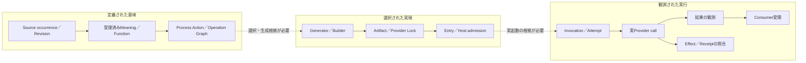
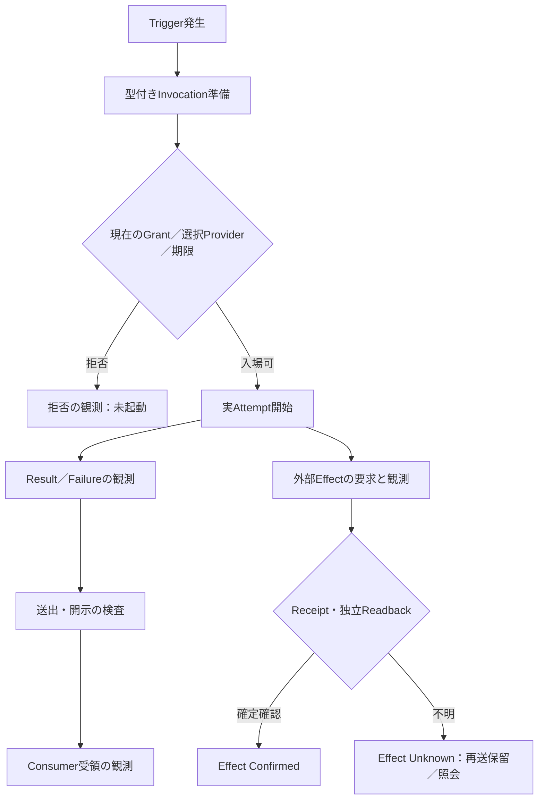
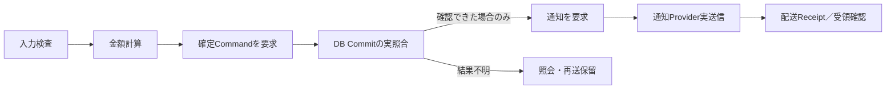

# プロセス実行図を「因果関係と証拠の照合」として成立させる

- **状態**：2026-11-15時点の実装前設計・検証手順。新しい製品API、DSL構文、Graph Runtime、Trace収集基盤、採用済みSchemaを定めるものではない。
- **目的**：定義上のプロセスと、生成された実現方式、実行時に観測された出来事を、同じ図面で誤認せずに照合する。既存の型付きGraph／Source Index／Inspection／Build・Effect Evidenceを利用し、CLIとStudioで共通の**問いに答える読み取り専用の投影**を作る。
- **上位設計**：[プログラム実行モデルの図解とTarget間移植](PROGRAM_EXECUTION_MODEL_PROJECTIONS_2026-11.md)、[標準Data／Processによるノード構成](SERVICE_FLOW_STANDARD_COMPOSITION_2026-11.md)、[成果物要求・計算粒度・実行計画](DECLARATIVE_RESULT_PROCESS_COMPOSITION_2026-11.md)、[プロセスの起動・状態・操作](PROCESS_LIFECYCLE_TRIGGER_OPERATION_SEMANTICS_2026-11.md)。
- **Owner**：#4198（Graph/Lifecycle）、#1124/#2497（Modeler／Graph）、#2621/#988（正式Source）、#4495（公開Entry・実Provider）、#951（Provider選択）、#1129/#1174（Effect/Receipt）、#1180/#2514（独立Expected）、#2831/#4583（実Desktop）。本書は各Ownerの採否を代行しない。
- **優先順位**：実Rule→Go生成・製品Builder・通常CLI実Providerと、非PluginのStudio Stage1→Stage2実WindowsのP0を変更しない。図解全体の完成を新しいHard Gateにしない。

## 1. 図の中心を「一枚の実行フロー」から「検証できる問い」へ移す

同じ形の矢印でも、**定義されている**、**今回選択された**、**実際に起きた**、**独立に確認できた**では意味が違う。図のNode、線、実際のSpan/Attempt、業務Action、Source occurrenceはそれぞれ別のIDを保持する。見た目の一致は、同じ実行が生じた証拠にならない。

対象となる問いの例：

> このWorkspaceのRule `sales.order_line.quantity_positive` は、現在選択されたSourceから意味を保ってGoへ生成され、その生成物が製品Builder・選択済みProvider・実Consumerに使われたか。

図はこの問いに必要な関連部分だけを表示する。Sourceを見つけた、Ruleを生成できた、実Goが判断した、BuilderがByteを読んだ、CLIでProviderを呼んだ、Consumerが受領した、という各主張の資格を混ぜない。別Subject・別Attemptで得た証拠を、名前が一致しただけでつないではならない。

### 1.1 三つの面と二種類の矢印

**実線**はその面で保持した関係を、**破線**は別資格の証拠による結合を必要とする箇所を示す説明図である。実線を描いたから実装済み・許可済み・成功とは判断しない。Rule読込前のCandidateは「受理済みMeaning」として表示しない。

## 2. 実行時の因果は、時刻順ではなく部分順序で表す

同期API、Queue、Batch、GUI、外部Hostをすべて一列の処理順に押し込まない。最低限、次の違いを保つ。

| 辺の性格 | 主に表すもの | ここから推定してはいけないこと |
| --- | --- | --- |
| Data / Dependency | 型付き入力や計算の前提。粒度・Snapshot・集合の完全性を伴う | 書込みの順序、認可、値が実際に読まれたこと |
| Control / Guard | 分岐・待機・順序・条件。未判定のGuardを保持 | Dataの存在だけで条件成立 |
| Event / Temporal | 発生・配送・時間シフト・再配送・有効時点 | 一意配送、実行完了、実順序の保証 |
| State / Effect | 状態遷移要求、Commit、通知、補償・再試行の条件 | 要求だけでCommit確定、ACKだけで永続化 |
| Declared / Derived | Sourceやモデルから導いた関係、生成計画 | 実Hostの選択・実Provider Call |
| Observed / Corroborated | 実Attempt・Receipt・独立Readback・Consumerが示した関係 | 観測していない全対象の不存在 |

二つの並列Provider呼出しは、共通の親があっても、互いに先後関係があるとは限らない。Batchの複数Triggerが一Attemptを生んだ場合にも、単一の親へ無理に畳まない。実Spanが存在するときだけその識別子・時点・Producerへ参照を貼り、定義上のAction IDと同一視しない。

この図は観測項目の依存関係を表す。ResultとEffectは並列的に成立し得るため、一方の成功を他方へ自動伝播させない。OS Processの終了、HTTP 200、Queue ACK、Cancellationは単独でCommitの証明ではない。External Effectが不明なら、同一Operation identity・fence・現在Grantを照合せずに再送しない。

## 3. 検証可能な図面に必要な最小情報

**保存する新Schemaの提案ではなく**、既存のSource Index・Inspection・Plan・Trace・Receiptを読み取り専用で照合する際の表示項目である。

| 対象 | 照合する識別・版・範囲 | 表示してよい結論 |
| --- | --- | --- |
| 問いの主体 | Workspace Root/epoch、Qualified Subject Kind/ID、Source occurrence、Model Revision | どの対象を調べたか |
| 定義・構成 | Source byte range/fingerprint、Language選択、Meaning/Contract、Node/Edge occurrence ID、選択範囲 | 何が宣言され、何を投影できたか |
| 実現 | World/Model/Artifactの別Revision、Generator/Builder、Plugin exact Lock、実Target、選択Provider | 何を選択・生成したか。実Callとは別 |
| 実行 | Entry/Trigger occurrence、Invocation/Attempt、実Process/Image、実Called Provider、Input Scope/Snapshot、Result/Failure | 実際に確認したCallと結果 |
| Effect / Delivery | Operation identity、Receipt、独立Readback、Disclosure/Audience、実Consumer世代・受領 | 確定した効果と届いた範囲 |
| 証拠の境界 | Producer、取得時刻、観測範囲、完全性、欠落・非開示・未対応の区別、独立Expectedの出典 | どこまで判定でき、どこから先は不明か |

表示状態は、**観測済み／矛盾を確認／証拠不足／対象外・未対応**のような説明用の分類を使う。Coreへ万能な新Enumを追加せず、元の具体的な状態（NULL、missing、unfetched、partial、permission denied、effect unknown等）を残す。「観測されなかった」と「存在しない」を同一にしない。

### 3.1 正の証人と負の証人は非対称

あるAttemptで選択B・実Call Aの対応が確認できれば、その**対象の不一致**を指摘できる。一方、観測TraceにAが出てこないだけではAが呼ばれなかったと断定できない。後者には、対象Callsite、Attempt、時間窓、Collector、Sample率、実行分岐を含む観測閉包が要る。異常を確認するための部分証拠は使えても、全件正常や不存在の証明にはそのまま使えない。

同様に「未使用のNode/Rule」「一意性違反なし」「副作用なし」「公開Sourceなし」と判断する際には、探索対象集合と参照解決・読取の完全性が必要になる。対象が見えなかった理由が権限、未ロードPlugin、途中障害、取得上限なら、図上は未確認として残す。

## 4. 一つの問いを図にするread-only照合手順

1. **質問と対象を固定する**：Workspace・Audience・Subject/Occurrence・必要な主張・対象時点を選ぶ。名前だけで自動同定しない。
2. **定義を同じ読取境界で取得する**：可能なら既存`ReadWorkspaceSubject`とSource Index/Inspectionを同じLoad/Snapshotから得る。別取得は版とCoverageが一致する場合だけ結ぶ。
3. **必要なStructure Sliceを切り出す**：Process Action→Operation Definition→Node/Port/Edge occurrenceを型付き参照で辿り、同名異ID・同端点の多重辺・未取得辺・循環条件を維持する。Plugin/Target選択を別欄にする。
4. **実現の証拠を照合する**：生成Go、Builderが実際に読んだbyte、Artifact/Lock、実Process imageを独立に関連付ける。Output byte一致だけで実Builder消費を推測しない。
5. **実行の証拠を照合する**：選択Providerとactual Calledを同じInvocation/Attempt・Targetで突き合わせる。時刻が近い別RunのReceiptは根拠にしない。
6. **結果・Effect・Audienceを独立に判定する**：Result、外部Effect、Response、Consumer受領を別欄で示す。独立Expectedに照合した範囲だけを合格にする。
7. **境界を明示して出力する**：未取得、未観測、未実装、対象外、非開示と出典を残す。UIのPin/epochが変わったら旧Replyを現在の判断へ混ぜず再照会する。

この順序は**図を導く検証手順**であり、すべてのTargetが逐次実行すべきRuntime命令ではない。Studioの位置移動、ノードの折畳み、色変更はView差分であり、それだけでMeaning/Artifactを再生成しない。

## 5. 既存のRule縦断を使う最初の実例

対象を`sales.order_line.quantity_positive`（`std.decimal`）一つに限定する。2026-11-15の既存研究・PRでは、選択済みMarkdown Ruleの製品`Workspace.Load`→`semantic.Validation`→Source Index/Inspection、合成入力によるEvaluator Read Footprint、`validationgen.GeneratePositive`が生成する実Go判断式までの**別々の限定的な証拠**がある。これらの根拠を、同じ実Provider／通常CLI／Windows Stage2の完成へ合算しない。

| 問い | 最小の証拠 | 根拠がなければ表示 |
| --- | --- | --- |
| どのSourceから来たか | 選択Language、原Markdown byte、Rule ID・Source Indexと同一Load | Source未束縛 |
| 何を判断するか | Attribute Type、Comparison、NULL/欠損、独立Expected | Meaning/適用未確認 |
| 何を実際に読んだか | 合成Sourceの`Number(attribute)`実Callと拒否された他Read | 合成Readのみ／実DB未観測 |
| 何を生成・Buildしたか | Go byte、Generator版、Builderの実ReadとArtifact ID | 生成のみ／Builder未確認 |
| どのProviderが使われたか | 選択Bとactual Bを同一Attemptで確認 | 実Provider未確認 |
| 誰が結果を受け取ったか | 実CLIや実Studio Consumer・Audience・世代 | Consumer未観測 |

SourceのAttributeだけを変更する実例では、Rule IDが同じでも依存・生成Go・実Read先・判断が変わる。逆に表示座標だけの変更でGeneratorが再実行されるなら、MeaningとViewを取り違えている。A→B→Aでは最終Byteの一致が途中の旧Grant・旧Attemptの復活を保証しない。

## 6. Effectを伴う別実例：受注確定から確認通知まで

以下は**設計上の反例生成用の説明**であり、実Provider/DB/通知が製品経路で成立した主張ではない。

**業務プロセス上のAction、純粋計算、Commit、通知配送、Consumerによる受領は異なる粒度**である。DBの更新と通知が無条件に単一Transactionで確定するとは仮定しない。Outboxなどを採る場合も、実Host/DBの保証と回復可能性を個別に示す。通知送信成功を業務確定や最終受領と誤表示せず、Commit後のACK喪失を「未実行」としない。

## 7. 図とドキュメントを同じ設計から導出する条件

図は説明用の別正本にならない。Markdownの表、ノード図、Graphviz、ステート遷移表、関数チェーン、Trace、文書の根拠欄はいずれも**同じ意味ID・Source occurrence・Evidence参照**を投影する。ドキュメント化によって構造化されるものと、その表示だけでは確定しないものを区別する。

| 変更の種類 | 主な再検証対象 | 元のSourceへ戻す条件 |
| --- | --- | --- |
| 座標・色・折畳み・注記のみ | View／Audience／現在の選択状態 | 意味への逆編集を要求しない |
| Node occurrence・Port・Edgeの接続変更 | 構造、型、粒度、循環、Guard、Operation参照、影響Source | 正確なOccurrence/Source位置と可逆なTyped Proposal |
| Rule／Business Meaningの変更 | Meaning受理、依存、Target生成、Independent Expected適合 | Ownerの受理・変更影響と対象Revision |
| Generator／Plugin／Target版の変更 | 選択、Artifact／Build Evidence、互換性 | Source不変でも実Artifact／Consumerを再評価 |
| 実Grant失効／Host変更／過去Attemptの追加 | 現在入場・実行資格、Trace／Effect／Audience | 実行履歴の更新をMeaningの変更にしない |

手動編集とAI提案はいずれも同じPreview→Resolve→Admit→Commit→Observeを通す。lossのある表現から「図で線を引いたので業務Relationが追加された」と自動確定しない。書込編集ができないProjectionにはSourceへのNavigationと、何が表現されていないかを提示する。

## 8. 外部の観測・来歴規約を使う場合の境界

既存の規約は、TEIの意味モデルを置き換える対象ではなく**必要な情報を公開・入出力するAdapterの比較基準**として利用する。

| 参考規約 | 使える発想 | TEIで追加して確認すべきこと |
| --- | --- | --- |
| W3C PROV-DM（Entity／Activity／Agent） | 定義・活動・生成物と由来の型付き関係 | SourceとAccepted Meaning、Current Grant、独立Expectedの区別 |
| OpenTelemetry Trace／Span Links | Processをまたぐ因果、非同期・Batchでの複数起点 | サンプリング欠落、実Provider Identity、業務Commitの証明 |
| OpenLineage Job／Run／Dataset・Facets | 宣言上のData依存と実Run・入力/出力の区別 | Grain、Read Scope、部分取得、開示、非DataのEffect／Consumer |

資料： https://www.w3.org/TR/prov-dm/ ／ https://opentelemetry.io/docs/concepts/signals/traces/ ／ https://openlineage.io/docs/spec/facets/

分散TraceのSpan、Data LineageのRun、業務Operation identityを一律に一対一対応させない。外部の図やLogを取り込む場合は、Producer・Trace/Run ID・取得範囲・欠落情報を明示した**候補Evidence**として扱う。実際の選択Providerや業務Effectを観測していなければ、仕様上の概念が存在するだけでは補えない。

## 9. 小さな実装差分と独立受入

**最初の差分：Headlessの一対象・一問のread-only出力。** 現在の`InspectSubject`／`TraceSubjectSourcesFromIndex`と、選択済みRuleのSource Index・型付き意味を再利用する。実際に存在する参照だけを、定義→生成→実行という欄へ投影し、未接続のProvider／Effect／Consumerは空欄の「成功」ではなく、**証拠なし／未確認**と理由を表示する。新しいGraph Compiler、Trace Store、共通Runner、公開DSL、Second Resolverは追加しない。

独立Expectedは#1180/#2514を用い、既存PX-06/09/10/11・SF-01/02/03/08/09/10・EL-03/04/07/12の負例を再利用する。初期に最低限落とすべき反例は、(a)同名異IDと二重Edgeの併合、(b)旧Sourceの遅着Reply、(c)Provider B選択なのにA実Call、(d)未観測Callを不存在と断言、(e)Commit不明時の盲目的再送、(f)Builderが読んでいない生成ByteからのProduct合格である。

**停止条件**：図を表示するために新たな正本・Host・Runnerが必要になる、Backendの現在GrantをRendererが捏造する、Read未完を空集合へ変換する、選択Providerと実Called Providerを実証せず合格表示する、図表の完全可逆性を無根拠に主張する、のいずれか。型・識別・Evidenceの不足は`unknown/unsupported`で返し、採否は各OwnerとADRに委ねる。

**実装状態**：本書は設計の統合であり、今回新しいGo/TypeScript/Windows/DB実試験、正式なGraph Compiler、通常CLI実Provider・外部Effect・Stage1→Stage2セルフビルドの製品受入を実施したものではない。
