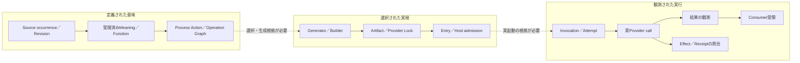
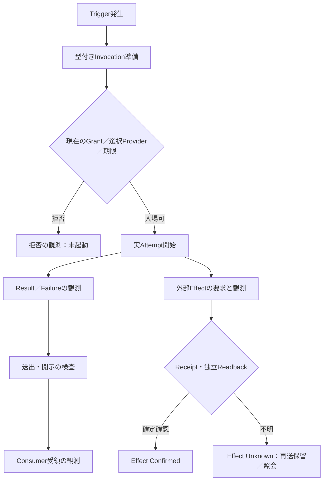
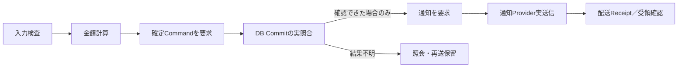
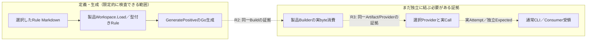

# プロセス実行図を「因果関係と証拠の照合」として成立させる

- **状態**：2026-11-15時点の実装前設計・検証手順。新しい製品API、DSL構文、Graph Runtime、Trace収集基盤、採用済みSchemaを定めるものではない。
- **目的**：定義上のプロセスと、生成された実現方式、実行時に観測された出来事を、同じ図面で誤認せずに照合する。既存の型付きGraph／Source Index／Inspection／Build・Effect Evidenceを利用し、CLIとStudioで共通の**問いに答える読み取り専用の投影**を作る。
- **上位設計**：[プログラム実行モデルの図解とTarget間移植](PROGRAM_EXECUTION_MODEL_PROJECTIONS_2026-11.md)、[標準Data／Processによるノード構成](SERVICE_FLOW_STANDARD_COMPOSITION_2026-11.md)、[成果物要求・計算粒度・実行計画](DECLARATIVE_RESULT_PROCESS_COMPOSITION_2026-11.md)、[プロセスの起動・状態・操作](PROCESS_LIFECYCLE_TRIGGER_OPERATION_SEMANTICS_2026-11.md)。
- **Owner**：#4198（Graph/Lifecycle）、#1124/#2497（Modeler／Graph）、#2621/#988（正式Source）、#4495（公開Entry・実Provider）、#951（Provider選択）、#1129/#1174（Effect/Receipt）、#1180/#2514（独立Expected）、#2831/#4583（実Desktop）。本書は各Ownerの採否を代行しない。
- **優先順位**：実Rule→Go生成・製品Builder・通常CLI実Providerと、非PluginのStudio Stage1→Stage2実WindowsのP0を変更しない。図解全体の完成を新しいHard Gateにしない。

## 1. 図の中心を「一枚の実行フロー」から「検証できる問い」へ移す

同じ形の矢印でも、**定義されている**、**今回選択された**、**実際に起きた**、**独立に確認できた**では意味が違う。図のNode、線、実際のSpan/Attempt、業務Action、Source occurrenceはそれぞれ別のIDを保持する。見た目の一致は、同じ実行が生じた証拠にならない。

対象となる問いの例：

> このWorkspaceのRule `sales.order_line.quantity_positive` は、現在選択されたSourceから意味を保ってGoへ生成され、その生成物が製品Builder・選択済みProvider・実Consumerに使われたか。

図はこの問いに必要な関連部分だけを表示する。Sourceを見つけた、Ruleを生成できた、実Goが判断した、BuilderがByteを読んだ、CLIでProviderを呼んだ、Consumerが受領した、という各主張の資格を混ぜない。別Subject・別Attemptで得た証拠を、名前が一致しただけでつないではならない。

### 1.1 三つの面と二種類の矢印

**実線**はその面で保持した関係を、**破線**は別資格の証拠による結合を必要とする箇所を示す説明図である。実線を描いたから実装済み・許可済み・成功とは判断しない。Rule読込前のCandidateは「受理済みMeaning」として表示しない。

## 2. 実行時の因果は、時刻順ではなく部分順序で表す

同期API、Queue、Batch、GUI、外部Hostをすべて一列の処理順に押し込まない。最低限、次の違いを保つ。

| 辺の性格 | 主に表すもの | ここから推定してはいけないこと |
| --- | --- | --- |
| Data / Dependency | 型付き入力や計算の前提。粒度・Snapshot・集合の完全性を伴う | 書込みの順序、認可、値が実際に読まれたこと |
| Control / Guard | 分岐・待機・順序・条件。未判定のGuardを保持 | Dataの存在だけで条件成立 |
| Event / Temporal | 発生・配送・時間シフト・再配送・有効時点 | 一意配送、実行完了、実順序の保証 |
| State / Effect | 状態遷移要求、Commit、通知、補償・再試行の条件 | 要求だけでCommit確定、ACKだけで永続化 |
| Declared / Derived | Sourceやモデルから導いた関係、生成計画 | 実Hostの選択・実Provider Call |
| Observed / Corroborated | 実Attempt・Receipt・独立Readback・Consumerが示した関係 | 観測していない全対象の不存在 |

二つの並列Provider呼出しは、共通の親があっても、互いに先後関係があるとは限らない。Batchの複数Triggerが一Attemptを生んだ場合にも、単一の親へ無理に畳まない。実Spanが存在するときだけその識別子・時点・Producerへ参照を貼り、定義上のAction IDと同一視しない。

この図は観測項目の依存関係を表す。ResultとEffectは並列的に成立し得るため、一方の成功を他方へ自動伝播させない。OS Processの終了、HTTP 200、Queue ACK、Cancellationは単独でCommitの証明ではない。External Effectが不明なら、同一Operation identity・fence・現在Grantを照合せずに再送しない。

## 3. 検証可能な図面に必要な最小情報

**保存する新Schemaの提案ではなく**、既存のSource Index・Inspection・Plan・Trace・Receiptを読み取り専用で照合する際の表示項目である。

| 対象 | 照合する識別・版・範囲 | 表示してよい結論 |
| --- | --- | --- |
| 問いの主体 | Workspace Root/epoch、Qualified Subject Kind/ID、Source occurrence、Model Revision | どの対象を調べたか |
| 定義・構成 | Source byte range/fingerprint、Language選択、Meaning/Contract、Node/Edge occurrence ID、選択範囲 | 何が宣言され、何を投影できたか |
| 実現 | World/Model/Artifactの別Revision、Generator/Builder、Plugin exact Lock、実Target、選択Provider | 何を選択・生成したか。実Callとは別 |
| 実行 | Entry/Trigger occurrence、Invocation/Attempt、実Process/Image、実Called Provider、Input Scope/Snapshot、Result/Failure | 実際に確認したCallと結果 |
| Effect / Delivery | Operation identity、Receipt、独立Readback、Disclosure/Audience、実Consumer世代・受領 | 確定した効果と届いた範囲 |
| 証拠の境界 | Producer、取得時刻、観測範囲、完全性、欠落・非開示・未対応の区別、独立Expectedの出典 | どこまで判定でき、どこから先は不明か |

表示状態は、**観測済み／矛盾を確認／証拠不足／対象外・未対応**のような説明用の分類を使う。Coreへ万能な新Enumを追加せず、元の具体的な状態（NULL、missing、unfetched、partial、permission denied、effect unknown等）を残す。「観測されなかった」と「存在しない」を同一にしない。

### 3.1 正の証人と負の証人は非対称

あるAttemptで選択B・実Call Aの対応が確認できれば、その**対象の不一致**を指摘できる。一方、観測TraceにAが出てこないだけではAが呼ばれなかったと断定できない。後者には、対象Callsite、Attempt、時間窓、Collector、Sample率、実行分岐を含む観測閉包が要る。異常を確認するための部分証拠は使えても、全件正常や不存在の証明にはそのまま使えない。

同様に「未使用のNode/Rule」「一意性違反なし」「副作用なし」「公開Sourceなし」と判断する際には、探索対象集合と参照解決・読取の完全性が必要になる。対象が見えなかった理由が権限、未ロードPlugin、途中障害、取得上限なら、図上は未確認として残す。

## 4. 一つの問いを図にするread-only照合手順

1. **質問と対象を固定する**：Workspace・Audience・Subject/Occurrence・必要な主張・対象時点を選ぶ。名前だけで自動同定しない。
2. **定義を同じ読取境界で取得する**：可能なら既存`ReadWorkspaceSubject`とSource Index/Inspectionを同じLoad/Snapshotから得る。別取得は版とCoverageが一致する場合だけ結ぶ。
3. **必要なStructure Sliceを切り出す**：Process Action→Operation Definition→Node/Port/Edge occurrenceを型付き参照で辿り、同名異ID・同端点の多重辺・未取得辺・循環条件を維持する。Plugin/Target選択を別欄にする。
4. **実現の証拠を照合する**：生成Go、Builderが実際に読んだbyte、Artifact/Lock、実Process imageを独立に関連付ける。Output byte一致だけで実Builder消費を推測しない。
5. **実行の証拠を照合する**：選択Providerとactual Calledを同じInvocation/Attempt・Targetで突き合わせる。時刻が近い別RunのReceiptは根拠にしない。
6. **結果・Effect・Audienceを独立に判定する**：Result、外部Effect、Response、Consumer受領を別欄で示す。独立Expectedに照合した範囲だけを合格にする。
7. **境界を明示して出力する**：未取得、未観測、未実装、対象外、非開示と出典を残す。UIのPin/epochが変わったら旧Replyを現在の判断へ混ぜず再照会する。

この順序は**図を導く検証手順**であり、すべてのTargetが逐次実行すべきRuntime命令ではない。Studioの位置移動、ノードの折畳み、色変更はView差分であり、それだけでMeaning/Artifactを再生成しない。

## 5. 既存のRule縦断を使う最初の実例

対象を`sales.order_line.quantity_positive`（`std.decimal`）一つに限定する。2026-11-15の既存研究・PRでは、選択済みMarkdown Ruleの製品`Workspace.Load`→`semantic.Validation`→Source Index/Inspection、合成入力によるEvaluator Read Footprint、`validationgen.GeneratePositive`が生成する実Go判断式までの**別々の限定的な証拠**がある。これらの根拠を、同じ実Provider／通常CLI／Windows Stage2の完成へ合算しない。

| 問い | 最小の証拠 | 根拠がなければ表示 |
| --- | --- | --- |
| どのSourceから来たか | 選択Language、原Markdown byte、Rule ID・Source Indexと同一Load | Source未束縛 |
| 何を判断するか | Attribute Type、Comparison、NULL/欠損、独立Expected | Meaning/適用未確認 |
| 何を実際に読んだか | 合成Sourceの`Number(attribute)`実Callと拒否された他Read | 合成Readのみ／実DB未観測 |
| 何を生成・Buildしたか | Go byte、Generator版、Builderの実ReadとArtifact ID | 生成のみ／Builder未確認 |
| どのProviderが使われたか | 選択Bとactual Bを同一Attemptで確認 | 実Provider未確認 |
| 誰が結果を受け取ったか | 実CLIや実Studio Consumer・Audience・世代 | Consumer未観測 |

SourceのAttributeだけを変更する実例では、Rule IDが同じでも依存・生成Go・実Read先・判断が変わる。逆に表示座標だけの変更でGeneratorが再実行されるなら、MeaningとViewを取り違えている。A→B→Aでは最終Byteの一致が途中の旧Grant・旧Attemptの復活を保証しない。

## 6. Effectを伴う別実例：受注確定から確認通知まで

以下は**設計上の反例生成用の説明**であり、実Provider/DB/通知が製品経路で成立した主張ではない。

**業務プロセス上のAction、純粋計算、Commit、通知配送、Consumerによる受領は異なる粒度**である。DBの更新と通知が無条件に単一Transactionで確定するとは仮定しない。Outboxなどを採る場合も、実Host/DBの保証と回復可能性を個別に示す。通知送信成功を業務確定や最終受領と誤表示せず、Commit後のACK喪失を「未実行」としない。

## 7. 図とドキュメントを同じ設計から導出する条件

図は説明用の別正本にならない。Markdownの表、ノード図、Graphviz、ステート遷移表、関数チェーン、Trace、文書の根拠欄はいずれも**同じ意味ID・Source occurrence・Evidence参照**を投影する。ドキュメント化によって構造化されるものと、その表示だけでは確定しないものを区別する。

| 変更の種類 | 主な再検証対象 | 元のSourceへ戻す条件 |
| --- | --- | --- |
| 座標・色・折畳み・注記のみ | View／Audience／現在の選択状態 | 意味への逆編集を要求しない |
| Node occurrence・Port・Edgeの接続変更 | 構造、型、粒度、循環、Guard、Operation参照、影響Source | 正確なOccurrence/Source位置と可逆なTyped Proposal |
| Rule／Business Meaningの変更 | Meaning受理、依存、Target生成、Independent Expected適合 | Ownerの受理・変更影響と対象Revision |
| Generator／Plugin／Target版の変更 | 選択、Artifact／Build Evidence、互換性 | Source不変でも実Artifact／Consumerを再評価 |
| 実Grant失効／Host変更／過去Attemptの追加 | 現在入場・実行資格、Trace／Effect／Audience | 実行履歴の更新をMeaningの変更にしない |

手動編集とAI提案はいずれも同じPreview→Resolve→Admit→Commit→Observeを通す。lossのある表現から「図で線を引いたので業務Relationが追加された」と自動確定しない。書込編集ができないProjectionにはSourceへのNavigationと、何が表現されていないかを提示する。

## 8. 外部の観測・来歴規約を使う場合の境界

既存の規約は、TEIの意味モデルを置き換える対象ではなく**必要な情報を公開・入出力するAdapterの比較基準**として利用する。

| 参考規約 | 使える発想 | TEIで追加して確認すべきこと |
| --- | --- | --- |
| W3C PROV-DM（Entity／Activity／Agent） | 定義・活動・生成物と由来の型付き関係 | SourceとAccepted Meaning、Current Grant、独立Expectedの区別 |
| OpenTelemetry Trace／Span Links | Processをまたぐ因果、非同期・Batchでの複数起点 | サンプリング欠落、実Provider Identity、業務Commitの証明 |
| OpenLineage Job／Run／Dataset・Facets | 宣言上のData依存と実Run・入力/出力の区別 | Grain、Read Scope、部分取得、開示、非DataのEffect／Consumer |

資料： https://www.w3.org/TR/prov-dm/ ／ https://opentelemetry.io/docs/concepts/signals/traces/ ／ https://openlineage.io/docs/spec/facets/

分散TraceのSpan、Data LineageのRun、業務Operation identityを一律に一対一対応させない。外部の図やLogを取り込む場合は、Producer・Trace/Run ID・取得範囲・欠落情報を明示した**候補Evidence**として扱う。実際の選択Providerや業務Effectを観測していなければ、仕様上の概念が存在するだけでは補えない。

## 9. 小さな実装差分と独立受入

**最初の差分：Headlessの一対象・一問のread-only出力。** 現在の`InspectSubject`／`TraceSubjectSourcesFromIndex`と、選択済みRuleのSource Index・型付き意味を再利用する。実際に存在する参照だけを、定義→生成→実行という欄へ投影し、未接続のProvider／Effect／Consumerは空欄の「成功」ではなく、**証拠なし／未確認**と理由を表示する。新しいGraph Compiler、Trace Store、共通Runner、公開DSL、Second Resolverは追加しない。

独立Expectedは#1180/#2514を用い、既存PX-06/09/10/11・SF-01/02/03/08/09/10・EL-03/04/07/12の負例を再利用する。初期に最低限落とすべき反例は、(a)同名異IDと二重Edgeの併合、(b)旧Sourceの遅着Reply、(c)Provider B選択なのにA実Call、(d)未観測Callを不存在と断言、(e)Commit不明時の盲目的再送、(f)Builderが読んでいない生成ByteからのProduct合格である。

**停止条件**：図を表示するために新たな正本・Host・Runnerが必要になる、Backendの現在GrantをRendererが捏造する、Read未完を空集合へ変換する、選択Providerと実Called Providerを実証せず合格表示する、図表の完全可逆性を無根拠に主張する、のいずれか。型・識別・Evidenceの不足は`unknown/unsupported`で返し、採否は各OwnerとADRに委ねる。

**実装状態**：本書は設計の統合であり、今回新しいGo/TypeScript/Windows/DB実試験、正式なGraph Compiler、通常CLI実Provider・外部Effect・Stage1→Stage2セルフビルドの製品受入を実施したものではない。

## 10. 表現、実現、観測の対応を「意味の保存条件」として検査する

実行図を共通化する価値は、異なる図を同じ色・記号で描けることではない。**Sourceの意味を変えずに視点を切り替えられること、実現方式を変えたときに守るべき条件が分かること、そして実観測から言える範囲だけを説明できること**にある。これらは同じ種類の「一致」ではない。

| 対応 | 確かめる関係 | ここから先へ自動的に進めない判断 |
| --- | --- | --- |
| Source → 意味モデル → 図 | 対象ID、型、Relation、Rule集合、Guard、粒度、時点、表示の損失 | 図の見た目から意味受理・実行権限を付与しない |
| 意味モデル → Target実現 | 入出力・NULL/欠損、Read範囲、判断、順序、必要Effectを保存するか | コードを生成できたという事実から実Host適合を宣言しない |
| Target実現 → 実Attempt | 選択Builder／Artifact／Providerと実使用物、Current Grant・Context | 同じ結果値から実Provider／実Artifactの一致を推定しない |
| 実Attempt → 証拠と説明 | 実Read、分岐、結果、Receipt、開示、Consumerの実観測範囲 | 部分Traceから全実行・全副作用・不存在を断定しない |

### 10.1 図の編集には、部分的な双方向変換の考え方を使う

双方向変換（lens）の研究では、元データから表示を得る処理と、表示上の変更を元データへ反映する処理について、往復時の整合性を考える。TEIでは全ての図が双方向であると宣言せず、**編集可能な範囲を限定した投影**にこの考え方を適用する。

- **無変更の往復**：Sourceから図を作り、何も編集せず再反映しても、元のSourceの意味・元byte表現を不要に変更しない。Markdown表の空白、コメント、Graphvizの配置設定を勝手に整形しない。
- **変更後の再投影**：一意なSource位置へ戻せる変更を、現在のRevision・対象Role・既存Acceptanceに束縛して適用したとき、同じSubjectを再投影すると許可された変更が再現される。それ以外のSource領域は保持する。
- **部分的な逆変換**：集約表・実行Trace・複数Nodeを縮約した図など、意味の欠落や複数の復元候補がある表示は、逆編集を拒否するかChange Proposalとして差分・損失を提示する。AIが選んだ候補を無確認で正本へ書き戻さない。

この原則は図上の操作からSourceへの**書換え適格性**を定めるものであり、業務Ruleの正しさやTargetでの実行資格を証明するものではない。一般化したLens Runtime／別のSource Storeは設けない。参考： [Contract lenses（2023）](https://doi.org/10.1017/S0956796823000059) と [部分指定状態のLenses（2026）](https://link.springer.com/chapter/10.1007/978-3-032-22723-2_2)。

### 10.2 「意味を保つ」を対象と観測項目つきで定める

実現方式AとBの比較では、「同じ結果」だけを同値性の基準にしない。対象のSource/Meaning版、Input、Scope/Snapshot、Grant、Target能力を固定し、そのFunctionで観測・保証が必要な**値・Read・Failure・Effect・順序・開示**をそれぞれ比較する。

例えば純粋な正数判定Ruleでは、真偽だけでなく、どのAttributeを一度読んだか、NULL／欠損がどう扱われたかまで比較できる。一方、承認・受注確定では、同じ画面メッセージでもDB Commitや現在のActor資格が異なれば同値ではない。将来のコード最適化については、比較できない条件を残したまま「意味保存済み」と呼ばない。

順序を伴うProcessで確かめるべきことは少なくとも三つある。**安全性**はGuardを迂回せず禁止された作用を起こさないこと、**結果の適合**は定義したOutcome・失敗・Effectの保証を満たすこと、**進行条件**は所定の前提のもとで待機・停止・再開がどう成立するかである。単発Fixtureの成功から無期限の進行保証を主張しない。

## 11. 実行方式を一種類の「フロー」に潰さず、必要な意味規則を選ぶ

標準Data／Function／Business・Operation／Graphを共有しても、処理分野によって**どの出来事が次の処理を可能にするか**は異なる。図の矢印を増やすより、対象ごとの判断条件と実行方式の適用範囲を保存する。

| 対象 | 主な意味上の規則 | 必要な図・表 | 誤った同一視を避けるもの |
| --- | --- | --- | --- |
| Rule／BRMS | 適用Rule集合、優先順位・競合、完全な入力集合、unknown | 決定表・判断の依存図・Read票 | Ruleが一致したことと操作許可 |
| Data／ETL／Batch | grain、group key、丸め位置、部分集計、対象Snapshot、差分 | 成果物定義表・依存Graph・実行計画 | 同じ物理Work Unitと同じ計算粒度 |
| 業務承認・State | DefinitionとInstanceの経路Snapshot、Guard、現在Grant、N_OF_M、遷移Receipt | 状態表・職務／Action・条件付きProcess図 | 申請時の承認候補と現在の承認資格 |
| REA等の業務事象 | 経済的な出来事、資源・主体・数量・有効時点、業務上の確定 | Event／Resource／Agent関係図・履歴表 | 業務EventとMessage／Webhook配送Event |
| Plugin／Hook | Ownerの接続点、before/after位相、依存、選択、実Call、Effect義務 | 配線Graph・Target別選択表・Call図 | Pluginの宣言配線と実際の呼出し |
| Web／CLI／VUI／MCP | Trigger、公開Entry、現在Context、Host Admission、Reply／Audience | Interaction図・Invocation図・Trace | 呼出し依頼と入場成功、ReplyとEffect |
| TEIセルフビルド | Source、Build Intent、実Builder、入力byte、生成物、Stage2 Consumer | 依存Graph・Build／Artifact図・実受領図 | Build成功とStage1がStage2を実生成した事実 |

**REAのEventとEvent BrokerのMessageは別物**である。後者は前者に関する通知を運べるが、Messageが届いたことだけで経済的な出来事の成立や帳簿への確定は証明されない。ProcessのEvent occurrence、経済事象、Runtime Spanも、異なるIdentityを型付き関係で結ぶ。組織の兼務・代理・時点依存の資格も、同じ線種にまとめない。

複数人承認や並行Batchには、joinの条件が重要となる。例えば3人中2人必要な承認では、2票の単純な数値だけでなく、申請時の担当候補、既に承認したActor集合、現在資格のある残りのActor集合を検査する。並列分岐の合流も「最初の一件で進む」「全件を待つ」「n件で進む」を契約なしに同一視しない。制御フローの複数Instance・同期・取消の差は [Workflow Patterns](https://www.workflowpatterns.com/documentation/documents/BPM-06-17.pdf) を比較候補とするが、TEIに全パターンを一括実装する前提は置かない。

## 12. 問いに必要な範囲だけ切り出す「証拠付き図解」

図に表示する範囲を選ぶときは、単に選択Nodeから隣接する数段を表示するのではなく、**その問いを成立させるために必要な依存と、確認済みの根拠**を残す。これは既存Graph/Inspector/Receiptからのread-onlyな抽出方針であり、新しいGraph CompilerやEvidence Storeを意味しない。

| 問い | 最低限残す関係 | 省略すると誤答になる関係 |
| --- | --- | --- |
| このRuleはどの入力を読んだか | 対象Rule、選択済みDefinition、Attribute／Relation、実Readと取得範囲 | 値には出ないFilter条件・拒否Read・欠損 |
| この出力は正しい粒度で計算されたか | 出力Grain、Group Key、丸め、分類版、Snapshot、演算の結合条件 | Filter-only依存・分類の多重所属・途中集計 |
| この承認を誰が実行できたか | Definition改版、Instance Snapshot、Actor・委任、実行時GrantとGuard | 失効した候補者・必要人数・自己承認禁止 |
| このPluginが実際に使われたか | 接続点Owner、選択Lock、実Artifact／Provider、Attempt、実Call | 宣言だけの配線・未ロード／代替Provider |
| このTEI生成物が使われたか | Source/World/Model、Builder、読取byte、Artifact、実Image、Consumer | 選択だけのBuilder・旧Asset・別Attemptの成功 |
| この作用は確定したか | Operation identity、開始条件、実Commit／Receipt、独立Readback、配送 | ACK喪失・結果unknown・再送と重複 |

図を小さくする際は、**必要なGuard・Error・Effect・Authority・Temporal辺を「単なる詳細」として消さない**。折り畳んだ部分に未解決の条件や未知の依存があれば、縮約Nodeに「範囲未確認／外部Effectあり」などの注記とSourceへの参照を残す。省略を存在しないことの証明に使わない。

上限付きSource Indexや部分Traceからの抽出では、読取対象、総数、取得上限、非開示、未ロード・未実装を別々に示す。特に「Readされた一件」は局所的な証人になるが、「他のReadはない」「Ruleは一意」「全件更新済み」という主張には対象集合の閉包が必要である。これは標準Data／Traitの全件検証と同じ非対称性を持つ。

### 12.1 説明図と実行証拠を重ねる最小例

図中の破線は成功済みの経路ではなく、**実実装・検収で必要となる対応関係**である。現行の限定Go生成・参照Builder試験と通常CLIの実Provider、Studio Stage2は、それぞれ現在の証拠資格で扱う。後続PRにより実証済みの箇所が増えた場合だけ、対象HEAD・Attemptに結び付けて表示を更新する。

## 13. TEI自身の実装から抽象化するdogfoodingとの接続

最初に扱う**実在のGoコード**は `internal/semantic/validationgen/positive.go` の `GeneratePositive` と、それが生成する `EvaluateSelected` である。前者は**生成器**、後者は**業務判断の実現**であり、両者を単一のFunction IDにまとめない。現在の生成器には `semantic.ValidationPositive`、`std.decimal`、属性・Rule IDの適格性確認、`Source.Number`、`Sign() > 0`、NULL/Read失敗の区別という観測可能な責務がある。

[実装から標準モデルへ折り返す設計](IMPLEMENTATION_TO_MODEL_DOGFOOD_2026-11.md)のI2M-0〜4では、これらをGo AST・型情報・必要な実観測から候補構造として抽出し、Data/Function/Rule／Processのどの義務へ対応するかを示す。**ASTの分岐を見つけたことと、その業務上の意味が受理されたことは別**である。

最初に比較するのは次の三つである。

1. **現行Goを観測した構造図**：Function・分岐・型・Read要求・Return・ErrorをSource span付きで取り出す。抽出できない副作用／動的Dispatchは`opaque`とする。
2. **既存Ruleから導いた意味図**：同じSource/Meaning ID、適用条件、型、入力欠損、判断結果と独立Expectedを確認する。Goの`func`／`struct`を専門家向けDSLへ移さない。
3. **生成物・実Consumerとの照合図**：Ruleの参照Attribute一因子変更について、旧Go／新Goのbyte、実Read先、Result、Builder消費とProvider／Consumerの資格を順番に検証する。

成功と数えるのは、生成図の綺麗さではなく、**TEIのモデルへ移せた判断義務の数、依存と変更の追随、残る手書き責務、Target別の別実装が減ったか**である。実装へ戻せるGraph／DSLの範囲がまだ狭ければ、狭いまま診断する。このdogfoodingをStudio Stage1→Stage2の新たな前提条件にはしない。

## 14. 最初の独立反証：変更一つでどの資格が失効するか

独立ExpectedとScenarioの正本は既存#1180／#2514に置き、本書の表を追加Registryへ転記しない。以下は**既存PX／SF／EL／BP-R等を横断して実証する比較手順**であり、今回のGo/Windows/DB試験実施を意味しない。

| 一因子変更・故障注入 | 図で区別するべき結果 | 結び付く既存反例とOwner |
| --- | --- | --- |
| Nodeの座標だけを移動 | Viewのみ変更。意味の再受理・Goの不要な再生成を行わない | PX-06／SF-03、#1124 |
| Ruleの参照先 `quantity`→`second_quantity` | 同じRule IDでもMeaning依存、生成Go、実Read・Resultが変わる。未使用の旧Artifactを再利用しない | 既存R1-M、#988/#1121/#2514 |
| 同端点・同名のEdgeを二本配置 | Edge occurrenceと多重性を維持。意味Relation、表示線、実行Spanは別 | SF-01／02、#2497 |
| Ruleの一行だけ取得、他の行は未取得 | 一意・不在・全件正常を表示せず、確定した局所Conflictだけ断言可能 | PX-09、#1180/#2514 |
| 承認の申請時経路A、DefinitionをBへ改版 | Instance経路を無言でBへ変更しない。現在Actor Grantを別に再判定 | BP-R01／03、#4198/#1174 |
| 選択Provider B、実Call A（結果一致） | 選択と実現の不一致を表示。Outcome一致で合格させない | SF-08／EL-04、#4495/#951 |
| 外部Commit後にACK喪失 | Effect unknownと実行停止／照会を別表示。無条件再送しない | SF-10／PX-03、#1174/#1129 |
| Rule SourceをA→B→A、旧Replyが到着 | Source Fingerprintの復帰と、旧Grant・旧Attempt・古いPinの現在適格性を分ける | SF-09／EL-03、#1124/#2514 |
| Builder選択B・別Image Aが実行 | Source/Generated Go/Build Input/実Imageを別に照合。生成成功を製品成功へ昇格させない | PX-11／EL-04、#2831/#4583 |

**負例の判定では現在の対象HEADと比較集合を固定する**。合成SourceでRead Footprintを証明できても、実DBを読んだとは言えない。旧HEADのCI成功を新HEADに流用しない。

## 15. 既存の製品計画へ落とし込む最小作業単位

| 接続する現行段階 | 次の実作業（既存実装を優先） | 合格を主張できる範囲／次に返す不足 |
| --- | --- | --- |
| **D0：Inspector／Rule Source** | `ReadWorkspaceSubject`・`InspectionFromLoad`・Source Indexを用いて、選択した一RuleのDefinition・型・参照・Source byteのread-only図をHeadlessで出す | S-LOCとSource/Roleの存在。S-OPEN、Runtime Call、Owner意味受理は別 |
| **D1：限定Goと実Builder** | `GeneratePositive`の一因子改版を既存R1-M/R2-Pへ接続。Generated Goを実Builderが読んだbyteとArtifactへ束縛 | Source改版が判断を変える局所証拠と製品Builder実消費を別票で確認 |
| **D2：公開pure Entryの実二入口** | #4495の既存R3から通常CLIと型付きAPIのactual Provider・独立Resultを照合。Ruleとpure Functionが別Subjectならそのまま分ける | 一つの実Attemptでつながる範囲だけ実行図へ加える |
| **D3：共通Node/Graph表示** | #1124／#2497で同じread-only ProjectionをCLI JSONとStudio Inspectorへ投影し、Node／Edge／Source spanとCoverageを保持 | 旧Pin／後着Reply、同名異ID、Loss、Disclosureの負例。図からの編集は未採用 |
| **D4：業務Process／REA／Batch** | #4198、#1130、#1174等でInstance・状態、粒度、時点、必要Effectを異質な二領域に適用 | 表現できない意味の一覧をOwnerへ返す。第二Engine採用ではない |
| **並行する最上位P0** | #2831/#4583のStage1実TEI→Stage2実Windows WebView2の実生成・実受領 | D0〜D4完成を新Hard Gateにしない。実Build Intent／Artifact／Consumerを独立検収 |

D0〜D3の説明UIは**元Sourceに到達でき、分からない境界を分からないと表示できること**を最低基準とする。新しいGraph Runtime、独立Scheduler、汎用Trace Store、第二Expected正本、新たなGo Hostを導入しない。もし既存の標準Graph/Role/Source Indexで表現不能な事例が出れば、対象・失われた意味・独立反証・既存Ownerを示してから最小差分を検討する。

### 15.1 初回PRの提出物を具体化する

最初の実装PRに必要なものは、(a)固定したWorkspace/Subject/Source Revisionと質問文、(b)既存Go APIから得た実際のDefinition・Source参照、(c)各欄に根拠を提供するProducer/取得範囲、(d)未接続を「未確認」とした出力、(e)一因子変更・同名異ID・部分取得の独立Expected、(f)実際に試験したexact HEADとConsumerの六点とする。

Graph→Goをいきなり万能化せず、まず定義→図→Sourceのread-only整合と、既存Rule→実Go→Builderという**既に狭く実証を積んでいる縦断**を接続する。設計図の成功が実Runtime成功を証明しないこと自体を、最初の図で説明できなければならない。
