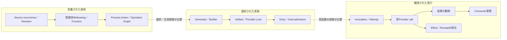
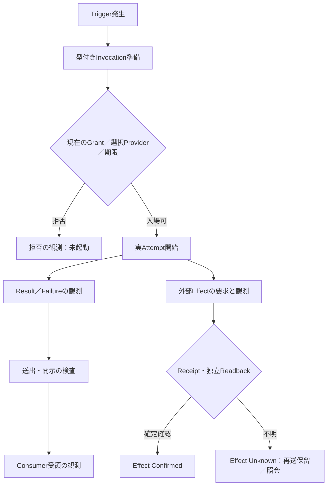
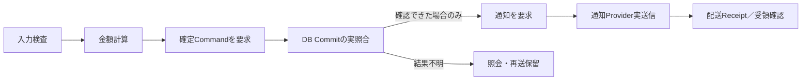
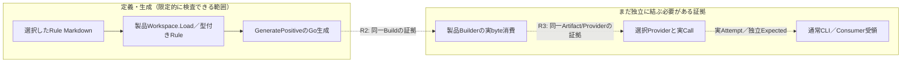
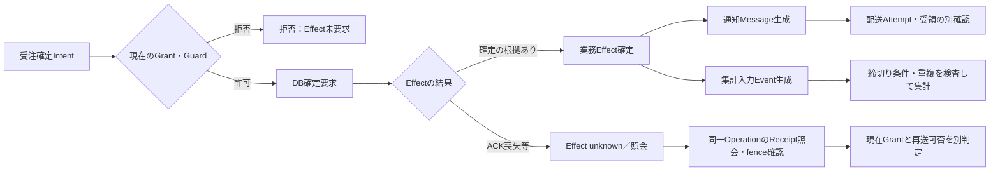
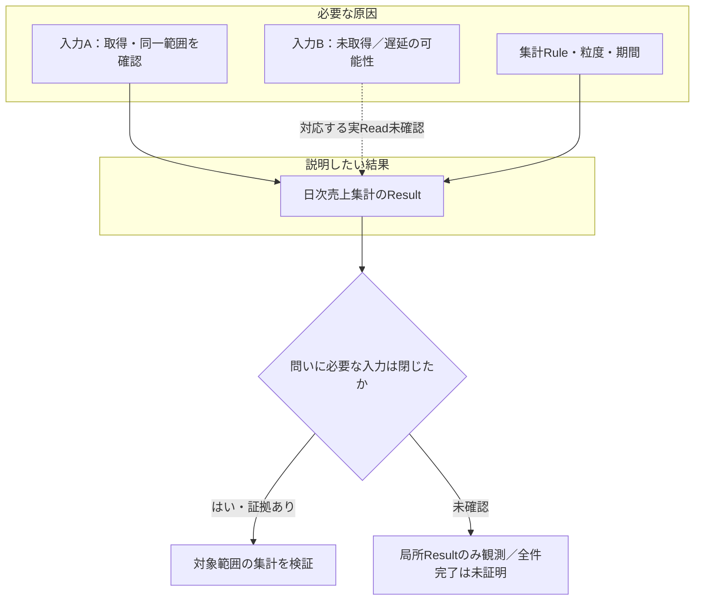
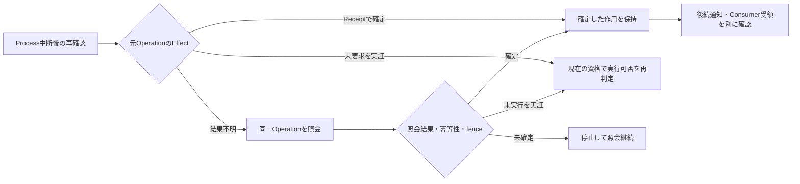
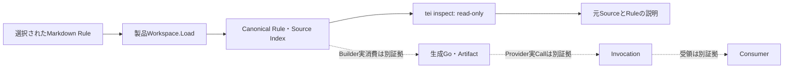

# プロセス実行図を「因果関係と証拠の照合」として成立させる

- **状態**：2026-11-15時点の実装前設計・検証手順。新しい製品API、DSL構文、Graph Runtime、Trace収集基盤、採用済みSchemaを定めるものではない。
- **目的**：定義上のプロセスと、生成された実現方式、実行時に観測された出来事を、同じ図面で誤認せずに照合する。既存の型付きGraph／Source Index／Inspection／Build・Effect Evidenceを利用し、CLIとStudioで共通の**問いに答える読み取り専用の投影**を作る。
- **上位設計**：[プログラム実行モデルの図解とTarget間移植](PROGRAM_EXECUTION_MODEL_PROJECTIONS_2026-11.md)、[標準Data／Processによるノード構成](SERVICE_FLOW_STANDARD_COMPOSITION_2026-11.md)、[成果物要求・計算粒度・実行計画](DECLARATIVE_RESULT_PROCESS_COMPOSITION_2026-11.md)、[プロセスの起動・状態・操作](PROCESS_LIFECYCLE_TRIGGER_OPERATION_SEMANTICS_2026-11.md)。
- **Owner**：#4198（Graph/Lifecycle）、#1124/#2497（Modeler／Graph）、#2621/#988（正式Source）、#4495（公開Entry・実Provider）、#951（Provider選択）、#1129/#1174（Effect/Receipt）、#1180/#2514（独立Expected）、#2831/#4583（実Desktop）。本書は各Ownerの採否を代行しない。
- **優先順位**：実Rule→Go生成・製品Builder・通常CLI実Providerと、非PluginのStudio Stage1→Stage2実WindowsのP0を変更しない。図解全体の完成を新しいHard Gateにしない。

## 1. 図の中心を「一枚の実行フロー」から「検証できる問い」へ移す

同じ形の矢印でも、**定義されている**、**今回選択された**、**実際に起きた**、**独立に確認できた**では意味が違う。図のNode、線、実際のSpan/Attempt、業務Action、Source occurrenceはそれぞれ別のIDを保持する。見た目の一致は、同じ実行が生じた証拠にならない。

対象となる問いの例：

> このWorkspaceのRule `sales.order_line.quantity_positive` は、現在選択されたSourceから意味を保ってGoへ生成され、その生成物が製品Builder・選択済みProvider・実Consumerに使われたか。

図はこの問いに必要な関連部分だけを表示する。Sourceを見つけた、Ruleを生成できた、実Goが判断した、BuilderがByteを読んだ、CLIでProviderを呼んだ、Consumerが受領した、という各主張の資格を混ぜない。別Subject・別Attemptで得た証拠を、名前が一致しただけでつないではならない。

### 1.1 三つの面と二種類の矢印

**実線**はその面で保持した関係を、**破線**は別資格の証拠による結合を必要とする箇所を示す説明図である。実線を描いたから実装済み・許可済み・成功とは判断しない。Rule読込前のCandidateは「受理済みMeaning」として表示しない。

## 2. 実行時の因果は、時刻順ではなく部分順序で表す

同期API、Queue、Batch、GUI、外部Hostをすべて一列の処理順に押し込まない。最低限、次の違いを保つ。

| 辺の性格 | 主に表すもの | ここから推定してはいけないこと |
| --- | --- | --- |
| Data / Dependency | 型付き入力や計算の前提。粒度・Snapshot・集合の完全性を伴う | 書込みの順序、認可、値が実際に読まれたこと |
| Control / Guard | 分岐・待機・順序・条件。未判定のGuardを保持 | Dataの存在だけで条件成立 |
| Event / Temporal | 発生・配送・時間シフト・再配送・有効時点 | 一意配送、実行完了、実順序の保証 |
| State / Effect | 状態遷移要求、Commit、通知、補償・再試行の条件 | 要求だけでCommit確定、ACKだけで永続化 |
| Declared / Derived | Sourceやモデルから導いた関係、生成計画 | 実Hostの選択・実Provider Call |
| Observed / Corroborated | 実Attempt・Receipt・独立Readback・Consumerが示した関係 | 観測していない全対象の不存在 |

二つの並列Provider呼出しは、共通の親があっても、互いに先後関係があるとは限らない。Batchの複数Triggerが一Attemptを生んだ場合にも、単一の親へ無理に畳まない。実Spanが存在するときだけその識別子・時点・Producerへ参照を貼り、定義上のAction IDと同一視しない。

この図は観測項目の依存関係を表す。ResultとEffectは並列的に成立し得るため、一方の成功を他方へ自動伝播させない。OS Processの終了、HTTP 200、Queue ACK、Cancellationは単独でCommitの証明ではない。External Effectが不明なら、同一Operation identity・fence・現在Grantを照合せずに再送しない。

## 3. 検証可能な図面に必要な最小情報

**保存する新Schemaの提案ではなく**、既存のSource Index・Inspection・Plan・Trace・Receiptを読み取り専用で照合する際の表示項目である。

| 対象 | 照合する識別・版・範囲 | 表示してよい結論 |
| --- | --- | --- |
| 問いの主体 | Workspace Root/epoch、Qualified Subject Kind/ID、Source occurrence、Model Revision | どの対象を調べたか |
| 定義・構成 | Source byte range/fingerprint、Language選択、Meaning/Contract、Node/Edge occurrence ID、選択範囲 | 何が宣言され、何を投影できたか |
| 実現 | World/Model/Artifactの別Revision、Generator/Builder、Plugin exact Lock、実Target、選択Provider | 何を選択・生成したか。実Callとは別 |
| 実行 | Entry/Trigger occurrence、Invocation/Attempt、実Process/Image、実Called Provider、Input Scope/Snapshot、Result/Failure | 実際に確認したCallと結果 |
| Effect / Delivery | Operation identity、Receipt、独立Readback、Disclosure/Audience、実Consumer世代・受領 | 確定した効果と届いた範囲 |
| 証拠の境界 | Producer、取得時刻、観測範囲、完全性、欠落・非開示・未対応の区別、独立Expectedの出典 | どこまで判定でき、どこから先は不明か |

表示状態は、**観測済み／矛盾を確認／証拠不足／対象外・未対応**のような説明用の分類を使う。Coreへ万能な新Enumを追加せず、元の具体的な状態（NULL、missing、unfetched、partial、permission denied、effect unknown等）を残す。「観測されなかった」と「存在しない」を同一にしない。

### 3.1 正の証人と負の証人は非対称

あるAttemptで選択B・実Call Aの対応が確認できれば、その**対象の不一致**を指摘できる。一方、観測TraceにAが出てこないだけではAが呼ばれなかったと断定できない。後者には、対象Callsite、Attempt、時間窓、Collector、Sample率、実行分岐を含む観測閉包が要る。異常を確認するための部分証拠は使えても、全件正常や不存在の証明にはそのまま使えない。

同様に「未使用のNode/Rule」「一意性違反なし」「副作用なし」「公開Sourceなし」と判断する際には、探索対象集合と参照解決・読取の完全性が必要になる。対象が見えなかった理由が権限、未ロードPlugin、途中障害、取得上限なら、図上は未確認として残す。

## 4. 一つの問いを図にするread-only照合手順

1. **質問と対象を固定する**：Workspace・Audience・Subject/Occurrence・必要な主張・対象時点を選ぶ。名前だけで自動同定しない。
2. **定義を同じ読取境界で取得する**：可能なら既存`ReadWorkspaceSubject`とSource Index/Inspectionを同じLoad/Snapshotから得る。別取得は版とCoverageが一致する場合だけ結ぶ。
3. **必要なStructure Sliceを切り出す**：Process Action→Operation Definition→Node/Port/Edge occurrenceを型付き参照で辿り、同名異ID・同端点の多重辺・未取得辺・循環条件を維持する。Plugin/Target選択を別欄にする。
4. **実現の証拠を照合する**：生成Go、Builderが実際に読んだbyte、Artifact/Lock、実Process imageを独立に関連付ける。Output byte一致だけで実Builder消費を推測しない。
5. **実行の証拠を照合する**：選択Providerとactual Calledを同じInvocation/Attempt・Targetで突き合わせる。時刻が近い別RunのReceiptは根拠にしない。
6. **結果・Effect・Audienceを独立に判定する**：Result、外部Effect、Response、Consumer受領を別欄で示す。独立Expectedに照合した範囲だけを合格にする。
7. **境界を明示して出力する**：未取得、未観測、未実装、対象外、非開示と出典を残す。UIのPin/epochが変わったら旧Replyを現在の判断へ混ぜず再照会する。

この順序は**図を導く検証手順**であり、すべてのTargetが逐次実行すべきRuntime命令ではない。Studioの位置移動、ノードの折畳み、色変更はView差分であり、それだけでMeaning/Artifactを再生成しない。

## 5. 既存のRule縦断を使う最初の実例

対象を`sales.order_line.quantity_positive`（`std.decimal`）一つに限定する。2026-11-15の既存研究・PRでは、選択済みMarkdown Ruleの製品`Workspace.Load`→`semantic.Validation`→Source Index/Inspection、合成入力によるEvaluator Read Footprint、`validationgen.GeneratePositive`が生成する実Go判断式までの**別々の限定的な証拠**がある。これらの根拠を、同じ実Provider／通常CLI／Windows Stage2の完成へ合算しない。

| 問い | 最小の証拠 | 根拠がなければ表示 |
| --- | --- | --- |
| どのSourceから来たか | 選択Language、原Markdown byte、Rule ID・Source Indexと同一Load | Source未束縛 |
| 何を判断するか | Attribute Type、Comparison、NULL/欠損、独立Expected | Meaning/適用未確認 |
| 何を実際に読んだか | 合成Sourceの`Number(attribute)`実Callと拒否された他Read | 合成Readのみ／実DB未観測 |
| 何を生成・Buildしたか | Go byte、Generator版、Builderの実ReadとArtifact ID | 生成のみ／Builder未確認 |
| どのProviderが使われたか | 選択Bとactual Bを同一Attemptで確認 | 実Provider未確認 |
| 誰が結果を受け取ったか | 実CLIや実Studio Consumer・Audience・世代 | Consumer未観測 |

SourceのAttributeだけを変更する実例では、Rule IDが同じでも依存・生成Go・実Read先・判断が変わる。逆に表示座標だけの変更でGeneratorが再実行されるなら、MeaningとViewを取り違えている。A→B→Aでは最終Byteの一致が途中の旧Grant・旧Attemptの復活を保証しない。

## 6. Effectを伴う別実例：受注確定から確認通知まで

以下は**設計上の反例生成用の説明**であり、実Provider/DB/通知が製品経路で成立した主張ではない。

**業務プロセス上のAction、純粋計算、Commit、通知配送、Consumerによる受領は異なる粒度**である。DBの更新と通知が無条件に単一Transactionで確定するとは仮定しない。Outboxなどを採る場合も、実Host/DBの保証と回復可能性を個別に示す。通知送信成功を業務確定や最終受領と誤表示せず、Commit後のACK喪失を「未実行」としない。

## 7. 図とドキュメントを同じ設計から導出する条件

図は説明用の別正本にならない。Markdownの表、ノード図、Graphviz、ステート遷移表、関数チェーン、Trace、文書の根拠欄はいずれも**同じ意味ID・Source occurrence・Evidence参照**を投影する。ドキュメント化によって構造化されるものと、その表示だけでは確定しないものを区別する。

| 変更の種類 | 主な再検証対象 | 元のSourceへ戻す条件 |
| --- | --- | --- |
| 座標・色・折畳み・注記のみ | View／Audience／現在の選択状態 | 意味への逆編集を要求しない |
| Node occurrence・Port・Edgeの接続変更 | 構造、型、粒度、循環、Guard、Operation参照、影響Source | 正確なOccurrence/Source位置と可逆なTyped Proposal |
| Rule／Business Meaningの変更 | Meaning受理、依存、Target生成、Independent Expected適合 | Ownerの受理・変更影響と対象Revision |
| Generator／Plugin／Target版の変更 | 選択、Artifact／Build Evidence、互換性 | Source不変でも実Artifact／Consumerを再評価 |
| 実Grant失効／Host変更／過去Attemptの追加 | 現在入場・実行資格、Trace／Effect／Audience | 実行履歴の更新をMeaningの変更にしない |

手動編集とAI提案はいずれも同じPreview→Resolve→Admit→Commit→Observeを通す。lossのある表現から「図で線を引いたので業務Relationが追加された」と自動確定しない。書込編集ができないProjectionにはSourceへのNavigationと、何が表現されていないかを提示する。

## 8. 外部の観測・来歴規約を使う場合の境界

既存の規約は、TEIの意味モデルを置き換える対象ではなく**必要な情報を公開・入出力するAdapterの比較基準**として利用する。

| 参考規約 | 使える発想 | TEIで追加して確認すべきこと |
| --- | --- | --- |
| W3C PROV-DM（Entity／Activity／Agent） | 定義・活動・生成物と由来の型付き関係 | SourceとAccepted Meaning、Current Grant、独立Expectedの区別 |
| OpenTelemetry Trace／Span Links | Processをまたぐ因果、非同期・Batchでの複数起点 | サンプリング欠落、実Provider Identity、業務Commitの証明 |
| OpenLineage Job／Run／Dataset・Facets | 宣言上のData依存と実Run・入力/出力の区別 | Grain、Read Scope、部分取得、開示、非DataのEffect／Consumer |

資料： https://www.w3.org/TR/prov-dm/ ／ https://opentelemetry.io/docs/concepts/signals/traces/ ／ https://openlineage.io/docs/spec/facets/

分散TraceのSpan、Data LineageのRun、業務Operation identityを一律に一対一対応させない。外部の図やLogを取り込む場合は、Producer・Trace/Run ID・取得範囲・欠落情報を明示した**候補Evidence**として扱う。実際の選択Providerや業務Effectを観測していなければ、仕様上の概念が存在するだけでは補えない。

## 9. 小さな実装差分と独立受入

**最初の差分：Headlessの一対象・一問のread-only出力。** 現在の`InspectSubject`／`TraceSubjectSourcesFromIndex`と、選択済みRuleのSource Index・型付き意味を再利用する。実際に存在する参照だけを、定義→生成→実行という欄へ投影し、未接続のProvider／Effect／Consumerは空欄の「成功」ではなく、**証拠なし／未確認**と理由を表示する。新しいGraph Compiler、Trace Store、共通Runner、公開DSL、Second Resolverは追加しない。

独立Expectedは#1180/#2514を用い、既存PX-06/09/10/11・SF-01/02/03/08/09/10・EL-03/04/07/12の負例を再利用する。初期に最低限落とすべき反例は、(a)同名異IDと二重Edgeの併合、(b)旧Sourceの遅着Reply、(c)Provider B選択なのにA実Call、(d)未観測Callを不存在と断言、(e)Commit不明時の盲目的再送、(f)Builderが読んでいない生成ByteからのProduct合格である。

**停止条件**：図を表示するために新たな正本・Host・Runnerが必要になる、Backendの現在GrantをRendererが捏造する、Read未完を空集合へ変換する、選択Providerと実Called Providerを実証せず合格表示する、図表の完全可逆性を無根拠に主張する、のいずれか。型・識別・Evidenceの不足は`unknown/unsupported`で返し、採否は各OwnerとADRに委ねる。

**実装状態**：本書は設計の統合であり、今回新しいGo/TypeScript/Windows/DB実試験、正式なGraph Compiler、通常CLI実Provider・外部Effect・Stage1→Stage2セルフビルドの製品受入を実施したものではない。

## 10. 表現、実現、観測の対応を「意味の保存条件」として検査する

実行図を共通化する価値は、異なる図を同じ色・記号で描けることではない。**Sourceの意味を変えずに視点を切り替えられること、実現方式を変えたときに守るべき条件が分かること、そして実観測から言える範囲だけを説明できること**にある。これらは同じ種類の「一致」ではない。

| 対応 | 確かめる関係 | ここから先へ自動的に進めない判断 |
| --- | --- | --- |
| Source → 意味モデル → 図 | 対象ID、型、Relation、Rule集合、Guard、粒度、時点、表示の損失 | 図の見た目から意味受理・実行権限を付与しない |
| 意味モデル → Target実現 | 入出力・NULL/欠損、Read範囲、判断、順序、必要Effectを保存するか | コードを生成できたという事実から実Host適合を宣言しない |
| Target実現 → 実Attempt | 選択Builder／Artifact／Providerと実使用物、Current Grant・Context | 同じ結果値から実Provider／実Artifactの一致を推定しない |
| 実Attempt → 証拠と説明 | 実Read、分岐、結果、Receipt、開示、Consumerの実観測範囲 | 部分Traceから全実行・全副作用・不存在を断定しない |

### 10.1 図の編集には、部分的な双方向変換の考え方を使う

双方向変換（lens）の研究では、元データから表示を得る処理と、表示上の変更を元データへ反映する処理について、往復時の整合性を考える。TEIでは全ての図が双方向であると宣言せず、**編集可能な範囲を限定した投影**にこの考え方を適用する。

- **無変更の往復**：Sourceから図を作り、何も編集せず再反映しても、元のSourceの意味・元byte表現を不要に変更しない。Markdown表の空白、コメント、Graphvizの配置設定を勝手に整形しない。
- **変更後の再投影**：一意なSource位置へ戻せる変更を、現在のRevision・対象Role・既存Acceptanceに束縛して適用したとき、同じSubjectを再投影すると許可された変更が再現される。それ以外のSource領域は保持する。
- **部分的な逆変換**：集約表・実行Trace・複数Nodeを縮約した図など、意味の欠落や複数の復元候補がある表示は、逆編集を拒否するかChange Proposalとして差分・損失を提示する。AIが選んだ候補を無確認で正本へ書き戻さない。

この原則は図上の操作からSourceへの**書換え適格性**を定めるものであり、業務Ruleの正しさやTargetでの実行資格を証明するものではない。一般化したLens Runtime／別のSource Storeは設けない。参考： [Contract lenses（2023）](https://doi.org/10.1017/S0956796823000059) と [部分指定状態のLenses（2026）](https://link.springer.com/chapter/10.1007/978-3-032-22723-2_2)。

### 10.2 「意味を保つ」を対象と観測項目つきで定める

実現方式AとBの比較では、「同じ結果」だけを同値性の基準にしない。対象のSource/Meaning版、Input、Scope/Snapshot、Grant、Target能力を固定し、そのFunctionで観測・保証が必要な**値・Read・Failure・Effect・順序・開示**をそれぞれ比較する。

例えば純粋な正数判定Ruleでは、真偽だけでなく、どのAttributeを一度読んだか、NULL／欠損がどう扱われたかまで比較できる。一方、承認・受注確定では、同じ画面メッセージでもDB Commitや現在のActor資格が異なれば同値ではない。将来のコード最適化については、比較できない条件を残したまま「意味保存済み」と呼ばない。

順序を伴うProcessで確かめるべきことは少なくとも三つある。**安全性**はGuardを迂回せず禁止された作用を起こさないこと、**結果の適合**は定義したOutcome・失敗・Effectの保証を満たすこと、**進行条件**は所定の前提のもとで待機・停止・再開がどう成立するかである。単発Fixtureの成功から無期限の進行保証を主張しない。

## 11. 実行方式を一種類の「フロー」に潰さず、必要な意味規則を選ぶ

標準Data／Function／Business・Operation／Graphを共有しても、処理分野によって**どの出来事が次の処理を可能にするか**は異なる。図の矢印を増やすより、対象ごとの判断条件と実行方式の適用範囲を保存する。

| 対象 | 主な意味上の規則 | 必要な図・表 | 誤った同一視を避けるもの |
| --- | --- | --- | --- |
| Rule／BRMS | 適用Rule集合、優先順位・競合、完全な入力集合、unknown | 決定表・判断の依存図・Read票 | Ruleが一致したことと操作許可 |
| Data／ETL／Batch | grain、group key、丸め位置、部分集計、対象Snapshot、差分 | 成果物定義表・依存Graph・実行計画 | 同じ物理Work Unitと同じ計算粒度 |
| 業務承認・State | DefinitionとInstanceの経路Snapshot、Guard、現在Grant、N_OF_M、遷移Receipt | 状態表・職務／Action・条件付きProcess図 | 申請時の承認候補と現在の承認資格 |
| REA等の業務事象 | 経済的な出来事、資源・主体・数量・有効時点、業務上の確定 | Event／Resource／Agent関係図・履歴表 | 業務EventとMessage／Webhook配送Event |
| Plugin／Hook | Ownerの接続点、before/after位相、依存、選択、実Call、Effect義務 | 配線Graph・Target別選択表・Call図 | Pluginの宣言配線と実際の呼出し |
| Web／CLI／VUI／MCP | Trigger、公開Entry、現在Context、Host Admission、Reply／Audience | Interaction図・Invocation図・Trace | 呼出し依頼と入場成功、ReplyとEffect |
| TEIセルフビルド | Source、Build Intent、実Builder、入力byte、生成物、Stage2 Consumer | 依存Graph・Build／Artifact図・実受領図 | Build成功とStage1がStage2を実生成した事実 |

**REAのEventとEvent BrokerのMessageは別物**である。後者は前者に関する通知を運べるが、Messageが届いたことだけで経済的な出来事の成立や帳簿への確定は証明されない。ProcessのEvent occurrence、経済事象、Runtime Spanも、異なるIdentityを型付き関係で結ぶ。組織の兼務・代理・時点依存の資格も、同じ線種にまとめない。

複数人承認や並行Batchには、joinの条件が重要となる。例えば3人中2人必要な承認では、2票の単純な数値だけでなく、申請時の担当候補、既に承認したActor集合、現在資格のある残りのActor集合を検査する。並列分岐の合流も「最初の一件で進む」「全件を待つ」「n件で進む」を契約なしに同一視しない。制御フローの複数Instance・同期・取消の差は [Workflow Patterns](https://www.workflowpatterns.com/documentation/documents/BPM-06-17.pdf) を比較候補とするが、TEIに全パターンを一括実装する前提は置かない。

## 12. 問いに必要な範囲だけ切り出す「証拠付き図解」

図に表示する範囲を選ぶときは、単に選択Nodeから隣接する数段を表示するのではなく、**その問いを成立させるために必要な依存と、確認済みの根拠**を残す。これは既存Graph/Inspector/Receiptからのread-onlyな抽出方針であり、新しいGraph CompilerやEvidence Storeを意味しない。

| 問い | 最低限残す関係 | 省略すると誤答になる関係 |
| --- | --- | --- |
| このRuleはどの入力を読んだか | 対象Rule、選択済みDefinition、Attribute／Relation、実Readと取得範囲 | 値には出ないFilter条件・拒否Read・欠損 |
| この出力は正しい粒度で計算されたか | 出力Grain、Group Key、丸め、分類版、Snapshot、演算の結合条件 | Filter-only依存・分類の多重所属・途中集計 |
| この承認を誰が実行できたか | Definition改版、Instance Snapshot、Actor・委任、実行時GrantとGuard | 失効した候補者・必要人数・自己承認禁止 |
| このPluginが実際に使われたか | 接続点Owner、選択Lock、実Artifact／Provider、Attempt、実Call | 宣言だけの配線・未ロード／代替Provider |
| このTEI生成物が使われたか | Source/World/Model、Builder、読取byte、Artifact、実Image、Consumer | 選択だけのBuilder・旧Asset・別Attemptの成功 |
| この作用は確定したか | Operation identity、開始条件、実Commit／Receipt、独立Readback、配送 | ACK喪失・結果unknown・再送と重複 |

図を小さくする際は、**必要なGuard・Error・Effect・Authority・Temporal辺を「単なる詳細」として消さない**。折り畳んだ部分に未解決の条件や未知の依存があれば、縮約Nodeに「範囲未確認／外部Effectあり」などの注記とSourceへの参照を残す。省略を存在しないことの証明に使わない。

上限付きSource Indexや部分Traceからの抽出では、読取対象、総数、取得上限、非開示、未ロード・未実装を別々に示す。特に「Readされた一件」は局所的な証人になるが、「他のReadはない」「Ruleは一意」「全件更新済み」という主張には対象集合の閉包が必要である。これは標準Data／Traitの全件検証と同じ非対称性を持つ。

### 12.1 説明図と実行証拠を重ねる最小例

図中の破線は成功済みの経路ではなく、**実装・検収で必要となる対応関係**である。現行の限定Go生成・参照Builder試験と通常CLIの実Provider、Studio Stage2は、それぞれ現在の証拠資格で扱う。後続PRにより実証済みの箇所が増えた場合だけ、対象HEAD・Attemptに結び付けて表示を更新する。

## 13. TEI自身の実装から抽象化するdogfoodingとの接続

最初に扱う**実在のGoコード**は `internal/semantic/validationgen/positive.go` の `GeneratePositive` と、それが生成する `EvaluateSelected` である。前者は**生成器**、後者は**業務判断の実現**であり、両者を単一のFunction IDにまとめない。現在の生成器には `semantic.ValidationPositive`、`std.decimal`、属性・Rule IDの適格性確認、`Source.Number`、`Sign() > 0`、NULL/Read失敗の区別という観測可能な責務がある。

[実装から標準モデルへ折り返す設計](IMPLEMENTATION_TO_MODEL_DOGFOOD_2026-11.md)のI2M-0〜4では、これらをGo AST・型情報・必要な実観測から候補構造として抽出し、Data/Function/Rule／Processのどの義務へ対応するかを示す。**ASTの分岐を見つけたことと、その業務上の意味が受理されたことは別**である。

最初に比較するのは次の三つである。

1. **現行Goを観測した構造図**：Function・分岐・型・Read要求・Return・ErrorをSource span付きで取り出す。抽出できない副作用／動的Dispatchは`opaque`とする。
2. **既存Ruleから導いた意味図**：同じSource/Meaning ID、適用条件、型、入力欠損、判断結果と独立Expectedを確認する。Goの`func`／`struct`を専門家向けDSLへ移さない。
3. **生成物・実Consumerとの照合図**：Ruleの参照Attribute一因子変更について、旧Go／新Goのbyte、実Read先、Result、Builder消費とProvider／Consumerの資格を順番に検証する。

成功と数えるのは、生成図の綺麗さではなく、**TEIのモデルへ移せた判断義務の数、依存と変更の追随、残る手書き責務、Target別の別実装が減ったか**である。実装へ戻せるGraph／DSLの範囲がまだ狭ければ、狭いまま診断する。このdogfoodingをStudio Stage1→Stage2の新たな前提条件にはしない。

## 14. 最初の独立反証：変更一つでどの資格が失効するか

独立ExpectedとScenarioの正本は既存#1180／#2514に置き、本書の表を追加Registryへ転記しない。以下は**既存PX／SF／EL／BP-R等を横断して実証する比較手順**であり、今回のGo/Windows/DB試験実施を意味しない。

| 一因子変更・故障注入 | 図で区別するべき結果 | 結び付く既存反例とOwner |
| --- | --- | --- |
| Nodeの座標だけを移動 | Viewのみ変更。意味の再受理・Goの不要な再生成を行わない | PX-06／SF-03、#1124 |
| Ruleの参照先 `quantity`→`second_quantity` | 同じRule IDでもMeaning依存、生成Go、実Read・Resultが変わる。未使用の旧Artifactを再利用しない | 既存R1-M、#988/#1121/#2514 |
| 同端点・同名のEdgeを二本配置 | Edge occurrenceと多重性を維持。意味Relation、表示線、実行Spanは別 | SF-01／02、#2497 |
| Ruleの一行だけ取得、他の行は未取得 | 一意・不在・全件正常を表示せず、確定した局所Conflictだけ断言可能 | PX-09、#1180/#2514 |
| 承認の申請時経路A、DefinitionをBへ改版 | Instance経路を無言でBへ変更しない。現在Actor Grantを別に再判定 | BP-R01／03、#4198/#1174 |
| 選択Provider B、実Call A（結果一致） | 選択と実現の不一致を表示。Outcome一致で合格させない | SF-08／EL-04、#4495/#951 |
| 外部Commit後にACK喪失 | Effect unknownと実行停止／照会を別表示。無条件再送しない | SF-10／PX-03、#1174/#1129 |
| Rule SourceをA→B→A、旧Replyが到着 | Source Fingerprintの復帰と、旧Grant・旧Attempt・古いPinの現在適格性を分ける | SF-09／EL-03、#1124/#2514 |
| Builder選択B・別Image Aが実行 | Source/Generated Go/Build Input/実Imageを別に照合。生成成功を製品成功へ昇格させない | PX-11／EL-04、#2831/#4583 |

**負例の判定では現在の対象HEADと比較集合を固定する**。合成SourceでRead Footprintを証明できても、実DBを読んだとは言えない。旧HEADのCI成功を新HEADに流用しない。

## 15. 既存の製品計画へ落とし込む最小作業単位

| 接続する現行段階 | 次の実作業（既存実装を優先） | 合格を主張できる範囲／次に返す不足 |
| --- | --- | --- |
| **D0：Inspector／Rule Source** | `ReadWorkspaceSubject`・`InspectionFromLoad`・Source Indexを用いて、選択した一RuleのDefinition・型・参照・Source byteのread-only図をHeadlessで出す | S-LOCとSource/Roleの存在。S-OPEN、Runtime Call、Owner意味受理は別 |
| **D1：限定Goと実Builder** | `GeneratePositive`の一因子改版を既存R1-M/R2-Pへ接続。Generated Goを実Builderが読んだbyteとArtifactへ束縛 | Source改版が判断を変える局所証拠と製品Builder実消費を別票で確認 |
| **D2：公開pure Entryの実二入口** | #4495の既存R3から通常CLIと型付きAPIのactual Provider・独立Resultを照合。Ruleとpure Functionが別Subjectならそのまま分ける | 一つの実Attemptでつながる範囲だけ実行図へ加える |
| **D3：共通Node/Graph表示** | #1124／#2497で同じread-only ProjectionをCLI JSONとStudio Inspectorへ投影し、Node／Edge／Source spanとCoverageを保持 | 旧Pin／後着Reply、同名異ID、Loss、Disclosureの負例。図からの編集は未採用 |
| **D4：業務Process／REA／Batch** | #4198、#1130、#1174等でInstance・状態、粒度、時点、必要Effectを異質な二領域に適用 | 表現できない意味の一覧をOwnerへ返す。第二Engine採用ではない |
| **並行する最上位P0** | #2831/#4583のStage1実TEI→Stage2実Windows WebView2の実生成・実受領 | D0〜D4完成を新Hard Gateにしない。実Build Intent／Artifact／Consumerを独立検収 |

D0〜D3の説明UIは**元Sourceに到達でき、分からない境界を分からないと表示できること**を最低基準とする。新しいGraph Runtime、独立Scheduler、汎用Trace Store、第二Expected正本、新たなGo Hostを導入しない。もし既存の標準Graph/Role/Source Indexで表現不能な事例が出れば、対象・失われた意味・独立反証・既存Ownerを示してから最小差分を検討する。

### 15.1 初回PRの提出物を具体化する

最初の実装PRに必要なものは、(a)固定したWorkspace/Subject/Source Revisionと質問文、(b)既存Go APIから得た実際のDefinition・Source参照、(c)各欄に根拠を提供するProducer/取得範囲、(d)未接続を「未確認」とした出力、(e)一因子変更・同名異ID・部分取得の独立Expected、(f)実際に試験したexact HEADとConsumerの六点とする。

Graph→Goをいきなり万能化せず、まず定義→図→Sourceのread-only整合と、既存Rule→実Go→Builderという**既に狭く実証を積んでいる縦断**を接続する。設計図の成功が実Runtime成功を証明しないこと自体を、最初の図で説明できなければならない。

## 16. 異なる実行方式をつなぐ境界で、保証がどう変わるかを表す

Rule、Node Flow、Batch、業務Process、Plugin Hookを共通のGraphに載せても、**同じPortを接続できることと、次の処理を正しく実行できることは別**である。既存のData／Function／Operation／Event／Effectの契約と、Targetが実際に保証する範囲を照合し、接続時に増える義務を明示する。ここでいう境界は、新しい共通Runtime／Adapter ABIではなく、既存のOperator・Provider・Hostの受入時に確認する条件である。

| 境界の例 | 受け渡すものと、受け渡せないもの | 接続時に必要な確認 |
| --- | --- | --- |
| Data／Query → Rule／BRMS | 値だけでなく型・NULL/欠損・粒度・取得範囲を受け渡す。部分取得を「条件不成立」に変換しない | 判定に必要なAttribute、Snapshot、Read Footprint、Rule競合・未判定 |
| Rule → Process Guard | 判断結果と理由・適用条件を受け渡す。真偽の一致を実行許可へ変換しない | Definition／Instanceの版、現在Actor・Host Grant、失効・再評価条件 |
| Process → Message／Event | 発行意図とEvent occurrenceを分離する。業務Eventと配送Messageを同じIDにしない | 発行時点、Operation identity、Correlation、重複・順序・配送保証 |
| Event → Batch／Aggregate | 起点の多重性、時間窓、Watermark相当の締切り条件を保つ。受信件数を業務上の全件数にしない | 入力集合の閉包、再配送・遅延、Group Key、時点、途中集計・再計算 |
| Batch／Operation → 外部Effect | 計算結果とCommand Intentを分離する。成功ResultをCommitへ読み替えない | 現在Grant、Tx境界、操作の冪等性、fence、Receipt、部分失敗・補償 |
| Effect → Response／Consumer | 確定した業務作用と返答・通知・受領を分離する。配送ACKを業務確定へ読み替えない | Audience／Disclosure、受領先と世代、Delivery Receipt、独立Readback |

たとえば、Ruleがtrueを返しても承認Instanceの現在Actor資格が失効していればOperationへ進めない。Eventが到着しても、再配送と未着が区別できなければ「当日分の全注文が揃った」とは判断できない。Targetが必要な時間・重複・順序・作用保証を表現できない場合は、都合のよいDefaultへ丸めず**unsupported／未確認の接続**とする。実HostのAdmission・Effect判断をGraph Rendererへ移さない。

この表は[標準ノード・軽量サービスの設計](SERVICE_FLOW_STANDARD_COMPOSITION_2026-11.md)、[プロセスの起動・状態・操作](PROCESS_LIFECYCLE_TRIGGER_OPERATION_SEMANTICS_2026-11.md)、[成果物要求・Batch計算](DECLARATIVE_RESULT_PROCESS_COMPOSITION_2026-11.md)にある既存の意味義務を、**一つの接続で失われるかもしれない情報**から読み直したものである。分野固有の詳細は各Ownerに残す。

## 17. 時間順の図と、因果が証明された図を分ける

非同期・並列処理を含む図では、時刻の前後と「その出来事が次を引き起こした」という主張を区別する。最低限、(a)同じAttempt内の確かな先行、(b)Message/Receipt/Operation identityで接続された別Attempt間の因果、(c)時刻が近いだけで関係が不明、を分ける。Clock順に並んだ二つのSpanだけで業務上の先後関係や、失われたMessageの不存在を推定しない。

以下は受注後の集計と通知を例にした**説明用の仮想図**であり、製品E2Eの成功経路ではない。

図のE→MとE→Bは**設計上の発生条件**であり、MとBの配信・実実行の順序を保証しない。実際のCommit・Outbox・Broker・Consumerから対応する証拠が得られなければ、該当線は「要求された関係」のままにする。U→T→Hの経路は無条件の再実行ではなく、照会・同一Operation identity・fence・現在Grantを確認したうえで再試行可否を判断する境界である。

また、承認や長期ProcessではDefinitionの改版と実行中Instanceの経路を混ぜない。**Instanceで固定された経路、処理時のGrant、観測時の外部状態は別時点**であり、一つの現在時刻へ正規化しない。「最終的に同じ状態に見える」だけで、誤ったActorによる遷移や二重Effectを合格にしない。

## 18. 図が答えてよい問いを、証人と閉包から決める

表示する結論は、対象NodeやTraceの数からではなく、**その問いに必要な証人と、調査できた集合の閉包**から決める。既存のRequired／Consumed、Source Index、Build入力、Read Coverage、Attempt、Receipt、独立Expectedを使う。下表は説明用の照合順であり、新たな永続Claim台帳や汎用判定Enumを定めない。

| 問い | 最小の肯定根拠 | 否定・全件判断で追加して必要な根拠 |
| --- | --- | --- |
| このRuleは指定Attributeを読んだか | 同一Rule版・Attemptに束縛された実Read | 「他を読まない」には全Callsite／分岐・観測範囲の閉包 |
| このPluginのProvider Bが使われたか | 実Image・Invocationのactual Called Bと選択Bの対応 | 「Aを使っていない」には実Call集合と動的Dispatch・観測欠落の検査 |
| このBatchで必要データが揃ったか | 個別レコードとgrain・範囲を示す取得根拠 | Source集合・期間窓・再配送・未取得・権限の閉包 |
| このOperationは確定したか | 同一Operation identityのCommit／Receiptと必要な実照合 | 「未実行」「再試行してよい」にはEffect unknown・fence・外部照会の解消 |
| この応答はConsumerへ届いたか | Audience／開示条件を満たす実Consumerの受領証拠 | 「全Consumerが受領」には対象集合と各受領の閉包 |
| 生成方式AとBは同等か | 固定Source/Meaning・Inputで値／Failure／Readなどを独立Expectedと比較 | 効果・時間・権限・順序まで必要ならTarget別の保証と実証を追加 |

**局所的な不一致の証明は、全件取得なしでも成立することがある**。選択Bなのに実Aを呼んだ証拠が同一Attemptで確かなら不一致といえる。他方、TraceからAが見つからないだけではAを呼ばなかったといえない。結果の欄には、観測したProducer、対象範囲、既知の不足、Source位置・版、独立Expectedの所在を伴わせる。Unknownを空集合・NULL・正常に置き換えず、未許可の出典をStudioやHarnessに展開しない。

## 19. 一問ずつ実装するための小さな反証と引渡し

実装は二つの独立した題材から始める。一つ目は**実在する選択済みMarkdown Rule** `sales.order_line.quantity_positive` のread-only説明であり、現在の `Workspace.Load`／Source Index／`semantic.Validation`／`validationeval`／`validationgen.GeneratePositive` に接続する。二つ目は**合成されたEffect unknown事例**であり、DB／Queue／通知の製品E2Eを行ったことにはしない。両者の証拠を、一つの業務Operationが製品で通ったかのように結合しない。

| 順番 | 既存資産を使う最小の作業 | 独立Expectedで落とす反例・受け渡し先 |
| --- | --- | --- |
| **C0：一Ruleの問いを固定** | Qualified Rule ID、同一LoadのSource byte/span、参照Attribute、型、Readの観測範囲をCLI/Headlessへread-only表示 | 同名別ID、partial Sourceを全件と誤認、古いPin。#1124/#2621/#4198 |
| **C1：一因子変更を比較** | RuleのAttribute変更と、表示だけの変更を別に試し、Read Footprint／生成Go／説明版の失効先を照合 | Rule ID不変を意味不変と誤認、Go byte一致を実Builder使用と誤認。#988/#1121/#2600 |
| **C2：異種境界の欠損を表示** | Rule結果→Process Guard、Event→Batch、Effect→通知の必要義務を、まず小さな合成Fixtureの照合票で試す | 現在Grantなし、入力集合partial、配送ACKだけでCommit確定。#4198/#1130/#1174 |
| **C3：再送・観測の反例** | 選択Provider B／実A、Commit後ACK喪失、旧Attemptの後着を別々に注入し、結論を限定する | 結果値一致による実Provider誤認、Effect unknownの盲目再送、旧Source A→B→Aの資格復活。#4495/#1129/#2514 |
| **C4：実Consumerとの照合** | C0〜C1のread-only結果を実CLIとStudioの同一Subjectへ投影し、実Builder／Provider／Stage2は各実装Ownerの証拠を別票にする | 別HEADのCI、参照Go/Mock、閲覧できた図を製品実受領と誤認。#1251/#2831/#4583 |

C0〜C4は新しいSprint順や製品Hard Gateではない。最初の成果物は**「問い一つ／対象一つ／現在のSource・Meaning／表示された事実／不足の理由／独立Expectedへの参照」**を持つ小さなJSON・図・表の同一内容で足りる。既存PX／SF／EL／BRMS／REAの負例・既存Ownerへ引き渡し、第二のScenario正本、Graph Runner、Trace Store、業務承認Engineを追加しない。

**現時点の資格**：§16〜19は設計と検証手順の追補であり、異種境界の製品実装、Go／DB／Queue／Windowsの新試験、実Effect、通常CLI actual Providerの同一製品試行、Ownerによる意味受理を**実施・合格したものではない**。全体P0のStudio Stage1→Stage2 Desktop実セルフビルドと並行P0の公開Entry→実Provider二入口は従来どおり優先する。

## 20. 「次に実行できるか」を一つのReady値で決めない

Process、Rule、Batch、Plugin Hookを同じ図でたどれるようになっても、**図上で次のNodeがつながっていることと、HostがそのOperationを今実行してよいことは別**である。実行準備を単一の真偽値へ畳まず、選択したOperationが必要とする条件を、既存契約と実際の観測に沿って個別に照合する。

| 確認する条件 | 判断に使う既存の根拠 | 不足している場合の扱い |
| --- | --- | --- |
| **定義の適格性** | Source occurrence／選択Language／受理済みMeaning、Function・Operationの型と必須Guard | 定義の候補や一部だけの読取りを、正式な意味・全Rule集合と見なさない |
| **入力の適格性** | Function Data Context、型・NULL・欠損、粒度、Snapshot／読取epoch、必要な集合のCoverage | 未取得や部分取得をfalse／NULL／空集合に変換して進めない |
| **構成の適格性** | Target/Profile、Contract、選択されたexact Provider／Plugin Lock、実Artifact | Providerが存在すること、生成byteがあることを実選択・実使用と同一視しない |
| **今回の起動資格** | Invocation、Hostの現在Grant、Actor、期限、対象Scope、fence／重複防止条件 | 古い許可や申請時Actor候補を、現在の実行許可として流用しない |
| **先行する作用の帰結** | 同一Operation identityのReceipt、必要な独立Readback、未確定Effect | ACK喪失／Commit不明時は照会を優先し、未実行と決め付けて再送しない |
| **結果の開示と受領** | Audience／Disclosure、Response、Consumer世代、実受領の証拠 | 業務処理が成功していても、公開・配信・受領まで完了と表示しない |

適格性は**Operationと時点に対して相対的**である。たとえば、純粋なRuleの評価では外部EffectのReceiptは不要だが、そのRuleの結果を使った受注確定Commandには現在のGrantとCommitの検証が必要になる。「未評価」「対象外」「不適合」「実際に拒否された」を一つの未Ready表示にまとめない。逆に、Ruleがtrueを返しただけで後続Commandを実行可能と判定することもない。

この照合は新しいAdmission Engineや共通Ready APIを作る提案ではない。既存のScript Launch／`execution`／Provider／Hostが保持する現在資格を、**どの条件がどのProducerに裏付けられているか**という形で読み取り専用に表示する。判断の所有者は変えない。

## 21. 「同じ時点の実行」を説明するための因果カット

一つの画面にSource、実行計画、実DBの値、Providerの呼出し、通知履歴を並べても、それらが同一の原子的Snapshotから得られたとは限らない。問いに必要な因果関係をたどる際には、**観測した結果と、その結果に必要な原因の証拠がそろっている範囲**を示す。ここでは説明上、この範囲を「因果カット」と呼ぶ。新しい保存形式や分散Snapshot収集基盤は導入しない。

区別する時点は、少なくとも次の五つである。

- **定義の時点**：選択したSource byte、Meaning Revision、Generator・Providerの版。定義を改版しても、進行中Instanceが新経路へ自動的に移るわけではない。
- **業務上の時点**：取引日・有効日、申請時の組織・経路、遡及訂正が適用される期間。観測時刻とは異なる。
- **入力の時点**：実ReadのSnapshot／Context epoch、取得済みの集合と未取得部分。複数Providerを呼んだだけでは同一Snapshotにならない。
- **作用の時点**：Invocation／Attempt、現在Grant、Effect要求とCommit、外部Providerが確認した操作。Messageの受信時刻だけでは取引確定時刻を示せない。
- **受領・説明の時点**：Consumerの世代、観測・取得時刻、Disclosureの現在性。旧Replyの後着で現在の画面へ昔の資格を上書きしない。

因果カットの検査では、問いに必要な原因の集合を先に特定し、そのうち**どれが証拠として閉じているか**を記す。重要な原因が未取得・非開示・別Attemptなら、結果の観測は示せても「必要な原因をすべて確認した」とは表示しない。なお、取得できない原因を隠さずに表示することと、その非公開の内容自体をViewerへ送ることは別である。

上図で入力Bの破線が消えたことは、入力Bが存在しない証拠にはならない。また、A・Bがそろっていても、互いに異なるSnapshotや粒度なら集計の同等性は成立しない。並列Joinで二つのAttemptを一つの線に縮約するときは、**入力数・条件・同一性・取得範囲・未確定の分岐**を保持する。単なる時刻順の並びやTraceの親子関係だけで因果を補完しない。

## 22. 中断後の操作を「再実行」という一語でまとめない

起動・失敗・再開・取消を図示する際には、やり直す対象が**純粋計算なのか、未確定の外部作用なのか、配信なのか**を区別する。特に同じOperation identityでの再送、Checkpointからの再開、業務上の補償を同じ矢印にしない。

| 操作 | 許可の前提 | 成功を主張できない例 |
| --- | --- | --- |
| **純粋な再評価** | 入力・Rule・精度・Snapshot等の比較条件を固定し、副作用がないと確認 | 同じResultでも別Attributeを読んだ／未取得をNULLに丸めた |
| **Checkpointからの継続** | 保存状態の版、元Instance／Attempt、Definition・Artifact・Provider Lock、未完了Stepと現在資格を照合 | 再開位置だけ一致して、旧Pluginや失効Grantで続行した |
| **外部Commandの照会・再試行** | Operation identity、ProviderのReceipt／Readback、冪等性・fence、現在Grantを実際に確認 | Commit後のACK喪失を未実行とみなし、二重副作用を起こした |
| **業務上の補償** | 元Effectと補償Operationの別Identity、補償可能条件・権限・新たなReceipt | 元の外部作用を物理的に巻き戻せたと断定した |
| **結果の再配送** | 元結果の開示範囲、Audience、Consumer世代、送信・受領の記録 | 古いReplyを新しい選択対象へ適用し、業務Commitの証拠にもした |

図の「確定した作用を保持」は、後続通知まで届けたことを意味しない。逆に、補償が可能でも元Effectの履歴を削除しない。イベント履歴、業務状態、送信履歴が一致しない場合には、どの部分を独立に確認できたかを示し、旧Attemptと新Attemptを結果の同一性だけで結ばない。

この復旧分類は、既存#1129/#1174のEffect・Receipt、#1130のBatch、#4198のProcess Lifecycle、#1180/#2514の独立Expectedに返す。新たなRecovery Orchestratorの製品採用を先取りしない。

## 23. 一つのRuleから、説明・図・実行証拠の差を反証する

初期実装は§19のC0〜C4を使い、別のScenario体系を増やさない。具体的には、`sales.order_line.quantity_positive`の**選択済みSource→型付きRule→合成入力の実Read→生成Go**を一つのSubjectの証拠として整える。Readerや生成器の局所テストから正式Builder・実Provider・実Consumerまでを飛び越えない。

| 反証したい取り違え | 最小の比較 | 期待する説明 |
| --- | --- | --- |
| 入力の不完全さを判断falseにする | 同じRuleで必要Attributeを完全取得／unfetched／NULLに切り替える | 判断不可、NULL、falseを区別し、呼んだReadだけを事実として表示 |
| Ruleの変更を表示差分にする | 属性参照を一因子変更し、図の座標だけの変更と比較する | 意味依存・生成Go・説明Source位置と、View-only変更の失効先を分ける |
| 生成Goの結果一致を実Provider一致とする | Provider Bを選び、別Aの実Callを記録した合成照合票を用いる | 同じ数値ResultでもSelectedとactual Calledの不一致を表示 |
| 集計の一部を全件とする | 日次集計で必要な二入力のうち一方だけを実観測する | 一件の正の証人と、全件完了に足りない入力閉包を別に示す |
| ACK喪失を失敗・再実行可とする | 元OperationにCommit証拠がありReplyだけ欠ける場合と、Effect unknownを比較 | Commit確定、配送未確認、照会待ちを別欄にし、二重実行を避ける |
| 図の同一性を業務IDの同一性とする | 同名Node二つ・同端点の二Edgeを描き、表示側で折り畳む | 描画用Edge ID、Meaning Relation、Attempt Spanを混ぜず、縮約による情報損失を提示 |

独立Expectedは実装者が出した図・生成Go・Resultから作らず、既存#1180/#2514のFixtureと反例に結び付ける。SourceとMeaningの対応が未受理なら未受理のまま示す。**正しい理由を説明する図**と、**実際に呼ばれたことを説明する図**の間には、Builderが読んだbyte、実Process Image、実Provider、Attempt、Consumerを結ぶ証拠が必要である。

最初の製品差分は、固定した一Ruleに対する既存Inspector／Source Index／CLI JSONの**read-onlyな照合結果**に限定する。既存StudioのSubject Pinへ表示する際は、同じWorkspace・Source Revision・対象epochに束縛し、現在選択されていない旧Replyを混入させない。新しいWriter／Runtime／永続Graph Storeを加えず、分からない条件を分からないまま説明できることを合格基準にする。

## 24. 図の表示と製品受入を、一つの小さな引渡し票にする

実装担当者が独自の検収台帳を作らないよう、§20〜23で必要な項目は既存のInspection・Build Evidence・Driver受入へ分配する。CLI JSON、StudioのTable/Node View、説明文は**同じSubject・Revision・Audienceの異なる投影**として扱い、描画の一致を実行成功へ昇格させない。

| 次の作業 | 最初に渡す証拠 | 残すべき未確認・Owner |
| --- | --- | --- |
| **C0/C1：Sourceと判断** | 選択済みRuleの原byte・型・実Read・Source位置、独立Expected | 未取得／意味未受理。#2621/#988/#1121 |
| **C2：接続条件** | Rule→Guard、Event→Batch、Operation→Effectで必要な型・粒度・時点・Current Grant | Target能力、Input閉包、外部Adapter未確認。#4198/#1130/#951 |
| **C3：実行と復旧** | Attempt、actual Provider、Effect identity・Receipt、再試行の拒否理由 | 実DB／通知、再送保証を合成から移転しない。#4495/#1129/#1174 |
| **C4：複数Consumerの照合** | 同一Subjectを参照するCLI/Studioの版・Coverage・表示損失、実Consumer受領 | Wails実埋込・Stage2 Windows、現在Disclosure。#1824/#2831/#4583 |
| **横断の独立検証** | 一因子変更、対象閉包、失効、否定判断の独立Expected | 新Scenario正本を増やさない。#1180/#2514 |

**着手順**は、実在するRuleの読み取り専用照合→一因子の失効反証→合成の部分入力・Effect unknown反例→実Builder・実Provider・実Consumerの独立照合とする。Studio Stage1→Stage2の正式Desktopセルフビルド、通常CLIからのactual Provider／実Readは引き続き**並行する最上位P0**であり、この図解を新Hard Gateにしない。

**実施状況**：§20〜24は採用前の設計・引渡し条件。新たなGo／Node／DB／Queue／Windows実試験、製品での異種接続・復旧、Owner意味受理、独立Consumerの同一Attempt受領は今回の文書変更では実施していない。

## 25. 製品CLIの実在する読取境界を、図の起点にする

実行図の最初の対象は、既存の`tei inspect`が正式に読み取れるMarkdown Rule一件とする。現行mainには`internal/operations/inspect.go`の`InspectSubject`、`workspace_subject_read.go`の`ReadWorkspaceSubject`／`InspectionFromLoad`、`cmd/tei/cli_inspect.go`の`tei.cli.inspect/v0`が存在する。さらに、PR #4980でmainに入った`cmd/tei/cli_inspect_rule_markdown_process_test.go`は、実際にビルドした製品CLIを別OSプロセスで起動して正負対照を行う。**今回はその既存コード・試験内容を確認したのであって、新たにGo試験を実行したわけではない。**

| 現在の根拠 | 製品の項目・対象 | そこからは言えないこと |
| --- | --- | --- |
| 正式に選択されたRuleの存在 | `semantic-validation:sales.order_line.quantity_positive`と`SubjectInspection.Subject`／`canonical` | 同IDの公開`semantic-capability`／Function Entryが存在すること |
| 元Sourceへの到達 | `sources.references`のDefinition Role・元byte範囲、`sources.artifacts`のPath・Fingerprint | Builderや実Providerがそのbyteを消費したこと |
| 読取専用の結果 | `tei.cli.inspect/v0`の`ok/result/error`、`sourceStatus=indexed`、`authorityLimits` | 意味のOwner受理、書込み・公開・再配布・実行の権限 |
| 読取内容の識別 | `worldFingerprint`、`sourceIndexFingerprint`、`workspace` | 現在のHost Grant、Model Revision、実行Attempt、分散Snapshotの一致 |

現行試験の負例では、同じIDを`semantic-capability`として指定すると`SUBJECT_NOT_FOUND`で拒否される。また、通常の`text` Fenceに文字列として登場するだけの別Ruleも正式な`semantic-validation`にはならない。「Sourceを読めた」と「公開したFunctionを起動できる」の間にある境界を、そのまま図に残す。

`ReadWorkspaceSubject`は同じLoadから`ModelRevision`も取得できるが、**現在のCLI `tei.cli.inspect/v0`がこの項目を公開しているわけではない**。二つのFingerprintをModel Revisionの代わりに扱わない。CLIとStudioが同じSource時点を表示したと主張するには、両方の実Consumerで取得できる版・対象のFit／Gapから確認する。

この図の実線は製品コードの経路を説明するもの、破線は**追加の証拠が必要な結合**である。図示したこと自体を、今回の製品E2Eの成功とみなさない。

## 26. 一つの問いから「証拠のある線」と「未確認の線」を引く

最初の問いは「このRuleについて、元定義・評価に必要な入力・生成Go・実利用をどこまで確認できたか」とする。全Workspaceを網羅したGraphを先に作らず、次の**独立した主張**を同じQualified Subjectのもとに並べる。

| 主張 | 既存Producer・検証 | 追加の根拠がなければ |
| --- | --- | --- |
| **S：Sourceから正式に読めた** | `Workspace.Load`、`InspectSubject`、実CLI正負試験#4980 | 別Workspace・未選択Language・別版のRuleとは未結合 |
| **R：入力を実際に読んで評価した** | 既存`validationeval`合成SourceのRead Footprintと一因子変更回帰 | 実DB Read・未観測分岐まで証明しない |
| **G：そのRuleからGoを生成した** | `validationgen.GeneratePositive`、生成byte／判断条件の局所検証 | 別構文で同じGoが出ても原Sourceを統合しない |
| **B：製品Builderが生成Goを使った** | #4544／#2595の実Build入力・Artifact証拠 | 局所Go生成のPASSからBuildを合格にしない |
| **I：選択Providerを実Callした** | #4495／#1251の公開Function Entry・actual Provider・Invocation | Rule Inspectorの成功からFunction公開・呼出しを推定しない |
| **E：Effect／受領が成立した** | #1129／#1174のReceipt、Consumer・Audienceの実受領 | Pure Ruleでは対象外、外部作用は別Attemptと別資格 |

SとRとGを一枚に並べても、それぞれの試験・実入力・実Build Attemptが同一だったとは限らない。結合するには**Producer、Qualified Identity、Source／Artifactの版、入力とAttempt、取得範囲**が一致するか、明示された対応証拠が必要である。この表は新しいEvidence Store、Runner、永続Status enumではなく、既存の読取結果の投影を作るための検収票である。

## 27. CLI・Studio・AIで同じ説明をするときの停止線

CLI JSON、StudioのInspector／Node View、AIの自然文説明は、同じSubjectを指しても情報を省略する範囲が異なる。そこで、**表示を共通化する前に、同一性・出典・失われる意味・現在開示の条件を明示する**。

| 表示 | 最初に使う情報 | 省略・推定してはならないもの |
| --- | --- | --- |
| CLI JSON／表 | 現行InspectのSubject・Canonical・Source参照・Authority Limits、取得したSource版 | `SUBJECT_NOT_FOUND`を全Universeの不存在に拡大、旧Revisionを現在値と断定 |
| Studio Node View | Rule→参照Attributeの型付き関係、元SourceへのNavigation、未接続のBuilder／Provider欄 | 表示用Edge IDを意味Relation IDに昇格、古いPinや後着Replyを現在欄へ適用 |
| AI／SHOの説明候補 | どこまで読めたか、どの判断が根拠つきか、次に必要な証拠 | 非公開情報の漏洩、推測した意味の自動受理、説明文の完成＝実行許可 |

参照Workbenchには`tei:inspector-selection-request`、`workspaceEpoch`／`inspectionEpoch`、Pin・後着応答を扱う処理がある。ただし**選択EventはIntentであり、Model Revisionの証明でもHost Grantでもない**。参照UIにある機能が正規Bundle、Go Embed、Windows WebView2で実際に同一版を表示したかは別に検証する。画面上の選択や図のレイアウトをSourceの逆編集権限にしない。

## 28. 間違った説明を防ぐための短い反例

| 反例 | 根拠つきで表示できる結論 | 不合格となる結論 |
| --- | --- | --- |
| RuleのInspectは成功、同名Capabilityは未登録 | Ruleを読めた／指定Capabilityは対象読取で見つからない | 公開Entryが完成した・呼べる |
| `text` FenceにRule名があるだけ | 定義済みRuleとしては不検出 | 名前を見つけたので正式Rule |
| Goの生成byteはあるがBuilder読取不明 | 生成は局所的に観測／製品消費未確認 | Byteがあるので実製品に収録済み |
| 選択Provider B・実Called Aを同一Attemptで確認 | 選択と実Callの**矛盾** | Resultが同じなのでBが呼ばれた |
| TraceにAの記録がない | 観測閉包がなければ呼出しの有無は未確認 | Aを呼んでいない |
| A→B→AのSource復帰後、旧PinのReplyが遅着 | 元byte一致と旧Attemptの現在性を分離 | 最終byte一致なので旧Grantも有効 |
| Providerが不整合なInspect結果を返す | 既存`INSPECTION_PROVIDER_INVALID`を保持 | Providerの私有エラー本文をそのまま外部へ公開 |
| Commit後ACK喪失 | Effectの照会・Receipt確認待ち | 未実行とみなして無条件再送 |

一件の不一致を示すには局所的な正の証人で足りる場合があるが、**全件正常や未呼出し・不存在には、その問いに必要な集合の閉包が要る**。`SUBJECT_NOT_FOUND`も、指定Workspace・Kind・現行Readerの対象範囲内の否定である。意味の未受理、未取得、非開示、未対応を「エラーなし」と読み替えない。独立Expectedは#1180／#2514の既存資産を使う。

## 29. 次の一件を製品実装へ渡す

次のP1実装は、既存の`tei inspect`が返す**一つのRuleの出典と判断義務を、元のSourceへ戻れるread-only説明として示す**ところまでに限定する。Source Reader、Runtime、Host、Compiler、Graph Storeをこの差分で新設しない。

第一の提出物は、(1)選択済みRuleの実Inspect応答、(2)原byte・Source位置と版／取得範囲、(3)Rule→Attributeの型付き関係、(4)未接続のBuilder／Provider／Effectを明示した表または小さな図、(5)同名異Kind・部分取得・一因子変更・旧Pinの独立Expected、(6)exact HEADと実入口／受領先、の六点とする。`ReadWorkspaceSubject`が持つModel Revisionと現行CLI応答との差はFit／Gapに記録し、存在しないJSON項目を想像で追加しない。

この一件が通ったら、同じRuleのAttribute変更を実Evaluator・生成Goへつなぐ。その後に正式Builderのbyte消費、公開pure Functionの実Provider二入口、独立Consumer、Effect／復旧の**別々の製品受入**へ進む。成功を別Attempt・別HEADから足し合わせない。

既存の担当は、Source/Rule＝#2621/#988、Graph・Inspector＝#1124/#4198、Generator/Builder＝#1121/#4544/#2595、Provider＝#4495、Studio＝#1824/#4583、独立Expected＝#1180/#2514とする。**非Plugin Studio Stage1→Stage2実Windowsセルフビルドと、通常CLI actual Provider／実ReadのP0を維持**し、実行図を新しいHard Gateにしない。

**状態**：本節は実在するコードと検証資産に接続した設計・引渡しである。今回、Go／Node／Windows／DBの新試験、正式Builder／Providerの同一Attempt証明、実Effect、業務Ownerの意味受理は実施していない。
