# プロセス実行図を「因果関係と証拠の照合」として成立させる

- **状態**：2026-11-15時点の実装前設計・検証手順。新しい製品API、DSL構文、Graph Runtime、Trace収集基盤、採用済みSchemaを定めるものではない。
- **目的**：定義上のプロセスと、生成された実現方式、実行時に観測された出来事を、同じ図面で誤認せずに照合する。既存の型付きGraph／Source Index／Inspection／Build・Effect Evidenceを利用し、CLIとStudioで共通の**問いに答える読み取り専用の投影**を作る。
- **上位設計**：[プログラム実行モデルの図解とTarget間移植](PROGRAM_EXECUTION_MODEL_PROJECTIONS_2026-11.md)、[標準Data／Processによるノード構成](SERVICE_FLOW_STANDARD_COMPOSITION_2026-11.md)、[成果物要求・計算粒度・実行計画](DECLARATIVE_RESULT_PROCESS_COMPOSITION_2026-11.md)、[プロセスの起動・状態・操作](PROCESS_LIFECYCLE_TRIGGER_OPERATION_SEMANTICS_2026-11.md)。
- **Owner**：#4198（Graph/Lifecycle）、#1124/#2497（Modeler／Graph）、#2621/#988（正式Source）、#4495（公開Entry・実Provider）、#951（Provider選択）、#1129/#1174（Effect/Receipt）、#1180/#2514（独立Expected）、#2831/#4583（実Desktop）。本書は各Ownerの採否を代行しない。
- **優先順位**：実Rule→Go生成・製品Builder・通常CLI実Providerと、非PluginのStudio Stage1→Stage2実WindowsのP0を変更しない。図解全体の完成を新しいHard Gateにしない。

## 1. 図の中心を「一枚の実行フロー」から「検証できる問い」へ移す

同じ形の矢印でも、**定義されている**、**今回選択された**、**実際に起きた**、**独立に確認できた**では意味が違う。図のNode、線、実際のSpan/Attempt、業務Action、Source occurrenceはそれぞれ別のIDを保持する。見た目の一致は、同じ実行が生じた証拠にならない。

対象となる問いの例：

> このWorkspaceのRule `sales.order_line.quantity_positive` は、現在選択されたSourceから意味を保ってGoへ生成され、その生成物が製品Builder・選択済みProvider・実Consumerに使われたか。

図はこの問いに必要な関連部分だけを表示する。Sourceを見つけた、Ruleを生成できた、実Goが判断した、BuilderがByteを読んだ、CLIでProviderを呼んだ、Consumerが受領した、という各主張の資格を混ぜない。別Subject・別Attemptで得た証拠を、名前が一致しただけでつないではならない。

### 1.1 三つの面と二種類の矢印

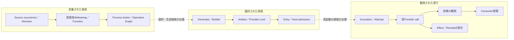

**実線**はその面で保持した関係を、**破線**は別資格の証拠による結合を必要とする箇所を示す説明図である。実線を描いたから実装済み・許可済み・成功とは判断しない。Rule読込前のCandidateは「受理済みMeaning」として表示しない。

## 2. 実行時の因果は、時刻順ではなく部分順序で表す

同期API、Queue、Batch、GUI、外部Hostをすべて一列の処理順に押し込まない。最低限、次の違いを保つ。

| 辺の性格 | 主に表すもの | ここから推定してはいけないこと |
| --- | --- | --- |
| Data / Dependency | 型付き入力や計算の前提。粒度・Snapshot・集合の完全性を伴う | 書込みの順序、認可、値が実際に読まれたこと |
| Control / Guard | 分岐・待機・順序・条件。未判定のGuardを保持 | Dataの存在だけで条件成立 |
| Event / Temporal | 発生・配送・時間シフト・再配送・有効時点 | 一意配送、実行完了、実順序の保証 |
| State / Effect | 状態遷移要求、Commit、通知、補償・再試行の条件 | 要求だけでCommit確定、ACKだけで永続化 |
| Declared / Derived | Sourceやモデルから導いた関係、生成計画 | 実Hostの選択・実Provider Call |
| Observed / Corroborated | 実Attempt・Receipt・独立Readback・Consumerが示した関係 | 観測していない全対象の不存在 |

二つの並列Provider呼出しは、共通の親があっても、互いに先後関係があるとは限らない。Batchの複数Triggerが一Attemptを生んだ場合にも、単一の親へ無理に畳まない。実Spanが存在するときだけその識別子・時点・Producerへ参照を貼り、定義上のAction IDと同一視しない。

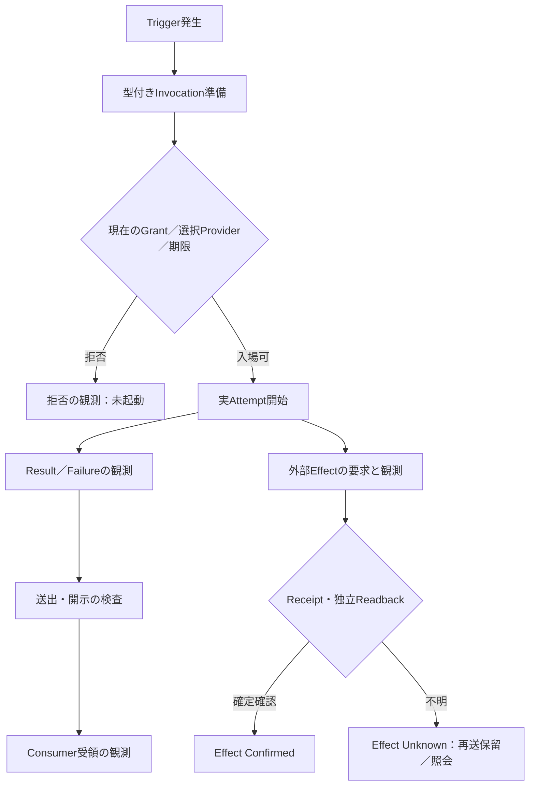

この図は観測項目の依存関係を表す。ResultとEffectは並列的に成立し得るため、一方の成功を他方へ自動伝播させない。OS Processの終了、HTTP 200、Queue ACK、Cancellationは単独でCommitの証明ではない。External Effectが不明なら、同一Operation identity・fence・現在Grantを照合せずに再送しない。

## 3. 検証可能な図面に必要な最小情報

**保存する新Schemaの提案ではなく**、既存のSource Index・Inspection・Plan・Trace・Receiptを読み取り専用で照合する際の表示項目である。

| 対象 | 照合する識別・版・範囲 | 表示してよい結論 |
| --- | --- | --- |
| 問いの主体 | Workspace Root/epoch、Qualified Subject Kind/ID、Source occurrence、Model Revision | どの対象を調べたか |
| 定義・構成 | Source byte range/fingerprint、Language選択、Meaning/Contract、Node/Edge occurrence ID、選択範囲 | 何が宣言され、何を投影できたか |
| 実現 | World/Model/Artifactの別Revision、Generator/Builder、Plugin exact Lock、実Target、選択Provider | 何を選択・生成したか。実Callとは別 |
| 実行 | Entry/Trigger occurrence、Invocation/Attempt、実Process/Image、実Called Provider、Input Scope/Snapshot、Result/Failure | 実際に確認したCallと結果 |
| Effect / Delivery | Operation identity、Receipt、独立Readback、Disclosure/Audience、実Consumer世代・受領 | 確定した効果と届いた範囲 |
| 証拠の境界 | Producer、取得時刻、観測範囲、完全性、欠落・非開示・未対応の区別、独立Expectedの出典 | どこまで判定でき、どこから先は不明か |

表示状態は、**観測済み／矛盾を確認／証拠不足／対象外・未対応**のような説明用の分類を使う。Coreへ万能な新Enumを追加せず、元の具体的な状態（NULL、missing、unfetched、partial、permission denied、effect unknown等）を残す。「観測されなかった」と「存在しない」を同一にしない。

### 3.1 正の証人と負の証人は非対称

あるAttemptで選択B・実Call Aの対応が確認できれば、その**対象の不一致**を指摘できる。一方、観測TraceにAが出てこないだけではAが呼ばれなかったと断定できない。後者には、対象Callsite、Attempt、時間窓、Collector、Sample率、実行分岐を含む観測閉包が要る。異常を確認するための部分証拠は使えても、全件正常や不存在の証明にはそのまま使えない。

同様に「未使用のNode/Rule」「一意性違反なし」「副作用なし」「公開Sourceなし」と判断する際には、探索対象集合と参照解決・読取の完全性が必要になる。対象が見えなかった理由が権限、未ロードPlugin、途中障害、取得上限なら、図上は未確認として残す。

## 4. 一つの問いを図にするread-only照合手順

1. **質問と対象を固定する**：Workspace・Audience・Subject/Occurrence・必要な主張・対象時点を選ぶ。名前だけで自動同定しない。
2. **定義を同じ読取境界で取得する**：可能なら既存`ReadWorkspaceSubject`とSource Index/Inspectionを同じLoad/Snapshotから得る。別取得は版とCoverageが一致する場合だけ結ぶ。
3. **必要なStructure Sliceを切り出す**：Process Action→Operation Definition→Node/Port/Edge occurrenceを型付き参照で辿り、同名異ID・同端点の多重辺・未取得辺・循環条件を維持する。Plugin/Target選択を別欄にする。
4. **実現の証拠を照合する**：生成Go、Builderが実際に読んだbyte、Artifact/Lock、実Process imageを独立に関連付ける。Output byte一致だけで実Builder消費を推測しない。
5. **実行の証拠を照合する**：選択Providerとactual Calledを同じInvocation/Attempt・Targetで突き合わせる。時刻が近い別RunのReceiptは根拠にしない。
6. **結果・Effect・Audienceを独立に判定する**：Result、外部Effect、Response、Consumer受領を別欄で示す。独立Expectedに照合した範囲だけを合格にする。
7. **境界を明示して出力する**：未取得、未観測、未実装、対象外、非開示と出典を残す。UIのPin/epochが変わったら旧Replyを現在の判断へ混ぜず再照会する。

この順序は**図を導く検証手順**であり、すべてのTargetが逐次実行すべきRuntime命令ではない。Studioの位置移動、ノードの折畳み、色変更はView差分であり、それだけでMeaning/Artifactを再生成しない。

## 5. 既存のRule縦断を使う最初の実例

対象を`sales.order_line.quantity_positive`（`std.decimal`）一つに限定する。2026-11-15の既存研究・PRでは、選択済みMarkdown Ruleの製品`Workspace.Load`→`semantic.Validation`→Source Index/Inspection、合成入力によるEvaluator Read Footprint、`validationgen.GeneratePositive`が生成する実Go判断式までの**別々の限定的な証拠**がある。これらの根拠を、同じ実Provider／通常CLI／Windows Stage2の完成へ合算しない。

| 問い | 最小の証拠 | 根拠がなければ表示 |
| --- | --- | --- |
| どのSourceから来たか | 選択Language、原Markdown byte、Rule ID・Source Indexと同一Load | Source未束縛 |
| 何を判断するか | Attribute Type、Comparison、NULL/欠損、独立Expected | Meaning/適用未確認 |
| 何を実際に読んだか | 合成Sourceの`Number(attribute)`実Callと拒否された他Read | 合成Readのみ／実DB未観測 |
| 何を生成・Buildしたか | Go byte、Generator版、Builderの実ReadとArtifact ID | 生成のみ／Builder未確認 |
| どのProviderが使われたか | 選択Bとactual Bを同一Attemptで確認 | 実Provider未確認 |
| 誰が結果を受け取ったか | 実CLIや実Studio Consumer・Audience・世代 | Consumer未観測 |

SourceのAttributeだけを変更する実例では、Rule IDが同じでも依存・生成Go・実Read先・判断が変わる。逆に表示座標だけの変更でGeneratorが再実行されるなら、MeaningとViewを取り違えている。A→B→Aでは最終Byteの一致が途中の旧Grant・旧Attemptの復活を保証しない。

## 6. Effectを伴う別実例：受注確定から確認通知まで

以下は**設計上の反例生成用の説明**であり、実Provider/DB/通知が製品経路で成立した主張ではない。

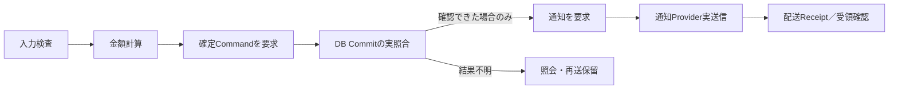

**業務プロセス上のAction、純粋計算、Commit、通知配送、Consumerによる受領は異なる粒度**である。DBの更新と通知が無条件に単一Transactionで確定するとは仮定しない。Outboxなどを採る場合も、実Host/DBの保証と回復可能性を個別に示す。通知送信成功を業務確定や最終受領と誤表示せず、Commit後のACK喪失を「未実行」としない。

## 7. 図とドキュメントを同じ設計から導出する条件

図は説明用の別正本にならない。Markdownの表、ノード図、Graphviz、ステート遷移表、関数チェーン、Trace、文書の根拠欄はいずれも**同じ意味ID・Source occurrence・Evidence参照**を投影する。ドキュメント化によって構造化されるものと、その表示だけでは確定しないものを区別する。

| 変更の種類 | 主な再検証対象 | 元のSourceへ戻す条件 |
| --- | --- | --- |
| 座標・色・折畳み・注記のみ | View／Audience／現在の選択状態 | 意味への逆編集を要求しない |
| Node occurrence・Port・Edgeの接続変更 | 構造、型、粒度、循環、Guard、Operation参照、影響Source | 正確なOccurrence/Source位置と可逆なTyped Proposal |
| Rule／Business Meaningの変更 | Meaning受理、依存、Target生成、Independent Expected適合 | Ownerの受理・変更影響と対象Revision |
| Generator／Plugin／Target版の変更 | 選択、Artifact／Build Evidence、互換性 | Source不変でも実Artifact／Consumerを再評価 |
| 実Grant失効／Host変更／過去Attemptの追加 | 現在入場・実行資格、Trace／Effect／Audience | 実行履歴の更新をMeaningの変更にしない |

手動編集とAI提案はいずれも同じPreview→Resolve→Admit→Commit→Observeを通す。lossのある表現から「図で線を引いたので業務Relationが追加された」と自動確定しない。書込編集ができないProjectionにはSourceへのNavigationと、何が表現されていないかを提示する。

## 8. 外部の観測・来歴規約を使う場合の境界

既存の規約は、TEIの意味モデルを置き換える対象ではなく**必要な情報を公開・入出力するAdapterの比較基準**として利用する。

| 参考規約 | 使える発想 | TEIで追加して確認すべきこと |
| --- | --- | --- |
| W3C PROV-DM（Entity／Activity／Agent） | 定義・活動・生成物と由来の型付き関係 | SourceとAccepted Meaning、Current Grant、独立Expectedの区別 |
| OpenTelemetry Trace／Span Links | Processをまたぐ因果、非同期・Batchでの複数起点 | サンプリング欠落、実Provider Identity、業務Commitの証明 |
| OpenLineage Job／Run／Dataset・Facets | 宣言上のData依存と実Run・入力/出力の区別 | Grain、Read Scope、部分取得、開示、非DataのEffect／Consumer |

資料： https://www.w3.org/TR/prov-dm/ ／ https://opentelemetry.io/docs/concepts/signals/traces/ ／ https://openlineage.io/docs/spec/facets/

分散TraceのSpan、Data LineageのRun、業務Operation identityを一律に一対一対応させない。外部の図やLogを取り込む場合は、Producer・Trace/Run ID・取得範囲・欠落情報を明示した**候補Evidence**として扱う。実際の選択Providerや業務Effectを観測していなければ、仕様上の概念が存在するだけでは補えない。

## 9. 小さな実装差分と独立受入

**最初の差分：Headlessの一対象・一問のread-only出力。** 現在の`InspectSubject`／`TraceSubjectSourcesFromIndex`と、選択済みRuleのSource Index・型付き意味を再利用する。実際に存在する参照だけを、定義→生成→実行という欄へ投影し、未接続のProvider／Effect／Consumerは空欄の「成功」ではなく、**証拠なし／未確認**と理由を表示する。新しいGraph Compiler、Trace Store、共通Runner、公開DSL、Second Resolverは追加しない。

独立Expectedは#1180/#2514を用い、既存PX-06/09/10/11・SF-01/02/03/08/09/10・EL-03/04/07/12の負例を再利用する。初期に最低限落とすべき反例は、(a)同名異IDと二重Edgeの併合、(b)旧Sourceの遅着Reply、(c)Provider B選択なのにA実Call、(d)未観測Callを不存在と断言、(e)Commit不明時の盲目的再送、(f)Builderが読んでいない生成ByteからのProduct合格である。

**停止条件**：図を表示するために新たな正本・Host・Runnerが必要になる、Backendの現在GrantをRendererが捏造する、Read未完を空集合へ変換する、選択Providerと実Called Providerを実証せず合格表示する、図表の完全可逆性を無根拠に主張する、のいずれか。型・識別・Evidenceの不足は`unknown/unsupported`で返し、採否は各OwnerとADRに委ねる。

**実装状態**：本書は設計の統合であり、今回新しいGo/TypeScript/Windows/DB実試験、正式なGraph Compiler、通常CLI実Provider・外部Effect・Stage1→Stage2セルフビルドの製品受入を実施したものではない。

## 10. 表現、実現、観測の対応を「意味の保存条件」として検査する

実行図を共通化する価値は、異なる図を同じ色・記号で描けることではない。**Sourceの意味を変えずに視点を切り替えられること、実現方式を変えたときに守るべき条件が分かること、そして実観測から言える範囲だけを説明できること**にある。これらは同じ種類の「一致」ではない。

| 対応 | 確かめる関係 | ここから先へ自動的に進めない判断 |
| --- | --- | --- |
| Source → 意味モデル → 図 | 対象ID、型、Relation、Rule集合、Guard、粒度、時点、表示の損失 | 図の見た目から意味受理・実行権限を付与しない |
| 意味モデル → Target実現 | 入出力・NULL/欠損、Read範囲、判断、順序、必要Effectを保存するか | コードを生成できたという事実から実Host適合を宣言しない |
| Target実現 → 実Attempt | 選択Builder／Artifact／Providerと実使用物、Current Grant・Context | 同じ結果値から実Provider／実Artifactの一致を推定しない |
| 実Attempt → 証拠と説明 | 実Read、分岐、結果、Receipt、開示、Consumerの実観測範囲 | 部分Traceから全実行・全副作用・不存在を断定しない |

### 10.1 図の編集には、部分的な双方向変換の考え方を使う

双方向変換（lens）の研究では、元データから表示を得る処理と、表示上の変更を元データへ反映する処理について、往復時の整合性を考える。TEIでは全ての図が双方向であると宣言せず、**編集可能な範囲を限定した投影**にこの考え方を適用する。

- **無変更の往復**：Sourceから図を作り、何も編集せず再反映しても、元のSourceの意味・元byte表現を不要に変更しない。Markdown表の空白、コメント、Graphvizの配置設定を勝手に整形しない。
- **変更後の再投影**：一意なSource位置へ戻せる変更を、現在のRevision・対象Role・既存Acceptanceに束縛して適用したとき、同じSubjectを再投影すると許可された変更が再現される。それ以外のSource領域は保持する。
- **部分的な逆変換**：集約表・実行Trace・複数Nodeを縮約した図など、意味の欠落や複数の復元候補がある表示は、逆編集を拒否するかChange Proposalとして差分・損失を提示する。AIが選んだ候補を無確認で正本へ書き戻さない。

この原則は図上の操作からSourceへの**書換え適格性**を定めるものであり、業務Ruleの正しさやTargetでの実行資格を証明するものではない。一般化したLens Runtime／別のSource Storeは設けない。参考： [Contract lenses（2023）](https://doi.org/10.1017/S0956796823000059) と [部分指定状態のLenses（2026）](https://link.springer.com/chapter/10.1007/978-3-032-22723-2_2)。

### 10.2 「意味を保つ」を対象と観測項目つきで定める

実現方式AとBの比較では、「同じ結果」だけを同値性の基準にしない。対象のSource/Meaning版、Input、Scope/Snapshot、Grant、Target能力を固定し、そのFunctionで観測・保証が必要な**値・Read・Failure・Effect・順序・開示**をそれぞれ比較する。

例えば純粋な正数判定Ruleでは、真偽だけでなく、どのAttributeを一度読んだか、NULL／欠損がどう扱われたかまで比較できる。一方、承認・受注確定では、同じ画面メッセージでもDB Commitや現在のActor資格が異なれば同値ではない。将来のコード最適化については、比較できない条件を残したまま「意味保存済み」と呼ばない。

順序を伴うProcessで確かめるべきことは少なくとも三つある。**安全性**はGuardを迂回せず禁止された作用を起こさないこと、**結果の適合**は定義したOutcome・失敗・Effectの保証を満たすこと、**進行条件**は所定の前提のもとで待機・停止・再開がどう成立するかである。単発Fixtureの成功から無期限の進行保証を主張しない。

## 11. 実行方式を一種類の「フロー」に潰さず、必要な意味規則を選ぶ

標準Data／Function／Business・Operation／Graphを共有しても、処理分野によって**どの出来事が次の処理を可能にするか**は異なる。図の矢印を増やすより、対象ごとの判断条件と実行方式の適用範囲を保存する。

| 対象 | 主な意味上の規則 | 必要な図・表 | 誤った同一視を避けるもの |
| --- | --- | --- | --- |
| Rule／BRMS | 適用Rule集合、優先順位・競合、完全な入力集合、unknown | 決定表・判断の依存図・Read票 | Ruleが一致したことと操作許可 |
| Data／ETL／Batch | grain、group key、丸め位置、部分集計、対象Snapshot、差分 | 成果物定義表・依存Graph・実行計画 | 同じ物理Work Unitと同じ計算粒度 |
| 業務承認・State | DefinitionとInstanceの経路Snapshot、Guard、現在Grant、N_OF_M、遷移Receipt | 状態表・職務／Action・条件付きProcess図 | 申請時の承認候補と現在の承認資格 |
| REA等の業務事象 | 経済的な出来事、資源・主体・数量・有効時点、業務上の確定 | Event／Resource／Agent関係図・履歴表 | 業務EventとMessage／Webhook配送Event |
| Plugin／Hook | Ownerの接続点、before/after位相、依存、選択、実Call、Effect義務 | 配線Graph・Target別選択表・Call図 | Pluginの宣言配線と実際の呼出し |
| Web／CLI／VUI／MCP | Trigger、公開Entry、現在Context、Host Admission、Reply／Audience | Interaction図・Invocation図・Trace | 呼出し依頼と入場成功、ReplyとEffect |
| TEIセルフビルド | Source、Build Intent、実Builder、入力byte、生成物、Stage2 Consumer | 依存Graph・Build／Artifact図・実受領図 | Build成功とStage1がStage2を実生成した事実 |

**REAのEventとEvent BrokerのMessageは別物**である。後者は前者に関する通知を運べるが、Messageが届いたことだけで経済的な出来事の成立や帳簿への確定は証明されない。ProcessのEvent occurrence、経済事象、Runtime Spanも、異なるIdentityを型付き関係で結ぶ。組織の兼務・代理・時点依存の資格も、同じ線種にまとめない。

複数人承認や並行Batchには、joinの条件が重要となる。例えば3人中2人必要な承認では、2票の単純な数値だけでなく、申請時の担当候補、既に承認したActor集合、現在資格のある残りのActor集合を検査する。並列分岐の合流も「最初の一件で進む」「全件を待つ」「n件で進む」を契約なしに同一視しない。制御フローの複数Instance・同期・取消の差は [Workflow Patterns](https://www.workflowpatterns.com/documentation/documents/BPM-06-17.pdf) を比較候補とするが、TEIに全パターンを一括実装する前提は置かない。

## 12. 問いに必要な範囲だけ切り出す「証拠付き図解」

図に表示する範囲を選ぶときは、単に選択Nodeから隣接する数段を表示するのではなく、**その問いを成立させるために必要な依存と、確認済みの根拠**を残す。これは既存Graph/Inspector/Receiptからのread-onlyな抽出方針であり、新しいGraph CompilerやEvidence Storeを意味しない。

| 問い | 最低限残す関係 | 省略すると誤答になる関係 |
| --- | --- | --- |
| このRuleはどの入力を読んだか | 対象Rule、選択済みDefinition、Attribute／Relation、実Readと取得範囲 | 値には出ないFilter条件・拒否Read・欠損 |
| この出力は正しい粒度で計算されたか | 出力Grain、Group Key、丸め、分類版、Snapshot、演算の結合条件 | Filter-only依存・分類の多重所属・途中集計 |
| この承認を誰が実行できたか | Definition改版、Instance Snapshot、Actor・委任、実行時GrantとGuard | 失効した候補者・必要人数・自己承認禁止 |
| このPluginが実際に使われたか | 接続点Owner、選択Lock、実Artifact／Provider、Attempt、実Call | 宣言だけの配線・未ロード／代替Provider |
| このTEI生成物が使われたか | Source/World/Model、Builder、読取byte、Artifact、実Image、Consumer | 選択だけのBuilder・旧Asset・別Attemptの成功 |
| この作用は確定したか | Operation identity、開始条件、実Commit／Receipt、独立Readback、配送 | ACK喪失・結果unknown・再送と重複 |

図を小さくする際は、**必要なGuard・Error・Effect・Authority・Temporal辺を「単なる詳細」として消さない**。折り畳んだ部分に未解決の条件や未知の依存があれば、縮約Nodeに「範囲未確認／外部Effectあり」などの注記とSourceへの参照を残す。省略を存在しないことの証明に使わない。

上限付きSource Indexや部分Traceからの抽出では、読取対象、総数、取得上限、非開示、未ロード・未実装を別々に示す。特に「Readされた一件」は局所的な証人になるが、「他のReadはない」「Ruleは一意」「全件更新済み」という主張には対象集合の閉包が必要である。これは標準Data／Traitの全件検証と同じ非対称性を持つ。

### 12.1 説明図と実行証拠を重ねる最小例

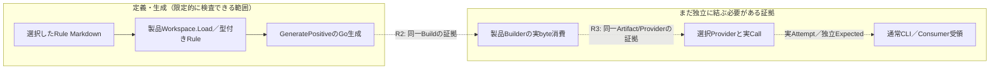

図中の破線は成功済みの経路ではなく、**実装・検収で必要となる対応関係**である。現行の限定Go生成・参照Builder試験と通常CLIの実Provider、Studio Stage2は、それぞれ現在の証拠資格で扱う。後続PRにより実証済みの箇所が増えた場合だけ、対象HEAD・Attemptに結び付けて表示を更新する。

## 13. TEI自身の実装から抽象化するdogfoodingとの接続

最初に扱う**実在のGoコード**は `internal/semantic/validationgen/positive.go` の `GeneratePositive` と、それが生成する `EvaluateSelected` である。前者は**生成器**、後者は**業務判断の実現**であり、両者を単一のFunction IDにまとめない。現在の生成器には `semantic.ValidationPositive`、`std.decimal`、属性・Rule IDの適格性確認、`Source.Number`、`Sign() > 0`、NULL/Read失敗の区別という観測可能な責務がある。

[実装から標準モデルへ折り返す設計](IMPLEMENTATION_TO_MODEL_DOGFOOD_2026-11.md)のI2M-0〜4では、これらをGo AST・型情報・必要な実観測から候補構造として抽出し、Data/Function/Rule／Processのどの義務へ対応するかを示す。**ASTの分岐を見つけたことと、その業務上の意味が受理されたことは別**である。

最初に比較するのは次の三つである。

1. **現行Goを観測した構造図**：Function・分岐・型・Read要求・Return・ErrorをSource span付きで取り出す。抽出できない副作用／動的Dispatchは`opaque`とする。
2. **既存Ruleから導いた意味図**：同じSource/Meaning ID、適用条件、型、入力欠損、判断結果と独立Expectedを確認する。Goの`func`／`struct`を専門家向けDSLへ移さない。
3. **生成物・実Consumerとの照合図**：Ruleの参照Attribute一因子変更について、旧Go／新Goのbyte、実Read先、Result、Builder消費とProvider／Consumerの資格を順番に検証する。

成功と数えるのは、生成図の綺麗さではなく、**TEIのモデルへ移せた判断義務の数、依存と変更の追随、残る手書き責務、Target別の別実装が減ったか**である。実装へ戻せるGraph／DSLの範囲がまだ狭ければ、狭いまま診断する。このdogfoodingをStudio Stage1→Stage2の新たな前提条件にはしない。

## 14. 最初の独立反証：変更一つでどの資格が失効するか

独立ExpectedとScenarioの正本は既存#1180／#2514に置き、本書の表を追加Registryへ転記しない。以下は**既存PX／SF／EL／BP-R等を横断して実証する比較手順**であり、今回のGo/Windows/DB試験実施を意味しない。

| 一因子変更・故障注入 | 図で区別するべき結果 | 結び付く既存反例とOwner |
| --- | --- | --- |
| Nodeの座標だけを移動 | Viewのみ変更。意味の再受理・Goの不要な再生成を行わない | PX-06／SF-03、#1124 |
| Ruleの参照先 `quantity`→`second_quantity` | 同じRule IDでもMeaning依存、生成Go、実Read・Resultが変わる。未使用の旧Artifactを再利用しない | 既存R1-M、#988/#1121/#2514 |
| 同端点・同名のEdgeを二本配置 | Edge occurrenceと多重性を維持。意味Relation、表示線、実行Spanは別 | SF-01／02、#2497 |
| Ruleの一行だけ取得、他の行は未取得 | 一意・不在・全件正常を表示せず、確定した局所Conflictだけ断言可能 | PX-09、#1180/#2514 |
| 承認の申請時経路A、DefinitionをBへ改版 | Instance経路を無言でBへ変更しない。現在Actor Grantを別に再判定 | BP-R01／03、#4198/#1174 |
| 選択Provider B、実Call A（結果一致） | 選択と実現の不一致を表示。Outcome一致で合格させない | SF-08／EL-04、#4495/#951 |
| 外部Commit後にACK喪失 | Effect unknownと実行停止／照会を別表示。無条件再送しない | SF-10／PX-03、#1174/#1129 |
| Rule SourceをA→B→A、旧Replyが到着 | Source Fingerprintの復帰と、旧Grant・旧Attempt・古いPinの現在適格性を分ける | SF-09／EL-03、#1124/#2514 |
| Builder選択B・別Image Aが実行 | Source/Generated Go/Build Input/実Imageを別に照合。生成成功を製品成功へ昇格させない | PX-11／EL-04、#2831/#4583 |

**負例の判定では現在の対象HEADと比較集合を固定する**。合成SourceでRead Footprintを証明できても、実DBを読んだとは言えない。旧HEADのCI成功を新HEADに流用しない。

## 15. 既存の製品計画へ落とし込む最小作業単位

| 接続する現行段階 | 次の実作業（既存実装を優先） | 合格を主張できる範囲／次に返す不足 |
| --- | --- | --- |
| **D0：Inspector／Rule Source** | `ReadWorkspaceSubject`・`InspectionFromLoad`・Source Indexを用いて、選択した一RuleのDefinition・型・参照・Source byteのread-only図をHeadlessで出す | S-LOCとSource/Roleの存在。S-OPEN、Runtime Call、Owner意味受理は別 |
| **D1：限定Goと実Builder** | `GeneratePositive`の一因子改版を既存R1-M/R2-Pへ接続。Generated Goを実Builderが読んだbyteとArtifactへ束縛 | Source改版が判断を変える局所証拠と製品Builder実消費を別票で確認 |
| **D2：公開pure Entryの実二入口** | #4495の既存R3から通常CLIと型付きAPIのactual Provider・独立Resultを照合。Ruleとpure Functionが別Subjectならそのまま分ける | 一つの実Attemptでつながる範囲だけ実行図へ加える |
| **D3：共通Node/Graph表示** | #1124／#2497で同じread-only ProjectionをCLI JSONとStudio Inspectorへ投影し、Node／Edge／Source spanとCoverageを保持 | 旧Pin／後着Reply、同名異ID、Loss、Disclosureの負例。図からの編集は未採用 |
| **D4：業務Process／REA／Batch** | #4198、#1130、#1174等でInstance・状態、粒度、時点、必要Effectを異質な二領域に適用 | 表現できない意味の一覧をOwnerへ返す。第二Engine採用ではない |
| **並行する最上位P0** | #2831/#4583のStage1実TEI→Stage2実Windows WebView2の実生成・実受領 | D0〜D4完成を新Hard Gateにしない。実Build Intent／Artifact／Consumerを独立検収 |

D0〜D3の説明UIは**元Sourceに到達でき、分からない境界を分からないと表示できること**を最低基準とする。新しいGraph Runtime、独立Scheduler、汎用Trace Store、第二Expected正本、新たなGo Hostを導入しない。もし既存の標準Graph/Role/Source Indexで表現不能な事例が出れば、対象・失われた意味・独立反証・既存Ownerを示してから最小差分を検討する。

### 15.1 初回PRの提出物を具体化する

最初の実装PRに必要なものは、(a)固定したWorkspace/Subject/Source Revisionと質問文、(b)既存Go APIから得た実際のDefinition・Source参照、(c)各欄に根拠を提供するProducer/取得範囲、(d)未接続を「未確認」とした出力、(e)一因子変更・同名異ID・部分取得の独立Expected、(f)実際に試験したexact HEADとConsumerの六点とする。

Graph→Goをいきなり万能化せず、まず定義→図→Sourceのread-only整合と、既存Rule→実Go→Builderという**既に狭く実証を積んでいる縦断**を接続する。設計図の成功が実Runtime成功を証明しないこと自体を、最初の図で説明できなければならない。

## 16. 異なる実行方式をつなぐ境界で、保証がどう変わるかを表す

Rule、Node Flow、Batch、業務Process、Plugin Hookを共通のGraphに載せても、**同じPortを接続できることと、次の処理を正しく実行できることは別**である。既存のData／Function／Operation／Event／Effectの契約と、Targetが実際に保証する範囲を照合し、接続時に増える義務を明示する。ここでいう境界は、新しい共通Runtime／Adapter ABIではなく、既存のOperator・Provider・Hostの受入時に確認する条件である。

| 境界の例 | 受け渡すものと、受け渡せないもの | 接続時に必要な確認 |
| --- | --- | --- |
| Data／Query → Rule／BRMS | 値だけでなく型・NULL/欠損・粒度・取得範囲を受け渡す。部分取得を「条件不成立」に変換しない | 判定に必要なAttribute、Snapshot、Read Footprint、Rule競合・未判定 |
| Rule → Process Guard | 判断結果と理由・適用条件を受け渡す。真偽の一致を実行許可へ変換しない | Definition／Instanceの版、現在Actor・Host Grant、失効・再評価条件 |
| Process → Message／Event | 発行意図とEvent occurrenceを分離する。業務Eventと配送Messageを同じIDにしない | 発行時点、Operation identity、Correlation、重複・順序・配送保証 |
| Event → Batch／Aggregate | 起点の多重性、時間窓、Watermark相当の締切り条件を保つ。受信件数を業務上の全件数にしない | 入力集合の閉包、再配送・遅延、Group Key、時点、途中集計・再計算 |
| Batch／Operation → 外部Effect | 計算結果とCommand Intentを分離する。成功ResultをCommitへ読み替えない | 現在Grant、Tx境界、操作の冪等性、fence、Receipt、部分失敗・補償 |
| Effect → Response／Consumer | 確定した業務作用と返答・通知・受領を分離する。配送ACKを業務確定へ読み替えない | Audience／Disclosure、受領先と世代、Delivery Receipt、独立Readback |

たとえば、Ruleがtrueを返しても承認Instanceの現在Actor資格が失効していればOperationへ進めない。Eventが到着しても、再配送と未着が区別できなければ「当日分の全注文が揃った」とは判断できない。Targetが必要な時間・重複・順序・作用保証を表現できない場合は、都合のよいDefaultへ丸めず**unsupported／未確認の接続**とする。実HostのAdmission・Effect判断をGraph Rendererへ移さない。

この表は[標準ノード・軽量サービスの設計](SERVICE_FLOW_STANDARD_COMPOSITION_2026-11.md)、[プロセスの起動・状態・操作](PROCESS_LIFECYCLE_TRIGGER_OPERATION_SEMANTICS_2026-11.md)、[成果物要求・Batch計算](DECLARATIVE_RESULT_PROCESS_COMPOSITION_2026-11.md)にある既存の意味義務を、**一つの接続で失われるかもしれない情報**から読み直したものである。分野固有の詳細は各Ownerに残す。

## 17. 時間順の図と、因果が証明された図を分ける

非同期・並列処理を含む図では、時刻の前後と「その出来事が次を引き起こした」という主張を区別する。最低限、(a)同じAttempt内の確かな先行、(b)Message/Receipt/Operation identityで接続された別Attempt間の因果、(c)時刻が近いだけで関係が不明、を分ける。Clock順に並んだ二つのSpanだけで業務上の先後関係や、失われたMessageの不存在を推定しない。

以下は受注後の集計と通知を例にした**説明用の仮想図**であり、製品E2Eの成功経路ではない。

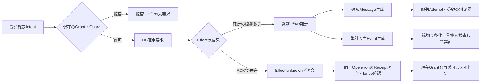

図のE→MとE→Bは**設計上の発生条件**であり、MとBの配信・実実行の順序を保証しない。実際のCommit・Outbox・Broker・Consumerから対応する証拠が得られなければ、該当線は「要求された関係」のままにする。U→T→Hの経路は無条件の再実行ではなく、照会・同一Operation identity・fence・現在Grantを確認したうえで再試行可否を判断する境界である。

また、承認や長期ProcessではDefinitionの改版と実行中Instanceの経路を混ぜない。**Instanceで固定された経路、処理時のGrant、観測時の外部状態は別時点**であり、一つの現在時刻へ正規化しない。「最終的に同じ状態に見える」だけで、誤ったActorによる遷移や二重Effectを合格にしない。

## 18. 図が答えてよい問いを、証人と閉包から決める

表示する結論は、対象NodeやTraceの数からではなく、**その問いに必要な証人と、調査できた集合の閉包**から決める。既存のRequired／Consumed、Source Index、Build入力、Read Coverage、Attempt、Receipt、独立Expectedを使う。下表は説明用の照合順であり、新たな永続Claim台帳や汎用判定Enumを定めない。

| 問い | 最小の肯定根拠 | 否定・全件判断で追加して必要な根拠 |
| --- | --- | --- |
| このRuleは指定Attributeを読んだか | 同一Rule版・Attemptに束縛された実Read | 「他を読まない」には全Callsite／分岐・観測範囲の閉包 |
| このPluginのProvider Bが使われたか | 実Image・Invocationのactual Called Bと選択Bの対応 | 「Aを使っていない」には実Call集合と動的Dispatch・観測欠落の検査 |
| このBatchで必要データが揃ったか | 個別レコードとgrain・範囲を示す取得根拠 | Source集合・期間窓・再配送・未取得・権限の閉包 |
| このOperationは確定したか | 同一Operation identityのCommit／Receiptと必要な実照合 | 「未実行」「再試行してよい」にはEffect unknown・fence・外部照会の解消 |
| この応答はConsumerへ届いたか | Audience／開示条件を満たす実Consumerの受領証拠 | 「全Consumerが受領」には対象集合と各受領の閉包 |
| 生成方式AとBは同等か | 固定Source/Meaning・Inputで値／Failure／Readなどを独立Expectedと比較 | 効果・時間・権限・順序まで必要ならTarget別の保証と実証を追加 |

**局所的な不一致の証明は、全件取得なしでも成立することがある**。選択Bなのに実Aを呼んだ証拠が同一Attemptで確かなら不一致といえる。他方、TraceからAが見つからないだけではAを呼ばなかったといえない。結果の欄には、観測したProducer、対象範囲、既知の不足、Source位置・版、独立Expectedの所在を伴わせる。Unknownを空集合・NULL・正常に置き換えず、未許可の出典をStudioやHarnessに展開しない。

## 19. 一問ずつ実装するための小さな反証と引渡し

実装は二つの独立した題材から始める。一つ目は**実在する選択済みMarkdown Rule** `sales.order_line.quantity_positive` のread-only説明であり、現在の `Workspace.Load`／Source Index／`semantic.Validation`／`validationeval`／`validationgen.GeneratePositive` に接続する。二つ目は**合成されたEffect unknown事例**であり、DB／Queue／通知の製品E2Eを行ったことにはしない。両者の証拠を、一つの業務Operationが製品で通ったかのように結合しない。

| 順番 | 既存資産を使う最小の作業 | 独立Expectedで落とす反例・受け渡し先 |
| --- | --- | --- |
| **C0：一Ruleの問いを固定** | Qualified Rule ID、同一LoadのSource byte/span、参照Attribute、型、Readの観測範囲をCLI/Headlessへread-only表示 | 同名別ID、partial Sourceを全件と誤認、古いPin。#1124/#2621/#4198 |
| **C1：一因子変更を比較** | RuleのAttribute変更と、表示だけの変更を別に試し、Read Footprint／生成Go／説明版の失効先を照合 | Rule ID不変を意味不変と誤認、Go byte一致を実Builder使用と誤認。#988/#1121/#2600 |
| **C2：異種境界の欠損を表示** | Rule結果→Process Guard、Event→Batch、Effect→通知の必要義務を、まず小さな合成Fixtureの照合票で試す | 現在Grantなし、入力集合partial、配送ACKだけでCommit確定。#4198/#1130/#1174 |
| **C3：再送・観測の反例** | 選択Provider B／実A、Commit後ACK喪失、旧Attemptの後着を別々に注入し、結論を限定する | 結果値一致による実Provider誤認、Effect unknownの盲目再送、旧Source A→B→Aの資格復活。#4495/#1129/#2514 |
| **C4：実Consumerとの照合** | C0〜C1のread-only結果を実CLIとStudioの同一Subjectへ投影し、実Builder／Provider／Stage2は各実装Ownerの証拠を別票にする | 別HEADのCI、参照Go/Mock、閲覧できた図を製品実受領と誤認。#1251/#2831/#4583 |

C0〜C4は新しいSprint順や製品Hard Gateではない。最初の成果物は**「問い一つ／対象一つ／現在のSource・Meaning／表示された事実／不足の理由／独立Expectedへの参照」**を持つ小さなJSON・図・表の同一内容で足りる。既存PX／SF／EL／BRMS／REAの負例・既存Ownerへ引き渡し、第二のScenario正本、Graph Runner、Trace Store、業務承認Engineを追加しない。

**現時点の資格**：§16〜19は設計と検証手順の追補であり、異種境界の製品実装、Go／DB／Queue／Windowsの新試験、実Effect、通常CLI actual Providerの同一製品試行、Ownerによる意味受理を**実施・合格したものではない**。全体P0のStudio Stage1→Stage2 Desktop実セルフビルドと並行P0の公開Entry→実Provider二入口は従来どおり優先する。

## 20. 「次に実行できるか」を一つのReady値で決めない

Process、Rule、Batch、Plugin Hookを同じ図でたどれるようになっても、**図上で次のNodeがつながっていることと、HostがそのOperationを今実行してよいことは別**である。実行準備を単一の真偽値へ畳まず、選択したOperationが必要とする条件を、既存契約と実際の観測に沿って個別に照合する。

| 確認する条件 | 判断に使う既存の根拠 | 不足している場合の扱い |
| --- | --- | --- |
| **定義の適格性** | Source occurrence／選択Language／受理済みMeaning、Function・Operationの型と必須Guard | 定義の候補や一部だけの読取りを、正式な意味・全Rule集合と見なさない |
| **入力の適格性** | Function Data Context、型・NULL・欠損、粒度、Snapshot／読取epoch、必要な集合のCoverage | 未取得や部分取得をfalse／NULL／空集合に変換して進めない |
| **構成の適格性** | Target/Profile、Contract、選択されたexact Provider／Plugin Lock、実Artifact | Providerが存在すること、生成byteがあることを実選択・実使用と同一視しない |
| **今回の起動資格** | Invocation、Hostの現在Grant、Actor、期限、対象Scope、fence／重複防止条件 | 古い許可や申請時Actor候補を、現在の実行許可として流用しない |
| **先行する作用の帰結** | 同一Operation identityのReceipt、必要な独立Readback、未確定Effect | ACK喪失／Commit不明時は照会を優先し、未実行と決め付けて再送しない |
| **結果の開示と受領** | Audience／Disclosure、Response、Consumer世代、実受領の証拠 | 業務処理が成功していても、公開・配信・受領まで完了と表示しない |

適格性は**Operationと時点に対して相対的**である。たとえば、純粋なRuleの評価では外部EffectのReceiptは不要だが、そのRuleの結果を使った受注確定Commandには現在のGrantとCommitの検証が必要になる。「未評価」「対象外」「不適合」「実際に拒否された」を一つの未Ready表示にまとめない。逆に、Ruleがtrueを返しただけで後続Commandを実行可能と判定することもない。

この照合は新しいAdmission Engineや共通Ready APIを作る提案ではない。既存のScript Launch／`execution`／Provider／Hostが保持する現在資格を、**どの条件がどのProducerに裏付けられているか**という形で読み取り専用に表示する。判断の所有者は変えない。

## 21. 「同じ時点の実行」を説明するための因果カット

一つの画面にSource、実行計画、実DBの値、Providerの呼出し、通知履歴を並べても、それらが同一の原子的Snapshotから得られたとは限らない。問いに必要な因果関係をたどる際には、**観測した結果と、その結果に必要な原因の証拠がそろっている範囲**を示す。ここでは説明上、この範囲を「因果カット」と呼ぶ。新しい保存形式や分散Snapshot収集基盤は導入しない。

区別する時点は、少なくとも次の五つである。

- **定義の時点**：選択したSource byte、Meaning Revision、Generator・Providerの版。定義を改版しても、進行中Instanceが新経路へ自動的に移るわけではない。
- **業務上の時点**：取引日・有効日、申請時の組織・経路、遡及訂正が適用される期間。観測時刻とは異なる。
- **入力の時点**：実ReadのSnapshot／Context epoch、取得済みの集合と未取得部分。複数Providerを呼んだだけでは同一Snapshotにならない。
- **作用の時点**：Invocation／Attempt、現在Grant、Effect要求とCommit、外部Providerが確認した操作。Messageの受信時刻だけでは取引確定時刻を示せない。
- **受領・説明の時点**：Consumerの世代、観測・取得時刻、Disclosureの現在性。旧Replyの後着で現在の画面へ昔の資格を上書きしない。

因果カットの検査では、問いに必要な原因の集合を先に特定し、そのうち**どれが証拠として閉じているか**を記す。重要な原因が未取得・非開示・別Attemptなら、結果の観測は示せても「必要な原因をすべて確認した」とは表示しない。なお、取得できない原因を隠さずに表示することと、その非公開の内容自体をViewerへ送ることは別である。

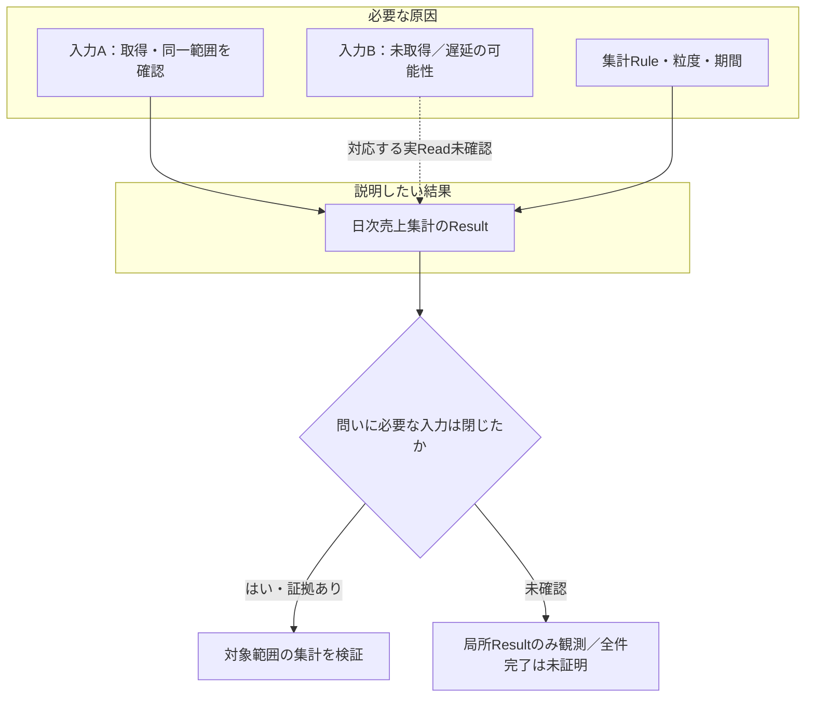

上図で入力Bの破線が消えたことは、入力Bが存在しない証拠にはならない。また、A・Bがそろっていても、互いに異なるSnapshotや粒度なら集計の同等性は成立しない。並列Joinで二つのAttemptを一つの線に縮約するときは、**入力数・条件・同一性・取得範囲・未確定の分岐**を保持する。単なる時刻順の並びやTraceの親子関係だけで因果を補完しない。

## 22. 中断後の操作を「再実行」という一語でまとめない

起動・失敗・再開・取消を図示する際には、やり直す対象が**純粋計算なのか、未確定の外部作用なのか、配信なのか**を区別する。特に同じOperation identityでの再送、Checkpointからの再開、業務上の補償を同じ矢印にしない。

| 操作 | 許可の前提 | 成功を主張できない例 |
| --- | --- | --- |
| **純粋な再評価** | 入力・Rule・精度・Snapshot等の比較条件を固定し、副作用がないと確認 | 同じResultでも別Attributeを読んだ／未取得をNULLに丸めた |
| **Checkpointからの継続** | 保存状態の版、元Instance／Attempt、Definition・Artifact・Provider Lock、未完了Stepと現在資格を照合 | 再開位置だけ一致して、旧Pluginや失効Grantで続行した |
| **外部Commandの照会・再試行** | Operation identity、ProviderのReceipt／Readback、冪等性・fence、現在Grantを実際に確認 | Commit後のACK喪失を未実行とみなし、二重副作用を起こした |
| **業務上の補償** | 元Effectと補償Operationの別Identity、補償可能条件・権限・新たなReceipt | 元の外部作用を物理的に巻き戻せたと断定した |
| **結果の再配送** | 元結果の開示範囲、Audience、Consumer世代、送信・受領の記録 | 古いReplyを新しい選択対象へ適用し、業務Commitの証拠にもした |

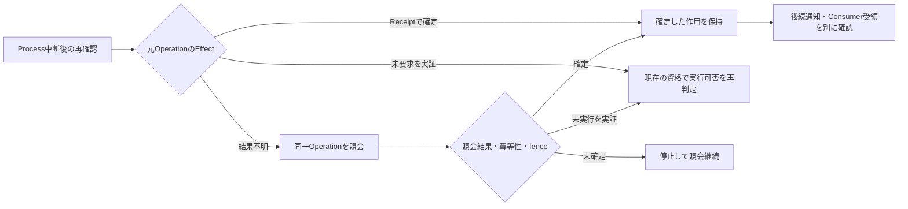

図の「確定した作用を保持」は、後続通知まで届けたことを意味しない。逆に、補償が可能でも元Effectの履歴を削除しない。イベント履歴、業務状態、送信履歴が一致しない場合には、どの部分を独立に確認できたかを示し、旧Attemptと新Attemptを結果の同一性だけで結ばない。

この復旧分類は、既存#1129/#1174のEffect・Receipt、#1130のBatch、#4198のProcess Lifecycle、#1180/#2514の独立Expectedに返す。新たなRecovery Orchestratorの製品採用を先取りしない。

## 23. 一つのRuleから、説明・図・実行証拠の差を反証する

初期実装は§19のC0〜C4を使い、別のScenario体系を増やさない。具体的には、`sales.order_line.quantity_positive`の**選択済みSource→型付きRule→合成入力の実Read→生成Go**を一つのSubjectの証拠として整える。Readerや生成器の局所テストから正式Builder・実Provider・実Consumerまでを飛び越えない。

| 反証したい取り違え | 最小の比較 | 期待する説明 |
| --- | --- | --- |
| 入力の不完全さを判断falseにする | 同じRuleで必要Attributeを完全取得／unfetched／NULLに切り替える | 判断不可、NULL、falseを区別し、呼んだReadだけを事実として表示 |
| Ruleの変更を表示差分にする | 属性参照を一因子変更し、図の座標だけの変更と比較する | 意味依存・生成Go・説明Source位置と、View-only変更の失効先を分ける |
| 生成Goの結果一致を実Provider一致とする | Provider Bを選び、別Aの実Callを記録した合成照合票を用いる | 同じ数値ResultでもSelectedとactual Calledの不一致を表示 |
| 集計の一部を全件とする | 日次集計で必要な二入力のうち一方だけを実観測する | 一件の正の証人と、全件完了に足りない入力閉包を別に示す |
| ACK喪失を失敗・再実行可とする | 元OperationにCommit証拠がありReplyだけ欠ける場合と、Effect unknownを比較 | Commit確定、配送未確認、照会待ちを別欄にし、二重実行を避ける |
| 図の同一性を業務IDの同一性とする | 同名Node二つ・同端点の二Edgeを描き、表示側で折り畳む | 描画用Edge ID、Meaning Relation、Attempt Spanを混ぜず、縮約による情報損失を提示 |

独立Expectedは実装者が出した図・生成Go・Resultから作らず、既存#1180/#2514のFixtureと反例に結び付ける。SourceとMeaningの対応が未受理なら未受理のまま示す。**正しい理由を説明する図**と、**実際に呼ばれたことを説明する図**の間には、Builderが読んだbyte、実Process Image、実Provider、Attempt、Consumerを結ぶ証拠が必要である。

最初の製品差分は、固定した一Ruleに対する既存Inspector／Source Index／CLI JSONの**read-onlyな照合結果**に限定する。既存StudioのSubject Pinへ表示する際は、同じWorkspace・Source Revision・対象epochに束縛し、現在選択されていない旧Replyを混入させない。新しいWriter／Runtime／永続Graph Storeを加えず、分からない条件を分からないまま説明できることを合格基準にする。

## 24. 図の表示と製品受入を、一つの小さな引渡し票にする

実装担当者が独自の検収台帳を作らないよう、§20〜23で必要な項目は既存のInspection・Build Evidence・Driver受入へ分配する。CLI JSON、StudioのTable/Node View、説明文は**同じSubject・Revision・Audienceの異なる投影**として扱い、描画の一致を実行成功へ昇格させない。

| 次の作業 | 最初に渡す証拠 | 残すべき未確認・Owner |
| --- | --- | --- |
| **C0/C1：Sourceと判断** | 選択済みRuleの原byte・型・実Read・Source位置、独立Expected | 未取得／意味未受理。#2621/#988/#1121 |
| **C2：接続条件** | Rule→Guard、Event→Batch、Operation→Effectで必要な型・粒度・時点・Current Grant | Target能力、Input閉包、外部Adapter未確認。#4198/#1130/#951 |
| **C3：実行と復旧** | Attempt、actual Provider、Effect identity・Receipt、再試行の拒否理由 | 実DB／通知、再送保証を合成から移転しない。#4495/#1129/#1174 |
| **C4：複数Consumerの照合** | 同一Subjectを参照するCLI/Studioの版・Coverage・表示損失、実Consumer受領 | Wails実埋込・Stage2 Windows、現在Disclosure。#1824/#2831/#4583 |
| **横断の独立検証** | 一因子変更、対象閉包、失効、否定判断の独立Expected | 新Scenario正本を増やさない。#1180/#2514 |

**着手順**は、実在するRuleの読み取り専用照合→一因子の失効反証→合成の部分入力・Effect unknown反例→実Builder・実Provider・実Consumerの独立照合とする。Studio Stage1→Stage2の正式Desktopセルフビルド、通常CLIからのactual Provider／実Readは引き続き**並行する最上位P0**であり、この図解を新Hard Gateにしない。

**実施状況**：§20〜24は採用前の設計・引渡し条件。新たなGo／Node／DB／Queue／Windows実試験、製品での異種接続・復旧、Owner意味受理、独立Consumerの同一Attempt受領は今回の文書変更では実施していない。

## 25. 製品CLIの実在する読取境界を、図の起点にする

実行図の最初の対象は、既存の`tei inspect`が正式に読み取れるMarkdown Rule一件とする。現行mainには`internal/operations/inspect.go`の`InspectSubject`、`workspace_subject_read.go`の`ReadWorkspaceSubject`／`InspectionFromLoad`、`cmd/tei/cli_inspect.go`の`tei.cli.inspect/v0`が存在する。さらに、PR #4980でmainに入った`cmd/tei/cli_inspect_rule_markdown_process_test.go`は、実際にビルドした製品CLIを別OSプロセスで起動して正負対照を行う。**今回はその既存コード・試験内容を確認したのであって、新たにGo試験を実行したわけではない。**

| 現在の根拠 | 製品の項目・対象 | そこからは言えないこと |
| --- | --- | --- |
| 正式に選択されたRuleの存在 | `semantic-validation:sales.order_line.quantity_positive`と`SubjectInspection.Subject`／`canonical` | 同IDの公開`semantic-capability`／Function Entryが存在すること |
| 元Sourceへの到達 | `sources.references`のDefinition Role・元byte範囲、`sources.artifacts`のPath・Fingerprint | Builderや実Providerがそのbyteを消費したこと |
| 読取専用の結果 | `tei.cli.inspect/v0`の`ok/result/error`、`sourceStatus=indexed`、`authorityLimits` | 意味のOwner受理、書込み・公開・再配布・実行の権限 |
| 読取内容の識別 | `worldFingerprint`、`sourceIndexFingerprint`、`workspace` | 現在のHost Grant、Model Revision、実行Attempt、分散Snapshotの一致 |

現行試験の負例では、同じIDを`semantic-capability`として指定すると`SUBJECT_NOT_FOUND`で拒否される。また、通常の`text` Fenceに文字列として登場するだけの別Ruleも正式な`semantic-validation`にはならない。「Sourceを読めた」と「公開したFunctionを起動できる」の間にある境界を、そのまま図に残す。

`ReadWorkspaceSubject`は同じLoadから`ModelRevision`も取得できるが、**現在のCLI `tei.cli.inspect/v0`がこの項目を公開しているわけではない**。二つのFingerprintをModel Revisionの代わりに扱わない。CLIとStudioが同じSource時点を表示したと主張するには、両方の実Consumerで取得できる版・対象のFit／Gapから確認する。

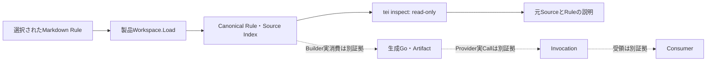

この図の実線は製品コードの経路を説明するもの、破線は**追加の証拠が必要な結合**である。図示したこと自体を、今回の製品E2Eの成功とみなさない。

## 26. 一つの問いから「証拠のある線」と「未確認の線」を引く

最初の問いは「このRuleについて、元定義・評価に必要な入力・生成Go・実利用をどこまで確認できたか」とする。全Workspaceを網羅したGraphを先に作らず、次の**独立した主張**を同じQualified Subjectのもとに並べる。

| 主張 | 既存Producer・検証 | 追加の根拠がなければ |
| --- | --- | --- |
| **S：Sourceから正式に読めた** | `Workspace.Load`、`InspectSubject`、実CLI正負試験#4980 | 別Workspace・未選択Language・別版のRuleとは未結合 |
| **R：入力を実際に読んで評価した** | 既存`validationeval`合成SourceのRead Footprintと一因子変更回帰 | 実DB Read・未観測分岐まで証明しない |
| **G：そのRuleからGoを生成した** | `validationgen.GeneratePositive`、生成byte／判断条件の局所検証 | 別構文で同じGoが出ても原Sourceを統合しない |
| **B：製品Builderが生成Goを使った** | #4544／#2595の実Build入力・Artifact証拠 | 局所Go生成のPASSからBuildを合格にしない |
| **I：選択Providerを実Callした** | #4495／#1251の公開Function Entry・actual Provider・Invocation | Rule Inspectorの成功からFunction公開・呼出しを推定しない |
| **E：Effect／受領が成立した** | #1129／#1174のReceipt、Consumer・Audienceの実受領 | Pure Ruleでは対象外、外部作用は別Attemptと別資格 |

SとRとGを一枚に並べても、それぞれの試験・実入力・実Build Attemptが同一だったとは限らない。結合するには**Producer、Qualified Identity、Source／Artifactの版、入力とAttempt、取得範囲**が一致するか、明示された対応証拠が必要である。この表は新しいEvidence Store、Runner、永続Status enumではなく、既存の読取結果の投影を作るための検収票である。

## 27. CLI・Studio・AIで同じ説明をするときの停止線

CLI JSON、StudioのInspector／Node View、AIの自然文説明は、同じSubjectを指しても情報を省略する範囲が異なる。そこで、**表示を共通化する前に、同一性・出典・失われる意味・現在開示の条件を明示する**。

| 表示 | 最初に使う情報 | 省略・推定してはならないもの |
| --- | --- | --- |
| CLI JSON／表 | 現行InspectのSubject・Canonical・Source参照・Authority Limits、取得したSource版 | `SUBJECT_NOT_FOUND`を全Universeの不存在に拡大、旧Revisionを現在値と断定 |
| Studio Node View | Rule→参照Attributeの型付き関係、元SourceへのNavigation、未接続のBuilder／Provider欄 | 表示用Edge IDを意味Relation IDに昇格、古いPinや後着Replyを現在欄へ適用 |
| AI／SHOの説明候補 | どこまで読めたか、どの判断が根拠つきか、次に必要な証拠 | 非公開情報の漏洩、推測した意味の自動受理、説明文の完成＝実行許可 |

参照Workbenchには`tei:inspector-selection-request`、`workspaceEpoch`／`inspectionEpoch`、Pin・後着応答を扱う処理がある。ただし**選択EventはIntentであり、Model Revisionの証明でもHost Grantでもない**。参照UIにある機能が正規Bundle、Go Embed、Windows WebView2で実際に同一版を表示したかは別に検証する。画面上の選択や図のレイアウトをSourceの逆編集権限にしない。

## 28. 間違った説明を防ぐための短い反例

| 反例 | 根拠つきで表示できる結論 | 不合格となる結論 |
| --- | --- | --- |
| RuleのInspectは成功、同名Capabilityは未登録 | Ruleを読めた／指定Capabilityは対象読取で見つからない | 公開Entryが完成した・呼べる |
| `text` FenceにRule名があるだけ | 定義済みRuleとしては不検出 | 名前を見つけたので正式Rule |
| Goの生成byteはあるがBuilder読取不明 | 生成は局所的に観測／製品消費未確認 | Byteがあるので実製品に収録済み |
| 選択Provider B・実Called Aを同一Attemptで確認 | 選択と実Callの**矛盾** | Resultが同じなのでBが呼ばれた |
| TraceにAの記録がない | 観測閉包がなければ呼出しの有無は未確認 | Aを呼んでいない |
| A→B→AのSource復帰後、旧PinのReplyが遅着 | 元byte一致と旧Attemptの現在性を分離 | 最終byte一致なので旧Grantも有効 |
| Providerが不整合なInspect結果を返す | 既存`INSPECTION_PROVIDER_INVALID`を保持 | Providerの私有エラー本文をそのまま外部へ公開 |
| Commit後ACK喪失 | Effectの照会・Receipt確認待ち | 未実行とみなして無条件再送 |

一件の不一致を示すには局所的な正の証人で足りる場合があるが、**全件正常や未呼出し・不存在には、その問いに必要な集合の閉包が要る**。`SUBJECT_NOT_FOUND`も、指定Workspace・Kind・現行Readerの対象範囲内の否定である。意味の未受理、未取得、非開示、未対応を「エラーなし」と読み替えない。独立Expectedは#1180／#2514の既存資産を使う。

## 29. 次の一件を製品実装へ渡す

次のP1実装は、既存の`tei inspect`が返す**一つのRuleの出典と判断義務を、元のSourceへ戻れるread-only説明として示す**ところまでに限定する。Source Reader、Runtime、Host、Compiler、Graph Storeをこの差分で新設しない。

第一の提出物は、(1)選択済みRuleの実Inspect応答、(2)原byte・Source位置と版／取得範囲、(3)Rule→Attributeの型付き関係、(4)未接続のBuilder／Provider／Effectを明示した表または小さな図、(5)同名異Kind・部分取得・一因子変更・旧Pinの独立Expected、(6)exact HEADと実入口／受領先、の六点とする。`ReadWorkspaceSubject`が持つModel Revisionと現行CLI応答との差はFit／Gapに記録し、存在しないJSON項目を想像で追加しない。

この一件が通ったら、同じRuleのAttribute変更を実Evaluator・生成Goへつなぐ。その後に正式Builderのbyte消費、公開pure Functionの実Provider二入口、独立Consumer、Effect／復旧の**別々の製品受入**へ進む。成功を別Attempt・別HEADから足し合わせない。

既存の担当は、Source/Rule＝#2621/#988、Graph・Inspector＝#1124/#4198、Generator/Builder＝#1121/#4544/#2595、Provider＝#4495、Studio＝#1824/#4583、独立Expected＝#1180/#2514とする。**非Plugin Studio Stage1→Stage2実Windowsセルフビルドと、通常CLI actual Provider／実ReadのP0を維持**し、実行図を新しいHard Gateにしない。

**状態**：本節は実在するコードと検証資産に接続した設計・引渡しである。今回、Go／Node／Windows／DBの新試験、正式Builder／Providerの同一Attempt証明、実Effect、業務Ownerの意味受理は実施していない。

## 30. 実行図の基線を、新しく実証された二つの経路へ更新する

2026年11月15日にmainへ統合された#5007と#5009は、§25〜29の図を実装へ進める際の重要な基線となる。ただし、**同じ一つのRuleを両方の経路で通したわけではない**。証拠の接合を増やすときも、この違いを残す。

| 経路 | mainに存在する実装と試験 | 確認できる範囲 | 依然として未確認の関係 |
| --- | --- | --- | --- |
| **Operatorの選択と評価**（#5007） | Workspace Manifestの`implementations:`、`workspace.Result.OperatorImplementations`、`validationeval.ResolveImplementations`、`cmd/tei/scenario_operator_implementation_test.go` | 文書で宣言した`sales.non_negative`の実装をManifestで選び、シナリオ評価が選択した実装を呼んだことを局所試験で観測 | 生成済みScenario Commandの選択版、Plugin Resolver/Lock、公開Function Entry、製品CLI全経路、実Host Grant |
| **RuleのGo生成と実バイナリ化**（#5009） | `Workspace.Load`、`validationgen.GeneratePositive`、`TestSelectedRuleGoThroughRealCLISelfBuild`、通常製品`tei self-build`／Build Intent | `quantity_positive`由来の生成GoをBuild Intentで実Buildし、実行バイナリの正値・0・負値・NULL・欠損を試験用Driverで照合する実装 | 元Markdown byte／Generator版の正式Build Plan束縛、公開Function実Provider、Owner受理、Stage2 Windows |
| **製品Inspectorの読取り**（#4980） | 通常`tei inspect`を別OS Processから実行し、`semantic-validation`と同名の未公開`semantic-capability`を正負対照 | 正式に選択したMarkdown Ruleの原Source／型付き意味／参照位置を表示できる | そのRuleのビルド・実Call・Effect・独立Consumer受領 |

ここでの「実装」はmainに統合されたコード・試験を指す。各試験の今回のexact HEADでの再実行や、三つの経路が同一Attemptで接続されたことは主張しない。#5009では**生成されたのは評価Functionであり、Goの起動Driverは手書きの試験用コード**である。生成Functionの出力と、その出力を動かすApplication CompositionをTEIが両方生成したとは数えない。

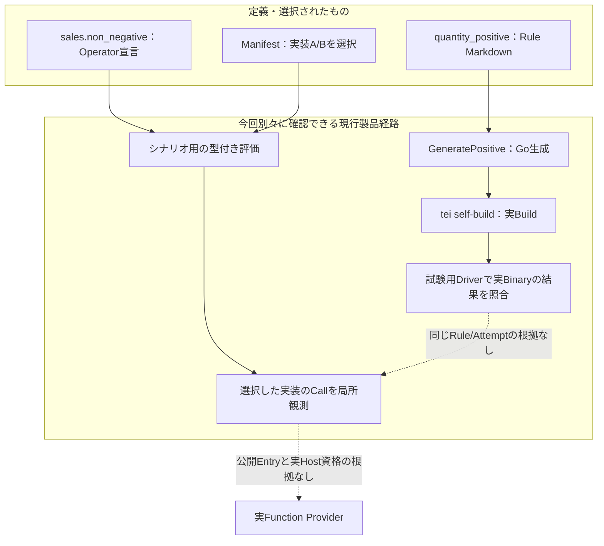

この図の破線は**現時点で結合を認めない場所**を示す。新しいGraph Engineや計測系を追加せず、既存の実証同士がまだつながっていないことを示すだけでよい。

## 31. 同じMeaningでも、実装選択が変われば実行経路が変わる

#5007の実テストが示した重要な性質は、**WorkspaceのMeaningが同じでも、選択したOperator実装が違えば判断結果が変わり得る**ことである。入力`0`に対して、`tei.number.non-negative`は真、`tei.number.non-zero`は偽を返す。反対に入力`1`では両方が真となるため、結果値だけを見てもどちらを実行したかは判定できない。

したがって実行図では、次の関係を別々のEdgeとして扱う。

| 関係 | 何で確かめるか | そのEdgeが証明しないこと |
| --- | --- | --- |
| **定義**：RuleがOperatorを参照 | 選択済み文書のQualified Rule／Operator、元byte／span | 実装A/Bが選ばれたこと |
| **選択**：Manifestが実装名を指定 | Workspaceの現在の`OperatorImplementations`、選択に用いた対象版 | 実装が組み込まれたこと、呼ばれたこと |
| **解決**：選択名が一つの実装に対応 | `ResolveImplementations`の一意性、利用可能な実装集合 | Plugin LockやTargetの実配布、Functionの公開資格 |
| **呼出し**：実際にその実装を使った | `ImplementationCall`、該当Rule・実評価Attempt、Resultと独立Expected | 他Attempt／別Process／実Providerが同じ実装を使ったこと |
| **製品配布**：生成物をTargetが使った | 実Builderの入力byte、Artifact／Image、実Consumer | 現在のHost権限、業務Owner受理 |

現行`ResolveImplementations`には、ビルトインの`tei.number.non-negative`と`tei.number.non-zero`が入っている。しかし、**これはPlugin RegistryやPlugin Lockを通じて実装を選択した証拠ではない**。`WorldFingerprint`が同じでも実装選択は変化し得るため、Worldの一致を実行方式の現在性と同じにしない。

最初に固定する負例は、**Manifestの選択をAからBへ変更したあと、旧選択で生成されたScenario Commandを再利用する事例**とする。#5007のPRには、生成済みコマンドがManifestの選択を固定せず、選択だけの改版で古いコマンドを検知できないという残課題が明記されている。これを「図の表示だけ古い」問題として済ませず、**次に実行するOperator実装の選択が古い**という実行資格の問題として扱う。

受入では、Rule文書を変更せず、(1)選択Aで生成したコマンド、(2)現在の選択B、(3)コマンドが実際に参照する選択版と実Called、(4)0で異なるExpectedを同じ照合票へ置く。旧コマンドが選択Aの資格で動けてしまう場合は、**警告表示で合格にせず、不適格な生成物として再解決・再生成を要求する**。失効単位と検査方法の実装は#4359／#951／#2600のOwnerへ返す。第二の選択Registryや新しいProcess Runnerを作らない。

## 32. 因果図の証拠を、四つの異なる変更から再資格化する

同じ画面で「変化した」と表示する場合も、変更の影響は一種類ではない。現行のWorld／Model／Artifact Revisionと元Source・Selection・Host Grant・Consumerを、それぞれのOwnerの根拠として保持する。

| 変更 | 再確認すべき対象 | 不必要に取り消さないもの |
| --- | --- | --- |
| **説明文・図の配置だけを変更** | 元byteを引用するSource Indexの現在性、View／説明の改版とLoss | 影響しないRuleの業務Meaningと生成Goの内容。同byteなら実消費資格まで自動承認するわけではない |
| **Ruleの参照属性や条件を変更** | 型付き判断、Read Footprint、生成Go、独立Expected、Build依存 | 変更の及ばない別Rule／別Artifactの受理 |
| **Manifestの実装選択だけを変更** | 選択版、Resolver結果、生成済みCommand、actual Called、必要なBuild／配布 | Source文書が不変ならそのCanonical Meaning。World一致で旧Callを認定しない |
| **Host Grant／Audience／Instance状態を変更** | 今回のInvocation／Disclosure／再配送／承認候補の現在資格 | 過去に確定したOperation・Receiptを無かったことにしない |

**失効した資格と、保持される事実は別**である。例えば、旧Manifestを使った実Called Aという履歴は削除しないが、現在の選択Bでの呼出しと主張しない。元byteのA→B→A復帰も、過去の適格性を復活させない。逆に画面のNode座標だけを変えたことで、採用済みのRule全件を意味再受理へ戻すこともしない。

このルールはBRMSのRule集合、REAのObservation／Relation、Batchの集計期間、Plugin配線、StudioのPin、AI作業票を横断して再利用する。ただし**何が業務上のMeaning変更かは各Ownerが決め、図解の汎用Diff処理で決めない**。

## 33. 履歴を扱うプロセス図では、有効時点と「知っていた時点」を分ける

組織・承認・REA・BRMS・データマートをつなぐ際に、単一の`timestamp`では原因を説明できない。少なくとも次の時点を取り違えない。

| 時点 | 質問 | その時点だけでは分からないこと |
| --- | --- | --- |
| **validAt** | どの業務期間に有効な関係か | その情報を当時の組織／システムが知っていたか |
| **knownAt** | どの認識時点で把握していた版か | DBが実際に記録した時刻／第三者が観測した時刻 |
| **recordedAt** | Providerがいつ記録したか | 業務上の有効性、先行する認識の成立 |
| **observedAt** | 外部Evidence／Consumerがいつ観測したか | 業務状態の確定と認可がその瞬間に有効だったか |
| **evaluatedAt／attempt** | どのRule／入力Context／Grantで評価したか | Ruleの有効時点、Commit／通知の受領完了 |

例として、組織Membership A2について、**2027年5月15日を対象に2027年7月2日に知っていた版**と、**同じ業務日を2027年7月3日に認識した訂正版**は異なる。独立したMembership A4が同じ二時点で並存することと、一つのMembership A2で矛盾する履歴版が同じ二時点に重なることも違う。これは現行の隔離PostgreSQL用**候補試験**の意味であり、正式なTEI組織履歴モデルの製品受理を示すものではない（#5008／未完了の#5027）。未実行／未受理の試験を実DBのPASSとして引用しない。

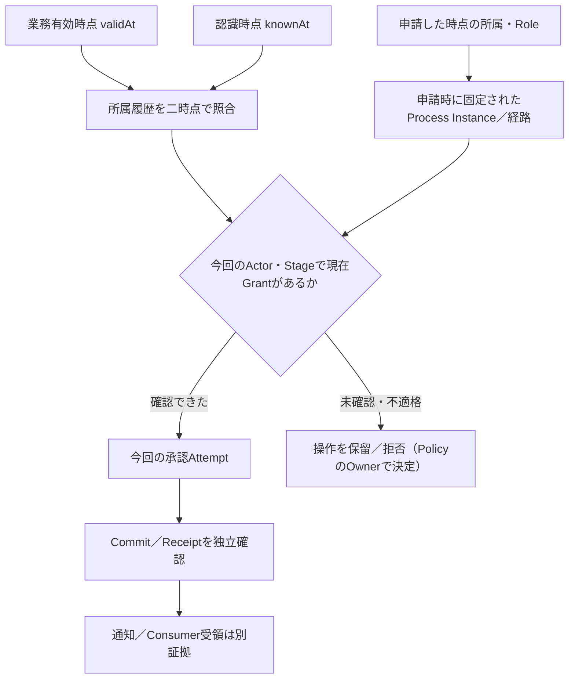

申請時の経路固定と、現在の操作資格は同じではない。委任・兼務・N_OF_M承認も、申請時に必要だった人数、過去の承認者、現時点で資格のある候補を混同しない。BRMSのDecision Tableなら**適用Rule集合の閉包**と**入力集合の閉包**が両方必要であり、所属履歴の一行を見つけただけで「全候補が承認済み」「唯一の判断が確定」とは言えない。

## 34. 次の実装を既存の小さな試験へ割り当てる

§25〜29の読取専用一Rule照合は維持し、その後の実行証拠は**別々の小さな検収**として扱う。今回の設計追補によって作業の先行順やP0のHard Gateを追加しない。

| 作業 | 現行基線と最初の反例 | 完了と呼べる最小範囲 |
| --- | --- | --- |
| **E0：Sourceの図解** | 実`tei inspect`の`semantic-validation`、同名の非公開Capability、旧Pinの後着 | 同じQualified Subject／Source版のread-only投影。実Builder・Providerは未確認と表示 |
| **E1：選択Operatorの鮮度** | #5007のManifest A→BでWorldが不変、0の判断が変わる。古い生成Scenario Command | 選択版・実Calledを一試行で照合し、旧コマンドの再利用を拒否または再資格化。#4359／#951 |
| **E2：生成Goの実Build** | #5009の`TestSelectedRuleGoThroughRealCLISelfBuild`を独立した製品試験として再実行 | 実Build Intent→Binary→判断の正負。元Rule byte／Generator→正式Build Planの束縛は次のR2-Pへ引き渡す。#4544／#2595 |
| **E3：二時点の業務判断** | validAtは同じ、knownAtは異なる訂正前後／別Membership並存／同Occurrenceの競合 | 隔離PostgreSQL候補の実PASSが確認できた範囲だけを説明。正式Query・業務Meaning／Host Grantは別受入 |
| **E4：複数Consumerの照合** | CLI InspectorとStudio Pinで同名異Workspace、旧Reply、Windows埋込世代が異なる | 実受領したConsumer・Source／Session／Audienceの一致と、不足・非開示を区別。#1824／#4583 |

最も先に解消すべき実装上の穴は、**実装選択だけが変更されても旧Scenario Commandが実行対象として残る問題**である。E1を既存の#4359と横断Plugin設計のCPW-11へ引き渡し、試験名、選択A/B、現在のManifest版、実Called、独立Expectedと拒否理由を明示する。#5015はこれを扱う並行PRであり、同じ実装を重複して本書から新設しない。

その次に、Rule→Go→Buildの証拠を束ねる。#5009の成果は通常製品CLIによるビルドと実バイナリの判断という重要な前進である。しかし、**Source／Generator資格とBuilder実消費を同一Build Planへ束縛する正式R2-P全体**は別の検収であり、公開pure FunctionのR3／実Provider／実Consumer、Studio Stage1→Stage2とは合算しない。外部Host用のGo package境界とTarget Adapterも、現在の`tei/internal`依存を前提とした試験から自動的に一般化しない。

**引渡し単位**は「問い・Qualified Subject・Source／選択Revision・実Producer／Attempt・独立Expected・現在確認できる関係・不足理由・次のOwner」の一票で十分である。DSL／Graphviz／Markdown表はこれを読みやすくする表現型として導出し、Sourceの編集・業務Meaning受理・実行許可を図面へ移さない。実証できた範囲の広さだけでなく、**TEIから生成して置き換えられた判断義務と、残る手書きDriver／Hostの責務**も計測する。

**現時点の資格**：§30〜34は2026年11月15日の現行mainと並行PRから抽出した設計・実装引渡しである。本追補でGo／PostgreSQL／Windowsの新試験や実Function Providerの起動、Effectの確定、Owner意味受理を実施したものではない。Studio実Windows Stage1→Stage2と通常CLI actual Providerの最優先P0を維持する。

## 35. 図の線を結ぶ前に、「同じものを見た」根拠を確かめる

§1〜34で区別したSource／Selection／Build／Invocation／Effect／Consumerは、別々の実装と時点で得られる。今後、実行図を製品機能として組み立てる際の中心課題は、新しい線種を増やすことではなく、**二つの証拠を同じ因果関係として結んでよい条件**を明らかにすることである。

次の照合条件は新しい共通Evidence Schemaではない。**一つの問いに答えるため、既存のProducerの返却情報から確認する事項**であり、元Ownerが保持するID・版・Receiptを置き換えない。

| 照合する条件 | 必要な根拠 | 根拠が欠けたとき |
| --- | --- | --- |
| **何についてか** | Workspace／Target／Qualified Subject／Kind、必要ならOccurrence・Relationの向きと多重性 | 同名Node・別Workspace・同端点二Edgeを結合しない |
| **どの定義・構成か** | 元Source byte／Model Revision／Language、Operator・Pluginの選択／Lock、Generator／Buildの対象と版 | World Fingerprintや結果値が同じでも、選択が同じとは言わない |
| **何が実際に生じたか** | 実Producer、実Reader／Builder入力、実Called Provider、Invocation／Attempt／Receipt／実受領 | 定義された・生成された・選択された、を実Callに格上げしない |
| **いつ・どこまでか** | 有効時点・認識時点・実Read Snapshot、取得範囲とNULL／partial／unavailable、Operation identityと順序 | 部分観測を全件正常・不存在としない。異なる時計の値を先後関係として結ばない |
| **誰に見せてよいか** | 現在のAudience／Disclosure／必要なGrant、観測結果の公開範囲 | 読取できることを他Consumerへの開示権限としない |

**照合が一致した**と表示できるのは、その問いに必要な条件を実証した範囲だけである。IDやHashが一致しても、両方が同じ一次Sourceから導出されていれば「相互に整合する二つの投影」として扱い、**独立した確認者が同じ事実を確かめた**とは表現しない。独立性を主張するときは、Expectedの由来、実Reader・実Consumer、検証対象とProducerの依存関係を別に確かめる。

この区別は、今後のStudioの証拠付きEdge、CLIの説明表、AIの出典説明に共通して必要になる。一方、照合表そのものをAuthorityやMeaningの第二正本にしない。

## 36. 「つながる」「一致する」「証明できる」を別の段階にする

二つの証拠を同じ図に載せるとき、見た目の接続可能性から業務上の成立までを一度に判定しない。次の順に、**どこまで言えるか**を停止位置として表現する。

1. **参照整合**：Node／Relation／Source／Qualified Subjectの参照先が定まるか。片端点が未観測なら、その側の関係は未確認とする。
2. **意味・時点の整合**：業務Relation／Rule／粒度／単位／有効時点・認識時点に矛盾がないか。技術的なID一致だけでは業務意味を受理しない。
3. **実現方式の整合**：今回選択したOperator／Plugin／Generator／Builderが、実際に配布・呼出しされた方式と一致するか。選択名と実Calledを別に保持する。
4. **作用と受領の整合**：実Invocation／Operation identity、Effect／Receipt、Consumer受領、現在のDisclosureに必要な根拠があるか。Read-onlyな対象には該当しない作用を要求しない。

各段階で説明する結果は、**確認済み／根拠のある不一致／未確認／対象外**を区別する。ここでの表現は説明用であり、全Ownerに共通の永続Enumや一律Ready判定を追加する意図ではない。根拠のある不一致と未確認を区別する点が重要である。

たとえば、Provider Bの選択に対して同一InvocationでAが呼ばれた証拠があれば「不一致」と判断できる。しかし、ProviderのTraceが存在しないだけなら、観測閉包が保証されない限り「未確認」である。同様に、ReceiptのないEffectを未実行と断定することもできない。

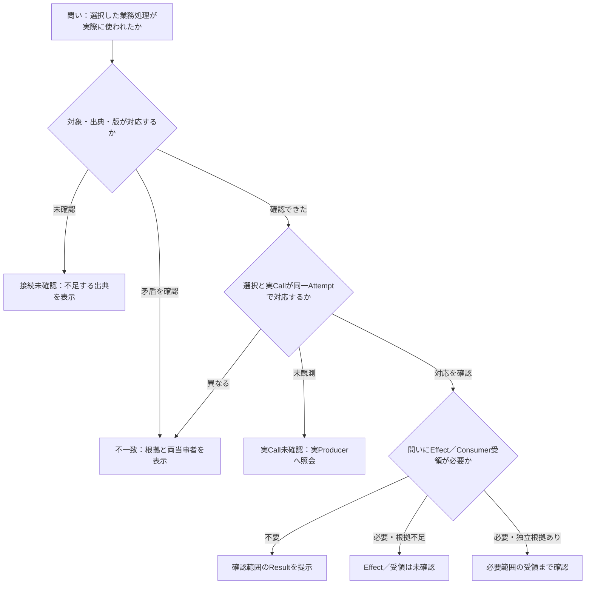

これは照合順序の説明であって、全Processに適用する実行前Gateではない。途中まで確認できた根拠は保持し、欠けた一段を図の読み手へ明示する。新しい中央Orchestratorを設けず、各段階の不足は元Ownerへ返す。

## 37. 最新の実装基線から、四つの誤結合を検証する

2026年11月15日現在のmainと並行PRに、上記の区別を反証できる具体例がある。

| 題材 | 実際に使える根拠 | 誤って引いてはいけない線 | 次の受入 |
| --- | --- | --- | --- |
| **CLIと共通Operation** | main統合済み#5037の`TestProductInspectCLISelectedMarkdownRuleIsNotCapability`は、別OS Processでの`tei inspect`と`operations.InspectSubject`の`SubjectInspection`全体、負例のError Codeを比較する | 共通のInspector実装から得た一致を、異種Provider／独立Expected／子Backend／現在Grantの受領とみなす | 同一Workspace／SubjectのReader経路の同値と、別Host／別Consumerによる独立受領を別票にする。#4635／#1251 |
| **REAのNodeとRelation** | main統合済み#5038は、外部EvidenceのRelationの`source_node_id`／`target_node_id`を、同じGraphで観測したNodeへ結ぶ。無関係なNode・片端点だけ・ID重複を反証する | 端点が技術的につながるだけで業務Relationの意味・向きの受理、全Graph取得、Effectを認定する | 原Source byte／Producer発行Relation／Coverageと、Meaning・Owner受理を別に検証。#3394／#2497 |
| **組織の二時点関係** | main統合済み#5027は、隔離PostgreSQLの候補テーブルで異なるMembership A2/A4の並存と、同じA2の版競合を試験する | 二つの行があるだけで二人と数える、`knownAt`を`validAt`や`recordedAt`と混同する、候補を正式Queryと呼ぶ | Occurrence identity・valid/knownの条件と、単一値性を受理する業務Scopeを分ける。#2386／#1126 |
| **Studioの実WebView2 Pin** | main統合済み#5025は、同一Workspaceを再読込するとPinの意図を残しながら旧観測を失効させ、明示再確認で実Host Readerを読み直す | 古いPinが表示されているだけで現在版・別Workspace・Source更新後の内容・実Windows Stage2成功とする | Source／Workspace／UI世代・実Readerの再資格化と、独立Consumer／Audienceを分ける。#1824／#4583 |

ここに示したのは**mainに統合された実装・試験コードが対象とする範囲**であり、本追補で同じexact HEADのすべての試験を再実行したという主張ではない。#5027がmainに統合されたため、§33〜34で「未完了の#5027」と記した当時の状況は更新された。ただし、実PostgreSQLの候補試験を正式な組織履歴・権限・製品Queryに自動昇格させない。

### 37.1 Operator選択の新しいPinを既定の成功としない

§31〜34で指摘した、ManifestのA→B変更後に旧生成Scenario Commandが動いてしまう問題には、現在**Go実装修正PR #5054**がある。現時点では審査中であり、main済みとは記さない。#5054の提案は既存Scenario PlanとCLIへ`operatorSelectionSha256`を別資格で加え、World／Plugin Lock／Fixtureが不変でも、古い生成Commandを評価前に拒否するものである。

ここから次に検証すべきことは、Pinが追加されたという文字列の存在ではなく、**実際の生成→実Run→Manifest変更→旧Run拒否→新生成Run→旧Plan拒否が、同じ対象・固定HEADで成立したか**である。A/Bが同じResultを返す`discount=2`の事例で旧Commandを拒否できることが特に重要である。

仮に#5054の局所試験が合格しても、Pinは**選択した実装ID集合の現在性**を検査するにとどまる。実装バイナリbyte・Plugin Lockによる供給経路、正式Builder消費、公開Functionのactual Provider、Host Grant、Source A→B→Aの受理履歴は別資格である。#5053の文書による受入条件がmainに入ったことと、#5054のGo実装がmainに入ったことも区別する。

## 38. 因果関係の検証を、変更の影響範囲と一緒に表す

実行図が役に立つのは、現在の状態を見せるだけでなく、**Sourceや構成が変更されたとき、何を再確認すればよいか説明できる**場合である。ここでも、すべてを一括失効させない。

| 起きた変更 | 維持できる過去の事実 | 現在性の再確認が必要な関係 |
| --- | --- | --- |
| Sourceの説明・レイアウトのみ | 実行済みAttemptとReceipt、影響しない意味・生成GoのContent一致 | 元Sourceのbyte範囲・Index・表示・逆編集対象 |
| Ruleの参照属性／Operatorの契約変更 | 旧Attemptで実際に読んだ入力と旧Result | 型・Read・期待値・生成Go・Builder適格性 |
| ManifestのOperator選択A→B | Aを実Calledした過去の記録、Canonical Worldの意味 | 現在の選択、生成Scenario Command／Plan、actual Called、関連するBuild・配布 |
| Plugin／Generator／Toolchain更新 | 過去のBuild・実配布のReceipt | 同一Targetの再Build資格、Artifact再利用・実Provider一致 |
| Process Instanceの所属・委任・Grant変更 | 申請時Route、旧承認Attempt・確定Effect | 現在Actorの操作資格、残る候補集合、同一Operationの再実行可否 |
| Workspace再読込／Pin再確認 | Pin対象のIntent、既に観測したSourceとその時点 | 現在Inspector応答、Model Revision・UI epoch・現在Audience |

**履歴として存在した証拠**と**今それを根拠として使う資格**を分離する。旧Pinや旧Sourceを削除して問題を見えなくするのではなく、失効理由と必要な再照会先を示す。A→B→Aで元byteが戻っても、旧AttemptのGrantや選択適格性は戻さない。

一方、Ruleの生成Go byteが同じであることを示す局所試験は、元Sourceの意味受理・実Builderの消費資格が維持された証拠とは異なる。World／Model／Artifact Revisionはそれぞれの再利用判断に用い、便利だからと単一の「全体最新フラグ」に置き換えない。

## 39. 最小の製品実装は「証拠が足りない線」を正しく表示すること

次のP1を、すべての実行を観測するTrace画面へ広げない。**既存の一つのRuleのInspector結果から、根拠のある線と不足した線だけを示すread-only照合**として実装する。

実装の出発点は次のとおり。

- **現行の同値基線**：#5037の製品`tei inspect`と`operations.InspectSubject`を、同じWorkspace／Subjectで比較する。両者の一致は「Transportを越えたread-only投影の同値」であり、独立業務意味の確認ではない。
- **同一Loadでの版の取得**：必要な作業に限り、現行`ReadWorkspaceSubject`／`InspectionFromLoad`／Source Indexを使い、`ModelRevision`と`worldFingerprint`・`sourceIndexFingerprint`の差を保持する。既存CLIの公開JSONにない版を勝手に宣言しない。
- **表示での制限**：Rule→Attributeは型付き関係として表示し、Source byteと元位置へ戻れるようにする。Builder／Provider／Effectの実証がなければ、Edgeを「観測済み」にはしない。Node座標や同名IDからSourceへの編集可能性を推測しない。
- **Producer別の反証**：REAの未接続端点、Scenarioの選択A→B、Windows Pinの再読込、組織二時点版競合を、最初の一Ruleの合格結果と**足し合わせず**各Ownerの検証票へ引き渡す。

最初の受入票は「何を問うか／対象のQualified IDとWorkspace／読取版／使用したProducerと対象Attempt／どの関係を確認できたか／何が未取得・対象外・不一致か／次に確認するOwner／実Consumer」の項目で足りる。この票は記録様式の提案であり、第二の証拠保管DBや常時動く証明Engineではない。

**検証済みと表示してはならない負例**は、(1)Sourceを読めただけでProvider Callを既成事実とする、(2)CLI/Operationの同一実装比較を独立Expectedとする、(3)片端点のREA Relationを全Graph関係へ拡張する、(4)二時点の別Occurrenceを同一人物数へ畳む、(5)Pin再読込後の古い応答を現在版へ復活させる、(6)未マージの#5054を既定のPin保護として扱う、の六つである。

この正負を**既存のSource・Inspection・Graph・Studio・Scenarioテスト**で再利用し、新たな中央Writer／Graph Runtime／Host／独立Expected Storeを作らない。正式Source→生成Go→製品Builder→通常CLI actual Providerと、非Plugin Studio Stage1→Stage2実Windowsセルフビルドは引き続きP0であり、図解P1を新しい前提にしない。

**状態**：§35〜39は現行mainの実装と進行中PRを照合した設計・引渡し。今回の文書更新で新Go／DB／Windowsの試験、正式R2-P/R3の縦断受入、Effect確定、Owner意味受理は実施していない。

## 40. 「どう実現するか」と「何が成立したか」を別々に選ぶ（2026-11-15 第10次統合）

前節までの実行図は、定義・実装選択・実呼出し・Effect・Consumerの関係を説明してきた。ここに、コード生成研究で出たもう一つの選択肢を加える。**処理のすべてを都度コード生成する必要はない。** 標準データ構造と型付きOperationの組合せを、既存の汎用Functionがパラメータとして読み取って動作できる場合は、その方が簡潔である。逆に、実行性能、配布先、静的な型保証、外部Hostの制約が求めるときはコード生成が適する。

同じ意味から複数の方式を選べることを目標にするが、意味の定義も実行資格も方式に従属させない。

| 実現方法 | 適する条件・利点 | 別に確認すること |
| --- | --- | --- |
| **コード生成** | 対象Targetでの静的コンパイル、反復処理の高速化、生成物の単独配布。TEIではGo単一バイナリを第一経路とする | Generatorの版と入力、生成byte、実Builderの消費、Artifact、実Process／Consumer |
| **標準Functionによる解釈・評価** | 既存の型付きOperationやRuleを汎用関数に渡せる場合。簡単な構成変更に再Buildを要しない | **実際に評価されたモデルの版、Function／Evaluatorの実装版、実Read、実結果、実Hostの入場資格**。モデルの存在だけを実評価としない |
| **既存Provider／外部Hostへ委任** | DB固有処理や外部サービス・装置への実作用。TEI専用Hostを増やさず、既存の公開Contractに合わせる | Providerの正確な選択／実呼出し、Target適合、Current Grant、Effect／Receipt、外部Consumer |

ここでいう「解釈」は**新しい万能Interpreter／Workflow Engineの新設を意味しない**。例えば、現行`validationeval.Evaluate`は選択済み`semantic.Validation`と`Source`から結果を導く既存の限定評価関数である。`validationgen.GeneratePositive`は同じ狭い契約に対するGoの判断式を生成する。二つの方式を比較するには、同じRule ID・Attribute・型・Input Scope・独立Expectedに加え、実Read先・NULL／取得不能・失敗を確認する。選択Providerや実DBを使っていなければ、そのことを明示する。

**実行方式の比較と製品受入は別の問い**である。解釈方式が正しく動いたからといって、正式R2-P（Source→生成Go→実Builder）やR3（通常CLI→選択Provider→独立Consumer）を完了扱いしない。逆にコード生成の単独Go実行成功だけで、Evaluator／Providerを実際に選択して呼んだとみなさない。

## 41. 最適化と解釈方式の選択は、契約を保持できる範囲に限る

方式選択で先に見るのは、どちらが「高度」かではなく、対象の意味・実行条件・配布制約を満たせるかである。次のように比較する。

| 比較軸 | 確認する基準 | 初期段階の扱い |
| --- | --- | --- |
| 専門家にとっての記述負担 | Rule・表・図・関数チェーンが、Goの`struct`/`func`を見せずに理解できるか | DSLは業務概念を優先。実装方式の切替設定を常に表へ露出させない |
| 意味の保存 | 型、単位、粒度、NULL／missing／unfetched、評価順、失敗、Read／Effectの差がないか | 独立Expectedと実Readの一因子比較を先に作る |
| 実現可能性 | Targetが必要な型、精度、並行性、権限、Host APIを満たすか | 未対応を`unsupported`とし、別方式への黙った切替を禁止 |
| 実装・更新費用 | Generator・Evaluator・Providerの保守、ビルド時間、モデル改版後の更新範囲 | 初期は単純な比較。大規模Optimizerを作らない |
| 実行性能 | 立上り、メモリ、反復呼出し、DB往復、処理件数あたりの遅延 | 固定Corpusと実Targetで測る。単一合成例から優劣を断定しない |
| 配布と開示 | Source原文や機密データを生成Artifactへ埋め込んでよいか、実ConsumerのAudienceは誰か | `//go:embed`で原文byteを収録できたことと、公開許可を分ける |

複雑な集計では、同じ値を返すだけでも計算粒度・丸め位置・時点・入力集合の完全性が違えば同値ではない。Plugin／Hookの場合は、選択、Guard、呼出し順、作用回数が加わる。**実行方式が変わっても保持すべき意味の差分を、Domainごとの小さな適合票で明示する**。新しい単一の万能Execution Profileや自動Plannerを正本にはしない。

設計時には明示されていなかった実装条件が見つかることも、単なる設計の複雑化ではない。例えば、ある式をSQLへ押し込むために必要な丸め位置・NULL意味・集合の粒度は、本来の意味モデルで検討すべき性質である。一方、特定Driverの一時的な制約はTarget Bindingの条件でよい。前者を標準Data／Operatorの属性・制約に取り込み、後者をPlugin／Targetの実装知識として再利用する。経験した条件を、必要以上にDSL構文へ追加するのではなく、**再利用可能なパターン・検証例・生成器の能力情報**へ変換する。

## 42. 実行図に表示するのは「達成率」ではなく、確認できた範囲と残る断線

ある問いについて、Ruleの原文と実Buildの証拠がある一方、公開Function／Providerの実Callが未確認なら、図上の後半を空白の成功経路で補わない。必要な関係を一つずつ照合し、**どの関係まで確認できたか、次の確認に何が不足するか**を返す。

例えば次の三つは別の結論になる。

1. **不一致**：選択したGoとBuilderが読もうとするGoのbyteが異なる。現在の候補Buildを拒否できる。
2. **未確認**：生成Goの原文SourceとGeneratorの実版を同じBuild Attemptで結ぶ証拠がない。下流のBuilderが動いても正式R2-P全体を認定できない。
3. **範囲内で確認**：指定したRule・入力に対して選択済みEvaluatorの実ReadとResultが独立Expectedに合う。ただし実DB Providerと業務Effectは対象外である。

不一致を見つけたら下流の履歴を消すのではなく、**旧版に対する観測事実と、現在の資格として再利用できない理由**を残す。観測が欠けている場合は、CollectorのないTargetまで実呼出しがなかったと判定しない。

この表示は、新しいProof Engineや中央Claim Storeの要求ではない。既存のInspection、Source Index、BuildPlan／Receipt、Plugin選択、Scenario／Runtime Evidence、Windows Consumerを、**問いと版を固定して関連付けたread-onlyの説明**である。抽出した図をCLI JSON、Studio、SHOの設計文書へ投影するときも、Audienceに開示できないSource／Path／秘密の値はHost側のDisclosure契約に従う。証拠を隠した結果、判定に足りなくなった場合は「未確認」と表示し、非開示情報から不存在を推測させない。

## 43. 現行mainの実成果を、違う資格のまま図に載せる

2026-11-15に確認した実装・PRの範囲を、説明図の入力として次のように整理する。ここで「main収録済み」はコードと履歴の状態であり、**今回のGo／Windows／DB試験を新たに実行した**という意味ではない。

| 現行の証拠 | 説明できること | 追加で確かめること |
| --- | --- | --- |
| #5037／#5058（main） | 選択したMarkdown Rule/Dataを実`tei inspect`別Processと直接Operationの同じ契約から読める。出典・型・拒否理由の差を確認する | 同一実装の二入口であり、別Providerや独立した業務計算の証明ではない |
| #5007（main） | 内蔵OperatorのManifest選択と局所の実呼出しを区別して確認できる | 実装A→B後の生成済みScenario Commandの失効。#5054は**未マージの実装PR**として扱う |
| #5051（main） | 限定Rule原文byteをGoのBuild入力へコピーし、実Binaryへ埋め込んだ原文と照合できる | 公式の原文Locator→Reader／Generator→実Buildの全入力閉包・配布時のDisclosure。#5056は**未マージの負例PR** |
| #5038（main） | REAのProducer発行RelationとNodeの端点を対応付け、無関係なIDや重複を検出できる | REA業務意味・時間条件・書込みEffect、実6.8 View受領の完了 |
| #5027（main） | 隔離PostgreSQL候補の二時点関係を照合する試験がある | DBでの競合版の除外制約は#5063の**未マージ候補**。正式組織Meaning／Providerではない |
| #5025／#5042（main） | Source／Pinの限定再確認と、生成Desktop PoCの実Windows WebView2試験の証拠を参照できる | 実N2の起動元と正規Build Intentを一緒に確認し、Stage1自身がStage2を生成する必要がある。#5059は**進行中** |

これらを一本につなぐ際には、**別Subject、別Attempt、別Targetの証拠を同じ製品試験に足し合わせない**。特に、Sourceを保持したまま実装A/Bを入れ替えた場合は、RuleのCanonical IDやWorld Fingerprintが同じでも、生成済みコマンドの選択鮮度を再検査する。元Rule原文の埋込みは有力な出典情報だが、それ自体が現行GrantやGeneratorの正当性を保証するものではない。

## 44. 最初の実装と既存計画の更新順

新しい図面専用APIや別のRuntimeを先に作るのではなく、**既存製品の限定された実観測を正確に伝えること**を第一差分とする。

| 作業単位 | 実装・検証内容 | 受入の境界 |
| --- | --- | --- |
| **X0：表示契約** | 一つの`semantic-validation`とWorkspace/Model Revisionを固定し、Source、型付きRule、実Readの有無、生成物・Provider／Consumerの未確認を既存Inspectorからread-onlyで出す | 原Source byte／Kind・ID、取得範囲、権限制限、別Workspaceの同名Subjectを取り違えない |
| **X1：二方式の局所比較** | 既存`validationeval.Evaluate`と`validationgen.GeneratePositive`→別Process Goを、固定した`std.decimal`一Ruleで比較する | 値だけでなく実Read先、NULL／未取得、Rule参照先の一因子変更を独立Expectedで照合。旧テストの重複を避ける |
| **X2：生成元とBuilderの接合** | #5051で成立した原文同梱・実Binaryの局所証拠に、選択済みSource／Generator実版／生成Goの実byteとBuilderの実入力を一Attemptで束縛する | #5056のBuilder入力取違え負例を再利用。正式R2-Pは各Ownerの資格がそろった範囲で認定 |
| **X3：実装選択の現在性** | #5054の旧Scenario Command拒否がmainへ入ったら、その正負をSourceとOperator選択・actual Calledの図へ渡す | マージ前は「保護済み」と表示しない。世界指紋一致だけで現在の実装を判断しない |
| **X4：独立Consumer** | #4495の通常CLI／actual Providerと、#2831/#4583のStage1→Stage2実Windowsを、それぞれ既存実行証拠へ照合する | 別Subject・別Build／Attemptで得た成功は一つのE2Eにしない |

X0〜X3は既存#4198／#1124／#2497、#988／#1121／#4544／#2595、#951／#4359、#1180／#2514へ引き渡す。X4のP0は独立に優先し、X0〜X3の完成を新しい必須前提にしない。構造・意味・実装・実運用の不足は各Ownerが採否を決める。**仕様上の方式比較を、製品としての方式自動選択・Interpreter追加・性能優位の宣言には昇格させない。**

この追補は設計と実装引渡しの更新であり、Go／Node／Windows／PostgreSQLの新しい実測、Ownerの業務意味受理、外部Hostの正式適合を行ったものではない。

## 45. Sourceから実Binary、さらに画面までの「受渡し」を四つに分解する

#5009に続き、main統合済み#5051では、選択したRuleの元Markdownを同一LoadのSource Indexで検査し、**原byteのコピーを生成Goと一緒にBuild Sourceへ収録**した。Goの`//go:embed`を使い、完成したBinary自身が埋め込みbyteのSHA-256を算出して元ファイルと照合する。説明文のみの変更でもBuild IntentのSource Closureが変わる負例を加えている。

ただし、この成功を「業務言語の全出典が正式Build Planへ束縛された」とは言わない。受渡しの証拠を次の四箇所に分ける。

| 受渡し | mainの実装・現在の候補 | 成立条件と残る穴 |
| --- | --- | --- |
| **A：原Source → 配置した原文コピー** | #5051の`Workspace.Load`、同一LoadのSource Index、Definition Range／元byte、`source.tei.md`の配置 | コピーと元原文のbyte一致は試験が確認するが、Source Locator／Reader版／Generator資格を正式Build Planが自身で受理するものではない |
| **B：実Generator出力 → Builder入力** | #5009の`GeneratePositive`と`generated.go`配置。#5056はbyte取り違えをBuilder前に拒否する試験の**未マージPR** | 生成Go byteが実packageで置換されていないことが必要。Build成功・同じResultだけではbyte一致の証明にならない |
| **C：Build Source → 実Artifact／Binary** | #5009/#5051の通常`tei self-build`、Build Intent／Plan、隔離Builder、Artifact Binding／再現性、実Binary | テスト用手書きDriverと生成Rule Functionの責務を分ける。Binaryが返したHashは実際に収録したbyteの証拠であって、Sourceの業務意味や実行許可の証明ではない |
| **D：実Artifact／Bundle → Consumer** | #5042/#5052の通常・生成PoC Bに対する実Windows WebView2検収。生成Workbenchの11依存Source／Lockをbyteで固定 | 固定された生成UIが実Windowsで表示された証拠。TEIの正式Stage1→Stage2自己再構築、公開pure Functionのactual Provider、任意Studio/ブラウザーへの移植を証明しない |

AとCが別々にPASSしてもBの取り違えは残り得る。CとDも、Rule Binaryと生成Workbenchが**同じArtifact／Target／Consumer**を共有していない以上、一つの縦断E2Eには結ばない。テスト用に原文を同梱できた事実を、すべてのTargetで元Sourceや秘密情報をBinaryへ必ず同梱する配布方針へ一般化しない。**配布すべき証拠と、配布してよい情報の範囲**は別に検査する。

実務上の最短の進め方は、#5056で生成Goと実Builder入力の取り違えを先に閉じ、次に元Sourceの実Locator・Reader／Generator資格とBuild Receiptを元Ownerの正式契約へ結ぶことである。`go-command`の`definitionSource`を元Markdownへ付け替えない。実Entrypoint Go packageを指す現行Build Intentの意味を保持する。

## 46. Processの実行段階を、データの受渡しと業務作用の受渡しに分ける

データ編集や承認の一連の処理を図示するときも、「バリデーションが通った」だけで保存・Commit・通知をまとめない。Wagby型の業務画面、X-TEA由来のTable Script、Node Flow、API・バッチに共通する**検査する位置**を、既存Process／Operation／Hook／Effect契約へ対応付ける。

| 段階 | 観測・検査するもの | 前段から受け取っただけでは足りないもの |
| --- | --- | --- |
| **定義・Load** | Source・Rule・型・実Provider候補、適用する版 | 現在Hostで選択された実装、実データ |
| **取得・表示** | 実Readの値・NULL／欠損・取得範囲・Disclosure | 画面に見えた値が更新対象値と同じであること |
| **入力・編集** | 利用者が確定した入力、元値、変更差分、Dirty状態 | 入力を受け取るAuthority、Commit適格性 |
| **保存前検証** | 現行Rule／Guard・版・Actor・対象Operation・入力Snapshot | 実DB制約成功、他Actorの同時更新がないこと |
| **トランザクション** | 実Provider選択、DB操作・競合・一意性・制約、Rollback | APIの正常応答だけから永続化済みであること |
| **Commitの確定** | Commit Receipt、必要なら独立Readback・Operation identity | 外部通知が配送されたこと、利用者に開示できること |
| **非同期処理・通知** | 配送要求／実配送／ACK／重複・Retry／Effect unknown | ACK消失を未Commitとみなした無条件Retry |
| **提供・Consumer受領** | 実Consumer／Audience、現在GrantとDisclosure、受領時点 | Local readや描画の成功を他Consumerへの許可とすること |

この八段階は新しい固定Workflow Runtimeではない。処理によっては編集や外部Effectが存在せず、段階自体が非該当になる。Node図、シーケンス図、Markdown表、テスト票には**実際に観測した境界**だけを表示する。画面・API・VUIで同じ業務Operationを使う場合も、入口の違いで保存前Guardや現在Grantを迂回してはならない。

プロセスの中断・再開では、保存前検証の再実行、確定済みCommitの照会、外部通知の再配送を同じ「再試行」にまとめない。履歴上のReceiptを保持し、現在の認可・受入と別に判定する。

## 47. 一つの「連続した証拠」を要求する実装検収票

次の実装PRに渡す票は、同じ名前のファイルや同じ結果値を列挙するものではなく、**互いに対応付けられる実体だけを順番に結ぶもの**とする。まず`quantity_positive`のSource／Go／Buildと、独立の`non_negative` Operator選択・Windows Consumerを**別票**として扱う。初期からこれらを合成して「TEI全体の一往復が通った」と記さない。

| 反例 | 最初の実証で確かめること | 不合格となる取り違え／Owner |
| --- | --- | --- |
| **EC-01：同じRule ID、別Source** | 同名IDを別Workspaceで読み、原byte・Reader・Workspaceの照合がなければSource Edgeをつながない | 名前だけで同一Source。#2621/#1124 |
| **EC-02：同じ生成Go、別Markdown説明** | Source Indexの旧位置・指紋は失効。一方で生成Go byteの同一性とArtifact再利用可否は別判定 | 内容一致から旧Sourceの現在性が復活。#2621/#2600 |
| **EC-03：Goの入替え** | 実生成Goを配置後に同じGoとしてコンパイル可能な別byteへ置換し、Builder前照合で拒否 | Build成功・Result一致でB受渡しを認定。#5056/#4544 |
| **EC-04：実装A→BでResultは同じ** | `discount=2`でA/Bの結果が`satisfied`でも旧生成Scenarioの選択Pinを拒否 | Result一致から旧Commandが現在適格。#5054/#4359 |
| **EC-05：Binaryの原文Hashは正しい** | Binaryが同梱byteを検出しても、元Locator・Reader／Generator版・Source Ownerの独立資格がないことを示す | Hashを業務意味受理・公開Grantに昇格。#5051/#2595 |
| **EC-06：生成Workbenchの旧依存** | 11依存Source／Lockを一因子変更し、PoC Bの既定の固定候補を拒否 | 旧Bundleと新Sourceの混在をUI合格にする。#5042/#4583 |
| **EC-07：実Runtime方式が異なる** | 同じRuleを汎用Evaluatorと生成Goで比較し、NULL・欠損・Read error・正値境界と実Calledを独立に確認 | 値一致を実行方式・副作用・Host資格の同一性にする。#1121/#4495 |
| **EC-08：Commit後のACK消失** | Operation identityとReceiptを照会し、結果不明の間は盲目的に再実行しない | タイムアウトを未実行扱い。#1129/#1174 |

EC-01〜08は既存#1180／#2514へ渡す**反例候補**であり、今回新しく合格した製品試験の番号ではない。現時点では#5051／#5042の範囲と、#5056／#5054の未マージ状態を分けて記録する。新しいEvidence Store、普遍的な証明状態Enum、第二のExpectedリポジトリを設けない。

### 47.1 既存の実装経路への引渡し

初期の反証は、#5051の原Markdown→実Binary内Digest（EC-02／EC-05）、#5056の生成Go／Builder入力取り違え（EC-03）、#5054のOperator選択A→Bと旧Command（EC-04）を、各PRのexact HEAD・実Producer・独立Expectedへ接続する。既存の§44 X0〜X4を置き換える別の作業管理を作らず、**どの断線を実際に閉じたか**を同じ受入票へ記録する。#5056／#5054が未マージなら実装済みと表示しない。

続いて既存Evaluatorと生成Goの一Rule比較（EC-07）を進める。性能・対象Host・実Provider・Effect・Audienceまで等価と断定しない。公開pure FunctionのR3実Provider／独立Consumerと、非Plugin Stage1→Stage2実WindowsセルフビルドのP0は独立に優先し、実行図P1を新たなHard Gateにしない。

**検証状態**：§45〜47は実装・検収の引渡しである。本追補でGo／Node／Windows／DB試験、正式Builder／ProviderのE2E、Effect確定、Owner意味受理を実施していない。

## 48. 抽象経路を、生成後のメソッド名に依存しないテスト対象にする

アプリケーションの抽象化は、設計書を読みやすくするだけでなく、**特定の条件で通るべき処理経路と、その前後で保たれるべき状態を検査する**ためにも使える。Go等へのコード生成後は関数の分割・統合・改名・インライン化が起き得るため、手書きのメソッド名を業務テストの識別子にしない。

テスト対象は「この業務上の判断・Operationが、どの入力条件で、どの意味上の経路を通り、何を変更せず、何を確定させるか」という**観測可能な契約**として識別する。

| 固定するもの | 目的 | 混同しないもの |
| --- | --- | --- |
| **Test Case ID／期待義務** | 同じ反例をCLI・Studio・Go・SQL・Providerで参照するための安定した識別子 | Goの`Test...`名、生成された関数名、UIのNode表示ラベル |
| **Qualified Subject／Operation** | 元Rule・業務操作の意味上の対象を定める | 表示用Node ID、同名別Workspace、個別Invocation ID |
| **入力条件と取得範囲** | Guard、NULL／未取得、粒度、Snapshot、Actor／Audienceを固定する | Fixtureに書いた入力の存在と、実Providerが完全に読んだ事実 |
| **期待する抽象経路** | どのGuard／Read／Operation／Resultへ進むべきかを指定する | 生成されたCall Graphの全メソッド、実行順序を無条件に確定する矢印 |
| **経路の不変条件** | 通過前後で保持する値・ID・版・多重性、許される変更、Effectの禁止／許可を示す | 同じ出力値だけから推測した状態保存 |
| **実測の証人と結果** | 実Read、Called、Builder、Receipt、Consumerから、どの条件まで証明したかを説明する | Sourceに書かれているだけの期待と、実際に起きた証拠 |

識別子は既存#1180／#2514のTest／独立Expectedで管理し、本書に新しいScenario正本や永続Test Registryを設けない。Goのテスト名は実行・検索のための**派生したLocator**にとどめ、Targetごとのメソッド名が異なっても同じ義務を参照できるようにする。

## 49. 到達したか、実際に通ったか、状態を保ったかを分けて検査する

抽象経路の検証を一つの`covered`／`passed`へ畳まない。少なくとも次の四層に分ければ、Go生成・汎用評価・外部委譲を同じ意味から比較できる。

| 段階 | 検査すること | 必要な根拠と停止線 |
| --- | --- | --- |
| **P0：構造上の到達可能性** | 意味Graph／Operation／Guard上、期待する経路が成立し得るか | Sourceと型付き関係の静的確認。実行した証拠ではない |
| **P1：実際の経路通過** | 指定条件で期待するRead、分岐、Selected→Calledが起きたか | 実Evaluator／Generated Binary／Providerの該当Attempt。単なるAST一致や別Attemptの結果は不可 |
| **P2：状態と作用の保存** | 入力版、未変更項目、Relationの多重性、Result、失敗時のEffectが期待どおりか | 前後Snapshot、Write Set、Receipt、独立Expected。未観測の状態を「不変」としない |
| **P3：消費者への成立** | 実Consumerが許可された対象と版の結果を受領したか | 配布Artifact、Consumer identity、Audience・Disclosure、受領記録。P1／P2だけでは成立しない |

ここでのP0〜P3は**抽象経路テスト内の検査層**であり、製品ロードマップのP0優先度や既存の受入ラベルと同一ではない。実装上は既存のSource Index／Inspection、Scenario、Go/Builder試験、Effect／Consumer Evidenceを使い、各結果を読み取り専用で照合する。

状態の検査では特に、(a)元の値と今回のInput Snapshot、(b)評価中の一時値、(c)業務状態への変更要求、(d)確定したCommit、(e)外部通知・Consumer受領を分ける。**評価Functionがpureであること**と**Hostが外部Effectを一度も起こさなかったこと**は同じ主張ではない。「呼ばれなかった」を断定できるのは、必要な観測範囲が閉じているときだけである。

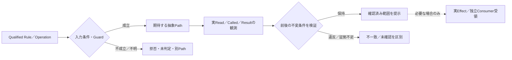

## 50. 最初の一Ruleで抽象経路を反証できるようにする

実装の第一候補は、新しいFlow Interpreterではなく、mainにある`quantity_positive`の既存回帰を**業務上の経路と状態不変条件**から読み直すことである。#5087は`validationeval.Evaluate`と`validationgen.GeneratePositive`から通常`tei self-build`で作ったBinaryを、正値・0・負値・NULL・未取得の五入力と`Number`の読取回数で比較する試験を追加した。#5056は生成Goと実Builderへ配置されたGo byteの取り違えを検出する負例をmainへ追加した。**今回、同じ五入力の別テストを増設しない**。

| Test義務候補 | 入力・通るべき抽象経路 | 保持する条件と独立Expected |
| --- | --- | --- |
| **AP-01 正値の評価** | Decimal 2.5 → `Number`を一度Read → Positive Guard成立 | `satisfied`、Read一回、別Attribute／Relationを読まない |
| **AP-02 境界値** | 0 → Read → Positive Guard不成立 | `not-satisfied`。`>= 0`への誤変更を検出 |
| **AP-03 負値** | -1 → Read → Positive Guard不成立 | `not-satisfied`。値一致に加えて参照先を確認 |
| **AP-04 明示NULL** | Number Readは成功、値がNULL → 評価エラー | `error`とRead一回。NULLを0や未取得へ変換しない |
| **AP-05 未取得** | Number Readが取得不能エラー → 評価エラー | `error`とRead一回。NULLと理由を混同しない |
| **AP-06 同じ判断の別実現** | 同じRuleを既存Evaluatorと生成Goへ渡す | 五入力のResult／Read Footprintを比較。Target方式・実Function Providerまで同じとはしない |
| **AP-07 実装選択の変更** | Operator実装A→Bで入力2のResultが同じ | 旧生成Scenario Commandを現在の選択で実行しない。未マージ#5054のexact HEAD検証へ委譲 |
| **AP-08 Sourceは同じでGoを取り違える** | 正しいRule→生成Go、Builder配置だけ別byteに差し替え | Builder前の一致検査で拒否。#5056の製品テストを根拠にし、現行GrantやOwner受理へ飛躍しない |

AP-01〜08は**既存実装と対応させる検収索引**であり、新しいGoテストを八件実装済みと主張しない。既存Goテストの主張の上限を明示し、追加が必要な負例だけ#1180／#2514へ渡す。#5054は現在未マージのため、AP-07の拒否をmainの実装済み保護とはしない。実Goのテスト関数名が変わっても、AP-01〜08の業務判断とExpectedは変えない。

## 51. Pluginの型付き配線と業務Processにも同じ検査原則を適用する

一Ruleで経路と状態を確認できたら、同じ枠組みをNode View・PluginのPort接続、承認・保存、Batchの部分再計算へ拡張する。ただしすべてを単一のGraph実行器へ押し込まない。

| 拡張対象 | 期待する抽象経路 | 通過しても保たれるべき条件 |
| --- | --- | --- |
| **Plugin／NodeのPort** | 複合Record全体、個別Field、明示AdapterのいずれかでProducer→Consumerへ | 型／単位／粒度、必須Field、Relation identity、未取得、秘匿Field、Mapping ID。折畳み表示では実Call数が変化しない（#5101／PIO-01〜10） |
| **承認・保存Process** | 受付→Guard→実Provider選択→Transaction→Commit→必要な通知 | Actor／現在Grant、Snapshot、Operation identity、同一書込みの重複防止、Receipt、開示Scope。失敗後のRetryが二重Commitを起こさない（#4198／#1174） |
| **結果要求・Batch** | Source→Filter／Join→計算→Aggregation→Result | Source Grain／Result Grain、丸め・NULL、分類版、対象集合の完全性、時間条件。適格な範囲だけ再計算し、それ以外はHold（#5103） |
| **Studio／CLI／API** | 同じOperationをCLI directまたはWails側の薄いHost Adapterから利用 | 読取対象と意味は保つが、実Principal／Host Grant／Audienceは入口ごとに独立。HTTP経由にしただけで実ProviderやPlugin公開を認定しない（#5037／審査中#5096） |

全体PortとField Portの表示を切り替えても、**型付きMappingの意味上のIdentityと作用回数が変わらないこと**が不変条件となる。逆に、全体RecordをHTTPへ渡したとき機密Fieldが増えるなら、型が合っていても不変条件に違反する。単位変換Adapterが必要な経路では、変換を通ったというTraceだけでなく、Law・精度・丸め・LossとExpectedを検査する。

業務Processでは、定義時に到達可能だった経路が、実行時にも適格とは限らない。組織Membershipの`validAt`／`knownAt`、現在Grant、Process Instanceの版・委任・効果の既確定性を同じAttemptの前提に結び、いずれかを変更した負例を用意する。静的Pathが存在することを、実行許可と表示しない。

## 52. 製品へ渡す最小実装と、次に棄却すべき仮定

実行図P1で最初に必要なのは、抽象Pathのあらゆる内部メソッドを追跡するTrace Collectorではない。**既存の型付きSourceと実試験から、試験が要求した関係・実際に観測した関係・まだ観測していない関係を分けて示す小さな読取専用の照合**である。

最初の実装票は既存#1180／#2514のCorpusへ置き、次の情報を同一の検証対象に結び付ける。

1. Qualified SubjectとWorkspace、Source Revision、必要なContext／取得範囲。
2. 安定したTest IDとPreconditions、期待する抽象Path・Guard、維持すべきInvariants。
3. 実行されたTargetと実Provider／Evaluator／Builderの選択・実Calledを示す証拠、実Attempt。
4. 各InvariantのExpected／Actual／不足理由、独立Expectedの由来。
5. 結果の限界、Effect／Consumerの受領資格、失効が必要となるSource／Selection／Grant変更。

**着手順**は、(i) AP-01〜06を既存#5087/#5056のテストと一対一に対応付け、欠けたRead／状態の証拠を列挙、(ii) #5054の選択Pinが実mainに入った場合に限りAP-07の旧Command拒否を確認、(iii) #5101の全体型／Field／Adapterを一つの既存Mapping上で投影、(iv) 保存・外部Effectは実ProviderとReceiptの独立検証を待ってから拡張する、の順とする。ここに新しい汎用Test Driver・メソッド名Registry・Trace Store・Graph Runtimeを設けない。

**採否の判断**：同じ抽象Pathを、汎用Evaluatorと生成Goで異なるメソッド構成にしても同じ不変条件で検収できるなら、TEIの標準Operation／Ruleによる抽象化がテストにも有効という根拠になる。反対に、実入力範囲やEffect、Relation多重性が表現できなければ、その不足は既存Data／Operation／Law／Bindingのどこで定義すべきかOwnerへ戻す。表示を作るためだけに新Core要素を増やさない。

**現時点の資格**：mainで確認できたのは#5087の限定Evaluator対生成Binary回帰、#5056のGo配置byte不一致拒否、#5059の実TEI CLI起点の生成Workbench N2と実Windows受領までである。ただし後者も正式な非Plugin Stage1→Stage2の製品セルフビルドではない。旧Scenario選択Pin #5054、HTTP Adapter #5096、Workbench統一 #5105は審査中のため未実装・未受理の範囲を明示する。今回の追補によって新Go／DB／Windows試験や正式Provider／Effectの実行を行ったとは主張しない。通常CLI actual Providerと非Plugin Studio Stage1→Stage2実WindowsのP0を維持する。

## 53. 同じ結果でも、読んだ対象が違えば同じ経路ではない

§48〜52では、生成後のメソッド名に依存しない抽象経路の検査を定義した。その基準を一歩進める。**結果の値とRead回数が一致しても、実際に読んだAttribute／Relationが違えば、同じ業務判断を実行したとは言えない。**

main統合済み#5118の`TestMarkedDataTableRuleRealGoAndEvaluatorReadParity`が、これを実Goバイナリを用いて検証する足場になった。元のRuleは`organization.transfer_request.allocation_positive`で、期待する読取先は`organization.transfer_request.allocation`である。試験では、生成Goが参照する属性だけを`organization.transfer_request.person_id`へ差し替え、Fixtureが同じ値を返すことで**結果が一致し、Readも一回なのに、読取先だけが違う**状況を作っている。

| 比較するもの | 意味上の同値を判断する条件 | この条件だけでは確かめられないこと |
| --- | --- | --- |
| Result／Error | 同じRuleのLaw、入力条件、NULL／未取得の分類に適合 | 同じ対象を読んだこと、Effectがないこと |
| 実Readの対象 | Qualified Attribute／RelationのID、向き、必要なPath・Scopeが一致 | 実DB Snapshotの完全性、現在のProvider選択 |
| 実Readの回数と順序 | 契約が回数や順序を要求する場合に一致。pureな式では不要な内部差を固定しない | 同じ値が異なる属性から得られたか |
| Source／Binding | Workspace・Source Index・型・Readerの対象版が一致 | 実Generatorや実Builderがそのbyteを消費したこと |
| 実現方式 | 汎用Evaluator、生成Go、選択Providerのどれが実際に動いたか区別 | 一方の局所試験が他方式のRuntime実受領を保証すること |

したがって抽象経路の照合では、**`Read Footprint`を、単なる件数ではなく意味上の参照先を含む集合または順序付き列として扱う**。全Readの順序を強制するのは、順序が意味・Effect・障害結果に影響する場合だけとする。SQL等の最適化や評価の並列化を、意味上不要な読取順固定で妨げない。

この試験のSourceはテスト用のNumber実装であり、実DB ProviderのReadを観測したものではない。またGoのビルドは一時Packageの通常`go build`であって、正式な`tei self-build`のBuild Intent→Builder→Artifact受入ではない。#5087の別Fixtureで実施した通常`tei self-build`と、#5118の別Ruleに対する読取先一致の検証を、**同一Source・同一Attemptの製品E2Eとして合算しない**。

## 54. 経路の不変条件を、定義と実観測の両側から確かめる

抽象経路をUIのNode線やGo Call Graphへ固定すると、意味は同じなのに内部実装が変わっただけで試験が壊れ得る。反対に、単なる最終Resultだけを期待値とすると、誤ったReadや過剰なEffectを見逃す。そこで、検証対象となる関係を**定義上の要求**と**実際の観測**の二面から結ぶ。

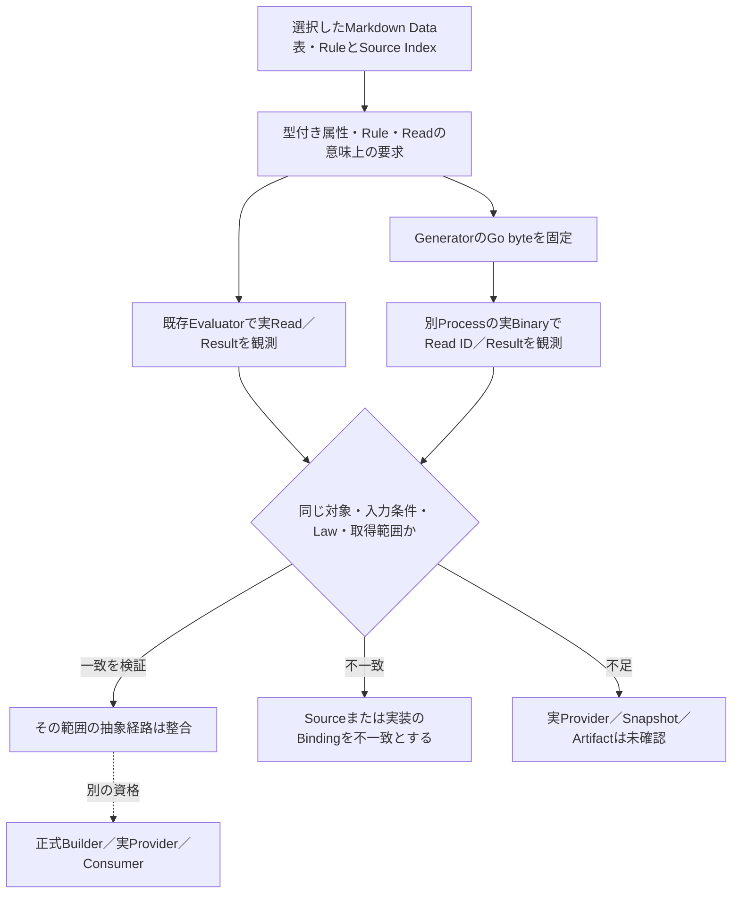

Sourceに書かれた参照属性をExpectedとする場合も、そのExpectedが**同じ実装の出力から機械的に複写されたものではないか**確認する。独立Expectedは既存#1180／#2514の責任範囲に置き、実装中のGoコード・生成後のメソッド名・Graph配置から自動的に正解を作らない。

検査の結果を一つのBooleanへ畳まず、少なくとも次の違いを説明できるようにする。

- **不一致**：Observed Readが`person_id`なのに、選択Ruleは`allocation`を要求する。Resultが一致しても不合格。
- **未確認**：Ruleと生成Goは一致したが、BuilderやProviderの実入力が観測されていない。未実行と断定しない。
- **範囲内で整合**：テスト用Sourceで実Evaluatorと生成BinaryのRead対象・Result・失敗が一致した。ただし外部Host／実DBには一般化しない。
- **対象外**：pureなRule評価に存在しないCommit／通知を、検収のために架空の必須段階として追加しない。

## 55. Plugin・Node・APIで経路をつなぐとき、保証を落とさない

#5101は複合型全体、Field単位、明示Adapterを**型付きMappingの異なる扱い**として整理した。ここに、並行#5121の「Portごとの適合から経路全体の適格性は導けない」という検討を重ねる。

接続が複数Edgeにまたがる場合、最初のPortが保証していたものが、途中のAdapterや表示上の折畳みで失われていないか、**経路を通した不変条件**として確かめる。

| 例 | 検証する経路 | 見落としてはいけない状態 |
| --- | --- | --- |
| 複合Recordをそのまま渡す | Producerの型付きRecord → ConsumerのPort | 必須Field、機密FieldのDisclosure、Scope、Collectionの取得範囲 |
| 二つのFieldを一つにまとめる | Field Path二本 → Mapper → Result Record | 同名だけの誤接続、二重Binding、NULL／未取得、多重度、Mapping identity |
| 明示Adapterを挟む | JPY Amount → 単位・精度のLaw → 変換後Port | 丸め・Overflow・Loss、型だけ同じ別Law、追加Read／Effect |
| Node Viewを折り畳む | 同じConnectionを全体Port表示↔Field表示 | 実Mapping ID、実Call回数、Effect／Receipt、業務上の向きは変わらない |
| CLIとStudioから同じ読取を要求 | CLI direct／実CLI別Process／Studio Host → 同じ共通Operation | Canonical／Source／Authorityの意味は保持しつつ、Workspace allowlistとAudienceは入口別に評価 |

最後の行は、mainに既にあるCLIと直接Operationの同値試験に、未マージ#5119がStudio Hostを追加しようとしている段階である。**CLIとStudioの内容が一致しても、HTTP公開・非Builtin Provider実Call・現在Grantが成立したことにはならない。** #5096のWails HTTP公開はこれとは別に検収する。API Pluginの本体をWails固有のServiceやCLIからのHTTP自己呼出しへ固定しない。

複数Consumerへの値のFan-outと、Effectful Producerの複数回呼出しも区別する。AdapterやNodeの見た目だけから実Call数を推定しない。Port間の参照整合→意味・Scope→選択実装→実Call／Effect／受領という段階は§35〜36を再利用し、第二のGraph Engineや接続証拠Storeを作らない。

## 56. 次の小さな実装差分を、結果が同じ誤経路の拒否へ寄せる

新しい実装票は、AP-01〜08と#5118の実Go試験を重複実装するのでなく、**現在確認できていない一つの接続**を独立Expectedとともに絞り込む。

| 次の検収 | 既存の実装資産／進行中のPR | 合格に必要な追加根拠 |
| --- | --- | --- |
| **Q-1：同じ値・違うReadの拒否** | main #5118。Data表→Rule→P/Gの別Process実Binary | 現状はテスト用Source上の読取ID比較。実Query/ProviderでAttributeと取得Snapshotを確かめる場合は別Ownerの試験 |
| **Q-2：抽象Relationの安定性** | 現行mainの`org_c1_abstract_route_contract_test.go`。組織Membership→OrgUnitの型付きRelation／Query | Symbol改名に耐え、Relation Key・向き・多重性・Query IDの差を拒否する。実DB traversalとは分離 |
| **Q-3：実装選択の鮮度** | 現行mainのScenario Plan／CLIにある`OperatorSelectionSHA256`・`-operator-selection-sha256`。旧PR #5114自体のマージ状態と分ける | World・Fixture・結果は不変でも、A→Bの旧コマンドを実Call前に拒否。Provider版／GrantやA→B→A履歴復活は別受入 |
| **Q-4：CLI・Studioの読取境界** | 現行mainの`TestProductInspectCLISelectedMarkdownRuleIsNotCapability`にある実`tei inspect`／直接Operation／非Wails Studio Host | 同一SubjectのSource／Authorityと、存在しないCapability・禁止Workspaceの拒否分類を照合。HTTP／実Providerは別 |
| **Q-5：Port／Adapterの非干渉** | mainの型付きMapping設計#5101と`SERVICE_FLOW_STANDARD_COMPOSITION`§12のDPC候補 | 一つのFixtureで全体Port⇄Field表示を変えてもMappingと実行対象が変わらない。秘密Fieldや不完全な入力を黙って補完しない |

Q-1〜5は既存Ownerへ渡す**受入パケット**であり、新しい製品機能の完成表ではない。かつて未マージと記した#5114／#5115／#5119／#5121の一部成果は現行mainのコード／設計へ別経路で収録されている。PRのマージ状態と現在の実コード、試験の実行結果は別に確認する。コードの存在だけから正式Provider・HTTP・Owner受理を導かない。

**実装順**：最初は同一Data表・Ruleの実Source→P/G読取先一致を#5118のFixtureから読み取り専用で提示する。その後、型付きRelation・Adapter・CLI/Studioの各境界を一件ずつ足し、通常CLIの公開pure Function→実Provider→独立Consumer、正式Source→BuilderのR2-P、非Plugin Studio Stage1→Stage2実Windowsという独立したP0へつなぐ。目的は「実行できる線を増やす」ことではなく、**誤った経路を結果の一致で見逃さないこと**にある。

**本追補の状態**：§53〜56はmain済み#5118の実Goテストと他レーンの未統合PRを照合した設計・計画更新。今回新たにGo／DB／Windows試験、実Provider／HTTP公開、Owner意味受理を実施したものではない。

## 57. 抽象経路の検査を「何が分かっているか」にまで拡張する

§53〜56のRead ID照合は、対象を取り違えないための必要条件だった。ただし、正しいAttributeを読んでも、**実際には値がないのか、まだ読んでいないのか、関係の一部だけを読んだのか**によって、業務Ruleの結論は変わる。

main統合済み#5142は既存の`validationeval`へ状態付きの読取入口`Decide`を追加した。Number／Key／Dateの読取状態（`present`、`null`、`not-fetched`）と関係の取得範囲（`complete`、`partial`）を、Ruleが判断する根拠として使う。判断できる場合は`satisfied`／`not-satisfied`、できない場合は理由付きの`Undecided`を返す。読取契約に矛盾がある場合はRuleの「不成立」や「未決」とせず、Readerのエラーとして扱う。

| 区分 | 観測した事実 | 抽象経路で確認すること |
| --- | --- | --- |
| 値がある（`present`） | 指定Attributeの型に合う値を読んだ | 実Read ID、値の型・精度、入力Scope、実際に呼ばれたEvaluator |
| 値がない（`null`） | 対象を読んだが値がなかった | 「0」「未取得」「空集合」へ変換しない。Ruleに明示された例外条件を適用 |
| 未取得（`not-fetched`） | 対象の値をまだ知らない | 値がないとは断言せず、追加Readで結論が変わるかを判断 |
| 部分取得（`partial`） | 関係の一部だけを読んだ | 観測した確定違反と、全体の正常性を同じ確実さで説明しない |
| 全件取得（`complete`） | 対象RelationをRuleの範囲で読んだ | 対象範囲・Snapshot・Authorityも対応するときだけ全件に関する結論を評価 |
| Readerの矛盾・障害 | `present`なのに実値がない、不正な状態、読取エラー | 業務上の不成立にも未決にも吸収せず、実Producerの失敗として表示 |

従来の`Evaluate`は既存Sourceとの互換入口として残るが、そこから`null`と`not-fetched`の違いが自動的に復元されるわけではない。新しい`Decide`の三値の判断を、そのまま生成Goや通常CLIの実Providerへ移植済みと推測しない。§50の既存P/G比較は**値が得られた限定Ruleの同値**を示すものであり、現在の状態付きReader全体の同値試験ではない。

## 58. 確定した違反と、まだ証明できない正常性を非対称に扱う

部分取得における結論は一律「未決」ではない。**残りの入力がどのような値でも結果を覆せない**なら、その結論は確定できる。そうでなければ、取得不足を理由とともに残す。これは新しい汎用Inference Engineを作るという意味ではなく、各Ruleの意味に沿った判定条件を検査するものである。

| Ruleと観測 | この範囲で言えること | 不適格な結論 |
| --- | --- | --- |
| Relationの一意性：取得済み二行に同じ確定キー | 取得範囲が部分的でも、違反は確定（`not-satisfied`） | 未取得行のため「違反も不明」とする |
| Relationの一意性：見えたキーは全部異なるが取得は部分的 | `undecided`。未取得行に重複があり得る | 取得済み行だけで全体の`satisfied`を宣言 |
| 正値Rule：対象Numberが`null`または`not-fetched` | それぞれ別の理由で`undecided` | 空欄を0に置き換え`not-satisfied`とする |
| 日付の`not-after if present`：比較先の日付を読み、`null`と確定 | そのRuleが明示した条件により`satisfied`。開始日の値によらない | 省略された`if present`を勝手に補う |
| 同じRuleで比較先日付が`not-fetched` | `undecided`。未取得は「終了日がない」ではない | 欠落を「終了日なし」と解釈して`satisfied`とする |
| 不正な読取状態・型の不一致 | Reader／Validationの失敗 | 失敗を「不成立」や「未取得」の都合のよい状態に丸める |

この区別を図に投影するとき、**確定した違反を示す実Witness**と、**正常だと断定するために必要なCoverage**を分けて示す。前者は実際に観測した二行・キー・Rule版などで支える。後者は業務上の対象範囲と実Read Snapshotを要する。Coverageの`complete`が何に対して完全かを省くと、部署内だけの完全性を全組織の完全性へ誤拡張し得る。

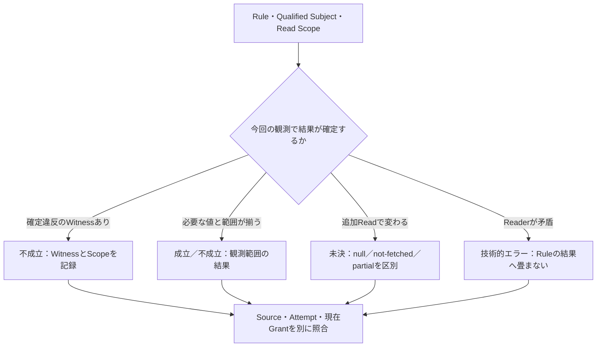

## 59. 規則の例、意味定義、実行時の受入を別々に保持する

main統合済み#5143では、Markdownの記録例に、期待するRuleの答えを記述できるようになった。`tei validate`が定義の検査後に例を評価し、不一致なら期待を書いた位置へ診断を返す。**規則の例は意味定義の外に置かれ、業務上の期待を確認するための材料**である。

| 観点 | 実装済みの限定的な根拠 | ここからは言えないこと |
| --- | --- | --- |
| 定義と原文 | `tei.authoring/v1`のRule・型・例表、Source位置、選択済みWorkspace | 例の行を正式な業務DB行や実Read Snapshotとみなす |
| Expected | 例表で明記した`satisfied`／`not-satisfied`／`undecided` | 例から自動推論した答えを独立Expectedとみなす |
| 例表の範囲 | 当該表の全行がその例における関係全体であるという約束 | 実DB・ページング・外部ProviderのCoverageが`complete`であるとみなす |
| 値のない理由 | 空の値セルは`null`。表にないAttributeは未取得 | 空のセルを0にする、未定・不明の理由を暗黙の型へ押し込む |
| 実行・配布 | `tei validate`で診断を確認できる | Scenario Run、Build、Provider実Callが自動的に同じ例を必須Gateに使う |

例は実装の反証に使えるが、例だけをSourceのMeaning正本にしてはならない。一方、元Markdownの説明や例が変更された場合は、その原byteに依存したSource Index／ビルド閉包の再検証が要ることもある。**意味モデルが変わるか、Artifactの再Buildが必要か、過去のEvidenceを再利用できるかは別々の判断**であり、既存#5109／#5129が検証するBuildPlan確定後の原文・生成Go改変拒否を再利用する。

## 60. 日付の前後、関係の期間、二時点履歴を一つにしない

main統合済み#5146は、一件の記録にある二つの暦日へ`not-after`と`if present`を適用する限定Ruleを追加した。**同じ日付を許すか、終了日のない行を対象に含めるか**を文書から読み取れるようにし、`std.datetime`への暗黙変換はしない。

これに対し、関係に属する**複数行の期間が重ならないこと**は別のRuleである。#5148はmain統合済みで、限定された`no-overlap`評価と独立した反例照合を利用できる。ただし、実DBの読取範囲、実Provider／Targetの適合、Ownerの業務意味受理まで確定したわけではない。さらに、組織の業務履歴を検査する際には、所属の`validAt`／`knownAt`、Source改版、実Read Snapshot、判定Attemptを別の軸として持つ。

| 区別するもの | 初期の検証題材 | 失格となる短絡 |
| --- | --- | --- |
| 一記録内の暦日比較 | 開始日が終了日以下、両日同じ、`if present`の有無 | 終了日が未取得なのに「終了日なし」と扱う |
| 関係行間の期間 | 同一Relation Scope・同一Group Keyの期間重複、終了端の扱い、部分取得 | 異なる部署の兼務を同一グループの期間重複とする |
| 業務上の二時点 | `validAt`と`knownAt`、Occurrence、改訂・訂正 | 認識時点を有効日とし、現在の所属人数へ加算する |
| 実行・証拠の時点 | Source Revision、選択実装、実Read Snapshot、実Build／Provider Attempt | A→B→Aで旧資格が自動復活したと扱う |

期間重複の検証では、**同じ組の二行が重なる確定証拠は、未取得行が残っていても消えない**一方、観測した範囲で重複が見つからないことは全件正常を意味しない。この非対称性は§58の一般原則と対応する。mainの#5148による限定Ruleの判定結果を、実DBのRelationを読むProvider、全件Coverage、生成Go、外部Hostでの一般的な適合へ広げない。

## 61. 製品化の順番を、知識の範囲を守る小さな試験に絞る

次の実装は新しいRule Runnerや全般Proof Statusの導入ではなく、**同じ選択済みSourceを、読取範囲と期待条件を固定して検証する**小さな試験を既存Ownerの場所へ足す順序とする。

| 検収単位 | 独立Expectedと反例 | 使用する既存資産／Owner |
| --- | --- | --- |
| **KD-01：値の不在理由** | `null`と`not-fetched`は両方`undecided`でも理由が異なる。Readerの矛盾はエラーとして拒否 | main #5142の`Decide`／Reader回帰、#1180／#2514 |
| **KD-02：部分取得の確定違反** | 一意性Ruleの重複二行は`partial`でも`not-satisfied`。重複なしの`partial`は`undecided` | 既存`decideRelationUnique`の独立Oracle、#988／#2621 |
| **KD-03：例表の役割** | 期待だけ変更→期待位置で不一致。規則Meaning・Runtime実Call・Build許可を例で書き換えない | main #5143の`CheckRuleExamples`、#1180／#2514 |
| **KD-04：日付の条件** | 比較先`null`で`if present`ありなら成立、なしなら未決。`not-fetched`は別 | main #5146の`not-after`、#988／#2621 |
| **KD-05：関係行の期間** | 同一Groupの確定重複と、部分取得で正常を言い切れない例を分ける | main #5148の限定`no-overlap`評価・独立反例。実Provider／Coverage／Targetの適合は別検収 |
| **KD-06：生成／汎用評価の差** | 生成関数名を変更してもMeaningとRead IDは同じ。対象Ruleや実入力が変われば拒否 | main #5118／#5132、実Builder #5109／#5129。新Rule種別の生成対応は未受理 |
| **KD-07：実Providerへの接続** | テスト用Reader／例表の取得範囲を、実DBのSnapshotやHost Grantとして転用しない | #2586／#4495／#1251、独立Consumer #1180／#2514 |

最初に接合する実装差分は、`Read Footprint`に **ID・値の状態・Coverage・読取対象のScope** を添えて、RuleのExpected／Observed／Undecided理由をread-onlyで照合するところまでとする。元SourceのRevision・Generator実版・Build Input・現在Grantは、その結果の外側にある別の資格として接続する。今ある`Decide`や例の結果から、未知の事実を推測して補完する新Schemaや第二Expected正本は作らない。

**優先順位**：通常CLIの公開pure Function→actual Provider→独立Consumer、正式Source→BuilderのR2-P、非Plugin Studio Stage1→Stage2実WindowsのP0は従来どおり独立して進める。KD-01〜07をP0全体の新Hard Gateにはしない。今回の§57〜61は現行mainの実コードと進行中のPRを踏まえた設計・検収計画の更新であり、新しいGo／DB／Windows試験、正式Providerの実行、Ownerの業務意味受理を行ったものではない。
