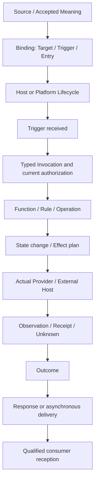

# アプリケーションの起動・イベント・処理・応答を、同じ意味から記述する

- **状態**：設計候補。既存のFunction／Operation／Trigger／Provider／Targetを接続するための提案であり、新しい実行Engineを採用する決定ではない
- **日付**：2026年11月14日
- **既存Owner**：[共通Application API #1158](https://github.com/hat47x/tei-platform/issues/1158)、[Script Launch #4495](https://github.com/hat47x/tei-platform/issues/4495)、[Function Context #2586](https://github.com/hat47x/tei-platform/issues/2586)、[Studio Desktop #4583](https://github.com/hat47x/tei-platform/issues/4583)。図解・DSL・Sourceの扱いは対応するLanguage／Representation／Generatorの既存Ownerへ返す
- **非目標**：TEI独自Host、全Target共通のEvent Loop、第二のWorkflow/StateMachine/Dispatcher、中央Authority/Registry、別のScenario Runnerは作らない

## 1. 出発点：共通なのはループの実装ではなく、処理が起きる理由と結果である

多くのアプリケーションは必要な資源や実装を準備し、外部からの要求または内部の契機を受けて処理を行う。WebサーバーならHTTP要求、業務Batchなら予定時刻、DesktopならUI操作、CLIならコマンド起動、メッセージConsumerなら配送されたMessageが処理の起点になる。

しかし、**すべてのアプリケーションが一つの待ち受けループを実装するわけではない**。CLIは一回の実行で終了できる。FaaSでは起動の管理をプラットフォームが行う。UI、OS Signal、Message Brokerの配送と並行制御も異なる。したがって、TEIが標準化する候補は「イベントループの構造」ではなく、**どの契機でどの契約を起動し、何を読み、何を変え、何を返し、結果をどう確かめるか**という意味の対応である。

この意味を標準データ構造で保持できれば、業務DSL、図、説明文、試験、Targetごとのコード生成へ展開できる。同時に、どのSourceを元にしたか、実際にどのProviderが呼ばれたか、どのConsumerが何を受け取ったかも追跡しやすくなる。

## 2. 二つの時間軸を分ける：Process LifecycleとInvocation

「サービスが稼働中である」と「この要求の処理が成功した」は異なる。このため、構成・待受け・停止のLifecycleと、一件ごとのInvocationを別の構造にする。

| 対象 | 候補となる状態・区間 | 誤解してはならないこと |
| --- | --- | --- |
| Process Lifecycle | configured → starting → ready → quiescing → stopped／failed | HTTP Server、Job、CLI、FaaSのすべてに長寿命Processがあるとは限らない |
| Trigger | HTTP／CLI／UI／timer／message／manualなどからの契機 | Triggerを定義しただけで実Schedulerや受信者が存在するわけではない |
| Invocation | admitted → executing → produced-outcome／failed／unknown | Request受付の成功は、実Providerの呼出しやEffect確定ではない |
| State／Effect | 保存済み状態、外部作用、観測、補償 | 論理的なState transitionはDBのCommitや実機の動作を証明しない |
| Response／Delivery | 同期応答、非同期通知、結果照会、応答なし | Responseを返さない処理もある。送信・受領・意味受理は異なる |

実装上の`ready`は、Hostが当該Operationの受付に必要な条件を満たした場合の報告である。あらゆるPluginやDBが正常であることを無条件に保証しない。Shutdown時は新規受付停止、進行中Invocationの中断・完了待ち、Receiptの確定可能性を用途別に記述する。



これは意味上の関係図であり、Runtimeが毎回この順で一つのLoopを走らせることを要求するものではない。認可や現在版の検査は、必要な作用境界で繰り返し行う。非同期処理ではDeliveryとReceiptの順序が前後し得る。

## 3. 最小の語彙と共有する意味

| 語彙 | TEIで保持する主な意味 | 既存機構への対応 |
| --- | --- | --- |
| Lifecycle | 起動・準備・停止と利用可能な能力 | Target／Hostの実現、Buildと運用の結果 |
| Trigger | 起動条件、起点、時刻基準、対象、受信形式 | Script LaunchのTrigger／Provider |
| Event Envelope | 発生時刻・受信時刻、相関ID、Source参照、Payloadの型、重複識別 | 既存の型・構造とTransport Adapter |
| Invocation | 公開Entry、型付き入力、Subjectと基準版、Context／Attempt | 共通Application Operation／Function Context |
| Dispatch | Contractに対して実Provider・Targetを選ぶこと | 既存ResolverとHost Binding |
| State | 対象の状態、版、期待する遷移、現在の確認状況 | データモデルの状態項目とRule／Hook |
| Effect | 永続化・通知・外部操作などの実作用と副作用区間 | Driver／Providerと実行後Receipt |
| Outcome | 完了・拒否・失敗・結果不明の区別 | Result／Diagnostic／Failure |
| Response | 同期応答、確認応答、非同期通知または省略 | CLI／HTTP／UI／MQ等の媒体Adapter |
| Observation | 実際の起動、呼出し、状態、結果を観測した範囲 | Evidence／Receipt／独立Consumer |

この語彙は採用候補であり、新しいCoreの固定Enumを提案するものではない。すでにあるOperation、Context、Provider、Hook、Targetを主に再利用する。PlatformごとのQueue、Dispatcher、Scheduler、HTTP Server、OS Event Loopは外部Host・既存Frameworkや選択したPluginが実現する。

## 4. 業務意味を失わない記述例：受注の受付

受注`order.demo.1`を締切前に受け付ける例では、HTTPのPOSTとCLIのsubmitは異なるTriggerだが、**同じ業務操作**へ対応付ける。次は説明用の意味表であり、確定したX-TEAの業務規則ではない。

| 位置 | 読める説明 | 独立した条件／結果 |
| --- | --- | --- |
| Trigger | HTTPまたはCLIから受注受付の依頼を受ける | Triggerが許されたEntryへBindingされる |
| 入力 | 対象受注IDと基準改訂を指定する | 型と対象が有効。未知Inputや欠損は拒否 |
| Guard | 受注が下書きで、現在時刻が受付期限より前 | `2026-11-20 17:00:00+09:00`の直前だけ許容 |
| State | 受注を`draft`から`submitted`へ変更する | 現在Grantと版の検査、DB Commitが必要 |
| Effect | Commit後、受付通知を試みる | 通知の送信と実Deliveryは別Receipt |
| Outcome | 保存は完了、通知は結果不明の場合がある | 二つの作用の結果を混ぜない |
| Response | HTTPでは型付き結果、CLIでは終了条件を返す | 同じ意味でも媒体ごとの形式は異なる |

`16:59:59.999+09:00`は説明用Guardの時刻条件を満たすが、`17:00:00.000+09:00`は満たさない。タイマーの発火時刻、HTTP Requestに記載された時刻、Hostで条件を確定した時刻を同一視しない。外部通知に応答がなくても、受注本体がDBへCommit済みなら、その事実を失敗扱いにして無条件に再送しない。

### 意味に近い説明文を規則的に生成する

業務DSLには、上表の「何を／いつ／どの条件で／どの対象へ／どう変えるか」を、人に読める粒度で保持する。例として「下書きの受注は、受付期限より前で、現在の権限と版が適合するときにだけ受付状態へ変更する。確定後に受付通知を依頼する」という説明を、実行実装のコード読解に頼らず生成できる水準を目指す。

説明文は自由なAI要約を正本にしない。各文はRule・Operation・Guard・Effect・対応Source位置と結び、変更後に差分を検査する。Markdown、Graphviz、表、段階的処理図は、同じ意味から作られる表現であり、図の番号や描画位置をSubject IDへ使わない。元の糖衣表記を保持して編集できることも必要である。

## 5. 実装より前に、TODOとMockで一巡する

設計初期から外部計算ライブラリ、通知システム、DB保存機能を実装する必要はない。TEI側にはInput、Output、前提、保証、Effect、失敗、再試行条件、Sourceの位置を宣言し、未実装の部品を`TODO`として残す。テスト用のMock Providerで固定Expectedを評価し、業務処理と表示・応答の一巡をSimulationできるようにする。

```text
Accepted Source → Meaning / Function / Rule
                → Trigger + Invocation + Context
                → Mock Provider + independent Expected
                → Simulated Outcome / Response
                → Graph / Explanation / Scenario

同じContractを維持したまま
                → Actual Provider / External Host
                → Real Effect / Receipt / Consumer
```

Mockが返す成功は、外部通知の実送信やDBへの永続化を証明しない。Lean等の形式手法を使う場合は、不変条件や有限状態の性質の検査へ選択的に適用し、実Target試験の代わりにしない。

この方式なら、実装を待たずに基本設計の手順を検査し、未実装部分を明示できる。最初から独自Workflow Engine、第二のRuntime、専用のモック正本を追加する必要はない。既存Driver Scenarioと独立Expectedを再利用する。

## 6. 純粋な意味評価と、外部作用を実行する段階

実装検討のため、次のような**概念式**で考える。

```text
Evaluate(Meaning, State, Event, Context)
  → (ProposedState, Value, PlannedEffects, Diagnostics)
```

`Evaluate`は、入力と明示的に与えた時計・Contextを使った**評価上の結果**を返す概念である。実DBへのCommit、Notification送信、GUI更新はここで済んだことにしない。ProviderやHostへ実行する段階を分け、実際の状態・結果の再取得と突き合わせる。

すべてのRuleを純粋関数とするわけではない。現在時刻や外部Readを必要とする条件は、明示的な入力・能力・Effectとして表す。更新可否は現在Grantと実行境界の整合性にも依存する。永続化を伴わない計算と、外部副作用を伴うCommandを同じ再試行規則で扱わない。

## 7. 並行・重複・時間・取消に関する採用前の選択

| 判断 | 仕様へ残すこと | 誤って一般化しないこと |
| --- | --- | --- |
| Ordering | キー単位／全体／保証なし、Eventの順序とCommit順序 | Event時刻の昇順が必ず実行順になる |
| Concurrency | 直列・並列、競合検査、Isolation、最大同時数 | 一つのProcess＝一件ずつ処理される |
| Retry | 操作Identity、外部作用の不明区間、冪等性を期待する範囲 | Timeout＝未実行、ゆえに安全に自動再送できる |
| Deadline | 発生・受信・判定・効果確定の時間基準 | 送信元Clockだけで期限を確定できる |
| Cancel | 取消可能な区間、取消後の残留Effect、観測 | Cancellation ACK＝実CPU／I/O停止 |
| Delivery | 同期応答、非同期受領、応答なし、Subscription | Responseが返った＝利用者が内容を受理した |
| Shutdown | 新規受付の停止、進行中処理、未確定Effect | 停止完了＝すべての外部作用が成功した |

これらをTarget能力の選択条件として使い、対応していないHostは不適合や要確認を返す。ContextやModelに必要な情報を残しても、Targetの実装がその保証を持つとは限らない。

## 8. Targetと言語への展開・既存標準との関係

候補となる対応先は、WebのHTTP・WebSocket、CLI、Wails/OSイベント、定期Batch、Message Broker、FaaS、継続観測処理である。TEIでは意味モデルとTrigger/Response Adapterの対応を保持し、Go、.NET、Java等の既存Host向けコード・設定を生成する。**TEI独自Hostは前提にしない**。StudioのWails構成を、TEIが生成する一般アプリケーションへ強制しない。

外部仕様は意味上の対応を吟味するために利用する。たとえば[CloudEvents](https://cloudevents.io/)はEventの交換形式、[OpenAPI](https://spec.openapis.org/)はHTTPのインターフェース、[AsyncAPI](https://www.asyncapi.com/docs/reference/specification/latest)はメッセージに関する契約、[BPMN](https://www.omg.org/spec/BPMN/)・[SCXML](https://www.w3.org/TR/scxml/)は処理と状態の表現、[OpenTelemetry](https://opentelemetry.io/docs/specs/)は観測情報、[WebAssembly Component Model](https://component-model.bytecodealliance.org/)は部品境界を調べる候補である。どの規格もTEIの業務意味、認可、全Effectの受入を単独で解決しない。

Native SQLからのQuery結果や外部REAのSource候補も、Eventに包めば意味受理されるわけではない。Coverage、現在のSource／Grant、Disclosure、独立Consumer受領は従来どおり別に確認する。

## 9. まず実装せずに検査する小さなScenario

| ID | 入力・操作 | 独立に期待する結果 | 実Targetで追加確認 |
| --- | --- | --- | --- |
| PL-01 | 同じ意味OperationをHTTPとCLIから起動 | Subject・Rule・Outcomeの意味が一致 | 各Adapterの型・認証・結果本文 |
| PL-02 | Triggerを受け付けるがEntryが非公開 | Dispatch前に拒否しProvider call=0 | 実Hostで認可と公開面の非迂回 |
| PL-03 | 期限直前／同時刻の`submit` | 直前のみ許可、同時刻は拒否 | 実時計とTransactionでの判定 |
| PL-04 | Commit後に通知のACKが失われる | 保存成功・通知結果不明を別に保持 | Receipt再読取りと再送の制御 |
| PL-05 | Event重複・逆順到着 | 何を重複とみなすか、競合を診断 | BrokerとDBの実並行制御 |
| PL-06 | Timerを宣言しSchedulerを外す | 構成不足を診断。起動成功としない | 実Schedulerの発火・停止 |
| PL-07 | MockからActual Providerへ切替 | 同じContractとFixtureで差分を示す | 実DB・実通知・独立Consumer |
| PL-08 | Process停止中に要求が到着 | 当該Hostの受付可否とOutcomeを明示 | FaaS／CLI／Webの違い |
| PL-09 | 取消受理後に外部Effectが完了 | 結果不明や確定済み作用を消さない | 実OS、I/O、Receiptの残留確認 |
| PL-10 | Event・Request・Sourceの版が異なる | 古い資格で新しい作用を許さない | 現在GrantとAudienceの再検査 |

表は**試験入力案**であり、実行済みの結果ではない。既存のDriver Scenarioと各OwnerのExpectedへ割り当てる。検証時はSource/World、Target/Toolchain、Operation Attempt、実Provider、Response、Consumerを別々に照合する。

## 10. 実現順序と採否の条件

| 優先 | 小さな成果 | 進める条件 |
| --- | --- | --- |
| P0設計 | LifecycleとTrigger、Invocation、Effect／Outcomeを既存型・契約へ対応付ける | 既存#1158/#4495にない新しい責務だけを識別し、重複Engineを増やさない |
| P1表現 | 同じ意味モデルから処理図、状態表、自然な説明文を導出する | Source位置・安定ID・分岐・未確定の意味が一致。糖衣表記を保持 |
| P1検証 | TODO・Mock・独立Expectedで一巡をシミュレーションする | 外部Effect未実証を明示し、Ownerの実Scenarioへ引き継ぐ |
| P2実Target | HTTP／CLI／Timerのうち条件がそろう二入口を実装と対照する | 実Provider、現在Grant、Outcome、外部Effect、実Consumerを比較 |
| P3移行 | 既存コード・Frameworkから意味候補を取り出す | 抽出候補とOwner受理を区別し、コード実行の観測だけから規則を推定しない |
| P4高度化 | メタプログラミング・異言語Target・科学/工程Toolkitへ展開する | 変換で失われる意味と操作、実Targetの品質を独立評価 |

**既存の製品P0を変えない。** 非Plugin Studio Desktopを正式なBuild SubjectとしてStage1→Stage2→Windows WebView2まで一巡させることと、通常CLIから実Provider→Function Context→独立Consumerを実受領することを優先する。この設計のP0は*意味モデルに関する小さな検討作業*であり、Studioセルフビルドへ新たな必須依存を課さない。

関連する業務データ・処理・表示の図解では、ERと番号付きData Flow、状態表、Operation表を同じSourceへ結び、番号は表示時に決め、参照Identityは安定IDで持つ。構文・意味・UIと評価結果を別の正本へ増殖させない。詳細は[共通Application API #1158](https://github.com/hat47x/tei-platform/issues/1158)、[Script Launch #4495](https://github.com/hat47x/tei-platform/issues/4495)のOwnerへ返し、既存[製品完成計画](../workstreams/PRODUCT_COMPLETION_PLAN.md)から追えるようにする。

## 11. 未決と次の判断

実行上の並列性と順序保証、State遷移とEffectのCommit境界、Triggerの各媒体への公開形、Event Envelopeの正式Schema、期限・再試行・取消の詳細な保証は未決である。最小Fixtureの独立Expected、Source文法と表現のFit/Gap、現在のGoコードやTargetの制約を先に調べてから採否を判断する。

本資料は設計のみ。Go、DB、Wails、Scheduler、Broker、外部Harnessを使う新たな実動作試験やOwnerの正式受理は行っていない。
