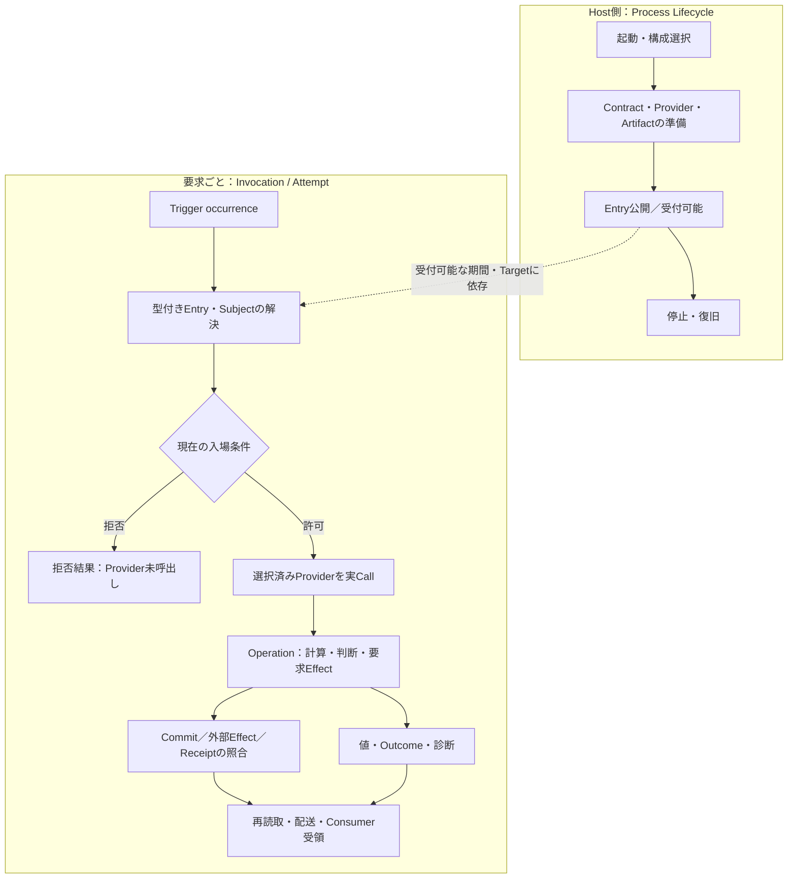
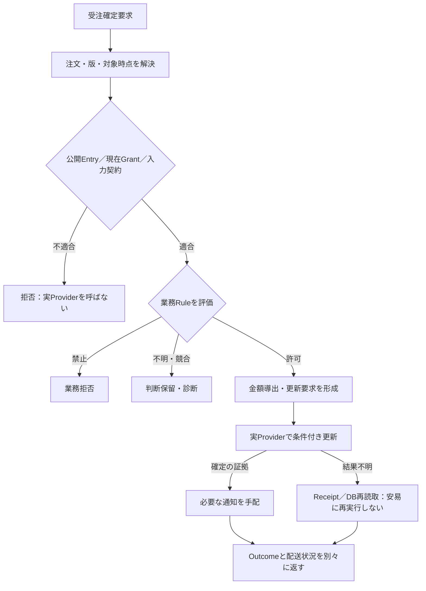
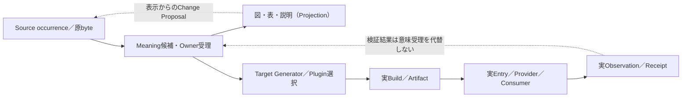
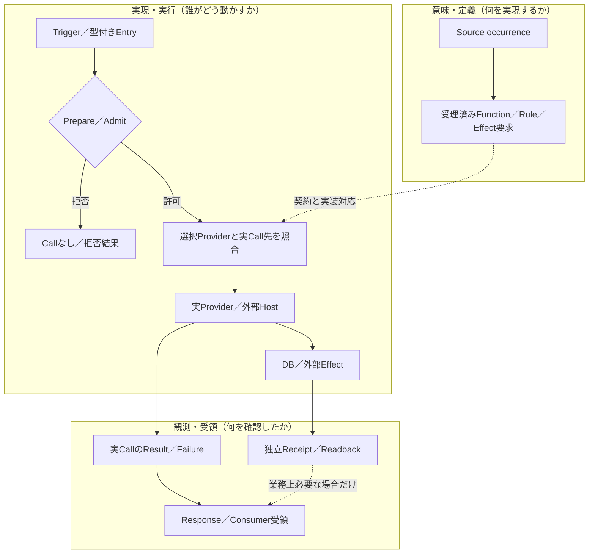
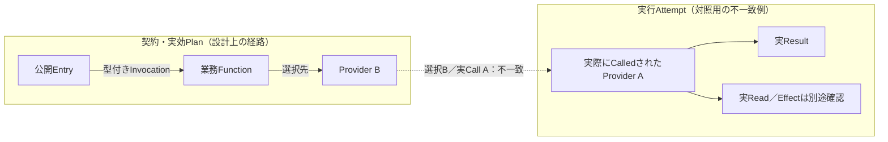
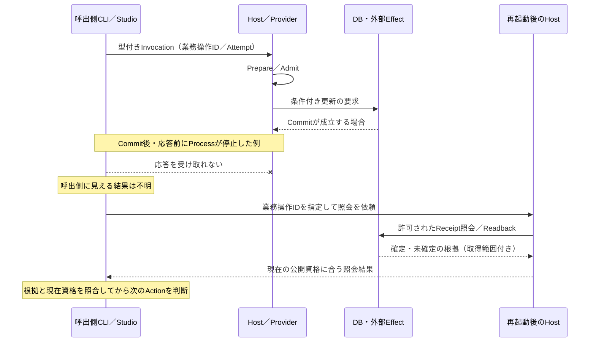
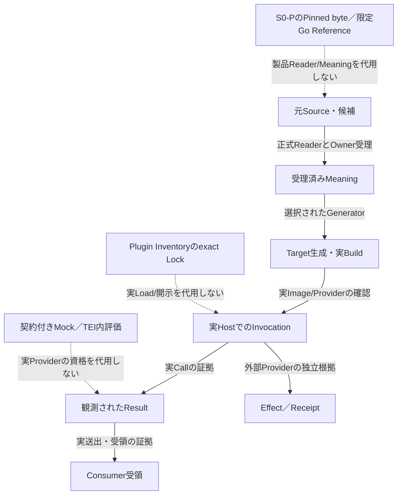
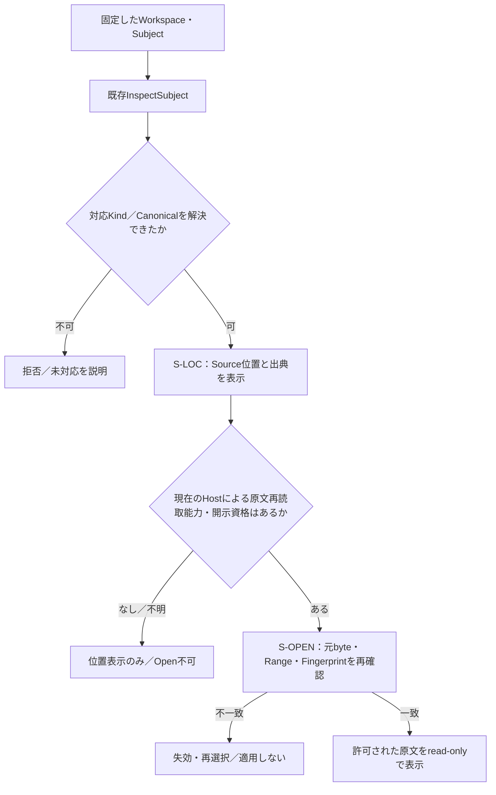
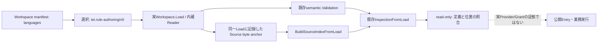
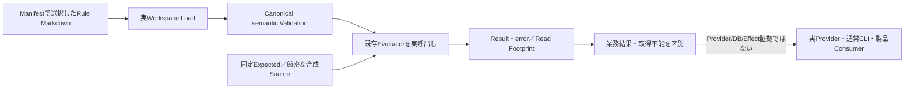

# プログラム実行モデルの図解とTarget間移植：設計・検証計画

- 状態：**実装前の横断設計案**。ここで整理する共通要素は、正式なDSL構文・Schema・実行Graph Compilerの採用を意味しない。
- 主担当：[実行可能Lifecycle Graph #4198](https://github.com/hat47x/tei-platform/issues/4198)。関係する仕様と検収は、それぞれの既存Issueが所有する。
- 接続先：[Script起動 #4502](https://github.com/hat47x/tei-platform/issues/4502)、[実Entry #4495](https://github.com/hat47x/tei-platform/issues/4495)、[Trigger #4497](https://github.com/hat47x/tei-platform/issues/4497)、[状態機械 #4193](https://github.com/hat47x/tei-platform/issues/4193)、[意味Role #2620](https://github.com/hat47x/tei-platform/issues/2620)、[DSL #988](https://github.com/hat47x/tei-platform/issues/988)、[Lowering #1121](https://github.com/hat47x/tei-platform/issues/1121)、[Studio #1124](https://github.com/hat47x/tei-platform/issues/1124)、[Effect #1129](https://github.com/hat47x/tei-platform/issues/1129)、[独立Expected #2514](https://github.com/hat47x/tei-platform/issues/2514)、[Stage2セルフビルド #4583](https://github.com/hat47x/tei-platform/issues/4583)。
- この文書の役割：既存の意味・実行・図解・移植・検証の境界を一か所で接続すること。業務意味、実行権限、Scenario、検証結果の第二正本にはしない。
- 今回の作業範囲：文書と計画の接続のみ。Go・Java・.NET・Web・実Providerのコード変更やE2E試験、Ownerによる仕様受理は **NOT RUN / NOT ACCEPTED**。

## 1. 問題設定と基本判断

Webアプリケーションでは「基盤の起動→受信待機→要求の到来→処理の選択→実行→応答」が繰り返されることが多い。この構造は、GUI、CLI、Batch、Message Consumer、Timer、OS Service、SaaSのFunction Invocationにも応用できる。ただし、すべてのTargetが同じ待機ループや常駐プロセスを持つわけではない。サーバーレスの起動管理や単発CLIの終了は、実Hostが担うこともある。

**TEIが標準化する対象は、特定のイベントループではなく、起動の契機・処理の意味・実行責任・副作用・結果の観測を区別できるプログラミングモデルである。** 実行ループやSchedulerをTEI固有のRuntimeとして実装することは、この構想の前提としない。

    実行環境の初期化・公開
              │
       起動契機の発生
              │
        Entry・対象の解決
              │
       現在の入場条件を検査
              │
       実ProviderでOperation実行
              │
    ┌─────────┴─────────┐
    │                   │
    値・業務結果       更新・外部作用
    │                   │
    応答／開示       Commit／Receipt
    └─────────┬─────────┘
              │
       独立Observation・終了／再入

上図は**説明のための投影**である。結果の返却と外部作用の確定は、常に左から右・上から下の順で起きるとは限らない。非同期配送、Commit後通知、ACK喪失、キャンセル、部分失敗では別々の因果関係と資格を追跡する。

## 2. 共通モデルの最小構成

| 要素 | 意味として区別する内容 | 実装上の責任 |
| --- | --- | --- |
| Execution Environment / Lifecycle | 起動、準備完了、停止、復旧、再入。初期化単位とInvocation単位の差 | OS・Host・Target Binding |
| Trigger Definition / Occurrence | 手動操作、HTTP、Timer、Message、Data Hookなどの宣言と、実際の発生事実 | #4497。発生は実行成功でも許可でもない |
| Entry / Prepared Invocation | 公開された型付き入口、対象、Input、期待Revision、期限、Operation識別 | #4495/#4502。Entryの発見は呼出権限ではない |
| Admission / Attempt | 現在のGrant、Scope、Provider、実ロードArtifact、Resource、開始の成否 | 既存Host/Driver・#1118/#1145 |
| Operation / Function | 計算、検証、Query、状態遷移、他Functionの呼出し、必要なEffectの要求 | Data/Function/BusinessのAccepted Meaning、Operator/Provider |
| Effect / Outcome | 永続化、外部通知、業務結果、失敗、不確定な効果 | #1129/#1174。結果値と確定済みEffectを混同しない |
| Response / Delivery / Observation | HTTP応答、CLI出力、GUI表示、ACK、Receipt、実状態の再読取 | #3274/#2586/#2514。受信者の実受領を別に検査 |

これらは**意味Roleの候補と既存構成の照合表**であって、新しい一枚岩のSchema、全用途共通の大きなEnvelope、独立のExecution Registryを追加する要求ではない。標準Data/Graph構造に必要なRoleと型付き参照を重ね、必要な箇所だけ対象固有の契約を設ける。

識別子も一種類にまとめない。少なくとも、Source occurrence／意味上のSubject・Revision／Trigger occurrence／Operation ID／Attempt／Provider Execution Reference／Effect Receipt／Traceを区別し、同じ表示名・時刻・応答番号による自動同一視を避ける。単一の万能IDをすべての経路に強制せず、実際に存在する因果関係を型付き辺で結ぶ。

## 3. 実行意味論と図の意味論を分ける

同じ図形の列が、同期処理、非同期処理、並行処理、Eventual Consistencyのすべてを同じ意味で表せるわけではない。次を対象Function/Targetに必要な範囲で明示する。

- **時間と順序**：発生時刻、配送時刻、評価時点、開始・完了時刻、Business Period、タイムゾーン／DST、順序保証を区別する。時計やEvent QueueをCoreへ固定しない。
- **並行・再入**：複数Attempt、親子Invocation、排他・競合、再送、Deadline、Cancellationの扱い。親のGrantを子へ自動継承しない。
- **状態・副作用**：計算による候補状態と、DB Commit・外部Effectの実確定は別。結果が不明な場合を成功・未実行に変換しない。
- **不変条件**：型、必要Input、許容遷移、認可、Effect fence、開示、Targetで表現可能な能力を明示する。PluginのGuard/HookやGraph Patchが回避してはならない義務を持つ。
- **評価方式**：Rule/Decision Table/State Machine/Stream/Batchなどの評価方式は、単一の固定実行順に押し込まない。必要なModel of Computationを適用範囲つきで示し、Targetが満たせなければunsupportedとする。

純粋な意味評価は概念的に「モデル・状態・入力・Contextから値、候補の状態変化、要求される作用、診断を導く」と表せる。ただし、その評価結果が実HostのGrant、外部Commit、配送成功、Consumer受領を証明するわけではない。意味評価、実行入場、実Provider呼出し、独立Observationをつなぐ検査順は、既存の **Prepare → Admit → Invoke → Observe** を用いる。

## 4. 図解の構成と安全な編集

すべての情報を一枚のフローチャートに詰め込まず、同じAccepted Meaningから次の図表を必要に応じて生成する。

| 投影 | 読み手の問い | 図と正本の関係 |
| --- | --- | --- |
| Lifecycle図 | 何が起動し、いつ待機・停止・復旧するか | Host固有部分とTEI定義を明示 |
| Control Flow・Decision図 | どの条件で何が実行されるか | 順序、分岐、例外、unknownを保持 |
| Interaction・Call図 | 誰が何を呼び、どの応答を受け取るか | EntryとInvocation/Consumerを分離 |
| Data・Effect図 | 何を読み、更新し、外部に通知するか | 宣言上の依存と実Read/実Effectを分離 |
| State図・遷移表 | どの状態・Eventで遷移が許可されるか | #4193が採否を判断。IFを無条件に置換しない |
| Trace・Evidence図 | 何を実行・観測できたか | 設計図とは異なる、実Attemptの観測投影 |
| Build・Artifact依存図 | 何を生成し、どの実行先が実際に使ったか | Source/Builder/Artifact/Consumerを別Revisionで確認 |

図の配置、色、線の曲げ方、Markdown・Graphvizなどの表記はPresentation Metadataであり、業務意味や実行順を自動的に変更しない。図からの編集は、SourceのSubject・Revision・出現位置と編集可能範囲を特定した**型付きChange Proposal**に変換し、Preview → Resolve → Admit → Commit → Observeの既存編集・検証境界を通す。

元のMarkdown/DSL/Graphviz等の糖衣表現は保存時に可能な限り保持し、意味のない全ファイル整形を避ける。図への投影で未表現となる属性はloss/unsupportedとして示す。逆写像できないProjectionを完全可逆と表示しない。AIが図やコードから推定したRelationはCandidateのまま保持し、Ownerによる意味受理を代替しない。

## 5. 異なる言語・Targetへの移行

移植元のコードを機械的に別言語の構文へ置換することと、同じ意味を別環境で成立させることは異なる。移行の単位は、必要に応じてFunction、Entry、Procedure、State Transition、Data Relation、Host Bindingへ分割する。

1. **Read-only Inventory**：元のSource/版、Call/Control Flow、イベント起点、実行Context、外部依存と副作用を列挙し、静的解析で不明な動的挙動はunknownとする。
2. **Candidate Semantic Map**：Data/Function/Business、Trigger/Entry/Operation/Effectへ候補対応を作る。旧コードの動作観測・AI推定だけでAccepted Meaningを生成しない。
3. **Gapと実現方式の選択**：同期/非同期、再入、状態、DB/Network、権限、精度、欠損/NULL、配布モデル、時刻と順序について、Target固有のBinding/Generator/Providerで実現できるかを照合する。
4. **生成と比較**：受理された意味からTarget実装を生成する。未実装の外部Componentは契約とMockで全体Scenarioを先に確かめられるが、実Provider適合は別の検収とする。
5. **実Consumer受領**：生成コードがビルドできたことだけでなく、同じSource/Meaning/Artifact/Providerが実CLI・Studio・Web等から使われた事実、必要な外部Effectと受領の範囲を追跡する。

例として同じ受注確定FunctionをHTTPとCLIから呼び出す場合、戻り値が一致するだけでは十分でない。入口が同じ意味上のFunctionに結び付いているか、選択したProviderを実際に呼んだか、同じ入力・権限・版で処理したか、Commit/Receipt/結果の開示が必要範囲で成立したかを別々に検査する。これは既存の#4495/#4502/#2586の検収を再利用する。

Target適合表では、Java/.NETの常駐Web Service、Go/Wails Desktop、単発CLI、Serverless、Batch/Message Consumerを例示できるが、**すべてに常駐Event Loopを生成することはしない**。Hostが所有するライフサイクル、TEIに表せる制約、Providerに委ねる保証、未表現の保証を区別する。

## 6. セクション化・メタプログラミングの適用条件

ここでいうセクション化には、コードの見出し・ファイル・関数を整理する**表層的な分割**と、独立した入力・出力・Effect契約を持つ**意味上の処理単位への分解**がある。見た目の区切りが同じでも、並行実行、再送、例外、Transaction境界をまたぐと意味は変わり得る。TEIが自動変換の対象にできるのは、必要な依存と制約を説明できる範囲だけである。

例えば受注確定処理を「入力の検証→金額計算→受注確定→確認通知」と分割する場合、金額計算は純粋Functionとして抽出できる可能性が高い。一方、受注確定と通知を独立の非同期処理へ分離するには、Commit後通知、Outbox、再送、重複防止、Effect unknownの契約が必要になる。単に四つのNodeへ分けたことは、それらの保証ではない。

分割・抽出・再配置・Target変更を行うメタ変換は、次の情報を失わないことを要求する。

1. **対象と由来**：意味Subject/Revision、Source occurrence、静的・動的参照の探索範囲。未解析の反射呼出し・外部Callはunknownとして残す。
2. **境界の明示**：型・多重度、missing/NULL/未取得、読み取り範囲、Outputと例外、必要なContext/Grant、Provider/Target要件を抽出後のInterfaceへ移す。
3. **観測可能な振る舞い**：Guard、評価順、精度と丸め、状態更新、Eventの因果・順序、Transactionの開始/確定、外部Effectの時点を保つ。効果を持つ処理を純粋と推測しない。
4. **変換責務の分離**：Source→Canonical Meaningの抽出はCandidate、Accepted Meaning→TargetのLoweringはGenerator、実Artifact→実Consumerは検収とする。変換器自身の「一致」判定をOwner受理にしない。
5. **差分の局所性**：型付きGraph PatchとDependency/Build差分を使い、表示Layoutの変更で意味やコードを再生成しない。A→B→A、Plugin/Operator版変更、非対象依存追加での旧Evidence再利用は別に判定する。

この方式なら、既存コードをFunction/Procedure/Effect単位へ切り出して共通部品を生成するだけでなく、Graphから呼出し順やUI/APIの公開面を導出し、言語別Generatorの選択やテスト生成に使える。ただし、Graphからの変換を一般に可逆と仮定しない。**変換前後の型付き入出力、必要な副作用、独立Expected、実呼出し先、Consumerの観測結果**を比較し、不足した保証はGapとして残す。

最初の比較は、同一pure Functionの「元コードの実行／意味モデルのシミュレーション／Go Targetの実起動」とする。次に副作用を伴うFunctionを選び、結果値が同じでも実ReadやEffectが異なる負例を入れる。二つの検証を分けることで、単なる構文移植と意味を保存したメタ変換の違いを判別できる。

## 7. 検証すべき反例（既存Scenarioへの引渡し候補）

| ID | 比較・故障注入 | 不合格を検出する要点 | Owner |
| --- | --- | --- | --- |
| PX-01 | 同一pure FunctionをAPIと実CLIから呼び出す | 値が一致しても実Providerが異なる、または片方がReferenceのみ | #4495/#2514 |
| PX-02 | Manual/HTTP/Timerで同じEntryを指定する | Trigger発生を、Grant付与・実起動・業務完了と誤認 | #4497/#4502 |
| PX-03 | Event重複とACK喪失後の再送 | 同一OperationでもEffectを重複確定、unknownを自動成功・自動再送 | #1174/#1129 |
| PX-04 | Commit前通知・Rollback | 外部送達済みと誤表示し、Effectの位相を飛ばす | #1129/#1174 |
| PX-05 | 同じフローを同期Hostと非同期Hostへ移す | 順序・期限・戻りの表現不一致を隠して同値と判定 | #1121/#4198 |
| PX-06 | 図の座標だけを変更する | 意味Revisionや生成Artifactが不要に変わる | #1124/#2620 |
| PX-07 | Source改版後の旧図・旧Triggerを使用する | 同名の別Subjectへ再束縛、旧Grantで起動 | #1124/#4497 |
| PX-08 | 状態機械をIF/Ruleへ展開する | Guard、直交状態、遅着Event、不変条件の喪失を隠す | #4193/#2514 |
| PX-09 | 可視化で未読込Plugin／秘密Sourceへの辺が欠ける | 不明な依存を「参照0・安全・完全」と表示 | #1251/#1124 |
| PX-10 | 同じ結果を返す実装が余分なデータを読む | 値の一致だけでRead Footprint/Disclosure合格 | #2586/#2514 |
| PX-11 | Buildは成功、実Consumerは旧Artifactを使用 | 生成物と実使用物を同一視 | #4583/#2831 |
| PX-12 | Targetが必要なEvent順序・Effect保証を持たない | unsupportedを自動代替実行して意味を変える | #1121/#4198 |

独立Expectedと合成Fixtureの結果は区別する。未実行の反例をPASSとは表示しない。状態図・表の見た目の一致だけでは、実時刻・実DB・実Deviceの動作が正しいことを保証しない。

## 8. 実装計画と優先順

**P0：既存の製品縦断を先に成立させる。** #4495の実Entry→型付きInvocation→実Providerの二入口と、#4583/#2831のStudio Desktop Stage1→Stage2自己再構築を優先する。今回の図解仕様やGraph Compiler完成を、これらの新しい必須Gateにしない。

**P1：既存Graph/Sourceのread-only投影を試す。** #4198 R0の棚卸しとして、一つのpure Functionと一つのTriggerを対象に、Lifecycle／Entry／Operation／Response／Evidenceの関係を既存Graph型へ投影する。元Source、辺の識別子、Representation Loss、未取得依存を明示し、図のLayoutのみ変更した場合の非再生成を検査する。Studio/CLIの固定選択・ソースジャンプは#1124/#4515へ接続する。

**P2：二つの異なるTargetで意味保存を比較する。** 同一Accepted Meaningの一Functionを、まず実Go CLIと既存Studio/Hostで検収し、続いて異なる言語または異なるLifecycle（例：常駐サービス対単発実行）へ適用する。差が出た箇所をRole不足／Target Binding／Provider／Host Authority／生成器不足へ分類し、差が消えるまで「移植可能」と断定しない。

**P3：編集・再生成と応用を検討する。** #4198 R1〜R4、#4193の異質DomainのPressure、#3503のVUI、既存HTTP応答Decision Graph、Batch/ETL、SHO文書生成へ、必要なProjectionだけを広げる。図編集からSource Change Proposal、受理、再生成、実Consumer確認までの可逆性が確認されたものだけ書込編集へ進める。

採否の停止線は、第二Host/Runner/Resolverが必要になる、現在Grantを迂回する、図からAuthoritative Sourceへ戻れない、Plugin登録順で意味が変わる、異質Target間の不足を隠す、未実行なのに製品合格を主張する、のいずれかである。

## 9. 各担当への引渡し

- **#4198**：共通Lifecycle/Control/Effect Graphの最小Roleと、Graph Template + Obligation + Plugin差分が既存標準Graphに収まるかを評価する。正式Schema/Graph Compilerの採用は保留。
- **#4502/#4495/#4497**：公開EntryとTriggerを実Invocationへ接続し、実Call・入場資格・再入・配送結果を検収する。新SchedulerやScript Runnerを作らない。
- **#2620/#988/#1121**：Data＋意味Role＋DSLの糖衣＋Target Loweringを分離し、評価順やRuntime能力を文法に埋め込まない。生成Goを業務意味の正本にしない。
- **#1124/#4193**：図・表・Traceの相互参照、選択の固定、Representation Loss、変更Proposalを担当する。State Machineの採否は異質Domain比較後。
- **#1129/#1174/#2586/#2514**：Effect/Receipt/Provider Read/独立Expectedを各Ownerの検証に接続する。HTTPステータス、ACK、Business Outcome、永続作用の資格を分離。
- **#4583/#2831**：Source→Build Intent→Builder実行→Artifact→Stage2 Desktop→実Windows Consumerの現在の最優先経路を維持する。図解構想を理由にセルフビルドへ別Runtimeを追加しない。

この設計案の統合は実装や採用の完了ではない。次の判断は、#4198 R0のread-only実証と#4495/#4583の独立した製品検収で得られる不足点を見て、既存Ownerが行う。

## 10. 定義・実効計画・実行記録・図面を区別する

前節までの「共通Graph」は、一つの巨大な実行フローをすべての画面で共有する意味ではない。少なくとも、次の四つを別の投影として扱う。

| 区分 | 何を表すか | 変更と合格の判断 |
| --- | --- | --- |
| 意味の定義（Definition） | Sourceに記述され受理されたFunction、Entry、条件、状態、Event、必要CapabilityやEffectの契約 | Accepted Meaning、Source/Operator/Role revisionが基準。未受理の解析結果はCandidate |
| 構成済み実行計画（Effective Plan） | 選択済みPlugin、Provider、Target、追加Guard/Hook、実行順制約と実装上のObligation | 対象と選択規則を固定した導出物。生成できても実際のロードや呼出しは未証明 |
| 実行の記録（Observed Trace） | 実際に読み込み、入場を許可され、呼び出され、どこまで応答・確定・受領されたか | Operation/Attempt、実Provider、実Read、Receipt、Consumer観測で判定。未観測の辺を実経路にしない |
| 表示・操作用の図面（Projection） | Graph/Tree/Table/Sequence/Timing/State/説明文のレイアウトと操作位置 | 正本への参照を持つView。座標・色・表示順の変更は意味変更ではない |

DefinitionからEffective Planへは既存Composition/Loweringで導出し、Effective PlanからObserved Traceへの対応は実行時の識別子で照合する。Observed TraceがDefinitionの意味を自動更新することはない。AIが実行履歴から推測した依存関係も、受理前はCandidateである。

同じ二つのNode間でも、制御フロー、データ依存、時刻上の先行関係、Effectの因果、権限上の要求、Source出典、実行観測は異なる辺である。型付き辺には、必要な範囲で関係種別、方向、Multiplicity、固有のEdge identity、条件・時点、Source locatorと探索Coverageを持たせる。表示のための線IDを意味上のEdge identityへ流用しない。同じ名称のNodeが二つ存在し、多重有向辺がある例で参照・投影を先に確かめる。

## 11. 実行規則（Model of Computation）の適用範囲

Bootstrap→待機→Event→処理→応答という説明は有用だが、それを万能の逐次フローとして仕様化すると移植時に意味が失われる。**何がいつ評価され、どこまでの順序や状態が保証されるか**は、プログラム構造とは独立した実行規則として、必要なSubjectに適用範囲つきで表す。

| 対象例 | 主な実行規則 | Hostに委ねる部分・保留条件 |
| --- | --- | --- |
| 常駐HTTP Service | Request単位のInvocation、同時実行、Response/Abort、Session等の必要Context | Listener、Thread/Task管理、接続停止。並列度や順序を推測しない |
| CLI単発実行 | Process入口、引数・標準入出力、終了コード、実行単位のResource | Process起動とOS権限。終了コード0とEffect確定を区別 |
| Serverless | Host側の初期化・再利用、Invocation単位のContextと期限 | Instance再利用・同時実行・配送はPlatform依存。常駐Loopを生成しない |
| Desktop/GUI | UI Event、非同期処理、描画スレッドとの境界、画面State | GUI DispatcherとOS/Wails/WebView。古い非同期応答を現Selectionへ混ぜない |
| Schedule/Queue/Batch | 発火、配送、対象集合、遅延、重複、再送、Checkpoint | Scheduler/Broker/Workerは既存Host/Provider。発火時刻と業務評価時点は別 |
| Stream/科学計算/Simulation | Window、Tick、サンプリング、遅着、計算順、単位・精度 | 既存Operator/Toolkitの適合条件。一般時間EngineやSolverをCoreへ追加しない |
| MCP/VUI/AI Web Chat | Typed Operation、部分入力、明示確認、割込み、Tool受領 | Interaction Profile固有の表現を分離。部分的Tool argsを実行指示へ昇格しない |

最小検査項目は、（1）起動・評価の契機、（2）状態の所有単位、（3）必要な順序／並列性、（4）時間・Deadline・業務評価時点、（5）失敗・取消・再送、（6）結果・作用の確定点、（7）Targetが満たす能力、の七つである。すべてのSubjectに七項目の巨大Envelopeを保存させるのではなく、移植や実行に必要な項目のみ既存Role/Trait/Target契約で明示する。不明な保証はunknown、適用先で実現できない保証はunsupportedとして残す。

State Machine、Rule、Decision Table、Reactive Flow、Dataflow、Stream、Batchを単一の実行順へ押し込まない。単純なIF/Ruleで十分なDomainに状態機械を強制せず、#4193の異質Domain比較で導入価値を判断する。

## 12. 処理を切り出すときの境界契約

プログラムを「機能の単位」に切り出す作業を、型付きGraphの部分領域を抽出する操作として説明できるようにする。ただし、Graph上の切り出し線を引いただけでは独立したFunctionにはならない。境界の外から参照する値、制御、状態、権限、時刻、作用を契約として閉じられることが必要である。

| 切り出し後に必要な契約 | 確認する内容 |
| --- | --- |
| 入力・出力 | Typed Ref、Presence/NULL/未取得、単位・精度・丸め、多重度、例外・結果の区分 |
| 依存の閉包 | 呼出すFunction/Rule/Operator、読込Relation・Field・Scope、動的参照、選択ProviderとVersion |
| 制御と時間 | Guard、短絡評価、Evaluation Order、並列実行、再入、Snapshotの評価時点、Deadline |
| 状態・Effect | Read Footprint、候補変更、Commit/通知などの位相、Operation ID・再送・補償 |
| 公開・権限 | Entryの公開面、必要Capabilityと実Host Grant、Scope、開示条件、Target適合 |
| 証拠 | Source/Meaning/Artifact revision、独立Expected、実Call、Receipt、Consumer Observation |

例：受注の「入力確認→金額計算→注文確定→通知」という表示からは、金額計算が独立pure Functionへ切り出せる可能性を検討できる。しかし注文確定と通知を別Taskへ分けるには、DB Commit後の通知であること、Outbox等の実配送方式、ACK不明時の再送規則が契約として必要になる。これらを失う変換は「構造化成功」ではなくGapまたは拒否である。旧X-TEA Sourceから受注Functionの対応が確定していなければ、名称の類似だけで新しいFunction IDへ接続しない。

変換の扱いは次の三段階にとどめる。

- **read-only抽出**：Sourceと静的依存の候補を図・表・説明へ投影する。未知の反射・動的Call・外部Effectは未解決として残す。
- **安全条件つき提案**：純粋計算など閉包が説明できる部分について、抽出先のInput/Output/Dependencyを提示し、対象Revisionに結び付けたChange Proposalを作る。Sourceの糖衣表現と非対象Byteを保存する。
- **実装・実行への反映**：既存Acceptance後にBuilder/Generatorへ渡し、各Targetの出力、実Provider・実Consumer・必要なEffectを別々に検収する。

宣言されたpure Traitと実際に作用しないことは別である。例としてCLIの計算はpureでも、Hostがログやファイルを生成する場合があるため、Function内の作用とHostの作用を混同しない。

## 13. 言語間移行とメタ変換の同等性

「同じ値を返した」というだけでは、異言語移植の合格条件にならない。対象の用途に必要な同等性を、段階的かつ別々に説明する。

| 比較する面 | 同等性を損なう例 | 検証・証拠 |
| --- | --- | --- |
| 構造と型 | 異なるSubjectへ名前で再束縛、NULLとmissingを統合、複合キー・順序・多重辺が欠落 | Source/Meaning ID、型とRefの照合 |
| 計算と評価 | Decimalの丸め、単位、短絡評価、NULL伝播、評価順が変化 | 固定入力、独立Expected、Mutation |
| 時間と制御 | 同期処理を非同期化して順序喪失、再入やDeadlineが異なる | Trigger/Attempt/Timing Trace、Target Capability |
| 状態と作用 | 出力値は同じでもRead Footprintが広い、通知がCommit前、効果不明を失敗扱い | 実Read、Effect Receipt、独立Observation |
| 権限と開示 | Sourceからの要求をGrantに昇格、移植先で秘密を余分に取得・返却 | 現在Host Grant/Disclosureと実Provider Call |
| 配布・受領 | 生成Artifactは最新でもConsumerは旧版を起動 | Build/Artifact/Loaded Bytes/Consumerの照合 |

同等性の主張には、対象Function/Target、入力集合、実行規則、検査した作用と観測範囲を添える。部分的に一致した範囲から、未検証の対象全体や別Targetへ同等性を拡張しない。

変換器の入力と出力も既存の資格を分けて扱う。旧言語のSource解析結果は**候補**、受理済みMeaningは**仕様**、Target-neutral planは**構成済み実現候補**、生成Artifactは**物理成果物**、実行Traceは**観測**である。Targetが必要な保証を表せない場合は、暗黙のFallbackではなく、既存#1121/#951/#3278のConformance上のGapとして返す。

必要に応じ、既存の標準Record/Sequence/Relation/Graph/Expressionに意味Roleを付けることで、言語専用ASTの内部構造を業務DSLへ露出せずに済む。構文定義とParser、意味解釈、Model of Computation、Target実現は別の契約とし、自己記述の有限Bootstrapとexact Pinは#2620/#4359の評価に従う。Goのstruct/func等をDSL必須要素にしない。

## 14. Studioでの表示と編集体験

初期版は新しいGraph Editorを作らず、既存のInspector／型付きReference／Source索引から、選んだFunctionまたはEntryを中心に表示する。

- **全体から局所へ**：アプリケーション→Entry→Function→処理節→Rule/Fieldへ粒度を変えても、同じMeaning IDとSource位置へ戻れる。画面ごとに別の編集正本を持たない。
- **見たい関係を切り替える**：制御、入力と出力、状態、時間、Effect、Authority、実呼出しを重ね合わせず切り替え可能にする。Graph/Table/Tree/Traceの相互参照と表示Lossを示す。
- **確実な対象指定**：現在のFocusとは独立したPinned Selectionに、Subject/Source/Revision/Scopeを保持する。古い結果・曖昧ID・権限失効時は表示を残しても、書込み・実起動・AI送出を保留する。
- **説明文への展開**：受理済みの業務意味と処理の型付き辺から、認知順に沿った説明文、Graphviz、Markdown表、テスト対象一覧を導出する。AIによる補足は候補として区別する。
- **編集の帰着先**：図面でNode/Edgeを変更した場合は、編集可能なSource occurrenceを確定できるものだけProposal化する。対応できないProjectionはread-onlyとし、元のMarkdown/DSLなどの非対象Byteを不必要に整形しない。

三要素分析法については、業務フロー・機能階層・データモデル・CRUD・クロスレファレンスなどの原典に忠実な再現を先に検証する。この汎用プログラムGraphは**TEI独自の追加投影**であり、業務モデルを自動Workflowへ、機能モデルを関数計算へ黙って置換しない。

## 15. 次の小さな実証と既存計画への引渡し

今回の追補は独立のRunner／Parser／Graph Compiler／Statechart Engine／Schedulerを実装する許可ではない。まずP0のStudio Stage1→Stage2セルフビルド（#4583/#2831）と、製品Entry→実Providerの二入口（#4495/#4502）を維持する。以下は#4198 R0〜R4、#4193、#2514の既存検証へ渡す**追加の反例候補**であり、新Gateや第二Scenario正本を作らない。

| ID | 最小の対照 | 確認すること | 既存Owner |
| --- | --- | --- | --- |
| PX-13 | 同じ表示位置に二つの同名Node、同じ端点間に二つの有向辺 | Graph identity／辺種別／方向／多重度をSourceまで追跡。曖昧なら書込拒否 | #2620/#1124/#4198 |
| PX-14 | 定義Graphは同一、Provider A/BとHookだけ差替え | Effective Plan差と実選択／実呼出しを分け、Guard/Effectを迂回不可 | #951/#4198/#2514 |
| PX-15 | 同じControl Flowを常駐HTTPと単発CLIへ投影 | Host待機の有無ではなくEntry/Function/Resultの必要な意味を比較 | #4502/#1121 |
| PX-16 | pure計算を関数へ抽出し、別Targetへ生成 | Input closure、演算・丸め、元Source、独立Expected、実Consumerを照合 | #988/#1121/#2514 |
| PX-17 | Commitと通知の間で処理節を分割 | Effect位相・Outbox・ACK不明・再送条件の喪失を検知し自動分割を拒否 | #1129/#1174 |
| PX-18 | 同じ入力値で依存Function・Provider実装だけ変化 | 構文・値が同じでもPin/Build/Evidence再利用を再判定 | #2620/#2600/#2831 |
| PX-19 | ServerlessのInstance再利用と二重Invocation | 初期化回数やProcess状態を業務一回実行とみなさない | #4497/#4502 |
| PX-20 | GUIで旧選択の非同期応答が新選択へ到着 | Pinned Subject・Revision・Disclosureの不一致を表示し誤反映しない | #1124/#4515 |
| PX-21 | 同じGraphから図だけ並べ替え、説明文だけ変更 | Layout変更は意味・実行を変えない。説明変更は必要な文書再確認を別判定 | #1124/#2600 |
| PX-22 | 値は一致するが実ProviderのRead範囲が部分的 | 値の成功をSource/Read Closure/Consumer完全性へ拡大しない | #2586/#2514 |

**進行順**：最初は一つの受理済みpure Functionと既存Entry/Triggerのread-only投影、次に同FunctionのGo CLI／Studio実Provider呼出しの対照、続いて「pure節抽出」と「Commit後通知の分割拒否」を比較する。異質なTarget間の生成・状態機械・対話UI・書込図編集は、観測された不足を解消する段階まで後ろに置く。実行前のモデル適合と実Targetの呼出し、独立Expected、Host Effect、Consumer受領は異なる資格のままとする。

現時点でPX-13〜22の実試験、異言語移植、Graph Writer、全Target適合、Owner意味受理は **NOT RUN / NOT ACCEPTED**。静的設計文書の変更から、製品機能の成立を主張しない。

## 16. 図から行う変換を分類する

プログラムを図にすると、Nodeの移動、関数の切り出し、実行先の変更が似た操作に見える。しかし、保存すべき意味と確認する証拠は異なる。Studioでは見た目を揃えるよりも、**何が変更され、どこまでを再検証する必要があるか**を示す。

| 変換の種類 | 例 | 判断の基準 |
| --- | --- | --- |
| 表示の変更 | Nodeの配置、折畳み、表示色の変更 | Meaning/Execution Planを変えない。省略した情報やSourceへの参照を保持 |
| 記述形式の変更 | Markdown表・式・DSL糖衣の往復 | Source occurrence・非対象byte、Role/Operator、意味への対応を保持 |
| 構造の組替え | 純粋計算の関数抽出、処理の共通化 | 型・依存・評価順・例外・状態・Effect・Authorityの境界を保つ |
| 実行先の移行 | Go CLI→HTTP、Go→Java/.NET、同期→Queue | Model of Computation、Provider/Host能力、時間・順序・再送・Consumer受領を検証 |
| 仕様そのものの改訂 | 丸め方、通知時点、例外方針の変更 | 旧版との同等性を強制せず、影響を示してOwnerが新しいMeaningを受理 |

同等性の主張には、比較する入力と環境、観測対象の値・状態・時間・副作用・開示範囲を必ず添える。同じ金額を返しても、余分な顧客情報を読み取る実装は「値について一致する」に留まり、Read Footprintや情報開示まで同等とはいえない。

契約を保った組替え、契約の条件を強める変更、許容する動作を増やす変更、意図的な仕様変更は別の判断である。たとえば再送を禁止して安全性を高める変更も、既存Consumerにとって必ずしも後方互換とは限らない。旧契約との関係と影響対象を明示したうえで、適切なOwnerと独立Expectedによって採否を決める。

この分類は新しいCore enumや承認Engineではない。既存Source Change Proposal・Meaning Acceptance・Lowering・Conformanceで、変換の種類に応じた検査を選ぶための指針である。

## 17. 安全に切り出せる処理の境界

型付きGraph上で処理領域を選択したとき、まず境界を横切る関係を**読取り専用**で列挙する。既存のSource/Dependency索引とFunction Contractから求められる範囲を使い、別のSlice Engineを前提としない。

| 境界を横切るもの | 切り出す前に確認すること |
| --- | --- |
| 値とデータ | Typed Input/Output、NULL・欠損・未取得、単位・精度、Multiplicity、複合識別子 |
| 呼出しと制御 | Guard、例外、戻り先、短絡評価、動的参照、再入 |
| 時間と順序 | Event因果、Deadline、Snapshot・業務評価時点、並列実行、遅延応答 |
| 状態の所有 | Function局所、Invocation、Session、Process、業務レコード、外部Providerのどこに状態が属するか |
| 権限と開示 | 公開Entry、必要Capability、対象Scope、現在Grant、実ConsumerへのDisclosure |
| 効果と復旧 | 実Read、更新候補、Commit、通知、ACK、取消、再送、補償 |
| SourceとBuild | 元のSubject/Source occurrence、Role/Operator/Provider/Generator Pin、実Artifactと現在資格 |

図形の囲みを独立Functionに変換してよいのは、必要な境界契約を説明できるときだけである。未探索のCall、反射、別Providerでの暗黙Read、未取得の外部状態があれば、曖昧さを示して自動適用を保留する。

たとえば受注処理の金額計算は純粋Functionとして切り出せる可能性がある。一方、注文確定と通知を別Taskへ分割するには、Commit後配送、Outbox、ACK喪失、再送の扱いを確認する必要がある。単に同じ応答値を返すだけでは安全な分割と判断できない。

X-TEA由来のSmartDB/Data Script/XF系を扱う場合は、原典に基づくFunction・Dataの対応、業務キーと物理PK、更新フック、実Providerの作用を確認する。同じ名前のFunctionへ推測で結び直さない。Graph上で選んだ領域の内側・境界・外側をStudioのGraph/Table/Treeから相互参照し、必要な情報が欠けている場合はread-onlyを維持する。

## 18. メタ変換後の再検証を局所化する

あらゆる変更で全処理を再実行するのではなく、変更された意味と実現の層に応じて必要な確認を選ぶ。ただし、結果値や入力byteが同じことだけを理由に、過去の検証結果を無条件に再利用しない。

| 変更 | 再検証の中心 | 誤って省略してはならないこと |
| --- | --- | --- |
| 図の表示設定 | Projectionと固定Subjectへの参照 | 図の変更をMeaning変更とみなさない |
| コメント・表記だけ | Source byte・occurrenceと説明・文書受領 | Source RevisionとMeaning Revisionの混同 |
| 処理抽出・依存変更 | 入出力閉包、評価順、例外、独立Expected、利用側 | 動的依存・実Read・Effectの調査 |
| Role/Operator/Plugin更新 | 受理したContract、実Impl Pin、選択Provider、Conformance | 同名・同version・同値だけでの資格再利用 |
| Generator・Target更新 | Target Capability、実Artifact bytes、実ロード先、Consumer | Build成功を実Consumer適合へ昇格 |
| Trigger・Host・時間規則変更 | 入場条件、順序、再入、Deadline、Grant、Receipt | 発火・ACK・exit 0を業務完了とみなすこと |
| DB・外部Provider変更 | Queryとbind、Read Footprint、取得範囲、Commit、独立Observation | 合成データ・部分取得を完全な実状態の証拠にすること |

World Fingerprint、Model Revision、Artifact Revision、Evidenceの現在資格は別の指標とする。SourceがA→B→Aと戻っても、途中でOperator・Plugin・Host Grant・Consumerの条件が変わっていれば、古いEvidenceをそのまま有効とはできない。Artifact再利用、Build省略、Evidence再利用も別の判断である。

これは新しいBuild管理機構の提案ではない。#2600/#2831のBuild・Bundle、#2620/#988のRole・Operator、#951/#1251のPlugin、#1124のSource編集、#2586/#2514の実Read・独立Expectedへ、それぞれ必要な再確認を引き渡す。

## 19. 最初の縦断実証と反例

最初は、実在するSourceとMeaning IDを確認できる**一つの純粋Function**を選ぶ。「数量2×単価300＝600」は説明用の独立Expected候補であり、現行order_entryの特定Functionがこの契約で受理済みだと主張しない。着手時は#4495の実Subjectと入口を照合し、対応がなければその不足を記録する。

このFunctionについて、Source→型付きGraphのread-only投影→抽出候補のInput/Output/Dependency→変換前後の独立Expected→実Go/CLIと別Consumerの実Provider呼出しを順に比較する。図が描けたことではなく、**分割した場合に何が失われるかを見つけられること**を最初の受入とする。

次にCommit後通知を含む処理を選び、値が一致しても安全に分割できない反例を確認する。異言語移行・Serverless・本格的なGraph逆編集は、この小さな二例から必要な意味RoleやTarget能力の不足が分かった段階で評価する。

| ID | 故障注入・比較 | 不合格条件 | Owner |
| --- | --- | --- | --- |
| PX-23 | 図形は同じだが一つの辺をData依存からControl依存へ変更 | 図の見た目だけで意味不変と判定 | #4198/#1124 |
| PX-24 | 純粋計算の抽出後にNULL・丸め・短絡評価が変わる | 代表値600だけで同等と判定 | #988/#2514 |
| PX-25 | 外部Providerの暗黙Readを含む処理をpureとして抽出 | 未確認のRead Footprintを無視 | #2586/#1129 |
| PX-26 | HTTP起動からQueueへ移行し二重配送 | 再送・順序・応答時点の差を互換扱い | #4497/#4502/#1121 |
| PX-27 | SourceがA→B→Aへ戻る間にProvider/Grantが変わる | 古いEvidenceを現在資格の確認なしに再利用 | #2600/#2831/#2514 |
| PX-28 | 処理分割でCommit後通知をCommit前に移す | Result値の一致だけで安全と判定 | #1129/#1174 |
| PX-29 | Ownerが新しい丸め規則を明示的に採用する | 意図した仕様変更を無条件に不合格、または無承認で同等とする | #2620/#2514 |

PX-23〜29は#4198 R0〜R4と#2514/#1180の既存Scenarioへ引き渡す候補であり、第二のテスト正本や新Gateを作らない。主線は引き続き、#4583/#2831のStage1→Stage2 Studio Desktopセルフビルドと#4495の実Entry→実Providerである。

**状態：設計・受入条件の追補。上記反例の実行、Go/Windows/DB/異言語での新しいE2E試験、Ownerによる意味受理はNOT RUN / NOT ACCEPTED。**

## 20. 対応関係の確かさと表現の損失

一つのプログラムをDSL、処理図、関数一覧、SQL、生成コード、実行Traceへ表示する場合、同じ名前・同じ形が現れても、その対応が確定しているとは限らない。**表現間の対応と、その対応をどこまで確認できたか**を明示する。

対応付けの起点は、既存のSource occurrence、意味Subject/Revision、型付きRelation/Edge ID、必要なRole/Operator Pinである。図の座標や生成コード中の行番号、似た名前を唯一の識別子にしない。生成後に行番号が変わっても、元の意味SubjectとSourceへ戻れる導出関係を保持する。ただし、同じ意味Subjectから複数のArtifactや表示Nodeが生成される場合もあり、一対一対応を強制しない。

| 対応関係 | 表示・診断で分けること | 安全な利用範囲 |
| --- | --- | --- |
| **Sourceに明示された定義** | 原文位置、版、Role/Operator解決、意味受理の有無 | 受理済みならMeaningの根拠にできる。構文認識だけでは受理済みとしない |
| **静的解析による依存候補** | 解決できたCall/Read、動的参照・未探索範囲、解析対象Artifact | 設計支援の候補。実行時に呼ばれたことの証拠ではない |
| **Provider/Hostによる実観測** | 実Call、実Read Scope、Effect Receipt、取得範囲・時点・主体 | 観測したAttemptの証拠。未観測の経路不存在を主張しない |
| **AI・移行ツールの推定** | 候補を得た入力と版、推定根拠、曖昧な対応・競合 | 説明・提案には使えるが、Owner受理／実行許可へ自動昇格しない |
| **表示上の関連** | 展開・折畳み、集約、別名、レイアウト、意図的な省略 | 閲覧の便宜。意味上のEdgeや処理順と取り違えない |

既存#2497の構造保存写像を再利用し、各Projectionが保持する性質を、少なくとも識別子・型・順序・多重性・粒度・NULL/欠損・時間・単位・取得範囲・編集可能性で検査する。GraphをTreeに表示して第二の親が隠れる、複数Edgeを一本の線にまとめる、Query集計で元行が失われる、といった場合には**表示できることと安全に書き戻せることを区別**する。

表示からSourceへの変更には、次の限定的な往復条件を置く。対象と版を固定したうえで、（a）変更せず取得したViewを適用しても、非対象のSourceや意味を変えない、（b）Viewの編集が成功した場合は再読取りした投影に意図した変更が反映される、（c）同じ変更が他のRelationや糖衣原文を不必要に破壊しない、を確認する。これはすべての表現が双方向変換できるという主張ではない。集計View、部分取得、未解決Source、多対一の対応、Graphの単なる配置変更は、それぞれ適したread-onlyまたはView Metadata操作へ留める。

生成AIによる自然文説明も同じ扱いとする。受理済みFunction/Business Ruleから**根拠付きで機械的に説明できる部分**と、推測・要約・補足を区別する。「通知した」「DBに保存された」「利用者が受領した」のような完了表現には、それぞれ実際のReceipt/Observationが必要である。説明文の生成成功を実行成功や業務意味の受理にしない。

## 21. Target移植を確認する際の観測範囲と不足情報

Go、Java、.NET、Web、Wails Desktop、CLI、Serverless等へ移すとき、「すべての内部処理が同じ順序で走る」ことを一律の条件にしない。SourceとTargetに対し、**どの入力・環境条件のもとで、どの振る舞いを等しいとみなすか**を先に決める。内部スレッドの割当てなど、利用者へ保証しない差は許容できる一方、外部に見える値、状態、権限、Effect、必要な時刻と順序は契約で明示する。

| 確認の段階 | 問い | 成立したと主張できる範囲 |
| --- | --- | --- |
| 意味と表現の対応 | Sourceから解釈した計算・関係・制約・実行規則が、Target側で表せるか | 静的な型・Meaning/Operator/Model of Computationの対応。実動作は未証明 |
| 生成と構築 | 選択済みBuilder/Generatorが必要な入力を読み、指定Target用Artifactを生成したか | 実消費入力・選択Provider・生成物の範囲。実ロードは未証明 |
| 実行と作用 | 対象Artifactから選択Providerを実際に呼び、許可された範囲で結果・Effectが生じたか | 実AttemptとEffect観測。未取得・他Attempt・他Principalには拡張しない |
| Consumer受領 | 実CLI、Studio/Web、別Host等が期待する値・版・開示を実際に受け取ったか | 観測したConsumerと条件に限った適合。全面同等性ではない |

これは新しい4段階Gateではなく、#1121 Lowering、#2600/#2831 Build、#4495実Entry、#2586実Read、#2514独立Expectedから既に得られる証拠の整理である。

移行前後の差は、**仕様の意図した変更**、**Target/Hostの能力差**、**Provider/生成器の実装不備**、**観測不足**の四つに分ける。例えばCLIからWebへ移しても同じ値を返す一方、Sessionの寿命、同時実行、キャンセル、ログ出力、実行権限が異なる場合がある。それらを未確認のまま完全互換とはしない。Providerに必要な時間的保証やTransaction保証がなければ、未知のFallbackで補完せず、既存の未対応・表現不能診断で停止する。

「未対応」「一部取得できた」「取得を拒否された」「まだ検証していない」も分ける。実データが0件であるという事実と、対象集合が空であると**確かめられなかったこと**は異なる。利用可能なSourceとPluginの選択集合も実行時点で変わり得るため、以前の成功を現在の権限・Providerに自動適用しない。

## 22. SQL・NoSQL・外部Providerをまたぐ実行モデル

汎用実行モデルの最初の応用先として、データ処理の表現と実行条件を比較する。Queryの記法が共通化できても、RDB、ドキュメントDB、Graph DB、API、ログ/Streamで**結果の意味と実際の取得条件が同じになるとは限らない**。

- **何を取得するか**：対象集合・条件・Join/Traverse、業務キー/物理キー、NULL・missing、多重度、重複、並び順、集計粒度。Native SQL/Native Queryの元の記法と方言を保持し、TEI標準表現への変換を強制しない。
- **いつ・どの範囲か**：業務時点・Snapshotの一貫性、ページング、カーソル、Window、遅着イベント、途中取得、ProviderのRead Scope。部分Rowsetや観測済みページだけから全件の集計正しさを主張しない。
- **どう実現したか**：論理QueryからTarget SQL/Provider QueryへLoweringした条件、Pushdown可能性、Unsupported Operator、実Bind値、実Provider Selection、Read Footprint。SQL文字列を得たこととDBが同じ意味で実行したことを分ける。
- **何を変えたか**：Read、業務データのDML、Schema差分/DDL、Migration Plan、実Apply、独立Read-back、Cache失効を別の作用として扱う。Queryの図や分析結果から暗黙にDDLやData Migrationを実行しない。

例えば、集計をJavaのメモリ処理からPostgreSQLへ移す場合、数量・金額が例題で一致しても、NULL伝播、Decimal丸め、GROUP BY粒度、重複、Snapshot時点が同じとは限らない。さらにNoSQLやAPIへ移すなら、Server側のFilter/Sort/Countの能力、ページ境界、順序保証、取得Scopeを確認する。条件が保存できない場合は、Resultの一致が偶然であっても適合を主張しない。

この検討は#2387のQuery/SQL IR、#3270のData Source Workbench、#2497の意味保存写像、#3271の派生Snapshot/Cache、#1121のTarget Lowering、#2586/#2514の実Provider/独立検証へ引き渡す。汎用実行Graphを別のDB EngineやMigration実行器にしない。DB管理の標準範囲と外部Host/DB側の実Apply権限も#3270の既存Owner判断に従う。

## 23. 最初に作る検証票と反例の追加

最初のread-only投影では、専用Schemaを増やす代わりに、既存のSource/Meaning/Plugin/Artifact/Trace参照を並べた**人が読める照合表**を作る。これが「何を図示でき、何が不足しているか」の実装前検査になる。

| 欄 | 記載する内容 |
| --- | --- |
| 対象と版 | 意味Subject/Revision、Source occurrence/byte、Role/Operator Pin、選択Scope |
| 対応した関係 | Node/Edge identity、関係種別、Source/Meaning/Projection/Artifactへの対応、集約・欠落・未解決 |
| 表現の保存条件 | 識別子、順序・多重性、NULL/missing、単位・精度、時間・粒度、取得範囲、編集可否 |
| 実行の条件 | 必要Target能力、選択Provider、HostのGrant、Effect/再送条件、実Artifact、実Consumer |
| 証拠と未確定 | 静的解析／独立Expected／実Call／実Read／Receipt／Consumer別の根拠。未実行・partial・unsupportedはそのまま |
| 変更と再確認 | 変更種別、影響する依存、必要な下流資格、Source往復可否、未着手の確認先 |

この照合表はCandidateと観測を一か所で見せるための**表示成果物**であり、Accepted MeaningやEvidenceの第二正本にはしない。CLI/JSONとStudioのGraph/Tableで同じ参照・Coverageを説明できるかを検証し、図からの書込みや実行操作は後段に分ける。

追加の反例を既存#4198/#2497/#1124/#2514のScenarioへ渡す。

| ID | 条件 | 検出する不正 | Owner |
| --- | --- | --- | --- |
| PX-30 | 同名Node・複数有向辺をGraph→Tree→Graphと表示 | 隠れた親・Edge identity・Multiplicityが消えるのに可逆編集と表示 | #2497/#1124 |
| PX-31 | Runtime Traceに現れない静的Callがある | 未実行・未観測を「依存なし」や「参照0」と確定 | #4198/#2514 |
| PX-32 | Sourceの説明コメントのみ変更、Meaningは不変 | Source byte・文書再確認と、意味・Artifact再生成を一律に扱う | #2600/#1124 |
| PX-33 | Function出力値は一致するがSQLのGROUP BY粒度が違う | 代表値の一致を全件・同粒度の移植成功と表示 | #2387/#2514 |
| PX-34 | NoSQL/APIの一ページ目だけを取得 | 未取得を0件／完全集合とみなして集計・通知を確定 | #3270/#2586 |
| PX-35 | 実Targetに必要な順序保証がなく、Providerが自動的に代替 | 不足能力を隠したまま互換／成功と判定 | #1121/#951 |
| PX-36 | 生成コードを手修正し、元Meaningへ逆投影しようとする | Sourceと生成Artifactの対応が不明なのに変更を業務仕様へ自動採用 | #1124/#2090/#2831 |
| PX-37 | 複数Hostで同じOperation名が使われ、実Callの参照が片方だけ | 同名・同値により、別Host/Consumerの受領まで成功とする | #4495/#2586 |

**実装・検証順**：P0のStage1→Stage2 Desktop実セルフビルド（#4583/#2831）と実Entry→実Provider二入口（#4495）を妨げない範囲で、#4198 R0の一Functionを対象とした照合表を作る。次に関係の投影損失（PX-30/31）とpure Functionの独立Expected、続いてSQL/Providerの粒度・取得範囲（PX-33/34）を比較する。最後に、二つのTargetを使う場合だけ実呼出し・Consumer受領へ進む。これらを全体P0の新必須Gateとはしない。

**状態：設計・反例候補の統合。照合表の製品実装、PX-30〜37の試験、SQL/NoSQL実Provider、異言語Target、Owner意味受理はNOT RUN / NOT ACCEPTED。**

## 24. 依存Pluginが公開する図解と情報の継承

Pluginを組み合わせてアプリケーションを構築するとき、依存先が持つ型付きGraph、計算モデル、状態遷移図、データ関係図、入出力契約、診断や説明を、利用側が改めて書き起こすべきではない。**依存先が契約で公開した情報を、元の意味・出典・適用範囲を保って再利用できること**を要件とする。Graphの表示画像だけでなく、必要な範囲でSourceへ戻れる型付きの関係も対象とする。

ここでいう継承は、GoやJavaのクラス継承とは異なる。Pluginの**依存・契約の参照・公開済みProjectionの合成**によって、利用側の説明や図面に必要な情報を取り込むことである。依存しただけで内部Source、非公開Relation、実行権限、HostのGrant、Effectの権限、再配布権を獲得するわけではない。

| 公開するもの | 利用側で認める使い方 | 必ず残す境界 |
| --- | --- | --- |
| 型付き意味の一部 | PublicなNode/Edge/Role、Functionの入力・出力や必要条件を参照し、利用側のGraphへ接続 | 公開された粒度・版・Subject ID、元のOwner受理、表現できない属性 |
| Diagram/Tree/TableのView | 共通Lifecycle図・状態図・Relation図の公開Facetを利用側で表示、集約、重ね合わせ | 元の表示由来、Viewの情報損失、利用側が加えた装飾・差分 |
| Contract/Obligation | 依存するFunction/Providerに必要なGuard、Trait、Effect制約を確認 | 必須条件をPresentationの編集で削除しない。追加条件と上位契約を識別 |
| 診断・説明・テスト参照 | Pluginが公開した診断規則、文書説明、独立Expectedへの参照を再利用 | 試験の成功は使用先での成功とは限らない。秘密Fixtureや非開示Evidenceを渡さない |
| 生成器・実現条件 | 適格なGenerator/Target能力・Build依存を構成時に参照 | 見えることとGeneratorが選択・実行されること、実Providerが利用されることは別 |

公開Facetには、元のContract/Plugin/Subject・実内容と版、元のSource/Meaningとの対応、公開対象（Consumer、Scope、用途）、許された表示・派生・再公開、必要な情報損失表示を結び付ける。これは**既存Contract/Provider・Role・Projection・Source provenanceの組合せ**として評価し、汎用の新しいPlugin継承クラスや別Registryを作らない。公開Contractが曖昧な場合は、読み取れる情報だけを候補として示し、再公開・書戻し・生成を認めない。

依存が二段以上の場合も、推移的に何でも公開できるわけではない。例えば、共通Lifecycleを公開するPlugin A、Aに依存する業務Plugin B、Bの図を利用するUI Plugin Cがあるとき、CがAの図を再利用するには、Aの許容条件とBの明示的な参照・再公開契約の双方を満たす必要がある。BがAの非公開情報を内部で使っていても、Cへ漏らしてはならない。二つの異なる上位Pluginから同じ名前のNodeを取り込んだ場合も、表示名で合体させず、Stable Ref・Contract・版で関係を解決する。

## 25. 継承した図面の合成と変更の扱い

図面を合成するときの基本は、**依存先から公開された部分を固定した参照として配置し、利用側の追加情報を別の差分として重ねる**ことである。図面全体をコピーして新しい意味正本にするのではなく、契約で許された表示・参照・拡張だけを行う。

- **由来の区別**：依存先から受け取ったNode/Edge、利用側が追加したNode/Edge、単に表示上作った集約Nodeを区別する。同名Node、多重辺、向き、Relation属性は維持する。
- **決定的な合成**：依存先のContract/Role/Plugin・選択Providerを固定し、複数親・複数Facetの競合を表示・診断する。導入順や偶然のファイル列挙順で、優先する意味・Guard・表示内容を決めない。
- **Obligationの保持**：上位Pluginが公開する必須GuardやEffect fenceを、子のGraph Patchや図面編集で迂回できない。Overrideを許す場合も、Contractが指定する拡張点・対象・条件に限定し、現在のHost Authorityを再確認する。
- **編集と書戻し**：依存先の意味Nodeを直接編集せず、必要なら依存先Ownerの変更Proposalへ送る。利用側の差分は利用側Sourceへ反映する。表示上の配置変更はView Metadataに閉じる。
- **変更の伝播**：依存先の公開Contract/Facet内容・再公開条件が変わった場合は、実際に選択・消費されたFacetと必要な下流だけ再評価する。図の色だけ変わった場合、Functionの意味や実Builderを過剰失効させない。
- **非公開化と古いView**：依存先の公開が失効・縮小した場合、過去の説明の履歴と現在閲覧できる情報を区別する。古いCacheやAIの要約から失効したSource/秘密Relationを再開示しない。

一つのGraph上にControl Flow、Data Flow、Authority、Effect、Traceを表示できるとしても、それらの型付き辺は互いに置換できない。**上位Pluginの図面が見えることは、下位Pluginによる実行・検証・再配布の許可ではない**。実行の資格は既存のComposition、Build/Artifact、Host/ProviderとConsumerで別々に判定する。

受入の最初の比較では、同じFunctionを表す（a）上位Plugin単独の公開View、（b）依存Pluginが局所差分を合成したView、（c）CLI/JSONのread-only表を用い、Stable ID・公開範囲・Relation identity・情報損失が一致することを確認する。StudioやSHOでの見た目の一致は、この検査が済んだ後に扱う。

## 26. TEI自身とPluginのセルフビルドへ接続する

図解は説明だけで終わらせず、**受理済みの型付き意味をもとに、コード生成・検証・Targetへの実現を進めるための入力**とする。もっとも、Graphの表示座標やAIが推測した辺から実行コードを生成するのではない。標準データ構造、意味Role/Operator、Sourceとその契約、必要なObligationを既存Lowering・Builderへ渡す。

初期段階の実証はStudioを必須としない。生成AI・開発者が利用しやすい**通常TEI CLI／MCPから、Markdownと図表を含むTEI定義を解決し、意味上の計算・検証・変換処理を実際に生成する**ことを先に試せる。MCPはCLI/APIに対応する薄い入口の一つであって、別のBuilder/Hostではない。Studio DesktopのStage1→Stage2再構築は引き続き全体P0の製品出口として維持し、Headlessの局所成功をDesktop完成に算入しない。

| 順序 | 小さな実証 | 合格に必要な差 |
| --- | --- | --- |
| **H0 構造を読み解く** | 既存の一つのTEI Function/Plugin定義にあるMarkdown表・関係図・SourceをCLIからread-only照合 | 図表が単なる説明ではなく、対象IDと意味Roleを持ち、元のSourceへ戻れる |
| **H1 意味のある生成** | 受理済みの一計算・Rule・Validationを標準構造で定義し、Go実装または検証器を生成 | 出力の意味が図表/DSLから導かれる。TEI定義が未解釈のGoを単に呼び出すだけでは合格にしない |
| **H2 Pluginにも適用** | 一つのLanguage/Operator/GeneratorまたはValidation Pluginの処理節をTEI定義から生成 | Plugin自身で生成した部分、従来の手書きGo部分、外部Providerに委ねる部分を識別 |
| **H3 再帰的に再構築** | 既存BuildIntent/Builderで生成したTEI/Pluginが、同じ受理済み定義から次段の実Artifactを再生成 | 実Process・実消費入力・生成物・必要な独立Expectedと実Consumerを別々に照合 |
| **H4 Desktop製品出口** | #2831/#4583の正式Studio Stage1→Stage2、生成Wails/WebView2での実利用 | H0〜H3の局所合格を足し算せず、同一Build Intentと実Consumerの証拠で判定 |

H1/H2の最初の題材は、図表・式から直接計算内容を確かめられる純粋Function、または必要条件を列挙できるValidationとする。作用を持つHook/DB Commitの生成は、実Provider・Authority・Receiptと独立Expectedの検証が整うまで後段に置く。

進歩を測る際は、単純な生成行数やDSLの行数だけでは判断しない。**（1）受理済みTEI定義から生成できたFunction/Operationの割合、（2）Plugin自身のうちTEIから生成された意味処理の範囲、（3）手書きで重複していた規則・分岐・Schema対応の削減、（4）異Targetへ移した際の手修正と不一致、（5）実再生成時間と失効範囲**を同じFixtureと版で記録する。初期は基準値を観測し、実測前に恣意的な達成率を完了条件としない。

この経路で、TEI定義の表記を簡潔にしていく際も、意味をGoの委譲先へ押し戻して「DSLが短くなった」と評価しない。必要な業務語彙・依存・Effect・例外・テストをどの層が所有するかを明示し、型付きモデルから再生成できる範囲が実際に増えたかを確認する。

## 27. 継承・セルフビルドの反例候補

以下は#4198/#951/#2497/#2620/#2831/#2514など既存Ownerへ渡す候補であり、新しいScenario正本を作らない。

| ID | 故障・対照 | 拒否または区別すること | 既存Owner |
| --- | --- | --- | --- |
| **PX-38** | AがBへ図を公開、BはCへの再公開を許していない | Cの閲覧・Artifact生成・AIへの送出で推移的漏出を拒否 | #951/#2497/#2516 |
| **PX-39** | 上位Graphの同名Node・多重Edgeを二Pluginから合成 | 表示名でIDを統合せず、関係種別と依存元を保持 | #2620/#4198 |
| **PX-40** | 下位PluginのPatchが上位必須Guardを表示上除外 | 図面の除外で実Obligation/Host Grantを迂回しない | #4198/#1174 |
| **PX-41** | 上位Pluginの公開Facetの版だけ変更し、依存Pluginの旧Viewを使用 | 旧Facetの再使用資格を再確認し、Scope失効・旧情報の再開示を拒否 | #951/#2600/#2516 |
| **PX-42** | Plugin A/Bの登録順を反転し、重複Facetを合成 | 読込順で勝者を選ばず、明示解決か衝突診断 | #951/#1016 |
| **PX-43** | Viewのレイアウトだけを変更、Function/Generator Inputは同じ | 意味を変えず、無関係なBuild/Evidenceを失効しない | #2497/#2600 |
| **PX-44** | TEI定義でGo実装の呼出し先だけを指定し、生成コードの意味はGo側に残る | 「図表とDSLによる実質的なセルフビルド」とは判定しない | #2620/#2831 |
| **PX-45** | PluginをTEIから一部生成したが、手書き規則を別Pluginへ移しただけ | 自己生成の範囲・重複削減・独立Expectedを別測定 | #2831/#1121 |
| **PX-46** | TEI CLIで一部品の再生成に成功、StudioのStage2は旧Artifact | Headless局所再帰と正式Desktop実Consumer受領を混同しない | #2831/#4583 |
| **PX-47** | 親Pluginはread-only図を公開、子PluginがそのNodeを編集して保存 | 編集先が親Sourceでなければ不正書戻し。局所Overlayなら別Sourceへ保存 | #1124/#2497 |

**本追補の扱い**：現行Repositoryの設計を結ぶ契約・実証順であり、正式な公開Facet Schema、推移継承の実装、Plugin側Generator、TEI自身の新しいセルフビルド成功、正式な意味受理を主張しない。PX-38〜47の実試験はNOT RUN / NOT ACCEPTED。既存Stage2 Desktopと実Entry→実Providerの製品検収を置き換えない。

## 28. アプリケーション構造Graphの適用範囲

従来の実行モデルを、Functionの内部フローだけでなく、アプリケーション全体の見通しを得るために使う。画面、Route、UI Section、公開Entry、Function、業務Operation、Trigger、Data Source、Plugin、Host、Target、生成Artifact、Consumerを、必要な意味Roleと型付きRelationで関連付ける。ただし、**すべてを同じ種類のNodeや一本の実行順序に押し込まない**。

- **構造上の関係**：AppがRouteを含む、SectionがOperationを利用する、EntryがFunctionを公開する、PluginがContractを実装する、TargetがArtifactを収録する、など。
- **振る舞い上の関係**：EventがEntryを起動する、Functionが別のFunctionを呼ぶ、Guardが実行を制約する、Providerが実Read/Effectを起こす、Consumerが結果を受け取る、など。
- **導出・観測上の関係**：SourceからModelを導出した、BuilderがArtifactを生成した、あるAttemptでProviderを呼んだ、ある画面の操作を実Browserで観測した、など。

NodeとEdgeの意味Identity、Source occurrence、受理済みMeaning、実Composition、実Trace、図面上の表示は前節までの区別を保つ。特定のRouteがFunctionを呼ぶという静的対応が分かっても、そのRouteが全利用者・全配備形態で存在するとは限らない。登録済みのRoute一覧、実際に生成されたRoute、実Consumerが到達したRoute、現在の権限で公開されるRouteを別の集合として扱う。

Graphの問いには、対象となるアプリケーション・Profile・Target・版、対象集合の導出根拠、取得範囲（complete/partial/unknown）、未解決・動的参照を添える。**部分的なGraphから「全ページ」「全操作」の適用を保証しない**。Graphの索引化はread-onlyの選択・説明から始め、正式なGraph CompilerやRuntime Interpreterを最初から作らない。

この全体Graphは三要素分析法の業務フロー、機能モデル、データモデルを置き換えない。原典の表・ER・CRUD・職務・業務フローは元の意味と表示方法を保ち、その上にTEI独自のApplication/Target/Executionの関連を別Projectionとして重ねる。

## 29. 横断的な関心事を既存Lifecycleへ結び付ける

アクセス解析、監査、診断ログ、性能計測、認証補助、操作履歴などは、画面やFunctionごとに同じ実装を書き込むより、**適用対象と差し込む場所を宣言し、必要なTargetへ展開する**ほうが保守しやすい。この仕組みはアスペクト指向的な拡張として設計するが、新しい独立のWeaver、実行Host、権限エンジンを必須としない。既存#4198のLifecycle Template/Obligation/Plugin差分、#3503のInteraction、#951のProvider、#1121のLowering、#2090の生成器Hookを使う。

適用Bindingを評価する際の最小の問いを次のように分ける。

| 問い | 設計上の扱い |
| --- | --- |
| **どこに** | Route/Section/Entry/Operationなどの型付きSubject集合を選ぶ。対象ID・Role・Profile・Target・版・include/exclude条件を明示 |
| **いつ** | Page生成時、表示前後、操作受付前、Admission前後、Provider実呼出し前後、Commit後、Delivery後など、既存Ownerが定義した位相を指定。単なる図の並び順は実行位相ではない |
| **何をするか** | 既存Contract/Providerが提供する観測・Validation・通知などのOperationと、その入力Closure/Effect/必要Capability |
| **どこで実現するか** | Client/Server/Edge/Build-time/CLIなどのTarget能力に適合する生成・取付け方式。Native FrontendでTEI共通DOMや必須Runtimeを強制しない |
| **競合したら** | 必須Guardと任意計測の区別、明示した順序制約、単一実呼出し主体、同じEventの二重観測、Provider不在時の診断とFallback禁止 |
| **何を検証するか** | 展開後の対象集合、実Artifact/Script、実Host/Browser Call、同意・開示・Read Scope、重複/欠落/実Consumer受領 |

例えば公開Webアプリ全体の計測では、「ページ全体」を文字列のワイルドカードで宣言するだけでは不十分である。SSR/Client/Edge/Native Routeで実現可能な取付け箇所を分け、Consent、Purpose、送信先、公開情報と私的情報、性能影響、配備Variant、対象範囲を評価する。AdSense型の広告配信と利用行動のAnalyticsは目的・Provider・取得データが異なるため、同一の計測契約として暗黙にまとめない。

ユーザーの同意が必要な計測は、Build時にScriptを収録しても、**実送信できる資格を意味しない**。現在のConsent/Host Policy/Scopeに従って送出前に検査する。未同意の場合に計測だけを抑止できても、業務Operationを止めてよいかは別のContract判断である。逆に監査などの必須Obligationを任意計測と同様に黙って無効化してはいけない。Clientで実行されたJavaScriptのCallを、Serverで権威ある業務Commitが成立した証拠にもしない。

図の上で対象Functionを選べることは、実装側にHookを置けることの証拠ではない。Targetに適切な位相がなければunsupportedとし、勝手に「処理前後らしい場所」へ差し込まない。既存Hookの宣言usesと実Calledの区別、Guard先行、Effect unknown時のlookup-firstも維持する。

## 30. 横断適用をGraphからTargetへ渡すときの順序

初期は一つの選択済みProfileに対し、**read-onlyの適用候補一覧**を生成する。これは適用が済んだという証明ではなく、どの対象へどの追加処理を実現できるかを可視化するための資料である。

1. **対象を確定**：受理済みのApp/Route/Operationに対する構造GraphとCoverageを解決。名前の一致やAI推定から新しいSource Targetを作らない。
2. **契約を合成**：対象に必要なObligation、公開されたPlugin Facet、選択済みProvider、Hookの位相・順序を、既存Compositionへ渡す。A→B→Cの再公開や秘密属性は別途確認。
3. **実現条件を判定**：TargetのBrowser/Server/CLI等の能力と、生成時だけ必要なGenerator/実行時に必要なProviderを分離。対応しないNative UIに無条件のラッパーを付けない。
4. **生成・構築**：既存Builder/Target Generatorが必要箇所だけAdapter/Instrumentationを生成する。生成出力の実消費byte、実Artifactへの収録、選択対象のVersionを記録。
5. **実行・観測**：既存Host/Provider/Consumerで実Call、現在AuthorityとEffect/Read範囲を確認。AnalyticsではAssignment/Exposure/送信/受領/業務Outcomeを別事実として残す。
6. **変更時の再評価**：Route追加、Plugin Facet更新、Consent条件変更、Builder変更、レイアウトのみ変更を区別し、必要なGraph閉包・生成物・Consumerだけ再検証する。

これらは独立した六段階実行Pipelineの新設ではない。既存Source→Meaning→Composition→Lowering→Build→Runtime/Consumerのどこで検査するかを示す概念上の順序である。

最初に比較するのは、（a）一つのRouteに対する任意のread-only計測、（b）そのRouteを追加・除外した場合の対象集合と生成物の差、（c）Consent未成立・二重イベント・Provider不在の負例である。次に、監査のように守るべき条件を持つHookを比較し、任意計測と同じ失敗処理を適用できないことを確かめる。B2C専用のPlugin群、Commerce本番Provider、全ページNative Browser検証は#3509の後続課題とし、Studio Self-Buildの先行条件にしない。

## 31. CLI・Studio・AIハーネスで同じ設計要素を扱う

アプリケーションGraphは、開発者と生成AIが対象の周辺構造を調べる際にも利用する。**固定した対象を起点に必要な関係だけ取得する**ことを基本とし、巨大な全体GraphやSource一式を毎回AIへ渡さない。

- **対象の固定**：CLIからのSubject指定とStudioで明示PinしたSubjectは、Workspace、Qualified Identity、Source/Meaning Revision、対象Scopeを持つ。同じ表示Label・Graph座標・描画用Edge IDを識別子にしない。Relationの意味IDが未確定ならRelation Pinをunsupportedとする。
- **周辺の調査**：選択したFunctionから公開Entry、呼出先、データ依存、適用されたHook、生成Target、実Traceの可用範囲を辿る。未解決、部分取得、非公開を空集合に置換しない。
- **Pluginの説明**：各Pluginは、用途、提供Contract/Role、必要条件、依存する上位Plugin、公開Facet、代表的なCLI/GUI操作、診断・検証の参照先を共通の説明方式で発見可能にする。継承する説明は元版・公開範囲を示し、非公開本文を複製しない。
- **AIへの入口**：Harness側の短いSkillにはTEIの基本概念と、対象の検索・Inspect・説明参照・検証・Proposal作成の道筋のみ載せる。詳細は実CLI/API/Studioで現在のContract/Plugin説明から確認する。Skill文面やAI判断をAuthorityや実Provider選択の正本にしない。
- **書込みと実行の境界**：AIが作る変更案はSource occurrence/Revisionに束縛したProposalとし、実Apply、Builder、実Entry/Provider呼出し、Host Grantを別検査にする。選択対象が変わった、Sourceが更新された、現在の開示が不明な場合は古い提案を黙って再適用しない。

初期はCLIのread-only Inspect/JSONと、既存Studio Inspectorを同じSubjectに向けて比較する。#4515のWorkbench-local Pinを全Harness共通の永続Storeとみなさず、必要なときだけ明示的な固定対象の受渡しを行う。個人情報・秘密情報の表示、外部Harnessへの送出、実Tool呼出しは#2516/#951の現在資格に従う。YICで複数Harnessを利用する場合も、DSH/Claude Code/Codexごとの第二Operation意味正本を作らない。

## 32. 横断適用とAI連携の反例・優先順

既存#4198 R0〜R4、#3509、#951/#1016、#1124/#4515、#1180/#2514のOwnerへ、次の反例を追加候補として渡す。正式Scenarioの第二正本は作らない。

| ID | 条件・故障注入 | 拒否・区別すること | Owner |
| --- | --- | --- | --- |
| **PX-48** | Route一覧がpartialだが全ページ計測と表示 | 未調査Routeを含む完全適用を宣言しない | #4198/#3509 |
| **PX-49** | Native Frontendの一RouteはTEI UIを使わない | Browser Wrapperや常時TEI Runtimeを強制しない | #3509/#1121 |
| **PX-50** | 同意未成立で計測ScriptがArtifactへ収録済み | 実送出0。収録成功を送信資格にしない | #3509/#2516 |
| **PX-51** | SSR/Client二経路で同じExposureを観測 | Assignment/Exposure/送信/受領を分離し二重計上を検出 | #3509/#2514 |
| **PX-52** | 子Pluginの図面Patchが上位の必須Guardを削除 | 適用Graphの表示と実Host Obligationが乖離してもGuardを迂回しない | #4198/#1174 |
| **PX-53** | Provider不在で任意計測が失敗、業務処理は成功 | 計測欠落を明示し、業務成功を計測成功・監査成功へ拡張しない | #951/#3509 |
| **PX-54** | Route変更ではなく表示色だけ変更 | Meaning/Builder/計測の無関係な再検証を省略 | #2600/#2497 |
| **PX-55** | 描画用EdgeをAIが選択し、対象Operationを変更 | Relation Identity未確定なら実変更拒否 | #4515/#1124 |
| **PX-56** | 親Pluginの説明が非公開化した後、Harnessが旧Cacheから引用 | 現在Disclosureに反する取得・送出を拒否 | #951/#2516 |
| **PX-57** | Skillだけが新Versionを説明するが実CLI/Pluginは旧版 | 文書・Skillの申告で現在Provider/Contractを再束縛しない | #951/#2620 |
| **PX-58** | 同一SubjectのCLI InspectとStudio Inspectで異なるSource/Meaning Revision | 見た目が同じでも異版として表示し、同一変更案を無検証で適用しない | #4515/#1124/#2514 |

**優先順位**：P0は引き続き#4583/#2831のStudio Stage1→Stage2 Desktop実セルフビルドと#4495/#1251の実Entry→実Provider二入口。P1として、現在の一Function/Entryと一Routeを使ってApplication Graphのread-only照合とCLI/Studioの同一Subject確認を行う。P2で一つの任意計測を実Targetへ差分生成し、Consent・重複・欠落の負例を確認する。P3で必須監査Hookや複数Target・複数Harnessの相違を広げる。B2Cの高度な計測・Experiment/Commerceは#3509へ戻す。

この追補は新Graph Compiler、Aspect Weaver、常駐Harness、中央Pin Store、独立Plugin文書Registryを導入する判断ではない。**現在の資格は設計・受入条件の提案であり、PX-48〜58、実Browser送出、実計測、全Target生成、Harness実連携の新試験およびOwner意味受理はNOT RUN / NOT ACCEPTED。**

## 33. 構造Graphの成立範囲を対象相対で確定する

Graphを利用して「このRouteには計測が適用されている」「このEntryから実Providerを呼べる」と判断するとき、まず**何を対象に、どこまで調査できているか**を明示する。全Workspaceの完全なGraphを先に要求するのではなく、選択されたApplication Profile、Target/Variant、配備環境、Source/Meaningの版、Consumerと問いを固定する。回答の成立範囲は、この問いに対して評価する。

| 見る範囲 | 分かること | 混同してはならないこと |
| --- | --- | --- |
| **定義済み** | Source/Accepted MeaningにあるRoute、Entry、Operation、Relationと適用条件 | 定義が存在することと公開・選択済みであること |
| **構成で選択済み** | Profile/Target、Contract/Provider、Guard、Plugin Facetと必要な依存集合 | 選択されたことと実Artifactへの収録・実行資格 |
| **実現済み** | 実Builderが消費した入力、生成ArtifactのMember、実Loader/Invokerへの対応 | Artifactが存在することと実Consumerが使用したこと |
| **実際に観測済み** | 対象Attemptで起きたCall/Read/Effect、Browser/CLI/Studioの受領 | 一度観測されなかったことと、あらゆる経路で起きないこと |

これらは同じGraphの異なる見方であり、単純な集合の包含関係ではない。たとえば選択されたGuardがInvocationを拒否した場合、実Provider Callが0回でも正しい。定義されたOptional HookがTargetで不要な場合、Artifactにないことが正しい場合もある。逆に、未選択Pluginの実装が不要なBinaryに収録されていれば、選択資格と物理同梱は不一致である。**予想する呼出し回数・適用範囲は、Guard、条件、Target能力、現在Grantとともに判定する**。

「全件」「存在しない」を主張できるのは、対象のSource/Registry/Route集合が問いに対して閉じており、動的登録・外部Provider・未選択Variant・未読Sourceなどの必要な依存を確認できた場合だけである。静的Graphが部分取得なら、あるNode/Edgeが見つからないことは unknown であって0件ではない。実Traceがない場合も、単なる未実行、観測不足、Guardによる不実行を区別する。

対象の完全性、Meaningの確定、Build閉包、実Callの観測、現在Disclosureはそれぞれ別の資格とする。この整理は既存#4198 R0〜R4、#2600の実消費入力、#951のComposition、#2586の実Readを**一つの閲覧面で照合するため**のもので、第二のGraph Storeや新しいEvidence正本を作るものではない。

## 34. 宣言と実現の差を説明する照合表

最初のread-only機能は、Graphを巨大な一枚絵として完成させるのではなく、**固定した一つのSubjectについて、設計上必要な関係と観測できた実現を並べる**。行は型付きNode/Relation occurrenceの参照を保ち、画面上のNode名や単なる文字列パスを比較キーにしない。

| 照合すること | 正常と判定できる例 | 差分・不明として残す例 |
| --- | --- | --- |
| 対象と版 | Qualified Subject、Workspace/Source Revision、Target/Profileを固定 | 同名別Subject、A→B→A、同Revisionを申告する別Provider |
| 関係の意味 | Data/Control/Call/Authority/EffectのEdge Roleと多重度が保持 | 同端点の二Edgeを一本に集約、描画用Edge IDを意味参照へ昇格 |
| 選択と依存 | Contract/Providerと必要Source閉包をexactに解決 | 表示上は選択済みだが、別Providerが実Call-siteに残る |
| 成果物 | 実Build Attempt、入力byte、Generator、Artifact Memberと実ロード先を結合 | 生成ファイルがあるだけで実LoadやTarget適合を宣言 |
| 実行と受領 | 実Consumerで該当Artifact/Providerを呼び、対応するOutput/Failureを観測 | 旧AttemptのTrace、別Consumerの結果、ACKを業務完了として流用 |
| 未確定と権限 | 部分取得、未観測、unsupported、permission-deniedを区別し開示を再確認 | Secretや未許可FacetをGraphが見えるから送出 |

相違を発見したら、（a）宣言と選択の不一致、（b）構成とBuildの不一致、（c）Buildと実行の不一致、（d）結果とConsumer受領の不一致、（e）現在のAuthority・Disclosureの不一致、に分類して既存Ownerへ戻す。**一つの不一致から別の層の故障を推測で確定しない**。特に実Readの0件・部分取得、Hookのskipped・not evaluated、Effect unknownはそれぞれの意味を保持する。

同じ設計上のSubjectについて、CLI/JSON、StudioのTable/Graph、Harnessの短い説明が一致しているかを、同一の出典・版・Coverageで比べる。表示形式による省略がある場合はそれを記録し、表示が一致しただけで実Callの一致と扱わない。これまでの§23の照合票に必要な列を追加するだけで、専用の新しいデータベースやStatus enumは採用しない。

## 35. CLI・Studio・Harnessの対象引渡しに必要な三つの閉包

TEIの設計要素をAIへ渡す際は、**指示の範囲、対象の範囲、実行能力の範囲**を分離する。これらを混ぜてしまうと、選択した図の説明を頼んだだけでSourceを書き換えたり、別Workspaceの同名Functionを操作したりする危険がある。

| 閉包 | 含めるもの | 含めてはならないもの |
| --- | --- | --- |
| **Instruction** | この作業で求める目的、許される読取り・変更案、必要な独立検証と返答形式 | Skill文書から自動的に認可・承認を得たという仮定 |
| **Subject** | Workspaceの識別、Source occurrenceとRevision、Qualified Subject ID、必要なNode/Edge、選択したView/Contextの粒度 | 描画ラベル・座標・一時選択を意味IDとすること |
| **Capability** | 現在Hostが認めるInspect/Proposal/Apply/Build/Invokeの操作範囲、必要Contract/Provider、開示先 | 外部Harnessの自己申告Role、旧SessionのGrant、Graph上に見えるだけの実行権限 |

これらは新しい三種類の永続Tokenや中央Pin Storeを設計するという意味ではない。既存のSubject Pin、Typed Application API、Source/Role、Plugin Capability、Host Authorityを**受け渡すときの確認項目**である。CLI・Studio・MCP・外部Harnessで利用可能な操作はそれぞれ異なるため、短いTEI Skillを共通の操作案内として利用しても、実Tool・現在権限・実Consumerを同じとみなさない。

最初の引渡しはread-onlyに限り、固定SubjectのInspect結果とPluginの公開説明を、必要なScopeへ絞って渡す。更新Proposalは元のSource/Revisionへ束縛し、Apply直前に再照合する。A→B→A、Workspace切替、旧非同期Reply到着、公開Facetの撤回時には、旧資格を自動的に復活させない。Graphの描画用Edgeを選択しても、意味Relation IDと対応付けられるまではRelation編集不可とする。

Markdown優先の *.tei.md は本文・インデント付きリスト・表・図・式の原文を保持し、必要な箇所だけTEIの意味Roleへ解決する。ファイル名やコードフェンスがあることを正式Readerの実装証拠にしない。Readerが未接続なら unsupported のまま止め、AIの手変換やGoへの委譲で製品の読込み成功を偽装しない。Generatorが実際に理解した表・図の規則と、手書きGoへ委ねた処理は自己生成範囲の評価で別に数える。

## 36. 最初の一枚の照合票と実装への引渡し

多数の反例を個別の新システムとして作るのではなく、**既存Scenarioと一つの固定Fixtureの比較票**へ整理する。最初の題材は、現在存在が確認できる一つのpure/read-only Function/Entryと、そのFunctionを利用するPlugin・実Providerの範囲とする。B2C全Route、全Plugin、全Targetを同時に完成させない。

第一段の実証では、次の一巡だけを要求する。

1. 実Sourceと受理済みMeaningが参照できるか、または何が未結合かを記録する。*.tei.md Readerがないときは、未対応と明示する。
2. Definition/Selected/Realized/Observedの四つの見方で、同じSubjectとTyped RelationをCLI/JSONへread-onlyで投影し、Source参照・版・Coverage・不明を揃える。
3. 選択Provider Bと実Call Aの取り違え、同名Node/多重辺の消失、未観測=不存在、表示だけの変更による過剰Build失効を、既存PX-01〜58・EL・PPC・SBXの該当独立Expectedで比較する。
4. 実Buildと実Providerの検証は既存#4495/#1251/#2600の資格へ引き渡す。局所Headlessの成功をStudio Stage1→Stage2へ加算しない。
5. Studio PinとHarnessへの受渡しは最初はread-onlyの同一Subjectの説明に限定し、実開示・Proposal Apply・Relation編集はそれぞれのOwnerの後続検証に残す。

最初の完了条件は「Graphが描けた」ことではなく、**一つのSubjectについて各段階の一致・不一致・未確認を、別々の証拠とSourceへ逆追跡できること**である。特に、同じ型付き関係の意味解釈、実Builderが消費したbyte、実Providerの呼出し、二つのConsumerの受領を、別試行のCI成功を足し合わせず説明できる必要がある。

担当を増やさないため、Graph inventoryは#4198、構造・往復は#2497/#1124、Source/Roleは#2620/#4536、Product Entry/Providerは#4495/#1251、Build/Evidenceは#2600/#2831、現在開示とUI Pinは#2516/#4515、Independent Expectedは#1180/#2514、Markdown Readerとセルフビルドは#988/#1018/#2831と既存作業計画へ引き渡す。

**優先順位は維持する。** 全体P0は正式Studio Desktop Stage1→Stage2と実Windows Consumer、並行P0は通常CLI・別Consumerからの実Entry→実Provider。今回のGraph照合と三閉包のread-only引渡しは、P0に割り込ませない小さなHeadless検証として進める。正式Graph Schema、万能App Graph Compiler、常駐Harness Runtime、新Source/Evidence Store、新Hard Gateは導入しない。

**状態**：設計と受入条件の追補。四層照合の製品実装、同一SubjectでのCLI/Studio/Harness実往復、*.tei.md正式Reader、Go/Windows/E2E、Owner意味受理はNOT RUN / NOT ACCEPTED。

## 37. 一つのGraph変更を実生成物まで追う

ここまでの構造Graphと四層照合を、**変更前後にどこまで同じ成果を再利用できるか**という具体的な問いに接続する。実証対象は、[製品完成計画のSB-0〜4](../workstreams/PRODUCT_COMPLETION_PLAN.md)で固定した小さなGraph/Ruleに統一する。新しいGraph Compiler、Build Cache、変更影響Engine、試験正本は作らない。

同じ表示名を持つNode `n-1`、`n-2`と、初期状態では両方とも `n-1 → n-2` を指す別IDのEdge `e-1`、`e-2`を使う。このGraphから、Nodeごとの出辺ID集合・件数を返す処理と、Edge IDの一意性を検査する処理をTEI定義から実Goへ生成することを候補とする。**固定JSONを書き出すだけ、手書きGoの参照関数を呼ぶだけでは、意味のあるCodegenとして受理しない。**

| 一因子だけ変える操作 | 意味・実装への影響 | 再利用・再確認の扱い |
| --- | --- | --- |
| 初期状態 | `n-1`の出辺は `e-1,e-2` の2本、`n-2`は0本。同じ表示名でも別Node | 基準となるSource/Meaning、生成コード、Builder実入力、実Provider/Consumerと独立Expectedを別々に採取 |
| `e-2`の方向だけ反転 | `n-1`の出辺は `e-1`、`n-2`は `e-2`。Data/Control Relationの向きが意味上変化 | 関係を解釈するRule/生成処理/必要Artifactと実Consumerを再確認。表示だけの再配置と判定しない |
| `e-2`のIDを`e-1`に変更 | 一意性制約違反 | Reader/Validator/Generated Validationの責務を明示して拒否。1本に黙って統合した結果を成功にしない |
| Graphvizの位置や図の装飾だけ変更 | Node/Edgeの意味Identity、向き、多重度、計算規則は不変 | Raw Source/表示の差を保持。解析・索引等の実読Source再評価が必要でも、意味上の生成コードが不変なら下流の無関係な再Buildを省略できるかを調べる |
| 注釈・説明文だけ変更 | 説明と出典位置の再確認が必要。業務計算の意味は必ずしも変わらない | 文書/Source位置の資格と計算/Artifact資格を分ける。Raw byte変化を無視した「Source不変」宣言はしない |
| Plugin/Generatorの選択A→B | Ruleが同じでも、実際にどの実装が処理したかが変わる | 選択・Build閉包・実Call・Conformanceを別試行で確認。数値結果の一致では実B使用を証明しない |
| Source/BindingのA→B→A | 最終byte・表示内容が旧状態へ戻ることがある | 内容の再利用可能性と、過去の意味受理・Provider資格・実Consumer証拠の復活を分離。途中の版と実際の読み込みを追う |
| 対象集合にRoute/Pluginを追加または除去 | Selectorの選択集合や「不在」を前提とした関係が変わる | 選択対象の導出条件・空集合・負の依存も再評価。旧集合に対する完全性を新集合へ移さない |

ここでの重要な区別は、**Raw Sourceを再読・再解析する必要があるか**、**意味モデルを再受理すべきか**、**生成物を再Buildすべきか**、**旧Artifact/Evidenceを再利用できるか**、**現在のHost/Consumerへ適用できるか**の五つである。たとえばレイアウト変更でも、Builderが元Markdown全体を実消費するなら、その入力が変わった事実は残す。Parserが意味不変を確認したことを根拠に、独立した下流工程を省略できるか判定する。変更ファイルの拡張子や同名Ruleだけで安全なskipを決めない。

## 38. 変更影響の境界を既存Build・Evidenceへ引き渡す

影響調査では「どのNodeへ矢印が届くか」だけでなく、**どの契約に対するどの種類の依存か**を確認する。Source occurrence、意味RoleとTyped Relation、選択Predicate、Plugin/Generator/Toolchain Pin、Target/Variant、実Builderが読んだ入力と実Artifact Member、実Consumerが使用したものをそれぞれ既存の参照で結ぶ。

- **意味上の影響**：Edgeの向き・多重度・Rule・NULL/単位・精度などの変更が、Function/Operationの結果や前提に及ぶ範囲。Graphの見た目は意味依存と混同しない。
- **構成上の影響**：Providerや公開Facet、Required Trait、選択Predicate、Target能力が変わったために必要な依存集合が増減する範囲。**以前に依存がなかったこと**を示す選択条件も検査対象にする。
- **物理Buildへの影響**：実消費Source byte、Generator/Builder/Toolchain、Target、Artifact Setの全必要Member。宣言された依存だけでなく実Buildの入力を照合し、不明なら再利用資格をunknownとする。
- **Evidenceへの影響**：Fixture・独立Expected・測定Environment・Attempt・観測Consumerが変わり、以前の証拠をどの主張へ利用できなくなるか。Artifact byteの一致だけで再受理しない。
- **現在資格への影響**：Owner意味受理、公開/再公開条件、Host Grant、Provider Trust、Consent、Disclosureが変わり、成果物が同byteでも現在の実行や送出を認められなくなる範囲。

World Fingerprint／Model Revision／Artifact Revisionは用途ごとに保持し、「Sourceが同じ→Artifactが使える→Evidenceも有効→実行許可もある」という連鎖を自動成立させない。とくに#2595のGo `manifest.Source`と実Build入力の食違い、Scriptの検査前後D1→実Read D2→D1というABAは、Source/Buildの境界を検証する既存負例として参照する。検査時点のDigestが一致しても、実実行で読んだbyteが不明なら、再利用・適合の断定を止める。

この範囲は#2595のSource実消費、#2600の増分BuildとEvidence、#943/#2831のBuild Execution/ArtifactSet、#951/#3267の選択Composition、#2514の独立Expectedへ引き渡す。別のChange Graph Storeや第二のImpact Resolverを設けない。実測する再評価の費用も、**Parser・意味解決・生成・外部Builder・Consumer検証**で分け、局所化を主張する場合は省いた工程と増えた管理コストを併記する。

## 39. 実装担当が最初に返す検証票

最初の実装PRは、既存SB-0〜4のうち**一つのReader/Source→意味Rule→生成Go→独立Expected**を動かすことを対象にする。現時点で`*.tei.md`の正式ReaderやGraphの汎用生成器が稼働していると仮定せず、最初に実Repoの入口を確認し、未接続なら`unsupported`と既存Ownerの不足契約を明示する。Headless Referenceの成功と通常`tei` CLIの製品経路も別扱いにする。

**固定入力と限定実装**：[Graph／Ruleの6つのMarkdown Fixture](../../testdata/tei-md-graph/README.md)と[独立Expected候補](../../testdata/tei-md-graph/independent-expected.candidate.json)を利用する。Markdown表をGraphと規則の候補定義元、Mermaidを導出表示とする。[read-only Readerと限定Go生成Reference](../../reference/tei-md-graph-reader/README.md)では、Edge方向と明示Rule条件（起点／終点）の変更が生成Goの実条件式に伝わることを、別Go Processの実行結果で確認する。配置変更だけなら生成Goは同byteであり、表と表示図が不一致でも表を無断書換えしない。これは**限定Fixtureのコード生成実証**であり、正式Workspace/Language Pluginで受理したMeaning、製品Go Generator、実Provider/通常CLI/Stage1→Stage2の達成資格ではない。

| 実装PRで提出する証拠 | 必要な最低内容 |
| --- | --- |
| **入力と意味** | Source occurrence/原byte、対応するNode/Edge/Rule、受理済みMeaningの参照または未受理・未対応の明示 |
| **生成** | 実Generatorが読んだSource/Role、出力したGoのうち意味処理を実装した箇所、手書き/外部Goへの委譲部分 |
| **差分** | 基準・`e-2`反転・ID重複拒否・レイアウトのみ変更を同Fixture/独立Expectedで比較 |
| **実Build** | 選択Builder/実子Process、実消費入力/Toolchain、出力Artifactの版・Digest、必要Member |
| **実使用** | 選択Plugin/Providerと実Call先、通常CLIと独立Consumerの受領、FailureとCurrent Grantの確認可能範囲 |
| **局所再検証** | 何を再解析し、どの下流だけ再生成・再検査したか。skip理由、unknown、実時間、余計な失効・見落とし |

**同一生成Binaryの入力別実使用**：固定した6件のGraph/Rule候補を利用したReference生成Goでは、初期の全Node出力に加えて、Callerから指定したNode IDについて出辺／入辺の計算結果を返す。同じ生成Binaryに9通りの入力を与え、実Output、未知・明示空Nodeと指紋照会の競合拒否、候補指紋の一致、Binary SHA-256の不変を確認することを**限定したRuntime Call Witness**として扱う。ただし、これを既存TEIのFunction Entry/Provider実呼出しやCLI・Studio二Consumerの成立証拠には使わない。業務意味の受理、Source選択、実Artifactの配備、Hostが選択したProviderとのIdentity照合は引き続き別の実装・受入である。固定出力を書き出すだけのReferenceと、入力に応じた生成ロジックが動くReferenceは区別するが、Referenceの出力が正しくても製品資格は昇格しない。

**Source Indexの既存機能へ接続する最小の証拠**：Graph／Rule限定ReaderのNode・Edge・Rule候補を、既存`sourceindex.NewArtifact`の元Source fingerprintと`RangeFromOffsets`のbyte位置へ照合し、元Sourceの説明だけを変えた場合にも古いArtifactの検証を拒否するGo回帰を追加した。これは正式なSource Indexへの意味Reference登録やLanguage Plugin選択、実Build消費を意味しない。`*.tei.md`の物理形式判定が`md`であっても、Parser／Meaningを自動選択しない。製品接合の次の一手は、**選択されたSource Reader→実Loader→元byteと型付きRole→受理済みMeaning**の順に各境界を証明し、Graph/Ruleの参照生成結果を業務意味として自動昇格させないこと。詳細は[Go回帰と資格境界](../../reference/tei-md-graph-reader/README.md)を参照する。

**Manifest選択と原文の結合を試す限定圧力テスト**：[test-only Workspace preflight](../../internal/workspace/tei_md_selected_source_pressure_test.go) では、宣言済み`semantic` Rootと未宣言`drafts`を分け、既存`Load`が未束縛`*.tei.md`を拒否することを先に確認する。別途、同じPinned RootでManifest→管理ファイル列挙→原文byte→限定Reference Reader→Source Indexの範囲を照合し、原文変更後は旧Indexを失効させる。ただしこの読取りは**テスト内で明示した候補の事前検査**であり、`Load`の製品読取り・Profile/Role選択・Meaning受理を接続したものではない。S0の次の本実装は、実`Workspace.Load`と型付きの選択済みFrontendを同じAttemptで結び、選択しなかった候補や未対応構文を拒否し、受理したSourceだけをSource Index/Buildへ渡すところまでを最小範囲とする。#2621/#988/#3030と進行中の#4704/#4730の検収へ引き渡し、ここから新たな独立Loaderを派生させない。Go試験が正式に通るまでは実証済みとしない。

**生成前候補と生成後Artifactを取り違えない**：限定Graph／Rule Referenceでは、Node・Edge・Rule条件の正規化構造だけから`CandidateShapeFingerprint`を導き、生成Binary自身の`-candidate-shape`照会値と比較する。原文Source Indexのbyte Fingerprint、Reference候補指紋、実BuildしたBinary SHA-256を別列で扱う。レイアウト変更は候補指紋不変、Edge反転・Rule条件切替は異なる指紋となる一方、A→B→AやProvider切替では同byte・同候補指紋でも過去の受理・実行資格を復活させない。候補指紋は**Referenceの観測用データ**であり、Canonical Meaning／Model Revision／正式Bundle Authorityの新しい正本ではない。正式Source/Provider/Consumerへの接続は既存#2600/#951/#4495/#1251のOwnerへ引き渡す。

**自己報告指紋と実実行ロジックの不一致負例**：生成Goの実判定を起点→終点へ差し替えても、`-candidate-shape`の自己報告を変えずに実Binaryと結果を変えられる。限定Referenceでこの反例を別Build／別ProcessのGo試験として固定し、自己申告と原文候補の一致から`realized`や`observed`を推論しない。S1からP0のProvider／Studio B1〜B3へ進める際は、実Builderの入力member、実Artifactの外部再読digest、選択Builder／Providerの実Call、Stage2の実Consumerを**同一のSubject/Target/Attempt**へ束縛して検収する。#2600の増分reuseと#4583のセルフビルド資格は新たな一律Gateでなく既存Ownerのまま維持する。

**Source Indexの既存機能へ接続する最小の証拠**：Graph／Rule限定ReaderのNode・Edge・Rule候補を、既存`sourceindex.NewArtifact`の元Source fingerprintと`RangeFromOffsets`のbyte位置へ照合し、元Sourceの説明だけを変えた場合にも古いArtifactの検証を拒否するGo回帰を追加した。これは正式なSource Indexへの意味Reference登録やLanguage Plugin選択、実Build消費を意味しない。`*.tei.md`の物理形式判定が`md`であっても、Parser／Meaningを自動選択しない。製品接合の次の一手は、**選択されたSource Reader→実Loader→元byteと型付きRole→受理済みMeaning**の順に各境界を証明し、Graph/Ruleの参照生成結果を業務意味として自動昇格させないこと。詳細は[Go回帰と資格境界](../../reference/tei-md-graph-reader/README.md)を参照する。

**Source Indexの既存機能へ接続する最小の証拠**：Graph／Rule限定ReaderのNode・Edge・Rule候補を、既存`sourceindex.NewArtifact`の元Source fingerprintと`RangeFromOffsets`のbyte位置へ照合し、元Sourceの説明だけを変えた場合にも古いArtifactの検証を拒否するGo回帰を追加した。これは正式なSource Indexへの意味Reference登録やLanguage Plugin選択、実Build消費を意味しない。`*.tei.md`の物理形式判定が`md`であっても、Parser／Meaningを自動選択しない。製品接合の次の一手は、**選択されたSource Reader→実Loader→元byteと型付きRole→受理済みMeaning**の順に各境界を証明し、Graph/Ruleの参照生成結果を業務意味として自動昇格させないこと。詳細は[Go回帰と資格境界](../../reference/tei-md-graph-reader/README.md)を参照する。

**Manifest選択と原文の結合を試す限定圧力テスト**：[test-only Workspace preflight](../../internal/workspace/tei_md_selected_source_pressure_test.go) では、宣言済み`semantic` Rootと未宣言`drafts`を分け、既存`Load`が未束縛`*.tei.md`を拒否することを先に確認する。別途、同じPinned RootでManifest→管理ファイル列挙→原文byte→限定Reference Reader→Source Indexの範囲を照合し、原文変更後は旧Indexを失効させる。ただしこの読取りは**テスト内で明示した候補の事前検査**であり、`Load`の製品読取り・Profile/Role選択・Meaning受理を接続したものではない。S0の次の本実装は、実`Workspace.Load`と型付きの選択済みFrontendを同じAttemptで結び、選択しなかった候補や未対応構文を拒否し、受理したSourceだけをSource Index/Buildへ渡すところまでを最小範囲とする。#2621/#988/#3030と進行中の#4704/#4730の検収へ引き渡し、ここから新たな独立Loaderを派生させない。Go試験が正式に通るまでは実証済みとしない。

**段階的な合格表現**を徹底する。Reader/意味候補だけなら「Source対応の限定実証」、生成Goが独立Expectedと一致したなら「意味あるCodegenの局所実証」、通常CLIと実ProviderのCallまで揃えば「製品Entryの限定検証」、Stage1実Processが次StageのBuildを発行し実Consumerまで届いて初めて「該当Targetのセルフビルド」とする。別のHEADや別Attemptの局所成功を足し合わせない。Stage2 Desktop/Windows WebView2は#4583/#2831の正式資格を維持する。

最初の負例は既存SBX-01〜06、PX-23〜29、PX-36/PX-44〜46などを使い、PX-59以降の番号は増やさず、#1180/#2514の該当Independent Expectedへ差分を追加する。**新たなテスト正本・万能Trace Envelope・一律のHard Gateは作らない。**

**状態**：本節は実装担当へ渡す照合条件・測定方針である。生成Go・Provider実呼出し・CLI再入・Studio Stage1→Stage2の新しい実行結果、増分skipの正当性・速度改善、Owner意味受理はまだ主張しない。

## 40. LifecycleとInvocationを重ねずに描く（2026-11-15追補）

プロセスの起動から停止までの時間と、一件の要求が評価される時間は異なる。前者はHostの責任、後者は公開Entry・Operation・実Provider・Consumerの関係として扱う。同一Host上で複数Invocationが並行し、単発CLIやServerlessでは待機ループが明示されないこともある。TEIはその違いを図に表せる必要があるが、共通Runtime Loopを生成して違いを消してはならない。

この図は構造と因果関係を示す**設計Projection**であり、全Targetに同じ実行順を命じるものではない。特にEffectとResponseの時間順、通知のACK、Cancellation、複数Providerによる分散Commitは図だけでは決まらない。各Edgeに順序保証・所有者・失敗時の扱いが定義されていない場合は、便宜的な矢印を契約へ昇格させない。図上の「許可」は現在のHost Grantを表し、業務Ruleの許可とは別に検査する。

| 独立した問い | 必要な観測・版 | 不適切な同一視 |
| --- | --- | --- |
| Hostは起動・受付可能か | Process/Backend実Image、選択構成、現在の入口 | Studio GUI表示＝Backend実Provider準備完了 |
| Invocationは受理されたか | Trigger occurrence、公開Entry、Input、Subject/Meaning Revision、現在Grant | Trigger受信＝Operation実行 |
| Operationは実行されたか | Attempt、選択Providerと実Call先、評価したRule/時点 | 同じOutput＝同じ実装・Provider |
| Effectは確定したか | DB/外部側のReceipt・再読取と必要な業務キー | HTTP 200／ACK＝Commit成功 |
| Consumerが結果を受けたか | 実受領先、開示範囲、Response/Receiptの対応 | 別Attempt・別Audienceの成功の流用 |

## 41. 業務上の「受注確定」から実行図を導く

題材は、業務担当者が読める「注文を確定する」という一つのOperationとする。以下は**設計例であり、現行製品で採用済みのDSL構文でも、実業務の受理済みRuleでもない**。仕様として説明できる条件を先に挙げ、図・表・説明文・Go生成を同じ受理済み意味に結び付ける。

| 業務上の順序 | 対象・条件・結果 | 外部境界と停止条件 |
| --- | --- | --- |
| 1. 注文を特定する | 注文ID、注文Revision、依頼者、処理時点を固定する | 不足・不一致なら受付拒否。別注文へ推測補完しない |
| 2. 確定可能か判断する | 状態、期限、権限、適用される業務Ruleを評価する | Decision Tableの複数一致・部分取得・不明を勝手に許可へしない |
| 3. 金額等を計算する | 明示した通貨、精度、丸め、明細集合で導出する | 欠損・NULLと空集合、金額0を区別 |
| 4. 注文を確定する | 対象Versionを条件に更新し、業務キーとReceiptを対応させる | DB側の更新確定は実Provider／Transactionの証拠を要する |
| 5. 確認を通知する | 通知の必要性と宛先・内容を判断する | Commitと通知送信・ACKは別のEffect。結果不明なら再読取を優先 |
| 6. 依頼者に結果を返す | Outcome、参照可能なReceipt、診断を許された形で返す | 返答成功と外部Effect／相手Consumer受領を混同しない |

設計図から「注文の確定に成功した」と説明するには、図上で成功経路が存在するだけでは不十分である。入力集合の完全性、業務Ruleの受理、実Providerの実行、Transaction/外部Effectの確定、現在の開示資格を用途ごとに調べる必要がある。MockによるScenario一巡は初期段階で有効だが、Mock Receiptを実DB Commitと呼ばない。X-TEA移植の`/session-submit`→`sales.order.submit`の合成State到達も、実Provider／実Commit／Recoveryの証明へ昇格させない。

この一つのOperationから、三要素分析法の業務フロー・機能／CRUD・データモデル、Rule/状態図、Interaction図、実Traceを**それぞれの意味と情報損失を明示して**投影する。業務フローにある担当者・台帳・現物移動の意味はRuntimeのCall Graphへ吸収しない。図面の番号、座標、色は安定したSubject/Relation IDの代用にしない。

## 42. 他領域へ展開するときに保持する意味の境界

| 関連設計 | 実行モデルと共有すること | 同じものにしないこと・Owner |
| --- | --- | --- |
| BRMS／宣言的構文 | Ruleの条件・優先度・Conflict/Unknown、表・式・Graphの共通意味と説明文 | partialな一行一致をUniqueと断定しない。正式Reader/意味受理は#2621/#988、Ruleは既存BRMS担当 |
| RDB／NoSQL／DB移行 | Queryの型付きInput、Snapshot/時間条件、取得Coverage、条件付きEffect | Rowset 0件＝全件不存在、SQL方言変換＝同等結果としない。実Providerは#2586 |
| 組織／履歴／REA | OccurrenceとRevision、validAt/knownAt、関係多重度、外部根拠のSource | 履歴訂正＝過去のCase自動再実行、REA候補＝業務意味受理としない。#4490/#4501と既存REA担当 |
| B2C／Web・VUI | HTTP/画面/Voice等のTrigger→同じ型付きEntry、Audience/Disclosure | 表示・音声応答＝実業務Effect成功、Client計測＝Server確定としない。#3509/#2516 |
| Batch／Scheduler | 期間、Chunk、Restart、再送、途中完了と不明をAttempt単位で追う | Scheduler宣言＝実発火、Chunk完了＝Job全体完了としない。#1130/#1174 |
| Plugin／AI Harness | 選択されたContract、公開Facet、Hook位相、固定SubjectをCLI/Studio/AI間で参照 | Skill/図の説明＝Grant、Plugin図面継承＝Private情報再公開としない。#951/#4198/#4515 |
| Desktopセルフビルド | Source→Meaning→Generator→実Builder入力→Artifact→Stage2 Consumerの依存・実観測 | テスト用Readerや参照Go実行＝正式Workspace/Studio Stage2としない。#2831/#4583 |

**共通するのは意味上の参照関係と検収上の問い**であり、各分野を一つのState Machine／一つのExecution Envelopeに押し込むことではない。外部Hostが持つ認証、取引、スケジューリング、プロセス管理をTEI自身に再実装しない。TEI生成側は既存Plugin/Target Generatorから必要なAdapterを用意し、Hostが担う契約を明示する。

## 43. 図解・Target生成・実観測を同一Subjectで照合する

図の相互変換を無条件の可逆操作にしない。元の`*.tei.md`のMarkdown表・Mermaid・文章・式は糖衣表現として保持し、正式に選択されたReaderが把握できた部分だけを意味対象へ束縛する。表からRuleやGraphを導出する場合も、図の表現が省いたEdge ID・多重度・時間条件・例外は、元Meaningから取得できない限り`loss`／`unknown`として示す。Read-only Viewでの見やすさとSourceへの安全な書戻しは別の適格性である。

最初の実証には既存`testdata/tei-md-graph/`の同名二Node・二多重Edge、Rule条件を利用する。次の対応を**別々の証拠**として記録する。

1. 原SourceのOccurrence/byte位置・Reader選択・意味候補と、Ownerが受理したMeaningの有無。
2. どのRule／Edge条件が生成Goの判定式・呼出し順に変換され、どの処理を手書きGo／外部Pluginへ委譲したか。
3. 実Builderが受け取った入力・Generator/Plugin/Toolchainの実版、生成Artifactと再読取Digest。
4. 通常`tei` CLIからの実Entry/Provider呼出しと、独立Consumerが受領したOutput/Failure。
5. 変更後のRaw Source、Meaning、Artifact、Evidence、現在Grantの再利用判断。表示だけの変更とEdge方向の変更、A→B→Aを区別する。

「図が正しい」「生成Goが動いた」「意味上の契約を満たした」「実Hostで正しく使われた」は、異なる合格主張とする。Product `Workspace.Load`による`*.tei.md`正式Reader接続（S0-A）が未成立なら、限定Referenceやテスト専用S0-P成功で代用しない。生成Sourceが業務の判断を実装している割合、Generator/Plugin自身のTEI主導生成率、手書きコード量、再生成時の変更伝播を継続的に測り、「Goへ委譲しただけ」を自己記述・セルフビルドの成果としない。

## 44. 既存P0へ組み込む最小の受入順

全体P0は**Studio Stage1→Stage2実Desktop／Windows WebView2**（#2831/#4583）であり、これと並行して**正式Entry→選択された実Provider→通常製品CLIと独立Consumer**（#4495/#2586）を閉じる。この追補は新たな製品Hard Gateを設定せず、既存Ownerが提出する証拠の読み方を揃える。

| 実施順 | 実装／検証の一辺 | 受け取る証拠・停止条件 |
| --- | --- | --- |
| A：read-only対応 | 一つのFunction/EntryについてLifecycle・Control・Effect・TraceのViewを同じSubjectから出す | ID、Relation多重度、Source版、取得CoverageとUnsupportedが各Viewで保たれる。図だけの成功は局所資格 |
| B：小さな意味生成 | Graphの向き・Rule条件を変え、生成Goの実条件・Runtime Inputへの反映を比較 | 独立Expectedに一致し、固定JSON出力・手書きGoへの単純委譲でない。変更・未変更の境界を再確認 |
| C：製品の実呼出し | 公開Entryと選択実Providerの呼出し、型付きInput/Failureを通常CLIと別Consumerで観測 | 同一Subject/Revision/選択Provider/Attemptの実Witness。Provider不一致・Grant失効は拒否 |
| D：Effect付き業務 | 受注のMock→実DB→Receipt再読取→通知／Consumerへ段階拡張 | 更新結果、通知、ACK、Responseを別Witnessで照合。Effect unknown時はlookup-firstを確認 |
| E：自己再構築 | 正式BuildIntentと実Builder入力、生成Desktop Stage1→Stage2→実WebView2 | 同一Build系列のSource・Artifact・Process・Consumerを追える。別HEAD/別CI成功の合算不可 |

最初の故障注入は、**選択B・実Call A**、同名二Nodeと多重Edgeの取り違え、Rule競合と不完全な取得、DB Commit直後のACK喪失、旧版Source/Providerの再利用、表示だけの変更での過剰Build、別Artifactを使ったStudio表示、外部Harnessへの無許可開示を対象とする。新しい`PX-`や`PL-`のScenario正本は作らず、既存#1180/#2514、#1174、#2600、#4495、#4583の独立Expected／Driverへ該当条件を引き渡す。

**現在の資格**：この追補は既存の局所Referenceやmainにある限定生成・テストを踏まえた設計と計画の更新である。今回の変更で新たなGo／DB／Windows／Stage2実行、製品`*.tei.md` Reader、正式Rule/業務意味受理、実Effect・二Consumer受領を実施したとは主張しない。Ownerが正式採用するまでは仕様候補として管理する。

## 45. 実行モデルを三つの面に分け、因果関係で結ぶ（2026-11-15 第3次統合）

前節まではBootstrapからConsumerまでを一本の流れとして説明した。しかし、その図の上下位置を**実行すべき命令列**と読み替えると、業務FunctionとProvider実装の順序、DBの確定と通知・応答の順序を誤解しやすい。図は次の三面を区別して描く。

| 面 | 読み手の問い | 代表的な対象 | 根拠 |
| --- | --- | --- | --- |
| **意味・定義** | 何を判断し、何を成立させたいか | Data/Function/Business、Rule、State transition、Effect要求、公開Entry契約 | Source occurrenceと受理済みMeaning。未受理候補は候補のまま |
| **実現・実行** | 誰が実際に呼び、どの保証で作用するか | Trigger/Invocation、Admit、選択Provider、実Call、Transaction、外部Host | 選択と実Called、実Build/実Image、現在Grant、Attempt |
| **観測・受領** | 何が確認でき、誰に届いたか | Rowset、Result/Failure、Commit/Effect Receipt、ACK、Consumer受領 | 出典とCoverage、実再読取、独立Expected、観測先 |

**業務Operationが実Providerを呼ぶ、という説明は意味上の対応関係**であり、ProviderがOperationの定義を評価する前に起動しなければならない、という順序指定ではない。業務RuleをGo内で評価するのか、SQLの条件へLoweringするのか、外部Providerが契約に基づいて評価するのかはTarget/Providerと受理済み意味によって決まる。図は実装選択を勝手に規定しない。

同じ三面を、通常CLI・Wails Desktop・Web Adapter・外部Hostで照合する。TEI独自の常駐Event Loopや二重Execution Registryは追加しない。Runtimeの実行と、コード生成のためのBuild Lifecycleは別のSubject/Attemptを持ち、Build成功をRuntime成功へ昇格させない。

## 46. 時刻の列ではなく、成立が必要な因果関係を記述する

Triggerの発生時刻、Entry受付時刻、業務評価時点、DBのvalid/known time、Provider呼出し時刻、Commit確定時刻、外部送信時刻、ACK受領時刻は別である。単一の時計順に並べるだけで、因果関係を証明することはできない。**因果・並行・未確定を保持したまま、読み手に必要な順序だけ投影する**。

| 関係 | 意味 | 設計／実行で確かめるもの |
| --- | --- | --- |
| 必須先行 | Bの成立にはAが必要 | Guard/Authorityの先行、同一Versionに対する条件付き更新、Commit後の通知手配など |
| 条件付き先行 | 特定条件下でAの後にBが可能 | 通知対象がある場合、Ruleが許可の場合、選択Providerが対応する場合 |
| 独立・並行可 | AとBに固定の前後を要求しない | 独立したread-only照会、別Invocationの計算。実I/Oの競合とGrantは別確認 |
| 順序不明／観測不足 | 実際の先後・確定を証明できない | 非同期配送、Client/Serverの別時計、Trace欠落、結果不明の外部Call |

とくに「DBを更新してからメールを送る」という文章は、DB Commitとメール送信を原子的な一操作にすることを意味しない。Commit後通知の保証が必要なら、対象のTransaction、Outbox等の既存Provider/Host機能、再送条件、業務キー、Effect Receiptと失敗時の回復を明示する。実装がない段階ではMockで因果とFailureを試せるが、実配送の保証にはならない。

個別のInvocationは同一Functionを利用しても別Attemptであり、再送・取消・重複イベントでは**同一の業務操作識別**と**実行試行識別**を分ける。旧いAttemptの成功Receiptを現在のGrantや別のAudienceへ流用しない。履歴訂正・validAt/knownAtの変更から、過去のCaseを無条件に再実行しない。#1174/#1129/#4497/#4193/#4490/#4501の既存Ownerで用途別に検収する。

## 47. 処理結果を一つの成功／失敗へ圧縮しない

次の表は**どの段階まで確かめられたか**を表す設計上の照合例であり、全製品共通の新しいStatus enumではない。

| 対照 | Rule／Admit | Provider呼出し | Effectの確定 | Response／受領 | 見落としてはならないこと |
| --- | --- | --- | --- | --- | --- |
| 入力・権限の拒否 | 拒否 | 0回 | 対象Effectなしと検証 | 拒否応答 | 拒否経路でProviderを実行しない |
| Rule競合／取得partial | 判断不能 | 0回が期待 | 未実行を確認 | 診断 | 一件の一致をUnique/許可としない |
| Pure Function成功 | 許可 | 選択先の実Callを確認 | Effectなしの契約に限る | 値・型・受領先を確認 | 値の一致だけで実Provider一致を主張しない |
| DB Commit成功・ACK欠落 | 許可 | 1回以上の実Call事実 | DB再読取・Receiptで確定 | 配送は不明 | ACK欠落をRollbackや処理失敗にしない |
| Call後のResult契約違反 | 許可 | 実Callあり | 不明の場合あり | 不正Resultを拒否 | 呼出し後の失敗を「未実行」にしない |
| 通知送信後に取消 | 許可済み | 実Callあり | 更新と通知を別に確定 | 相手受領不明の場合あり | 取消によって既存の外部作用は消えない |
| 実際のProviderが選択と異なる | 入場の一部は通過 | AをCalled、BをSelected | 別の作用を生んだおそれ | 値が同じでも不適合 | 名前・結果一致でProvider Identityを代替しない |

失敗や不明を「成功していないから再送してよい」に変換しない。**呼出し前の拒否**と**呼出し後のResult違反**では再試行の意味が異なる。後者に副作用の可能性があれば、Operation identityと対応するReceipt/実状態の再読取を先行し、重複確定の防止条件が不明なら自動再実行を止める。X-TEA移植で確認された合成Stateの到達と実DB Commit、正式Recoveryを別資格として扱う。

「実Providerが呼ばれなかった」という観測を不存在の主張に使う場合も、必要な実行経路・Trace・ConsumerのCoverageが閉じているかを問う。Entry拒否のコード上の分岐、隔離MockでのCall=0、実Hostの完全なCall=0は別の証拠である。

## 48. 表現・言語・Targetを変えても保存する契約

同じ受理済みMeaningを複数のDSL表層、Go/Java/.NETやSQLへLoweringする際、**同じ出力値**だけで同等性を判定しない。次の三つを区別して比較する。

1. **構造の同等性**：対象Identity、Relation方向・多重度、型、NULL/欠損/未取得、時間条件、単位・精度、Rule/Decisionの意味、元Sourceへの追跡を保持したか。
2. **評価の同等性**：独立Expectedの正負例で、分岐・競合・Unknown、丸め、Query結果集合の範囲、状態遷移、例外の意味が一致するか。部分取得による判断不能を0件やFalseに変えない。
3. **実行の同等性**：実Host・選択されたProvider、現在Grant、実Build Artifact、入出力、永続化、外部Effect、Receipt、独立Consumerの受領が必要な範囲で一致するか。

受理済みの構造を使うGraph/Rule Referenceは①②の**限定実証**に使える。しかし、そのReferenceで成功した条件分岐を、正式`Workspace.Load`による`*.tei.md` Reader、受理済み業務Meaning、実Go Provider、Studio Stage2と自動的につなげない。既存S0-PのPinned Source予備試験と製品S0-A、SL-1a〜1c、Stage1→Stage2を別の段階で照合する。

組織の二時点Member照会では、同じ人数でもMembership件数/FTE/Source版が異なることがある。REAの外部Evidenceも、観測→候補→Owner受理→実行根拠を経ずに正式Operationへ昇格できない。DB移行はSQL文字列の形だけでなく行多重度、NULL、Snapshot、Column/Row Coverageと対象Providerの実能力を調べる。UI・Mermaid・Graphviz・KaTeXはPresentationの表層であり、意味を失う投影にはLossを明示する。上位Pluginから継承する図面は公開Facet／版／現在Disclosureの範囲に限り、Host Grantは継承しない。

## 49. 一つの定義から説明・図・コード・試験を導く最小縦断

実装担当へ渡す最初の比較を、既存Graph/Ruleの固定Fixtureと一つの公開pure Functionの二本の小さな経路から構成する。両者を**別Subjectのまま並行検証**し、同じ意味Source/Function/Providerへ実際に接続できた段階でのみ一つのEnd-to-Endと扱う。

| 既存資産／次の操作 | 同一性・独立性の検収 | 不合格を見分ける負例 |
| --- | --- | --- |
| Graph：同名二Node・別ID二Edgeと一行Rule | Node/Edge identity、方向・多重度、Rule条件、元byte位置 | Edge反転、ID重複、Layout-only、説明だけ変更、表と派生図の不一致 |
| 正式Reader S0-A | 選択されたFrontendが実`Workspace.Load`で元byteを読んだか | テスト専用Reader成功、未選択Source、旧Indexの流用 |
| 受理Meaning→Go生成 | 生成コードの分岐・型・Rule、外部Go委譲範囲、独立Expected | 固定JSONの書出し、候補指紋だけ一致する改変Binary |
| Pure Function Entry実呼出し | 同一Meaning/Revision、型付きInput、SelectedとActual Provider、通常製品CLI実Process | A/B Provider取り違え、Adapter後Result違反、Call=0/1の誤分類 |
| 実Build・Stage2 | Build Intent→実Builder入力→Artifact Digest→生成Desktop実Consumer | 外部Runnerが二度Build、別HEADの成功合算、旧Assetの再利用 |
| 説明／図／試験の導出 | 出典・時点・Role・Rule条件を保った自然な説明、Figure/ViewごとのLoss | 説明から独立Expectedを自己循環生成、図の表示順を実行順と誤認 |

定義を単にGoの関数に委譲するだけではTEIによる生成の成果とみなさない。最初の測定は、**意味を記述するTEI側の定義量、生成された判断・Relation処理、手書き/委譲コード量、変更の伝播先、Generator/Plugin自身をTEIで実生成した範囲**を版ごとに比較する。行数の削減だけを品質としない。検証の判別力、Traceability、独立Expected、ビルド時間を併記する。

Ownerが受け取るべき一枚の検収票には、固定Subject/Source/World、Meaningの受理有無、選択Contract/Provider、Builderの実消費Member、Artifact/Toolchain、Attempt、Effect/Receipt、Consumer/Audience、Coverage、独立Expected、現在資格・失効理由を用途別に記録する。必須の欄が未取得ならunknownとして残す。万能Trace Envelopeや新しいEvidence Storeを作らず、既存Receipt・Evidence・Build・Driverの識別子を参照する。

## 50. 既存計画への組込みと切り分け

- **全体P0**：非Plugin Studio Desktopを正式Build Subjectとして、Stage1 TEI実ProcessによるStage2 Windows Build・実WebView2 Consumerへ接続する（#2831/#4583）。N0→N2→N3の実Builder入力、Stage2が使う実ArtifactとRuntime Witnessを別証拠として受け取る。
- **並行P0**：選択された`*.tei.md` Reader S0-A／正式Meaningと、公開pure Entry→Host選択の実Go Provider→通常製品`tei` CLI→独立Consumerを段階的に閉じる（#2621/#988/#4495/#2586）。既存Script Launch計画のSL-1a〜1cは後継PR #4775のOwnerで調整し、この文書から別の実装順やHard Gateを作らない。
- **小さな先行実証**：§49のGraph/Rule固定対照と三面のread-only図・照合表を既存#4198/#2497/#1180/#2514へ渡す。正式Reader未接続のままReferenceによる描画・Go生成を製品合格としない。
- **Effectを含む後続段階**：受注確定や組織Case・REAの実例で、二時点の照会結果、業務Rule判断、DB Commit、通知、ACK、実Readback、Current Grantを別証拠として統合する（#1174/#1129/#4490/#4501）。新Scheduler・新Host・汎用StateMachineを作らない。

本追補は**設計・Owner引渡しの更新のみ**である。新しいGo/SQL/Java/.NET/Windowsの実行テスト、製品Reader・実Provider・Stage2、実Effect/独立Consumerの受領、Ownerによる業務Meaningの正式受理は行っていない。新しい独立Expected正本やPX番号を追加せず、既存Scenarioへ必要な差分を引き渡す。

## 51. 実行図に「予定」と「実際」を重ねるための基準（2026-11-15 第4次統合）

第45〜50節で意味・実行・観測の三面を分けた。次は、設計者が実行図を開いたとき、**契約として必要な経路と、特定の試行で実際にたどった経路を同じ対象で比較できるようにする**。図の描画機能を新しい実行Engineへ育てるのではなく、既存のSource/Meaning、Operation/Provider、Receipt/Evidenceを読み取る限定的なProjectionから始める。

最初に固定するのは、問い（例：「この公開Entryが選択されたProviderを呼んだか」）、Workspace、Source occurrence/Revision、Accepted Meaningの有無、Target/Build variant、実Consumer、対象Attemptと必要な開示範囲である。これらを固定しない「最新の実行図」や「すべての経路」は意味が曖昧になる。

| 図に載せる関係 | 答えられる問い | その図だけでは答えられない問い |
| --- | --- | --- |
| **定義された経路** | Entry→Function/Rule、要求Effect、型付きRelationが何を意図するか | 実Hostが公開・呼出したか |
| **選択された実効経路** | Target/Plugin Lock/Contract/Guardを考慮すると何を使う予定か | 実BuilderがそのSourceを読んだか、実ProviderがCalledされたか |
| **実現された経路** | 選択Builderが消費したSource、Artifact Member、実Image/Providerは何か | 当該Attemptでその処理を通ったか |
| **観測された経路** | 実Call、Result、Read/Effect/Receipt、受領先のうち何が見えたか | Traceに現れなかった経路が存在しないか、現在のGrantが有効か |

この四つの関係は単純な包含関係ではない。Guardによる正当な拒否なら、定義上のProvider経路が存在しても実Callはゼロでよい。任意PluginのHookもTargetによって生成されないことがある。逆に実Callが存在しても、受理済み契約から外れたProviderが呼ばれていれば「観測済みだから正しい」とはならない。

**観測がない**ことと**起きなかったと確認できた**ことを区別する。後者を主張するには、対象となる全Call siteやInstrumented Scope、対象Attempt、観測の完備性が、その問いを満たしている必要がある。「一つのTraceにない」「画面に表示されない」「Source Indexで検索できない」は不存在の証明ではない。partial、unknown、not-loaded、permission-denied、unsupportedをゼロ件や成功に変換しない。

## 52. 図の線を、独立した証拠へ結び付ける

実行図の辺には「宣言上の呼出し」「Provider選択」「実際のCall」「作用確定」「観測・配送」の異なる意味がある。同じ二つのNodeを結ぶ線でも、それらを一本にまとめてはならない。多重Edgeのidentity、方向、意味Role、Occurrenceを保持する。Runtime Traceの一行や描画ライブラリが自動発行したEdge IDを、Sourceの意味Relation IDへ昇格させない。

これは**故障注入を説明する合成図**であり、現在の製品で不正Callが観測されたという記録ではない。同じResultが返っても、Provider AとBの実コード、Source/Artifact、Grant、Effectが同じと認定しない。Provider契約の選択は#951/#4495、実Calledと入出力はOperation/Driver、作用の確定は#1174/#1129が別々に証明する。

| 問いの種類 | 必要な証拠 | 図の上で認める表示 |
| --- | --- | --- |
| **一件の存在** | 型・Subject/Attemptが合う正の実Witness | 「この範囲で一件を観測」と限定して示す |
| **全件に対する適合** | 完全な対象集合、必要な不変条件と独立Expected、実Provider/Consumerの対象範囲 | 対象Scopeと適合を確認した割合・不足を表示 |
| **一件もない** | 対象集合・観測点・時間範囲の閉包、必要な否定条件 | 閉包がない場合は「未確認」と示す |
| **Ruleの競合** | 別IDの二行が同じ入力に対してそれぞれ成立した正の根拠 | 取得がpartialでも、確定した二行のConflictを示せる |
| **業務Effectの確定** | 実DB/外部Host側Receiptと、必要な場合の独立Readback | ACKやExit 0とは別の確定情報を示す |
| **現在の利用・公開資格** | 現在のHost Grant、Audience、Source/Provider/Disclosure | 旧い成功Traceを再利用せず再確認 |

ここでいう「適合を確認した割合」は、全体の分母が有資格に確定しているときだけ計算する。部分取得されたGraphやRLSで隠れたRowsetに対して「全処理の80%」などの見かけの完全率を作らない。RuleのUnique判定も、二行一致で競合を確定できる一方、一行の一致だけでは唯一性を証明できないという既存BRMS設計に従う。

図へ重ねる証拠は、原Sourceのbyte/位置、Meaning Revision、Provider/Builderの実版、Artifact Digest、Attempt、Read ScopeとCoverage、Receipt、Consumer、Expectedの識別子で追跡する。**新しい汎用Trace形式やClaim Storeは作らない。** 実在する既存の証拠がない項目を、表示用の仮データで補完しない。

## 53. Process再起動時に、何を引き継げるかを図解する

CLIの直接起動、StudioのWails Native実装、子Backend候補、Web/Batchの外部Hostは、同じApplication APIを使えてもProcessとSessionの寿命が異なる。特に再起動では、実行中のAttemptと、Processが終了したという事実を分ける。

この図は**正常／障害の取り得る因果経路**を示すもので、全DB・全Hostに一意なReceipt APIが存在すると仮定していない。外部照会は実Provider/Hostの契約と権限を満たす場合だけ行える。読み取れなかった場合はunknownを保持し、Effect再送が安全であると推測しない。

再起動で再利用できるものは、利用者の未保存Buffer、Workspace選択、Pin、提出済みOperation IDなど、各Ownerが保存を認めた範囲に限る。復元してよい**表示の状態**と、復元してよい**実行権限・Provider実体・Effectの実行済み判定**は異なる。実Child Image、Protocol/Plugin Lock、Process Generation、Server側Workspace、Source/Meaning Revision、現在Grantを照合せず、旧SessionのReplyを現在の操作に結び付けない。

ServerやWorkerの自動再起動と、業務Operationの自動再送は別のPolicyである。Child Process方式の採否も#4635の実比較に委ねる。現行の同一Process Desktopを、子Backendの実動作実証として表示しない。#4775で計画へ統合されたScript LaunchのPrepare→Admit→Invoke→Observe/Discloseと、その実装Ownerを再利用する。

## 54. Studio・CLI・AIが同じ実行図を扱うときの操作境界

最初のUIは、全Workspaceの巨大Graphよりも、**一つのEntry／Functionを選び、その契約・実効Plan・実行Attemptを横に照合できるread-only画面**がよい。Studio上でSource・Graph・Trace・表・説明文を切り替えても、同じSubjectを参照しているかを明示する。

| 画面で見たいもの | 最小の表示・操作 | 書込み・公開の制約 |
| --- | --- | --- |
| 対象 | Workspace、Source occurrence、Meaning/Targetの版、PinしたSubject | 同じ表示名や位置を対象IDとしない。Bへ移った後のAの遅延返信はBに作用させない |
| 契約 | Entry、Function/Rule、必要なCondition・Effect・Guard、Source位置 | Reader未接続・Meaning未受理は候補／unsupportedと表示 |
| 実効Plan | 選択Contract/Provider/Target、実Builder/Artifactの対応 | 宣言された選択と実Load/実Callの一致を推測しない |
| 実行Trace | 当該AttemptでのCall、Result、Read/Effect/Receipt、ConsumerとCoverage | 古いTraceと新しいAttemptを名前だけで接合しない |
| 差分と説明 | 契約上必要な関係、実現した関係、観測の欠落・不一致・未確定 | 非公開Facetや現在開示されない情報を外部AIへ送らない |

図上のNode/Edgeを選択した場合は、型付きSubject/Relationへの一意な対応を検証してからEditorの元Sourceへ移動する。多義的なViewや描画専用Edge、部分的な投影から逆編集を始めない。変更する場合もSource occurrence/Revisionに束縛したProposal→Preview→再読取→Applyの既存経路を用い、GraphのDragやAIの要約によって業務Meaning、Current Grant、Effectを直接変更しない。

説明は「何を目的に、どの条件で何を判断し、何を実行し、何が確かめられたか」を自然な日本語で述べ、元のRule行・業務Source・実Receiptへ辿れるようにする。AIからの補足はCandidateと区別する。**出典から導いた説明文と、その説明文を正解として生成したテストの一致**を、独立Expectedによる検収と呼ばない。AI Harnessへ渡す内容はInstruction・Subject・Capabilityの三閉包で固定し、Skillや図から権限を与えない。

## 55. 最小の検証シナリオを既存Fixture・Driverへ引き渡す

ここでは新しい試験番号・Expected正本を定義せず、**既存のGraph/Rule Fixture、Script Launch EL、Receipt/Driver、Studio PinとSelf-buildの試験に追加する観測項目**をまとめる。

| 検証の問い | 固定する一因子／故障注入 | 必要な区別 |
| --- | --- | --- |
| 同一Relationを追跡できるか | 同名二Node、同端点二Edge、片Edge反転、描画用Edge再採番 | Relation ID／方向／多重度／Source spanとView Edgeの違い |
| 選択先が本当に呼ばれたか | Selected B、Actual A。同値Resultを返す | 不正なProvider実体・実Artifactを検出し、値一致だけでPASSにしない |
| Ruleが同じか | Rule条件だけ変更／説明だけ変更／A→B→A | 原byte・受理Meaning・生成Go・実Input/Result・再資格化の別判定 |
| Call=0を証明できるか | Entry拒否と、Traceだけを欠落させる反例 | 拒否経路の独立Witnessと、観測不足からの不存在断定の違い |
| Commit・応答・再送は別か | DB確定後・返信前のProcess停止、ACK喪失 | Receipt取得、結果unknown、現在Grantと重複副作用防止 |
| Process世代を分けられるか | Child再起動／Plugin版変更／古いStudio Reply | 現在の実Image/Lock/Workspaceと旧Pin・旧Attemptの分離 |
| 実行図の変更で再Buildが要るか | レイアウトのみ／Source記述変更／Rule変更／Builder版変更 | Source Index、Meaning、Artifact/Evidence再利用、現在Grantを独立評価 |

最初の正常側の縦断は、#4495の**一つの公開pure Function→Host選択Provider→型付きApplication API→通常製品`tei` CLI**である。引き続き別のConsumerを検収するが、最初からHTTP・VUI・Batch・MCP・Studioの全入口を一度に接続しない。Graph/Rule Fixtureによる生成Go・独立Expectedの成功は、同じFunction/Providerと実接続するまでは別Subjectの成果とする。

受理済みMeaningと正式`*.tei.md` ReaderのS0-Aが未成立なら、図をCandidateとして表示するにとどめる。テスト用S0-Pや限定Referenceの出力、模擬Traceによって実製品のEntry・Provider・Stage2の合格を作らない。独立Expectedは#1180/#2514に置き、図や実装結果から自己生成したExpectedに依存しない。

## 56. 最初に実装するread-only差分と、製品P0への合流

| 作業単位 | 小さな成果と停止線 | 担当する既存Owner |
| --- | --- | --- |
| **D0：観測できる範囲を表示** | 固定Subjectの定義／選択／実現／観測を既存の型付き参照で並べる。必要な参照がない層はunknown／unsupported | #4198／#2497／#1124 |
| **D1：一因子変更のread-only比較** | Edge方向・ID・Rule・Layoutのみ変更の前後と、Source/Meaning/Artifact/Traceの影響を区別 | #2600／#2514／#2621 |
| **D2：Product Entryの実証へ接続** | 公開pure Entry、選択実Go Provider、通常CLI実Process、独立Consumerの同一AttemptとResult/Failure | #4495／#2586／#1251 |
| **D3：実Effectの復旧を観測** | 実Provider/DBとReceipt再読取、Commit後ACK喪失・重複再送の判定。未実証ならunknownで停止 | #1174／#1129／#1130 |
| **既存P0：正式Desktop自己再構築** | Stage1自身のBuild Intentから実Builder・生成Stage2 Windows Artifact・実WebView2 Consumerまでつなぐ | #2831／#4583 |

D0/D1はP0の新Hard Gateではない。特にCLIの実Provider接続とDesktop Stage2の完成を「図解機能が全Targetで完成するまで」停止させない。GUIより先に既存CLI/JSON Inspectorで意味ID・版・Coverageを揃え、Studioは同じread-only Projectionを消費する。新しいGraph Compiler、Trace Collector、中央Evidence Store、Scheduler、Rule Runtime、Hostは設けない。

**受入条件**：各実装PRで、(a)固定した対象と問い、(b)実際に消費したSource/Artifact/Provider、(c)Observed/Not Observed/Unknownの根拠となる取得範囲、(d)独立Expectedとの対照、(e)Consumer/Audience、(f)現在資格と再利用・失効理由を、既存ReceiptやSource参照で確認できること。説明可能な小さな対象で成立したことを、全Workspace/全Plugin/全Targetの証明へ拡大しない。

**現在の資格**：本節は既存資料と限定Referenceの成果を受けた設計・実装引渡しの更新である。新Go/Node/Windows/DB/実ProviderのE2E、新Studio Trace Overlay、Ownerの業務意味受理、実Stage2の成功を新たに主張しない。既存の各Owner・独立Expectedへの引渡しと、実実装の完了を区別する。

## 57. 実在する小さな証拠をつなぐ順序（2026-11-15 第5次統合）

§51〜56では契約上の経路と実際の観測を重ねる方針を決めた。最初の実装では、未知の全体Traceを想定するより、**いま製品または限定試験が返せる事実**から始める。2026-11-15時点で現行mainのコード・関連PRを照合すると、次の接点は存在するが、これらを足し合わせても製品End-to-Endは完成しない。

| 既存の接点 | 現物から主張できる最小のこと | まだ言えないこと・次の担当 |
| --- | --- | --- |
| `internal/workspace/tei_md_window_pinned_source_test.go`（#4792） | Windowの五つの固定候補について、選択Manifest、元byte、Source Indexと負例の候補Sourceをテスト専用S0-Pとして追跡する | `*.tei.md`の製品`Workspace.Load`での正式Frontend／Role・Meaning受理（S0-A、#2621/#988） |
| `reference/tei-md-graph-reader/`とGraph/Rule六Fixture（#4758/#4759/#4761） | 候補RuleのGo生成、原文と候補指紋・生成Binaryの違い、自己申告指紋の偽陽性を限定検査する | 一般Meaning／製品Generator・実Provider・実Consumerの合格（#4544/#4495） |
| `internal/plugin/management/document_preflight.go`（#4800） | 既存Inventory/Resolver結果から、選択Pluginのexact Version/Lock、scan-incomplete等をread-onlyで事前点検する | Plugin→Documentの正式Binding、Doc原文、Disclosure/現在Grant、実Load・実Call。実コード自身が`sourceBinding=unbound`／`readEligibility=not-assessed`を維持 |
| `internal/reacandidate/adopt.go`（#4805） | 同一Candidate IDと申告Source DigestでもStructuralFactsが変われば、観測事実の変更を区別する | CandidateのOwner受理、正式Business Relation、実FunctionのReadやCommit |
| Studio `InspectSubject.authorityLimits`のWorkbench表示（#4806） | Inspectorの参照結果に付随する制限を、欠落・型違反・古いReplyを拒否しながら表示する方向の実装と回帰 | 画面表示を意味受理・編集・AI開示のGrantへ昇格すること。生成/配布HTMLとWorkbenchの版一致は#4812で別検収 |
| Script Launch §28（#4808） | TEI内評価・契約付きMock・公開Entryの実Providerを、同じ意味契約に対する**別資格の経路**として比較する | Mock PASSからProduct Provider／DB Commit／Current Grantへ資格を移すこと |

重要なのは**既に存在するread-onlyの事実と、まだ無いJoinの根拠を分ける**ことである。Sourceを追跡できたことは意味を評価したことではない。Pluginのexact Lockが確認できてもDocumentの取得許可は成立しない。Studioが制限文を表示しても、その文字列が実配布ArtifactやWindows WebView2で利用されたとは限らない。今回の差分から新しいClaim Store、観測Collector、共通Hostを作らない。

## 58. 「一つの問い」に答える証拠の結合条件

最初の図解は何でも関連付ける巨大Graphではなく、利用者が選んだ一つの問いに必要な**結合が成立した範囲**を表す。たとえば「この公開Entryは、指定された業務契約に従ってProvider Bを実際に呼んだか」という問いでは、次の独立の根拠を確かめる。

| 照合箇所 | 結合に必要な情報 | 保留または不適合となる例 |
| --- | --- | --- |
| Source→Meaning | 選択されたWorkspace/Root、Source occurrence、実読取byte/位置、Frontend/Role、受理されたMeaning Revision | S0-Pでbyteを読んだだけ、未選択の表、名前だけ一致、Reader未接続 |
| Meaning→契約・選択 | Entry／Functionの安定ID、型付きInput、Contract Revision、実Target、Hostが選んだProviderと現在のGrant | 未受理候補、別Targetでしか成立しないProvider、失効したGrant |
| 選択→実現 | Providerの実Load・実Called先、実Artifact/Version/Lock、Builder/Process Generationと対象Attempt | 選択B／実Call A、InventoryにあるだけのPlugin、旧Imageの流用 |
| Call→Result／Effect | 実Attempt、Input/Result/Failureと必要なCoverage、外部HostのOperation identity、Commit/Receipt・Readback | Call後の契約違反をCall=0と扱う、ACK不明をRollbackと推測 |
| 結果→Consumer | 対象Consumer/Audience、出力の版、実受領とDisclosure、現在のReply/Pin | 別Attempt・別Audience・別Window/Server世代の成功を合算 |

この順序は**設計上の照合手順であり、Runtimeの強制的な逐次命令列ではない**。同じFunction IDでも、別Source occurrence、別Environment、別Time/Snapshot、別Provider Version、別Attemptは自動的に一続きの証拠にはならない。二つの証拠をつなぐには、元のProducerと対象、固定した版、必要な範囲、独立に確認できる対応付けを要求する。HashやCandidate IDの一致だけで、実観測Facts・Owner受理・Current Grantまで一致したとは判断しない。

負の結論には正の結論以上の条件が要る。実際に二つの異なるRule行の成立を確認できればUniqueのConflictは示せるが、一行だけの成立では唯一性を示せない。実観測に一件もないことからProvider Callの不存在を証明するには、対象Callsite／Attempt／時間範囲の**観測閉包**が必要である。行の読み終わりと母集団の取得完全性、Clientの画面更新とArtifactの実埋込み、Sessionの再開とEffectの再送資格も同じ論理で区別する。

判断を返すread-only Viewには、各問いに対して「何を確かめたか」「不適合を示す根拠」「確かめられない範囲」「その根拠の版・Producer」を添える。これは説明の表示仕様であり、汎用の新しい永続判定Enumや署名形式ではない。現行実装が根拠を返さない場合は、**表示用に推測した値を置かず、未確認とする**。

## 59. 実行図で示す資格の移動と、移してはいけない範囲

この図の実線も**合格を自動付与する矢印ではなく、次の資格を判断する際の必要な根拠の種類**を示す。例えば実Buildが成立しても、そのArtifactを実Consumerが使ったとは限らない。実Provider Callが成立しても、業務Effectの確定は別に確認する。図を描画できること、自然な説明を生成できること、テストを再現できることは、それぞれ有益だがProduct入場の権限にはならない。

TEI内評価・契約付きMock・実Providerを同じ業務意味から生成する場合、**生成元の契約は共有しても、実行Attempt・実Provider・実Source・Resultの資格は共有しない**。Mockが必要な未実装部品にはTODO・入力・Output/Failure・要求Effect・仮定を残す。本番Invocationで実Providerがない場合にMockへ黙ってfallbackしない。Rule分析のpartial、Null/未取得、組織のPerson同定やREA Candidateの観測変更もMockで「成功すること」に塗り替えない。

実行図から設計書・判断理由・テストパターンを生成する際にも、元Sourceへの出典と情報損失を示す。独立Expectedを生成結果の自己一致で代替せず、#1180/#2514のOwnerが検証する。SourceのA→B→A、Generator版、Plugin版、観測Facts、Hostの現在Grantを変更した場合は、Source／Meaning／Artifact／Evidence／実行資格のうち、**何を再検証すべきか**を別々に判断する。

## 60. 最初の製品PRを五つの小さな確認へ分解する

各確認は**異なる契約の一つのPRまたは既存Owner内の作業**であり、ひとつの巨大なRunnerや新しい一律Hard Gateへまとめない。

| 確認 | 実装担当へ渡す最小差分 | 認定しないこと |
| --- | --- | --- |
| **V0：現在のInspectorを正しく表示** | #4812で旧PR1/current Inspect付きWorkbenchの固定版・構成HTML/TypeScript・生成/埋込Assetを実消費版と突き合わせる。#4806のauthorityLimitsを古いReplyや別Subjectに表示しない | Node/Presenter試験だけで実Wails/Windowsの表示が成立したとしない |
| **V1：一問のread-only照合** | #4198/#1124の一Functionについて、既存InspectorのSubject/Source版・参照限界を起点とし、他の証拠へのLinkは実在する場合のみ表示。Plugin Inventory/Document Preflightは**別の前提**として示す | Pluginが選択されたことを実Function CalledやDisclosureへ昇格させない |
| **V2：正式Sourceの一本を接続** | #2621/#988でGraph/Rule六件から一つだけ選び、実`Workspace.Load`→正式Frontend/Role→同一byteとSource Index→候補を接続する（S0-A）。Window五件のS0-Pは別の負例資産として維持 | 参照ReaderによるGo生成やWindow Source追跡を正式Meaning受理へ昇格させない |
| **V3：実Product起動を閉じる** | #4495のSL-1a〜1cで、Ownerが受理した公開pure Entry→actual Go Provider→型付きApplication API→通常`tei` CLIの別OS Process→独立Expectedを照合する | Reference `tei view -execute`、Mock PASS、同値Resultを実Provider一致としない |
| **V4：実ConsumerとEffectを段階的に確認** | #2831/#4583ではStage1実Build→Stage2 Windows実Artifact/実WebView2、#1129/#1174では書込みReceipt/独立Readback/Unknown Effectを**別のSubject**として進める | BuildだけでRuntime合格、ACKだけでCommit確定、旧SessionのReplyで現在資格を宣言しない |

**作業順の注意**：V0のStudio表示の不整合をV3のCLI実Providerの着手条件にしない。V2の正式ReaderとV3の公開pure Entryは現時点で別Subjectであり、同じ受理Meaning／実Artifactに実際に接続できるまでは「一つのセルフビルドE2E」と呼ばない。V4のStage2は全体P0として優先度を保持するが、Effect付き業務やPlugin文書公開の完了を待つ必要はない。

実装PRの最小報告は、変更した実ファイル、正のWitnessと反例、テストを走らせたexact HEAD、使用したBuilder/Provider/Consumer、未実装の継ぎ目、Owner受理の有無とする。CI未完了や旧PRのPASSは新HEADのPASSへ流用しない。既存の独立Expected/Source Index/Evidence/Receiptを使用し、新しいScenario正本やPX番号を追加しない。

**今回の範囲**：§57〜60は現行コード・並行PRからの設計と実装引渡しであり、製品S0-A、実Providerの通常CLI End-to-End、新Studioの実ブラウザ・実Windows、Stage1→Stage2、業務Effect/Recovery、Owner意味受理の新しい合格を主張しない。

## 61. 実行図の最初の一歩は、実在するInspectorの対象から始める（2026-11-15追補）

§57〜60で整理した証拠の連鎖を製品へ接続する際、最初から「公開Functionを選んで、すべての実行経路を表示できる」と仮定しない。現行`internal/operations/inspect.go`の`InspectSubject`は、`Workspace.Load`から正規化Worldを読み、**先にCanonical Subjectを解決してから**`BuildSourceIndex`へ進む。対象種別は`InspectionSubjectKinds`の閉じた集合であり、`semantic-capability`には対応するが、任意のFunction/Entry/実行Attemptを自由に参照するAPIではない。

したがって最初のread-only検証は、**実在する一件の`semantic-capability`とそのSource参照の照合**へ限定する。「Capabilityの定義をInspectできる」と「公開Entryから実Providerが呼ばれた」を別の問いとして表示し、前者の成功だけで後者を有効化しない。対象種別が未対応なら、表示名やGraphの描画Nodeから代用のCanonical IDを合成せず、既存`UNSUPPORTED_SUBJECT_KIND`を返す。

| 実行図で見せたい情報 | 実在する入手先 | 初回に表示してよい内容と限界 |
| --- | --- | --- |
| 対象の定義 | `InspectSubject`の`subject`と`canonical` | 対象Kind＋正確なID、受理済みWorldの参照投影。業務Functionの実Callを主張しない |
| 対象の出典 | `SubjectInspection.sources`：`artifacts[]`と`references[]` | SourceのWorkspace相対Path、Role、範囲、元ArtifactのFingerprint。未選択Sourceや非表示範囲を補完しない |
| 参照可能性の限界 | `sourceStatus`、`sourceIndexFingerprint`、`authorityLimits` | 位置表示、意味の受理、書込み、外部送出の資格を分ける。World Fingerprintは現行Revision Tokenではない |
| Providerの選択 | 既存Plugin／Entryの選択・Lockの別の検査 | 別Subject/Targetの証拠が一致するまで「未照合」。Inventoryの`exact-version-pinned`は実Calledではない |
| 実際の呼出し・作用 | #4495/#4502の実Attempt、#1174のReceipt等 | 初回Inspectorには存在しないため「未観測／未対応」。疑似TraceやMockで補わない |

`internal/operations/trace.go`の`TraceSubjectSourcesFromIndex`も、Source参照を返す**読み取り専用操作**であり、参照があることからCanonical Subjectの存在を証明するものではない。このため、InspectorとTraceの情報を合わせる際も、同じSubject/Workspace/Source Index版であることを確認し、Trace単独のSource位置から意味受理を逆算しない。

## 62. S-LOCとS-OPENを実行図で取り違えない

[Desktop製品契約§0.18.6](TEI_DESKTOP_PRODUCT_CONTRACT_2026-11.md)の**S-LOC**は、Sourceの参照位置を読み取り専用で示す段階であり、**S-OPEN**はその原文をHostが現在のRoot／Scope／Source Revision／実バイトで開き直す段階である。これらを実行図上で明確に区別する。

`sourceindex.PositionAt`は行・列を**原文のbyteを数えて**算出する。UTF-8日本語、CRLF、BOMを含むOffsetを、Rendererの文字数やEditor列番号へ無検証で変換しない。Source Indexの`Reference`は`subject`／`artifactPath`／`range`／`role`、`Artifact`はWorkspace相対`path`／`format`／`fingerprint`を持つ。実行図はそれらのIdentityと元位置を保持し、同名PathのSource改版、同Subject別Occurrence、同じ表示名の別IDをまとめない。

表示時の上限（最初のS-LOCは最大20参照）、省略数、Index未作成、部分的な取得、Audienceへの非開示は、存在しないことの証明に転用しない。実Source位置を知らせること自体がDisclosureを要する場合は、Hostの公開範囲に従って参照情報の送出を制限する。Rendererで`file://` URLや絶対Pathを構築せず、Hostの安全なOpen能力が正式に受け入れられるまではOpen操作を無効にする。

Workbenchの局所Pin、選択epoch、後着Replyの拒否は**画面の対象同一性**を守るが、Open時の現行GrantやRaw byteの一致を証明しない。原文を開いた後も、その内容を自動保存・意味受理・外部AI送信・Business Operation実行へ結び付けない。Stage1→Stage2で実表示した証拠も、Node/TypeScript試験、正規Bundle/Embedded Asset、一つの実Windows WebView2 Consumerとして別に取る（#4812/#2831/#4583）。

## 63. 最初のGo／Workbench検証PRの引渡しを一問に絞る

現状の最短実装は、図解専用の新APIを足すことではない。既存`InspectSubject`を使い、「**この正規化済みCapability定義は、どの原Sourceから確認できるか**」という一問に、元Sourceと資格の限界を示して答える。

| 手順 | 実装担当が提出する最小の証拠 | 不合格・停止条件 |
| --- | --- | --- |
| ① Headlessで固定 | 対象Workspace Root、`semantic-capability`の実Kind/ID、実`InspectSubject`応答と既存独立Expected | 同名の別Kind/ID、Subject欠落・重複・未対応、別Rootへのすり替え |
| ② Sourceの対応 | `references[]`の複数Occurrence/Role、`artifacts[]`のPath/Fingerprint、byte offsetとSource Index版 | 参照の先頭だけ採用、BOM/CRLFの文字列列番号化、参照0を全Workspaceの不存在と表示 |
| ③ Workbenchで表示 | 既存`InspectSubject`の結果と`authorityLimits`、Pin/Workspace epochの維持、現在生成/配布Assetの版 | 別Subjectの遅延Reply、権限表示欠落、未一致の埋込Bundle。実DOM/Windowsは別検収 |
| ④ 利用できない経路を明示 | Function Entry/Selected Provider/actual Call/Receiptの各欄を、根拠が未接続なら未確認と表示 | Inspect成功やSourceを見つけたことを「実行済み」にする。Mockによる埋め合わせ |
| ⑤ 次のOwnerへ渡す | S0-A正式Reader（#2621）と実pure Entry→実Go Provider→通常CLI（#4495）への不足辺、試験したexact HEAD、観測範囲 | テスト専用S0-P、Reference Go、`tei view -execute`を製品の同一E2Eと称する |

最初のOwnerはInspector/Source Indexの#1124/#3788とWorkbenchの#1824/#3421、独立Expectedの#1180/#2514を維持する。正式Reader、公開Entry、Runtime Provider、DB Effect、Windows Stage2は各担当が**この最初の問いとは別に並行**して進める。特にStage1→Stage2の実セルフビルド（#2831/#4583）と公開pure Entryの実Provider（#4495）を全体P0から外さず、S-LOCや実行図全体の完成を新しい前提にしない。

達成と呼べるのは、既存Inspectorが返した**一つの現在の対象・元Source・参照限界**を、Headlessと実Consumerの各段階で取り違えずに表示できた範囲までである。Sourceへ安全に開き直すS-OPEN、業務Functionの実Call/Effect、Studio Stage2の実完成は別の受入票とする。新しいRuntime、Execution Registry、Graph Compiler、Mock Engine、Claim Store、独立Expected正本、PX番号やHard Gateは導入しない。

**本追補の設計時点では**新しいGo/TypeScript/Windows/実Providerのテスト実行、S-OPEN実実装、正式`*.tei.md` ReaderやOwner意味受理、Stage1→Stage2の製品検収を行っていない。以下の局所Go試験はその後の独立した実装作業として扱う。

### 63.1 最初のHeadless証拠の実装（2026-11-15）

`internal/operations/inspect_capability_source_evidence_test.go`に、既存の`reference/workspace`のCapability `sales.order.submit`を対象とした実Go回帰試験を追加する。実`InspectSubject`で`semantic-capability`を解決し、Canonical IDと`read-only`/`authorityLimits`、`semantic/sales/order.tei`のReference Role、Workspace相対Path、元byte上の識別子span・Artifact Fingerprintを照合する。続いて実`TraceSubjectSources`の結果と照合し、存在しないCapabilityについてTraceの空集合からCanonical存在を推測せず、`InspectSubject`の`SUBJECT_NOT_FOUND`を確認する。

**この試験が合格しても**、Source原文を現在のHost権限で開くS-OPEN、Graph/Window等の未接続Markdown Reader、Owner意味受理、公開Entry／実Provider呼出し、独立Consumer、Windows Stage2は未受理である。テスト自体の実行結果とexact HEADのCI判定はPRに記録し、追加したコードを根拠に自動でPASSを宣言しない。これ以降のUI変更は、S-LOCのOwnerがこの実Headless結果とWorkbenchの版・Audienceを照合してから進める。

### 63.2 Sourceだけの改版とA→B→Aを、Capabilityの実読取で検査する（2026-11-15）

`ReadWorkspaceSubject`は一度のWorkspace読取から、`Inspection`と管理対象Source集合の`ModelRevision`を返す。第63.1節の`InspectSubject`／`TraceSubjectSources`は各操作が独立にWorkspaceを読むため、静的Fixture上で値が一致しても、**並行編集時の単一Snapshotを証明するものではない**。Source-backedなEditor/Workbench表示の再資格化には、同じ読み取り境界で取得した参照情報と管理対象Source版が必要である。

Go回帰`TestCapabilitySourceOnlyEditInvalidatesPinnedRevision`では、既存の製品Workspace用テストFixtureに正式`.tei`のCapabilityを宣言して`ReadWorkspaceSubject`を呼び、末尾の改行を一つ追加した場合を比較する。**Canonical ID・意味に基づくWorld Fingerprintが同じでも、Model Revision・Source Index Fingerprint・Artifact byte Fingerprintは変わる**ことを検査する。識別子Source Rangeはそのままでよく、元の位置だけを現在資格の根拠にしない。元バイトへ戻すA→B→Aでは記述的Fingerprintも復帰するが、途中改版の不存在や失効Grantの復活を証明しない。

これは**同一Workspaceの一件のread-only回帰**である。単一読取がすべての並行ファイル更新を原子的に観測する保証ではなく、S-LOC-0 TypeScript Presenterの実Go応答受領やS-OPENの現在権限・Raw再取得、実Host/ProviderのCallを実装したわけではない。Goパッケージ単位の試験合格、総合Repository Healthの合格、Windows実Consumerの受領は別票に置く。既存#1124/#3788/#1824/#4515/#1180/#2514へ手渡し、Stage1→Stage2とProduct pure EntryのP0を止めない。

### 63.3 内蔵Rule Markdownの製品読取を、実行図の別の出発点にする（2026-11-15）

本節の実装状況を、mainに新たに収録された**内蔵Language Reader `tei.rule-authoring/v0`**に合わせて更新する。以前の§57〜63の「製品`*.tei.md` Readerは未接続」は、Graph表・Window表や任意のMarkdownについては引き続き成り立つが、**選択した`tei`定義領域内のRuleだけには当てはまらない**。この狭い実装を、外部Pluginの入場、あらゆるMarkdownの意味受理、実Provider呼出しまで一般化しない。

実装済みの結合は次のとおりである。

製品Fixture `internal/workspace/testdata/tei-md-rule`の`tei.workspace.yaml`は`languages: tei.rule-authoring/v0`を明示し、`semantic/sales/order-line-rules.tei.md`の二つの`tei`コード領域を選択する。読み取った二件は`semantic.Validation`となる。説明用の`text`領域に書かれた規則はDefinitionとして取り込まれない。選択Language ID、Contract Version、Implementation ID、読取領域数・定義数は、`workspace.Result.AuthoringSources`に**実Loadの観測結果**として残るが、Ownerの意味受理やPlugin Selection Grantではない。

新設するGo回帰`TestInspectSelectedRuleMarkdownFromSameLoad`は、独立のReference Parserではなく、実`workspace.Load`で選択したRuleを起点とする。同じ`loaded`を`BuildSourceIndexFromLoad`と`InspectionFromLoad`へ渡し、二つの正規化済み`semantic-validation`のID・Kind・Attribute/Relation、原MarkdownのID byte span、Workspace相対Path・Role・Artifact Fingerprint、`TraceSubjectSourcesFromIndex`の一致を調べる。引用しただけの第三のRuleは`InspectionNotFound`とSource参照0件を**別々に検査**する。別Loadや別Windowから偶然一致したWorld/Source指紋を集めて「同じ実行」とは扱わない。

最初の製品照合を、二つの独立した正例へ分ける。

| 正例 | 現行Goで照合する範囲 | 次に必要な別資格 |
| --- | --- | --- |
| 既存`*.tei` Capability（§63.1〜63.2） | Canonical Capability、元Source、Source改版・A→B→A | 実Entry公開、選択Provider/Grant、通常CLI実Callと独立Consumer |
| 選択済みRule `*.tei.md`（§63.3） | 実Language選択→同一Loadの既存Validation→元byte/Source Index→Inspector | Rule集合・入力Readの閉包、独立ExpectedによるEvaluator、業務Effectと実Providerの独立確認 |

Ruleが型付きMeaningへ変換されたことと、そのRuleが**実際の入力集合で評価されたこと**を分離する。Unique判定に必要なRule集合の選択と入力の取得完全性は別の根拠であり、Ruleが一件だけ見えたことを「競合なし」の全称根拠にしない（#988/#2514）。次のProduct PRでは同じSource/Subjectの定義・実Reader・独立Expected・実Provider/Consumerを段階接合する。S-LOC-0の純粋PresenterもこのGo結果を実Host Replyとして受け取るまでは製品S-LOC表示の成立とはいえない。

**現状の停止線**：内蔵Rule Readerは限定実装であり、Graph/Windowの製品Reader、外部Language Pluginのexact Lock→実Load、生成Go Plugin/通常CLI実Provider、現在Grant/Disclosure、実Windows WebView2およびStage1→Stage2の資格は別に確認する。このPRが追加するのはGo回帰と既存計画への引渡しである。テスト合格、Owner意味受理、業務実行E2Eは**当該HEADの実Runで確認されるまで未認定**とする。新しいHost・Registry・Runner・Source Store・第二のExpected正本は設けない。

### 63.4 選択済みRuleの実評価と「読んだ入力」を分けて照合する（2026-11-15）

§63.3の製品内蔵Readerは、選択した`*.tei.md`から`semantic.Validation`へ到達し、元Sourceに戻る**定義の証拠**を与える。次に必要なのは、作られた意味モデルを説明するだけでなく、そのRuleが**具体的にどの入力を要求したか**を実Evaluatorの呼出しで確認することである。Graph/RuleのSource位置が分かったことと、実際に検証用Inputを取得し判断したことを混同しない。

追加する`TestSelectedMarkdownRulesDriveEvaluatorReadFootprint`（`internal/operations/selected_rule_markdown_evaluator_read_footprint_test.go`）は、実`workspace.Load`の明示Language選択と、`BuildSourceIndexFromLoad`→`InspectionFromLoad`が返す正規化済みRuleを使い、既存`validationeval.Evaluate`を呼び出す。**RuleのID/Kind/Attribute/Relation、入力値、Expected結果、実際に要求されるSourceの呼出し**を、テスト側でそれぞれ固定する。Inspectorの出力からExpectedを再生成しない。

| 評価対象 | 合格・不成立・エラーの検査 | 実際のRead Footprint |
| --- | --- | --- |
| 数量が正 | 2は`satisfied`、0は`not-satisfied` | `Number(sales.order_line.quantity)`を一度 |
| 数量のNULL／未取得 | いずれも評価エラー。`not-satisfied`に変換しない | 同じAttributeの`Number`呼出し一度 |
| 明細番号の一意性 | 観測した完全な合成集合`[1,2]`は`satisfied`、`[1,1]`は`not-satisfied` | `RelationKeys(sales.order.lines, sales.order_line.line_number)`を一度 |
| 空集合／取得範囲不明 | 完全と明示した空集合だけ`satisfied`。未取得の集合は評価エラー | 同じRelationとAttributeの組を一度 |

この段階での`validationeval.Source`は**要求した対象以外のReadを拒否し、取得範囲の完全性をテスト側で明示する合成入力**である。実Database/Driver/Providerを読んだわけではなく、現行Evaluator自身が一般にRead Coverageを検証できることも証明していない。入力取得の資格、NULL/欠損の実Binder表現、適用したRule集合の完全性、業務上の適用時点、公開Entryとその実Go Provider、書込みEffect／Receiptは、それぞれ既存#988/#1180/#2514/#4495で別検収する。

この回帰は、提案B「`tei`記述をGoへ委譲しただけ」の検証の一段階であり、TEIから判断ロジックを生成して実Builder/Artifactを使う方式Cや、実Provider呼出しの検証を代替しない。以降は固定したRule・Source・Expectedを維持して、生成結果の同値だけでなく**入力読取要求と実Consumerが使ったArtifact／Providerの一致**を比較する。Studio S-LOC／Pin／正規BundleとWindows Stage1→Stage2は独立P0のままとし、新しいRuntime、Evaluator、万能Read Coverage Store、Gateは導入しない。

**検証上の注意**：前回PR #4891のCache CIは`success`、Repository Healthは確認時点で`in_progress`であり、RuleのGo回帰単体が合格したと判断する根拠にはならない。本節の追加試験も、当該PR exact HEADの実Go test結果を確認して初めて合格とする。

**同一入力に対するRule原文の一因子変更（§63.4の追加実証）**：`TestSelectedMarkdownRuleEditChangesActualEvaluatorRead`では、製品Reader用Fixtureを一時Workspaceへコピーし、`sales.order_line.quantity_positive`という**Rule IDは維持したまま**、検査対象のAttributeだけ`sales.order_line.quantity`から`sales.order_line.line_number`へ変更する。入力Sourceは固定し、数量0・明細番号2を返す一つの合成データセットを前後で共用する。変更前の既存Evaluatorは数量を読み`not-satisfied`を返し、変更後は明細番号を読み`satisfied`を返すこと、各回の実Read先が一件だけであることを検査する。ManifestのLanguage選択、実`workspace.Load`、同一LoadのIndex、`InspectionFromLoad`の各工程は変更前後とも通す。

ここで固定したRule ID・Source識別子位置の一致は、**同じ意味が継続した証拠にならない**。Canonically選択したAttribute・World Fingerprint・Source Index Fingerprint・Model Revision・Artifact Fingerprintが変更に追随することを別々に確認する。元Rule IDと評価対象Attributeの名前が一時的に一致しなくなるのは、IDの文字列から意味を推測せず、現在のSourceと型付きMeaningを読むための意図的な負荷例である。

このテストは「Sourceを変えても以前のGo評価が固定の結果を返すだけ」という**TEI宣言の無効化**を検出できるが、意味を含むGoコードをTEIから生成した方式Cの成立は証明しない。今回は既存`validationeval.Evaluate`へ委譲する方式Bの実到達点に限定する。方式Cは同じ二版のSource・独立Expected・入力Read先を使い、生成Go byte／実Builder・Artifactの差分、通常CLI/選択Providerの実使用、Consumer受領をそれぞれ計測する（研究統合計画§16.13〜16.17、#1121/#1251/#4495）。Source ID、Rule ID、Artifact SHAの一致のみで古い実行資格を復活させない。

**CI記録の単位**：#4901のCacheは当該HEADで成功し、セルフビルドは失敗、Repository Healthは取得時点で進行中だった。ここから新試験の合格・失敗を推定しない。本追加試験もPRのexact HEADでGoの対象試験が実行されたことを別に確認する。
