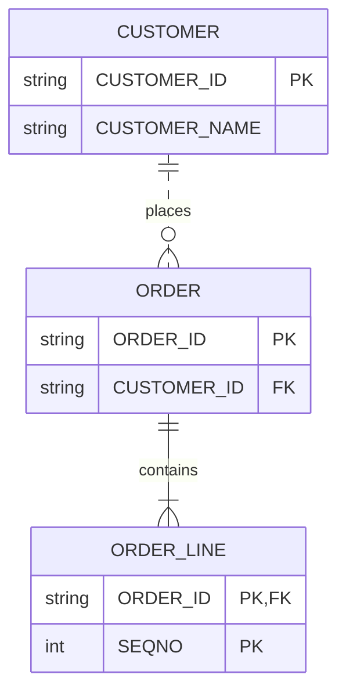

# 讓呎ｺ悶ョ繝ｼ繧ｿ讒矩縺ｮ諢丞袖逧・↑蟇ｾ蠢應ｻ倥￠縺ｨ縲∵ｧ区枚繝ｻ蝗ｳ隗｣繝ｻ邱ｨ髮・・蜈ｱ騾夊ｨｭ險・
- **迥ｶ諷・*・壼ｮ溯｣・燕縺ｮ讓ｪ譁ｭ險ｭ險医・讀懆ｨｼ險育判縲よｭ｣蠑上↑Semantic Schema縲；rammar IR縲∝・髢輝lugin ABI縲ヾtudio讖溯・縲∝ｮ蘖rovider驕ｩ蜷医＾wner縺ｮ諢丞袖蜿礼炊繧剃ｸｻ蠑ｵ縺励↑縺・・- **逶ｮ逧・*・哽SON Schema縺ｪ縺ｩ縺ｮ螟夜Κ讒矩螳夂ｾｩ繧・､壽ｧ倥↑DSL繧偵ゝEI縺ｮ讓呎ｺ悶ョ繝ｼ繧ｿ讒矩繝ｻ諢丞袖Role繝ｻ蜈ｱ騾啅I縺ｸ螳牙・縺ｫ謗･邯壹☆繧九ょ酔譎ゅ↓縲；raph・週ree・週able・乗凾邉ｻ蛻励↑縺ｩ縺ｮ逶ｸ莠定｡ｨ迴ｾ縺ｫ蠢・ｦ√↑諢丞袖菫晏ｭ俶擅莉ｶ繧呈・遉ｺ縺吶ｋ縲・- **譛蜆ｪ蜈井ｺ矩・*・售tudio Desktop縺ｮStage1竊担tage2繧ｻ繝ｫ繝輔ン繝ｫ繝峨→縲∬｣ｽ蜩：unction Entry竊貞ｮ蘖rovider竊堤峡遶気onsumer縺ｮ邵ｦ譁ｭ繧貞ｦｨ縺偵↑縺・よ枚豕慕函謌仙勣繧・眠縺励＞Runtime縺ｮ讒狗ｯ峨ｒ蜈郁｡梧擅莉ｶ縺ｫ縺励↑縺・・- **Owner蠅・阜**・喙讒矩繝ｻFacet #2495](https://github.com/hat47x/tei-platform/issues/2495)縲ー貍皮ｮ玲ｳ募援 #2544](https://github.com/hat47x/tei-platform/issues/2544)縲ー讒矩Projection #2497](https://github.com/hat47x/tei-platform/issues/2497)縲ーLanguage・衆perator #988](https://github.com/hat47x/tei-platform/issues/988)縲ー諢丞袖Role繝ｻ閾ｪ蟾ｱ險倩ｿｰ #2620](https://github.com/hat47x/tei-platform/issues/2620)縲ーStudio #1124](https://github.com/hat47x/tei-platform/issues/1124)縲ー蜈ｱ騾啅I #1824](https://github.com/hat47x/tei-platform/issues/1824)縲ー迢ｬ遶畿xpected #2514](https://github.com/hat47x/tei-platform/issues/2514)縲ょ､夜Κ雉・侭縺ｮ蜿冶ｾｼ縺ｯ#958縲ヾource蠢螳滓ｧ縺ｯ#2621・・2497縲・幕遉ｺ縺ｯ#2516縲∝､画峩蠖ｱ髻ｿ縺ｯ#1143縲∝ｮ溯｡梧ｨｩ髯舌・#1174縺ｫ蠕薙≧縲・- **驥崎､・＆縺帙↑縺・枚譖ｸ**・喙諢丞袖Trait縺ｮClaim](SEMANTIC_TRAIT_CLAIMS_AND_CONFORMANCE_2026-11.md)縲ー蜴溷ｭ千噪Trait](TRAIT_ATOMIC_COMPOSITION_AND_FULFILLMENT_2026-11.md)縲ーSyntax豁｣隕丞喧](EVERYTHING_DATA_SYNTAX_NORMAL_FORM_EQUIVALENCE_2026-11.md)縲ーSource縺ｨRole](EVERYTHING_DATA_INTERPRETATION_AND_SOURCE_BINDING_2026-11.md)縲ーStudio髢区叛諤ｧ](GENERIC_STUDIO_OPEN_WORLD_PROJECTION_CONFORMANCE_2026-11.md)縲ーSource邱ｨ髮・(SCRIPT_FIRST_GENERIC_STUDIO_PROJECTION_REFERENCE_2026-11.md)縲ーDSL縺ｨOperator](DSL_OPERATOR_PLUGIN_COMPOSITION_DESIGN.md)縲ー繝励Ο繧ｰ繝ｩ繝螳溯｡悟峙](PROGRAM_EXECUTION_MODEL_PROJECTIONS_2026-11.md)縲・- **髱樒岼讓・*・夂ｬｬ莠後・Canonical豁｣譛ｬ縲∫峡遶鬼emantic Engine・蹴esolver・秋ost・蹴egistry・秀ate縲√≠繧峨ｆ繧句､夜Κ讒区枚繧貞ｮ悟・縺ｫ蜿ｯ騾・喧縺吶ｋ荳・・Grammar縲∽ｻｻ諢上・View縺九ｉ縺ｮ辟｡譚｡莉ｶ縺ｮ蜴滓枚譖ｸ謌ｻ縺励ゞI謫堺ｽ懊↓繧医ｋ讓ｩ髯舌・閾ｪ蜍穂ｻ倅ｸ弱・
## 1. 邨占ｫ・
TEI縺ｮ讓呎ｺ悶ョ繝ｼ繧ｿ讒矩縺ｯ縲∝腰縺ｫ繝・・繧ｿ縺ｮ蠖｢繧貞・譛峨☆繧九◆繧√・繧ゅ・縺ｧ縺ｯ縺ｪ縺・よｧ矩縺斐→縺ｫ縲御ｽ輔ｒ蜷御ｸ縺ｨ縺ｿ縺ｪ縺吶°縲阪後←繧薙↑髢｢菫ゅ・鬆・ｺ上・譎る俣繝ｻ謨ｰ驥上′縺ゅｋ縺九阪後←縺ｮ謫堺ｽ懊′謌千ｫ九☆繧九°縲阪ｒ縲∝ｿ・ｦ√↑遽・峇縺ｧ譏守､ｺ縺ｧ縺阪ｋ繧医≧縺ｫ縺吶ｋ縲ゅ◎縺ｮ諤ｧ雉ｪ繧貞茜逕ｨ縺励※縲・*讒区枚縲∵э蜻ｳ縲∬｡ｨ遉ｺ縲∫ｷｨ髮・∝ｮ溯｣・ｒ蛻･縲・↓騾ｲ蛹悶＆縺帙ｋ**縲・
譁ｰ險ｭ縺吶ｋ縺ｮ縺ｯ螟ｧ縺阪↑蝙矩嚴螻､縺ｧ縺ｯ縺ｪ縺上∵里蟄倥・Meaning・洲acet・臭aw・週rait・襲rojection螂醍ｴ・ｒ縺､縺ｪ縺舌∝ｰ上＆縺ｪ**蟇ｾ蠢應ｻ倥￠縺ｮ讀懆ｨｼ逾ｨ**縺ｧ縺ゅｋ縲よ悽譁・・螂醍ｴ・・岼縺ｨ隴伜挨蟄舌・豈碑ｼ・畑縺ｮ隱槫ｽ吶〒縺ゅｊ縲∵悽逡ｪ逕ｨSchema繧・・髢帰PI縺ｸ縺ｮ謗｡逕ｨ譯医〒縺ｯ縺ｪ縺・・
蛻ｩ逕ｨ閠・↓縺ｯ謨ｰ蟄ｦ逧・↑諤ｧ雉ｪ蜷阪ｒ蜑埼擇縺ｫ蜃ｺ縺吝ｿ・ｦ√・縺ｪ縺・ゅ瑚､・焚縺ｮ隕ｪ繧呈戟縺ｦ繧九阪悟ｾｪ迺ｰ縺後≠繧九阪悟酔縺倬未菫ゅ′隍・焚蝗樒樟繧後ｋ縲阪後％縺ｮ邱ｨ髮・・蜴滓枚縺ｫ謌ｻ縺帙↑縺・阪→縺・▲縺溯・辟ｶ縺ｪ隱ｬ譏弱∈謚募ｽｱ縺吶ｋ縲４tudio縺ｮ陦ｨ繝ｻ蝗ｳ繝ｻ蜈･蜉帙ヵ繧ｩ繝ｼ繝縺ｯ縲∫峡遶九＠縺滓э蜻ｳ縺ｮ豁｣譛ｬ縺ｫ縺ｯ縺ｪ繧峨↑縺・・
## 2. 蜈ｱ譛峨☆繧区э蜻ｳ迚ｹ諤ｧ縺ｨ縲∵ｷｷ蜷後＠縺ｦ縺ｯ縺・￠縺ｪ縺・ｂ縺ｮ

| 隕ｳ轤ｹ | 譏守､ｺ縺吶ｋ縺薙→ | 蜿悶ｊ驕輔∴縺溷ｴ蜷医・蝠城｡・|
| --- | --- | --- |
| Identity | Stable Subject ID縲＾ccurrence縲∵･ｭ蜍吶く繝ｼ縲∫黄逅・K縲；raph Node/Edge縺ｮ蛻･ | 蜷悟錐繝弱・繝峨∝､夐㍾霎ｺ縲∝酔蜷榊・菴懈・繧剃ｽｵ蜷医☆繧・|
| Relation | 譁ｹ蜷代∽ｸ｡遶ｯ縺ｮ蠖ｹ蜑ｲ縲∝ｱ樊ｧ縲∝､夐㍾諤ｧ縲・←逕ｨ譎る俣 | 謇螻槭・蜈郁｡後・蜿ら・繧貞酔荳隕悶☆繧・|
| Collection | 髮・粋・丞､夐㍾髮・粋・丞・縲・・ｺ上・㍾隍・∽ｸ諢乗ｧ縲∫ｲ貞ｺｦ | 陦梧焚繝ｻ莉ｶ謨ｰ繝ｻ髮・ｨ育ｵ先棡縺悟､峨ｏ繧・|
| Presence | 蟄伜惠縲∵・遉ｺNULL縲∵ｬ謳阪∵悴蜿門ｾ励・撼髢狗､ｺ縲∫ｩｺ髮・粋 | 縲瑚ｦ九▽縺九ｉ縺ｪ縺・阪ｒ縲悟ｭ伜惠縺励↑縺・阪→譁ｭ螳壹☆繧・|
| Quantity | 謨ｰ驥上・諢丞袖縲∝腰菴阪∫ｲｾ蠎ｦ縲∽ｸｸ繧√∵ｸｬ螳壼ｰｺ蠎ｦ | 荳埼←蛻・↑蜉邂励・蟷ｳ蝮・・豈碑ｼ・ｒ險ｱ縺・|
| Time | 譛牙柑譎らせ縲∬ｨ倬鹸譎らせ縲∬ｦｳ貂ｬ譎らせ縲√Ν繝ｼ繝ｫ縺ｮ驕ｩ逕ｨ迚・| 驕主悉縺ｮ諢丞袖繧・樟蝨ｨ縺ｮ隕ｳ貂ｬ繧呈ｷｷ蜷後☆繧・|
| Scope | 豈埼寔蝗｣縲∝盾辣ｧ遽・峇縲∝叙蠕怜ｮ悟・諤ｧ縲，ontext縲ヽevision | 驛ｨ蛻・ｪｭ蜿悶〒蜷ｦ螳壽擅莉ｶ繧堤悄縺ｫ縺吶ｋ |
| Authority | 蜿礼炊貂医∩縺ｮ讌ｭ蜍呎э蜻ｳ縲∫樟蝨ｨGrant縲∝ｮ檸ffect縺ｮ蛻･ | 隕九∴縺ｦ縺・ｋ繝・・繧ｿ繧貞ｮ溯｡瑚ｨｱ蜿ｯ縺ｨ隱､隱阪☆繧・|

縺薙ｌ繧峨ｒ荳蠕九↓蜈ｨ繝・・繧ｿ縺ｸ莉倅ｸ弱☆繧九％縺ｨ縺ｯ縺励↑縺・ょｿ・ｦ√↑Meaning Claim・衆perator・修onsumer縺ｫ蠢懊§縺ｦ迚ｹ諤ｧ繧貞盾辣ｧ縺励∵悴螳｣險縺ｯ譛ｪ螳｣險縺ｮ縺ｾ縺ｾ謇ｱ縺・ょ梛繝ｩ繝吶Ν縺ｮ荳閾ｴ縺ｯ縲∵э蜻ｳ逧・↑驕ｩ譬ｼ諤ｧ縺ｮ險ｼ譏弱〒縺ｯ縺ｪ縺・・
### 荳臥ｨｮ鬘槭・蜷御ｸ諤ｧ

1. **蜴滓枚縺ｮ蜷御ｸ諤ｧ**・壹ヵ繧｡繧､繝ｫ縲｜yte蛻励∝・迴ｾ邂・園縲ヾource Revision縲∵枚豕包ｼ丞､画鋤蝎ｨ縺ｮ迚医よ隼陦後∵ｳｨ驥医∝峙縺ｮ驟咲ｽｮ繧ゆｿ晄戟蟇ｾ雎｡縺ｨ縺ｪ繧九・2. **讒矩蛟呵｣懊・蜷御ｸ諤ｧ**・壼盾辣ｧ縺瑚ｧ｣豎ｺ縺輔ｌ縺滓ｨ呎ｺ悶ョ繝ｼ繧ｿ讒矩縺ｨ縲∝ｯｾ雎｡Claim縺ｫ蠢・ｦ√↑Role繝ｻ鬆・ｺ上・隴伜挨蟄舌・蛻ｶ邏・ょ次譁・′驕輔▲縺ｦ繧ゆｸ閾ｴ縺怜ｾ励ｋ縲・3. **蜿礼炊縺輔ｌ縺滓э蜻ｳ・丞ｮ滄圀縺ｮ謖ｯ闊槭＞縺ｮ蜷御ｸ諤ｧ**・唹wner縺ｫ繧医ｋMeaning蜿礼炊縲＾perator Law縲￣rovider・週arget縲∝ｮ溯ｦｳ貂ｬ繝ｻ蜿鈴倥ｒ蜷ｫ繧縲よｧ矩蛟呵｣懊・Fingerprint縺悟酔縺倥□縺代〒縺ｯ謌千ｫ九＠縺ｪ縺・・
World Fingerprint縲｀odel Revision縲、rtifact Revision繧よｷｷ蜷後＠縺ｪ縺・４ource遘ｻ蜍輔∵ｧ区枚Plugin縺ｮ譖ｴ譁ｰ縲∫函謌仙勣縺ｮ螟画峩縲，onsumer縺ｮ蜿門ｾ礼ｯ・峇縺ｯ縲∝ｽｱ髻ｿ縺吶ｋClaim縺斐→縺ｫ螟ｱ蜉ｹ譚｡莉ｶ繧貞ｮ壹ａ繧九・
## 3. 讒矩髢薙・蟇ｾ蠢應ｻ倥￠縺ｯ縲悟､画鋤縺ｧ縺阪ｋ縲阪□縺代〒縺ｯ荳榊香蛻・
莉･荳九ｒ蛹ｺ蛻･縺励※謇ｱ縺・・
| 髢｢菫・| 諢丞袖 | 萓九→豕ｨ諢冗せ |
| --- | --- | --- |
| 陦ｨ迴ｾ荳翫・蜷悟､ | 譏守､ｺ縺励◆隕ｳ貂ｬ縺ｫ縺､縺・※蜷後§邨先棡縺ｫ縺ｪ繧・| 蜷後§Data繧定｡ｨ繝ｻ繝・Μ繝ｼ縺ｧ隱ｭ繧縲ょ次譁・ｸ閾ｴ縺ｾ縺ｧ縺ｯ隕∵ｱゅ＠縺ｪ縺・|
| 蝓九ａ霎ｼ縺ｿ | 蜈・・隕∫ｴ繝ｻ髢｢菫ゅｒ螟ｱ繧上★蛻･讒矩縺ｸ霈峨○繧・| Tree竊竪raph縲ゅ◆縺縺玲ｹ繝ｻ霎ｺ螻樊ｧ繝ｻ鬆・ｺ上・菫晏ｭ俶婿豕輔ｒ豎ｺ繧√ｋ |
| 蟆・ｽｱ | 謖・ｮ壹＠縺滄Κ蛻・□縺代ｒ蜿悶ｊ蜃ｺ縺・| Graph竊帝團謗･陦ｨ縲ゝable竊帝寔險・hart縲る壼ｸｸ縺ｯ騾・､画鋤縺ｧ縺阪↑縺・|
| 髮・ｴ・| 邊貞ｺｦ繧貞､峨∴縲∵ュ蝣ｱ繧定ｦ∫ｴ・☆繧・| Event竊呈律蛻･髮・ｨ医ょ句挨Event縺ｯ蠕ｩ蜈・〒縺阪↑縺・|
| 隗｣驥・| 讒矩縺ｫ讌ｭ蜍吩ｸ翫・蠖ｹ蜑ｲ繧剃ｸ弱∴繧・| Graph竊剃ｽ懈･ｭ蜈郁｡碁未菫ゅよｧ矩縺縺代〒縺ｯ諢丞袖蜿礼炊縺輔ｌ縺ｪ縺・|
| 霑台ｼｼ | 邊ｾ蠎ｦ繝ｻ轤ｹ謨ｰ繝ｻ遨ｺ髢楢ｧ｣蜒丞ｺｦ遲峨ｒ諢丞峙縺励※關ｽ縺ｨ縺・| 譎らｳｻ蛻励・髢灘ｼ輔″縲りｪ､蟾ｮ縺ｨ驕ｩ逕ｨ遽・峇繧呈・險倥☆繧・|

蜷悟､縺ｮ蛻､螳壹・縲∽ｽ輔ｒ隕ｳ貂ｬ縺吶ｋ縺九↓繧医▲縺ｦ螟峨ｏ繧九ゅ≠繧句､画鋤 f 縺後∵欠螳壹＠縺溯ｦｳ貂ｬ O 縺ｫ縺､縺・※ O(source)=O(f(source)) 繧呈ｺ縺溘＠縺ｦ繧ゅ∝次譁・ｿ螳滓ｧ繝ｻ蜈ｨ蛻ｶ邏・・螳溯｡悟柑譫懊∪縺ｧ遲峨＠縺・→縺ｯ險縺医↑縺・ゅ檎┌謳榊､ｱ縲阪ｒ荳ｻ蠑ｵ縺吶ｋ蝣ｴ蜷医・縲∝ｯｾ雎｡Scope縲∵ｧ矩繝ｻ螻樊ｧ繝ｻ蜿ら・繝ｻ鬆・ｺ上・菫晏ｭ俶擅莉ｶ繧貞・謖吶☆繧九・
**Graph竊探ree縺ｮ雋萓・*・壻ｺ後▽縺ｮ蜷悟錐Node縲∝酔縺倅ｸ｡遶ｯ繧呈戟縺､隍・焚縺ｮ譛牙髄Edge縲∝挨縺ｮ隕ｪ縺九ｉ蜈･繧畿dge縲∝ｾｪ迺ｰ縲・dge縺ｮ螻樊ｧ縺後≠繧倶ｸ也阜縺ｧ縺ｯ縲∝腰邏斐↑Tree陦ｨ遉ｺ縺縺代〒縺ｯ蜈・・Graph繧剃ｸ闊ｬ縺ｫ蠕ｩ蜈・〒縺阪↑縺・りｪｭ縺ｿ蜿悶ｊ蟆ら畑縺ｮTree View縺ｯ險ｱ螳ｹ縺怜ｾ励ｋ縺後ゝree邱ｨ髮・°繧牙・Graph縺ｸ縺ｮ閾ｪ蜍墓嶌謌ｻ縺励・蛻･蛻､螳壹→縺吶ｋ縲・
**WBS縺ｮ萓・*・壻ｽ懈･ｭ縺ｮ蛹・性髢｢菫ゅ→縲∽ｽ懈･ｭ髢薙・蜈郁｡碁未菫ゅ・蛻･縺ｮ諢丞袖Role縺ｨ縺吶ｋ縲る嚴螻､蝗ｳ縺ｨPERT蝗ｳ繧貞酔荳繝｢繝・Ν縺九ｉ豢ｾ逕溘〒縺阪※繧ゅ∝桁蜷ｫ縺九ｉ蜈郁｡碁未菫ゅｒ蜍晄焔縺ｫ逕滓・縺励↑縺・・
## 4. 蟆上＆縺ｪ蟇ｾ蠢應ｻ倥￠讀懆ｨｼ逾ｨ・域ｭ｣蠑輯chema縺ｧ縺ｯ縺ｪ縺・ｼ・
讒矩螟画鋤繧・｡ｨ遉ｺ繧定ｩ穂ｾ｡縺吶ｋ髫帙∵里蟄倥・#2497 Projection縺ｨ#2495/#2544縺ｮFacet・臭aw縺ｫ縲∵ｬ｡縺ｮ隕ｳ轤ｹ繧堤・蜷医☆繧九・
| 鬆・岼 | 譛菴朱剞縺ｮ蝠上＞ |
| --- | --- |
| source / target | 蜈･蜃ｺ蜉帙・蝙九∝ｯｾ雎｡Subject縲ヾcope縲∝ｯｾ雎｡迚医・菴輔° |
| preconditions | 縺ｩ縺ｮ讒矩逧・・諢丞袖逧・擅莉ｶ縺ｧ驕ｩ逕ｨ縺ｧ縺阪ｋ縺・|
| preserved / omitted | 菴輔′邯ｭ謖√＆繧後∽ｽ輔′逵∫払繝ｻ霑台ｼｼ縺輔ｌ繧九° |
| identity / provenance | Node縲・dge縲∬｡後ヾource Occurrence縲∝盾辣ｧ蜈医・蟇ｾ蠢懊・菴輔° |
| read / edit | 陦ｨ遉ｺ縺ｧ縺阪ｋ遽・峇縺ｨ縲∝次譁・∈謌ｻ縺帙ｋ邱ｨ髮・ｯ・峇縺ｯ菴輔° |
| authority / disclosure | Consumer縺ｫ菴輔ｒ隕九○縺ｦ繧医＞縺九ょｮ溯｡梧ｨｩ髯舌・縺ｩ縺薙〒蛻､螳壹☆繧九° |
| evidence / invalidation | 縺ｩ縺ｮIndependent Expected繧呈ｺ縺溘＠縲∽ｽ輔′螟峨ｏ繧後・蜀肴､懆ｨｼ縺吶ｋ縺・|

萓具ｼ哦raph竊探ree縺ｧ縲碁撼蠕ｪ迺ｰ繝ｻ譬ｹ縺御ｸ縺､繝ｻ蜷Нode縺ｮ隕ｪ縺碁ｫ倥・ｸ縺､縲阪ｒ蠢・ｦ∵擅莉ｶ縺ｫ縺吶ｋ縺ｨ縺阪ｂ縲・dge ID縺ｨ螻樊ｧ縲∝ｭ舌・鬆・ｺ上∝ｭ､遶起ode縺ｪ縺ｩ繧貞挨縺ｫ辣ｧ蜷医☆繧九る←逕ｨ譚｡莉ｶ縺梧純繧上↑縺・ｴ蜷医・縲悟､画鋤荳榊庄縲阪∪縺溘・縲梧ュ蝣ｱ謳榊､ｱ縺ゅｊ縺ｮ隱ｭ縺ｿ蜿悶ｊ蟆ら畑陦ｨ遉ｺ縲阪→縺励∵・蜉滓桶縺・〒謐ｨ縺ｦ縺ｪ縺・・
蜷後§螂醍ｴ・ｒOperator縺ｮ驕ｩ逕ｨ蜿ｯ閭ｽ諤ｧ縺ｫ繧ゆｽｿ縺医ｋ縲ゅ◆縺ｨ縺医・topologicalSort縺ｯGraph縺ｨ縺・≧蜷榊燕縺ｧ縺ｯ縺ｪ縺上∝ｯｾ雎｡Relation縺瑚ｦ∵ｱゅ☆繧矩撼蠕ｪ迺ｰ諤ｧ繝ｻ譁ｹ蜷第ｧ繝ｻScope繧呈ｺ縺溘☆縺ｨ縺阪↓驕ｩ逕ｨ縺ｧ縺阪ｋ縲ゆｸ譁ｹ縲《um・渋verage縺ｯ謨ｰ驥上・蜊倅ｽ阪・蟆ｺ蠎ｦ繝ｻNULL繝ｻ荳ｸ繧√・邊貞ｺｦ縺ｫ萓晏ｭ倥☆繧九ょ庄謠帙・邨仙粋繝ｻ蛻・・縺ｪ縺ｩ縺ｮ豕募援縺ｯ蜷榊燕縺縺代〒謗ｨ隲悶○縺壹・2544縺ｮ讀懆ｨｼ蜿ｯ閭ｽ縺ｪClaim縺ｫ蠕薙≧縲・
## 5. JSON Schema縺ｯ縲軍ecord縺ｮ蛻･陦ｨ險倥阪〒縺ｯ縺ｪ縺・
譛蛻昴・螟夜Κ莉墓ｧ倥・螳溯ｨｼ萓九→縺励※JSON Schema繧堤畑縺・ｋ縲ゅ◆縺縺励゛SON Schema縺ｯ**JSON繧､繝ｳ繧ｹ繧ｿ繝ｳ繧ｹ縺ｮ螯･蠖捺ｧ繧貞ｮ壹ａ繧句宛邏・ｨ隱・*縺ｧ縺ゅｊ縲ヾchema縺昴・繧ゅ・縺ｨ讀懆ｨｼ蟇ｾ雎｡縺ｮRecord繧呈ｷｷ蜷後＠縺ｪ縺・・
隱ｭ縺ｿ霎ｼ縺ｿ譎ゅ↓菫晄戟縺吶∋縺阪ｂ縺ｮ・・- 莉墓ｧ魯ialect・酬ocabulary縲～$schema`縲～$id`縲∝盾辣ｧScope縲∝次譁㍍yte繝ｻOccurrence縲ょ､夜Κ蜿ら・縺ｯ蜿門ｾ怜・繝ｻ迚医・譎らせ繝ｻ螳悟・諤ｧ繧貞挨縺ｫ險倬鹸縺吶ｋ縲・- `properties`・汁required`・汁additionalProperties`縺ｪ縺ｩ縺ｮ蛻ｶ邏・→縲∵ｳｨ驥医・陦ｨ遉ｺ逕ｨ隱ｬ譏弱・蛻･縲・- `$ref`・汁$dynamicRef`縲～$defs`縲∝・蟶ｰ蜿ら・縲～allOf`・汁anyOf`・汁oneOf`・汁not`縲～if`・汁then`・汁else`縲・- `unevaluatedProperties`縺ｪ縺ｩ縲∬ｩ穂ｾ｡邨瑚ｷｯ繝ｻ豕ｨ驥亥庶髮・↓萓晏ｭ倥☆繧句宛邏・ょ腰邏斐↑繝輔ぅ繝ｼ繝ｫ繝我ｸ隕ｧ縺ｸ蟷ｳ蝮ｦ蛹悶＠縺ｦ縲悟酔遲峨阪→縺ｯ謇ｱ繧上↑縺・・- 逵溷⊃蛟､Schema・・true`・汁false`・峨∝ｭ伜惠縺励↑縺・ｱ樊ｧ縺ｨ譏守､ｺNULL縺ｮ驕輔＞縲～default`縺ｪ縺ｩ縺瑚・蜍戊｣懷ｮ後・譖ｸ霎ｼ縺ｿ縺ｮ鄒ｩ蜍吶→縺ｯ髯舌ｉ縺ｪ縺・％縺ｨ縲・
**Studio縺ｮ蝓ｺ譛ｬ陦ｨ遉ｺ**・夐・岼蜷阪∝梛縺ｮ蛟呵｣懊∝ｿ・医°縺ｩ縺・°縲∝盾辣ｧ縲∝宛邏・・譛臥┌繧偵∪縺夂､ｺ縺吶り､・粋蛻ｶ邏・・蜴滓枚繝ｻDialect繝ｻ蜿ら・隗｣豎ｺ繝ｻ讀懆ｨｼ荳翫・隧ｳ邏ｰ縺ｯ螻暮幕繧・ヤ繝ｼ繝ｫ繝√ャ繝励↓霈峨○繧九・SON Schema縺悟宛邏・°繧牙ｰ弱°縺ｪ縺・％縺ｨ・井ｾ九∴縺ｰ遒ｺ螳壹＠縺滓･ｭ蜍吶く繝ｼ繧ДB蛻ｶ邏・ｼ峨・霑ｽ蜉謗ｨ隲悶＠縺ｪ縺・・
**邱ｨ髮・凾**・售ource byte遽・峇縲∬ｧ｣豎ｺ貂医∩蜿ら・縲∝ｯｾ雎｡Revision縲∝､画峩諢丞峙縺御ｸ諢上・蝣ｴ蜷医□縺大呵｣弃atch竊貞ｷｮ蛻・review竊貞・讀懆ｨｼ縺ｸ騾ｲ繧縲ょ・譛峨＆繧後◆`$ref`蜈医∬､・焚Schema縺ｮ蜷域・縲∵ｴｾ逕溘＠縺溽判髱｢縺ｧ縺ｯ縲∵э蝗ｳ縺帙★蠎・沺螟画峩繧定ｵｷ縺薙＆縺ｪ縺・ｈ縺・次蜑㎎ead-only縺ｾ縺溘・譏守､ｺ逧・↓邱ｨ髮・ｯｾ雎｡繧帝∈縺ｳ逶ｴ縺吶４chema縺ｮ陦ｨ遉ｺ繝ｻSource邱ｨ髮・・JSON繧､繝ｳ繧ｹ繧ｿ繝ｳ繧ｹ縺ｸ縺ｮ蜈･蜉帙・DB Migration縺ｯ蝗帙▽縺ｮ逡ｰ縺ｪ繧区桃菴懊〒縺ゅｋ縲・
**螟夜Κ莉墓ｧ倥・螂醍ｴ・*・咼ialect譛ｪ蟇ｾ蠢懊∝盾辣ｧ蜿門ｾ嶺ｸ崎・縲・Κ蛻・叙蠕励〃ocabulary譛ｪ隗｣驥医・謌仙粥縺励◆螳悟・隗｣驥医↓縺励↑縺・ょｾ捺擂縺ｩ縺翫ｊplain-data縺ｮ讒矩陦ｨ遉ｺ縺ｸ騾驕ｿ縺ｧ縺阪ｋ遽・峇縺ｨ縲∵､懆ｨｼ・冗ｷｨ髮・〒縺阪↑縺・ｯ・峇繧貞玄蛻･縺吶ｋ縲・
## 6. DSL縺ｮ閾ｪ蟾ｱ螳夂ｾｩ繧偵∝ｰら畑縺ｮ蟾ｨ螟ｧ縺ｪParser蝓ｺ逶､縺ｫ縺励↑縺・
險隱槭＃縺ｨ縺ｫ縲梧ｧ区枚縺ｮ隱ｭ縺ｿ譁ｹ縲阪→縲梧ｨ呎ｺ悶ョ繝ｼ繧ｿ蛟呵｣懊∈縺ｮ蟇ｾ蠢懊阪ｒ蛻・￠繧九・
```text
Authoritative Source (TEI DSL / Markdown / JSON Schema / DOT / ...)
  竊・Language Plugin縺継arse繝ｻSource菴咲ｽｮ繝ｻ險ｺ譁ｭ繧剃ｾ帷ｵｦ
  竊・plain standard data candidate
  竊・Role・衆perator・丞盾辣ｧ縺ｮ隗｣豎ｺ縲∝宛邏・､懆ｨｼ縲＾wner縺ｮMeaning蜿礼炊
  竊・Studio蜈ｱ騾啖iew・乗ｧ区枚蝗ｺ譛鰻iew・秀enerator・輯cenario
```

譁・ｳ輔・縲・BNF・就NTLR・週ree-sitter縺ｪ縺ｩ縺ｮ譌｢蟄俶橿陦薙ｒ豈碑ｼ・ｯｾ雎｡縺ｨ縺吶ｋ縲ゅ◆縺縺励・*Grammar IR縺ｮ譁ｰ險ｭ繧・・險隱槭・蜈ｱ騾啀arser逕滓・縺ｯ譛ｪ謗｡逕ｨ**縲ゅ∪縺・988縺ｮ譌｢蟄廊anguage Plugin Reference縺九ｉ縲∵ｧ区枚隕丞援縲√お繝ｩ繝ｼ蝗槫ｾｩ縲∬｣懷ｮ悟呵｣懊ヾource occurrence縲ヾemantic Binding縺ｮ縺ｩ縺薙∪縺ｧ繧貞・騾壼喧縺ｧ縺阪ｋ縺区ｸｬ繧九・
蜈･蜉帶髪謠ｴ繧剃ｸ画ｮｵ髫弱↓蛻・￠繧具ｼ・1. **讒区枚蛟呵｣・*・壽ｬ｡縺ｫ鄂ｮ縺代ｋ險伜捷縲√く繝ｼ繝ｯ繝ｼ繝峨∫ｹｰ霑斐＠縺ｪ縺ｩ縲・2. **諢丞袖蛟呵｣・*・啌ole縲∝梛縲∵據邵帶ｸ医∩蜿ら・縲∝腰菴阪，ardinality縲＾perator縺ｮ驕ｩ譬ｼ諤ｧ縲・3. **Context蛟呵｣・*・夊ｨｱ蜿ｯ縺輔ｌ縺溽樟蝨ｨ縺ｮSubject縲￣rovider縺悟ｮ滄圀縺ｫ隱ｭ縺ｿ蜿悶▲縺溷呵｣懊・幕遉ｺ縺ｧ縺阪ｋ蛟､縲よ悴蜿門ｾ励ｒ遨ｺ縺ｮ蛟呵｣憺寔蜷医→蜷御ｸ隕悶＠縺ｪ縺・・
Studio蜀・・GUI縺九ｉGrammar・酬iew繧定ｨ倩ｿｰ縺ｧ縺阪ｋ譁ｹ蜷代・邯ｭ謖√☆繧九ゅ◆縺縺怜・譛溘・迢ｬ閾ｪView縺ｯ螳｣險逧・↑繝ｬ繧､繧｢繧ｦ繝医∝梛莉倥″Binding縲∝盾辣ｧ繧ｸ繝｣繝ｳ繝励ゝooltip縲∝庄隱ｭ縺ｪ隴ｦ蜻翫ｒ蜆ｪ蜈医☆繧九ゆｻｻ諢上さ繝ｼ繝峨・豕ｨ蜈･繧・・蜍募ｮ溯｡瑚ｨｱ蜿ｯ繧呈ｨ呎ｺ匁僑蠑ｵ縺ｫ縺励↑縺・ょｰる摩View縺ｯ#951縺ｮPlugin螂醍ｴ・〒霑ｽ蜉縺ｧ縺阪ｋ菴吝慍繧剃ｿ昴▽縲・
閾ｪ蟾ｱ險倩ｿｰ縺ｮ蛻ｰ驕皮岼讓吶・縲∵枚豕輔・Role繝ｻView縺ｮ荳驛ｨ繧呈ｨ呎ｺ悶ョ繝ｼ繧ｿ縺ｨ縺励※隱ｬ譏弱・讀懆ｨｼ縺ｧ縺阪ｋ縺薙→縲り・蛻・・霄ｫ縺ｮParser繧貞ｮ悟・蜀咲函謌舌〒縺阪◆縺薙→繧・∝・繧ｿ繝ｼ繧ｲ繝・ヨ縺ｧ諢丞袖蜷悟､縺ｧ縺ゅｋ縺薙→縺ｯ蛻･縺ｮ讀懷庶縺ｨ縺吶ｋ縲ょ崋螳壹＆繧後◆譛蟆蹴eader・獣ootstrap縺ｨ縲∬・蟾ｱ螳夂ｾｩ繧呈峩譁ｰ縺吶ｋ髫帙・莠呈鋤諤ｧ繝ｻ騾驕ｿ邨瑚ｷｯ繧剃ｿ昴▽縲・
## 7. Studio縺ｧ縺ｮ荳雋ｫ縺励◆謫堺ｽ・
蜷後§Subject繧偵√ユ繧ｭ繧ｹ繝医∵ｧ矩繝・Μ繝ｼ縲・未菫ょ峙縲∬｡ｨ縲√ヵ繧ｩ繝ｼ繝縲ヾource Diff縺ｧ蛻・ｊ譖ｿ縺医ｉ繧後ｋ縺薙→繧堤岼讓吶→縺吶ｋ縲ゆｸｭ蠢・・**螳牙ｮ壹＠縺溷ｯｾ雎｡驕ｸ謚・*縺ｧ縺ゅｊ縲∝峙荳翫・蠎ｧ讓吶ｄ陦ｨ遉ｺEdge繧呈э蜻ｳID縺ｫ縺励↑縺・・
- 陦ｨ遉ｺ縺ｯ諢丞袖譛ｪ隗｣豎ｺ縺ｧ繧ゅ・幕遉ｺ蜿ｯ閭ｽ縺ｪ`path / structural type / disclosed value`縺ｸ騾驕ｿ縺吶ｋ縲・- Tooltip縺ｯ諢丞袖Role縲∝宛邏・・←逕ｨ遽・峇縲∬ｨｺ譁ｭ縲ヾource菴咲ｽｮ繧定ｦ九○繧九よ悴蜿礼炊縺ｮ蛟呵｣懊・譛ｪ蜿礼炊縺ｨ陦ｨ遉ｺ縺吶ｋ縲・- 蝗ｳ陦ｨ縺ｨ蜴滓枚縺ｮ繧ｸ繝｣繝ｳ繝励・Source ID・衆ccurrence・蹴evision縺ｫ蝓ｺ縺･縺上４ource縺ｮ遘ｻ蜍輔ｄA竊達竊但縺ｯ縲∵ｧ矩繝ｻ邱ｨ髮・・蜿礼炊螻･豁ｴ繝ｻConsumer縺御ｽ輔ｒ蜷御ｸ隕悶☆繧九°縺ｫ蠢懊§縺ｦ辣ｧ蜷医☆繧九ょ・螳ｹbyte縺悟酔縺倥％縺ｨ縺縺代〒縲∝唆荳句ｱ･豁ｴ繧・､夜ΚConsumer縺ｮ雉・ｼ縺ｾ縺ｧ蠕ｩ豢ｻ縺輔○縺ｪ縺・・- 邱ｨ髮・・`read-only`縲～candidate patch`縲～explicit source edit`縲～supported reversible edit`繧貞・縺代∝ｾ御ｺ瑚・ｂ讓ｩ髯舌・諢丞袖蜿礼炊繝ｻ螳檸ffect繧剃ｻ｣譖ｿ縺励↑縺・・- 髢狗､ｺ縺ｮ驕輔＞縺九ｉ髱槫・髢九・Subject縺ｮ譛臥┌繝ｻ莉ｶ謨ｰ繝ｻ險ｺ譁ｭ縺悟・縺九ｉ縺ｪ縺・ｈ縺・・2516縺ｮConsumer蛻･隧ｦ鬨薙↓蠕薙≧縲・- Studio蜀・・莠ｺ髢薙→AI縺ｯ蜷後§蝙倶ｻ倥″Selection縺ｨPreview繧剃ｽｿ縺・′縲、I蛟呵｣懊・逕滓・縺ｨOwner縺ｮ諢丞袖蜿礼炊繧貞・髮｢縺吶ｋ縲・
譁ｰ縺励＞Domain Plugin繧定ｿｽ蜉縺励◆髫帙・驥崎ｦ∵欠讓吶・縲∝ｰら畑縺ｮStudio Core蛻・ｲ舌ｒ霑ｽ蜉縺帙★縲∵里蟄倥・Text・襲roperty・週ree・秀raph縺ｸ蠢・ｦ√↑諠・ｱ繧定｡ｨ遉ｺ縺ｧ縺阪ｋ縺九〒縺ゅｋ縲・raph繧・ｫ伜ｺｦ縺ｪ蜿ｯ隕門喧繧偵☆縺ｹ縺ｦ豎守畑UI縺ｸ謚ｼ縺苓ｾｼ繧縺ｮ縺ｧ縺ｯ縺ｪ縺上∝ｰら畑UI縺悟ｿ・ｦ√↑逅・罰縺ｨ蜉ｹ譫懊ｒ豈碑ｼ・☆繧九・
## 8. 蜿堺ｾ九ｒ蜈医↓蝗ｺ螳壹☆繧区､懆ｨｼ險育判

谺｡縺ｮ繧ｱ繝ｼ繧ｹ縺ｯ**Independent Expected縺ｮ蛟呵｣・*縺ｧ縺ゅｊ縲∵悽譖ｸ菴懈・譎らせ縺ｧ譁ｰ縺溘↑螳溯ｩｦ鬨薙ｒ螳滓命縺励◆縺ｨ縺・≧諢丞袖縺ｧ縺ｯ縺ｪ縺・よ里蟄・2497・・1131・・2514・・1124縺ｮScenario縺ｸ蜑ｲ繧頑険繧翫・｡樔ｼｼFixture繧帝㍾隍・眠險ｭ縺励↑縺・・
| ID | 蜈･蜉幢ｼ乗桃菴・| 譛溷ｾ・☆繧句愛螳・|
| --- | --- | --- |
| SM-01 | Graph縺ｫ蜷悟錐Node莠後▽縲∝酔荳荳｡遶ｯ縺ｮEdge莠後▽縲∝ｱ樊ｧ縺ゅｊ | Node・拾dge蜷御ｸ諤ｧ縺ｨ螟夐㍾諤ｧ繧剃ｿ晏ｭ倥５ree縺ｸ縺ｮ辟｡謳榊､ｱ譖ｸ謌ｻ縺励ｒ諡貞凄 |
| SM-02 | Graph縺ｫ隍・焚隕ｪ繝ｻ蠕ｪ迺ｰ繝ｻ蟄､遶起ode | Tree驕ｩ譬ｼ諤ｧ繧貞句挨險ｺ譁ｭ縲る←蛻・↑read-only陦ｨ遉ｺ縺ｸ騾驕ｿ |
| SM-03 | WBS縺ｮ蛹・性霎ｺ縺ｨ蜈郁｡瑚ｾｺ | 荳｡閠・・諢丞袖繧貞・髮｢縲ょ桁蜷ｫ縺縺代〒萓晏ｭ倩ｾｺ繧堤函謌舌＠縺ｪ縺・|
| SM-04 | Table縺ｮbag縲¨ULL縲［issing縲｝artial蜿門ｾ・| 莉ｶ謨ｰ繝ｻ蜷ｦ螳壼愛螳壹・髮・ｨ医・諢丞袖繧定ｪ､縺｣縺ｦ遒ｺ螳壹＠縺ｪ縺・|
| SM-05 | 譎らｳｻ蛻励・蜊倅ｽ阪・邊ｾ蠎ｦ繝ｻ隕ｳ貂ｬ譎らせ繧貞､峨∴繧・| 譏守､ｺ縺励◆隕ｳ貂ｬ遽・峇縺ｧ縺ｮ縺ｿ蜷悟､諤ｧ繧貞愛螳・|
| SM-06 | JSON Schema縺ｮ`oneOf`・汁allOf`・汁if` | 蜊倥↑繧狗ｶ呎価繝ｻ鬆・岼陦ｨ縺ｸ隱､螟画鋤縺帙★縲∝宛邏・ｒ菫晄戟縺ｾ縺溘・譛ｪ蟇ｾ蠢懊ｒ陦ｨ遉ｺ |
| SM-07 | 蜀榊ｸｰ`$ref`・汁$dynamicRef`・乗悴蜿門ｾ怜盾辣ｧ | 隗｣豎ｺ迥ｶ諷九→驕ｩ逕ｨScope繧定｡ｨ遉ｺ縲ゆｸ榊ｮ悟・縺ｪ讀懆ｨｼ繧呈・蜉溘→縺励↑縺・|
| SM-08 | 蜷後§蜿ら・蜈医′隍・焚逕ｻ髱｢縺ｧ蛻ｩ逕ｨ縺輔ｌ繧鬼chema | 蝗ｳ邱ｨ髮・〒蜿ら・蜈医ｒ蜍晄焔縺ｫ蠎・沺螟画峩縺励↑縺・|
| SM-09 | 蜷後§讓呎ｺ縫ata縺勲arkdown縲．SL縲゛SON縺九ｉ蟆弱°繧後ｋ | 讒矩蛟呵｣懊・蜷御ｸ諤ｧ縺ｨSource identity繧貞玄蛻･ |
| SM-10 | Grammar・蹴ole・衆perator縺ｮ迚医ｒ螟画峩 | 蜿､縺・э蜻ｳ蜿礼炊繧・｣懷ｮ悟呵｣懊ｒ辟｡讀懆ｨｼ縺ｧ蜀榊茜逕ｨ縺励↑縺・|
| SM-11 | 譛ｪ遏･Role縺ｨ`trusted-script`縺ｨ縺・≧蜈･蜉帛､ | plain-data陦ｨ遉ｺ縺ｫ騾驕ｿ縺励、ction・秀rant繧呈・譬ｼ縺励↑縺・|
| SM-12 | View縺ｮ驛ｨ蛻・幕遉ｺ縲《tale Selection縲∵尠譏ｧ縺ｪ騾・・蜒・| 諠・ｱ貍上∴縺・→隱､譖ｸ謌ｻ縺励ｒ髦ｲ縺弱∫炊逕ｱ繧堤､ｺ縺・|
| SM-13 | `default`豕ｨ驥医ｄ莉ｻ諢上・繝ｭ繝代ユ繧｣縺ｮ繝輔か繝ｼ繝陦ｨ遉ｺ | 豕ｨ驥医ｒ蠑ｷ蛻ｶ蜈･蜉帙・蛟､縺ｮ閾ｪ蜍慕｢ｺ螳壹→隱､隗｣縺励↑縺・|
| SM-14 | Source縺ｮ繧ｳ繝｡繝ｳ繝茨ｼ愁OT驟咲ｽｮ縺縺大､画峩 | Source蟾ｮ蛻・・谿九＠縲∵э蜻ｳ蟾ｮ蛻・・Artifact蜀榊茜逕ｨ繧貞挨蛻､螳・|

繝・せ繝医・莠梧ｮｵ髫弱↓縺吶ｋ縲ゅ∪縺唏eadless縺ｧ蜷後§Source繝ｻ豁｣隗｣繝ｻDiagnostic繝ｻSource Jump繧貞崋螳壹☆繧九よｬ｡縺ｫStudio螳溽判髱｢・修LI・冗峡遶気onsumer縺ｧ縲∝酔縺牢ubject縺ｨ蛻､螳壹ｒ蜿鈴倥〒縺阪ｋ縺区､懆ｨｼ縺吶ｋ縲ょ峙縺梧緒縺代ｋ縺薙→繧呈э蜻ｳ菫晏ｭ倥ｄTarget驕ｩ蜷医・險ｼ諡縺ｫ縺ｯ縺励↑縺・・
## 9. 譌｢蟄倩ｨ育判縺ｸ蜑ｲ繧雁ｽ薙※繧矩・ｺ・
| 鬆・ｽ・| 菴懈･ｭ縺ｨ螳御ｺ・擅莉ｶ | 譌｢蟄楼wner |
| --- | --- | --- |
| **P0・域里蟄倅ｸｻ邱壹ｒ邯咏ｶ夲ｼ・* | Stage1竊担tage2 Studio閾ｪ蟾ｱ蜀肴ｧ狗ｯ峨ゆｸｦ陦後＠縺ｦ陬ｽ蜩・ntry竊貞ｮ蘖rovider竊貞ｮ櫃onsumer縺ｮ雉・ｼ繧堤峡遶狗｢ｺ隱・| #4583・・4495・・2586 |
| **S0・井ｸｦ陦後・險ｭ險医・縺ｿ・・* | 譌｢蟄倥・Meaning・洲acet・臭aw・週rait・襲rojection縺ｨ譛ｬ譖ｸ縺ｮSM繧ｱ繝ｼ繧ｹ繧貞ｯｾ蠢應ｻ倥￠縲∵里蟄伜･醍ｴ・〒險倩ｿｰ縺ｧ縺阪↑縺・怙蟆丞ｷｮ蛻・□縺大・謖・| #2495・・2544・・2497 |
| **S1・・eadless・・* | Graph・週ree・週able縺ｮ莠後▽莉･荳翫・逶ｸ莠歎iew繧偵∝酔荳ID繝ｻScope繝ｻ迢ｬ遶畿xpected縺ｧ豈碑ｼ・ら┌謳榊､ｱ・乗錐螟ｱ・俊eadonly繧貞・縺怜・縺代ｋ | #2497・・1131・・2514 |
| **S2・亥､夜ΚSchema・・* | JSON Schema縺ｮ蜊倡ｴ比ｾ九→隍・粋萓九ｒ隱ｭ縺ｿ縲ヾource菴咲ｽｮ繝ｻ蛻ｶ邏・・譛ｪ蟇ｾ蠢懃憾諷倶ｻ倥″縺ｧ讒矩陦ｨ遉ｺ縲らｷｨ髮・・縺ｾ縺read-only | #988・・2620・・1124 |
| **S3・・tudio髯仙ｮ夂ｷｨ髮・ｼ・* | 荳諢上・Occurrence縺縺代ｒ蛟呵｣弃atch竊単review竊貞・隗｣譫舌ょ・譛牙盾辣ｧ繝ｻ蜿､縺Сevision繝ｻ譛ｪ蟇ｾ蠢廛ialect縺ｧ蛛懈ｭ｢ | #1124・・2497・・2621 |
| **S4・亥ｮ｣險逧Хiew・・* | 譌｢蟄倥・豎守畑UI縺ｧ譁ｰ縺励＞View螳夂ｾｩ繧剃ｽｿ縺・ヾource繧ｸ繝｣繝ｳ繝励・Tooltip繝ｻ蜈･蜉幄｣懷ｮ後ｒ謠蝉ｾ帙りｿｽ蜉Plugin縺ｫ繧医ｋStudio蝗ｺ譛牙・蟯先焚繧定ｨ域ｸｬ | #1124・・1824・・951 |
| **S5・域枚豕募ｮ夂ｾｩ繝ｻ閾ｪ蟾ｱ險倩ｿｰ縺ｮ豈碑ｼ・ｼ・* | 譌｢蟄廊anguage Plugin縺ｮ荳崎ｶｳ繧貞ｮ滓ｸｬ縺励◆蠕後；rammar隕丞援縺ｮ蜈ｱ騾夊ｨ倩ｿｰ縺ｨ螟夜ΚParser逕滓・謚陦薙・謗｡蜷ｦ繧呈ｯ碑ｼ・| #988・・2620・・1121 |

S1縲彜5縺ｯ**P0縺ｮ蜈郁｡隈ate縺ｫ縺励↑縺・*縲４0縺ｧ譌｢蟄伜･醍ｴ・□縺代〒蜊∝・縺ｨ蛻､譏弱＠縺滄・岼縺ｫ縺ｯ譁ｰ縺励＞Schema繧Еngine繧貞ｰ主・縺励↑縺・よ眠縺励＞Issue繧偵・繧・∩縺ｫ蠅励ｄ縺輔★縲√∪縺壼推譌｢蟄楼wner縺ｸ讀懆ｨｼ譚｡莉ｶ縺ｨ蜿堺ｾ九ｒ貂｡縺吶・
## 10. 謗｡逕ｨ蛻､譁ｭ

谺｡縺ｮ縺吶∋縺ｦ繧堤､ｺ縺帙◆驛ｨ蛻・□縺代∵里蟄伜･醍ｴ・・諡｡蠑ｵ蛟呵｣懊→縺吶ｋ縲・
1. 隱ｰ縺勲eaning縺ｮOwner縺九√←縺ｮSource・冗沿縺ｫ蟶ｰ螻槭☆繧九°繧定ｪｬ譏弱〒縺阪ｋ縲・2. 蜷御ｸ諤ｧ繝ｻ鬆・ｺ上・螟夐㍾諤ｧ繝ｻNULL・塾issing・術artial繝ｻTime・酋nit縺ｪ縺ｩ縲∝ｯｾ雎｡Claim縺ｫ蠢・ｦ√↑諢丞袖繧呈ｬ縺九＆縺ｪ縺・・3. 謳榊､ｱ縺ｮ縺ゅｋProjection繧貞ｮ牙・縺ｪ邱ｨ髮・庄閭ｽView縺ｨ蜿悶ｊ驕輔∴縺ｪ縺・・4. Studio蝗ｺ譛牙・逅・ｒ蠅励ｄ縺輔★縲∵眠縺励＞讒区枚繝ｻSchema繝ｻ諢丞袖Role縺ｮ蟆代↑縺上→繧ゆｸ萓九ｒ陦ｨ遉ｺ縺ｧ縺阪ｋ縲・5. 譌｢蟄櫓xpected縺ｧ豁｣蟶ｸ萓九→雋萓九′蜀咲樟縺ｧ縺阪ヾource竊歎iew竊貞呵｣弃atch竊貞・隗｣譫舌・遽・峇縺梧・遒ｺ縺ｧ縺ゅｋ縲・6. 螳蘖rovider・週arget・修onsumer・衆wner蜿礼炊縺ｮ雉・ｼ繧偵∝粋謌占ｩｦ鬨薙ｄ蝗ｳ隗｣縺ｮ謌仙粥縺ｨ豺ｷ縺懊↑縺・・
**蛻､譁ｭ**・壽э蜻ｳ迚ｹ諤ｧ繝ｻ讒矩髢灘・蜒上・讒区枚縺ｨView縺ｮ諡｡蠑ｵ諤ｧ繧偵ゝEI縺ｮ髟ｷ譛溽噪縺ｪ蜈ｱ騾壼渕逶､縺ｨ縺励※險育判縺ｫ蜉縺医ｋ縲ゅ◆縺縺玲治逕ｨ蜊倅ｽ阪・譌｢蟄伜･醍ｴ・↓蟇ｾ縺吶ｋ蟆上＆縺ｪ蟾ｮ蛻・→縺励∵ｭ｣蠑上↑Grammar IR繝ｻ譁ｰSemantic Engine繝ｻ蜈ｨ髱｢逧・↑Schema蜿梧婿蜷醍ｷｨ髮・・縲∝ｮ溯ｨｼ邨先棡縺ｫ蝓ｺ縺･縺・※謾ｹ繧√※蛻､譁ｭ縺吶ｋ縲・

## 11. 諢丞袖菫晏ｭ倥ｒ讀懈渊縺吶ｋ蜊倅ｽ阪ｒ縲∝ｮ滄圀縺ｮ蛻ｩ逕ｨ邨瑚ｷｯ縺ｫ蜷医ｏ縺帙ｋ・・026-11-14霑ｽ陬懶ｼ・
莉雁屓霑ｽ蜉縺ｧ遒ｺ隱阪＠縺溘・縺ｯ縲・*讒矩髢薙・蜀吝ワ縺梧焚蟄ｦ逧・↓豁｣縺励￥縺ｦ繧ゅ√◎繧後□縺代〒縺ｯ蛻ｩ逕ｨ閠・′譛溷ｾ・☆繧区ｩ溯・縺ｮ蜷悟､諤ｧ繧剃ｿ晁ｨｼ縺ｧ縺阪↑縺・*縺ｨ縺・≧轤ｹ縺ｧ縺ゅｋ縲よｧ区枚繧定ｪｭ縺ｿ蜿悶ｋ谿ｵ髫弱＿uery繧定ｩ穂ｾ｡縺吶ｋ谿ｵ髫弱ゞI縺ｸ謠冗判縺吶ｋ谿ｵ髫弱∫ｷｨ髮・ｒ蜴滓枚縺ｸ謌ｻ縺呎ｮｵ髫弱〒縲√◎繧後◇繧御ｿ晏ｭ倥☆縺ｹ縺崎ｦｳ貂ｬ縺檎焚縺ｪ繧九・
| 蠅・阜 | 蟇ｾ雎｡縺ｨ縺ｪ繧九梧э蜻ｳ縲・| 蜷悟､諤ｧ縺ｮ荳ｻ隕√↑隕ｳ貂ｬ |
| --- | --- | --- |
| Syntax 竊・Data candidate | 蜷榊燕譚溽ｸ帙´iteral/Ref縲・・ｺ上＾perator ID縲ヾource菴咲ｽｮ | 蜷御ｸSource繝ｻGrammar/Role Pin縺ｧ蜷後§蛟呵｣懊→險ｺ譁ｭ縺悟ｾ励ｉ繧後ｋ縺・|
| Data/Query 竊・螳欒owset | Relation Path縲゛OIN邊貞ｺｦ縲｜ag縲¨ULL縲∫ｵ櫁ｾｼ譚｡莉ｶ縲∬ｩ穂ｾ｡譎らせ | 蜷後§Source/Query/螳蘖rovider縲∝ｮ溷・蜉帙°繧峨∝ｯｾ雎｡Scope縺ｮ螳溷､繝ｻ蜿門ｾ礼ｯ・峇縺御ｸ閾ｴ縺吶ｋ縺・|
| Data 竊・View | Identity縲・未菫ゅ∝盾辣ｧ縲∝腰菴阪∵凾髢薙・幕遉ｺ蜿ｯ閭ｽ縺ｪ蛟､ | Consumer縺ｫ蠢・ｦ√↑諠・ｱ繧堤ｶｭ謖√☆繧九°縲ら怐逡･諠・ｱ繧呈・遉ｺ縺ｧ縺阪ｋ縺・|
| View edit 竊・Source patch | 邱ｨ髮・ｯｾ雎｡Occurrence縺ｨRevision縲∝次譁・ｿ螳滓ｧ縲∝､画峩諢丞峙 | 蟇ｾ雎｡莉･螟悶・byte繧剃ｸ榊､峨↓縺励∝・隱ｭ霎ｼ蠕後・謖・ｮ壹＆繧後◆諢丞袖縺縺代′螟牙喧縺吶ｋ縺・|
| Meaning 竊・Target | Operator縺ｮ豕募援縲∝､ｱ謨励・蜑ｯ菴懃畑縲・・ｺ上∵凾髢薙￣rovider驕ｩ蜷・| 迢ｬ遶畿xpected縺ｨ螳鬱arget・修onsumer隕ｳ貂ｬ縺御ｸ閾ｴ縺吶ｋ縺九ょｮ檸ffect縺ｯ蛻･騾皮｢ｺ隱阪☆繧九° |

**讒矩蜷悟､・剰ｩ穂ｾ｡蜷悟､・丞､画峩蜷悟､縺ｮ荳峨▽繧貞・髮｢縺吶ｋ縲・* 莠後▽縺ｮQuery縺悟酔縺伜・縺ｮ蜷榊燕縺ｨ蝙九ｒ霑斐＠縺ｦ繧ゅ゛OIN縺ｮ驥崎､・ｄNULL縺ｮ隗｣驥医´IMIT縲ヽLS縲ゝop-N縲¨OT EXISTS縺ｮ蜀崎ｩ穂ｾ｡縺檎焚縺ｪ繧後・隧穂ｾ｡蜷悟､縺ｧ縺ｯ縺ｪ縺・りｪｭ縺ｿ蜿悶ｊ邨先棡縺御ｸ閾ｴ縺励※繧ゅ∽ｸ譁ｹ縺ｮ譖ｴ譁ｰ縺悟次譁・・菴薙ｒ譖ｸ縺肴鋤縺医◆繧翫∝・譛牙盾辣ｧ蜈医∈諢丞峙縺励↑縺・ｽｱ髻ｿ繧剃ｸ弱∴縺溘ｊ縺吶ｌ縺ｰ螟画峩蜷悟､縺ｧ縺ｯ縺ｪ縺・・
縺薙・蛻・｡槭ｒ蛻･縺ｮCore enum縺ｫ蝗ｺ螳壹○縺壹∵里蟄・2497縺ｮProjection縲・2544縺ｮOperator Law縲・2387縺ｮQuery縲・1143縺ｮ螟画峩蠖ｱ髻ｿ縲・2514縺ｮ迢ｬ遶畿xpected縺ｫ蟇ｾ縺吶ｋ**Claim蛻･縺ｮ辣ｧ蜷郁ｦｳ轤ｹ**縺ｨ縺励※謇ｱ縺・・
### 11.1 蜷悟､諤ｧ縺ｫ縺ｯ譚｡莉ｶ縺ｨ隕ｳ貂ｬ遽・峇繧貞ｿ・★豺ｻ縺医ｋ

縲悟・縺ｮ諢丞袖繧剃ｿ昴▽縲阪→縺・≧陦ｨ迴ｾ縺ｯ縲∫┌譚｡莉ｶ縺ｮ菫晁ｨｼ縺ｫ菴ｿ繧上↑縺・ゆｾ九∴縺ｰ縲∵怏髯宣寔蜷井ｸ翫〒莠後▽縺ｮ邏皮ｲ軌perator縺ｮ險育ｮ礼ｵ先棡縺御ｸ閾ｴ縺励※繧ゅ・≦蟒ｶ隧穂ｾ｡縲∫洒邨｡縲∝､ｱ謨励∵凾蛻ｻ縲・ffect縺檎焚縺ｪ繧後・莉ｻ諢上・Context縺ｧ鄂ｮ謠帛庄閭ｽ縺ｨ縺ｯ縺・∴縺ｪ縺・・
蜷悟､繧剃ｸｻ蠑ｵ縺吶ｋ蜑阪↓縲∝ｰ代↑縺上→繧ゆｻ･荳九ｒ豎ｺ繧√ｋ縲・
- 蟇ｾ雎｡Subject・蹴elation縺ｨ譎らせ縲∵ｯ埼寔蝗｣縲∝ｿ・ｦ√↑蛻励・霎ｺ繝ｻ螻樊ｧ繝ｻ蜊倅ｽ阪・菴輔°縲・- 蜈・・Source・襲lugin・衆perator・舟eaning・襲rovider・週oolchain縺ｮ縺ｩ縺ｮ迚医↓萓晏ｭ倥☆繧九°縲・- 縺ｩ縺ｮ隕ｳ貂ｬ・亥､縲・・ｺ上∽ｻｶ謨ｰ縲√お繝ｩ繝ｼ縲・ffect縲∬ｨｺ譁ｭ縲ヾource byte・峨′荳閾ｴ縺吶ｌ縺ｰ蜊∝・縺九・- 菴輔ｒ遒ｺ隱阪〒縺阪↑縺九▲縺溘°縲よ悴蜿門ｾ励・Κ蛻・叙蠕励・撼髢狗､ｺ縲∵悴隗｣驥・lugin縺ｯ縲∝ｮ悟・縺ｪ荳閾ｴ縺ｮ險ｼ諡縺ｫ縺ｯ縺励↑縺・・- 螟画鋤蠕後・Consumer縺ｫ蠢・ｦ√↑諠・ｱ縺後∵兜蠖ｱ邨先棡縺ｧ譛ｬ蠖薙↓蜈・ｶｳ縺輔ｌ縺溘°縲・
## 12. 邱ｨ髮・庄閭ｽ縺ｪView縺ｫ縺ｯ縲∝曙譁ｹ蜷大､画鋤縺ｮ豕募援繧貞盾閠・↓縺吶ｋ

荳闊ｬ縺ｮ蜿梧婿蜷大､画鋤・・ens・峨・閠・∴譁ｹ縺ｯ縲・2497縺ｮ邱ｨ髮・･醍ｴ・ｒ讀懈渊縺吶ｋ髫帙↓蠖ｹ遶九▽縲ゅ◆縺縺励鍬ens繧呈眠縺励＞譛ｬ逡ｪ謚ｽ雎｡縺ｨ縺励※謗｡逕ｨ縺吶ｋ縲阪→縺・≧諢丞袖縺ｧ縺ｯ縺ｪ縺・・
隱ｭ縺ｿ蜿悶ｊView繧・`get(S)`縲〃iew縺ｮ譖ｴ譁ｰ蛟呵｣懊ｒ蜴滓枚縺ｸ蜿肴丐縺吶ｋ謫堺ｽ懊ｒ `put(S,V)` 縺ｨ譖ｸ縺上・
- **Get窶撤ut**・壻ｽ輔ｂ螟峨∴縺ｪ縺九▲縺欸iew繧呈綾縺励※繧ゅ∵э蜻ｳ荳翫・譖ｴ譁ｰ縺ｯ襍ｷ縺薙ｉ縺ｪ縺・・arkdown縺ｪ縺ｩ縺ｮ蜴滓枚菫晏ｭ倥〒縺ｯ辟｡髢｢菫ゅ↑byte繧ょ､画峩縺励↑縺・・- **Put窶敵et**・夊ｨｱ螳ｹ縺輔ｌ縺欸iew螟画峩繧担ource縺ｸ蜿肴丐縺励※蜀崎ｧ｣譫舌☆繧九→縲√◎縺ｮ螟画峩縺梧欠螳壹・Scope縺ｧ蜀阪・隕ｳ貂ｬ縺ｧ縺阪ｋ縲・- **Put窶撤ut**・壽峩譁ｰ縺ｮ鬆・ｺ上ｄ遶ｶ蜷医ｒ謇ｱ縺・ｴ蜷医∝ｾ後°繧芽｡後▲縺溷､画峩縺御ｻ･蜑阪・譖ｴ譁ｰ繧偵←縺・ｸ頑嶌縺阪☆繧九°繧呈・遉ｺ縺吶ｋ縲ゆｸ闊ｬ縺ｫ蜈ｨ蠖｢蠑上〒謌千ｫ九☆繧九→莉ｮ螳壹＠縺ｪ縺・・
縺薙ｌ繧峨・豕募援縺ｯ縲・*迚ｹ螳壹・Source縲ヽevision縲∵桃菴懊ヾcope縺ｫ蟇ｾ縺吶ｋ譚｡莉ｶ莉倥″縺ｮ讀懈渊**縺ｧ縺ゅｋ縲よ紛蠖｢縲∵ｳｨ驥医∝・譛牙盾辣ｧ縲｀acro縲∝､夜ΚSchema蜿ら・縺ｪ縺ｩ縺後≠繧句ｴ蜷医∵э蜻ｳ荳翫・遲我ｾ｡諤ｧ縺ｨSource byte縺ｮ蠢螳滓ｧ縺ｯ蛻･譚｡莉ｶ縺ｫ縺ｪ繧九・
### 12.1 Studio縺ｧ縺ｮ譖ｴ譁ｰ邨瑚ｷｯ

```text
蝗ｺ螳壹＆繧後◆Subject + Source Occurrence + Revision
        竊・UI縺瑚ｿ斐☆蝙倶ｻ倥″邱ｨ髮・ntent
        竊・Preview・壼・byte縺ｨ謠先｡・atch縲・未菫ゅ☆繧句挨View縺ｸ縺ｮ蠖ｱ髻ｿ
        竊・Resolve・夂樟蝨ｨ縺ｮSource・蹴ole・衆perator・丞盾辣ｧ繧貞・隗｣豎ｺ
        竊・Admit・壽里蟄楼wner・乗ｨｩ髯撰ｼ冗ｫｶ蜷域擅莉ｶ縺ｧ謗｡蜷ｦ繧貞愛譁ｭ
        竊・Commit・夊ｨｱ縺輔ｌ縺欖ource Patch縺ｾ縺溘・蛻･騾碑ｨｱ縺輔ｌ縺櫂B譖ｴ譁ｰ
        竊・Observe・夂峡遶九＠縺溷・隱ｭ蜿悶ｊ縺ｧSource・酬iew・丞ｿ・ｦ√↑螳溽ｵ先棡繧堤｢ｺ隱・```

縺薙・謇矩・・譌｢蟄倥・邱ｨ髮・・螳溯｡薫wner縺ｸ貂｡縺・*隱ｬ譏惹ｸ翫・謗･邯・*縺ｧ縺ゅｊ縲∝・騾咾ommit Engine繧呈眠險ｭ縺励↑縺・４ource縺ｸ縺ｮ譖ｸ謌ｻ縺励→DB縺ｸ縺ｮCommit縺ｯ蛻･縺ｮ蜿門ｼ輔〒縺ゅｊ縲∽ｸ譁ｹ縺ｮ謌仙粥繧剃ｻ匁婿縺ｮ謌仙粥縺ｨ隕九↑縺輔↑縺・・
**譖ｴ譁ｰ荳榊庄縺ｨ縺励※谿九☆譚｡莉ｶ**・夊､・焚縺ｮSource occurrence縺九ｉ蜷御ｸView隕∫ｴ繧貞ｰ主・縺励◆蝣ｴ蜷医∝次譁・盾辣ｧ縺梧尠譏ｧ縺ｪ蝣ｴ蜷医∝叙蠕礼ｯ・峇縺碁Κ蛻・噪縺ｪ蝣ｴ蜷医∵ｨｩ髯舌′荳咲｢ｺ縺九↑蝣ｴ蜷医∝ｯｾ雎｡Revision縺悟商縺・ｴ蜷医∵э蜻ｳRole縺ｾ縺溘・Grammar縺悟､画峩縺輔ｌ縺溷ｴ蜷医∝・譛峨＆繧後◆Schema縺ｮ螟画峩遽・峇縺檎｢ｺ螳壹〒縺阪↑縺・ｴ蜷医り｡ｨ遉ｺ縺ｨSource縺ｸ縺ｮNavigate縺ｯ縲・幕遉ｺ蜿ｯ閭ｽ縺ｪ遽・峇縺ｧ邯咏ｶ壹〒縺阪ｋ縲・
## 13. 諠・ｱ縺ｮ譛臥┌繧定｡ｨ縺咏憾諷九ｒ縲∵ｧ矩逧・↑遨ｺ髮・粋縺ｸ逡ｳ縺ｾ縺ｪ縺・
Graph縺ｫ陦ｨ遉ｺ縺吶ｋ霎ｺ縺・譛ｬ縲ヾQL縺ｮRowset縺・陦後゛SON Schema縺ｮ`required`縺檎ｩｺ縲√→縺・≧莠句ｮ溘・縲√＞縺壹ｌ繧ゅ梧･ｭ蜍吩ｸ翫◎縺ｮ髢｢菫ゅ・蛻ｶ邏・・莠玖ｱ｡縺悟ｭ伜惠縺励↑縺・阪％縺ｨ縺ｮ險ｼ譏弱→縺ｯ髯舌ｉ縺ｪ縺・・
| 蜿励￠蜿悶▲縺溽憾諷・| 謌千ｫ九☆繧倶ｸｻ蠑ｵ縺ｮ萓・| 謌千ｫ九＠縺ｪ縺・ｸｻ蠑ｵ縺ｮ萓・|
| --- | --- | --- |
| 螳悟・縺ｪScope縺ｧ0莉ｶ繧定ｦｳ貂ｬ | 譏守､ｺ縺励◆Scope繝ｻ譎らせ繝ｻQuery縺ｧ縺ｯ隧ｲ蠖謎ｻｶ謨ｰ0 | 蜈ｨ譛滄俣繝ｻ蜈ｨProvider繝ｻ蜈ｨ荳ｻ菴薙↓縺､縺・※荳榊ｭ伜惠 |
| 蜿門ｾ嶺ｻｶ謨ｰ0縲，overage荳肴・ | 縺薙・蜻ｼ蜃ｺ縺励°繧・莉ｶ縺瑚ｿ斐▲縺・| 蟇ｾ雎｡縺悟ｭ伜惠縺励↑縺・◆繧・莉ｶ縺ｫ縺ｪ縺｣縺・|
| partial縺ｪRowset | 霑泌唆貂医∩縺ｮ陦後→蛟､縺ｯ隕ｳ貂ｬ縺励◆ | NOT EXISTS縺檎悄縲・寔險医′蜈ｨ驥・|
| Schema縺ｮ譛ｪ螳｣險螻樊ｧ | 縺昴・螳夂ｾｩ邂・園縺ｫ螳｣險縺瑚ｦ句ｽ薙◆繧峨↑縺・| 螳溘ョ繝ｼ繧ｿ縺ｫ蟄伜惠縺励↑縺・ｼ冗ｦ∵ｭ｢縺輔ｌ縺ｦ縺・ｋ |
| 髱樣幕遉ｺ縺ｮSubject | 縺薙・Consumer縺ｫ縺ｯ縺昴・諠・ｱ繧呈署遉ｺ縺ｧ縺阪↑縺・| 縲碁撼蜈ｬ髢九・繧ゅ・縺悟ｭ伜惠縺吶ｋ縲阪→陦ｨ遉ｺ縺励※繧医＞ |

縺溘→縺医・`enabled(order.submit) = not exists approval.pending`縺ｯ縲∬ｨｱ縺輔ｌ縺溽ｯ・峇縺ｫ螳滄圀縺ｮ譛ｪ謇ｿ隱崎｡後′1莉ｶ隕九▽縺九ｌ縺ｰ蜷ｦ螳壹〒縺阪ｋ蝣ｴ蜷医′縺ゅｋ縲ゆｸ譁ｹ縲∫ｩｺ縺ｮ霑泌唆縺縺代〒閧ｯ螳壹☆繧九↓縺ｯ縲∝ｯｾ雎｡豈埼寔蝗｣縲∵擅莉ｶ縲ヾnapshot縲∝叙蠕怜ｮ悟・諤ｧ縲￣rovider縺ｮ蛻ｶ髯舌′蠢・ｦ√↓縺ｪ繧九ゅ％繧後・#2582・・2516・・2497縺ｮ譌｢蟄伜｢・阜繧貞・蛻ｩ逕ｨ縺吶ｋ縲・
譁ｰ縺励＞譛ｪ遏･蛟､縺ｮ荳・・enum繧剃ｽ懊ｋ縺ｮ縺ｧ縺ｯ縺ｪ縺上∵里蟄倥・Presence繝ｻCoverage繝ｻDisclosure繝ｻFreshness縺ｮ譬ｹ諡繧堤ｵ・∩蜷医ｏ縺帙・*蜷Гonsumer縺瑚ｨ縺｣縺ｦ繧医＞縺薙→縺ｮ荳企剞**繧呈・遉ｺ縺吶ｋ縲る撼髢狗､ｺ縺ｮ譛臥┌繧定ｨｺ譁ｭ繝｡繝・そ繝ｼ繧ｸ繧・｣懷ｮ悟呵｣懈焚縺ｧ貍上ｉ縺輔↑縺・・
## 14. DB・丞ｰる摩鬆伜沺縺ｨ縺ｮ謗･邯壹ｒ縲∽ｺ後▽縺ｮ譛蟆冗ｸｦ譁ｭ縺ｧ讀懆ｨｼ縺吶ｋ

### 14.1 螟夜ΚSchema縺ｮ讒矩陦ｨ遉ｺ・哽SON Schema 竊・Studio

譛蛻昴・隱ｭ蜿門ｰら畑縺ｫ髯仙ｮ壹☆繧九ょ崋螳壹＠縺櫟SON Schema Source縺ｫ縺､縺・※縲．ialect縲ヾource occurrence縲∝盾辣ｧ遽・峇縲∝梛繝ｻ`required`繝ｻ譚｡莉ｶ莉倥″蛻ｶ邏・・豕ｨ驥医ｒ隴伜挨縺励・・岼繝・Μ繝ｼ・丞宛邏・ｩｳ邏ｰ・丞次譁・ず繝｣繝ｳ繝励∈謚募ｽｱ縺吶ｋ縲・
**蜷域ｼ譚｡莉ｶ蛟呵｣・*・・- 蜷後§Source縺ｨPlugin Pin縺ｧ縲？eadless縺ｮ隱ｭ縺ｿ蜿悶ｊ邨先棡繝ｻ險ｺ譁ｭ繝ｻSource繧ｸ繝｣繝ｳ繝怜・縺悟・迴ｾ縺輔ｌ繧九・- `oneOf`縺ｨ`anyOf`縲～allOf`縺ｨ邯呎価縲～default`縺ｨ蛟､縺ｮ遒ｺ螳壹∵悴蟇ｾ蠢弖ocabulary縺ｨ謌仙粥繧呈ｷｷ蜷後＠縺ｪ縺・・- `$ref`縺ｮ蜈ｱ譛牙・繝ｻ蠕ｪ迺ｰ繝ｻ譛ｪ隗｣豎ｺ縲∝､夜Κ蜿門ｾ励・partial/unavailable繧堤判髱｢縺九ｉ隕句・縺代ｉ繧後ｋ縲ゅ◆縺縺鈴幕遉ｺ荳榊庄諠・ｱ縺ｯ貍上ｉ縺輔↑縺・・- 隍・粋蛻ｶ邏・ｒ陦ｨ縺ｫ螻暮幕縺励″繧後↑縺上※繧ゅ∝宛邏・・菴薙・菫晄戟縺励〃iew縺瑚｡ｨ迴ｾ縺励◆遽・峇縺縺代ｒ譏守､ｺ縺吶ｋ縲・- 蜈・・Schema繧堤ｷｨ髮・・菫晏ｭ倥☆繧句燕縺ｮ谿ｵ髫弱〒縺ｯ縲ヾource繧剃ｸ蛻・嶌縺肴鋤縺医↑縺・・
**莉墓ｧ倥↓蝓ｺ縺･縺剰ｩｳ邏ｰ譚｡莉ｶ**・壽怙蛻昴・蝗ｺ螳咼ialect縺ｯJSON Schema Draft 2020-12繧呈ｯ碑ｼ・呵｣懊→縺吶ｋ縲ょ酔迚医〒縺ｯ`prefixItems`・汁items`縺ｮ驟榊・蛻ｶ邏・～$dynamicRef`・汁$dynamicAnchor`縺ｮ螳溯｡梧凾縺ｮ蜍慕噪Scope縲～format-annotation`縺ｨ`format-assertion`縺ｮVocabulary蟾ｮ繧偵∝腰邏斐↑髱咏噪繝輔ぅ繝ｼ繝ｫ繝芽｡ｨ縺ｸ荳ｸ繧√↑縺・ら音縺ｫ`$dynamicRef`縺ｮ隗｣豎ｺ蜈医・縲∝次譁・〒遉ｺ縺輔ｌ縺溷盾辣ｧURI縺縺代〒縺ｯ蜊∝・縺ｫ遒ｺ螳壹＠縺ｪ縺・ｴ蜷医′縺ゅｋ縲ょ・蜈ｸ・喙JSON Schema Draft 2020-12](https://json-schema.org/draft/2020-12)縲ーCore specification](https://json-schema.org/draft/2020-12/json-schema-core)縲・
**蟆主・繧呈･縺後↑縺・ｩ溯・**・壻ｻｻ諢上・Dialect縺ｮ螳悟・縺ｪ讀懆ｨｼ縲√☆縺ｹ縺ｦ縺ｮ蛻ｶ邏・・閾ｪ蜍輔ヵ繧ｩ繝ｼ繝螟画鋤縲∝曙譁ｹ蜷全chema Migration縲∵枚豕慕函謌仙勣縺ｮ荳闊ｬ蛹悶ゅ∪縺壼崋螳咼ialect繝ｻ譛蛾剞Fixture縺ｧ荳埼←蜷医ｒ隱ｬ譏弱〒縺阪ｋ縺薙→繧貞━蜈医☆繧九・
### 14.2 螳櫺uery縺ｮ讒矩謚募ｽｱ・啀ostgreSQL Read 竊・Table・就ggregate

#2586縺ｮ陬ｽ蜩ヽead雉・ｼ繧貞ｾ励◆蠕後・Consumer讀懆ｨｼ縺ｨ縺励※縲∵里蟄倥・`order_entry`蜿玲ｳｨ隱ｭ蜿悶ｊ遲峨ｒ鬘梧攝縺ｫ縲・*蜷御ｸ縺ｮ螳欒owset縺九ｉTable縺ｨ髮・ｨ・iew繧貞挨縲・↓豢ｾ逕・*縺吶ｋ縲ょｮ蘖G隱ｭ蜿悶ｊ縺昴・繧ゅ・縺ｯ縺薙・險ｭ險域枚譖ｸ縺梧園譛峨○縺壹∵里蟄楼wner縺ｮ雉・ｼ繧貞盾辣ｧ縺吶ｋ縲・
**蜷域ｼ譚｡莉ｶ蛟呵｣・*・・- Query縲∝ｼ墓焚縲ヾubject縺ｨ螳蘖rovider縲ヾnapshot縲∝ｿ・ｦ√↑Field縲∫ｲ貞ｺｦ縲¨ULL縲ヽow ID縲ヽow Count縲∝宛邏・・蜿門ｾ鈴剞逡後ｒ蜷御ｸAttempt縺九ｉ辣ｧ蜷医〒縺阪ｋ縲・- Table縺ｧ縺ｯ陦後→Key縺御ｿ晄戟縺輔ｌ繧九る寔險医〒縺ｯ髮・ｨ亥腰菴阪∵擅莉ｶ縲¨ULL繝ｻ驥崎､・・謇ｱ縺・→縲∝､ｱ縺｣縺溷句挨陦梧ュ蝣ｱ縺瑚ｪｬ譏弱〒縺阪ｋ縲・- LIMIT・蹴LS・蒐ative SQL縺ｮ譛ｪ遏･譚｡莉ｶ縺ｧ蜈ｨ驥乗ｧ縺檎ｫ玖ｨｼ縺輔ｌ縺ｦ縺・↑縺代ｌ縺ｰ縲・寔險育ｵ先棡繧偵悟ｯｾ雎｡蜈ｨ莉ｶ縺ｮ蜷郁ｨ医阪→陦ｨ遉ｺ縺励↑縺・・- CLI縺ｨStudio縺ｪ縺ｩ逡ｰ縺ｪ繧気onsumer縺ｧ縺ｯ縲∝酔縺俶э蜻ｳ縺ｮ蜿鈴倥ｒ**縺昴ｌ縺槭ｌ**讀懈渊縺吶ｋ縲よ緒逕ｻ縺ｮ謌仙粥縺ｨProvider螳櫃all縲∵ｭ｣縺励＞髢狗､ｺ縺ｨ蟇ｾ雎｡蜈ｨ驥丞叙蠕励ｒ豺ｷ蜷後＠縺ｪ縺・・- Derived View縺ｯ蜴溷援read-only縲３ow Edit繧定ｨｱ縺吝ｴ蜷医ヾubject Pin縲∵擅莉ｶ莉倥″譖ｴ譁ｰ縲，ommit Receipt縲∫峡遶輝ost-commit Read繧貞挨邨瑚ｷｯ縺ｧ蜿励￠蜈･繧後ｋ縲・
縺薙ｌ縺ｯData Source Workbench #3270縲＿uery #2387縲：unction Data Context #2506縲￣rojection #2497縲，onsumer雉・ｼ #2586縺ｫ蟇ｾ縺吶ｋ**蜷御ｸ縺ｮ蜿怜・騾｣骼・*縺ｧ縺ゅ▲縺ｦ縲∫峡遶九＠縺櫂B謚ｽ雎｡繧・ｬｬ莠後・Query IR繧呈署譯医＠縺ｪ縺・３DB縺ｨNoSQL縺ｮ蜿梧婿縺ｸ螻暮幕縺吶ｋ髫帙ｂ縲∝次譁⑱uery縲￣rovider迚ｹ譛峨・隧穂ｾ｡縲∝ｮ溷叙蠕励・Coverage繧呈ｶ医＠縺ｦ蜈ｱ騾壼喧縺励↑縺・・
### 14.3 WBS繝ｻ遘大ｭｦ險育ｮ励・縲梧э蜻ｳ迚ｹ諤ｧ縺ｮ逡ｰ遞ｮ讀懆ｨｼ萓九阪→縺励※蠕檎ｶ壹↓鄂ｮ縺・
[蟆る摩繝・・繝ｫ繧ｭ繝・ヨ險育判](CROSS_DOMAIN_MATH_STATISTICS_PLANNING_TOOLKITS_2026-11.md)・・4660縺ｮ鬘梧攝繧偵∝・騾壼渕逶､縺ｮ驕ｩ譬ｼ諤ｧ繧呈ｸｬ繧句ｯｾ辣ｧ鄒､縺ｨ縺励※菴ｿ縺・・
- **WBS・襲ERT**・壼桁蜷ｫ縺ｨ蜈郁｡後・霎ｺ繧貞・縺代∝酔蜷控ask繝ｻ螟夐㍾霎ｺ繝ｻ蠕ｪ迺ｰ繧呈桶縺・ょ腰縺ｪ繧季raph陦ｨ遉ｺ縺九ｉ繧ｯ繝ｪ繝・ぅ繧ｫ繝ｫ繝代せ縺ｮ險育ｮ怜庄閭ｽ諤ｧ繧呈耳螳壹＠縺ｪ縺・・- **邨ｱ險茨ｼ集indow**・啀ARTITION縲＾RDER縲：rame縲¨ULL縲∬｡檎ｲ貞ｺｦ縲√ョ繝ｼ繧ｿ蜈ｨ驥乗ｧ繧剃ｼｴ縺・４QL譁ｹ險縺ｾ縺溘℃縺ｮ隕九°縺代・蜷悟梛繧呈э蜻ｳ蜷悟､縺ｸ譏・ｼ縺励↑縺・・- **謨ｰ驥上・遘大ｭｦ險育ｮ・*・壼腰菴阪∝ｰｺ蠎ｦ縲∫ｲｾ蠎ｦ縲∬ｨｱ螳ｹ隱､蟾ｮ縲∝｢・阜譚｡莉ｶ縲ヾolver/繧｢繝ｫ繧ｴ繝ｪ繧ｺ繝迚医∬ｨ育ｮ励・豎ｺ螳壽ｧ繧呈・遉ｺ縺吶ｋ縲よｵｮ蜍募ｰ乗焚轤ｹ縺ｮ蜴ｳ蟇・ｸ閾ｴ繧堤┌譚｡莉ｶ縺ｫ隕∵ｱゅ○縺壹∫峡遶畿xpected縺梧欠螳壹＠縺溯ｪ､蟾ｮ繝ｻ譚｡莉ｶ縺ｧ蛻､螳壹☆繧九・
蟆る摩Toolkit縺ｮ螳溯｣・・Stage2繧ｻ繝ｫ繝輔ン繝ｫ繝峨・P0繧呈ｭ｢繧√↑縺・よｱ守畑Core縺ｸ霑ｽ蜉縺吶ｋ縺ｮ縺ｯ縲∬､・焚蛻・㍽縺ｧ蠢・ｦ∵ｧ縺悟ｮ滓ｸｬ縺輔ｌ縲∵里蟄炉acet/Law/Projection縺ｧ陦ｨ迴ｾ縺ｧ縺阪↑縺・怙蟆剰ｦ∫ｴ縺縺代→縺吶ｋ縲・
## 15. 閾ｪ蟾ｱ險倩ｿｰ繝ｻ蟾ｮ蛻・・Build蜀榊茜逕ｨ縺ｮ蠅・阜

Grammar繧Сole縺ｮ閾ｪ蟾ｱ螳夂ｾｩ縺ｯ縲ーRole Bootstrap險ｭ險・(ROLE_BOOTSTRAP_AND_SELF_DESCRIPTION_2026-11.md)縺ｮ譛蛾剞Seed縺九ｉ蟋九ａ繧九ＡformatVersion`縲´anguage・襲arser縺ｮ迚医ヽole・衆perator縺ｮ迚医；enerator・週oolchain縲ヾource Revision繧貞玄蛻･縺吶ｋ縲よ枚豕輔・閾ｪ蟾ｱ險倩ｿｰ縺瑚ｪｭ繧√ｋ縺薙→縲∫函謌舌＆繧後◆Parser縺悟虚縺上％縺ｨ縲ゝEI閾ｪ霄ｫ繧貞・繝薙Ν繝峨〒縺阪ｋ縺薙→縺ｯ荳峨▽縺ｮ蛻･謌先棡縺ｧ縺ゅｋ縲・
蛹ｺ蛻･縺励※謇ｱ縺・､画峩萓具ｼ・
| 螟画峩 | 蠢・★蜀崎ｩ穂ｾ｡縺吶ｋ蟇ｾ雎｡ | 閾ｪ蜍慕噪縺ｫ縺ｯ螟牙喧縺励↑縺・→荳ｻ蠑ｵ縺ｧ縺阪↑縺・ｯｾ雎｡ |
| --- | --- | --- |
| Markdown豕ｨ驥医．OT繝ｬ繧､繧｢繧ｦ繝・| Source byte・衆ccurrence縺ｨ陦ｨ遉ｺ蟾ｮ蛻・| 隱槫ｽ吝・縺ｮ蜿ら・縲∫函謌仙ｯｾ雎｡縲∝女逅・ｸ医∩Meaning縺ｸ縺ｮ蠖ｱ髻ｿ |
| Source縺ｮA竊達竊但縲∫ｧｻ蜍輔∝酔蜷榊・菴懈・ | Source蜀・ｮｹ縲＾ccurrence縲∽ｾ晏ｭ呂losure縲．ecision螻･豁ｴ縲，onsumer Selection繧剃ｸｻ蠑ｵ縺斐→縺ｫ辣ｧ蜷・| 蜀・ｮｹ縺御ｸ閾ｴ縺励◆縺縺代〒蜊ｴ荳句ｱ･豁ｴ縲∝ｮ櫃onsumer縺ｮ蜿鈴倥∫樟蝨ｨ縺ｮAuthority繧貞ｾｩ豢ｻ縺輔○繧九％縺ｨ |
| Grammar・臭anguage Plugin縺ｮ譖ｴ譁ｰ | Parse・剰ｨｺ譁ｭ・乗ｭ｣隕丞喧・剰｣懷ｮ後→縲∝ｿ・ｦ√↑Meaning Claim | 譌｢蟄倥・蜿礼炊貂医∩諢丞袖繝ｻTarget驕ｩ蜷・|
| Role・衆perator Law譖ｴ譁ｰ | 蟇ｾ雎｡Operation縺ｮ諢丞袖繝ｻ邨先棡繝ｻ驕ｩ譬ｼ諤ｧ | 譌ｧ逕滓・迚ｩ縺ｮ諢丞袖蜷悟､繝ｻCache縺ｮ豁｣蠖捺ｧ |
| Generator・週oolchain譖ｴ譁ｰ | Artifact逕滓・縺ｨ螳溷茜逕ｨ雉・ｼ | Source縺悟酔縺倥→縺阪・Bundle蜀榊茜逕ｨ雉・ｼ |
| Provider・輯cope・秀rant譖ｴ譁ｰ | 螳欒ead縲・幕遉ｺ縲、ction Authority縲，onsumer蜿鈴・| 驕主悉縺ｮ蜷域・Fixture PASS縺ｮ陬ｽ蜩∬ｳ・ｼ |

螟画峩蠖ｱ髻ｿ縺ｯ縲・*affected・峻coped-unaffected・瞬nknown**繧呈里蟄倥・萓晏ｭ呂losure縺ｨClaim蛻･隧穂ｾ｡縺ｸ霑斐☆縲６nknown繧偵☆縺ｹ縺ｦ辟｡蠖ｱ髻ｿ縺ｨ謇ｱ繧上↑縺・ｸ譁ｹ縲∫┌髢｢菫ゅ↑譛ｪ遏･繧堤炊逕ｱ縺ｫ蜈ｨSource繧貞ｿ・★蜀榊女逅・＆縺帙ｋ蠢・ｦ√ｂ縺ｪ縺・ょ商縺Сesult繧・酔蜷阪・Source繧剃ｽｿ縺｣縺ｦ縲∝､ｱ蜉ｹ縺励◆Consumer繝ｻAuthority繝ｻ蜿礼炊縺ｮ雉・ｼ繧貞ｾｩ豢ｻ縺輔○縺ｪ縺・ゅ◆縺縺怜酔荳byte縺ｫ蟇ｾ縺吶ｋ邏皮ｲ九↑蛟呵｣弃atch縺ｮ驕ｩ逕ｨ蜿ｯ閭ｽ諤ｧ縺ｯ縲∝ｯｾ雎｡Source縺ｨ萓晏ｭ倥′荳閾ｴ縺吶ｋ遽・峇縺ｧ謾ｹ繧√※蛻､螳壹〒縺阪ｋ縲ょｱ･豁ｴ繧堤炊逕ｱ縺ｫ辟｡髢｢菫ゅ↑邏皮ｲ狗ｷｨ髮・∪縺ｧ荳蠕句､ｱ蜉ｹ縺輔○縺ｪ縺・・
## 16. 霑ｽ蜉蜿堺ｾ九→譌｢蟄露ssue縺ｸ縺ｮ蠑墓ｸ｡縺・
ﾂｧ8縺ｮSM-01縲・4繧堤ｶｭ謖√＠縲∽ｻ悶メ繝｣繝・ヨ縺ｨ縺ｮ謨ｴ蜷医〒荳崎ｶｳ縺励※縺・◆蜿堺ｾ九□縺代ｒ莉･荳九↓霑ｽ蜉縺吶ｋ縲ゅ☆縺ｹ縺ｦ**譛ｪ螳溯｡後・Independent Expected蛟呵｣・*縺ｧ縺ゅｊ縲∵眠縺励＞Scenario蜿ｰ蟶ｳ繧貞｢励ｄ縺呎э蝗ｳ縺ｯ縺ｪ縺・・
| ID | 讀懆ｨｼ蟇ｾ雎｡ | 迢ｬ遶九＠縺滓悄蠕・ｵ先棡 | 荳ｻ縺ｪ譌｢蟄楼wner |
| --- | --- | --- | --- |
| SM-15 | 蜷後§蛻玲ｧ矩縺ｧJOIN邊貞ｺｦ繝ｻbag縺檎焚縺ｪ繧倶ｺ群uery | Shape荳閾ｴ縺ｧ繧りｩ穂ｾ｡蜷悟､縺ｨ蛻､螳壹＠縺ｪ縺・| #2387・・2497 |
| SM-16 | NOT EXISTS縺ｧ0莉ｶ縲√◆縺縺由ead縺ｯpartial | 蜷ｦ螳壽擅莉ｶ縺ｮ逵溘ｒ險ｼ譏弱＠縺ｪ縺・| #2582・・2497 |
| SM-17 | View縺九ｉSource縺ｸ蜷後§蛟､繧剃ｿ晏ｭ倥｀arkdown譖ｸ蠑上≠繧・| No-op縺ｧ縺ｯ蜴滓枚byte荳榊､峨よ怙蟆襲atch莉･螟悶・蜀糠ormat繧呈拠蜷ｦ | #2621・・2497 |
| SM-18 | 髮・ｨ・iew縺ｧ蛟､繧貞､画峩縺吶ｋIntent | 謌ｻ縺呵｡後′荳諢上〒縺ｪ縺・◆繧∬・蜍暮・嶌謌ｻ縺励ｒ豁｢繧√ｋ | #1124・・2497 |
| SM-19 | Grammar迚医□縺第峩譁ｰ縲ヾource byte縺ｨRole蜷阪・蜷後§ | Parse縺ｨMeaning縺ｮ蠢・ｦ，laim繧貞・隧穂ｾ｡縺励∵立蜿礼炊繧定・蜍慕ｶ呎価縺励↑縺・| #988・・2620 |
| SM-20 | 蜷御ｸ螳欒owset縺九ｉTable縺ｨAggregate縲ヽLS/LIMIT縺ゅｊ | 蜿鈴倥＠縺溽ｯ・峇縺ｮ髮・ｨ医→蜈ｨ莉ｶ髮・ｨ医ｒ蛻･陦ｨ遉ｺ縲ょｮ欒ead雉・ｼ縺ｯ蛻･ | #2586・・2387 |
| SM-21 | 蜷後§Graph繧淡BS髫主ｱ､蝗ｳ縺ｨPERT蝗ｳ縺ｧ謠上￥ | 蛹・性縺ｨ蜈郁｡後・Role繧貞・髮｢縺励∬ｨ育ｮ怜・蜉帙・蠕ｪ迺ｰ繧定ｨｺ譁ｭ縺吶ｋ | #2495・・4660 |
| SM-22 | Solver迚医・邊ｾ蠎ｦ繝ｻ蜊倅ｽ阪□縺醍焚縺ｪ繧狗ｧ大ｭｦ險育ｮ礼ｵ先棡 | 迢ｬ遶畿xpected縺悟ｮ壹ａ縺滄←譬ｼ諤ｧ縺ｨ隱､蟾ｮ縺ｧ縺ｮ縺ｿ蜷悟､繧定ｪ阪ａ繧・| #2544・・4660 |
| SM-23 | Schema Viewer縺碁撼髢狗､ｺ縺ｮ蜿ら・蜈医ｒ陬懷ｮ鯉ｼ剰ｨｺ譁ｭ縺吶ｋ | Consumer蛛ｴ縺ｮ蜈ｬ髢狗ｵ先棡縺九ｉ蟄伜惠繝ｻ莉ｶ謨ｰ繝ｻSource蜷阪ｒ謗ｨ貂ｬ縺輔○縺ｪ縺・| #2516・・1124 |
| SM-24 | Source繧単review縺励◆蠕後ヽevision・秀rant縺悟､牙喧 | Resolve・就dmit繧偵ｄ繧顔峩縺励∝商縺・∈謚槭〒Commit縺励↑縺・| #1124・・1174 |
| SM-25 | Schema・酬iew縺ｮ螟画峩蠕後∝ｮ櫂B縺ｮ蛻励′豸医∴縺溘ｈ縺・↓隕九∴繧九′Coverage荳肴・ | Desired Source繧・女逅・ｸ医∩讌ｭ蜍呎э蜻ｳ繧定・蜍募炎髯､縺励↑縺・| #3270・・1143 |

### 16.1 縺ｩ縺ｮ谿ｵ髫弱〒菴輔ｒ謌先棡縺ｨ蜻ｼ縺ｶ縺・
- **S0・郁ｨｭ險医〒遒ｺ隱阪〒縺阪ｋ遽・峇・・*・售M-01縲・5繧呈里蟄倥・螂醍ｴ・・Issue繝ｻFixture縺ｸ謖ｯ繧雁・縺代・㍾隍・・譛ｪ陦ｨ迴ｾ繝ｻ蛻､譁ｭ菫晉蕗繧貞・謖吶☆繧九ゅ％縺薙↓譖ｸ縺・◆縺薙→縺ｧ陬ｽ蜩・←蜷医→縺ｯ縺励↑縺・・- **S1・・eadless縺ｮ譛蟆丞ｮ溯ｨｼ・・*・哦raph竊乃ree・週able縺ｮ蜷御ｸ諤ｧ縺ｨ謳榊､ｱ蛻､螳壹↓蜉縺医ヾM-17・・8縺ｧ邱ｨ髮・庄蜷ｦ縺ｮ蟾ｮ繧堤｢ｺ隱阪☆繧九・raph縺ｮ蜷悟錐Node繝ｻ螟夐㍾Edge縺ｯ譛蛻昴°繧牙性繧√ｋ縲・- **S2・・chema隱ｭ蜿門ｰら畑・・*・哽SON Schema縺ｮ蜊倡ｴ斐・隍・粋繝ｻ譛ｪ隗｣豎ｺ蜿ら・繝ｻDialect荳埼←蜷医ｒ蜷後§Studio generic陦ｨ遉ｺ縺ｸ蜃ｺ縺吶ょｮ悟・蟇ｾ蠢懃紫繧呈刻騾縺励↑縺・・- **S3・磯剞螳夂ｷｨ髮・ｼ・*・售ource occurrence・蹴evision・獣yte蟾ｮ蛻・ｒ蛯吶∴縺滉ｸ邂・園縺ｮ蜷域ｳ姫atch縺ｮ縺ｿ繧帝壹＠縲ヾM-17・・8・・4繧定ｲ萓九↓縺吶ｋ縲・- **S4・亥・騾啖iew・・*・壽眠縺励＞Role・輯chema繧定ｿｽ蜉縺励※繧４tudio Core縺ｫ繝峨Γ繧､繝ｳ蛻・ｲ舌ｒ蠅励ｄ縺輔★縲∬｡ｨ遉ｺ繝ｻNavigate繝ｻ髢狗､ｺ雉・ｼ縺ｮ蟾ｮ繧堤｢ｺ隱阪☆繧九・- **S5・域ｧ区枚螳夂ｾｩ豈碑ｼ・ｼ・*・壽里蟄廊anguage Plugin縺ｮ螳滓ｸｬ邨先棡縺ｨ蠢・ｦ√↑謾ｯ謠ｴ讖溯・繧呈ｯ碑ｼ・＠縲；rammar IR・冗函謌先橿陦薙ｒ謗｡逕ｨ縺吶ｋ蜊∝・縺ｪ譬ｹ諡縺悟・縺溷ｴ蜷医↓髯舌▲縺ｦOwner縺悟愛譁ｭ縺吶ｋ縲・- **陬ｽ蜩∫ｸｦ譁ｭ・域里蟄榔0縺ｮ謌先棡繧貞盾辣ｧ・・*・・2586縺ｮ螳欒ead雉・ｼ縺梧・遶九＠縺溷ｾ後∝酔縺連ttempt縺九ｉ縺ｮTable・就ggregate繧堤峡遶気onsumer縺ｧ辣ｧ蜷医☆繧九４0縲彜5繧・ｰる摩Toolkit繧単0驕疲・縺ｮ蜈郁｡隈ate縺ｫ縺ｯ縺励↑縺・・
**谺｡縺ｮ逹謇句腰菴・*縺ｯ縲√∪縺壽里蟄・2497縺ｮProjection・冗ｷｨ髮・･醍ｴ・→SM-01・・4・・7・・8縺ｮExpected繧堤・蜷医＠縲√梧眠縺励＞蝙九ｒ蠅励ｄ縺輔★縺ｫ譖ｸ縺代ｋ鬆・岼縲阪→縲梧悽蠖薙↓荳崎ｶｳ縺吶ｋ鬆・岼縲阪ｒ荳譫壹〒遉ｺ縺吶％縺ｨ縺ｧ縺ゅｋ縲ゅ◎縺薙↓Gap縺瑚ｪ阪ａ繧峨ｌ縺ｪ縺・剞繧翫ヾemantic Registry縲；rammar IR縲・dit Engine遲峨・譁ｰ隕丞・騾壼渕逶､繧定ｦ∵ｱゅ＠縺ｪ縺・・

## 17. 謳榊､ｱ縺ｮ縺ゅｋProjection縺ｫ縺翫￠繧矩・岼繝ｻ謫堺ｽ懷挨縺ｮ邱ｨ髮・ｳ・ｼ・・026-11-14霑ｽ蜉・・
**陬懈ｭ｣縺吶ｋ蛻､譁ｭ**・哦raph竊探ree縺ｮ繧医≧縺ｫ蜀吝ワ蜈ｨ菴薙′髱槫庄騾・〒繧ゅ√瑚｡ｨ遉ｺ縺輔ｌ縺ｦ縺・ｋNode縺ｮ謇譛牙ｱ樊ｧ縲阪・繧医≧縺ｪ螻謇謫堺ｽ懊∪縺ｧ辟｡譚｡莉ｶ縺ｫ諡貞凄縺吶ｋ蠢・ｦ√・縺ｪ縺・ゆｸ譁ｹ縲√ヮ繝ｼ繝臥ｧｻ蜍輔ｄEdge縺ｮ莉俶崛縺医・縲∬ｦ九∴縺ｪ縺・ｦｪ繝ｻ荳ｦ陦窪dge繝ｻEdge ID縺ｫ萓晏ｭ倥☆繧九◆繧√∝酔縺倡判髱｢縺九ｉ謫堺ｽ懊〒縺阪ｋ繧医≧縺ｫ隕九∴縺ｦ繧りｨｱ蜿ｯ縺ｧ縺阪ｋ縺ｨ縺ｯ髯舌ｉ縺ｪ縺・・
縺薙ｌ縺ｯ譁ｰ縺励＞Projection Engine縺ｮ隕∵悍縺ｧ縺ｯ縺ｪ縺・・#2497](https://github.com/hat47x/tei-platform/issues/2497)縺ｮ蜀吝ワ螂醍ｴ・ｒ縲・*蜈ｨ菴薙・諠・ｱ菫晏ｭ伜愛螳壹→縲・∈謚槭＠縺欖lot・乗桃菴懊↓髯舌▲縺滄・・蜒丞愛螳・*縺ｫ蛻・￠縺ｦ讀懆ｨｼ縺吶ｋ謠先｡医〒縺ゅｋ縲ょｯｾ蠢懊☆繧区ｹ諡縺ｯ[#4533](https://github.com/hat47x/tei-platform/issues/4533)縺ｮ譌｢蟄伜ｮ滓ｸｬ縺ｨ縲ーDraft #4538](https://github.com/hat47x/tei-platform/pull/4538)縺ｮGo Reference縲・
### 17.1 蜈医↓蛻､螳壹☆繧倶ｺ疲擅莉ｶ

莉･荳九・莠疲擅莉ｶ縺梧・遶九☆繧狗ｯ・峇縺縺代ｒ縲悟次譁・∈螟画峩蛟呵｣懊ｒ霑斐○繧九阪→縺吶ｋ縲・
1. **蟇ｾ雎｡縺ｮ荳諢乗ｧ**・夊｡ｨ遉ｺ隕∫ｴ縺九ｉ縲∝梛莉倥″Subject縺ｨ邱ｨ髮・ｯｾ雎｡Occurrence・輯lot縺御ｸ縺､縺ｫ隗｣豎ｺ縺輔ｌ繧九ょ酔蜷阪ヮ繝ｼ繝峨〒繧・D縺悟挨縺ｪ繧画ｷｷ蜷後＠縺ｪ縺・・2. **蛟､縺ｮ蜃ｺ謇**・夂ｷｨ髮・､縺悟ｽ楢ｩｲSubject縺ｮ謇譛峨☆繧句ｱ樊ｧ縺ｫ蟇ｾ蠢懊＠縲・寔險医・邨仙粋繝ｻ荳ｸ繧√・謠帷ｮ励・螟壼ｯｾ荳螟画鋤繧帝壹§縺ｦ逕滓・縺輔ｌ縺溷､縺ｧ縺ｯ縺ｪ縺・・3. **螻謇Patch**・壼次譁・ｸｭ縺ｮ螟画峩遽・峇縺檎｢ｺ螳壹＠縲∽ｾ晞ｼ縺輔ｌ縺ｦ縺・↑縺・さ繝｡繝ｳ繝医∫ｩｺ逋ｽ縲∽ｻ門ｱ樊ｧ縲∝挨縺ｮSource繧貞､画峩縺励↑縺・・4. **迴ｾ譎らせ縺ｮ蟇ｾ蠢・*・售ource縺ｮ蜀・ｮｹ繝ｻ蟇ｾ雎｡span繝ｻ萓晏ｭ倥・蠢・ｦ√↑Selection縺ｮ迴ｾ蝨ｨ諤ｧ繧呈､懈渊縺吶ｋ縲４ource縺ｮ邏皮ｲ九↑Patch驕ｩ逕ｨ蜿ｯ閭ｽ諤ｧ縺ｨ縲＾wner蜿礼炊繝ｻAuthority縺ｮ迴ｾ蝨ｨ雉・ｼ縺ｯ蛻･縲・5. **蜀肴､懆ｨｼ**・啀review竊呈里蟄腕eview・渋ccept竊貞・parse・丞・謚募ｽｱ縺ｧ螟画峩縺御ｸ閾ｴ縺吶ｋ縲・o-op縺ｪ繧牙次譁㍍yte繧貞､画峩縺励↑縺・・
縺薙ｌ縺ｯ縲檎ｷｨ髮・呵｣懊ｒ菴懊ｌ繧九阪◆繧√・譚｡莉ｶ縺ｧ縺ゅｊ縲＾wner縺ｫ繧医ｋ諢丞袖蜿礼炊縲ヾource譖ｸ霎ｼ讓ｩ髯舌∝ｮ櫂B譖ｴ譁ｰ縲・ffect Receipt繧剃ｸ弱∴繧区擅莉ｶ縺ｧ縺ｯ縺ｪ縺・・
| Projection・乗桃菴・| 蜈ｨ菴薙・謳榊､ｱ | 螻謇蛻､譁ｭ | 逅・罰 |
| --- | --- | --- | --- |
| Graph竊探ree・哢ode謇譛峨・蜷咲ｧｰ螟画峩 | 隨ｬ莠後・隕ｪ繝ｻ螟夐㍾Edge縺ｪ縺ｩ縺悟､ｱ繧上ｌ繧・| 荳諢上・Source螻樊ｧ縺ｪ繧牙呵｣懷庄閭ｽ | 螟画峩蟇ｾ雎｡Slot縺ｯ蜀吝ワ縺ｧ豸医∴縺ｦ縺・↑縺・|
| Graph竊探ree・哢ode遘ｻ蜍・| 蜷御ｸ・| 髱櫁｡ｨ遉ｺ霎ｺ縺ｨ髢｢菫・D繧貞性繧√◆蛻･讀懈渊縺悟ｿ・ｦ・| Tree荳翫・隕ｪ縺ｯGraph蜈ｨ霎ｺ繧定｡ｨ縺輔↑縺・|
| Graph竊探ree・哘dge螻樊ｧ螟画峩 | 蜷御ｸ・| Edge ID繝ｻ螻樊ｧ謇譛芽・′譛ｪ遒ｺ螳壹↑繧画拠蜷ｦ | 蜷後§遶ｯ轤ｹ縺ｮ蛻･Edge繧定ｪ､譖ｴ譁ｰ縺怜ｾ励ｋ |
| JOIN竊帝寔險・hart・壽焚蛟､縺ｮ逶ｴ謗･螟画峩 | 蜈・｡後・驥崎､・・邊貞ｺｦ繧貞､ｱ縺・| 閾ｪ蜍暮・嶌謌ｻ縺励・諡貞凄 | 髮・ｨ・轤ｹ縺ｮ螟画峩繧定｡後∈荳諢上↓驟榊・縺ｧ縺阪↑縺・|
| 驛ｨ蛻・叙蠕冷・Table・夊ｪｭ蜿匁ｸ医∩繧ｻ繝ｫ邱ｨ髮・| 譛ｪ蜿門ｾ苓｡後′縺ゅｋ | 譏守､ｺRow ID繝ｻRevision繝ｻ譚｡莉ｶ莉倥″譖ｸ霎ｼ繧貞挨縺ｫ遒ｺ隱・| 譌｢遏･縺ｮ荳陦後・譖ｴ譁ｰ縺ｨ蜈ｨ莉ｶ鄂ｮ謠帙・逡ｰ縺ｪ繧・|
| Markdown陦ｨ竊単roperty・壼酔縺伜､縺ｮ菫晏ｭ・| 陦ｨ險倥・遨ｺ逋ｽ繝ｻ豕ｨ驥医・謳榊､ｱ縺後≠繧雁ｾ励ｋ | No-op縺ｪ繧唄ource byte荳榊､・| 騾壼ｸｸSave縺ｯ邉冶｡｣讒区枚縺ｮ蜀咲函謌舌〒縺ｯ縺ｪ縺・|

[#4538](https://github.com/hat47x/tei-platform/pull/4538)縺ｮ髯仙ｮ啌eference縺ｧ縺ｯ縲￣roperty/Table縺ｮ荳螻樊ｧ邱ｨ髮・・Source蠕蠕ｩ縺ｨ諡貞凄縺ｯ遒ｺ隱阪＆繧後◆縺後；raph竊探ree縺ｮ**Node螻樊ｧSlot**繧貞・菴捺錐螟ｱ縺九ｉ迢ｬ遶九↓蛻､螳壹☆繧句ｮ溯｣・・縺ｾ縺荳崎ｶｳ縺吶ｋ縲√→蝣ｱ蜻翫＆繧後※縺・ｋ縲ゅ％縺ｮ蜈ｷ菴鍋噪縺ｪGap繧端#4351](https://github.com/hat47x/tei-platform/issues/4351)・・2497縺ｸ謌ｻ縺吶・raph荳闊ｬ縺ｮ螳牙・縺ｪ譖ｸ謌ｻ縺励ｒ險ｼ譏弱＠縺溘％縺ｨ縺ｫ縺ｯ縺励↑縺・・
### 17.2 Source縺ｮA竊達竊但繧偵←縺・ｪｭ繧縺・
[#4558](https://github.com/hat47x/tei-platform/issues/4558)縺ｮ讀懆ｨ弱°繧峨√窟竊達竊但縺ｪ繧牙ｸｸ縺ｫ蜈ｨ邱ｨ髮・ｒ諡貞凄縺吶ｋ縲阪→縺・≧荳蠕玖ｦ丞援縺ｯ謗｡繧峨↑縺・りｦ∵ｱゅ☆繧倶ｸｻ蠑ｵ縺斐→縺ｫ莉･荳九ｒ蛻・￠繧九・
| 荳ｻ蠑ｵ | 蠢・ｦ√↑遒ｺ隱・| A竊達竊但縺ｧ豕ｨ諢上☆繧狗せ |
| --- | --- | --- |
| 邏皮ｲ九↑Source蜀・ｮｹPatch縺碁←逕ｨ縺ｧ縺阪ｋ | 迴ｾ蝨ｨbyte縲∝ｯｾ雎｡span縲∽ｾ晏ｭ倥∝・隗｣譫・| byte縺ｨ蟇ｾ雎｡譚｡莉ｶ縺悟酔縺倥↑繧蛾←逕ｨ蜿ｯ閭ｽ諤ｧ繧貞・隧穂ｾ｡縺ｧ縺阪ｋ |
| Owner縺御ｻ･蜑阪↓蜊ｴ荳九＠縺ｦ縺・↑縺・| Decision螻･豁ｴ縲∝酔荳蛟呵｣懊∵・遉ｺ逧・↑supersedes | 蜀・ｮｹ縺梧綾縺｣縺ｦ繧ょ唆荳玖ｨ倬鹸縺ｯ豸医∴縺ｪ縺・|
| Source譖ｸ霎ｼ繧堤樟蝨ｨ險ｱ蜿ｯ縺輔ｌ縺ｦ縺・ｋ | 螳滓命譎らせ縺ｮAuthority縺ｨ蟇ｾ雎｡Scope | 驕主悉縺ｮReview・剰｡ｨ遉ｺ邨先棡縺ｯGrant縺ｧ縺ｯ縺ｪ縺・|
| 螟夜ΚConsumer縺ｫ迴ｾ蝨ｨ蜈ｬ髢九＠縺ｦ繧医＞ | Consumer縲、udience縲ヾource・舟eaning Pin縲・幕遉ｺ譚｡莉ｶ | B繧貞女縺大叙縺｣縺櫃onsumer縺ｮ雉・ｼ繧但縺ｮbyte荳閾ｴ縺九ｉ蝗槫ｾｩ縺輔○縺ｪ縺・|
| Build謌先棡迚ｩ繧貞・蛻ｩ逕ｨ縺ｧ縺阪ｋ | World・舟odel・就rtifact縺ｨToolchain萓晏ｭ・| Source縺縺代′A縺ｫ謌ｻ縺｣縺ｦ繧ょ挨縺ｮ螳溯｣・・蛻ｩ逕ｨ雉・ｼ縺悟ｿ・ｦ・|

Decision縺ｮ蜊ｴ荳句ｱ･豁ｴ繧貞女逅・凾縺ｫ縺ｩ縺・桶縺・°縲・℃蜑ｰ縺ｪWorkspace蜈ｨ菴迭evision螟ｱ蜉ｹ繧偵←縺薙∪縺ｧ螻謇蛹悶☆繧九°縲ヾource譖ｸ霎ｼGrant繧定ｪｰ縺梧､懈渊縺吶ｋ縺九・#4558・乗里蟄連cceptance Owner縺ｮ蛻､譁ｭ縺ｨ縺励※谿九☆縲よ眠縺励＞蜈ｨ菴灘腰隱ｿ繧ｫ繧ｦ繝ｳ繧ｿ繧Бuthority繧偵％縺薙°繧画治逕ｨ縺励↑縺・・
## 18. 縲瑚｡ｨ遉ｺ縺ｧ縺阪ｋ縲阪→縲瑚｡ｨ遉ｺ縺礼ｶ壹￠縺ｦ繧医＞縲阪ｒ蛻・￠繧・
Studio縺ｮ髱槫酔譛溯ｪｭ蜿悶〒縺ｯ縲ヾource・修ontext・秀rant縺ｮ蜿､縺Сesult縺悟ｾ後°繧牙芦逹縺怜ｾ励ｋ縲ょ・蜉帶凾轤ｹ縺ｮ譚｡莉ｶ縺梧怏蜉ｹ縺ｧ繧ゅ・*謠冗判繧堤｢ｺ螳壹☆繧区凾轤ｹ・・ender Commit・・*縺ｫ蜷後§諠・ｱ繧貞・髢九＠縺ｦ繧医＞縺ｨ縺ｯ髯舌ｉ縺ｪ縺・・
譌｢蟄麓Studio open-world縺ｮ讀懆ｨｼ險育判](GENERIC_STUDIO_OPEN_WORLD_PROJECTION_CONFORMANCE_2026-11.md)縺ｧ縺ｯ縲´ane蜊倅ｽ阪・螟ｱ蜉ｹ縲∝・Lane reset縲∽ｻ･蜑肴緒逕ｻ縺励◆蛟､縺ｮ谿狗蕗縲∝ｾ檎捩Response繧帝剞螳啌eference縺ｧ讀懆ｨ弱＠縺ｦ縺・ｋ縲ょ・騾壹・epoch token繧・ｬｬ莠訓olicy Engine繧剃ｽ懊ｋ縺ｮ縺ｧ縺ｯ縺ｪ縺上√％縺ｮ遒ｺ隱阪ｒView蛻ｩ逕ｨ譚｡莉ｶ縺ｸ謗･邯壹☆繧九・
蛻晄悄陦ｨ遉ｺ縲・撼蜷梧悄譖ｴ譁ｰ縲・∈謚槫ｾ後・Tooltip縲∬｣懷ｮ悟呵｣懊∵､懃ｴ｢邏｢蠑輔、I縺ｫ貂｡縺僖esign Context縺ｯ縲√◎繧後◇繧・*蠖楢ｩｲConsumer縺ｮDisclosure縺ｨ迴ｾ蝨ｨSelection縺ｫ逶ｸ蟇ｾ**縺ｧ縺ゅｋ縲ょｿ・ｦ√↑Current Claim縺後↑縺・ｴ蜷医∝・髢句庄閭ｽ縺ｪplain-data陦ｨ遉ｺ縺ｸ騾驕ｿ縺吶ｋ縺九・未騾｣蜀・ｮｹ繧帝撼陦ｨ遉ｺ縺ｫ縺吶ｋ縲・
**驥崎ｦ√↑蜿堺ｾ・*・壽ｨｩ髯仙､画峩譎ゅ↓Response Scope繧池eset縺励※繧ゅ∵里縺ｫ陦ｨ遉ｺ縺励◆DOM・就RIA・乗､懃ｴ｢蛟呵｣懶ｼ秀raph Node・就I Context縺梧ｶ亥悉縺輔ｌ縺溘→縺ｯ髯舌ｉ縺ｪ縺・ょ､画峩騾夂衍繧貞女縺大叙繧後↑縺・ｮ櫃onsumer縺ｯ蜊ｳ譎よ彫蝗槭ｒ菫晁ｨｼ縺励◆縺薙→縺ｫ縺帙★縲∵ｬ｡縺ｮ蛻ｩ逕ｨ繝ｻ謠冗判譎らせ縺ｮ雉・ｼ遒ｺ隱阪→譌｢蟄伜・螳ｹ縺ｮ蜀肴兜蠖ｱ繝ｻ豸亥悉縺ｮ雋ｬ蜍吶ｒ蛻･縺ｫ讀懈渊縺吶ｋ縲・
| 迥ｶ豕・| 陦ｨ迴ｾ縺ｮ蛻､螳・| 譖ｴ譁ｰ繝ｻ螳溯｡後↓髢｢縺吶ｋ蛻､螳・|
| --- | --- | --- |
| 譛ｪ蟇ｾ蠢彝ole縲ヾource縺ｯ蜈ｬ髢句庄閭ｽ | plain-data縺ｨ縺励※inspect・輯ource Navigate蜿ｯ | 諢丞袖繧呈耳貂ｬ縺吶ｋ邱ｨ髮・・螳溯｡後・荳榊庄 |
| Source縺ｯ隱ｭ繧√ｋ縺後∝・譛牙盾辣ｧ縺ｮ譖ｴ譁ｰ遽・峇縺梧尠譏ｧ | 蜿ら・繝ｻ蛻ｶ邏・・陦ｨ遉ｺ蜿ｯ | 蠖楢ｩｲ蜿ら・蜈医・荳諡ｬ譖ｴ譁ｰ縺ｯ菫晉蕗 |
| 髱樣幕遉ｺ縺ｮ蜿ら・蜈医′蠢・ｦ・| 蜈ｬ髢句庄閭ｽ縺ｪ譁ｭ迚・□縺題｡ｨ遉ｺ | 蜿ら・縺ｮ蟄伜惠繝ｻ莉ｶ謨ｰ繧呈ｼ上ｉ縺呵｣懷ｮ鯉ｼ剰ｨｺ譁ｭ縺ｯ遖∵ｭ｢ |
| 蜿､縺Сead Result縺袈I縺ｸ蛻ｰ逹 | 迴ｾ蝨ｨ縺ｮ驕ｸ謚槭・髢狗､ｺ譚｡莉ｶ繧貞・讀懈渊 | 驕主悉縺ｮallow繧堤樟蝨ｨ縺ｮallow縺ｸ豬∫畑縺励↑縺・|
| Preview縺ｮ蠕後〒Authority・輯ource縺悟､画峩 | 譌｢蟄榔review縺ｯ螻･豁ｴ縺ｨ縺励※蛹ｺ蛻･ | Resolve・就dmit縺礼峩縺吶∪縺ｧ驕ｩ逕ｨ荳榊庄 |

## 19. 譌｢蟄漏eference縺ｸ縺ｮFit/Gap縺ｨ譛蛻昴・讀懆ｨｼ逾ｨ

S0縺ｧ縺ｯ譁ｰ縺励＞螳溯｣・ｒ蟋九ａ繧句燕縺ｫ縲∵里蟄倥・謌先棡繧呈ｭ｣遒ｺ縺ｫ蜀榊茜逕ｨ縺吶ｋ縲よ里縺ｫ縺ゅｋReference縺ｨ莉雁屓縺ｮ謠先｡医ｒ豺ｷ蜷後＠縺ｪ縺・◆繧√∵ｬ｡繧剃ｸ譫壹・蟇ｾ辣ｧ縺ｨ縺励※謇ｱ縺・・
| 譌｢蟄楼wner・丞ｮ溯ｨｼ | 縺吶〒縺ｫ豈碑ｼ・〒縺阪ｋ縺薙→ | 谿九ｋ荳崎ｶｳ | 譛ｬ險ｭ險医°繧画ｸ｡縺儡M繧ｱ繝ｼ繧ｹ |
| --- | --- | --- | --- |
| [#4351](https://github.com/hat47x/tei-platform/issues/4351) 縺ｮFacet Mapping | 12蛻怜･醍ｴ・→XMAP雋萓九∵ュ蝣ｱ謳榊､ｱ繝ｻ騾・・蜒上・read-only蛻､螳・| 謫堺ｽ懷挨Slot縺ｮ諢丞袖謳榊､ｱ縺ｨ螳欖ource邱ｨ髮・・蛻･ | SM-01・・2・・4・・8 |
| [Draft #4464](https://github.com/hat47x/tei-platform/pull/4464) 縺ｮ謚募ｽｱMatrix | 4讒矩ﾃ・陦ｨ迴ｾ蝙九・縺・■11繧ｻ繝ｫ繧帝剞螳哦o Reference縺ｧ隧穂ｾ｡縲∵悴繧ｫ繝舌・21繧ｻ繝ｫ繧貞玄蛻･ | 譛ｪ蛻､螳壹そ繝ｫ縲∝ｮ欒enderer縲∝ｮ蘖rovider縲＾wner蜿礼炊 | SM-01・・5・・1 |
| [#4533](https://github.com/hat47x/tei-platform/issues/4533)・充Draft #4538](https://github.com/hat47x/tei-platform/pull/4538) 縺ｮ螻謇邱ｨ髮・| Property/Table蛟､縺ｮSource span・蹴evision・襲review・丞・謚募ｽｱ縺ｮ髯仙ｮ壼ｾ蠕ｩ | Graph竊探ree Node螻樊ｧSlot縺ｮ驕主臆諡貞凄縲ヾource譖ｸ霎ｼAuthority縲∵ｭ｣蠑輯tudio | SM-17・・8・・4 |
| [#4558](https://github.com/hat47x/tei-platform/issues/4558) 縺ｮ螻･豁ｴ繝ｻ讓ｩ髯・| byte・蹴eview・愁ecision・秀rant・修onsumer縺ｮ迴ｾ蝨ｨ雉・ｼ繧貞・髮｢ | 蜊ｴ荳句ｾ悟女逅・ヾource譖ｸ霎ｼGrant縲∝・菴迭evision縺ｫ繧医ｋ驕主臆螟ｱ蜉ｹ縺ｮOwner蛻､譁ｭ | SM-19・・4 |
| [Studio Open World](GENERIC_STUDIO_OPEN_WORLD_PROJECTION_CONFORMANCE_2026-11.md) | plain-data騾驕ｿ縲∵悴遏･Role縲・撼蜷梧悄Result縺ｮ髯仙ｮ壼､ｱ蜉ｹ蟇ｾ辣ｧ | 螳櫂OM・就RIA・剰｣懷ｮ鯉ｼ就I蜿鈴俶凾縺ｮ蜀崎ｨｱ蜿ｯ縺ｨ謦､蝗・| SM-11・・2・・3 |
| [#2586](https://github.com/hat47x/tei-platform/issues/2586)・充RA-0縲彝A-3險育判](SCRIPT_LAUNCH_ENTRY_TEST_QUALIFICATION_2026-11.md) | 蝙倶ｻ倥″Query縲・剞螳壼ｮ蘖G Read縲，overage縺ｮ蛹ｺ蛻･縺ｫ縺､縺・※譌｢蟄伜女蜈･谿ｵ髫弱ｒ螳夂ｾｩ | 騾壼ｸｸ陬ｽ蜩，LI・丞ｮ蘖rovider・丞酔荳Context縺ｮ迢ｬ遶倶ｺ靴onsumer | SM-15・・6・・0 |

**S0縺ｮ謌先棡迚ｩ縺ｯ縺薙・Fit/Gap陦ｨ縺ｨ譌｢蟄櫓xpected縺ｸ縺ｮ辣ｧ蜷・*縺ｧ縺ゅｊ縲∬｡ｨ縺ｮ陦後ｒ譁ｰ縺励＞Issue・洲ixture・酬alidator縺ｨ縺励※螳溯｣・☆繧九％縺ｨ縺ｧ縺ｯ縺ｪ縺・よ怙蛻昴・蟆上＆縺ｪ螳溯｣・呵｣懊・縲・4351縺ｨ#4538縺悟ｮ滄圀縺ｫ遉ｺ縺励◆縲悟・菴薙・lossy縺ｧ繧ゆｸ縺､縺ｮNode螻樊ｧSlot縺ｯ邱ｨ髮・呵｣懊↓縺ｪ繧雁ｾ励ｋ縲阪→縺・≧Gap縺ｫ髯仙ｮ壹☆繧九・2497縺ｮOwner縺悟女蜈･譚｡莉ｶ繧堤｢ｺ螳壹＠縺ｦ縺九ｉ譌｢蟄漏eference繧呈僑蠑ｵ縺吶ｋ縲・
**蜷域ｼ繧堤､ｺ縺呎怙遏ｭ縺ｮ蟇ｾ**・・- 豁｣萓具ｼ壼酔縺賂raph竊探ree謚募ｽｱ縺ｧ縲∝ｮ牙ｮ哢ode ID縺ｨ荳諢輯ource span繧呈戟縺､蜷咲ｧｰ螟画峩縺後∵里蟄榔review・就cceptance・丞・謚募ｽｱ縺ｧ謌千ｫ九☆繧九・- 雋萓具ｼ壼酔縺倩｡ｨ遉ｺ縺九ｉEdge ID縺ｪ縺励・Node遘ｻ蜍輔ｒ隕∵ｱゅ＠縺溷ｴ蜷医・撼陦ｨ遉ｺ縺ｮ霎ｺ縺ｨ螟夐㍾諤ｧ繧堤ｴ螢翫☆繧九◆繧∵拠蜷ｦ縺吶ｋ縲・- 縺ｩ縺｡繧峨ｂ蜷後§Source・舟odel・襲lugin Pin縺ｨ迢ｬ遶畿xpected繧堤畑縺・∝ｮ檬raph Writer繧Жraph蟆ら畑UI縺ｮ譁ｰ險ｭ繧貞ｿ・ｦ∵擅莉ｶ縺ｫ縺励↑縺・・ode螻樊ｧ繧堤ｷｨ髮・〒縺阪※繧・raph荳闊ｬ縺ｮ螟画鋤縺檎┌謳榊､ｱ縺ｫ縺ｪ縺｣縺溘→縺ｯ蝣ｱ蜻翫＠縺ｪ縺・・
### 19.1 驕主臆縺ｪ髢狗匱遽・峇繧帝∩縺代ｋ蛛懈ｭ｢譚｡莉ｶ

縲梧兜蠖ｱ縺ｧ縺阪ｋ縲阪→縺・≧蛻､螳壹↓Property邱ｨ髮・・Graph蜀肴ｧ狗ｯ峨・螳櫂B譖ｴ譁ｰ繝ｻStage2繧ｻ繝ｫ繝輔ン繝ｫ繝峨・驕疲・繧偵∪縺ｨ繧√↑縺・よ里蟄倥・12蛻怜･醍ｴ・・Claim縺ｧ蛹ｺ蛻･縺ｧ縺阪ｋ縺ｪ繧画眠縺励＞Semantic Schema縺ｯ荳崎ｦ√ょ挨騾疲眠縺励＞蜈ｱ騾啀rimitive繧呈署譯医☆繧九・縺ｯ縲・*逡ｰ縺ｪ繧句・驥弱・莠御ｾ倶ｻ･荳翫〒蜀咲樟蜿ｯ閭ｽ縺ｪ荳崎ｶｳ**縺後≠繧翫∵里蟄炉acet・臭aw・週rait・襲rojection縺ｧ縺ｯ陦ｨ迴ｾ荳崎・縺ｧ縺ゅｋ縺ｨ遉ｺ縺帙◆蝣ｴ蜷医↓髯舌ｋ縲・
縺ｾ縺溘゛SON Schema縺ｮ隱ｭ蜿門ｰら畑陦ｨ遉ｺ縲ヾtudio螳欟I縺ｮ螳牙・邱ｨ髮・∝ｮ蘖ostgreSQL竊剃ｺ靴onsumer縺ｮ蜿鈴倥・縺昴ｌ縺槭ｌ蛻･縺ｮ谿ｵ髫弱〒縺ゅｋ縲１roduct P0縺ｮStage1竊担tage2縺ｨ螳欒ead繧呈怙蜆ｪ蜈医↓邯ｭ謖√＠縲∵悽譖ｸ縺ｮS0縲彜5繧呈眠縺溘↑Hard Gate縺ｸ譬ｼ荳翫￡縺励↑縺・・

## 20. 蜷域・Projection縺ｧ螟ｱ繧上ｌ繧区э蜻ｳ縺ｨ縲￣lugin縺九ｉ蜈ｬ髢九＆繧後ｋ陦ｨ迴ｾ・・026-11-14讓ｪ譁ｭ謨ｴ逅・ｼ・
譌｢蟄麓蜷域・陦ｨ迴ｾ蝙九・驕ｩ譬ｼ諤ｧ #4122](https://github.com/hat47x/tei-platform/issues/4122)・充險ｭ險域悽譁Ⅹ(COMPOSED_REPRESENTATION_MAPPING_QUALIFICATION_2026-11.md)縺ｯ縲．竊歎竊淡縺ｮ蜷・ｮｵ縺悟ｱ謇謌仙粥縺ｧ繧ゅ∵怙蠕後・W縺ｫ縺､縺・※Subject蜷御ｸ諤ｧ繝ｻ螳悟・諤ｧ繝ｻ騾・ｷｨ髮・庄閭ｽ諤ｧ繝ｻ迴ｾ蝨ｨ髢狗､ｺ繧剃ｿ晁ｨｼ縺ｧ縺阪↑縺・％縺ｨ繧呈桶縺・よ悽譖ｸ縺ｮ蠖ｹ蜑ｲ縺ｯ縺昴・蜴溷援繧・*讒区枚繝ｻ讓呎ｺ悶ョ繝ｼ繧ｿ繝ｻ繝励Λ繧ｰ繧､繝ｳ蜈ｬ髢儀iew繝ｻStudio邱ｨ髮・∈驕ｩ逕ｨ縺吶ｋ蟾ｮ蛻・*縺ｫ髯舌ｋ縲らｬｬ莠後・蜷域・蜀吝ワEngine繧Пrojection Contract繧定ｿｽ蜉縺励↑縺・・
### 20.1 萓具ｼ壼､夐㍾Graph竊探ree竊樽arkdown

蜷後§莠ｺ迚ｩ縺御ｺ碁Κ鄂ｲ縺ｫ螻槭☆繧区凾轤ｹ莉倥″Graph繧探ree縺ｸ螟画鋤縺励√＆繧峨↓SHO譁・嶌蜀・・Markdown隕句・縺励∈螟画鋤縺吶ｋ縲・
- 蛻晄ｮｵ縺ｮTree縺御ｸｻ謇螻槭□縺代ｒ陦ｨ遉ｺ縺励◆譎らせ縺ｧ縲∝・蜍吶ｒ陦ｨ縺僞dge縺ｨEdge Identity縺ｯView縺九ｉ螟ｱ繧上ｌ蠕励ｋ縲・arkdown縺後″繧後＞縺ｫ逕滓・縺輔ｌ縺ｦ繧ょ・Graph縺ｮ蜈ｨ髢｢菫ゅ′蠕ｩ蜈・＆繧後◆縺ｨ縺ｯ荳ｻ蠑ｵ縺励↑縺・・- Tree荳翫〒Node蜷阪ｒ邱ｨ髮・☆繧区桃菴懊・荳諢上・Source螻樊ｧ縺ｸ蟇ｾ蠢懊＠蠕励ｋ縺後∽ｺ梧ｮｵ逶ｮ縺ｮMarkdown隕句・縺励〒Source occurrence繧Тtable Subject ID縺悟､ｱ繧上ｌ縺溷ｴ蜷医・縲∵怙蠕後・陦ｨ遉ｺ縺九ｉ縺ｮ逶ｴ謗･譖ｸ謌ｻ縺励ｒ險ｱ蜿ｯ縺励↑縺・・- 騾比ｸｭ縺ｧ螟ｱ繧上ｌ縺溷ｱ樊ｧ繧剃ｸ区ｵ√′蜈ゴource縺ｸ縺ｮ雉・ｼ莉倥″Reference縺九ｉ蜿門ｾ励☆繧句ｴ蜷医√◎縺ｮ諠・ｱ縺ｯ**邏皮ｲ九↑蜷域・蜀吝ワ縺ｫ繧医ｋ蝗槫ｾｩ縺ｧ縺ｯ縺ｪ縺上∵眠縺励＞Read・州inding・愁isclosure繧剃ｼｴ縺・・蜿門ｾ・*縺ｧ縺ゅｋ縲ら峡遶九＠縺滓ｹ諡縺悟ｿ・ｦ√・- 荳縺､縺ｮSource縺九ｉTree縺ｨTable繧剃ｸｦ陦後↓逕滓・縺励※繧ゅ∽ｸ｡閠・・Snapshot縲∝叙蠕怜ｯｾ雎｡縲，onsumer雉・ｼ縺悟酔縺倥→縺ｯ髯舌ｉ縺ｪ縺・７iew縺斐→縺ｮ驕ｸ謚槭ｄ迴ｾ蝨ｨ諤ｧ繧呈・遉ｺ縺吶ｋ縲・
蜷域・邨先棡縺ｫ蟇ｾ縺励※蝠上≧縺ｮ縺ｯ縲∝・讒矩縺ｮ辟｡譚｡莉ｶ縺ｮ縲悟庄騾・ｼ丈ｸ榊庄騾・阪〒縺ｯ縺ｪ縺上∫畑騾斐′豎ゅａ繧軌bserver縲ヾlot縲∵桃菴懊ヾource縺ｨConsumer縺ｮ蠢・ｦ・哩蛹・′譛蠕後∪縺ｧ騾壹▲縺ｦ縺・ｋ縺九〒縺ゅｋ縲・*騾比ｸｭ縺ｧ螟ｱ繧上ｌ縺溷ｿ・ｦ，laim繧偵∝ｾ梧ｮｵ縺ｧ菫晏ｭ倥＆繧後◆縺薙→縺ｫ譖ｸ縺肴鋤縺医↑縺・・*

### 20.2 荳贋ｽ恒lugin縺ｮ蝗ｳ隗｣繝ｻ諢丞袖諠・ｱ繧剃ｸ倶ｽ恒lugin縺ｧ蜀榊茜逕ｨ縺吶ｋ

蛻･繝√Ε繝・ヨ縺ｧ譏守｢ｺ縺ｫ縺ｪ縺｣縺溯ｦ∽ｻｶ・壹≠繧輝lugin縺悟･醍ｴ・↓蝓ｺ縺･縺榊・髢九＠縺溷峙隗｣縲∝梛莉倥″Relation縲ヽole縲∵ｳｨ驥医ヾource菴咲ｽｮ縺ｪ縺ｩ繧偵∽ｾ晏ｭ伜・縺ｮ蛻･Plugin縺檎ｶ呎価逧・↓蛻ｩ逕ｨ縺ｧ縺阪ｋ繧医≧縺ｫ縺吶ｋ縲・
縺溘□縺励檎ｶ呎価縲阪・縲√・繝ｭ繧ｰ繝ｩ繝溘Φ繧ｰ險隱槭・繧ｯ繝ｩ繧ｹ邯呎価繧Тource縺ｮ謇譛画ｨｩ遘ｻ霆｢繧呈э蜻ｳ縺励↑縺・・*螂醍ｴ・〒蜈ｬ髢九＆繧後◆諠・ｱ繧偵∽ｸ区ｵ√・逕ｨ騾斐〒蜀崎ｧ｣驥医・蜷域・繝ｻ陦ｨ遉ｺ縺吶ｋ**縺薙→縺ｧ縺ゅｋ縲・Plugin雋｢迪ｮ蛻･蜷域・](PLUGIN_ROLE_COMPOSITION_AND_STUDIO_REENTRY_2026-11.md)縺ｨ譌｢蟄・951・・1016・・2497・・2516・・1124縺ｸ蜑ｲ繧雁ｽ薙※繧九・
| 荳贋ｽ阪°繧牙・髢九＆繧後ｋ蜀・ｮｹ | 荳倶ｽ阪〒險ｱ縺輔ｌ繧句茜逕ｨ縺ｮ萓・| 閾ｪ蜍慕噪縺ｫ縺ｯ荳弱∴繧峨ｌ縺ｪ縺・ｂ縺ｮ |
| --- | --- | --- |
| 逕ｻ蜒上・SVG遲峨・螳梧・縺励◆蝗ｳ髱｢ | 隱ｬ譏手ｳ・侭縺ｸ縺ｮ蝓玖ｾｼ縺ｿ縲∝・蜈ｸ縺ｸ縺ｮNavigate | Node/Edge縺ｮ蜈ｨIdentity縲∝句挨邱ｨ髮・ｨｩ髯・|
| 蝙倶ｻ倥″Graph・剰｡ｨ迴ｾDescriptor | 陦ｨ・週ree・丞挨蝗ｳ縺ｸ縺ｮ蜀肴兜蠖ｱ縲∵里蟄倥・Graph ID縺ｧ縺ｮ驕ｸ謚槫酔譛・| 髱樣幕遉ｺ螻樊ｧ縲∝､ｱ繧上ｌ縺滄未菫ゅ∝女逅・ｸ医∩讌ｭ蜍呎э蜻ｳ |
| Role・修onstraint・衆perator豕ｨ驥・| 隧ｳ邏ｰ隱ｬ譏弱∬｣懷ｮ悟呵｣懊・伜沺縺ｫ蠢懊§縺溷ｰら畑View | Role縺ｮ豁｣蠑乗治逕ｨ縲￣rovider縺ｮ螳滄←譬ｼ縲？ost Grant |
| Source蜿ら・・輯pan・蹴evision | 蜴滓枚縺ｸ遘ｻ蜍輔∝呵｣弃atch縺ｮ蟇ｾ雎｡遒ｺ螳・| Source謇譛画ｨｩ縲∫ｷｨ髮・ｾ後・閾ｪ蜍柊ccept |
| 讀懆ｨｼ邨先棡・拾vidence蜿ら・ | 荳区ｵ√・蠢・ｦ，laim縺ｫ蟇ｾ縺吶ｋ譌｢蟄俶､懆ｨｼ縺ｮ蜀榊茜逕ｨ蛟呵｣・| 譁ｰ縺励＞Consumer繝ｻTarget繝ｻPlugin迚医・蜷域ｼ |

蛻晄悄縺ｫ荳区ｵ√∈貂｡縺・*辣ｧ蜷域ュ蝣ｱ**縺ｯ縲・∈謚樊ｸ医∩荳贋ｽ垢ontract・襲rovider ID縺ｨ迚医∝・髢鬼lice縺ｮSubject繝ｻRelation繝ｻOccurrence・輯ource菴咲ｽｮ縲ヾcope繝ｻ譎らせ繝ｻDisclosure縲√←縺ｮ諢丞袖迚ｹ諤ｧ縺御ｿ晏ｭ假ｼ冗怐逡･縺輔ｌ縺溘°縲∽ｸ倶ｽ阪′隕∵ｱゅ☆繧軌perator・襲rojection縺ｮ迚医∝ｮ櫃onsumer縺ｨ蠢・ｦ√↑Current Claim縺ｧ縺ゅｋ縲ゅ％繧後・譌｢蟄倥・蝙倶ｻ倥″Reference縺ｨPlugin驕ｸ謚槭・譚溽ｸ帶ュ蝣ｱ繧堤ｵ・∩蜷医ｏ縺帙ｋ繧ゅ・縺ｧ縺ゅｊ縲∵眠縺励＞蜈ｬ髢帰BI縺ｮ謗｡逕ｨ譯医〒縺ｯ縺ｪ縺・・
荳倶ｽ恒lugin縺檎峡閾ｪ縺ｮ諢丞袖Role繧・ｾｺ繧剃ｻ伜刈縺吶ｋ蝣ｴ蜷医√◎縺ｮ霑ｽ蜉蛻・・**荳倶ｽ榊・縺梧園譛峨☆繧区э蜻ｳ蛟呵｣・*縺ｨ縺励※隴伜挨縺吶ｋ縲ゆｸ贋ｽ阪°繧牙ｾ励◆莠句ｮ溘ｒ荳頑嶌縺阪＠縺ｪ縺・ょ酔縺朗ode ID縺ｨ陦ｨ遉ｺ蜷阪〒繧ゅ∵園螻槭→蜈郁｡後∬ｨ倬鹸荳翫・蜿ら・縺ｨ螳溷他蜃ｺ縺励ｒ鮟吶▲縺ｦ蜷後§Relation縺ｸ螟峨∴縺ｪ縺・り､・焚荳贋ｽ恒rovider縺ｮ蜷悟錐Contribution縺檎ｫｶ蜷医☆繧句ｴ蜷医・縲￣lugin繝ｭ繝ｼ繝蛾・↓繧医ｋ蜍晄焔縺ｪ驕ｸ謚槭ｒ縺励↑縺・・
### 20.3 蜈ｬ髢矩擇縺ｮ谿ｵ髫弱→騾驕ｿ蜍穂ｽ・
蜈ｬ髢九＆繧後◆蝗ｳ髱｢縺縺代′蛻ｩ逕ｨ蜿ｯ閭ｽ縺ｪ繧峨∽ｸ区ｵ√・**蝗ｳ髱｢縺ｮ髢ｲ隕ｧ縺ｨ蜃ｺ蜈ｸ蜿ら・**縺九ｉ蟋九ａ繧九ょ梛莉倥″Graph・輯ource Anchor縺後↑縺代ｌ縺ｰ縲∝峙蠖｢縺ｮ驟咲ｽｮ縺九ｉ讌ｭ蜍咎未菫ゅｒ謗ｨ貂ｬ縺励※邱ｨ髮・庄閭ｽ縺ｫ縺励↑縺・・
蝙倶ｻ倥″Descriptor縺ｨ迴ｾ蝨ｨ縺ｮMeaning縺瑚ｧ｣豎ｺ縺ｧ縺阪ｋ蝣ｴ蜷医・縲∵ｱ守畑Studio縺ｮProperty・秀raph・週ree・週ooltip縺ｸ縺ｮ蜀肴兜蠖ｱ繧貞呵｣懊↓縺吶ｋ縲らｷｨ髮・・ﾂｧ17縺ｮSlot・乗桃菴懷挨譚｡莉ｶ縺ｨ譌｢蟄榔review・就cceptance縺ｫ謌ｻ縺吶ゆｻｻ諢上・螳溯｡薫ffer縺ｯ蝙倶ｻ倥″Operation・冗樟蝨ｨHost Grant縺ｨ迢ｬ遶九↓讀懈渊縺吶ｋ縲・
荳贋ｽ阪°繧蛾撼髢狗､ｺ縺ｮ髢｢菫ゅｒ蜿励￠蜿悶ｌ縺ｪ縺・ｸ倶ｽ恒lugin縺後・國縺輔ｌ縺檸dge縺ｮ譛ｬ謨ｰ繝ｻ蟄伜惠繝ｻ蜷榊燕繧定｣懷ｮ悟呵｣懊ｄ蝗ｳ隗｣豕ｨ驥医〒髴ｲ蜃ｺ縺輔○縺ｦ縺ｯ縺ｪ繧峨↑縺・ゅ∪縺溘∽ｻ･蜑榊叙蠕励＠縺滉ｸ贋ｽ阪・蜈ｬ髢鬼lice繧偵；rant螟ｱ蜉ｹ蠕後・Studio・輯HO・就I Consumer縺ｸ鮟吶▲縺ｦ蜀肴軸縺励↑縺・ょｿ・ｦ√↑蝣ｴ髱｢縺ｧ縺ｯﾂｧ18縺ｮRender Commit譎ゅ・雉・ｼ繧貞叙繧顔峩縺吶・
## 21. 諢丞袖繝｢繝・Ν縺九ｉ閾ｪ辟ｶ縺ｪ隱ｬ譏弱ｒ蟆主・縺吶ｋ譚｡莉ｶ

讌ｭ蜍吶↓菴ｿ縺・峙隗｣縺ｯ縲∬ｨｭ險域э蝗ｳ縺ｨ蜃ｦ逅・・髢｢菫ゅｒ隱ｭ閠・↓莨昴∴繧九◆繧√・繧ゅ・縺ｨ縺吶ｋ縲ょ峙蠖｢蛹悶′蠢・ｦ√↑髢｢菫ゑｼ・ubject縺ｮ讒矩縲∽ｾ晏ｭ伜・縲∵凾轤ｹ縲∫憾諷矩・遘ｻ・峨・蝗ｳ縺ｧ遉ｺ縺励・寔險医ｄ蠑上・隱ｬ譏弱・辟｡譚｡莉ｶ縺ｫ蜃ｦ逅・ヮ繝ｼ繝峨∈螻暮幕縺励↑縺・ょｼ上ｄOperator縺ｮ蜀・ｮｹ縺ｫ蠢懊§縺ｦ縲・*陦ｨ繝ｻ謨ｰ蠑上・遏ｭ縺・・辟ｶ譁・*繧帝∈縺ｹ繧九ｈ縺・↓縺吶ｋ縲・
隱ｬ譏取枚縺ｮ逕滓・縺ｯ縲∝女逅・ｸ医∩縺ｮ諢丞袖Role縲∝梛莉倥″髢｢菫ゅ＾perator縲∵擅莉ｶ縲∝､ｱ謨励・Effect縲∵凾轤ｹ縲ヾource菴咲ｽｮ縺ｪ縺ｩ縲∝ｮ滄圀縺ｫ蟄伜惠縺吶ｋ諠・ｱ繧帝・↓荳ｦ縺ｹ譖ｿ縺医ｋ蜃ｦ逅・→縺励※謇ｱ縺・ゅ◆縺ｨ縺医・縲悟ｯｾ雎｡縺ｮ蜿玲ｳｨ繧呈擅莉ｶ縺ｧ邨槭ｊ縲・≡鬘阪ｒ蜷郁ｨ医☆繧九阪→隱ｬ譏弱☆繧九↑繧峨∝ｯｾ雎｡豈埼寔蝗｣縲∬ｿｰ隱槭¨ULL縲・寔險育ｲ貞ｺｦ縲∫ｵ先棡縺ｮ蜊倅ｽ阪′遒ｺ螳壹＠縺ｦ縺・ｋ遽・峇縺縺代ｒ險倩ｿｰ縺吶ｋ縲ゅ悟・豕ｨ譁・ｒ髮・ｨ医☆繧九阪↑縺ｩ縺ｮ蜈ｨ莉ｶ諤ｧ縺ｯ縲，overage縺御ｸ肴・縺ｪ繧芽｣懊ｏ縺ｪ縺・・
蝗ｳ隗｣繝ｻ隱ｬ譏弱・繧ｳ繝ｼ繝臥函謌舌・繝・せ繝医′蜷後§諢丞袖ID繧貞盾辣ｧ縺ｧ縺阪ｋ縺九ｒ讀懈渊縺吶ｋ縲よ枚遶縺瑚・辟ｶ縺ｧ縺ゅｋ縺薙→縲、I縺後ｂ縺｣縺ｨ繧ゅｉ縺励＞隱ｬ譏弱ｒ逕滓・縺励◆縺薙→縺ｯMeaning Acceptance縺ｮ譬ｹ諡縺ｧ縺ｯ縺ｪ縺・りｪｬ譏弱↓蠢・ｦ√↑諠・ｱ縺梧ｬ縺代※縺・ｋ邂・園縺ｯ縲ヾource縺ｸ繧ｸ繝｣繝ｳ繝怜庄閭ｽ縺ｪ譛ｪ隗｣豎ｺ莠矩・→縺励※陦ｨ遉ｺ縺吶ｋ縲・
縺薙・譁ｹ驥昴・[繝励Ο繧ｰ繝ｩ繝螳溯｡後Δ繝・Ν縺ｮ蝗ｳ隗｣](PROGRAM_EXECUTION_MODEL_PROJECTIONS_2026-11.md)縺ｨ縲∵･ｭ蜍僖SL繧貞・縺ｫ蜃ｦ逅・ｪｬ譏弱・螟夜Κ驛ｨ蜩｀ock繝ｻ迢ｬ遶畿xpected縺ｸ螻暮幕縺吶ｋ譌｢蟄・4198・・988・・1124・・2514縺ｮ蜿怜・縺ｸ謌ｻ縺吶ゅ☆縺ｹ縺ｦ縺ｮ蝗ｳ繧堤函謌舌☆繧区眠縺励＞蝗ｳ髱｢Compiler縺ｯ蟆主・縺励↑縺・・
## 22. 霑ｽ蜉縺ｮ蜿怜・蟇ｾ辣ｧ縺ｨ谺｡縺ｮ荳謇・
縺薙・霑ｽ陬懊・#2497/#4122縺ｮ蜷域・蜀吝ワ縲・951縺ｮPlugin Contract縲・1124縺ｮStudio縲・2516縺ｮDisclosure縺御ｺ､蟾ｮ縺吶ｋ**蜈ｷ菴鍋噪縺ｪ讀懆ｨｼ譚｡莉ｶ**縺縺代ｒ霑ｽ蜉縺吶ｋ縲ゆｻ･荳九・譌｢蟄櫓xpected縺ｸ蜑ｲ繧雁ｽ薙※繧・*譛ｪ螳溯｡後・蛟呵｣・*縺ｧ縺ゅｊ縲∵眠縺励＞繝・せ繝域ｭ｣譛ｬ繝ｻ逡ｪ蜿ｷ菴鍋ｳｻ繧定｣ｽ蜩√∈蝗ｺ螳壹＠縺ｪ縺・・
| ID | 蜿堺ｾ・| 迢ｬ遶九↓遒ｺ隱阪☆繧九％縺ｨ | Owner |
| --- | --- | --- | --- |
| SM-26 | Graph竊探ree竊樽arkdown縲ょ・蜍僞dge縺悟・谿ｵ縺ｧ髱櫁｡ｨ遉ｺ | 譛邨・arkdown縺ｮ謌仙粥縺ｧGraph蜈ｨ霎ｺ菫晏ｭ倥ｒ荳ｻ蠑ｵ縺励↑縺・| #2497・・4122 |
| SM-27 | Tree蜀・・Node螻樊ｧ縺ｯ荳諢上□縺後｀arkdown縺ｧ縺ｯSource occurrence縺御ｺ後▽ | 譛邨７iew縺九ｉ縺ｮ閾ｪ蜍慕ｷｨ髮・ｒ豁｢繧√∝・Source繧呈｡亥・縺吶ｋ | #2497・・1124 |
| SM-28 | 荳贋ｽ恒lugin縺悟峙逕ｻ蜒上□縺代ｒ蜈ｬ髢九∽ｸ倶ｽ恒lugin縺窪dge ID邱ｨ髮・ｒ隕∵ｱ・| 逕ｻ蜒上・髢ｲ隕ｧ縺ｯ蜿ｯ閭ｽ縺縺悟梛莉倥″Edge譖ｴ譁ｰ縺ｯ諡貞凄 | #951・・2497 |
| SM-29 | 荳贋ｽ阪′蝙倶ｻ倥″Graph縺ｨ蜃ｺ蜈ｸ繧貞・髢九∽ｸ倶ｽ阪・蛻･Role縺ｧ陬懷勧蝗ｳ繧堤函謌・| 蜈ｬ髢鬼ubject縺ｨ蜈エraph ID繧剃ｿ昴■縲∬ｿｽ蜉Role繧剃ｸ倶ｽ榊呵｣懊→縺励※蛹ｺ蛻･ | #951・・2620 |
| SM-30 | 荳贋ｽ阪・髱樣幕遉ｺEdge繧剃ｸ倶ｽ控ooltip・就I陬懷ｮ後↓蛻ｩ逕ｨ | 蜈ｬ髢狗ｵ先棡縺九ｉ髱樣幕遉ｺ縺ｮ蟄伜惠繝ｻ莉ｶ謨ｰ繧呈耳貂ｬ縺ｧ縺阪↑縺・| #2516・・1124 |
| SM-31 | 荳贋ｽ恒lugin縺ｮ迚医→Source Pin縺悟､峨ｏ繧九′縲∝峙縺ｮ隕九◆逶ｮ縺ｯ蜷後§ | 譌ｧMeaning蜿礼炊繝ｻ邱ｨ髮・ｼ修onsumer雉・ｼ繧堤判髱｢荳閾ｴ縺縺代〒邯呎価縺励↑縺・| #951・・1143 |
| SM-32 | 髮・ｨ亥峙縺九ｉ縲悟ｯｾ雎｡蜈ｨ莉ｶ繧貞粋險医阪→隱ｬ譏弱∝ｮ欒owset縺ｯpartial | 螳滄圀縺ｫ遒ｺ隱阪＠縺欖cope縺縺代ｒ隱ｬ譏弱＠縲∽ｸ崎ｶｳ繧定｡ｨ遉ｺ縺吶ｋ | #2387・・2514 |

**譛蛻昴・荳蟾｡**縺ｯGraph竊探ree竊樽arkdown縺ｮSM-26・・7縺ｧ繧医＞縲よ里蟄・4351縺ｮ蜀吝ワ蛻､螳壹・#4538縺ｮ螻樊ｧ邱ｨ髮・・#4122縺ｮ蜷域・螂醍ｴ・ｒ菴ｿ縺・・a)蜈ｨGraph諠・ｱ縺ｮ蝟ｪ螟ｱ縲・b)荳諢上・Node螻樊ｧ縺縺代・邱ｨ髮・ｳ・ｼ縲・c)莠梧ｮｵ逶ｮ縺ｧSource菴咲ｽｮ縺梧尠譏ｧ縺ｫ縺ｪ縺｣縺溷ｴ蜷医・諡貞凄繧偵∝酔縺倡峡遶畿xpected縺九ｉ蛻､螳壹☆繧九よｬ｡縺ｫSM-28・・9縺ｧ荳贋ｽ恒rovider縺九ｉ縺ｮ**蜈ｬ髢句峙髱｢縺ｮ縺ｿ**縺ｨ**蝙倶ｻ倥″讒矩縺ｮ蜈ｬ髢・*縺ｮ蟾ｮ繧呈ｯ碑ｼ・☆繧九ゅ・繝ｩ繧ｰ繧､繝ｳ縺ｮ豁｣蠑就BI縲ヾtage2 Desktop縲∝ｮ蘖rovider縲∝ｮ欖HO Consumer縺ｯ縺薙・Headless讀懈渊縺ｮ蜷域ｼ縺ｨ縺ｯ蛻･縺ｧ縺ゅｋ縲・
### 谿ｵ髫手ｨ育判縺ｸ縺ｮ蜑ｲ蠖薙※

- **S0 Fit/Gap**・・2497・・4122縺ｮ蜷域・蜀吝ワ縺ｨ#951縺ｮ雋｢迪ｮ蛻･蜈ｬ髢九〒蠢・ｦ√↑諠・ｱ縺梧純縺・°遒ｺ隱阪る㍾隍・･醍ｴ・ｒ菴懊ｉ縺ｪ縺・・- **S1 Headless**・售M-26・・7繧呈里蟄漏eference縺ｮ蟒ｶ髟ｷ縺ｨ縺励※讀懆ｨｼ縲ょ､ｱ繧上ｌ縺溯ｾｺ縲ヾource occurrence縲∝ｱ謇邱ｨ髮・・荳峨▽繧堤峡遶句愛螳壹☆繧九・- **S2 Schema陦ｨ遉ｺ**・哽SON Schema縺ｮ蜈ｱ譛荏$ref`繧・､・粋蛻ｶ邏・ｒ縲∽ｸ贋ｽ阪・蝙倶ｻ倥″Slice縺悟・髢九〒縺阪ｋ縺玖ｩ穂ｾ｡縺吶ｋ縲ゅ∪縺嗷ead-only縲・- **S3 髯仙ｮ夂ｷｨ髮・*・壻ｸ諢輯lot縺ｮSource-backed Patch縺ｮ縺ｿ螳溯｡後＠縲∝粋謌仙ｾ後・荳肴・縺ｪSource菴咲ｽｮ縺ｧ豁｢繧√ｋ縲・- **S4 Plugin蜈ｬ髢儀iew**・壻ｸ贋ｽ阪′蝗ｳ縺縺代ｒ蜈ｬ髢九☆繧倶ｾ九→縲∵э蜻ｳDescriptor縺ｾ縺ｧ髢狗､ｺ縺吶ｋ萓九ｒ荳倶ｽ阪・蜷御ｸGeneric Studio縺ｧ豈碑ｼ・よｭ｣蠑上↑諢丞袖謗｡逕ｨ繝ｻ髢狗､ｺ繝ｻAuthority縺ｯ蛻･縲・- **S5 DSL閾ｪ蟾ｱ險倩ｿｰ・冗函謌・*・壹◎縺ｮView縺ｨ蝙倶ｻ倥″螂醍ｴ・ｒTEI Source縺九ｉ螳滄圀縺ｫ隱ｬ譏弱・蜀咲函謌舌〒縺阪ｋ縺九ｒ遒ｺ隱阪・o蜃ｦ逅・∈縺ｮ蜊倡ｴ播elegate繧・∝峙縺碁｣ｾ繧翫〒縺ゅｋ縺縺代・讒区・繧偵そ繝ｫ繝輔ン繝ｫ繝画・譫懊→縺ｯ謨ｰ縺医↑縺・・
**蜈ｨ菴撤0縺ｯ荳榊､・*・夐撼Plugin Studio Desktop Stage1竊担tage2縺ｮ螳溷・讒狗ｯ峨→縲・壼ｸｸ`tei` CLI竊貞ｮ滄∈謚霸rovider竊堤峡遶気onsumer縺ｮ螳溷女鬆倥ｒ蜆ｪ蜈医☆繧九ょ・譛溘・Headless蜷域・・丞・髢儀iew縺ｯ荳ｦ陦悟ｮ溯ｨｼ縺ｧ縺ゅｊ縲∵眠縺溘↑Hard Gate縺ｧ縺ｯ縺ｪ縺・・
**謗｡蜷ｦ縺ｨ險倬鹸蜈・*・壽悽譖ｸ縺ｯPR繝ｬ繝薙Η繝ｼ逕ｨ縺ｮFit/Gap謨ｴ逅・↓縺ｨ縺ｩ繧√ｋ縲ょ粋謌仙・蜒上・豁｣蠑丞愛譁ｭ縺ｯ#2497・・4122縲￣lugin髢狗､ｺ縺ｯ#951縲ヾource邱ｨ髮・・#1124縲∝女逅・・蜷Оwner・終ssue・就DR繧呈ｭ｣譛ｬ縺ｨ縺吶ｋ縲よ律莉伜・繧願ｨｭ險域枚譖ｸ繧呈э蜻ｳ蜿礼炊繧・ｦ∽ｻｶ縺ｮ隨ｬ莠梧ｭ｣譛ｬ縺ｨ縺励↑縺・・
## 23. 繧｢繝励Μ繧ｱ繝ｼ繧ｷ繝ｧ繝ｳ讒矩繧貞梛莉倥″髢｢菫ゅ→縺励※霎ｿ繧具ｼ・026-11-14讓ｪ譁ｭ霑ｽ陬懶ｼ・
莉悶メ繝｣繝・ヨ縺ｮB2C蜷代￠讓ｪ譁ｭ逧・未蠢・ｺ九´ifecycle Graph縲￣lugin/Studio險ｭ險医・蜈ｱ騾夂せ縺ｯ縲・*繧｢繝励Μ繧ｱ繝ｼ繧ｷ繝ｧ繝ｳ縺ｮ縺ｩ縺ｮ隕∫ｴ縺ｫ菴輔ｒ驕ｩ逕ｨ縺吶ｋ縺・*繧貞梛莉倥″縺ｮ髢｢菫ゅ→縺励※霎ｿ繧後ｋ縺薙→縺ｫ縺ゅｋ縲ゅ◆縺縺励√い繝励Μ繧ｱ繝ｼ繧ｷ繝ｧ繝ｳ蜈ｨ菴薙・隨ｬ莠梧ｭ｣譛ｬ縺ｫ縺ｪ繧句腰荳蟾ｨ螟ｧGraph縺ｯ菴懊ｉ縺ｪ縺・・#4198](https://github.com/hat47x/tei-platform/issues/4198)縺ｮLifecycle Graph縲ー#1158](https://github.com/hat47x/tei-platform/issues/1158)縺ｮ蜈ｱ騾哂pplication API縲ー#951](https://github.com/hat47x/tei-platform/issues/951)縺ｮPlugin驕ｸ謚槭ー#1143](https://github.com/hat47x/tei-platform/issues/1143)縺ｮ螟画峩蠖ｱ髻ｿ縲ー#2497](https://github.com/hat47x/tei-platform/issues/2497)縺ｮ讒矩Projection繧偵・*逕ｨ騾泌挨縺ｮ蝙倶ｻ倥″Graph View**縺ｨ縺励※辣ｧ蜷医☆繧九・
### 23.1 蛹ｺ蛻･縺吶∋縺堺ｸ峨▽縺ｮ隕也せ

| 隕也せ | 菴輔ｒ陦ｨ縺吶° | 荳ｻ縺ｪ蝠上＞ | 荳ｻ蠑ｵ縺励↑縺・％縺ｨ |
| --- | --- | --- | --- |
| Definition Graph | Source縺ｫ譏守､ｺ縺輔ｌ縺櫂ata・洲unction・酋I・蹴elation・衆peration・襲lugin萓晏ｭ・| 縺ｩ縺ｮ隕∫ｴ縺悟ｭ伜惠縺励√←縺ｮ螂醍ｴ・ｒ蜿ら・縺吶ｋ縺・| 縺吶∋縺ｦ縺ｮProvider縺悟ｮ滄圀縺ｫ驕ｸ謚槭・螳溯｡後＆繧後◆ |
| Effective Composition Graph | 驕ｸ謚槭＆繧後◆Target・就pplication Profile・襲rovider・秋ook縺ｨ逕滓・邨瑚ｷｯ | 縺薙・讒区・縺ｧ縺ｯ縺ｩ縺薙↓菴輔′謗･邯壹＆繧後ｋ縺ｹ縺阪° | 逕滓・迚ｩ縺ｸ縺ｮ蜿朱鹸縲∝ｮ櫃all縲∫樟蝨ｨGrant縺梧・遶九＠縺・|
| Observed Trace Graph | Attempt縲∝ｮ蘖rovider Call縲、rtifact縲∝ｮ檸ffect縲，onsumer縺ｮ蜿鈴・| 譛ｬ蠖薙↓縺ｩ縺ｮ邨瑚ｷｯ繧帝壹▲縺溘° | 隕ｳ貂ｬ縺輔ｌ縺ｪ縺・ｾｺ縺悟ｭ伜惠縺励↑縺・∵･ｭ蜍呎э蜻ｳ縺梧ｭ｣蠑丞女逅・ｸ医∩ |

縺薙ｌ繧峨・Graph縺ｯ縲∵里蟄牢ource・丞梛莉倥″蜿ら・・洲unction・修ontext・州uild・蹴eceipt縺ｫ蟇ｾ縺吶ｋProjection縺ｧ縺ゅｊ縲∵眠縺励＞Graph Store繧・ｸｭ螟ｮAuthority繧定ｦ∵ｱゅ＠縺ｪ縺・ょｮ溯｡瑚ｦｳ貂ｬ縺九ｉDefinition縺ｸ縲瑚ｾｺ繧堤匱隕九阪＠縺溷ｴ蜷医ｂ縲ヾource-backed Observation・修andidate縺ｨ縺励※謇ｱ縺・＾wner蜿礼炊縺ｪ縺励↓豁｣蠑蹴elation縺ｸ譏・ｼ縺輔○縺ｪ縺・・
Graph縺ｮ霎ｺ縺ｯ譛菴朱剞縲∵園螻槭・蜿ら・繝ｻ蜻ｼ蜃ｺ縺励・蠢・ｦ∵擅莉ｶ繝ｻ螳溯｣・・逕滓・繝ｻ陦ｨ遉ｺ繝ｻ隕ｳ貂ｬ繧貞玄蛻･縺吶ｋ縲ゆｾ九∴縺ｰ縲檎判髱｢縺熊unction繧貞盾辣ｧ縺吶ｋ縲阪→縲後◎縺ｮFunction縺悟ｮ蘖rovider繧貞他繧薙□縲阪・驕輔≧縲ゅ∪縺溘ヾource occurrence縲∝ｮ牙ｮ壹＠縺櫻ode・拾dge ID縲∵婿蜷代・螟夐㍾霎ｺ縲∝ｯｾ雎｡譎らせ縲ヽelation Role縺ｨSource/Provider/Artifact縺ｮ迚医ｒ逕ｨ騾斐↓蠢・ｦ√↑遽・峇縺ｧ菫晄戟縺吶ｋ縲ら判髱｢荳翫・菴咲ｽｮ繧・・ｷｯ逡ｪ蜿ｷ繧貞ｮ牙ｮ唔D縺ｫ縺励↑縺・・
### 23.2 蜈ｨ菴敵raph縺ｮ螳悟・諤ｧ縺ｯ莉ｮ螳壹＠縺ｪ縺・
迚ｹ縺ｫ讓ｪ譁ｭ諡｡蠑ｵ縺ｧ縺ｯ縲後☆縺ｹ縺ｦ縺ｮ繝壹・繧ｸ縲阪悟・Request縲阪後≠繧峨ｆ繧句・髢畿ntry縲阪′蟇ｾ雎｡縺ｫ縺ｪ繧雁ｾ励ｋ縲ゅ＠縺九＠縲∬ｪｭ縺ｿ霎ｼ繧薙□Source髮・粋縺縺代〒繧｢繝励Μ繧ｱ繝ｼ繧ｷ繝ｧ繝ｳ蜈ｨ菴薙・髢牙桁縺檎｢ｺ螳壹＠縺溘→縺ｯ髯舌ｉ縺ｪ縺・・
Graph縺九ｉ蟇ｾ雎｡繧呈爾邏｢縺吶ｋ髫帙・縲∝ｯｾ雎｡Universe縲∝ｿ・ｦ√↑萓晏ｭ倬哩蛹・∵悴隱ｭ縺ｿ霎ｼ縺ｿ・城撼髢狗､ｺ・丞虚逧・匳骭ｲ・丞､夜Κ逕滓・Target縺ｮ譛臥┌繧貞玄蛻･縺吶ｋ縲よ爾邏｢縺ｧ0莉ｶ縺縺｣縺溷ｴ蜷医ｂ縲∝ｯｾ雎｡縺悟ｮ滄圀縺ｫ0莉ｶ縺ｪ縺ｮ縺九∝ｿ・ｦ√↑Source・襲lugin・週arget繧偵∪縺隕九※縺・↑縺・□縺代↑縺ｮ縺九ｒ蛹ｺ蛻･縺吶ｋ・・2582・・2516・峨る㍾隕√↑蜷ｦ螳壽擅莉ｶ繧・・莉ｶ驕ｸ謚槭〒縺ｯ縲∝ｿ・ｦ√↑Closure縺ｮ螳梧・繧呈ｹ諡縺ｨ縺吶ｋ縲・
## 24. 讓ｪ譁ｭ逧・僑蠑ｵ縺ｯGraph繧呈爾邏｢縺吶ｋ譏守､ｺ逧・↑隕丞援縺ｨ縺励※謇ｱ縺・
B2C繧ｵ繧､繝亥・菴薙・繧｢繧ｯ繧ｻ繧ｹ險域ｸｬ縲∫屮譟ｻ縲√Μ繧ｯ繧ｨ繧ｹ繝医・逶ｸ髢｢ID縲∬ｪ崎ｨｼ蜑榊ｾ後・讀懈渊縲∝・騾壹・繝・ム繝ｼ遲峨・縲∝ｯｾ雎｡Page・拾ntry・衆peration縺ｫ讓ｪ譁ｭ縺励※驕ｩ逕ｨ縺励◆縺・未蠢・ｺ九〒縺ゅｋ縲・OP縺ｮ縲繰oin Point・襲ointcut・就dvice縲阪・豈碑ｼ・・縺溘ａ縺ｮ隱槫ｽ吶→縺励※譛臥畑縺縺後ゝEI縺ｮ讓呎ｺ縫SL縺ｸ謗｡逕ｨ貂医∩縺ｨ隕九↑縺輔↑縺・・
**險ｭ險域署譯・*・壽里蟄倥・Plugin Contribution・秋ook・秀enerator縺ｫ蟇ｾ縺励∵ｬ｡繧呈里蟄賂raph/Contract縺ｮ蜿ら・縺ｧ謖・ｮ壼庄閭ｽ縺ｫ縺吶ｋ縲・- **蟇ｾ雎｡**・壼梛莉倥″縺ｮPage縲・ntry縲＾peration縲√∪縺溘・Lifecycle Hook縲ょ腰縺ｪ繧鬼ource譁・ｭ怜・繧ФRL繝代ち繝ｼ繝ｳ縺縺代〒螳溯｡御ｸｻ菴薙→菴懃畑遽・峇繧堤｢ｺ螳壹＠縺ｪ縺・・- **驕ｸ謚樊擅莉ｶ**・壼・髢区ｸ医∩縺ｮMeaning Role縲ゝarget縲ヾcope縲∝ｿ・ｦゝrait縲∽ｾ晏ｭ榔lugin/Operation縺ｮ蟄伜惠縲ょ・莉ｶ譚｡莉ｶ縺ｫ縺ｯ謗｢邏｢Universe縺ｮ螳悟・諤ｧ繧定ｦ∵ｱゅ☆繧九・- **莉句・蝨ｰ轤ｹ**・喘efore・渋fter・出n-error・俊ender-time縺ｪ縺ｩ縲∵里蟄廊ifecycle Graph縺悟ｮ夂ｾｩ縺吶ｋ諡｡蠑ｵ轤ｹ縺縺代ｒ菴ｿ縺・ゆｻｻ諢上・蜀・Κ蜃ｦ逅・ｽ咲ｽｮ縺ｸ辟｡蛻ｶ髯舌↓繧ｳ繝ｼ繝画ｳｨ蜈･縺励↑縺・・- **鬆・ｺ上→遶ｶ蜷・*・壼酔荳Join Point縺ｸ縺ｮ隍・焚諡｡蠑ｵ縲∽ｾ晏ｭ倬未菫ゅ∫洒邨｡縲∽ｾ句､悶・ffect縲∝・隧ｦ陦後・蜆ｪ蜈磯未菫ゅよ悴隗｣豎ｺ縺ｮ遶ｶ蜷医・繝ｭ繝ｼ繝蛾・〒隗｣豎ｺ縺励↑縺・・- **螳溽樟縺ｨ隕ｳ貂ｬ**・售ource荳翫・螳｣險縲・∈謚槭＠縺蘖lugin/Target縲∫函謌舌＆繧後◆Artifact縲∝ｮ櫞ost縺ｮ驕ｩ逕ｨ縲∝ｮ櫃onsumer縺ｧ縺ｮ蜉ｹ譫懊ｒ蛻･縺ｫ讀懈渊縺吶ｋ縲・
### 24.1 險域ｸｬ繧ｿ繧ｰ繧貞・繝壹・繧ｸ縺ｸ驕ｩ逕ｨ縺吶ｋ萓・
縲悟・繝壹・繧ｸ縺ｸ蛻・梵繧ｿ繧ｰ繧貞・繧後ｋ縲阪→縺・≧隕∽ｻｶ縺ｯ縲・*髱咏噪Page縺ｮ髮・粋繧貞叙蠕励〒縺阪ｋ縺薙→**縲・*Web Target縺ｮ縺ｩ縺ｮ菴咲ｽｮ縺ｫ逕滓・縺吶ｋ縺・*縲・*螳溘ヶ繝ｩ繧ｦ繧ｶ縺梧擅莉ｶ繧呈ｺ縺溘＠縺ｦ隱ｭ縺ｿ霎ｼ繧縺・*縲・*蜷梧э繝ｻ蛻ｩ逕ｨ逶ｮ逧・・髢狗､ｺ隕∽ｻｶ縺ｫ驕ｩ蜷医☆繧九°**縺ｨ縺・≧蛻･縲・・蝠城｡後〒縺ゅｋ縲・oogle Analytics遲峨・險域ｸｬSDK縺ｨ蠎・相驟堺ｿ｡繧ｿ繧ｰ縺ｯ蜷後§繧ゅ・縺ｨ縺ｯ髯舌ｉ縺壹∝ｮ溯｣・婿豕輔・逶ｮ逧・・蜷梧э隕∽ｻｶ繧貞玄蛻･縺吶ｋ縲・
蛻晄悄螳溯ｨｼ縺ｯ螟夜Κ驟堺ｿ｡繧剃ｼｴ繧上↑縺・*蜷域・縺ｮ險域ｸｬContribution**縺ｧ陦後≧縲４ource蛛ｴ縺ｫ縲悟・髢輝age縺ｮrender Hook縺ｧ繝・せ繝育畑繝槭・繧ｫ繝ｼ繧堤函謌舌☆繧九阪→縺・≧蛟呵｣懊ｒ鄂ｮ縺阪・∈謚樊ｸ医∩Target縺ｮ莠後▽縺ｮPage縺ｧ逕滓・迚ｩ繧呈､懈渊縺吶ｋ縲らｬｬ荳臼age霑ｽ蜉縺ｧ蠢・ｦ√↑蟇ｾ雎｡髢牙桁縺悟､峨ｏ繧九％縺ｨ縲・撼蜈ｬ髢輝age縺梧ｷｷ蜈･縺励↑縺・％縺ｨ繧堤｢ｺ隱阪☆繧九・
蜷梧э繝ｻPrivacy繧Гontent Security Policy縲∝ｮ櫞ost縺ｮ隱榊庄繝ｻCSP/Browser蜍穂ｽ懊・Target・丞ｰる摩Plugin・秋ost縺ｮOwner縺ｨ縺励；raph縺ｮ驕ｸ謚槭↓謌仙粥縺励◆縺縺代〒貅縺溘＠縺溘％縺ｨ縺ｫ縺ｯ縺励↑縺・る撼蜷梧э繝ｻ譛ｪ蜿門ｾ励・譛ｪ蟇ｾ蠢弋arget繧偵後ち繧ｰ謖ｿ蜈･貂医∩・冗ｨｼ蜒肴ｸ医∩縲阪→蝣ｱ蜻翫＠縺ｪ縺・・raph縺ｯ驕ｩ逕ｨ蛟呵｣懊ｒ遉ｺ縺吶・縺ｧ縺ゅ▲縺ｦ縲∵帆遲門愛譁ｭ繧・ｮ檸ffect縺ｮ隨ｬ莠梧ｭ｣譛ｬ縺ｧ縺ｯ縺ｪ縺・・
### 24.2 螟画峩蠖ｱ髻ｿ縺ｨ蜀咲函謌舌ｒ螻謇蛹悶☆繧・
譁ｰ縺励＞Page・拾ntry縺悟｢励∴縺溷ｴ蜷医・縲∝ｯｾ雎｡驕ｸ謚槭↓蠖ｱ髻ｿ縺吶ｋClosure繧貞・隧穂ｾ｡縺吶ｋ縲りｨ域ｸｬPlugin縺ｮ隱ｬ譏取枚縺縺代ｒ螟画峩縺励◆蝣ｴ蜷医∝ｿ・ｦ√↑謚陦灘･醍ｴ・・逕滓・蜈･蜉帙→蛻・屬縺ｧ縺阪ｋ縺ｪ繧牙ｮ檻uild繧・э蜻ｳ蜿礼炊繧帝℃蜑ｰ螟ｱ蜉ｹ縺輔○縺ｪ縺・４elector譚｡莉ｶ縲？ook縺ｮ鬆・ｺ上￣rovider迚医ゝarget・秀enerator縺ｮ迚医′螟峨ｏ縺｣縺溷ｴ蜷医・縲・未騾｣縺吶ｋEffective Graph縺ｨArtifact蜀崎ｳ・ｼ蛹悶′蠢・ｦ√↓縺ｪ繧雁ｾ励ｋ縲・
縺薙・蛻､蛻･縺ｯ譌｢蟄・1143・・2582・・2600・・3267縺ｸ謌ｻ縺吶４tatic Source蟾ｮ蛻・｀eaning蠖ｱ髻ｿ縲。uild Artifact縲∝ｮ欒untime/Consumer蜉ｹ譫懊・蛻･逾ｨ縺ｨ縺励∵眠縺励＞蠅怜・Build Engine繧堤ｫ九※縺ｪ縺・・
## 25. 繝励Λ繧ｰ繧､繝ｳ縺ｮ隱ｬ譏弱→萓晏ｭ俶枚譖ｸ繧偵∝酔縺伜･醍ｴ・°繧芽ｾｿ繧後ｋ繧医≧縺ｫ縺吶ｋ

蛻･繝√Ε繝・ヨ縺ｧ蜈ｷ菴灘喧縺励◆隕∵ｱゅ・縲∝推Plugin閾ｪ霄ｫ縺ｫ**遏ｭ縺・ｦりｦ√∫畑騾斐∝ｿ・ｦ∵擅莉ｶ縲∝・髢九☆繧騎ole・衆perator・秋ook・酬iew縲・∈謚槭→蛻ｩ逕ｨ縺ｮ謇矩・∝宛邏・・雋萓九∬ｩｳ縺励＞譁・嶌縺ｸ縺ｮ蜿ら・**繧貞ｙ縺医∽ｺｺ髢薙→逕滓・AI縺ｮ荳｡譁ｹ縺後∽ｸ贋ｽ阪・萓晏ｭ榔lugin縺ｮ隱ｬ譏弱∈閾ｪ辟ｶ縺ｫ霎ｿ繧後ｋ縺薙→縺ｧ縺ゅｋ縲・
縺薙ｌ繧貞挨縺ｮPlugin Documentation Registry縺ｨ縺帙★縲∵里蟄・951縺ｮContract・襲rovider・愁ependency縲・1016縺ｮApplication Profile縲・2605縺ｮProduct Skill縲・1124縺ｮStudio縺ｨCLI/MCP縺ｮ譌｢蟄倥・蝙倶ｻ倥″Inspect縺ｫ謗･邯壹☆繧九・
| 蛻ｩ逕ｨ閠・・蝠上＞ | 譛蛻昴↓隕九○繧区ュ蝣ｱ | 隧ｳ邏ｰ縺ｸ霎ｿ繧句・ |
| --- | --- | --- |
| 縺薙・Plugin縺ｯ菴輔° | 荳譁・〒縺ｮ逶ｮ逧・・荳ｻ縺ｪ雋｢迪ｮ繝ｻ謗｡逕ｨ迥ｶ諷・| 螂醍ｴ・∫沿縲∝ｯｾ蠢弋arget縲ヾource繝ｻ譁・嶌 |
| 菴輔↓萓晏ｭ倥☆繧九° | exact縺ｪ蠢・・ependency縺ｨ莉ｻ諢修ontribution | 荳贋ｽ恒lugin縺ｮ蜈ｬ髢句･醍ｴ・・隱ｬ譏弱・Pin |
| 縺薙・繝・・繧ｿ繧偵←縺・ｦ九○繧峨ｌ繧九° | Public View・丞ｯｾ蠢廡acet縲∝ｿ・ｦヽole | Projection謳榊､ｱ縲ヾource Anchor縲∝峙髱｢繝ｻ謫堺ｽ懈擅莉ｶ |
| 縺薙・謫堺ｽ懊ｒ螳溯｡後〒縺阪ｋ縺・| 蛻ｩ逕ｨ蜿ｯ閭ｽ縺ｪ蝙倶ｻ倥″Operation縺ｨ蠢・ｦ∝・蜉・| 螳滄∈謚霸rovider縲？ost Grant縲∝柑譫懊・螟ｱ謨怜･醍ｴ・|
| 縺ｪ縺應ｽｿ縺医↑縺・・縺・| missing・渋mbiguous・瞬nsupported・舜ithheld遲峨・逅・罰 | 蟇ｾ雎｡Source縲∽ｾ晏ｭ呂losure縲∝ｿ・ｦ∬ｳ・ｼ縺ｨ譌｢蟄倩ｨｺ譁ｭ |

譁・嶌縺ｮ邯呎価逧・↑髢ｲ隕ｧ縺ｯ**譁・嶌縺ｮ蜿ら・髢｢菫ゅ・霎ｿ繧頑婿**縺ｧ縺ゅｋ縲ゆｸ贋ｽ阪・隱ｬ譏弱ｒ荳倶ｽ阪∈繧ｳ繝斐・縺励※隨ｬ莠梧ｭ｣譛ｬ縺ｫ縺励↑縺・ゆｸ贋ｽ阪・迚医ｄContract縺悟､峨ｏ縺｣縺溷ｴ蜷医∬｡ｨ遉ｺ縺吶ｋ隱ｬ譏弱→逕滓・AI縺ｮ蜿ら・蜈医ｂ驕ｸ謚樊ｸ医∩Dependency Pin縺ｫ蠕薙≧縲ょ酔蜷恒lugin繝ｻ蜷悟錐Role繧定・蜍暮∈謚槭○縺壹∬､・焚縺ｮ蛟呵｣懊・譏守､ｺ逧・↓蛹ｺ蛻･縺吶ｋ縲・
**AI Harness蜷代￠Skill蜈･蜿｣**縺ｯ縲ゝEI縺ｮ蝓ｺ譛ｬ逕ｨ隱槭，LI蜆ｪ蜈医〒縺ｮ螳牙・縺ｪ隱ｭ蜿悶∝ｯｾ雎｡驕ｸ謚槭∬ｩｳ邏ｰ譁・嶌繧呈爾縺咏ｵ瑚ｷｯ縲￣review・乗､懆ｨｼ・丞､画峩謠先｡医→螳滄←逕ｨ縺ｮ蠅・阜繧偵∫洒縺・・蜿｣譁・嶌縺ｨ縺励※謠蝉ｾ帙☆繧九ゅ◎縺ｮ蜈･蜿｣縺ｫ蜈ｨPlugin縺ｮ繝槭ル繝･繧｢繝ｫ繧貞ｱ暮幕縺励↑縺・りｩｳ縺励＞隱ｬ譏弱・蝙九・Scenario繝ｻ驕ｩ譬ｼ諤ｧ縺ｯ縲√◎縺ｮ蝣ｴ縺ｧ陬ｽ蜩√°繧牙撫縺・粋繧上○繧九ょｮ櫃LI縺ｮ繧ｳ繝槭Φ繝牙錐縺ｯ譌｢蟄倥・螳溯｣・ｒ讀懈渊縺励※縺九ｉ險倩ｼ峨＠縲∵悴螳溯｣・・謗｢邏｢繧ｳ繝槭Φ繝峨ｒ螳溷惠縺吶ｋ繧ゅ・縺ｨ縺励※譯亥・縺励↑縺・・
蝗ｳ髱｢縺ｫ陦ｨ遉ｺ縺励◆隕∫ｴ縺ｮ驕ｸ謚槭ｒAI縺ｸ貂｡縺咎圀縺ｯ縲∬｡ｨ遉ｺ譁・ｭ怜・繧・判髱｢蠎ｧ讓吶□縺代〒縺ｪ縺上∝梛莉倥″Subject・蹴elation・輯ource occurrence・蹴evision・修ontext繝ｻ髢狗､ｺ迥ｶ諷九ｒ蜿ｯ閭ｽ縺ｪ遽・峇縺ｧ蝗ｺ螳壹☆繧九る∈謚樒ｵ先棡繧但I縺ｸ騾√▲縺溘％縺ｨ縺ｯ邱ｨ髮・ｯｾ雎｡縺ｮAccept繧・樟蝨ｨGrant縺ｮ莉倅ｸ弱〒縺ｯ縺ｪ縺・・I縺碁幕遉ｺ縺ｧ縺阪↑縺・ｸ贋ｽ恒lugin縺ｮ譁・嶌繧・撼蜈ｬ髢騎elation繧帝・爾邏｢縺ｧ縺阪↑縺・ｈ縺・∝・髢句庄閭ｽ縺ｪSlice繧丹wner縺ｫ蠕薙▲縺ｦ蛻ｶ髯舌☆繧九・
## 26. 譛蟆丞女蜈･譚｡莉ｶ縺ｨ螳溯｣・・ｼ域眠縺溘↑陬ｽ蜩；ate縺ｧ縺ｯ縺ｪ縺・ｼ・
谺｡縺ｮ蛟呵｣懊ｒ譌｢蟄・1180・・2514縺ｮIndependent Expected縺ｸ蠑輔″貂｡縺励・4198・・951・・2497・・1124・・3509縺ｫ諡・ｽ薙ｒ蜑ｲ繧雁ｽ薙※繧九・*譛ｬ譖ｸ縺ｧ譁ｰ縺励＞繝・せ繝・D繧定｣ｽ蜩∝崋螳壹＠縺溘ｊ縲∝・Target縺ｮGraph Compiler螳梧・繧呈ｱゅａ縺溘ｊ縺励↑縺・・*

| ID | 蜈･蜉帙・螟画峩 | 迢ｬ遶九↓譛溷ｾ・☆繧句愛螳・| 荳ｻ縺ｪOwner |
| --- | --- | --- | --- |
| SM-33 | 蜷後§蜷榊燕縺ｮ莠後▽縺ｮPage・冗焚縺ｪ繧鬼ubject ID | 繧ｿ繧ｰ驕ｩ逕ｨ蜈医ｒ蜷榊燕縺縺代〒菴ｵ蜷医＠縺ｪ縺・| #4198・・2497 |
| SM-34 | 髱咏噪Page莠御ｻｶ縲∝､夜Κ縺ｫ譛ｪ隱ｭ霎ｼEntry荳莉ｶ | 縲悟・Page蟇ｾ雎｡縲阪→譁ｭ螳壹○縺壹∵爾邏｢Scope・乗悴遏･繧堤､ｺ縺・| #4198・・2582 |
| SM-35 | Page霑ｽ蜉縲∬ｨ域ｸｬ逕ｨContribution縺ｯ荳榊､・| 譛牙柑縺ｪSelector Closure縺ｫ霑ｽ蜉Page繧貞性縺ｿ縲∝ｿ・ｦ、rtifact縺縺大・隧穂ｾ｡ | #4198・・2600 |
| SM-36 | 蜷後§Join Point縺ｫ遶ｶ蜷医☆繧倶ｺ後▽縺ｮHook | 鬆・ｺ擾ｼ冗洒邨｡・拾ffect縺ｮ陦晉ｪ√ｒ險ｺ譁ｭ縺励√Ο繝ｼ繝蛾・〒鮟吶▲縺ｦ隗｣豎ｺ縺励↑縺・| #4198・・951 |
| SM-37 | Plugin縺隈raph逕ｻ蜒上□縺代ｒ蜈ｬ髢九∽ｸ倶ｽ阪′Relation邱ｨ髮・ｦ∵ｱ・| 逕ｻ蜒上・髢ｲ隕ｧ縺縺代ｒ蜿ｯ閭ｽ縺ｫ縺励・dge邱ｨ髮・・諡貞凄 | #951・・2497 |
| SM-38 | Plugin縺悟梛莉倥″Graph縺ｨSource Anchor繧貞・髢・| 荳倶ｽ阪′蜈ｬ髢鬼cope縺ｧ蜀恒rojection蜿ｯ閭ｽ縲ょ・縺ｮ諢丞袖繝ｻID縺ｨ霑ｽ蜉蛟呵｣懊ｒ蛹ｺ蛻･ | #951・・1124 |
| SM-39 | 萓晏ｭ榔lugin A@v1竊但@v2縲∝酔蜷抗ole繝ｻ隱ｬ譏主､画峩 | 驕ｸ謚霸in縺ｨ譁・嶌縺ｮ蜿ら・迚医ｒ辣ｧ蜷医＠縲∵立迚域э蜻ｳ繝ｻ螳滄←譬ｼ諤ｧ繧定・蜍慕ｶ呎価縺励↑縺・| #951・・2605 |
| SM-40 | AI縺悟峙縺ｮ蜷悟錐Node繧呈欠螳壹ヾource occurrence縺梧尠譏ｧ | 蛟呵｣懊・荳隕ｧ縺ｨSource Jump繧呈署遉ｺ縺励∫ｷｨ髮・・螳溯｡後∈縺ｮ閾ｪ蜍墓・譬ｼ繧呈ｭ｢繧√ｋ | #1124・・2516 |
| SM-41 | 髱槫・髢九・荳贋ｽ肴枚譖ｸ縺御ｾ晏ｭ倬哩蛹・↓蟄伜惠 | 荳倶ｽ阪・譁・嶌繝ｻ陬懷ｮ後・AI Context縺九ｉ髱槫・髢句・螳ｹ繧・ｭ伜惠繧呈ｼ上ｉ縺輔↑縺・| #951・・2516 |
| SM-42 | Studio陦ｨ遉ｺ繝ｻPlugin驕ｸ謚槭・謌仙粥縲∫函謌植rtifact縺ｫHook縺ｪ縺・| Definition・拾ffective・衆bserved縺ｮ蟾ｮ繧堤､ｺ縺励∵ｩ溯・螳溯｣・ｮ御ｺ・→謇ｱ繧上↑縺・| #4198・・2831 |

**谺｡縺ｮ螳溯ｨｼ鬆・ｼ・G邉ｻ蛻暦ｼ壽里蟄牢0縲彜5縺ｮ迢ｬ遶九＠縺溯｣懷勧讀懆ｨｼ・・*縺ｯ谺｡縺ｮ縺ｨ縺翫ｊ縲・
1. **AG-0・壽里蟄楼wner Fit/Gap**・・4198縺ｮ蝙倶ｻ倥″Graph縲・951縺ｮContribution/Dependency縲・2497縺ｮProjection縺ｨ#4122縺ｮ蜷域・縲・2605縺ｮSkill縲・1124縺ｮSelection縺ｮ譌｢蟄伜･醍ｴ・〒SM-33縲・2繧偵←縺薙∪縺ｧ譖ｸ縺代ｋ縺玖ｪｿ縺ｹ繧九・2. **AG-1・唏eadless縲∬ｪｭ蜿門ｰら畑**・壼酔縺牢ource縺九ｉDefinition Graph縺ｮ蝗ｺ螳售lice繧呈歓蜃ｺ縺励￣age/Operation/Provider縺ｮ蛻･遞ｮRelation繧定ｭ伜挨縲・raph縺ｮ荳榊ｮ悟・諤ｧ繧・酔蜷榊挨ID繧定ｨｺ譁ｭ縺吶ｋ縲・3. **AG-2・壽ｨｪ譁ｭSelector縺ｮ髯仙ｮ壽､懆ｨｼ**・壼粋謌舌・莠訓age・倶ｸ蜍慕噪・乗悴隱ｭ霎ｼEntry縺ｫ蟇ｾ縺励∝・髢輝age縺ｮHook驕ｩ逕ｨ蛟呵｣懊ｒ逕滓・縲ょｮ鬱arget縺ｮ繧ｿ繧ｰ驟堺ｿ｡繝ｻConsent縺ｯ縺ｾ縺蜷域ｼ縺ｨ縺励↑縺・・4. **AG-3・啀lugin譁・嶌繝翫ン繧ｲ繝ｼ繧ｷ繝ｧ繝ｳ**・壻ｺ碁嚴螻､縺ｮ譌｢蟄榔lugin萓晏ｭ倥ｒ逕ｨ縺・※縲∵ｦりｦ≫・Contract竊剃ｾ晏ｭ伜・縺ｮ隱ｬ譏趣ｼ輯ource縺ｸ霑ｽ霍｡縲ゆｺｺ髢薙→AI縺ｧ蜷後§ID・冗沿繝ｻDisclosure繧堤｢ｺ隱阪☆繧九・5. **AG-4・售tudio・就I驕ｸ謚樣｣謳ｺ**・壼・騾啅I縺ｮ荳隕∫ｴ繧貞梛莉倥″Selection縺ｨ縺励※蜿悶ｊ蜃ｺ縺励ヾource Jump縺ｨreadonly險ｺ譁ｭ繧貞・迴ｾ縲ょ呵｣弃atch縺ｯﾂｧ17縺ｮ荳諢輯lot縺ｫ髯仙ｮ壹☆繧九・6. **AG-5・咤uild・丞ｮ櫃onsumer**・壽里蟄・2831・・4583縺ｮStage2縺ｨ#1251・・2586縺ｮProduct邨瑚ｷｯ縺梧・遶九＠縺溽ｯ・峇縺ｧ縲∝ｮ滄∈謚霸lugin繝ｻ逕滓・Artifact繝ｻ螳櫃all・修onsumer蜿鈴倥ｒ迢ｬ遶狗・蜷医☆繧九・
AG-0縲廣G-4縺ｯ**Studio繧ｻ繝ｫ繝輔ン繝ｫ繝峨→騾壼ｸｸCLI縺ｮ螳欒ead縺ｨ縺・≧蜈ｨ菴撤0縺ｮ譁ｰ縺溘↑蜑肴署譚｡莉ｶ縺ｫ縺励↑縺・*縲よ里蟄倥・讒矩繝ｻ蝙倶ｻ倥″蜿ら・繝ｻProjection繝ｻCLI Inspect縺ｧ螳溽樟縺ｧ縺阪ｋ遽・峇縺ｫ逡吶ａ繧九よ眠縺励＞Universal App Graph Store縲；raph Compiler縲、spect Engine縲∵枚譖ｸRegistry縲∝挨縺ｮAI Skill Runtime繧貞・縺ｫ蟆主・縺励↑縺・・
**蛛懈ｭ｢譚｡莉ｶ**・壼ｯｾ雎｡Universe縺御ｸ肴・縺ｪ縺ｮ縺ｫ縲悟・Page縺ｫ驕ｩ逕ｨ貂医∩縲阪￣lugin縺ｮ譁・嶌縺悟ｭ伜惠縺吶ｋ縺縺代〒縲悟ｮ櫃apability蛻ｩ逕ｨ蜿ｯ縲阪∝粋謌仙峙縺九ｉ縲悟・髢｢菫ゅｒ螳悟・蠕ｩ蜈・阪∽ｸ贋ｽ阪・隱ｬ譏弱ｒ隕九◆縺薙→縺ｧ縲檎樟蝨ｨ縺ｮGrant縺ゅｊ縲阪→荳ｻ蠑ｵ縺吶ｋ螳溯｣・・縲∫畑騾斐↓蠢懊§縺ｦ荳埼←譬ｼ・乗悴讀懆ｨｼ縺ｸ謌ｻ縺吶・
## 27. `*.tei.md`繧樽arkdown縺ｨ縺励※閾ｪ辟ｶ縺ｫ隱ｭ繧√ｋAuthoring Source縺ｫ縺吶ｋ・・026-11-14霑ｽ蜉・・
**險ｭ險亥渕貅・*・啜EI縺ｮ蟆ら畑繝・・繝ｫ繧帝幕縺九↑縺上※繧ゅ・壼ｸｸ縺ｮMarkdown繝薙Η繝ｼ繧｢繝ｼ縲∫音縺ｫGitHub荳翫〒縲∵枚譖ｸ縺ｮ逶ｮ逧・・讒矩繝ｻ荳ｻ隕√↑髢｢菫ゅ・蜃ｦ逅・・豬√ｌ縺檎炊隗｣縺ｧ縺阪ｋ縺薙→繧偵∵ｧ区枚縺ｮ謗｡蜷ｦ譚｡莉ｶ縺ｫ蜉縺医ｋ縲よ枚譖ｸ縺ｮ蜿ｯ隱ｭ諤ｧ繧堤｢ｺ菫昴☆繧九◆繧√↓TEI迢ｬ閾ｪ縺ｮ陦悟・險伜捷繧貞､壽焚莉倥￠縺溘ｊ縲∵э蜻ｳ縺ｮ縺ゅｋ諠・ｱ繧剃ｸ榊庄隕悶・HTML繧ｳ繝｡繝ｳ繝医□縺代↓髫縺励◆繧翫＠縺ｪ縺・・
縺薙・隕∽ｻｶ縺ｯ縲御ｻｻ諢上・Markdown縺ｮ縺吶∋縺ｦ繧探EI縺悟ｮ溯｡悟庄閭ｽ縺ｪ螳夂ｾｩ縺ｨ縺励※隗｣驥医〒縺阪ｋ縲阪→縺・≧諢丞袖縺ｧ縺ｯ縺ｪ縺・・*GitHub遲峨〒隱ｭ繧√ｋ縺薙→・週EI縺悟梛莉倥″Source縺ｨ縺励※隱ｭ縺ｿ蜿悶ｌ繧九％縺ｨ・週EI Studio縺九ｉ螳牙・縺ｫ邱ｨ髮・〒縺阪ｋ縺薙→**繧堤峡遶九・蛻ｰ驕疲ｮｵ髫弱→縺吶ｋ縲・
迴ｾ陦後・[#4370 Markdown Authoring S9](https://github.com/hat47x/tei-platform/issues/4370)縺ｧ縺ｯ縲～workspace/tei_md_source_guard.go`縺檎ｮ｡逅・oot蜀・・`*.tei.md`繧蛋TEI_MD_PARSER_UNBOUND`縺ｧ蛛懈ｭ｢縺輔○繧句渕邱壹→縲｀arkdown Container Reader・剰｡ｨCell span・洲ence byte蟇ｾ蠢懊′譛ｪ螳溯｣・〒縺ゅｋ縺薙→繧貞玄蛻･縺励※縺・ｋ縲らｧｻ陦瑚ｨ育判[#3030](https://github.com/hat47x/tei-platform/pull/3030)縺ｨ縲、uthoring Owner [#2621](https://github.com/hat47x/tei-platform/issues/2621)縺悟愛譁ｭ縺吶ｋ縲・*繝輔ぃ繧､繝ｫ蜷阪ｒ`*.tei.md`縺ｸ螟峨∴繧九□縺代〒TEI陬ｽ蜩√′諢丞袖繧定ｪｭ繧√ｋ繧医≧縺ｫ縺ｪ縺｣縺溘→縺ｯ縺励↑縺・*縲よ悽譖ｸ縺ｯ譁・ｽ薙・讒区枚縺ｮ蜆ｪ蜈磯・ｽ阪→縲√◎縺ｮ蜿怜・蝓ｺ貅悶ｒ蜈ｷ菴灘喧縺吶ｋ縲・
### 27.1 險倩ｿｰ縺ｮ驕ｸ縺ｳ譁ｹ

| 莠ｺ縺瑚｡ｨ迴ｾ縺励◆縺・％縺ｨ | 縺ｾ縺壻ｽｿ縺・ｨ俶ｳ・| TEI蛛ｴ縺ｧ蠢・ｦ√↑隗｣驥医・蠅・阜 |
| --- | --- | --- |
| 逶ｮ逧・・閭梧勹繝ｻ蜃ｦ逅・・隱ｬ譏・| Markdown縺ｮ隕句・縺励∵ｮｵ關ｽ縲∫ｮ・擅譖ｸ縺・| 隱ｬ譏取枚縺ｨ蜿礼炊貂医∩讌ｭ蜍呵ｦ丞援繧貞玄蛻･縲よ悽譁・ｒ閾ｪ蜍輔〒Executable Role縺ｸ譏・ｼ縺励↑縺・|
| 蟇ｾ雎｡繝ｻ鬆・岼繝ｻ隕丞援繝ｻ繝・せ繝・| GFM Markdown陦ｨ | 荳諢上・ID縲∝・縺ｮ蠖ｹ蜑ｲ縲ヾource Cell span縲ヽeference・蹴ole縺ｮ譏守､ｺ隗｣豎ｺ縲り｡ｨ縺ｮ蠖｢縺縺代〒螳｣險縺ｨ縺励↑縺・|
| Graph繝ｻFlow繝ｻ迥ｶ諷句峙 | GitHub蟇ｾ蠢懊・Mermaid繧ｳ繝ｼ繝宇ence | 蝙倶ｻ倥″Node/Edge/Relation/譎らせ縺ｮ菫晏ｭ倡ｯ・峇縺ｨ縲∽ｽ輔′陦ｨ遉ｺ荳翫・諠・ｱ縺縺代°繧貞愛螳・|
| 謨ｰ驥上・蠑上・髮・ｨ・| Markdown蜀・・謨ｰ蠑上∬｡ｨ縲∫洒縺・ｪｬ譏・| Operator繝ｻ蜊倅ｽ阪・邊ｾ蠎ｦ繝ｻ蜈･蜉婀cope縺ｯ蛻･騾疲э蜻ｳ譚溽ｸ帙よ焚蠑上・隕九°縺代°繧画ｼ皮ｮ励ｒ閾ｪ蜍慕｢ｺ螳壹＠縺ｪ縺・|
| Markdown縺縺代〒縺ｯ隱ｭ縺ｿ縺ｫ縺上＞蠑上・DSL | `tei`遲峨・險隱櫁ｭ伜挨莉倥″繧ｳ繝ｼ繝宇ence | Language Plugin縺ｫ譏守､ｺBinding縲・itHub縺ｧ縺ｯ繧ｳ繝ｼ繝峨→縺励※隱ｭ縺ｿ縲∵悴蜿礼炊縺ｯ縺昴・縺ｾ縺ｾ菫晄戟 |
| Mermaid縺ｫ縺ｪ縺・｡ｨ迴ｾ | 螻樊ｧ陦ｨ縲∝ｰる摩逧・↑Source Fence縲∝ｿ・ｦ√↑繧吋OT | 縺昴ｌ閾ｪ菴薙・GitHub縺ｧ蝗ｳ縺ｨ縺励※謠冗判縺輔ｌ繧九→縺ｯ髯舌ｉ縺ｪ縺・◆繧√∬ｪｬ譏弱・陦ｨ繝ｻMermaid蟆主・蝗ｳ遲峨・隱ｭ蜿也ｵ瑚ｷｯ繧呈ｷｻ縺医ｋ |

GitHub縺ｯ`mermaid` fenced code block繧竪itHub荳翫・Markdown縺ｧ謠冗判縺吶ｋ縲ょ盾辣ｧ・喙GitHub Docs: Creating diagrams](https://docs.github.com/en/get-started/writing-on-github/working-with-advanced-formatting/creating-diagrams)縲ゅ◆縺縺励；itHub縺ｮ螳滄圀縺ｮMermaid迚医↓繧医▲縺ｦ蛻ｩ逕ｨ蜿ｯ閭ｽ縺ｪ讒区枚縺碁＆縺・・ermaid縺ｯ譁ｰ縺励＞迚医〒Edge ID莉倅ｸ餐e1@-->`遲峨ｒ謠蝉ｾ帙☆繧具ｼ・Mermaid Flowchart](https://mermaid.js.org/syntax/flowchart)・峨′縲・*GitHub縺ｮ迴ｾ陦軍enderer縺後◎縺ｮ諡｡蠑ｵ繧貞女縺台ｻ倥￠繧九％縺ｨ繧堤｢ｺ隱阪☆繧九∪縺ｧ縺ｯ蠢・域ｧ区枚縺ｫ縺励↑縺・*縲・
TEI蝗ｺ譛峨・Role繧Пarser驕ｸ謚槭′蠢・ｦ√↑繧峨∵枚譖ｸ縺ｮ隕句・縺励・陦ｨ・洲ence縺ｮ蠖ｹ蜑ｲ繝ｻProfile縺ｪ縺ｩ縲・壼ｸｸMarkdown縺ｨ縺励※隱ｭ繧√ｋ謇区寺縺九ｊ繧剃ｽｿ縺・ょｿ・ｦ√↓縺ｪ縺｣縺溘→縺阪□縺大ｰ上＆縺ｪ譏守､ｺMetadata繧定ｿｽ蜉縺吶ｋ縲り｡ｨ鬘後↓`繝｢繝・Ν`縺ｨ譖ｸ縺・◆縺薙→縲～mermaid`繧Яtei`縺ｮFence縺後≠繧九％縺ｨ縺縺代〒諢丞袖蜿礼炊繝ｻ螳溯｡後ｒ險ｱ蜿ｯ縺励↑縺・ょｼ慕畑荳ｭ・丈ｾ狗､ｺ荳ｭ・城壼ｸｸ縺ｮ`*.md`繧り・蜍慕噪縺ｪ邂｡逅・ｯｾ雎｡縺ｫ縺励↑縺・・
## 28. 隍・尅縺ｪGraph縺ｯMermaid縺ｨ蝙倶ｻ倥″螳夂ｾｩ繧貞ｽｹ蜑ｲ蛻・球縺輔○繧・
Mermaid縺ｧ隱ｭ縺ｿ繧・☆縺・峙縺御ｽ懊ｌ縺溘→縺励※繧ゅ；raph縺ｮ讌ｭ蜍吩ｸ翫・蜷御ｸ諤ｧ繝ｻ隍・焚Relation繝ｻ譛牙柑譛滄俣繝ｻ螻樊ｧ繝ｻ螳悟・諤ｧ繧偵√◎繧後□縺代〒陦ｨ迴ｾ縺ｧ縺阪ｋ縺ｨ縺ｯ髯舌ｉ縺ｪ縺・・*Mermaid繧貞━蜈医☆繧九・縺ｯ縲隈itHub縺ｧ隱ｭ繧√ｋ陦ｨ迴ｾ縲阪→縺励※縺ｧ縺ゅ▲縺ｦ縲｀ermaid縺ｮ蜈ｨ讒区枚繧探EI縺ｮ諢丞袖螳夂ｾｩ縺ｸ閾ｪ蜍墓・譬ｼ縺輔○繧九◆繧√〒縺ｯ縺ｪ縺・*縲・
### 28.1 縺ｾ縺壻ｺ後▽縺ｮAuthoring繝｢繝ｼ繝峨ｒ蛹ｺ蛻･縺吶ｋ

- **蝗ｳ髱｢繧担ource縺ｨ縺励※謇ｱ縺・剞螳壹Δ繝ｼ繝・*・壼・蝗槭・`erDiagram`・汁sequenceDiagram`・城剞螳夂噪縺ｪ`flowchart`縺ｮ縺・■縲∝ｯｾ蠢懊ｒ螳溯ｨｼ縺ｧ縺阪◆讒区枚縺ｫ邨槭ｊ縲・ntity・蹴elation・丞盾蜉閠・・繝｡繝・そ繝ｼ繧ｸ・丞梛莉倥″Role・輯ource菴咲ｽｮ繧定ｧ｣驥医〒縺阪ｋ遽・峇縺縺代Δ繝・Ν蛟呵｣懊∈螟画鋤縺吶ｋ縲ゅ◆縺ｨ縺医・Mermaid ER縺ｮ隴伜挨邱壹→`PK, FK`螻樊ｧ縺ｯ譛臥畑縺ｪ莠句ｮ溘□縺後∬ｦｪKey縺九ｉ蟄尻ey縺ｸ縺ｮ螳悟・縺ｪ邯呎価蟇ｾ蠢懊ｒ蠢・★縺励ｂ遒ｺ螳壹〒縺阪↑縺・よ悴蟇ｾ蠢懊・Syntax・洲eature繧帝ｻ吶▲縺ｦ蜑翫ｉ縺ｪ縺・ょ峙縺ｮ陦ｨ遉ｺ謌仙粥繧呈･ｭ蜍呎э蜻ｳ縺ｮ蜿礼炊繧・ｮ欅peration縺ｮ險ｼ諡縺ｫ縺励↑縺・・- **繝｢繝・Ν螳夂ｾｩ縺九ｉ蝗ｳ繧貞ｰ主・縺吶ｋ繝｢繝ｼ繝・*・壼､夐㍾霎ｺ縲∵凾轤ｹ縲∵･ｭ蜍儚ole縲∬ｾｺ螻樊ｧ縲∝酔蜷康ode遲峨・諠・ｱ縺悟峙縺縺代〒縺ｯ荳崎ｶｳ縺吶ｋ蝣ｴ蜷医・*Markdown陦ｨ縺ｾ縺溘・譌｢蟄倥・蝙倶ｻ倥″Source繧呈э蜻ｳ荳翫・蜚ｯ荳縺ｮ螳夂ｾｩ蜈・*縺ｨ縺励｀ermaid縺ｯ隱ｭ蜿悶ｊ逕ｨ縺ｮ蟆主・蝗ｳ縺ｫ縺吶ｋ縲ょ峙縺ｮ螟画峩繧堤峩謗･遒ｺ螳壹○縺壹∝・螳夂ｾｩ縺ｸ縺ｮChange Proposal・輯ource Jump縺ｸ謌ｻ縺吶・
莠後▽縺ｮ繝｢繝ｼ繝峨・豺ｷ蝨ｨ繧・里蟄炉ile縺ｮ閾ｪ蜍慕ｧｻ陦後・Owner蛻､譁ｭ縺ｨ縺吶ｋ縲・*蛻晄悄縺ｮ譛蟆丞ｮ溯ｨｼ縺ｧ縺ｯ縲｀ermaid繧堤峩謗･Source縺ｫ縺吶ｋER蝗ｳ荳萓九→縲∵里蟄伜梛莉倥″Source縺九ｉMermaid縺ｸ蟆主・縺吶ｋ荳萓九ｒ蛻･縲・↓蝗ｺ螳・*縺励∝酔荳縺ｮ諢丞袖繧剃ｺ碁㍾豁｣譛ｬ縺ｫ縺励↑縺・ゅ←縺｡繧峨ｒ驕ｸ縺ｶ縺九・蝗ｳ縺ｮ陦ｨ迴ｾ蜉帙→逕ｨ騾斐↓繧医ｋ縲・
### 28.2 GitHub縺ｧ縺昴・縺ｾ縺ｾ隱ｭ繧√ｋ`*.tei.md`縺ｮ萓具ｼ・*譛ｪ謗｡逕ｨ繝ｻParser譛ｪ蟇ｾ蠢懊・隱ｬ譏守畑繧ｵ繝ｳ繝励Ν**・・
谺｡縺ｮ譁・嶌縺ｯ縲√◎縺ｮ縺ｾ縺ｾ騾壼ｸｸ縺ｮMarkdown縺ｨ縺励※謌千ｫ九☆繧九る未菫ゅ・**螳夂ｾｩ縺ｯ陦ｨ**縲｀ermaid縺ｯ縺昴・髢｢菫ゅ°繧牙ｰ主・縺励◆**陦ｨ遉ｺ蝗ｳ**縺ｨ縺吶ｋ縲ょ峙縺ｮID繝ｻ繝ｩ繝吶Ν縺ｯ隱ｭ縺ｿ繧・☆縺輔→霑ｽ霍｡縺ｮ縺溘ａ縺ｫ霈峨○繧九′縲∬ｾｺ縺ｮ霑ｽ蜉・丞炎髯､繧・･ｭ蜍吩ｸ翫・Role縺ｮ遒ｺ螳壹・縲∬｡ｨ縺ｮ螳夂ｾｩ繧貞､画峩縺励※譌｢蟄楼wner縺ｮ讀懆ｨｼ繧帝壹☆縲・
````markdown
# 諡・ｽ楢・→驛ｨ髢縺ｮ髢｢菫・
P01縺ｯ蝟ｶ讌ｭ驛ｨ縺ｫ謇螻槭＠縲∝膚蜩∽ｼ∫判驛ｨ繧貞・蜍吶＠縺ｦ縺・∪縺吶・蝟ｶ讌ｭ驛ｨ縺ｧ縺ｮ莉｣逅・･ｭ蜍吶・縲∵園螻槭→縺ｯ蛻･縺ｮ髢｢菫ゅ→縺励※險倬鹸縺励∪縺吶・
## 髢｢菫ゅ・螳夂ｾｩ

| ID | 襍ｷ轤ｹ | 髢｢菫・| 邨らせ | 譛牙柑髢句ｧ区律 |
| --- | --- | --- | --- | --- |
| R01 | P01 | 謇螻・| D01 | 2026-04-01 |
| R02 | P01 | 莉｣逅・| D01 | 2026-06-01 |
| R03 | P01 | 蜈ｼ蜍・| D02 | 2026-07-01 |

## 髢｢菫ょ峙・井ｸ願｡ｨ縺九ｉ蟆主・縺励◆陦ｨ遉ｺ・・
```mermaid
flowchart LR
    P01["諡・ｽ楢・] -->|R01 謇螻桍 D01["蝟ｶ讌ｭ驛ｨ"]
    P01 -->|R02 莉｣逅・ D01
    P01 -->|R03 蜈ｼ蜍處 D02["蝠・刀莨∫判驛ｨ"]
```

蝗ｳ縺ｧ縺ｯR01縺ｨR02縺悟酔縺倅ｺ檎せ繧堤ｵ舌・縺ｾ縺吶′縲∝挨縲・・髢｢菫ゅ〒縺吶・陦ｨ遉ｺ蝗ｳ縺縺代ｒ邱ｨ髮・＠縺ｦ髢｢菫ゅｒ遒ｺ螳壹☆繧九％縺ｨ縺ｯ縺励∪縺帙ｓ縲・````

縺薙・萓九〒隧ｦ縺吶・縺ｯ**GitHub荳翫〒隱ｭ繧√ｋ縺薙→**縺ｨ縲∝ｰ・擂逧・↑Reader縺ｮ蜿怜・譚｡莉ｶ縺ｧ縺ゅｋ縲ら樟蝨ｨ縺ｮTEI Loader縺後％縺ｮMarkdown陦ｨ繧呈ｭ｣蠑蹴elation縺ｫ隗｣驥医〒縺阪ｋ縺ｨ縺ｯ荳ｻ蠑ｵ縺励↑縺・・
### 28.3 Graph縺ｮ蜷御ｸ諤ｧ縺ｨGitHub荳翫・莠呈鋤諤ｧ

- Stable Node ID縺ｨEdge・蹴elation ID縺ｯ縲∬｡ｨ遉ｺ繝ｩ繝吶Ν繧Мermaid縺ｮ荳譎ら噪縺ｪ驟咲ｽｮ逡ｪ蜿ｷ縺ｨ縺ｯ蛻･縲ょ酔蜷康ode縲∝酔縺倡ｫｯ轤ｹ髢薙・荳ｦ陦窪dge縲∵婿蜷代、ttribute縲ゝime繧呈､懈渊縺励∝・蜈ｸ縺ｮ譛ｪ蜿門ｾ励ｒ縲御ｸ榊ｭ伜惠縲阪→縺励↑縺・・- 蝗ｳ縺ｸ關ｽ縺ｨ縺帙↑縺・ｱ樊ｧ縺ｯ縲・*蜈・・陦ｨ縺ｾ縺溘・蝙倶ｻ倥″Source縺ｫ谿九☆**縲・ermaid縺ｮ蜊倡ｴ斐↑遏｢蜊ｰ繧・｣懷勧繝ｩ繝吶Ν繧貞髪荳縺ｮ諢丞袖險ｼ諡縺ｨ縺励↑縺・り､・粋Projection縺ｮ諠・ｱ謳榊､ｱ縺ｯ#2497・・4122縺ｮ譌｢蟄伜･醍ｴ・〒隱ｬ譏弱☆繧九・- GitHub縺ｨStudio蜿梧婿縺ｧ陦ｨ遉ｺ縺励◆蝗ｳ繧呈ｯ碑ｼ・☆繧句ｴ蜷医∝峙蠖｢縺ｮ蠎ｧ讓吶ｄ荳ｦ縺ｳ縺ｮ螳悟・荳閾ｴ繧呈擅莉ｶ縺ｫ縺励↑縺・・ode・拾dge縺ｮ隴伜挨縺ｨ蠢・ｦ√↑Relation繧堤・蜷医☆繧九ら沿蟾ｮ縺ｧ謠冗判縺ｫ螟ｱ謨励＠縺溘ｉ蝗ｳ髱｢縺ｮ陦ｨ遉ｺ荳埼←蜷医〒縺ゅｊ縲∵･ｭ蜍呎э蜻ｳ縺檎┌蜉ｹ蛹悶＆繧後◆縺薙→縺ｫ縺ｯ縺励↑縺・・- 蛻晏屓縺ｮ豈碑ｼ・ｯｾ雎｡縺ｯ`erDiagram`縲～sequenceDiagram`縺ｨ髯仙ｮ夂噪縺ｪ`flowchart`縲ゅ◎繧後◇繧後・蝗ｳ蝙九↓縺､縺・※Role・臭oss・輯ource mapping繧堤峡遶九↓讀懈渊縺励∝峙縺ｮ隕九◆逶ｮ縺縺代〒螳溯｡梧э蜻ｳ縺ｫ蟇ｾ蠢懊＆縺帙↑縺・ＡstateDiagram-v2`遲峨・蛻･騾皮畑騾泌挨縺ｮ蜿礼炊譚｡莉ｶ繧定ｦ√☆繧九・- DOT縺ｮ鬮伜ｺｦ縺ｪLayout繧・ｱ樊ｧ險倩ｿｰ繧呈賜髯､縺励↑縺・′縲；itHub縺ｮMarkdown荳翫〒縺ｯDOT縺ｮCode Fence縺ｯ騾壼ｸｸ蝗ｳ縺ｨ縺励※謠冗判縺輔ｌ縺ｪ縺・ょｿ・ｦ√↑繧窺ermaid縺ｸ縺ｮ蟆主・繧貞挨騾碑｡後＞縲∝・縺ｮDOT繧堤┌譁ｭ縺ｧ譖ｸ縺肴鋤縺医↑縺・・
## 29. Source菫晄戟繝ｻ邱ｨ髮・→縲∬ｪｬ譏守畑繧ｳ繝ｼ繝峨・隱､隗｣驥医ｒ髦ｲ縺・
Markdown繧呈ｧ区枚逧・↓謇ｱ縺医ｋ縺薙→縺ｨ縲｀arkdown縺ｮ蜈ｨ隕∫ｴ縺悟ｮ溯｡後〒縺阪ｋ縺薙→縺ｯ蛻･縺ｧ縺ゅｋ縲らｮ｡逅・ｯｾ雎｡縺ｮ`*.tei.md`蜀・〒繧ゅ・*萓狗､ｺ・丞ｼ慕畑・丞女逅・ｸ医∩螳夂ｾｩ・丞ｰ主・縺励◆蝗ｳ・冗峡遶畿xpected**縺ｮ逕ｨ騾斐ｒ蛹ｺ蛻･縺吶ｋ縲よ悴蟇ｾ蠢懊・Fence繧Мermaid讒区枚縺ｯOpaque Source縺ｨ縺励※菫晄戟縺吶ｋ縲り・蜍輔〒譌｢遏･縺ｮ蛻･讒区枚縺ｸ螟画鋤縺励◆繧翫√ユ繧ｭ繧ｹ繝医ｒ荳縺九ｉ蜀肴紛蠖｢縺励◆繧翫＠縺ｪ縺・・
TEI Studio縺九ｉ縺ｮ邱ｨ髮・・縲∝次譁・・byte遽・峇縺ｨSyntax Plugin迚医∵ｭ｣遒ｺ縺ｪSubject・蹴elation ID縲・∈謚槭＠縺欖lot・乗桃菴懊ヾource Revision縲∝ｿ・ｦ√↑Authority繧堤｢ｺ隱阪☆繧九よ里蟄倥・Preview竊坦esolve竊但dmit竊辰ommit竊丹bserve縺ｸ蛟呵｣懊ｒ謌ｻ縺励∝・縺ｮ謾ｹ陦後∬｡ｨ縺ｮ遨ｺ逋ｽ縲∵ｳｨ險倥・未菫ゅ↑縺Мermaid繧ｳ繝ｼ繝峨ｒ荳榊ｿ・ｦ√↓螟画峩縺励↑縺・・
**蟆主・Mermaid縺ｨ蜈・・陦ｨ縺ｮ莠碁㍾邱ｨ髮・*縺ｯ驕ｿ縺代ｋ縲り｡ｨ縺悟､画峩縺輔ｌ縺溷ｴ蜷医∝峙縺ｨ縺ｮ荳堺ｸ閾ｴ繧定ｨｺ譁ｭ縺励∵・遉ｺ逧・↑縲悟峙縺ｮ蜀咲函謌舌肴桃菴懊・蛟呵｣懊ｒ蜃ｺ縺吶る壼ｸｸ縺ｮ菫晏ｭ倥〒閾ｪ蜍墓峩譁ｰ縺励↑縺・％縺ｨ繧呈里螳壹→縺励∫函謌舌＠縺櫪ermaid縺ｫ謇句虚螟画峩縺梧ｷｷ縺倥▲縺溷ｴ蜷医・荳頑嶌縺阪○縺壹∝ｷｮ蛻・ｒ謠千､ｺ縺吶ｋ縲ょ峙縺ｮ蜀咲函謌先凾繧ょ・陦ｨ縺梧э蜻ｳ荳翫・蜚ｯ荳縺ｮ螳夂ｾｩ縺ｧ縺ゅｋ縲ょ峙縺ｮ謇句虚邱ｨ髮・・螳ｹ繧呈э蜻ｳ縺ｮ螟画峩縺ｨ縺励※蜿悶ｊ霎ｼ繧縺ｫ縺ｯ縲∝挨騾粘ource-backed Proposal繧貞ｿ・ｦ√→縺吶ｋ縲・
Markdown縺ｮ驕ｩ譬ｼ諤ｧ繧呈､懆ｨｼ縺吶ｋ髫帙・縲・*GitHub縺ｪ縺ｩ縺ｮ讓呎ｺ也噪縺ｪRenderer縺ｧ隱ｭ繧√ｋ縺薙→**縺ｨ縲・*TEI迢ｬ閾ｪ縺ｮ譁・ｳ輔・諢丞袖讀懈渊縺碁壹ｋ縺薙→**繧貞・縺代ｋ縲・ermaid縺梧緒縺代◆縺九ｉ縺ｨ縺・▲縺ｦSource縺ｮ諢丞袖縺悟女逅・＆繧後◆繧上￠縺ｧ縺ｯ縺ｪ縺・る・↓Mermaid Renderer縺檎音螳壽ｩ溯・繧定ｧ｣驥医〒縺阪↑縺上※繧ゅ∝・縺ｮ陦ｨ繧・枚遶繧定ｪｭ繧√ｋ蝣ｴ蜷医・縲∝女逅・ｸ医∩諢丞袖繧定ｪ､縺｣縺ｦ遐ｴ譽・＠縺ｪ縺・・
## 30. 谿ｵ髫手ｨ育判縺ｨ譌｢蟄櫓xpected縺ｸ縺ｮ蠑墓ｸ｡縺・
縺薙・螟画峩縺ｯ[#4370](https://github.com/hat47x/tei-platform/issues/4370)・充#2621](https://github.com/hat47x/tei-platform/issues/2621)・・arkdown Authoring・峨ー#3030](https://github.com/hat47x/tei-platform/pull/3030)・・*.tei.md`遘ｻ陦鯉ｼ峨ー#988](https://github.com/hat47x/tei-platform/issues/988)・・anguage Plugin・峨ー#2497](https://github.com/hat47x/tei-platform/issues/2497)・域э蜻ｳ菫晏ｭ假ｼ峨ー#1124](https://github.com/hat47x/tei-platform/issues/1124)・・tudio・峨∈縺ｮ**險ｭ險井ｸ翫・蜿怜・蟾ｮ蛻・*縺ｧ縺ゅｋ縲よ里蟄倥・TM・輯9・輯F遲峨・隧ｦ鬨捺ｭ｣譛ｬ繧貞・螳夂ｾｩ縺帙★縲∽ｻ･荳九・蜿堺ｾ九ｒ蟇ｾ蠢懷・縺ｸ蜑ｲ繧雁ｽ薙※繧九・
| ID | 蜈･蜉帙・螟牙喧 | 迢ｬ遶九↓譛溷ｾ・☆繧狗ｵ先棡 | 諡・ｽ・|
| --- | --- | --- | --- |
| SM-43 | `*.tei.md`繧探EI縺ｪ縺励〒GitHub荳翫↓陦ｨ遉ｺ | 隕句・縺励・隱ｬ譏弱・螳夂ｾｩ陦ｨ繝ｻMermaid蝗ｳ繧定ｪｭ繧√ｋ縲ょ峙髱槫ｯｾ蠢懃腸蠅・〒繧り｡ｨ縺九ｉ諢丞袖縺ｮ讎ら払縺悟・縺九ｋ | #2621・・3030 |
| SM-44 | 蜷後§遶ｯ轤ｹ髢薙・逡ｰ縺ｪ繧騎01・蹴02 | 荳ｦ陦窪dge繧貞酔荳隕悶○縺壹・未菫・D縺ｨRole・乗凾轤ｹ繧剃ｿ晄戟 | #2497・・4370 |
| SM-45 | Mermaid繝ｩ繝吶Ν縺ｨ驟咲ｽｮ縺縺代ｒ螟画峩 | 陦ｨ螳夂ｾｩ繧呈･ｭ蜍呎э蜻ｳ縺ｮ豁｣譛ｬ縺ｨ縺励※菫晄戟縺励∝峙繧呈・遉ｺ逧・↓蜀咲函謌撰ｼ乗ｯ碑ｼ・| #2621・・2497 |
| SM-46 | 蝗ｳ縺ｮ縺ｿ邱ｨ髮・＠縺ｦ譁ｰ縺励＞讌ｭ蜍僞dge繧定ｿｽ蜉 | 蝗ｳ縺九ｉ閾ｪ蜍柊ccept縺帙★縲∝ｮ夂ｾｩ陦ｨ縺ｸ縺ｮ蛟呵｣懃ｷｨ髮・→縺励※謇ｱ縺・| #1124・・2497 |
| SM-47 | Mermaid蟆ら畑縺ｮ譁ｰ讖溯・縺隈itHub縺ｮRenderer縺ｧ髱槫ｯｾ蠢・| 陦ｨ・乗枚遶繧剃ｿ晏・縺励∵緒逕ｻ譛ｪ蟇ｾ蠢懊ｒ讌ｭ蜍呎э蜻ｳ縺ｮ遐ｴ謳阪→豺ｷ蜷後＠縺ｪ縺・| #988・・2621 |
| SM-48 | Mermaid縺ｮ譛ｪ遏･螻樊ｧ繝ｻ辟｡蜉ｹ縺ｪSyntax | 譛ｪ蟇ｾ蠢懈ュ蝣ｱ繧呈昏縺ｦ縺壹＾paque・剰ｨｺ譁ｭ縺ｨ縺励∬・蜍墓嶌謌ｻ縺励＠縺ｪ縺・| #988・・4370 |
| SM-49 | 隱ｬ譏守畑`tei` Fence縲∝ｼ慕畑蜀・・蝗ｳ縲・壼ｸｸ`*.md` | 螳溯｡悟ｮ｣險繧Мanaged Source縺ｸ蜍晄焔縺ｫ蜿悶ｊ霎ｼ縺ｾ縺ｪ縺・| #2621・・3030 |
| SM-50 | CRLF・州OM・乗律譛ｬ隱橸ｼ剰｡ｨ荳ｭ縺ｮ繝代う繝苓ｨ伜捷・剰､・焚Fence | Cell・洲ence縺ｮ豁｣遒ｺ縺ｪbyte span繧剃ｿ晄戟縲ょｯｾ蠢應ｸ崎・縺ｪ繧臥ｷｨ髮・ｒ諡貞凄 | #2621・・1124 |
| SM-51 | 蜴滓枚No-op菫晏ｭ倥∬｡ｨ縺ｮ荳邂・園縺ｮ縺ｿ螟画峩 | No-op byte荳榊､峨∵・遉ｺPatch縺ｯ譛蟆冗ｯ・峇縲｀ermaid縺ｯ騾壼ｸｸSave縺ｧ蜀肴紛蠖｢縺励↑縺・| #2621・・2497 |
| SM-52 | 繝・せ繝医こ繝ｼ繧ｹ陦ｨ繧定ｪｬ譏守畑陦ｨ縺ｸ隍・｣ｽ | Header荳閾ｴ繧・｡ｨ蠖｢迥ｶ縺縺代〒迢ｬ遶畿xpected縺ｸ謗｡逕ｨ縺励↑縺・| #2514・・2621 |

**螳滓命鬆・*・哺D-0縺ｨ縺励※GitHub陦ｨ遉ｺ繧貞燕謠舌↓縺励◆遏ｭ縺Бuthoring Profile縺ｨ蜿ｯ謳ｬ縺ｪMermaid繧ｵ繝悶そ繝・ヨ繧・2621/#4370縺ｧ繝ｬ繝薙Η繝ｼ縺吶ｋ縲・D-1縺ｧ邂｡逅・ｯｾ雎｡`*.tei.md`縺ｮSource讀懷・繝ｻFence・剰｡ｨ縺ｮbyte span繧呈里蟄・3030 Reader遘ｻ陦後↓蜷医ｏ縺帙※讀懆ｨｼ縺励∬ｪｬ譏守畑Markdown繧貞ｮ溯｡悟ｮ｣險縺ｸ隱､隗｣驥医＠縺ｪ縺・・D-2縺ｧGraph縺ｮ蝙倶ｻ倥″陦ｨ縺九ｉMermaid繧貞ｰ主・繝ｻ豈碑ｼ・＠縲∬､・焚霎ｺ縺ｨ邱ｨ髮・拠蜷ｦ繧辿eadless縺ｧ遒ｺ隱阪☆繧九・D-3縺ｧ荳諢上・Cell/Slot縺縺代ｒ螻謇邱ｨ髮・＠縺ｦ蜈・嶌蠑上ｒ菫晄戟縺励∝､画峩蠕後・蝗ｳ縺ｨ縺ｮ謨ｴ蜷医ｒ蜀肴､懈渊縺吶ｋ縲・D-4縺ｧ騾壼ｸｸGitHub陦ｨ遉ｺ縲ヾtudio縲、I/CLI縺ｮ荳峨▽縺ｮ髢ｲ隕ｧ邨瑚ｷｯ繧偵∝酔荳Source縺ｨ迢ｬ遶畿xpected縺ｧ辣ｧ蜷医☆繧九・
**蜆ｪ蜈磯・ｽ阪→蛛懈ｭ｢邱・*・哺D-0・舟D-1縺ｯ`*.tei.md`遘ｻ陦後・險ｭ險医・Reader驕ｩ譬ｼ諤ｧ縺ｫ蠕灘ｱ槭☆繧九・D-2縲廴D-4縺ｯ陬ｽ蜩￣0縺ｮ譁ｰHard Gate縺ｧ縺ｯ縺ｪ縺・５EI Studio Stage1竊担tage2縺ｮ螳溘そ繝ｫ繝輔ン繝ｫ繝峨→騾壼ｸｸ`tei` CLI竊貞ｮ蘖rovider竊堤峡遶気onsumer繧貞━蜈医☆繧九ゆｻｻ諢上・Mermaid Parser蟇ｾ蠢懊ｄ譁ｰGrammar IR縲｀arkdown蜈ｨ繝輔ぃ繧､繝ｫ閾ｪ蜍墓ｭ｣隕丞喧縲；raph Compiler縲∝峙縺ｮ蜿梧婿蜷醍ｷｨ髮・お繝ｳ繧ｸ繝ｳ縺ｯ蜈医↓謗｡逕ｨ縺励↑縺・・
譛ｬ霑ｽ陬懊・**險ｭ險域｡医・縺ｿ**縲・itHub Renderer縺ｧ縺ｮ譛ｬ繧ｵ繝ｳ繝励Ν縺ｮ螳滓緒逕ｻ縲～*.tei.md`縺ｮ陬ｽ蜩ヽeader縲ヾtudio縺ｮ螳溽ｷｨ髮・；o/Windows/Consumer縺ｮ螳溯｡後＾wner縺ｫ繧医ｋ豁｣蠑乗ｧ区枚謗｡逕ｨ縺ｯ莉雁屓譛ｪ螳滓命縲・

## 31. Markdown讓呎ｺ冶ｨ俶ｳ輔ｒ蝓ｺ譛ｬ縺ｫ縺励◆繝輔ぃ繧､繝ｫ縺ｮ讒区・・・026-11-14讓ｪ譁ｭ霑ｽ陬懶ｼ・
縺薙ｌ縺ｾ縺ｧ縺ｮﾂｧ27縲・0縺ｮ蝓ｺ貅悶ｒ縲∝・菴鍋噪縺ｪAuthoring驕ｸ謚槭↓關ｽ縺ｨ縺吶Ａ*.tei.md`縺ｯ**蟆ら畑DSL繧帝國縺励◆Markdown縺ｧ縺ｯ縺ｪ縺上∽ｺｺ髢薙′Markdown縺ｨ縺励※閾ｪ辟ｶ縺ｫ隱ｭ繧√ｋ繝｢繝・Ν譁・嶌**縺ｧ縺ゅｋ縲る嚴螻､縺ｯ蜈･繧悟ｭ舌Μ繧ｹ繝医∝ｰ剰ｦ乗ｨ｡縺ｪ陦ｨ縺ｯGFM Markdown陦ｨ縲∬｡梧焚繧・・謨ｰ縺悟､壹＞繝・・繧ｿ縺ｯCSV・週SV縺ｸ縺ｮ逶ｸ蟇ｾ繝ｪ繝ｳ繧ｯ縲∫ｫ繝ｻ鬆伜沺縺悟､ｧ縺阪￠繧後・`*.tei.md`繧貞・蜑ｲ縺吶ｋ縲ょｮ夂ｾｩ繧・ｾ九・縺溘ａ縺縺代↓迢ｬ閾ｪ繝悶Ο繝・け讒区枚繧貞｢励ｄ縺輔↑縺・・
| 蟇ｾ雎｡ | 蝓ｺ譛ｬ譖ｸ蠑・| 蛻・牡縺ｮ蛻､譁ｭ |
| --- | --- | --- |
| Tree・乗ｩ溯・髫主ｱ､・集BS縺ｮ蛹・性 | 繧､繝ｳ繝・Φ繝医＠縺滄壼ｸｸ縺ｮMarkdown繝ｪ繧ｹ繝・| 髫主ｱ､蜊倅ｽ阪ｒ蛻･縺ｮ譁・嶌縺ｸ |
| 蟆第焚陦後・螻樊ｧ繝ｻ繝ｫ繝ｼ繝ｫ繝ｻCase | Markdown繝・・繝悶Ν | 蟾ｨ螟ｧ縺ｪ陦碁寔蜷医ｄ蟷・ｺ・＞繝・・繧ｿ縺ｯCSV・週SV縺ｸ |
| 讌ｭ蜍呵ｪｬ譏弱→莉墓ｧ・| Markdown縺ｮ隕句・縺励→譛ｬ譁・| 遶繝ｻ讖溯・繝ｻOwner縺斐→縺ｫ繝輔ぃ繧､繝ｫ蛹・|
| ER・上す繝ｼ繧ｱ繝ｳ繧ｹ・上ヵ繝ｭ繝ｼ | Mermaid縺ｮ讓呎ｺ悶さ繝ｼ繝宇ence | 蝗ｳ縺斐→縺ｫ蛹ｺ蛻・ｊ縲∝ｿ・ｦ√↓蠢懊§蛻･譁・嶌縺ｸ |
| 陦ｨ縺帙↑縺・ｫ伜ｺｦ縺ｪ諢丞袖繝ｻ貍皮ｮ・| 譌｢蟄廊anguage Plugin縺ｮDSL繝ｻ蝙倶ｻ倥″Source | 霑第磁繝輔ぃ繧､繝ｫ縺ｸ縺ｮ譏守､ｺ蜿ら・ |

萓具ｼ哺arkdown縺ｮ谺｡縺ｮ蜈･繧悟ｭ舌Μ繧ｹ繝医・縲・*隕句・縺励′謖・ｮ壹＠縺滓ｩ溯・縺ｮ蛹・性**繧貞呵｣懊→縺励※隱ｭ繧√ｋ縲ゅ◆縺縺励√Μ繧ｹ繝医・蟄舌′隕ｪ縺ｫ蠕灘ｱ槭☆繧九％縺ｨ縺ｯ縲∝ｭ色unction繧偵◎縺ｮ鬆・分縺ｧ螳溯｡後☆繧九％縺ｨ繧・樟蝨ｨGrant縺檎ｶ呎価縺輔ｌ繧九％縺ｨ繧呈э蜻ｳ縺励↑縺・・
````markdown
## 蜿玲ｳｨ邂｡逅・・讖溯・讒区・

- 蜿玲ｳｨ蜿嶺ｻ假ｼ・sales.order.receive`・・  - 蜈･蜉帶､懈渊・・sales.order.validate`・・  - 蜿嶺ｻ倡匳骭ｲ・・sales.order.record`・・- 蜿玲ｳｨ遒ｺ螳夲ｼ・sales.order.submit`・・
隧ｳ邏ｰ・・[蜿玲ｳｨ遒ｺ螳咯(./functions/order-submit.tei.md)

## 繝・せ繝医ョ繝ｼ繧ｿ

陦梧焚縺悟､壹＞繝・・繧ｿ縺ｯ [蜿玲ｳｨ繧ｱ繝ｼ繧ｹ](./cases/order-cases.csv) 繧貞盾辣ｧ縺吶ｋ縲・````

縺薙％縺ｧ縺ｯ莠ｺ髢灘髄縺代・**逶ｸ蟇ｾ繝ｪ繝ｳ繧ｯ**縺ｨ縲ゝEI縺悟ｿ・ｦ√↑縺ｨ縺阪↓隗｣豎ｺ縺吶ｋ**蝙倶ｻ倥″Subject・蹴elation蜿ら・**繧貞玄蛻･縺吶ｋ縲ゅΜ繝ｳ繧ｯ蜈医∈縺ｮ遘ｻ蜍輔□縺代〒CSV縺ｮ蜀・ｮｹ縺瑚・蜍慕噪縺ｫMeaning縺ｸ謗｡逕ｨ縺輔ｌ縺溘ｊ縲∫峡遶畿xpected縺ｨ縺ｪ縺｣縺溘ｊ縺励↑縺・・SV縺ｮ蛻怜梛縲¨ULL・冗ｩｺ谺・∵枚蟄励さ繝ｼ繝峨∝ｼ慕畑莉倥″謾ｹ陦後∬｡後・Identity縲√ョ繝ｼ繧ｿ縺ｮ螳悟・諤ｧ繝ｻProvider繧呈・遉ｺ逧・↓讀懈渊縺吶ｋ縲り｡檎分蜿ｷ繧担table ID縺ｨ縺励※謇ｱ繧上↑縺・ょ・蜑ｲ縺励◆Source髢薙・萓晏ｭ倥・蠕ｪ迺ｰ繝ｻ譛ｪ隱ｭ霎ｼ繝ｻ讓ｩ髯蝉ｸ崎ｶｳ繧よ里蟄牢ource Index・愁ependency縺ｮ險ｺ譁ｭ縺ｫ蟋斐・繧九ゅし繧､繧ｺ蛻･縺ｮ荳蠕玖｡梧焚縺励″縺・､縺ｯ蟆主・縺帙★縲・夢隕ｧ繝ｻ繝ｬ繝薙Η繝ｼ繝ｻ蟾ｮ蛻・・謇ｱ縺・ｄ縺吶＆縺ｧ驕ｸ縺ｶ縲・

### 31.1 騾壼ｸｸ縺ｮMarkdown繧偵・∈謚槭＠縺溽ｯ・峇縺縺大ｮ｣險縺ｨ縺励※隱ｭ繧・・026-11-15讒区枚讀懆ｨ趣ｼ・
**Markdown繧定ｪｭ繧縺薙→縺ｨ縲√◎縺ｮ險倩ｿｰ繧探EI縺ｮ螳夂ｾｩ縺ｨ縺励※謗｡逕ｨ縺吶ｋ縺薙→縺ｯ蛻･**縺ｧ縺ゅｋ縲Ａ*.tei.md`繧剃ｺｺ縺隈itHub縺ｧ髢九￠縺ｰ縲∬ｦ句・縺励・譁・ｫ繝ｻ邂・擅譖ｸ縺阪・陦ｨ繝ｻMermaid繝ｻ逶ｸ蟇ｾ繝ｪ繝ｳ繧ｯ縺九ｉ蜀・ｮｹ繧堤炊隗｣縺ｧ縺阪ｋ縲ゆｸ譁ｹ縲ゝEI縺梧э蜻ｳ蛟呵｣懊ｒ菴懊ｋ縺ｮ縺ｯ縲・*Workspace縺ｧ蟇ｾ雎｡Source縺ｨLanguage Plugin・乗枚譖ｸProfile縺碁∈謚槭＆繧後∬ｩｲ蠖薙☆繧句ｮ夂ｾｩ縺ｮ蠖ｹ蜑ｲ縺ｨ遽・峇縺檎音螳壹〒縺阪◆縺ｨ縺阪□縺・*縺ｨ縺吶ｋ縲りｦ句・縺励・蜷榊燕縺縺代〒諢丞袖Role繧呈耳貂ｬ縺励↑縺・・
| 譎ｮ騾壹・Markdown縺ｧ縺ｮ陦ｨ迴ｾ | 讒区枚縺ｨ縺励※謇ｱ縺・呵｣・| 諢丞袖繧呈耳貂ｬ縺励※縺ｯ縺・￠縺ｪ縺・せ |
| --- | --- | --- |
| 隕句・縺励・譛ｬ譁・| 譁・ｫ繝ｻ遽縺ｮ謇螻槭ょｿ・ｦ√↑繧唄ource遽・峇繧坦ole縺ｸ邏蝉ｻ倥￠繧・| `## 隕丞援`縺ｨ縺・≧隕句・縺励□縺代〒縲・・荳九ｒ蜈ｨ縺ｦ螳溯｡悟庄閭ｽ縺ｪRule縺ｫ縺励↑縺・|
| 繧､繝ｳ繝・Φ繝井ｻ倥″繝ｪ繧ｹ繝・| 驕ｸ謚樊ｸ医∩縺ｮ鬆伜沺縺縺代〒蛹・性繝ｻ髫主ｱ､繧定｡ｨ縺・| 繝ｪ繧ｹ繝磯・ｒ螳溯｡碁・・萓晏ｭ倥・Grant邯呎価縺ｫ縺励↑縺・|
| GFM縺ｮ陦ｨ | 驕ｸ謚樊ｸ医∩縺ｮ蠖ｹ蜑ｲ繝ｻ蛻怜･醍ｴ・↓蠕薙＞縲∬｡後ｒ螻樊ｧ・剰ｦ丞援・城未菫ゑｼ拾xpected蛟呵｣懊∈螟画鋤 | 陦ｨ縺ｮ蟄伜惠縺縺代〒縲梧ｭ｣譛ｬ縲阪ｒ豎ｺ繧√↑縺・ょ・蜷阪・鬘樔ｼｼ繝ｻ陦ｨ遉ｺ鬆・°繧迂D繧呈刻騾縺励↑縺・|
| `mermaid`縺ｮER・輯equence・洲low | 蠖楢ｩｲ蝗ｳ蝙九・蟇ｾ蠢懈ｸ医∩讒区枚繝ｻRole繝ｻStable ID繝ｻScope繧呈ｺ縺溘☆驛ｨ蛻・□縺大梛莉倥″蛟呵｣懊∈ | Mermaid謠冗判謌仙粥縺縺代〒PK邯呎価縲∵･ｭ蜍僞ffect縲∝ｮ悟・縺ｪGraph蜷御ｸ諤ｧ繧貞女逅・＠縺ｪ縺・|
| `tei`遲峨・繧ｳ繝ｼ繝宇ence | 驕ｸ謚槭＆繧後◆Language縺ｨ蝗ｺ螳夂沿縺ｫ驕ｩ蜷医☆繧区・遉ｺ逧・↑螳｣險 | 隱ｬ譏守畑繝ｻ蠑慕畑繝ｻ萓狗､ｺFence繧堤┌譚｡莉ｶ縺ｫWorkspace Source縺ｸ蜿悶ｊ霎ｼ縺ｾ縺ｪ縺・|
| Markdown縺ｮCSV繝ｻSQL繝ｻ蛻･`*.tei.md`縺ｸ縺ｮ逶ｸ蟇ｾ繝ｪ繝ｳ繧ｯ | 莠ｺ髢灘髄縺代・蜿ら・縺ｨ縲∵・遉ｺ縺励◆Source Binding繧貞挨縺ｫ隗｣豎ｺ | 繝ｪ繝ｳ繧ｯ繧貞ｼｵ繧九□縺代〒CSV Import縲ヾQL螳溯｡後∽ｾ晏ｭ倬哩蛹・・螳御ｺ・・xpected蜿礼炊縺ｨ縺ｯ縺励↑縺・|

譁・嶌縺ｮ陦ｨ遉ｺ蜷阪・陦ｨ縺ｮ陦御ｽ咲ｽｮ繝ｻMermaid縺ｮ蝗ｳ蠖｢ID縺ｨ縲∵э蜻ｳ荳翫・Qualified ID縲ヾource縺ｮbyte span・出ccurrence繧貞・縺代ｋ縲Ａsource path + heading slug`縺縺代ｒ豌ｸ邯夂噪縺ｪSubject ID縺ｫ縺帙★縲∵・遉ｺID縺ｨ迴ｾ蝨ｨSource Revision・城∈謚樊ｸ医∩Parser迚医ｒ逕ｨ縺・※蜀崎ｧ｣豎ｺ縺吶ｋ縲ょ酔縺倩｡ｨ螻､縺瑚ｪｬ譏弱→螳｣險縺ｮ荳｡譁ｹ縺ｫ菴ｿ縺医ｋ縺溘ａ縲・*驕ｸ謚槭＆繧後※縺・↑縺・ｯ・峇縺ｯ隱ｭ繧√※繧ょｮ溯｡後＠縺ｪ縺・*縺薙→繧呈里螳壹→縺吶ｋ縲・
### 31.2 蟆上＆縺ｪ荳譁・嶌縺ｧ縲√ョ繝ｼ繧ｿ繝ｻ隕丞援繝ｻ迢ｬ遶区悄蠕・､繧帝團謗･縺輔○繧・
莉･荳九・**讒区枚蛟呵｣懊・豈碑ｼ・畑Markdown萓九〒縺ゅｊ縲∫樟陦瑚｣ｽ蜩ヽeader縺悟女逅・☆繧句ｽ｢蠑上〒縺ｯ縺ｪ縺・*縲よ里蟄倥・[#4359](https://github.com/hat47x/tei-platform/issues/4359)・充#4361](https://github.com/hat47x/tei-platform/issues/4361)縺ｮ蜷御ｸ隱ｲ鬘鯉ｼ域焚驥上・豁｣謨ｰ蛻､螳夲ｼ峨ｒ縲∬・辟ｶ縺ｪ譁・嶌縺ｨ荳邱偵↓譖ｸ縺上よ律譛ｬ隱槭・隕句・縺励・隱ｬ譏弱・陦ｨ遉ｺ譁・〒縺ゅｊ縲∝ｮ滄圀縺ｮSubject繧Пredicate縺ｮID縺ｯ闍ｱ謨ｰ蟄励〒險倥☆縲・
````markdown
# 蜿玲ｳｨ譏守ｴｰ縺ｮ螳夂ｾｩ

蜿玲ｳｨ譏守ｴｰ縺ｮ謨ｰ驥上・縲・繧医ｊ螟ｧ縺阪＞蛟､縺ｨ縺吶ｋ縲・螳夂ｾｩ縺ｨ遒ｺ隱堺ｾ九ｒ縺薙・譁・嶌縺ｫ縺ｾ縺ｨ繧√ｋ縲・
## 螳夂ｾｩ蟇ｾ雎｡

| Role | ID |
| --- | --- |
| Data | sales.order_line |

## 鬆・岼

| ID | Type | Required |
| --- | --- | --- |
| sales.order_line.quantity | std.decimal | yes |
| sales.order_line.line_number | std.integer | yes |

## 隕丞援

| ID | Subject | Predicate |
| --- | --- | --- |
| sales.order_line.quantity_positive | sales.order_line.quantity | positive |

## 遒ｺ隱堺ｾ具ｼ育峡遶九＠縺滓悄蠕・､・・
| Case | Quantity | Expected | 譬ｹ諡 |
| --- | --- | --- | --- |
| positive_quantity | 2 | satisfied | 2縺ｯ豁｣縺ｮ蛟､ |
| zero_quantity | 0 | not-satisfied | 0縺ｯ豁｣縺ｮ蛟､縺ｧ縺ｯ縺ｪ縺・|
| negative_quantity | -1 | not-satisfied | -1縺ｯ豁｣縺ｮ蛟､縺ｧ縺ｯ縺ｪ縺・|
````

縺薙・萓九〒縺ｯ縲∬｡ｨ縺ｮ`Role`繧ЯPredicate`遲峨・**蟆・擂驕ｸ謚槭☆繧区枚譖ｸProfile縺瑚ｧ｣驥医☆繧句呵｣懷・蜷・*縺ｧ縺ゅ▲縺ｦ縲∵ｭ｣蠑上↑譁ｰ讒区枚繧・眠Core Schema縺ｧ縺ｯ縺ｪ縺・Ａpositive`縺ｯ縲∵里蟄倭semantic.Validation`縺ｮ`positive`縺ｸ蟇ｾ蠢懊＠蠕励ｋ遽・峇縺縺代ｒ隧ｦ縺吶Ａyes`縲∬｡ｨ蝙九・蝙句錐縲∝､縺ｮ隱ｭ縺ｿ譁ｹ縲∝腰菴搾ｼ丈ｸｸ繧√∬｡ｨ縺ｮRole驕ｩ逕ｨ縺ｯ縲√◎繧後◇繧梧里蟄倩ｨ隱槫･醍ｴ・↓辣ｧ蜷医〒縺阪↑縺・剞繧頑悴蟇ｾ蠢懊→縺吶ｋ縲・arkdown縺ｮ閾ｪ辟ｶ險隱樊枚繧定・蜍輔〒Constraint縺ｫ縺励↑縺・・
譛溷ｾ・､縺ｯ縺薙・`positive`縺ｮ諢丞袖縺ｫ蝓ｺ縺･縺・*迢ｬ遶九・螂醍ｴ・呵｣・*縺ｧ縺ゅｊ縲∝ｮ溯｣・ｵ先棡縺九ｉ逕滓・縺励↑縺・・ULL繝ｻ譛ｪ蜿門ｾ励・荳榊ｮ悟・縺ｪ髮・粋縺ｫ縺､縺・※縺ｯ縲～error`・汁unverified`・汁not-satisfied`繧呈ｷｷ蜷後○縺壹∝ｽ楢ｩｲScope縺ｨ譏守､ｺPolicy縺ｫ蝓ｺ縺･縺丞挨縺ｮ隧ｦ鬨薙↓縺吶ｋ縲り｡ｨ繧辰SV縺ｸ蛻・屬縺吶ｋ蝣ｴ蜷医ｂ縲∝推Case・蹴ule縺ｮID縺ｨ迚医∝次Source縺ｸ縺ｮ逶ｸ蟇ｾ蜿ら・縲・xpected縺ｮ迢ｬ遶区ｧ繧剃ｿ昴▽縲・
### 31.3 Markdown縺縺代〒雜ｳ繧翫↑縺・ｮ・園繧堤洒縺・ｮ｣險縺ｧ陬懊≧

谺｡縺ｯ[#4359](https://github.com/hat47x/tei-platform/issues/4359)縺ｮ`S1縲彜6`縺ｧ讀懆ｨ惹ｸｭ縺ｮ**菴弱ヮ繧､繧ｺ縺ｪ`rule`蛟呵｣・*縲ゅ％繧後ｒ縲；o縺ｮ`func`繝ｻ`struct`繧・梛繝代Λ繝｡繝ｼ繧ｿ繧剃ｽｿ縺・枚豕輔∈蟇・○繧句ｿ・ｦ√・縺ｪ縺・・
```tei
rule sales.order_line.quantity_positive:
  sales.order_line.quantity is positive
```

譌｢蟄倭.tei`縺ｮ`validation ... positive { attribute ... }`縺ｨ豈碑ｼ・＠縲・*Rule ID繝ｻ蟇ｾ雎｡Attribute繝ｻ譌｢蟄老alidation Kind繝ｻ隧穂ｾ｡邨先棡縺ｮ蛹ｺ蛻・′荳閾ｴ縺吶ｋ遽・峇**縺縺代ｒ讒区枚邉冶｡｣縺ｨ縺励※隱阪ａ繧九よ眠譌ｧ荳｡譁ｹ繧貞酔荳Subject縺ｮ螳夂ｾｩ蜈・→縺励※蜷梧凾逋ｻ骭ｲ縺励↑縺・ょ酔荳ID縺碁㍾隍・☆繧後・蜈亥享縺｡・丞ｾ悟享縺｡縺ｧ縺ｯ縺ｪ縺剰ｨｺ譁ｭ縺吶ｋ縲Ａcheck ... with std.op.positive@1`縺ｯ[#4361](https://github.com/hat47x/tei-platform/issues/4361)縺ｮ豈碑ｼ・呵｣懊□縺後√◎縺ｮ縺ｾ縺ｾ縺ｧ縺ｯRule ID縺梧・遉ｺ縺輔ｌ縺ｦ縺翫ｉ縺壹＾perator pin繧よｭ｣蠑上↑陬ｽ蜩∝･醍ｴ・→縺ｯ髯舌ｉ縺ｪ縺・◆繧√∝酔蛟､繧定・蜍穂ｸｻ蠑ｵ縺励↑縺・・
鬮伜ｺｦ縺ｪ蠑上ｄChain縺ｯ縲・*螳｣險縺ｮ蟇ｾ雎｡繝ｻ蜈･蜉帙・蜃ｺ蜉帙・譚｡莉ｶ繝ｻ邨先棡繧定ｪｭ繧√ｋ鬆・ｺ上〒陦ｨ迴ｾ縺励∝ｮ滄圀縺ｮ貍皮ｮ励・諢丞袖縺ｯ驕ｸ謚樊ｸ医∩Operator螂醍ｴ・∈蟋斐・繧・*縲Ａquantity * unit_price`縺ｨ縺・≧險倩ｿｰ縺九ｉ驥鷹｡阪・蜊倅ｽ阪・譯∵焚繝ｻ荳ｸ繧√・NULL蜃ｦ逅・ｒ謗ｨ貂ｬ縺励↑縺・Ａ|>`縺ｯ迴ｾ迥ｶ蜿ら・逕ｨ縺ｮ隗｣譫仙呵｣懊〒縺ゅｊ縲∬｣ｽ蜩￣arser縺ｮ螳溯｣・ｸ医∩貍皮ｮ怜ｭ舌〒縺ｯ縺ｪ縺・・
SQL縺ｯ[#4369](https://github.com/hat47x/tei-platform/issues/4369)縺ｮ縺ｨ縺翫ｊNative SQL蜴滓枚繧呈ｭ｣譛ｬ縺ｨ縺励※菫晄戟縺励ゝEI縺ｯDataSource・乗婿險・丞・蜉幢ｼ冗ｵ先棡縺ｮ譏守､ｺBinding繧呈桶縺・・waySQL縺ｮ蝣ｴ蜷医ｂtemplate縺ｮ蜈ッyte縺ｨ螳滄∈謚曖ranch繧貞玄蛻･縺吶ｋ縲・*TEI Query竊担QL縺ｮ逕滓・縲¨ative SQL縺ｮ諢丞袖隗｣譫舌ヾQL竊探EI縺ｮ騾・､画鋤縺ｯ蛻･雉・ｼ**縺ｧ縺ゅｊ縲∝腰縺ｪ繧九Μ繝ｳ繧ｯ繧・ｳ冶｡｣讒区枚繧貞庄騾・ｧ縺ｮ險ｼ諡縺ｫ縺励↑縺・・
### 31.4 蜷後§諢丞袖繧定､・焚縺ｮ陦ｨ螻､縺ｧ驥崎､・ｮ夂ｾｩ縺励↑縺・
Mermaid繧堤峩謗･螳夂ｾｩ蜈・↓縺ｧ縺阪ｋ蝣ｴ蜷医〒繧ゅ・*譁・嶌蜈ｨ菴薙ｒ荳縺､縺ｮ縲勲ermaid豁｣譛ｬ縲阪→謇ｱ縺・→縺ｯ髯舌ｉ縺ｪ縺・*縲ゅ←縺ｮ諢丞袖繧偵←縺ｮSource縺梧園譛峨☆繧九°繧偵・*Claim・洲acet縺斐→縺ｫ蛹ｺ蛻･**縺励※譖匁乂縺ｪ驥崎､・ｒ驕ｿ縺代ｋ縲ゆｾ九∴縺ｰER蝗ｳ縺ｮEntity繝ｻ遶ｯ轤ｹ繝ｻ螟夐㍾蠎ｦ繧樽ermaid縺梧球縺・√◎縺薙↓縺ｪ縺・ｦｪKey竊貞ｭ尻ey縺ｮ蟇ｾ蠢懊ｒ蝙倶ｻ倥″髢｢菫り｡ｨ縺梧球縺・ｨｭ險医・蜿ｯ閭ｽ縺ｧ縺ゅｋ縲ゅ◆縺縺怜酔縺漏elation ID縺ｨScope繧堤嶌莠偵↓邨舌∋縺ｦ縲∽ｸ｡譁ｹ縺ｫ遏帷崟縺吶ｋ蛟､縺後↑縺・％縺ｨ繧貞燕謠舌→縺吶ｋ縲ょ峙縺ｮ遶ｯ轤ｹ縺縺代°繧峨く繝ｼ邯呎価繧貞ｾｩ蜈・＠縺ｪ縺・・
| 諢丞袖縺ｮ蟇ｾ雎｡ | 螳夂ｾｩ蜈・呵｣・| 莠碁㍾螳夂ｾｩ繧帝亟縺先擅莉ｶ |
| --- | --- | --- |
| 鬆・岼ID繝ｻ蝙九・蠢・域ｧ | Markdown鬆・岼陦ｨ縲∵里蟄倭data`螳｣險 | 蜷後§Subject縺ｮ蜷後§螻樊ｧ繧剃ｸ｡譁ｹ縺九ｉ迢ｬ遶区治逕ｨ縺励↑縺・|
| 隕丞援縺ｮ蟇ｾ雎｡縺ｨ蛻､螳・| Markdown隕丞援陦ｨ縲∫洒縺Яrule` | 蜷御ｸRule ID縺ｫ隍・焚縺ｮAuthoritative Source繧剃ｸ弱∴縺ｪ縺・|
| Entity・蹴elation縺ｮ遶ｯ轤ｹ繝ｻ螟夐㍾蠎ｦ | Mermaid ER縲∝梛莉倥″Relation螳夂ｾｩ | 蟇ｾ蠢懊☆繧鬼table Relation ID繝ｻ蜷代″繝ｻSource繧堤・蜷・|
| 隕ｪKey竊貞ｭ尻ey縺ｮ鬆・岼蟇ｾ蠢・| Key Mapping陦ｨ繝ｻ蝙倶ｻ倥″Source | Mermaid縺瑚｡ｨ迴ｾ縺ｧ縺阪↑縺・ュ蝣ｱ繧偵∵囓鮟吶↓陬懷ｮ後＠縺ｪ縺・|
| 陦ｨ遉ｺ逕ｨ縺ｮ鬆・ｺ上・蠎ｧ讓・| Mermaid險倩ｿｰ鬆・ヾtudio Layout Profile・丞ｰ・擂縺ｮView Hint | 陦ｨ遉ｺ螟画峩繧奪ata・洲unction・州usiness縺ｮ諢丞袖螟画峩縺ｸ譏・ｼ縺励↑縺・|
| 譛溷ｾ・☆繧玖ｩ穂ｾ｡邨先棡 | Test・輯cenario縺ｨ迢ｬ遶畿xpected | Parser・拾valuator・冗函謌慎arget縺ｮ螳滓ｸｬ蛟､繧脱xpected縺ｨ縺励※隍・・縺励↑縺・|

迢ｬ遶九・譁・嶌・修SV・輯QL縺ｫ蛻・￠縺溷ｴ蜷医∽ｺｺ縺後け繝ｪ繝・け縺吶ｋ逶ｸ蟇ｾ繝ｪ繝ｳ繧ｯ縺ｨ縲ゝEI縺瑚ｧ｣豎ｺ縺吶ｋRequired Source・丞梛莉倥″萓晏ｭ倬未菫ゅｒ蛻･縺ｫ邂｡逅・☆繧九ゅヱ繧ｹ縺ｮ遘ｻ蜍輔ｄSource縺ｮA竊達竊但縲￣lugin繝ｻOperator縺ｮ迚亥､画峩縺後≠繧後・逕ｨ騾泌挨縺ｫ蜀崎ｳ・ｼ蛹悶☆繧九よｬ縺代◆蜿ら・縲∵悴隱ｭ霎ｼ縲・Κ蛻・寔蜷医∵悴遏･縺ｮMermaid讒区枚繧・*遨ｺ髮・粋繝ｻ髢｢菫ゅ↑縺励・豁｣蟶ｸ縺ｪ蛻晄悄蛟､**縺ｨ縺励※謇ｱ繧上↑縺・・
### 31.5 螳溯｣・・・譌｢蟄倥・DSL繝ｻMarkdown Owner縺ｸ謌ｻ縺・
譛ｬ遽縺ｮ謠先｡医ｒ譁ｰ縺励＞Grammar・蹴ole Engine・襲arser Registry縺ｮ隨ｬ莠梧ｭ｣譛ｬ縺ｫ縺励↑縺・ょｮ溯｣・・蜿怜・鬆・・谺｡縺ｮ繧医≧縺ｫ譌｢蟄楼wner縺ｸ蠑輔″貂｡縺吶・
| 谿ｵ髫・| 譛蟆上・螳溯ｨｼ | 蠑墓ｸ｡縺怜・ |
| --- | --- | --- |
| **D0 陦ｨ螻､豈碑ｼ・・迢ｬ遶畿xpected** | 譌ｧ`validation`縲∫洒縺Яrule`縲｀arkdown陦ｨ縲＾perator蛟呵｣懊〒蜷後§Rule ID繝ｻ豁｣蟶ｸ・・・剰ｲ・蒐ULL・乗悴蜿門ｾ暦ｼ城㍾隍・ｒ豈碑ｼ・ら峡遶軌racle繝ｻ螳溯｣・ｺ呈鋤繝ｻPolicy縺ｮ蜃ｺ蜈ｸ繧貞玄蛻･ | #4359・・4361・・2514 |
| **D1 迢ｭ縺・眠Rule讒区枚** | 譌｢蟄廊exer・汁semantic.Validation`縺ｸ髯仙ｮ哭owering縲ょ・Source縺ｨ險ｺ譁ｭ縺ｮbyte菴咲ｽｮ繧剃ｸ蝗槭・Parse縺ｧ菫晄戟縲∵立讒区枚縺ｯ邯ｭ謖・| #4362縲・4365・・988 |
| **D2 `*.tei.md` Reader** | 譏守､ｺ驕ｸ謚槭＠縺欖ource縺縺閃arkdown繧呈ｧ矩隱ｭ蜿悶＠縲・∈謚樊ｸ医∩縺ｮ螳｣險鬆伜沺繝ｻ陦ｨCell・洲ence繧呈里蟄榔arser・蹴ole縺ｸ貂｡縺吶ＡTEI_MD_PARSER_UNBOUND`縺ｮ隱､謌仙粥髦ｲ豁｢繧堤ｶｭ謖・| #2621・・4370・・3030・・1018 |
| **D3 譁・ｳ慕沿繝ｻ菫晏ｭ倥・蛻･陦ｨ螻､** | `formatVersion`縺ｨLanguage・衆perator pin繧貞玄蛻･縲ら┌螟画峩Save縺ｯbyte荳閾ｴ縲：ormatter縺ｯ譏守､ｺ謫堺ｽ懊５ree・秀raph・舟ermaid・修SV・輯QL縺ｯ逕ｨ騾泌挨縺ｫread-only竊帝剞螳啗rite繧貞愛螳・| #4366縲・4371・・2497 |
| **D4 螳滓ｶ郁ｲｻ繝ｻ閾ｪ蟾ｱ諡｡蠑ｵ** | 蜷後§Reader縺九ｉSource Index竊堤峡遶畿xpected竊堤函謌仙勣・襲lugin縺ｸ螳溷・蜉帙ｒ貂｡縺励∝梛莉倥″Rule繝ｻRelation縺九ｉ螳檬o逕滓・縲￣lugin閾ｪ霄ｫ縺ｮTEI蛹悶・螳夂ｾｩ驥上・螟牙喧繧貞ｮ滓ｸｬ縲・LI・舟CP縺九ｉ髢句ｧ九＠縲∵ｬ｡縺ｫStudio Stage2縺ｧ豸郁ｲｻ繧堤｢ｺ隱・| #2620・・4536・・4544・・2831・・4583・・1251 |

**謗｡逕ｨ蛻､譁ｭ縺ｮ蝓ｺ貅・*・壽ｯ碑ｼ・ｯｾ雎｡縺ｯ險倩ｿｰ譁・ｭ玲焚縺ｮ遏ｭ縺輔□縺代〒縺ｪ縺上∵･ｭ蜍吝ｰる摩螳ｶ縺悟ｯｾ雎｡竊呈擅莉ｶ竊堤ｵ先棡繧定ｿｽ縺医ｋ縺九∵尠譏ｧ縺ｪ諢丞袖繧堤怐逡･縺励※縺・↑縺・°縲∝次譁・ｒ蜀咲樟蜿ｯ閭ｽ縺九∝酔縺伜・蜉帙〒迢ｬ遶畿xpected繧呈ｺ縺溘☆縺九∫函謌舌→螳櫃onsumer縺ｮ荳閾ｴ繧堤｢ｺ隱阪〒縺阪ｋ縺九→縺吶ｋ縲ょ庄隱ｭ諤ｧ縺ｮ蜆ｪ蜉｣縺ｯ蛻ｩ逕ｨ閠・ｩ穂ｾ｡蜑阪↓謨ｰ蛟､逧・↑螳溯ｨｼ貂医∩縺ｨ荳ｻ蠑ｵ縺励↑縺・・0縲廛4縺ｯ螳溯｣・燕縺ｮ蠑墓ｸ｡縺鈴・〒縺ゅｊ縲∽ｻ雁屓縺ｮParser螳溯｣・ｄStudio逕ｻ髱｢螳梧・繧呈э蜻ｳ縺励↑縺・よ里蟄榔0縺ｮ**Studio Stage1竊担tage2螳溘そ繝ｫ繝輔ン繝ｫ繝・*縺翫ｈ縺ｳ**騾壼ｸｸ縺ｮ`tei` CLI竊貞ｮ蘖rovider竊堤峡遶気onsumer**縺ｮ蜆ｪ蜈亥ｺｦ縺ｯ螟峨∴縺ｪ縺・・
### 31.6 逡ｰ縺ｪ繧玖ｳ・侭繧偵∝酔縺伜ｮ｣險逧・Δ繝・Ν縺ｸ邨舌・莉倥￠繧具ｼ・026-11-15霑ｽ陬懶ｼ・
TEI縺ｮ螳｣險逧・ｧ区枚縺ｯ縲∝ｮ梧・貂医∩縺ｮ莉墓ｧ倥ｒ險倩ｿｰ縺吶ｋ縺縺代・蠖｢蠑上〒縺ｯ縺ｪ縺・ょｮ溷漁縺ｧ縺ｯ縲・*繝帙Ρ繧､繝医・繝ｼ繝峨∈謠上＞縺滉ｸ芽ｦ∫ｴ蛻・梵豕輔・蝗ｳ繧呈聴蠖ｱ縺励※貂・嶌縺吶ｋ**邨瑚ｷｯ縺ｮ縺ｻ縺九∽ｼ夊ｭｰ繝ｻ蜿｣鬆ｭ隱ｬ譏弱・譁・ｭ苓ｵｷ縺薙＠縲，SV繝ｻExcel縲∝ｸｳ逾ｨ縲∵里蟄倥い繝励Μ繧ｱ繝ｼ繧ｷ繝ｧ繝ｳ縺ｮ逕ｻ髱｢縲．B・輯QL・上さ繝ｼ繝峨↑縺ｩ縲∫焚雉ｪ縺ｪ蜈･蜉帙′豺ｷ蝨ｨ縺吶ｋ縲ょ推蜈･蜉帙°繧陰I縺悟呵｣懊ｒ謚ｽ蜃ｺ縺励※繧ゅゝEI縺ｧ螳夂ｾｩ縺吶ｋEntity繝ｻRelation繝ｻRule繝ｻTask・洲unction遲峨・縲・*蜈ｱ騾壹・諢丞袖讒矩**縺ｸ蟇ｾ蠢懊＆縺帙ｋ縲・
縺溘□縺励檎判蜒上′遉ｺ縺励◆縺薙→縲阪御ｼ夊ｭｰ縺ｧ逋ｺ險縺輔ｌ縺溘％縺ｨ縲阪後ョ繝ｼ繧ｿ縺ｮ讓呎悽縺ｧ隕ｳ貂ｬ縺輔ｌ縺溘％縺ｨ縲阪窟I縺瑚｣懊▲縺滓耳貂ｬ縲阪梧ｭ｣蠑上↓謗｡逕ｨ縺輔ｌ縺滓･ｭ蜍吩ｻ墓ｧ倥阪・蜷後§縺ｧ縺ｯ縺ｪ縺・・*蜴溯ｳ・侭竊定ｦｳ貂ｬ莠句ｮ溪・隗｣驥亥呵｣懌・Markdown荳翫・邱ｨ髮・庄閭ｽ縺ｪ譯遺・譌｢蟄伜女逅・｢・阜竊貞推遞ｮView・冗函謌千黄**繧貞玄蛻･縺吶ｋ縲・
```text
繝帙Ρ繧､繝医・繝ｼ繝牙・逵滂ｼ丈ｼ夊ｭｰ髻ｳ螢ｰ繝ｻ譁・ｭ苓ｵｷ縺薙＠・修SV繝ｻExcel・丞ｸｳ逾ｨ・冗判髱｢・輯QL遲・    竊・Source繝ｻEvidence螳滉ｽ薙→迚茨ｼ城幕遉ｺ・丞ｯｾ雎｡遽・峇繧堤｢ｺ菫・邏譚仙挨縺ｮ隕ｳ貂ｬ・育判蜒城伜沺繝ｻ譎ょ綾繝ｻ繧ｻ繝ｫ繝ｻ鬆√・逕ｻ髱｢隕∫ｴ繝ｻSource byte縺ｪ縺ｩ・・    竊・隕ｳ貂ｬ縺ｧ縺阪◆莠矩・→隱ｭ繧√↑縺九▲縺滉ｺ矩・ｒ險倬鹸
AI謾ｯ謠ｴ縺ｫ繧医ｋData・洲unction・州usiness繝ｻRule・蹴elation縺ｮ蛟呵｣懊→蟇ｾ譯・    竊・蜃ｺ蜈ｸ繝ｻ遏帷崟繝ｻ谺謳阪・迢ｬ遶畿xpected縺ｨ蝙具ｼ蹴ole繧堤・蜷・騾壼ｸｸMarkdown・貴ermaid・句ｿ・ｦ∵怙蟆城剞縺ｮTEI螳｣險縺ｨ縺励※邱ｨ髮・庄閭ｽ縺ｪ譯・    竊・蟇ｾ雎｡Claim繝ｻSource繝ｻScope繝ｻRevision繧貞崋螳壹＠縺蘖review・丞女逅・Accepted Meaning 竊・貂｡霎ｺ蠑丞峙・乗･ｭ蜍吶ヵ繝ｭ繝ｼ・修RUD・輯QL繝ｻTarget・輯tudio
```

縺薙ｌ縺ｯ蜃ｦ逅・・隲也炊逧・↑騾｣縺ｪ繧翫〒縺ゅｊ縲・*迢ｬ遶九＠縺溷・騾哂I Host繝ｻIntake Engine繝ｻ譁ｰGraph Store繧剃ｽ懊ｋ謖・ｮ壹〒縺ｯ縺ｪ縺・*縲ょ､夜Κ蜴溷・縺ｮread-only蜿冶ｾｼ縺ｨSource fidelity縺ｯ[#950](https://github.com/hat47x/tei-platform/issues/950)繝ｻ[#958](https://github.com/hat47x/tei-platform/issues/958)縲・・ｧ｣譫職vidence縺ｮ螳蘖roduct縺ｸ縺ｮ蜈･蝣ｴ縺ｯ[#3394](https://github.com/hat47x/tei-platform/issues/3394)縲∵枚譖ｸ縺九ｉ縺ｮCandidate/險ｭ險域枚譖ｸ縺ｯ譌｢蟄弄MI・輯HO蠅・阜縲∵ｦょｿｵ縺ｮ遨ｺ髢鍋噪縺ｪ邨ｱ蜷医・SUI縲∝ｰる摩隱ｿ譟ｻ縺ｨ辣ｧ蜷医・SEI・週AI縺梧球縺・５EI縺ｯ蝙倶ｻ倥″諢丞袖繝ｻ萓晏ｭ倥・蜿礼炊繝ｻ讀懆ｨｼ繝ｻ繧ｳ繝ｼ繝臥函謌舌ｒ諡・≧縲よ眠縺励＞莠碁㍾Ledger・就uthority・輯emantic Store繧定｣ｽ蜩・俣縺ｫ險ｭ縺代↑縺・・
### 31.7 蜈･蜉帛ｪ剃ｽ薙↓繧医▲縺ｦ縲∬ｦｳ貂ｬ縺ｧ縺阪ｋ縺薙→縺碁＆縺・
| 蜈･蜉帙メ繝｣繝阪Ν | 譬ｹ諡縺ｮ菴咲ｽｮ縺ｨ迚・| 蛻晄悄蛟呵｣・| 蠢・★谿九☆荳肴・轤ｹ |
| --- | --- | --- | --- |
| **蝗ｳ繝ｻ繝帙Ρ繧､繝医・繝ｼ繝牙・逵・* | 逕ｻ蜒重igest縲∵聴蠖ｱ繝ｻ譖ｴ譁ｰ迚医∫判蜒丞・縺ｮ遏ｩ蠖｢・冗ｷ夂ｫｯ・城㍾縺ｪ繧・| Entity繝ｻActor繝ｻ蜃ｦ逅・・譁・嶌繝ｻ髢｢菫らｷ壹・繧ｷ繧ｹ繝・Β蠅・阜縺ｮ荳区嶌縺・| 謇区嶌縺崎ｪ､隱ｭ縲∵ｶ医＆繧後◆譯医∽ｺ､蟾ｮ邱壹・謗･邯壼・縲∫判髱｢螟悶∝峙豕輔・蜴溷・譛ｪ辣ｧ蜷・|
| **蜿｣鬆ｭ繝ｻ髻ｳ螢ｰ繝ｻ莨夊ｭｰ譁・ｭ苓ｵｷ縺薙＠** | 蜴滄浹螢ｰ繝ｻ譁・ｭ苓ｵｷ縺薙＠迚医∫匱險縺ｮ譎る俣蛹ｺ髢薙∬ｩｱ閠・・蟶ｰ螻樔ｸ咲｢ｺ螳滓ｧ | 讌ｭ蜍吶Ν繝ｼ繝ｫ縲∽ｾ句､悶∵球蠖薙・・ｺ上∵悴豎ｺ莠矩・∬ｳｪ蝠・| 迴ｾ迥ｶ・剰ｦ∵悍・丞ｰ・擂譯茨ｼ丈ｻｮ螳夲ｼ乗治逕ｨ豎ｺ螳壹∝凄螳壹ｄ閨槭″驕輔＞ |
| **CSV繝ｻExcel遲峨・螳溘ョ繝ｼ繧ｿ** | 蜈・ヵ繧｡繧､繝ｫdigest縲ヾheet繝ｻTable繝ｻ蛻励・陦後・繧ｻ繝ｫ縲∵焚蠑上→陦ｨ遉ｺ蛟､ | Field繝ｻ蝙九・蜊倅ｽ阪・隕句・縺玲・邏ｰ繝ｻ繧ｭ繝ｼ繝ｻ髢｢謨ｰ蠕灘ｱ樊ｧ縺ｮ蛟呵｣・| 繧ｵ繝ｳ繝励Ν縺ｧ縺ｮ荳諢乗ｧ竕讌ｭ蜍吶・荳諢丞宛邏・¨ULL・冗ｩｺ谺・∝・鬆ｭ0縲∵ｬ謳崎｡後・Κ蛻・叙蠕励・國縺怜・ |
| **蟶ｳ逾ｨ繝ｻPDF繝ｻ邏呎枚譖ｸ** | 譁・嶌迚医・√∬｡ｨ繝ｻ繧ｻ繝ｫ繝ｻ遏ｩ蠖｢縲・・岼縺ｮ蜃ｺ蜈ｸ菴咲ｽｮ | 蟶ｳ逾ｨ鬆・岼縲∬ｦ句・縺玲・邏ｰ縲∬ｨ育ｮ励・謇ｿ隱阪・蜿玲ｸ｡縺怜呵｣・| 蜊ｰ蟄励・謇区嶌縺阪・蜈･蜉帙・蜃ｺ蜉帙・蛹ｺ蛻･縲∝ｸｳ逾ｨ陦ｨ遉ｺ縺ｨDB豌ｸ邯壼喧縺ｮ蟾ｮ |
| **譌｢蟄倡判髱｢繝ｻ謫堺ｽ懆ｨ倬鹸** | 逕ｻ髱｢迚茨ｼ冗腸蠅・ｼ蹴ole縲ゞI隕∫ｴ遽・峇縲∵桃菴懈凾邉ｻ蛻・| 蜈･蜉幃・岼縲∵桃菴懷呵｣懊∫憾諷矩・遘ｻ繝ｻ逕ｻ髱｢驕ｷ遘ｻ | 隕九∴縺ｪ縺・・蟯舌∝ｮ櫂B Effect縲∬ｪ榊庄縲√お繝ｩ繝ｼ譎よ嫌蜍輔∝挨Role縺ｧ縺ｮ驕輔＞ |
| **DB繝ｻSQL繝ｻ繧ｳ繝ｼ繝峨・API** | 迺ｰ蠅・ｼ輯napshot縲∝ｮ夂ｾｩ繝ｻ繝輔ぃ繧､繝ｫbyte span縲∝ｮ欒ead・週race | 迚ｩ逅・chema繝ｻConstraint縲＿uery繝ｻFunction・衆peration縺ｮ蛟呵｣・| 螳溯｣・ｼ晄･ｭ蜍呵ｦ∽ｻｶ縺ｧ縺ｯ縺ｪ縺・よ悴螳溯｡檎ｵ瑚ｷｯ繧・悴隕ｳ貂ｬEffect縲∫腸蠅・ｷｮ |

縺薙ｌ繧峨・**Observation縺ｮ邊貞ｺｦ**縺ｧ縺ゅｊ縲∫判蜒丈ｸ翫・遏｢蜊ｰ繧貞叉讌ｭ蜍儚elation縲∫匱險鬆・ｒ螳溷・逅・・；UI繝懊ち繝ｳ繧堤｢ｺ螳壽ｸ医∩Effect縲√し繝ｳ繝励ΝExcel縺ｮ荳諢乗ｧ繧単K縺ｸ閾ｪ蜍墓・譬ｼ縺輔○縺ｪ縺・よ立X-TEA縺ｮ讌ｭ蜍吶ヵ繝ｭ繝ｼ縺ｧ縺ｯ莠ｺ繝ｻ譁・嶌繝ｻ蜿ｰ蟶ｳ繝ｻ迴ｾ迚ｩ繝ｻ鄂ｮ縺榊ｴ縺梧ｷｷ蝨ｨ縺励√し繝悶す繧ｹ繝・Β蛻･ER蝗ｳ縺ｧ縺ｯ蜷御ｸTable縺形CRUD`縺ｨ`R`縺ｧ陦ｨ遉ｺ縺輔ｌ繧九％縺ｨ縺後≠繧九ょｪ剃ｽ薙°繧峨・謚ｽ蜃ｺ邨先棡繧・*蜈ｱ騾哘ntity縺ｨView逶ｸ蟇ｾ縺ｮ蠖ｹ蜑ｲ・丈ｽｿ逕ｨ髢｢菫・*繧貞・縺代∽ｸ芽ｦ∫ｴ蛻・梵豕輔・蜷・峙縺ｸ辟｡逅・↓1蟇ｾ1縺ｧ蟇ｾ蠢應ｻ倥￠縺ｪ縺・・
### 31.8 荳榊ｮ悟・縺ｪ繝｢繝・Ν繧ゅ∬ｪｭ縺ｿ繧・☆縺Мarkdown縺ｧ陦ｨ迴ｾ縺ｧ縺阪ｋ

縺薙・萓九・**蛟呵｣廣uthoring縺ｮ譁・嶌萓・*縺ｧ縺ゅｊ縲∫樟陦瑚｣ｽ蜩√・`*.tei.md` Reader縺瑚ｧ｣驥域ｸ医∩縺ｮ譁ｰ譁・ｳ輔〒縺ｯ縺ｪ縺・ら嶌蟇ｾ繝ｪ繝ｳ繧ｯ縺ｯ髢ｲ隕ｧ逕ｨ縺ｧ縲∝・雉・侭繧竪it縺ｸ繧｢繝・・繝ｭ繝ｼ繝峨☆繧九％縺ｨ繧定ｦ∵ｱゅ＠縺ｪ縺・る撼蜈ｬ髢九・雉・侭縺ｯ[#4307](https://github.com/hat47x/tei-platform/issues/4307)縺ｮSource・拾vidence蜿ら・縺ｨ髢狗､ｺ隕丞援縺ｫ繧医▲縺ｦ螳牙・縺ｪ鄂ｮ縺榊ｴ謇縺ｫ菫晉ｮ｡縺吶ｋ縲・
````markdown
# 逋ｺ豕ｨ縺九ｉ蜈･闕ｷ縺ｾ縺ｧ・域､懆ｨ惹ｸｭ・・
## 譬ｹ諡

| ID | 蜴溯ｳ・侭 | 遒ｺ隱阪＠縺溷ｴ謇 |
| --- | --- | --- |
| board.01 | 繝帙Ρ繧､繝医・繝ｼ繝牙・逵・| 縲悟・闕ｷ縲阪・邂ｱ縺ｨ蜻ｨ蝗ｲ縺ｮ邱・|
| meeting.01 | 莨夊ｭｰ縺ｮ譁・ｭ苓ｵｷ縺薙＠ | 12蛻・0遘偵・3蛻・0遘・|
| sample.01 | 逋ｺ豕ｨCSV | 逋ｺ豕ｨ譏守ｴｰ縺ｮ10陦・|

## 隕ｳ貂ｬ縺ｧ縺阪◆縺薙→

| ID | 隕ｳ貂ｬ莠矩・| 蜃ｺ蜈ｸ |
| --- | --- | --- |
| obs.01 | 蝗ｳ縺ｫ縲檎匱豕ｨ縲阪→縲悟・闕ｷ縲阪′謠上°繧後※縺・ｋ | board.01 |
| obs.02 | 莨夊ｭｰ縺ｧ縲悟・闕ｷ螳溽ｸｾ縺ｯ逋ｺ豕ｨ縺ｫ邨舌・莉倥￥縲阪→逋ｺ險縺輔ｌ縺・| meeting.01 |

## 髢｢菫ゅ・蛟呵｣・
| ID | 襍ｷ轤ｹ | 髢｢菫・| 邨らせ | 譬ｹ諡 | 迥ｶ諷・|
| --- | --- | --- | --- | --- | --- |
| purchase.receipt_link | purchase.order | relates-to | stock.receipt | obs.01, obs.02 | 隕∫｢ｺ隱・|

## 蝗ｳ髱｢譯・
```mermaid
flowchart LR
    PO["逋ｺ豕ｨ"] -->|髢｢騾｣縺ｮ蛟呵｣忿 RC["蜈･闕ｷ"]
```

## 遒ｺ隱阪＠縺溘＞縺薙→

- 逋ｺ豕ｨ縺ｨ蜈･闕ｷ縺ｯ1蟇ｾ螟壹・髢｢菫ゅ〒縺吶°縲・- 蜈･闕ｷ縺ｯ縺ｩ縺ｮ逋ｺ豕ｨ譏守ｴｰ縺ｮ繧ｭ繝ｼ繧貞盾辣ｧ縺励∪縺吶°縲・- 蜈･闕ｷ縺ｮ險倬鹸縺ｨ讌ｭ蜍吩ｸ翫・遒ｺ螳壹・蜷後§謫堺ｽ懊〒縺吶°縲・````

**縲碁未菫ゅ・蛟呵｣懊崎｡ｨ繧貞ｮ夂ｾｩ蜈・→縺励※謗｡逕ｨ縺励◆蝣ｴ蜷・*縲√％縺ｮMermaid縺ｯ縺昴・蛟呵｣懊°繧牙ｰ主・縺励◆陦ｨ遉ｺ縺ｨ縺励∽ｺ後▽逶ｮ縺ｮRelation豁｣譛ｬ縺ｫ縺励↑縺・Ａrelates-to`縺ｯ譁ｹ蜷代・螟夐㍾蠎ｦ繝ｻFK繝ｻPK邯呎価繧呈悴遒ｺ螳壹→縺励◆**隱ｬ譏守畑縺ｮ蛟呵｣懆ｪ・*縺ｧ縺ゅｊ縲∵ｭ｣蠑上↑Core Relation Type縺ｧ縺ｯ縺ｪ縺・りｳ・侭縺ｮ陦ｨ縺ｫ`隕∫｢ｺ隱港縺ｨ譖ｸ縺・※繧ゅ￣arser縺ｮAdmission State繧・ｮ溯｡梧ｨｩ髯舌ｒ逕滓・縺励↑縺・・I縺ｮ蜃ｺ蜉帙・蜈・・蜀咏悄繧・匱隧ｱ縺ｨ縺ｯ蛻･縺ｫ`derived`縺ｮ譬ｹ諡繧呈戟縺｡縲、I縺悟酔縺伜・螳ｹ繧剃ｸ牙屓蝗樒ｭ斐＠縺ｦ繧ら峡遶鬼ource縺御ｸ我ｻｶ縺ゅｋ縺ｨ縺ｯ謨ｰ縺医↑縺・・
### 31.9 蟐剃ｽ灘崋譛峨・譬ｹ諡菴咲ｽｮ繧偵∝・騾售ource Index縺ｸ謗･邯壹☆繧・
譛蟆上・Candidate Handoff縺ｫ縺ｯ谺｡縺ｮ鬆・岼縺悟ｿ・ｦ√→縺ｪ繧具ｼ・*譁ｰ蜈ｱ譛陰BI繧堤峩縺｡縺ｫ蝗ｺ螳壹☆繧九・縺ｧ縺ｯ縺ｪ縺上∵里蟄牢ource・拾vidence縺ｧ陦ｨ縺帙ｋ遽・峇繧堤｢ｺ隱阪☆繧・*・峨・
| 蛻・｡・| 蠢・ｦ√↑蜀・ｮｹ |
| --- | --- |
| **蜴溯ｳ・侭縺ｮ蜷御ｸ諤ｧ** | Source ID縲‥igest縲∝叙蠕礼沿繝ｻ譎らせ繝ｻ蟇ｾ雎｡Scope縲∽ｿ晏ｭ伜ｴ謇縲∝ｿ・ｦ√↑髢ｲ隕ｧ讓ｩ髯・|
| **譬ｹ諡菴咲ｽｮ** | 逕ｻ蜒上・鬆伜沺縺ｨ遏｢蜊ｰ遶ｯ轤ｹ縲・浹螢ｰ繝ｻ蜍慕判縺ｮ譎る俣蛹ｺ髢薙・xcel Sheet・修ell縲￣DF鬆√→遽・峇縲∫判髱｢隕∫ｴ縲ヾQL繝ｻ譁・嶌byte span |
| **隕ｳ貂ｬ** | 蜴溯ｳ・侭縺九ｉ隱ｭ繧√ｋ譛蟆上・荳ｻ蠑ｵ縲∬ｪｭ蜿紋ｸ崎・邂・園縲∝ｼ慕畑・剰ｦ∫ｴ・〒諠・ｱ縺瑚誠縺｡縺溽ｮ・園 |
| **螟画鋤縺ｮ邨瑚ｷｯ** | Parser・襲lugin・就I繝｢繝・Ν繝ｻ迚医∽ｽｿ逕ｨ縺励◆雉・侭鄒､縲∝呵｣懊′縺ｩ縺ｮ隕ｳ貂ｬ縺九ｉ蟆弱°繧後◆縺・|
| **諢丞袖縺ｮ蛟呵｣・* | 蝙倶ｻ倥″Subject・蹴elation・蹴ole・輯cope縲∝呵｣懷酔螢ｫ縺ｮ遶ｶ蜷医゜ey繝ｻCardinality繝ｻ譎らせ繝ｻ蜊倅ｽ阪・Policy縺ｮ譛ｪ豎ｺ |
| **驕ｩ譬ｼ諤ｧ** | Source縺ｮ螳悟・諤ｧ縲’resh/stale/unavailable/partial遲峨・幕遉ｺ繝ｻ蛻ｩ逕ｨ蜿ｯ閭ｽ遽・峇縲∵ｭ｣蠑丞女逅・ｸ医∩縺九←縺・° |

[W3C Web Annotation Data Model](https://www.w3.org/TR/annotation-model/)縺ｯ逕ｻ蜒上・譁・嶌繝ｻ蜍慕判縺ｮ荳驛ｨ蛻・ｒ謖・☆Selector縺ｮ閠・∴譁ｹ縲ーW3C PROV-O](https://www.w3.org/TR/prov-o/)縺ｯ蜴溯ｳ・侭繝ｻ蟆主・豢ｻ蜍輔・諡・ｽ謎ｸｻ菴薙・髢｢菫ゅｒ謨ｴ逅・☆繧句盾閠・↓縺ｪ繧九ゅ◆縺縺・*譁ｰ縺溘↑Annotation Store・蹴DF Store・襲ROV蜈ｨ螳溯｣・・蜑肴署縺ｫ縺励↑縺・*縲４ource Index縺ｮbyte span縺縺代〒縺ｯ陦ｨ縺帙↑縺・ｪ剃ｽ灘崋譛峨・Selector繧偵∝ｿ・ｦ√↓縺ｪ縺｣縺蘖lugin縺九ｉ蟆主・縺励∝・譛溘・Source ID・句ｪ剃ｽ鉄elector・掬igest縺ｮ蜿ら・縺ｧ讀懆ｨｼ縺吶ｋ縲・
迚医′螟峨ｏ繧後・Selector繧ょ､ｱ蜉ｹ縺怜ｾ励ｋ縲ら判蜒上・蜀肴聴蠖ｱ縲∽ｼ夊ｭｰ骭ｲ縺ｮ險よｭ｣縲・xcel陦梧諺蜈･縲∫判髱｢譖ｴ譁ｰ縲ヾQL Source螟画峩蠕後・譌ｧ菴咲ｽｮ繧帝ｻ吶▲縺ｦ譁ｰ縺励＞蟇ｾ雎｡縺ｸ莉倥￠譖ｿ縺医↑縺・ょｿ・ｦ√↑蜴溯ｳ・侭縺梧悴蜿門ｾ暦ｼ城撼髢狗､ｺ・術artial縺ｪ繧峨√碁未菫ゅ↑縺励阪悟宛邏・↑縺励阪→縺ｯ蛻､螳壹＠縺ｪ縺・・
### 31.10 隍・焚繝√Ε繝阪Ν縺ｮ荳堺ｸ閾ｴ縺薙◎AI謾ｯ謠ｴ縺ｮ蟇ｾ雎｡縺ｨ縺吶ｋ

| 隍・焚雉・侭縺九ｉ隕九▽縺九▲縺溽憾諷・| AI縺梧髪謠ｴ縺吶∋縺榊・逅・| 遖∵ｭ｢縺吶ｋ遏ｭ邨｡ |
| --- | --- | --- |
| 繝帙Ρ繧､繝医・繝ｼ繝峨→莨夊ｭｰ縺ｧ蜷後§髢｢菫ゅｒ遉ｺ蜚・| 蜷後§諢丞袖蛟呵｣懊∈縺昴ｌ縺槭ｌ迢ｬ遶九・蜴溯ｳ・侭繧堤ｴ蝉ｻ倥￠縲∵ｹ諡繧呈署遉ｺ | AI縺ｮ蜀咲函謌先枚譖ｸ繧呈眠縺励＞迢ｬ遶畿vidence縺ｨ縺励※豌ｴ蠅励＠ |
| 逕ｻ髱｢縺ｧ縺ｯ蠢・医，SV縺ｫ縺ｯ遨ｺ谺・| 驕ｩ逕ｨScope繝ｻ譎らせ繝ｻ譌ｧ繝・・繧ｿ遘ｻ陦後・讓ｩ髯仙宛蠕｡繝ｻ蜈･蜉帷ｵ瑚ｷｯ繧定ｳｪ蝠上↓蛻・ｧ｣ | 蠢・域擅莉ｶ繧貞享謇九↓隗｣髯､縲√∪縺溘・遨ｺ谺・ｒ蠢・★荳肴ｭ｣縺ｨ譁ｭ螳・|
| 莨夊ｭｰ縺ｧ縲・莉ｶ縲阪．B縺ｫ縺ｯ蜷後§逡ｪ蜿ｷ縺ｧ隍・焚陦・| 譏守ｴｰ繝ｻ螻･豁ｴ繝ｻ蜿匁ｶ医・隍・粋繧ｭ繝ｼ繝ｻ譎る俣譚｡莉ｶ繧呈ｯ碑ｼ・| 驥崎､・炎髯､繧・叉蠎ｧ縺ｮ荳諢丞宛邏・ｰ主・ |
| 逋ｺ險縺ｫ縲悟ｰ・擂縺ｯ閾ｪ蜍募喧縲阪′縺ゅｋ | 迴ｾ陦後・繝ｭ繧ｻ繧ｹ縺ｨ蟆・擂隕∵悍繧貞挨Candidate縺ｫ險倬鹸 | 迴ｾ陦熊unction縺ｮ螳溯・蜍募ｮ溯｡後→縺励※謇ｱ縺・|
| AI縺後薫RDER縺靴USTOMER繧巽K蜿ら・縺吶ｋ縲阪→陬懊▲縺・| 莉ｮ隱ｬ縺ｨ逅・罰繝ｻ蜿堺ｾ九・遒ｺ螳壹↓蠢・ｦ√↑雉・侭繧呈署遉ｺ | 蜴溯ｳ・侭縺ｫFK螳夂ｾｩ縺後≠縺｣縺溘→謐城 |
| 荳驛ｨ縺ｮRule縺縺代ｒ蟆る摩螳ｶ縺梧治逕ｨ | 蜿礼炊縺励◆Claim・洲acet縺縺代ｒ逋ｻ骭ｲ縺励∽ｻ悶ｒ譛ｪ豎ｺ縺ｮ縺ｾ縺ｾ谿九☆ | 譁・嶌繝ｻ蝗ｳ髱｢繧剃ｸｸ縺斐→豁｣蠑丞女逅・＠縺ｦ縺励∪縺・|

逕滓・AI縺ｮ菫｡鬆ｼ蠎ｦ繧ｹ繧ｳ繧｢縺ｯ諢丞袖蜿礼炊繧Бuthority縺ｮ莉｣繧上ｊ縺ｫ縺ｯ縺ｪ繧峨↑縺・ら｢ｺ隱阪＠縺溯ｳ・侭縺ｨ遽・峇縲∝・縺ｮ迢ｬ遶鬼ource縲∝渚萓九∫嶌蜿阪☆繧玖ｧ｣驥医∵､懆ｨｼ繧帝壹▲縺櫃ontract繧堤､ｺ縺吶４tudio・修LI・舟CP縺ｯ**蜷後§謫堺ｽ懷ｯｾ雎｡**繧貞女縺大叙繧翫∵ｹ諡繧帝幕縺鞘・蛟呵｣懊ｒ謠千､ｺ竊貞ｷｮ蛻・ｒ豈碑ｼ・・驕ｸ謚槫ｯｾ雎｡縺縺大女逅・・View繧貞・謚募ｽｱ縺吶ｋ縲・UI縺ｮ遽・峇驕ｸ謚槭・逕ｻ蜒上・驕ｸ謚樣伜沺縺ｧ縺ゅ▲縺ｦ縲∵･ｭ蜍吩ｸ翫・Subject繧偵◎縺ｮ菴咲ｽｮ縺縺代°繧臥｢ｺ螳壹＆縺帙↑縺・・
### 31.11 Headless蜆ｪ蜈医・隨ｬ荳邵ｦ譁ｭ縺ｨ蠑墓ｸ｡縺・
**蛻晏屓縺ｮ蟆上＆縺・･ｭ蜍吩ｾ・*・夂匱豕ｨ繝ｻ蜈･闕ｷ繝ｻ謾ｯ謇輔・縺・■逋ｺ豕ｨ縺ｨ蜈･闕ｷ縺ｮRelation荳莉ｶ繧貞ｯｾ雎｡縺ｫ縺吶ｋ縲よ楔遨ｺ縺ｮ髱樊ｩ溷ｯ・ｳ・侭繧・遞ｮ鬘樒畑諢上＠縲≫蔵謇区緒縺榊峙鬚ｨ縺ｮ逕ｻ蜒上≫贈莨夊ｭｰ譁・ｭ苓ｵｷ縺薙＠縲≫造逋ｺ豕ｨ譏守ｴｰ縺ｮCSV縺ｫ**諢丞峙逧・↓逡ｰ縺ｪ繧区ュ蝣ｱ**繧堤ｽｮ縺上ょ推蜴溯ｳ・侭縺ｮ菴咲ｽｮ繝ｻ迚医ｒ菫晄戟縺励、I縺瑚ｦｳ貂ｬ竊定ｧ｣驥亥呵｣懌・Markdown陦ｨ・貴ermaid竊定ｳｪ蝠上→蜿堺ｾ九∪縺ｧ繧呈署遉ｺ縺吶ｋ縲ゅ◎縺ｮ譎らせ縺ｧ縺ｯMeaning繧貞女逅・＠縺ｪ縺・・
谺｡縺ｫ縲∵･ｭ蜍呎球蠖薙′荳縺､縺ｮRelation縺ｮ螟夐㍾蠎ｦ縺ｨKey mapping繧呈・遉ｺ逧・↓豎ｺ繧√◆**迢ｬ遶畿xpected**繧堤畑諢上＠縲，andidate縺九ｉ蟇ｾ蠢懊☆繧騎ole・輯ource・蹴ule繧帝∈謚槭＠縺ｦ縲∵里蟄牢ource Acceptance縺ｸ貂｡縺吶よ悴隗｣豎ｺ縺ｮ蛻･髢｢菫ゅ・隗ｦ繧峨↑縺・ょ挨縺ｮTEI Consumer縺ｧ蜷後§Relation繧坦ead縺励ヾtudio縺ｮ貂｡霎ｺ蠑上・讌ｭ蜍吶ヵ繝ｭ繝ｼ縺ｧLoss繧Тource Jump繧堤・蜷医☆繧九・*Reader譛ｪ螳溯｣・↑繧牙ｮ蘖roduct縺ｧ謌仙粥縺励◆縺ｨ蝣ｱ蜻翫○縺・*縲∫樟陦形TEI_MD_PARSER_UNBOUND`繧堤ｶｭ謖√☆繧九・
- **蜈･蜿｣**・喙#3394](https://github.com/hat47x/tei-platform/issues/3394)縺ｮREA騾・ｧ｣譫仙呵｣懊｀MI・輯HO縺ｮ譁・嶌蛟呵｣懊ー#3270](https://github.com/hat47x/tei-platform/issues/3270)縺ｮData Source Workbench縺ｮSchema/Read繧偵ヾource・拾vidence縺ｨ縺励※菴ｿ縺・・縺代ｋ縲４UI縺ｯ荳隕ｧ繝ｻKJ/Graph縺ｮ陦ｨ遉ｺ・城未騾｣莉倥￠繧呈署萓帙＠縲ゝEI縺ｮ諢丞袖繧定､・・縺励◆隨ｬ莠梧ｭ｣譛ｬ縺ｫ縺励↑縺・・- **隗｣驥・*・喙#2621](https://github.com/hat47x/tei-platform/issues/2621)・充#4370](https://github.com/hat47x/tei-platform/issues/4370)縺ｧMarkdown Table・舟ermaid・冗洒縺УEI螳｣險繧帝∈謚樊ｸ医∩Profile縺九ｉ隱ｭ縺ｿ蜿悶ｊ縲ー#2497](https://github.com/hat47x/tei-platform/issues/2497)縺ｧLoss繧呈､懈渊縲・I・襲roduct Skill縺ｯParser繧Бcceptance縺ｮ霑ょ屓霍ｯ縺ｫ縺励↑縺・・- **螳櫃onsumer**・咾UI・修LI・舟CP縺九ｉ蜈医↓荳蟾｡縺励ヾHO譁・嶌繝ｻ荳芽ｦ∫ｴ蛻・梵豕輔・Studio View繝ｻPlugin・週arget逕滓・縺ｸ謗･邯壹☆繧九４tudio蛛ｴ縺ｮ驕ｸ謚樞・AI逶ｸ隲・・蜴欖ource繧帝幕縺鞘・髯仙ｮ啀atch縺ｮ邨瑚ｷｯ縺ｯ譌｢蟄伜・騾哂PI縺ｨChange Proposal繧貞茜逕ｨ縺吶ｋ縲・- **讀懷庶縺ｨ蝨ｧ蜉幄ｩｦ鬨・*・壼酔蜷阪・蛻･Entity縲∝・逵溘・莠､蟾ｮ邱壹∽ｼ夊ｭｰ縺ｮ蜷ｦ螳壹・xcel縺ｮ蜈磯ｭ繧ｼ繝ｭ繝ｻ驛ｨ蛻・寔蜷医∽ｺ後▽縺ｮ雉・侭縺ｮ遏帷崟縲∵ｹ諡蛻・ｌ縲∫ｧ伜ｯ・次雉・侭縺ｮ髱樣幕遉ｺ縲、I逕滓・譁・・Evidence豌ｴ蠅励＠縲ヽaw Source縺ｮ隱､蜿礼炊繧定ｲ萓九→縺吶ｋ縲４econd Expected Store繧・ｸ・・OCR Engine繧定ｵｷ縺薙＆縺ｪ縺・ょ､ｱ謨励・譬ｹ諡縲∵ｧ矩谺謳阪∝呵｣懊→蜿礼炊縺ｮ驕輔＞縺後◎繧後◇繧檎｢ｺ隱阪〒縺阪ｋ縺薙→繧呈怙菴取擅莉ｶ縺ｨ縺吶ｋ縲・
**謗｡逕ｨ蜑阪・蠅・阜**・壽悽霑ｽ陬懊・讒区枚繝ｻ蜈･蜉帷ｵ瑚ｷｯ繝ｻ蜿怜・譚｡莉ｶ縺ｮ險ｭ險医〒縺ゅｊ縲∫判蜒上ｄ莨夊ｭｰ繧定・蜍戊ｪ崎ｭ倥☆繧句ｮ蘖lugin縲｀ermaid Reader縲・xcel Parser縲∫判髱｢騾・ｧ｣譫舌∝､夜ΚEvidence縺ｮ豁｣蠑丞女蜈･縲ゝEI閾ｪ菴薙・蜈ｨ髱｢繧ｻ繝ｫ繝輔ン繝ｫ繝峨ｒ螳溯｣・＠縺溘ｏ縺代〒縺ｯ縺ｪ縺・・2831縺ｮStage1竊担tage2繧ｻ繝ｫ繝輔ン繝ｫ繝峨→#2586縺ｮ螳蘖rovider竊堤峡遶気onsumer繧偵ヶ繝ｭ繝・け縺吶ｋ譁ｰ縺励＞P0 Gate縺ｯ蠅励ｄ縺輔↑縺・・
### 31.12 蛟呵｣懊・迥ｶ諷九ｒ縲∬ｳ・侭縺ｨ螳｣險譁・嶌縺ｮ髢薙〒蠑輔″邯吶＄・・026-11-15讓ｪ譁ｭ譖ｴ譁ｰ・・
螳｣險逧・ｧ区枚縺ｨ螟夂ｵ瑚ｷｯAuthoring縺ｮ譛蛻昴・謌先棡縺ｯ縲∵眠縺励＞險俶ｳ輔・邯ｲ鄒・ｧ縺ｧ縺ｯ縺ｪ縺上・*蜴溯ｳ・侭繧定ｪｭ繧薙□縺ｨ縺薙ｍ縺九ｉ蟇ｾ雎｡繧帝剞螳壹＠縺溷､画峩縺ｮ讀懆ｨｼ縺ｾ縺ｧ縲∝酔縺俶ｹ諡繧貞､ｱ繧上★縺ｫ騾ｲ繧√ｉ繧後ｋ縺薙→**縺ｧ縺ゅｋ縲・I縺悟・蜉帙＠縺櫪arkdown繧偵卦EI縺ｮ諢丞袖豁｣譛ｬ縲阪→縺ｿ縺ｪ縺呎ｮｵ髫弱・險ｭ縺代↑縺・よ里蟄牢ource Index縲・xternalCandidates縲ヽole縲∝女逅・・Proposal縲，onsumer縺ｮ雉・ｼ縺ｫ豐ｿ縺｣縺ｦ谺｡繧貞玄蛻･縺吶ｋ縲・
| 谿ｵ髫・| 譬ｹ諡繝ｻ蜃ｺ蜉帙・譛蟆丞腰菴・| 縺ｧ縺阪ｋ謫堺ｽ・| 荳ｻ蠑ｵ縺励※縺ｯ縺・￠縺ｪ縺・％縺ｨ |
| --- | --- | --- | --- |
| Raw source・剰ｳ・侭 | digest繝ｻ迚医・髢ｲ隕ｧ遽・峇繝ｻ蟐剃ｽ灘挨Locator | 驕ｸ謚槭・髢ｲ隕ｧ繝ｻ險倬鹸 | 逕ｻ蜒上ｄ逋ｺ險縺梧ｭ｣縺励＞讌ｭ蜍吩ｻ墓ｧ倥〒縺ゅｋ |
| Observation | 蜴溯ｳ・侭縺ｮ遽・峇縺ｫ謌ｻ繧後ｋ譛蟆上・莠句ｮ溘→隱ｭ蜿紋ｸ崎・邂・園 | 蜃ｺ蜈ｸ縺ｸJump繝ｻ蟇ｾ辣ｧ | 隕ｳ貂ｬ縺励◆邱壹′FK縺ｧ縺ゅｋ縲∵枚蟄怜・荳閾ｴ縺悟酔荳Subject縺ｧ縺ゅｋ |
| Candidate | 莉ｮ縺ｮ蟇ｾ雎｡ID縺ｨ蝙具ｼ蹴ole・蹴elation譯医∫峡遶畿vidence蜿ら・縲∝渚萓九・譛ｪ豎ｺ | Markdown縺ｫ譖ｸ縺榊・縺励・豈碑ｼ・・蛻・ｲ・| 豁｣蠑修anonical ID・丞女逅・ｸ医∩髢｢菫ゑｼ丞ｮ溯｡隈rant縺悟ｾ励ｉ繧後◆ |
| Source-bound Draft | 驕ｸ謚樊ｸ医∩`*.tei.md`荳ｭ縺ｮ遽繝ｻ陦後・Fence縲ヾource Revision縲´anguage/Profile pin | 髯仙ｮ夂噪縺ｪPreview繝ｻ讒区枚險ｺ譁ｭ繝ｻ菫ｮ蠕ｩ謠先｡・| Parser謌仙粥・扨eaning蜿礼炊縲∵悴驕ｸ謚樒ｯ・峇縺梧囓鮟吶↓譛牙柑 |
| Accepted Meaning | 譌｢蟄伜女逅・｢・阜縺ｧ遒ｺ螳壹＠縺欖ubject/Claim繝ｻ驕ｩ逕ｨScope繝ｻ迚・| Headless讀懆ｨｼ繝ｻ豢ｾ逕欸iew繝ｻ逕滓・縺ｮ驕ｩ譬ｼ諤ｧ辣ｧ蜷・| 蜿礼炊貂医∩・晉樟蝨ｨGrant・丞ｮ蘖rovider・丞ｮ檸ffect謌千ｫ・|
| Consumed・衆bserved | Consumer ID縲∝叙蠕励＠縺溽沿縲∫函謌千黄・丞ｮ滓ｸｬReceipt | 螳櫃onsumer縺ｧ蜀咲・蜷医∝ｽｱ髻ｿ縺ｮ遒ｺ隱・| 雉・侭縺ｮ譬ｹ諡繧・ｬ謳阪′陬懷ｮ後＆繧後◆ |

**Candidate ID縺ｨCanonical Subject ID縺ｮ髢｢菫ゅ・縲悟呵｣懊′菴輔↓蟇ｾ蠢懊☆繧九→謠先｡医＠縺ｦ縺・ｋ縺九阪→縺・≧蟇ｾ蠢應ｻ倥￠**縺ｨ縺吶ｋ縲ょ・逵溘・遏ｩ蠖｢蠎ｧ讓吶ｄCSV縺ｮ陦檎分蜿ｷ縺九ｉCanonical ID繧堤匱陦後＠縺ｪ縺・よ里蟄牢ubject縺ｸ邨舌・莉倥°縺ｪ縺・眠隕丞呵｣懊・莉ｮID縺ｮ縺ｾ縺ｾ菫晄戟縺励∵眠隕丞ｮ夂ｾｩ縺ｮ謗｡逕ｨ譎ゅ□縺前wner蠅・阜縺ｧ隴伜挨蟄舌ｒ遒ｺ螳壹☆繧九ょ酔蜷阪・蜷瑚｡ｨ險倥・Entity縺瑚､・焚縺ゅｋ蝣ｴ蜷医・∈謚槭○縺壹↓邨仙粋縺励↑縺・・
蜷・ｮｵ髫弱・騾ｲ縺ｿ譁ｹ縺ｯ蜊倩ｪｿ縺ｪ謌仙粥蛻励〒縺ｯ縺ｪ縺・ゆｼ夊ｭｰ骭ｲ縺ｮ險よｭ｣繧・判蜒上・蜀肴聴蠖ｱ縺ｫ繧医▲縺ｦObservation縺悟､峨ｏ繧翫，andidate縺ｮ譬ｹ諡縺形stale`縺ｫ縺ｪ繧九％縺ｨ縺後≠繧九・ccepted Meaning繧定・蜍慕噪縺ｫ蟾ｻ縺肴綾縺吶・縺ｧ縺ｯ縺ｪ縺上ヾource/Evidence縺ｮ螟画峩縺ｨ縺励※蠖ｱ髻ｿ遽・峇縺ｨ蜀咲｢ｺ隱崎ｦ∝凄繧呈署遉ｺ縺吶ｋ縲・
### 31.13 AI謾ｯ謠ｴ縺ｮ譛蟆乗桃菴懊・縲悟崋螳壼ｯｾ雎｡縺ｫ蟇ｾ縺吶ｋ譬ｹ諡莉倥″謠先｡医・
Studio縺ｧ蝗ｳ縺ｮEntity繝ｻField繝ｻRelation縲｀arkdown縺ｮ陦ｨ陦後∵･ｭ蜍吶ヵ繝ｭ繝ｼ縺ｮ蜃ｦ逅・ｒ驕ｸ謚槭＠縺ｦAI縺ｸ貂｡縺吝ｴ髱｢縺ｯ縲∵里蟄麓#4515](https://github.com/hat47x/tei-platform/issues/4515)縺ｮSubject Pin縲ー#4503](https://github.com/hat47x/tei-platform/issues/4503)縺ｮEvidence驕ｸ謚橸ｼ城剞螳夐∝・縲ー#2516](https://github.com/hat47x/tei-platform/issues/2516)縺ｮ逕ｨ騾泌挨Construction Context縲ー#3419](https://github.com/hat47x/tei-platform/issues/3419)縺ｮ蜈ｱ騾唹peration縺ｸ謗･邯壹☆繧九・*AI蜷代￠縺ｮ隨ｬ莠梧桃菴懷･醍ｴ・∵ｱ守畑Prompt Host縲∬ｨｱ蜿ｯ縺ｮ縺ｪ縺・・Workspace騾∽ｿ｡繧定ｿｽ蜉縺励↑縺・・*

1. **驕ｸ謚・*・夂樟蝨ｨ縺ｮWorkspace・輯ource Revision・輯ubject縺ゅｋ縺・・Source遽・峇繧貞崋螳壹☆繧九ょ峙髱｢縺ｮ謠冗判逕ｨEdge ID繧・ｺｧ讓吶□縺代↑繧峨∵э蜻ｳ荳翫・Relation繧堤｢ｺ螳壹〒縺阪↑縺・％縺ｨ繧堤､ｺ縺吶よ眠隕上・譛ｪ隗｣豎ｺ蛟呵｣懊・縲∵里蟄倥・Subject Pin縺ｨ蜷後§縲檎｢ｺ螳壽ｸ医∩縲崎｡ｨ遉ｺ縺ｫ縺励↑縺・・2. **譬ｹ諡縺ｮ驕ｸ謚・*・夂岼逧・・蠢・ｦ√↑Claim繝ｻScope縺九ｉEvidence縺ｮ髢牙桁繧呈ｱｺ繧√∝ｿ・ｦ∽ｻ･荳翫・逕ｻ蜒擾ｼ城浹螢ｰ・丞ｸｳ逾ｨ・城｡ｧ螳｢諠・ｱ繧貞､夜ΚAI縺ｸ貂｡縺輔↑縺・る夢隕ｧ雉・ｼ縲、I縺ｸ縺ｮ髢狗､ｺ雉・ｼ縲∵ｭ｣蠑丞､画峩繝ｻ螳溯｡瑚ｳ・ｼ縺ｯ蛻･縲よ悴騾∝・縺ｮ蠢・ｦ∬ｳ・侭縺後≠繧後・縲、I縺ｮ蝗樒ｭ斐・驕ｩ逕ｨ遽・峇繧蛋partial・瞬nestablished`縺ｨ縺励※谿九☆縲・3. **隗｣驥医→雉ｪ蝠・*・哂I縺ｯ隕ｳ貂ｬ莠句ｮ溘・隗｣驥亥呵｣懊・蜿堺ｾ九・閨槭″逶ｴ縺吶∋縺咲せ繧貞玄蛻･縺励※霑斐☆縲ゅ◆縺ｨ縺医・縲悟・闕ｷ縺ｯ逋ｺ豕ｨ繧貞盾辣ｧ縺吶ｋ縲阪→縺・≧逋ｺ險縺縺代°繧臼K邯呎価縲，ardinality縲∝ｮ櫂B蛻励ｒ豎ｺ繧√↑縺・ょ凄螳壹・譚｡莉ｶ莉倥″繝ｻ蟆・擂隕∵悍繧堤樟迥ｶ縺ｮ莠句ｮ溘→菴ｵ蜷医＠縺ｪ縺・・4. **Preview**・壹←縺ｮ譌｢蟄呂laim・洲acet縺ｮ縺ｩ縺ｮSource span繧貞､画峩縺吶ｋ蛟呵｣懊°縲∵眠隕修laim縺ｪ繧峨←縺ｮRole繝ｻNamespace縺ｫ霑ｽ蜉縺吶ｋ縺九ｒ譏守､ｺ縺吶ｋ縲ょ次雉・侭繝ｪ繝ｳ繧ｯ繝ｻSource byte繝ｻ驕ｸ謚霸arser/Plugin迚医′螟峨ｏ縺｣縺ｦ縺・◆繧峨∝商縺・ｽ咲ｽｮ縺ｸPatch縺励↑縺・・5. **驕ｩ逕ｨ繝ｻ蜀崎ｦｳ貂ｬ**・夐∈謚槫ｯｾ雎｡縺縺全ource螟画峩竊貞・Parse竊呈里蟄老alidation繝ｻAcceptance竊貞挨Consumer繧帝壹☆縲よ拠蜷ｦ繝ｻ譛ｪ蜿礼炊繝ｻ譛ｪ讀懆ｨｼ縺ｯUI縺ｫ繧よｮ九＠縲～Preview`縺ｮ菴懈・繧БI蝗樒ｭ泌女鬆倥ｒ`Commit`縺ｨ陦ｨ遉ｺ縺励↑縺・・
蜷御ｸ縺ｮ`*.tei.md`縺ｧ縲∽ｺｺ髢薙・陦ｨ邱ｨ髮・，LI/MCP縲、I縺ｮ螟画峩謠先｡医ヾtudio蝗ｳ髱｢縺ｮ繝峨Λ繝・げ縺九ｉ蜷後§Subject縺ｫ蛻ｰ驕斐☆繧句ｴ蜷医ｂ縲・*邱ｨ髮・・縺ｮAuthority縺ｯ荳縺､**縺ｧ縺ゅｊ縲￣atch縺ｮ邨瑚ｷｯ繧貞｢励ｄ縺励※豁｣譛ｬ繧貞｢励ｄ縺輔↑縺・る剞繧峨ｌ縺溷ｯｾ雎｡縺ｸ縺ｮChange Proposal縺ｨ縺励※蜿励￠莉倥￠縲ヾource繧剃ｿ晏ｭ倥☆繧句燕縺ｫReader・蹴ole・丞ｯｾ雎｡Revision縺ｮ荳閾ｴ繧堤｢ｺ隱阪☆繧九・
### 31.14 讒区枚繧堤ｰ｡貎斐↓菫昴■縺､縺､縲∽ｸ榊ｮ悟・縺ｪ諢丞袖繧定｡ｨ縺帙ｋ縺薙→

蜈･蜉帛ｪ剃ｽ薙＃縺ｨ縺ｮSource Selector繧БI縺ｮ謗ｨ隲門ｱ･豁ｴ繧偵∵･ｭ蜍吝ｰる摩螳ｶ縺梧嶌縺上☆縺ｹ縺ｦ縺ｮ隕丞援陦後∈髟ｷ縺・ｱ樊ｧ蛻励→縺励※髴ｲ蜃ｺ縺輔○縺ｪ縺・る壼ｸｸ縺ｮ譁・嶌縺ｫ縺ｯ**Subject繝ｻ蜀・ｮｹ繝ｻ譛ｪ豎ｺ莠矩・・遏ｭ縺・・蜈ｸ蜿ら・**繧定｡ｨ遉ｺ縺励∬ｩｳ邏ｰ縺ｪFingerprint・襲arser迚茨ｼ城幕遉ｺ繝ｻ譬ｹ諡縺ｮ髢牙桁縺ｯ譌｢蟄牢ource/Evidence螂醍ｴ・ｒ蜿ら・縺吶ｋ縲ょｿ・ｦ√↑蝣ｴ蜷医□縺題ｩｳ邏ｰ繝代ロ繝ｫ繧ГLI縺ｮInspection縺ｧ髢九￥縲・
蜷後§隱ｲ鬘後ｒ谺｡縺ｮ荳峨▽縺ｮ邊貞ｺｦ縺ｫ蛻・￠縺ｦ隧ｦ縺吶・
| 逕ｨ騾・| 譛繧ょ腰邏斐↑閾ｪ辟ｶ陦ｨ險・| 蝙倶ｻ倥″隗｣驥医〒蠢・ｦ√↑霑ｽ蜉譚｡莉ｶ |
| --- | --- | --- |
| 蛻晄悄縺ｮ隱ｬ譏・| 縲悟・闕ｷ螳溽ｸｾ縺ｯ逋ｺ豕ｨ縺ｨ髢｢菫ゅ☆繧九・| 髢｢菫ゅ・蛟呵｣懊よ･ｭ蜍吩ｸ翫・譁ｹ蜷代・螟夐㍾蠎ｦ縺ｯ譛ｪ遒ｺ螳・|
| 諢丞袖蛟呵｣懊ｒ遒ｺ隱阪☆繧玖｡ｨ | `| ID | 襍ｷ轤ｹ | 髢｢菫・| 邨らせ | 譬ｹ諡 |` | 驕ｸ謚樊ｸ医∩Role縺ｨ陦ｨ繧ｹ繧ｭ繝ｼ繝槭ヾtable Relation ID縲ヾource菴咲ｽｮ |
| 螳溯｡鯉ｼ冗函謌舌☆繧句ｮ夂ｾｩ | 譌｢蟄倭data`繝ｻ`relation`繝ｻ`rule`蛟呵｣懃ｭ・| Cardinality縲√く繝ｼ蟇ｾ蠢懊¨ull・襲artial縲〃ersion縲￣rovider・拾ffect縺ｮ迢ｬ遶句･醍ｴ・|

縲瑚｡ｨ縺檎洒縺・°繧画治逕ｨ縺吶ｋ縲阪窟I縺瑚ｪｬ譏弱＠縺溘°繧画ｭ｣縺励＞縲阪〒縺ｯ縺ｪ縺上・*蠢・ｦ√↑諢丞袖縺梧・遉ｺ縺ｧ縺阪√←縺ｮSource繧堤ｷｨ髮・☆縺ｹ縺阪°荳諢上↓蛻・°繧句ｽ｢蠑・*繧剃ｽｿ縺・・ermaid・舟arkdown陦ｨ・冗洒縺ДSL縺ｯ遶ｶ莠臥嶌謇九〒縺ｯ縺ｪ縺上∝ｮ｣險蟇ｾ雎｡縺ｫ蠢懊§縺滄∈謚櫁い縺ｧ縺ゅｋ縲ゆｸ区嶌縺肴凾縺ｮ莉ｮ縺ｮ髢｢菫ゅ・`Mermaid flowchart`縺ｮ蛟呵｣懆｡ｨ遉ｺ縺ｫ逡吶ａ縲゜ey mapping縺檎｢ｺ螳壹＠縺檸R蝗ｳ縺ｨ蜷檎ｭ峨・雉・ｼ繧剃ｸ弱∴縺ｪ縺・・
### 31.15 迢ｬ遶区､懆ｨｼ縺ｧ譛蛻昴↓關ｽ縺ｨ縺吶∋縺崎ｲ萓・
譁ｰ縺励＞繝・せ繝井ｿ晉ｮ｡蠎ｫ繧剃ｽ懊ｉ縺壹∵里蟄麓#4359](https://github.com/hat47x/tei-platform/issues/4359)・充#4361](https://github.com/hat47x/tei-platform/issues/4361)縺ｮ蜷御ｸRule豈碑ｼ・ー#3394](https://github.com/hat47x/tei-platform/issues/3394)縺ｮREA螟夜Κ隕ｳ貂ｬ縲ー#4661](https://github.com/hat47x/tei-platform/issues/4661)縺ｮ迢ｬ遶気onsumer縲ー#1180](https://github.com/hat47x/tei-platform/issues/1180)・充#2514](https://github.com/hat47x/tei-platform/issues/2514)縺ｮExpected縺ｸ蠑輔″貂｡縺吶・
| 迢ｬ遶句・蜉帙・荳蝗蟄仙ｷｮ | 譛溷ｾ・☆繧句愛螳・| 蟇ｾ蠢廾wner |
| --- | --- | --- |
| 蜷後§蝗ｳ荳ｭ縺ｮ莠梧悽縺ｮ邱壹′莠､蟾ｮ縺吶ｋ縺梧磁邯壹＠縺ｪ縺・| 邱壹・莠､蟾ｮ繧呈眠Relation縺ｸ譏・ｼ縺励↑縺・よ磁邯壼・縺御ｸ肴・縺ｪ繧画悴豎ｺ繧堤､ｺ縺・| #3394・・1124 |
| 莨夊ｭｰ縺ｧ縺ｯ縲悟・闕ｷ縺斐→縲阪・xcel縺ｯ逋ｺ豕ｨ譏守ｴｰ縺ｫ隍・焚陦・| 莉ｮ隱ｬ繧剃ｸｦ蛻嶺ｿ晏ｭ倥４cope繝ｻ隍・粋繧ｭ繝ｼ繝ｻ螻･豁ｴ繝ｻ譎らせ繧堤｢ｺ隱阪☆繧九∪縺ｧCardinality繧貞崋螳壹＠縺ｪ縺・| #1126・・2514 |
| CSV縺ｫ繧ｵ繝ｳ繝励Ν100陦後・荳諢乗ｧ縺後≠繧・| 100陦後〒驥崎､・＠縺ｪ縺・ｦｳ貂ｬ縺ｨ縲∵･ｭ蜍吝宛邏・→縺励※縺ｮ荳諢乗ｧ繧貞・縺代ｋ | #3270・・1126 |
| 蜷後§AI縺御ｸ牙屓蜷後§Relation繧堤函謌舌☆繧・| 豢ｾ逕滓枚譖ｸ繧堤峡遶句次雉・侭縺ｨ縺励※謨ｰ縺医★縲∵ｹ諡縺ｯ蜷後§縺ｾ縺ｾ | #3394・・2516 |
| 蝗ｳ縺ｮSource Revision縺悟､峨ｏ繧頑立蠎ｧ讓吶ｒ謖・☆ | stale蜿ら・繧呈拠蜷ｦ縺ｾ縺溘・蜀崎ｧ｣豎ｺ隕∵ｱゅら焚蟇ｾ雎｡縺ｸ縺ｮ證鈴ｻ儕atch遖∵ｭ｢ | #4307・・2621 |
| Subject驕ｸ謚槭′謠冗判逕ｨEdge ID縺ｮ縺ｿ | Qualified Relation繧堤｢ｺ螳壹＠縺溘・繧翫ｒ縺励↑縺・Ｓead-only縺ｮ陦ｨ遉ｺ・剰ｳｪ蝠上∈騾驕ｿ | #4515・・2497 |
| AI縺ｸ貂｡縺呵ｳ・侭縺ｮ荳驛ｨ縺碁撼髢狗､ｺ | 髯仙ｮ壼・蜉帙〒縺ｮ謗ｨ隲悶→譏手ｨ倥ょｮ悟・縺ｪ險ｭ險茨ｼ丈ｸ榊ｭ伜惠蛻､譁ｭ縺ｨ縺励↑縺・| #4503・・2516 |
| `*.tei.md`蜀・・隱ｬ譏惹ｾ九→螳欖ource縺ｫ蜷後§Rule縺後≠繧・| Authoritative Source繧剃ｸ諢上↓縺励∽ｾ狗､ｺ繧剃ｺ御ｻｶ逶ｮ縺ｮRule縺ｫ縺励↑縺・ょｯｾ蠢弃arser縺檎┌縺・↑繧臥樟蝨ｨ縺ｯ`TEI_MD_PARSER_UNBOUND` | #2621・・4370 |

### 31.16 譛ｬ菴薙そ繝ｫ繝輔ン繝ｫ繝峨∈縺ｮ謗･邯壹→谿ｵ髫主愛譁ｭ

縺薙・讒区Φ繧偵☆縺ｹ縺ｦ螳溯｣・☆繧句燕縺ｫ縲・*螳｣險逧・ｧ区枚縺卦EI縺ｮ螳溯｣・ｒ螳滄圀縺ｫ邁｡貎斐↓縺励※縺・ｋ縺・*繧堤｢ｺ縺九ａ繧九ゅ∪縺咾LI・舟CP縺ｧSource縺ｨ諢丞袖繧剃ｸ莉ｶ縺壹▽霎ｿ繧翫∝酔縺伜･醍ｴ・〒Headless Projector繝ｻPlugin Adapter繝ｻStudio縺ｮViewer縺ｾ縺ｧ謗･邯壹☆繧九４tudio縺窟I縺ｫ貂｡縺吝ｯｾ雎｡縺ｯ縲∝酔縺牢ource・輯ubject縺ｨ蝗ｺ螳啌evision縺ｧ蜀榊叙蠕励〒縺阪↑縺代ｌ縺ｰ縺ｪ繧峨↑縺・・
陬ｽ蜩√∈縺ｮ蠑墓ｸ｡縺励〒遒ｺ隱阪☆縺ｹ縺榊ｮ滓ｸｬ縺ｯ谺｡縺ｮ蝗帷せ縺ｧ縺ゅｋ縲・
- **閾ｪ辟ｶ縺輔→邁｡貎斐＆**・壽里蟄倭.tei`縺ｮ蜷御ｸ諢丞袖繧樽arkdown陦ｨ繝ｻ遏ｭ縺Сule縺ｧ譖ｸ縺代ｋ縺九ょｮ夂ｾｩ陦梧焚縺縺代〒縺ｪ縺上∬ｪｬ譏弱・驥崎､⑩D繝ｻ蜿ら・繝ｻ隱､險ｺ譁ｭ繝ｻ螟画峩譎ゅ・蜀堺ｽ懈･ｭ繧貞性繧√※豈碑ｼ・☆繧九ょ茜逕ｨ閠・ｩ穂ｾ｡繧偵＠縺ｦ縺・↑縺・ｮｵ髫弱〒謾ｹ蝟・紫繧貞ｮ｣險縺励↑縺・・- **諢丞袖縺ｨ譚･豁ｴ**・啌aw竊辰andidate竊担ource-bound竊但ccepted竊辰onsumed縺ｮ蜷・ｮｵ髫弱↓縺､縺・※縲ヾubject繝ｻScope繝ｻSource Revision繝ｻPlugin/Generator縺ｮ迚医・蜃ｺ蜈ｸ遽・峇縺瑚ｾｿ繧後ｋ縺九・I謗ｨ貂ｬ縺後←縺薙〒蜿礼炊縺輔ｌ縺溘°繧貞玄蛻･縺吶ｋ縲・- **謌先棡迚ｩ縺ｨConsumer**・咼ata/Relation/Rule縺九ｉ縲；o縺ｮ螳溷・逅・ｄ逕滓・Plugin縺ｸ**迢ｬ遶九・讒矩繝ｻ蛻ｶ邏・ｒ逕滓・**縺ｧ縺阪ｋ縺九ょ腰縺ｫ`*.tei.md`縺九ｉ謇区嶌縺宏o髢｢謨ｰ繧貞ｧ碑ｭｲ縺吶ｋ縺縺代↑繧峨そ繝ｫ繝輔ン繝ｫ繝峨・謌先棡縺ｫ謨ｰ縺医↑縺・４tage1縺ｮ逕滓・迚ｩ縺郡tage2繧貞・逕滓・縺励仝indows Wails/WebView縺ｮ螳櫃onsumer縺ｸ閾ｳ繧玖ｳ・ｼ縺ｯ[#2831](https://github.com/hat47x/tei-platform/issues/2831)・充#4583](https://github.com/hat47x/tei-platform/issues/4583)縺ｫ蠕薙≧縲・- **蛛懈ｭ｢縺吶ｋ遽・峇**・哺arkdown Reader繧・､夜Κ雉・侭Reader縺梧悴蟇ｾ蠢懊〒繧ゅ∵里蟄倭.tei`・修ore・襲lugin縺ｮ蜷域ｼ貂医∩邵ｦ譁ｭ繧貞ｦｨ縺偵↑縺・よ悴蟇ｾ蠢懊・譁ｰSource縺ｯ蠢・ｦ√↑蝣ｴ蜷医↓fail-closed縺ｧ蛛懈ｭ｢縺励∫┌髢｢菫ゅ・P0繝輔Ο繝ｼ縺ｾ縺ｧ譁ｰ縺励＞繝槭Ν繝√Δ繝ｼ繝繝ｫ迺ｰ蠅・↓萓晏ｭ倥＆縺帙↑縺・・
蠢・ｦ√↓縺ｪ縺｣縺ｦ縺九ｉ縲∵聴蠖ｱ繝ｻ髻ｳ螢ｰ繝ｻExcel繝ｻ逕ｻ髱｢遲峨・Source Connector繧単lugin縺ｨ縺励※蠅励ｄ縺吶・*蛻晏屓縺ｮ譁ｰ縺励＞蜷域・Fixture縺ｯ謇区緒縺榊峙鬚ｨ縺ｮ逕ｻ蜒擾ｼ倶ｼ夊ｭｰ骭ｲ・気SV縺九ｉ荳莉ｶ縺ｮRelation蛟呵｣懊ｒ菴懊ｋ遽・峇**縺ｫ髯仙ｮ壹＠縲∝・蜃ｺ蜈ｸ縺ｮ迢ｬ遶狗・蜷遺・CLI縺ｮ蛟呵｣懷女鬆倪・髯仙ｮ售ource邱ｨ髮・庄閭ｽ諤ｧ繧堤｢ｺ隱阪☆繧九４tudio縺ｮ萓ｿ蛻ｩ縺ｪGUI繧БI縺ｫ繧医ｋ荳諡ｬ繝｢繝・Ν遒ｺ螳壹・蠕檎ｶ壹〒縺ゅｊ縲∫ｬｬ莠郡ource Index・冗ｬｬ莠窟cceptance・乗眠Web Host繧剃ｽ懊ｉ縺ｪ縺・・
### 31.17 Graph縺ｨRule縺ｮ螳溯｣・ｸ医∩蜿ら・萓九°繧峨∝ｮ｣險逧・ｧ区枚縺ｮ譛蟆丞･醍ｴ・ｒ蝗ｺ螳壹☆繧具ｼ・026-11-15霑ｽ陬懶ｼ・
蜑咲ｯ縺ｾ縺ｧ縺ｮ讓ｪ譁ｭ險ｭ險医↓縲・*迴ｾ蝨ｨ縺ｮ`main`縺ｧ隱ｭ繧√ｋ螳溯｣・・蛻ｰ驕皮せ**繧呈磁邯壹☆繧九・`reference/tei-md-graph-reader`](../../reference/tei-md-graph-reader/README.md)縺ｧ縺ｯ縲・縺､縺ｮ`*.tei.md` Fixture縺ｫ蟇ｾ縺励・剞螳壹＆繧後◆Markdown陦ｨ縺九ｉNode・拾dge・蹴ule蛟呵｣懊ｒ隱ｭ縺ｿ縲∝・縺ｮbyte菴咲ｽｮ繧定ｿ斐☆縲ＡGenerateGo`縺ｯ髢｢菫ゅ・襍ｷ轤ｹ・冗ｵらせ繧貞愛螳壹☆繧句ｮ檬o譚｡莉ｶ蛻・ｲ舌ｒ逕滓・縺励√ユ繧ｹ繝医・蛻･縺ｮ`go run`縺ｧ迢ｬ遶畿xpected蛟呵｣懊→辣ｧ蜷医☆繧九ゅ％繧後・**陦ｨ竊帝剞螳夊ｧ｣驥遺・Go縺ｮ螳溘Ο繧ｸ繝・け竊堤峡遶玖ｦｳ貂ｬ**縺ｮ螻謇謌千ｫ九〒縺ゅｋ縲・
蜷後§蜿ら・螳溯｣・′陦後▲縺ｦ縺・↑縺・％縺ｨ繧よ・遒ｺ縺ｫ縺吶ｋ縲ＡParseCandidate`縺ｯ縲∝錐遘ｰ繧貞崋螳壹＠縺滉ｺ後▽縺ｮ遽縺ｮ陦ｨ縺縺代ｒ隱ｭ縺ｿ縲ヽule Reader繧ゆｸ縺､縺ｮ陦ｨ繝ｻ荳陦後↓髯仙ｮ壹＆繧後ｋ縲よэ蜻ｳ荳翫・ID縺ｨ陦ｨ遉ｺ逕ｨMermaid ID縺ｯ蛻･縺ｧ縺ゅｊ縲．erived Mermaid縺ｯ陦ｨ繧剃ｸ頑嶌縺阪＠縺ｪ縺・・*陬ｽ蜩仝orkspace Loader縲・∈謚槭＆繧後◆Language Plugin縲，anonical Meaning縲・壼ｸｸCLI縲∝ｮ蘖lugin・襲rovider縲ヾtage1竊担tage2繧ｻ繝ｫ繝輔ン繝ｫ繝峨↓縺ｯ謗･邯壹＠縺ｦ縺・↑縺・・* `TEI_MD_PARSER_UNBOUND`繧剃ｿ晄戟縺励※縺・ｋ縺ｮ縺ｯ豁｣蟶ｸ縺ｪ譛ｪ蟇ｾ蠢懊・陦ｨ譏弱〒縺ゅｋ縲・
縺薙・螳溯ｨｼ縺九ｉ謗｡逕ｨ蛟呵｣懊↓縺ｧ縺阪ｋ縺ｮ縺ｯ縲梧眠縺励＞Graph DSL縲阪〒縺ｯ縺ｪ縺上∵ｬ｡縺ｮ蟆上＆縺・*Source竊呈э蜻ｳ蛟呵｣懊・隱ｭ蜿悶ｊ螂醍ｴ・*縺ｧ縺ゅｋ縲・
| 譚｡莉ｶ | Reader縺檎｢ｺ隱阪☆縺ｹ縺阪％縺ｨ | 縺ｪ縺懷ｿ・ｦ√° |
| --- | --- | --- |
| 驕ｸ謚樒ｯ・峇 | Workspace縺碁∈謚槭＠縺欖ource縲￣rofile・臭anguage迚医∝ｮ夂ｾｩ縺ｨ縺励※隱ｭ繧√ｋ遽繝ｻ陦ｨ | 隱ｬ譏弱・蠑慕畑繝ｻ萓九・螳溯｡悟喧繧帝亟縺・|
| 隴伜挨蟄・| Node・拾dge・蹴ule縺斐→縺ｮ迢ｬ遶紀D縲∝盾辣ｧ蜈医・Qualified ID縲・㍾隍・・譖匁乂縺・| 蜷悟錐Node縲∝酔遶ｯ轤ｹ縺ｮ螟夐㍾譛牙髄Edge繧剃ｿ晄戟 |
| 蜴滓枚縺ｸ縺ｮ蟇ｾ蠢・| Table cell・洲ence・輯ource span縲。OM繝ｻCRLF繝ｻUTF-8縲ヾource revision | 險ｺ譁ｭ縺ｨ螻謇Patch繧貞・byte縺ｸ謌ｻ縺・|
| 陦ｨ迴ｾ縺ｮ蛹ｺ蛻･ | 螳夂ｾｩ蜈・・Table縲｀ermaid縺ｮDirect Authoring・愁erived View縲∬・辟ｶ險隱槭・蛟呵｣・| 蝗ｳ髱｢縺ｮ陦ｨ遉ｺ螟画峩縺ｧ諢丞袖繧剃ｸ頑嶌縺阪＠縺ｪ縺・|
| 隗｣驥医・雉・ｼ | Role縲∝梛繝ｻOperator螂醍ｴ・∝ｿ・ｦ√↑萓晏ｭ倥→蜈･蜉帙・螳悟・諤ｧ | Parser縺瑚ｪｭ繧√※繧よэ蜻ｳ縺ｮ謗｡逕ｨ繝ｻ螳溯｡瑚ｳ・ｼ縺ｯ蛻･ |
| 豸郁ｲｻ繝ｻ蜀榊茜逕ｨ | 逕滓・Target縺ｮBuild蜈･蜉幢ｼ秀enerator迚医∫峡遶畿xpected縲∝ｮ滄圀縺ｫ驕ｸ謚槭＆繧後◆Consumer | 蜊倅ｽ薙・逕滓・謌仙粥繧定｣ｽ蜩√そ繝ｫ繝輔ン繝ｫ繝峨→蜻ｼ縺ｰ縺ｪ縺・|

**Mermaid縺ｯ荳蠕九↓豢ｾ逕溷峙縺ｨ縺ｯ縺励↑縺・*縲ゅ％縺ｮGraph Fixture縺ｧ縺ｯ陦ｨ縺悟ｮ夂ｾｩ蜈・〒縺ゅｋ縲ゆｸ譁ｹ縲・R蝗ｳ繧・す繝ｼ繧ｱ繝ｳ繧ｹ蝗ｳ縺ｧMermaid閾ｪ霄ｫ縺軍ole荳雁ｿ・ｦ√↑諢丞袖繧定｡ｨ迴ｾ縺ｧ縺阪ヾource縺ｸ縺ｮ蟇ｾ蠢懊′荳諢上↑繧峨・ｧ32縲・5縺ｫ蠕薙▲縺ｦ逶ｴ謗･Authoring蛟呵｣懊→縺ｧ縺阪ｋ縲ゅ←縺｡繧峨・蝣ｴ蜷医ｂ縲・*蜷後§Claim繧剃ｺ後▽縺ｮ邱ｨ髮・・縺九ｉ迢ｬ遶区治逕ｨ縺励↑縺・*縲・
### 31.18 隕丞援繝ｻ蛻､譁ｭ繝ｻ繝・・繧ｿ謫堺ｽ懊・蜷後§讒区枚蜈･蜿｣繧剃ｽｿ縺・∵э蜻ｳ縺ｯ蛻・￠繧・
BRMS逧・↑讖溯・繧呈戟縺溘○繧矩圀繧ゅ∫峡遶九＠縺欒ule Engine縺ｮ蟆主・繧堤ｬｬ荳逶ｮ讓吶↓縺励↑縺・３ule繧偵∫畑騾斐↓蠢懊§縺ｦ**Data縺ｮConstraint・酬alidation縲．erivation縲：unction縺ｮDecision縲。usiness縺ｮLifecycle譚｡莉ｶ縲，apability・拾ffect縺ｮ蜑肴署**縺ｸ邨舌・莉倥￠繧九よ嶌蠑上→縺励※縺ｯ蟆上＆縺・愛譁ｭ陦ｨ繧樽arkdown陦ｨ縺ｧ陦ｨ縺励∬､・尅縺ｪ譚｡莉ｶ繧・ｼ上ｒ蠢・ｦ∵凾縺縺醍洒縺Яrule`・衆perator螳｣險縺ｧ陬懊≧縲よ擅莉ｶ莉倥″縺ｮ蜃ｦ逅・→螳滄圀縺ｮCommand・週ransaction縺ｯ蛻･縺ｮ雋ｬ蜍吶〒縺ゅｋ縲・
萓九∴縺ｰ讌ｭ蜍吩ｸ翫・縲悟女豕ｨ譏守ｴｰ縺ｮ謨ｰ驥上ｒ蛻､螳壹☆繧九阪・縲√Ξ繝薙Η繝ｼ髱｢縺ｧ縺ｯ莉･荳九・繧医≧縺ｪ陦ｨ縺ｧ隱ｬ譏弱〒縺阪ｋ縲ゅ％繧後・**隱ｬ譏守畑縺ｮ讒区枚蛟呵｣・*縺ｧ縺ゅｊ縲∫樟蝨ｨ縺ｮ`main`縺ｫ蜷後§蛻怜錐縺ｮDecision Parser縺悟ｮ溯｣・＆繧後※縺・ｋ繧上￠縺ｧ縺ｯ縺ｪ縺・・
````markdown
## 謨ｰ驥上・蛻､螳夲ｼ亥呵｣懶ｼ・
蛻､螳壽婿蠑擾ｼ壽擅莉ｶ縺御ｸ縺､縺縺第・遶九☆繧九％縺ｨ・・nique・・
| ID | 譚｡莉ｶ | 邨先棡 |
| --- | --- | --- |
| quantity.positive | 謨ｰ驥上′0繧医ｊ螟ｧ縺阪＞ | 蜿礼炊蜿ｯ閭ｽ |
| quantity.nonpositive | 謨ｰ驥上′0莉･荳・| 蜿礼炊荳榊庄 |

NULL縲∵悴蜿門ｾ励・撼髢狗､ｺ縲∝・蜉帙・螳悟・諤ｧ縺御ｸ肴・縺ｪ蝣ｴ蜷医・蛻､螳壹・譛ｪ螳夂ｾｩ縲・````

**`Unique`繧貞・譛滓ｯ碑ｼ・ｯｾ雎｡縺ｮHit Policy蛟呵｣・*縺ｨ縺励∬､・焚陦後′蜷梧凾縺ｫ謌千ｫ九☆繧句ｴ蜷医・蜈医↓譖ｸ縺九ｌ縺溯｡後ｒ辟｡譁ｭ縺ｧ謗｡逕ｨ縺帙★縲∫ｫｶ蜷医→縺励※遉ｺ縺吶よ擅莉ｶ縺梧・遶九＠縺ｪ縺・ｴ蜷医∬ｩ穂ｾ｡縺ｫ蠢・ｦ√↑蜈･蜉帙′謠・ｏ縺ｪ縺・ｴ蜷医∫泝逶ｾ縺励◆隍・焚縺ｮ邨先棡縺梧・遶九☆繧句ｴ蜷医ｒ蛻･縺ｫ謇ｱ縺・・ULL・冗ｩｺ髮・粋・城Κ蛻・叙蠕励∵凾轤ｹ繝ｻ蜊倅ｽ阪・邊ｾ蠎ｦ縲・←逕ｨScope縲∫洒邨｡繝ｻ鬆・ｺ上∵・遉ｺ萓句､悶∝呵｣懊・譛牙柑譛滄俣縺ｯOperator・洲unction Data Context縺ｨ謨ｴ蜷医＆縺帙ｋ縲ょ愛螳夂ｵ先棡縺ｫ`蜿礼炊蜿ｯ閭ｽ`縺ｨ譖ｸ縺・※繧ゅ・*迴ｾ蝨ｨ縺ｮGrant繧Оperation縺ｮ螳溯｡後ｒ險ｱ蜿ｯ縺励◆縺薙→縺ｫ縺ｯ縺ｪ繧峨↑縺・*縲・
縺薙・譖ｸ蠑上・驕ｩ逕ｨ蜿ｯ閭ｽ諤ｧ縺ｯ[#2622](https://github.com/hat47x/tei-platform/issues/2622)縺ｮData Operations縲ー#988](https://github.com/hat47x/tei-platform/issues/988)縺ｮOperator諢丞袖縲ー#4134](https://github.com/hat47x/tei-platform/issues/4134)縺ｮObligation・冗峡遶畿xpected縲ー#4193](https://github.com/hat47x/tei-platform/issues/4193)縺ｮ迥ｶ諷玖｡ｨ・冗憾諷句峙縺ｮ蜷御ｸ諢丞袖謚募ｽｱ縺ｫ蟋斐・繧九ら音谿翫↑髮・ｨ医ｄNative SQL縺ｮ譁ｹ險縺ｯ縲∵ｭ｣譛ｬ縺ｨ縺ｪ繧鬼QL Source繧剃ｿ晄戟縺励◆縺・∴縺ｧ譏守､ｺBinding縺吶ｋ縲・*Decision陦ｨ縺ｮ陦碁・→讌ｭ蜍吩ｸ翫・蜆ｪ蜈磯・ｽ阪ｒ蜷御ｸ隕悶＠縺ｪ縺・*縲・
### 31.19 荳芽ｦ∫ｴ蛻・梵豕輔→繧ｻ繝ｫ繝輔ン繝ｫ繝峨↓蜷後§縲瑚ｪｭ縺ｿ譖ｿ縺亥｢・阜縲阪ｒ驕ｩ逕ｨ縺吶ｋ

蝗ｳ髱｢縺九ｉ蠕励ｉ繧後◆蜀・ｮｹ繧貞ｮ｣險縺吶ｋ蝣ｴ蜷医．ata繝ｻFunction繝ｻBusiness縺ｯ蜷後§Markdown繝輔ぃ繧､繝ｫ縺ｫ髫｣謗･縺輔○縺ｦ繧ゅｈ縺・′縲・*縲後←縺ｮRole縺ｮ縺ｩ縺ｮClaim縺九・*繧呈・遉ｺ縺吶ｋ縲・
- **Data**・哘ntity繝ｻField繝ｻKey・洲D繝ｻ隴伜挨・城撼隴伜挨Relation繝ｻSubsystem逶ｸ蟇ｾ縺ｮCRUD遲峨ゅし繝ｳ繝励ΝCSV縺ｮ驥崎､・↑縺励□縺代〒讌ｭ蜍吩ｸ翫・Key繧貞女逅・＠縺ｪ縺・・- **Function**・唔nput・衆utput繝ｻFunction Data Context繝ｻRelation path繝ｻField繝ｻ邊貞ｺｦ繝ｻ蠢・ｦ√↑螳悟・諤ｧ繝ｻRule・衆perator・讐uery binding縲・ata Relation縺後≠繧九□縺代〒閾ｪ蜍彦etch繧貞｢励ｄ縺輔↑縺・・- **Business**・壽球蠖楢・・逋ｺ逕溷･第ｩ溘・讌ｭ蜍吩ｽ懈･ｭ繝ｻ蟶ｳ逾ｨ・冗樟迚ｩ繝ｻ蜿玲ｸ｡縺励・萓句､厄ｼ乗価隱阪よ･ｭ蜍吶ヵ繝ｭ繝ｼ荳翫・菴懈･ｭ繧偵☆縺ｹ縺ｦ螳溯｡悟庄閭ｽFunction縺ｸ螟画鋤縺励↑縺・・- **Projection**・哺ermaid・乗ｸ｡霎ｺ蠑拾R・乗･ｭ蜍吶ヵ繝ｭ繝ｼ・修RUD繝ｻ陦ｨ繝ｻ繝・Μ繝ｼ遲峨り｡ｨ遉ｺ蜿ｯ閭ｽ諤ｧ縲´oss縲∫ｷｨ髮・庄閭ｽ遽・峇縺ｨSource讓ｩ髯舌ｒ縺昴ｌ縺槭ｌ遉ｺ縺吶・
縺薙ｌ繧定｡後≧髫帙√・繝ｯ繧､繝医・繝ｼ繝峨・莨夊ｭｰ骭ｲ繝ｻ蟶ｳ逾ｨ繝ｻCSV繝ｻ譌｢蟄倡判髱｢縺九ｉ謚ｽ蜃ｺ縺輔ｌ縺櫃andidate縺ｯ縲・ｧ31.6縲・1.16縺ｧ螳夂ｾｩ縺励◆蜴溯ｳ・侭竊定ｦｳ貂ｬ竊貞呵｣懌・Source-bound Draft竊貞女逅・ｸ医∩Meaning縺ｮ邨瑚ｷｯ縺ｫ逡吶ａ繧九・*螟夂ｵ瑚ｷｯ雉・侭縺ｮAI隗｣譫舌・縲ヽeader縺梧・遉ｺ逧・↓譚溽ｸ帙＆繧後◆Source繧定ｪｭ繧縺薙→縺ｮ莉｣譖ｿ縺ｧ縺ｯ縺ｪ縺・*縲ょ酔縺呂ontent繝ｻ蜷後§隴伜挨蟄舌′隕九∴縺ｦ繧ゅ∫焚縺ｪ繧鬼cope・冗沿・丞・髢狗ｯ・峇縺ｮ雉・侭繧帝ｻ吶▲縺ｦ荳莉ｶ縺ｸ邨ｱ蜷医＠縺ｪ縺・・
**螳溯｣・・・譖ｴ譁ｰ・域里蟄伜ｷ･遞九・鄂ｮ謠帛呵｣懶ｼ・*・・
| 鬆・| 蜈ｷ菴鍋噪縺ｫ髢峨§繧玖ｾｺ | 譛菴朱剞縺ｮ險ｼ諡 |
| --- | --- | --- |
| **A-0 蜿ら・螳溯｣・・蜀榊茜逕ｨ** | 迴ｾ蝨ｨ縺ｮGraph/Rule Reader竊堤函謌触o螳溷・逅・・髯仙ｮ壹ユ繧ｹ繝医ｒ蝗ｺ螳・| 螳檳ixture・冗函謌舌さ繝ｼ繝会ｼ丞挨Process縺ｮ迢ｬ遶畿xpected縲∫樟蝨ｨ縺ｮmain縺ｧ縺ｮ螳溷ｮ溯｣・ｯ・峇繧定ｪｬ譏・|
| **A-1 豁｣蠑蹴eader蜈･蜿｣** | Workspace驕ｸ謚槭→Language・蹴ole pin竊樽arkdown蜀・・驕ｸ謚樊ｸ医∩Table・洲ence竊呈里蟄牢ource Index | 蜈ッyte遽・峇縲・㍾隍⑩D繝ｻ譛ｪ蟇ｾ蠢懃ｯ縺ｮ諡貞凄縲～TEI_MD_PARSER_UNBOUND`縺九ｉ縺ｮ豁｣蠑冗ｧｻ陦檎ｯ・峇 |
| **A-2 諢丞袖縺ｨ逕滓・** | 蜿礼炊縺輔ｌ縺檬raph・蹴ule・洲unction Data Context竊呈里蟄賂enerator・週arget | 蝙具ｼ習ey・蹴ule縺ｮ諢丞袖蟾ｮ蛻・→逕滓・Go蟾ｮ蛻・∝峙縺ｮ驟咲ｽｮ螟画峩縺ｧ逕滓・諢丞袖荳榊､・|
| **A-3 Plugin縺ｮ螳滓ｶ郁ｲｻ** | TEI逕ｱ譚･逕滓・迚ｩ竊帝∈謚樊ｸ医∩Plugin・城壼ｸｸCLI竊堤峡遶気onsumer | Go蟋碑ｭｲ縺ｮ縺溘ａ縺縺代・阮・＞蛹・｣・ｒ髯､縺阪∝ｮ鬱arget縺ｮ蜃ｦ逅・→隕ｳ貂ｬ繧呈､懈渊 |
| **A-4 閾ｪ蟾ｱ蜀肴ｧ狗ｯ峨→蟆る摩View** | 蜷後§Source・州uild Intent竊担tage1・輯tage2竊淡indows Wails Studio繝ｻ荳芽ｦ∫ｴViewer | 蜀肴ｧ狗ｯ峨・蜈･蜉帙・Generator迚医・讒矩逕滓・邇・・螳夂ｾｩ驥上・螟牙喧繝ｻ陦ｨ遉ｺ縺ｮLoss繧貞・髮｢縺励※螳滓ｸｬ |

A-0縺ｯ迴ｾ`main`縺ｫ**螻謇逧・↑蜿ら・螳溯｣・→縺励※蟄伜惠**縺吶ｋ縲・-1縲廣-4繧貞ｮ御ｺ・＠縺溘→縺ｯ縺ｿ縺ｪ縺輔↑縺・・#4359](https://github.com/hat47x/tei-platform/issues/4359)・充#2621](https://github.com/hat47x/tei-platform/issues/2621)・充#1018](https://github.com/hat47x/tei-platform/issues/1018)・充#4536](https://github.com/hat47x/tei-platform/issues/4536)・充#4544](https://github.com/hat47x/tei-platform/issues/4544)・充#2831](https://github.com/hat47x/tei-platform/issues/2831)・充#4583](https://github.com/hat47x/tei-platform/issues/4583)縺ｫ縺昴・縺ｾ縺ｾ蠑輔″貂｡縺励∵眠縺励＞Parser Registry繝ｻ隨ｬ莠後・Meaning Store繝ｻRule Runtime繝ｻStudio Host繧剃ｽ懊ｉ縺ｪ縺・１0縺ｮ螳欖tudio繧ｻ繝ｫ繝輔ン繝ｫ繝峨→騾壼ｸｸ陬ｽ蜩，LI竊貞ｮ蘖rovider・冗峡遶気onsumer縺ｯ蜆ｪ蜈育ｶｭ謖√☆繧九・
### 31.20 螳｣險逧・ｧ区枚縺ｮ驕ｩ逕ｨ縺ｯ縲∵枚譖ｸ縺ｮ隕九◆逶ｮ縺ｧ縺ｪ縺城∈謚槭→Role縺ｧ豎ｺ繧√ｋ・・026-11-15讓ｪ譁ｭ霑ｽ陬懶ｼ・
迴ｾ蝨ｨ縺ｮ`reference/tei-md-graph-reader`縺ｯ縲∝崋螳壹＆繧後◆`## 繝弱・繝峨・螳夂ｾｩ`・汁## 髢｢菫ゅ・螳夂ｾｩ`・汁## 邂怜ｮ夊ｦ丞援縺ｮ螳夂ｾｩ`縺縺代ｒ蛟呵｣彝eader縺ｨ縺励※謇ｱ縺・ゅ％繧後・蟆上＆縺ｪFixture縺ｧ豁｣雋荳｡譁ｹ繧堤｢ｺ隱阪☆繧九◆繧√・**Reference荳翫・蛻ｶ髯・*縺ｧ縺ゅｊ縲ゝEI讓呎ｺ悶・隕句・縺怜錐遘ｰ縲∵律譛ｬ隱曠SL縲√☆縺ｹ縺ｦ縺ｮMarkdown繧呈э蜻ｳ縺ｸ螟画鋤縺吶ｋ隕丞援縺ｧ縺ｯ縺ｪ縺・・
陬ｽ蜩∝喧縺ｫ蠖薙◆繧翫∵ｬ｡縺ｮ**莠梧ｮｵ髫弱・驕ｸ謚・*繧偵∵里蟄・1018縺ｮWorkspace・臭anguage Plugin驕ｸ謚槭→#2621縺ｮRole Source Binding縺ｫ驟咲ｽｮ縺吶ｋ縲・
1. **縺ｩ縺ｮSource繧定ｪｭ繧縺・*・啗orkspace縺ｧ邂｡逅・＠縺ｦ縺・ｋFile・蹴evision・臭anguage繝ｻReader implementation pin・城←逕ｨ遽・峇繧定ｧ｣豎ｺ縺吶ｋ縲Ａ*.tei.md`縺ｨ縺・≧諡｡蠑ｵ蟄舌ｄ繝輔ぃ繧､繝ｫ縺ｮ蟄伜惠縺縺代〒螳｣險蜈・↓縺ｯ縺励↑縺・る∈謚朿eader縺後↑縺代ｌ縺ｰ縲∵里蟄倭TEI_MD_PARSER_UNBOUND`繧貞､ｱ繧上○縺ｪ縺・・2. **驕ｸ謚朶ource縺ｮ縺ｩ縺ｮ驛ｨ蛻・ｒ縲√←縺ｮRole縺ｧ隱ｭ繧縺・*・壽枚譖ｸProfile縺ｾ縺溘・譏守､ｺ縺励◆Binding縺後∬｡ｨ・洲ence・上Μ繧ｹ繝茨ｼ舟ermaid縺ｮ蜈ｷ菴鍋噪遽・峇繧呈欠縺吶よ欠螳壹′縺ｪ縺・ｪｬ譏取枚縲∝ｼ慕畑縲√ユ繧ｹ繝井ｾ九∝粋謌植I縺ｮ蛟呵｣懆｡ｨ繧呈囓鮟吶・Definition縺ｫ縺励↑縺・３ole縺ｮ陦晉ｪ√∝酔荳ID縺ｫ蟇ｾ縺吶ｋ莠後▽縺ｮ豁｣譛ｬ縲∝ｯｾ蠢懊＠縺ｦ縺・↑縺・ｧ区枚縺ｯ險ｺ譁ｭ縺吶ｋ縲・
Source縺九ｉ蜿悶ｊ蜃ｺ縺兪Node`・汁Edge`・汁Rule`縺ｮ**諢丞袖ID縲∽ｽｿ逕ｨ縺吶ｋOperator縲ヽelation譁ｹ蜷托ｼ丞､夐㍾諤ｧ縲ヾource byte span**縺ｯ蛻・屬縺励※謇ｱ縺・・raph蜿ら・萓九〒縺ｯ陦ｨ縺窟uthoritative Source縺ｧ縺ゅｊ縲｀ermaid縺ｯ譏守､ｺ縺励◆陦ｨ遉ｺ逕ｨID蟇ｾ蠢懊°繧臥函謌舌＠縺滓ｴｾ逕溷峙縲ゆｸ譁ｹ縲・R・輯equence遲峨・Mermaid縺郡ource縺ｫ縺ｪ繧句ｴ蜷医・**蝗ｳ蝙九＃縺ｨ縺ｫ蟇ｾ蠢懈э蜻ｳ縺ｨ谺謳阪ｒ蛟句挨縺ｫ蜿礼炊**縺吶ｋ縲ょ峙縺ｮ驟咲ｽｮ繧・Λ繝吶Ν縺ｮ縺ｿ繧堤炊逕ｱ縺ｫID繝ｻKey mapping繝ｻ螳溯｡梧擅莉ｶ繧貞・隗｣驥医＠縺ｪ縺・・
**蛻晏屓縺ｮ讒区枚隧ｦ鬨薙・譁ｰ縺励＞DSL Keyword繧定ｿｽ蜉縺帙★**縲∵里蟄・ Fixture縺ｮ陦ｨ縺ｫ蟇ｾ縺励碁∈謚槭＠縺溽ｯ・峇縺ｯ隗｣驥茨ｼ丞ｼ慕畑繧・悴驕ｸ謚樒ｯ・峇縺ｯ髱櫁ｧ｣驥医阪・莠御ｸ也阜繧剃ｽ懊ｋ縲４ource縺ｮBOM・修RLF縲∝酔蜷康ode縲∝酔遶ｯ轤ｹ螟夐㍾Edge縲・哩縺倥※縺・↑縺Ёence繧・う繝ｳ繝・Φ繝医さ繝ｼ繝峨｀arkdown陦ｨ縺ｮ譛ｪ蟇ｾ蠢廢scape縲∝酔縺漏ule ID縺ｮ驥崎､・ｒ雋萓九↓縺吶ｋ縲よ里蟄・4704縺ｮMR邉ｻ蛻励ｒ陬ｽ蜩ヽeader縺ｮ蜈･蜿｣縺ｨ縺励∝盾辣ｧReader繧堤ｬｬ莠後・豁｣蠑襲arser縺ｫ譬ｼ荳翫￡縺励↑縺・・
### 31.21 蜷後§逕滓・迚ｩ縺ｸ逡ｰ縺ｪ繧句・蜉帙ｒ貂｡縺吶％縺ｨ縺ｨ縲ヾource縺九ｉ蜀咲函謌舌☆繧九％縺ｨ繧貞玄蛻･縺吶ｋ

迴ｾ`main`縺ｮ`reference/tei-md-graph-reader/rule_test.go`縺ｫ縺ｯ`TestGeneratedBinaryRuntimeNodeQuery`縺後≠繧翫∝推譛牙柑Fixture縺ｮ逕滓・Go繧・*荳蠎ｦ縺縺疏go build`**縺励∝酔縺倡函謌舌ヰ繧､繝翫Μ縺ｸ蜈ｨ莉ｶ隕∵ｱゅ→莠後▽縺ｮNode ID縲∵拠蜷ｦ縺輔ｌ繧句・蜉帙ｒ貂｡縺励※縺・ｋ縲よ・遉ｺ縺励◆遨ｺID繝ｻ譛ｪ遏･ID繝ｻ菴吝・縺ｪ菴咲ｽｮ蠑墓焚縺ｯ髱槭ぞ繝ｭ邨ゆｺ・＠縲√ヰ繧､繝翫Μ縺ｮSHA-256縺悟ｮ溯｡悟燕蠕後〒螟峨ｏ繧峨↑縺・％縺ｨ繧よ､懈渊縺吶ｋ縲・
縺薙ｌ縺ｯ驥崎ｦ√□縺後・*Reference繝励Ο繧ｰ繝ｩ繝縺ｮ`-node`蠑墓焚繧定｣ｽ蜩～tei` CLI縺ｮ蜈ｬ髢帰PI繧・∈謚樊ｸ医∩Provider縺ｨ縺ｿ縺ｪ縺輔↑縺・*縲よｬ｡縺ｮ莠斐▽縺ｮ蟾ｮ蛻・ｒ迢ｬ遶九↓隱ｬ譏弱☆繧九・
| 蜈･蜉帙・螟画峩縺ｮ遞ｮ鬘・| 蠖ｱ髻ｿ繧貞女縺代ｋ遽・峇 | 讀懆ｨｼ縺吶ｋ蠅・阜 |
| --- | --- | --- |
| **螳溯｡梧凾Node ID縺ｮ螟画峩** | 蜷後§Artifact荳翫・Operation Input縺ｨResult | 逕滓・繝舌う繝翫Μ縺ｯ蜷御ｸ縲ょ・蜉帙↓萓晏ｭ倥☆繧狗ｵ先棡縲∵悴遏･繝ｻ遨ｺ繝ｻ菴吝・縺ｪ蠑墓焚縺ｮ諡貞凄 |
| **Rule縺ｮ襍ｷ轤ｹ竊堤ｵらせ縺ｮ螟画峩** | Source・舟eaning・冗函謌触o縺ｮ譚｡莉ｶ蠑上・迢ｬ遶畿xpected | 譁ｰSource繧貞・Parse縺励｀eaning縺ｨ逕滓・Artifact縺ｮ蟾ｮ繧堤・蜷医よ立Artifact縺ｮ縺昴・縺ｾ縺ｾ縺ｮ菴ｿ縺・屓縺励・縺励↑縺・|
| **Edge縺ｮ蜷代″繧貞渚霆｢** | Graph縺ｮ諢丞袖縲ヽule縺ｫ繧医ｋ邨先棡縲；enerator縺ｮ蜈･蜉・| 陦ｨ繧呈ｭ｣譛ｬ縺ｨ縺吶ｋFixture縺ｧ縺ｯ豢ｾ逕櫪ermaid縺ｨ荳閾ｴ縺輔○繧九ょ商縺・峙縺梧ｮ九▲縺ｦ繧り｡ｨ縺ｮ諢丞袖繧剃ｸ頑嶌縺阪＠縺ｪ縺・|
| **Mermaid縺ｮLR竊探B遲峨∬｡ｨ遉ｺ縺縺大､画峩** | Source bytes縺ｨView驟咲ｽｮ | Meaning縺悟､峨ｏ繧峨↑縺・％縺ｨ縺ｯ蛟句挨縺ｫ辣ｧ蜷医４ource・集orld縺ｮ迚亥､画峩縺後≠縺｣縺ｦ繧・rtifact蜀榊茜逕ｨ繝ｻEvidence蜀崎ｳ・ｼ蛹悶ｒ閾ｪ蜍戊ｨｱ蜿ｯ縺励↑縺・|
| **Language・衆perator・秀enerator・週arget繝ｻ螳蘖rovider迚医・螟画峩** | 驕ｸ謚櫁ｳ・ｼ縲∵э蜻ｳ・乗・譫懃黄蜀咲樟諤ｧ縲∝ｮ櫃onsumer | 蜷後§Source hash縺ｧ繧ょｮ溷茜逕ｨ迚医・Capabilities繝ｻBuild Intent繧貞・遒ｺ隱阪よ立Receipt繧呈眠雉・ｼ縺ｸ邯呎価縺励↑縺・|

**螳溯｣・ｨ育判縺ｮ蠑墓ｸ｡縺・*縺ｯ縲ヾource digest・城∈謚朿eader繝ｻRole・就ccepted Meaning・秀enerator縺ｨTarget・州uild Artifact・衆peration Input・襲rovider繝ｻGrant・蹴esult繝ｻ迢ｬ遶軌bservation繧・*荳縺､縺ｮAttempt縺ｨ縺励※霎ｿ繧後ｋ縺薙→**繧呈ｱゅａ繧九つｧ31.12縺ｮEvidence谿ｵ髫弱→縲仝orld Fingerprint・舟odel Revision・就rtifact Revision縺ｮ逕ｨ騾泌挨豈碑ｼ・ｒ謗･邯壹☆繧九′縲√％縺薙〒譁ｰ縺励＞Universal Hash繧Зost繧貞ｮ夂ｾｩ縺励↑縺・・
### 31.22 螟夂ｵ瑚ｷｯAI繝｢繝・Ν蛹悶・縲瑚ｳ・侭縺ｮ蛟呵｣懊阪→縲悟ｮ｣險逧Тource邱ｨ髮・阪・謗･轤ｹ縺ｧ隧穂ｾ｡縺吶ｋ

繝帙Ρ繧､繝医・繝ｼ繝牙・逵溘∽ｼ夊ｭｰ骭ｲ縲・xcel・修SV縲∝ｸｳ逾ｨ縲∫判髱｢縲∵里蟄牢QL繧但I縺瑚ｧ｣譫舌☆繧句ｴ蜷医〒繧ゅ∝腰縺ｫ鄒弱＠縺УEI蝗ｳ髱｢繧貞・縺帙ｋ縺薙→繧貞粋譬ｼ蝓ｺ貅悶↓縺励↑縺・・*隕ｳ貂ｬ縺ｫ謌ｻ繧後ｋ縺薙→縲∝ｿ・ｦ√↑諢丞袖縺梧ｬ縺代◆縺ｾ縺ｾ谿九○繧九％縺ｨ縲∫｢ｺ螳壹☆縺ｹ縺堺ｸ縺､縺ｮClaim縺縺代ｒ驕ｸ繧薙〒豁｣蠑上↑Authoring Source縺ｸ謌ｻ縺帙ｋ縺薙→**繧定ｩ穂ｾ｡縺吶ｋ縲・
譛蛻昴・Fixture縺ｯ縲檎匱豕ｨ窶募・闕ｷ縺ｮRelation荳莉ｶ縲阪ら判蜒上・莠後▽縺ｮ邂ｱ縺ｨ荳肴・迸ｭ縺ｪ謗･邯壹∽ｼ夊ｭｰ骭ｲ縺ｯ逋ｺ豕ｨ縺ｨ蜈･闕ｷ縺ｮ髢｢騾｣繧定け螳壹＠縺､縺､螟夐㍾蠎ｦ繧堤｢ｺ螳壹＠縺ｪ縺・匱險縲，SV縺ｯ縺ゅｋ逋ｺ豕ｨ逡ｪ蜿ｷ縺ｫ隍・焚陦後′隕九∴繧九′驛ｨ蛻・ｨ呎悽縺ｨ縺・≧讒区・縺ｨ縺吶ｋ縲りｦｳ貂ｬ縺ｧ縺阪◆莠矩・、I縺ｮ謠先｡医∵治逕ｨ蛟呵｣懊∵悴隗｣豎ｺ縺ｮKey mapping・修ardinality繧樽arkdown陦ｨ縺ｨ縺励※荳ｦ縺ｹ縺ｦ繧ゅ｀ermaid縺ｮ隕九◆逶ｮ縺梧紛縺｣縺溘□縺代〒讌ｭ蜍吩ｸ翫・FK繧Ёunction縺ｮ謫堺ｽ懊∈螟画鋤縺励↑縺・・
**縺薙・荳莉ｶ縺ｧ螳溯ｨｼ縺吶ｋ謫堺ｽ懊ｒ蝗ｺ螳壹☆繧・*・壼次雉・侭縺ｮ髯仙ｮ夐∈謚樞・蟐剃ｽ灘挨菴咲ｽｮ縺ｮ遒ｺ隱坂・AI蛟呵｣懊→蜿堺ｾ銀・Source-bound Draft縺ｸ縺ｮ譛蟆襲atch蛟呵｣懌・Source Revision繧貞崋螳壹＠縺蘖review竊呈里蟄伜女逅・｢・阜竊堤峡遶気onsumer縺ｧ蜀崎ｪｭ蜿悶りｳ・侭縺ｮ髢狗､ｺ譚｡莉ｶ繧・商縺Тelector縺ｫ蝠城｡後′縺ゅｋ蝣ｴ蜷医・縲∫ｷｨ髮・ｈ繧雁燕縺ｫ荳肴・遶九→縺吶ｋ縲４tudio・修LI・舟CP・秋arness縺ｯ蟇ｾ雎｡縺ｨOperation繧貞・譛峨〒縺阪ｋ遽・峇縺ｧ蛻ｩ逕ｨ縺吶ｋ縺後仝orkspace蜈ｨ菴薙・證鈴ｻ咎幕遉ｺ繧・、I縺ｫ繧医ｋ證鈴ｻ吶・讌ｭ蜍吝女逅・ｒ隕∵ｱゅ＠縺ｪ縺・・
逕ｻ蜒冗罰譚･縺ｮ蝗ｳ蠖｢縺ｨ蜷悟錐Entity縲∽ｼ夊ｭｰ縺ｮ縲檎樟蝨ｨ縲阪悟ｰ・擂縲阪御ｻｮ縺ｫ縲阪後懊〒縺ｯ縺ｪ縺・阪，SV縺ｮ谺關ｽ繝ｻ驥崎､・・蜈磯ｭ繧ｼ繝ｭ繝ｻ蝙区耳貂ｬ縲∝ｸｳ逾ｨ縺ｮ險育ｮ玲ｬ・∫判髱｢縺九ｉ隕九∴縺ｪ縺ДB Effect繧呈ｷｷ蜷後＠縺滉ｾ九ｒ縲∵里蟄・3394・・1124・・2621・・2497縺ｮ雋萓九∈蠑輔″貂｡縺吶・*蛟呵｣懊・驥崎､・ｪｬ譏弱ｒ迢ｬ遶畿vidence縺ｨ縺励※謨ｰ縺医↑縺・・*

### 31.23 閾ｪ辟ｶ縺輔・蜀榊茜逕ｨ繝ｻ繧ｻ繝ｫ繝輔ン繝ｫ繝峨・讀懷庶逾ｨ繧呈怙蟆丞喧縺吶ｋ

讒区枚驕ｸ謚槭ｒ縲檎洒縺乗嶌縺代ｋ縺九阪□縺代〒貂ｬ繧峨↑縺・よ･ｭ蜍吝ｰる摩螳ｶ縺悟ｯｾ雎｡繝ｻ譚｡莉ｶ繝ｻ萓句､悶・邨先棡縺ｮ鬆・↓隱ｭ繧√ｋ縺九｀arkdown縺ｮ邏縺ｮ陦ｨ遉ｺ縺ｧ諢丞袖縺瑚ｿｽ縺医ｋ縺九ヾource繧定ｧｦ繧峨★Studio縺ｨCLI縺ｧ蜷後§Subject縺ｸ謌ｻ繧後ｋ縺九ｒ豈碑ｼ・☆繧九ゆｸ譁ｹ縺ｧ隍・尅縺ｪ讖滓｢ｰ逧・↑Provenance繧呈悽譁・∈豈主屓髴ｲ蜃ｺ縺輔○縺ｪ縺・・
譌｢蟄麓#1180](https://github.com/hat47x/tei-platform/issues/1180)・充#2514](https://github.com/hat47x/tei-platform/issues/2514)・充#2831](https://github.com/hat47x/tei-platform/issues/2831)縺ｸ貂｡縺呎､懷庶縺ｯ**蜷・ｽ懈･ｭ縺ｫ縺､縺肴ｬ｡縺ｮ莠斐▽縺縺代ｒ蠢・域ｯ碑ｼ・･ｨ蛟呵｣・*縺ｨ縺吶ｋ・域里蟄倥・繝・せ繝井ｽ鍋ｳｻ繧堤ｽｮ謠帙☆繧区э蜻ｳ縺ｧ縺ｯ縺ｪ縺・ｼ峨・
| 隕ｳ轤ｹ | 譛蛻昴↓豈斐∋繧九ｂ縺ｮ |
| --- | --- |
| **諢丞袖縺ｮ蜷御ｸ諤ｧ** | 譌ｧ`.tei`縲｀arkdown陦ｨ縲｀ermaid・冗洒縺Сule縺ｧ縲√←縺ｮClaim縺悟酔縺倥〒縺ｩ縺薙′譛ｪ蟇ｾ蠢懊° |
| **蜴滓枚縺ｨ邱ｨ髮・ｳ・ｼ** | 蜈ッyte繝ｻ驕ｸ謚朶ource繝ｻRole縲∝ｱ謇Patch縺ｮ蟇ｾ雎｡縲∫┌螟画峩Save縺ｧ縺ｮbyte荳閾ｴ縲∵拠蜷ｦ縺輔ｌ繧区悴驕ｸ謚樒ｯ・峇 |
| **螳溯｡後・莠檎ｨｮ鬘槭・螟牙喧** | Source螟画峩竊貞・逕滓・縺ｧ螳溘Ο繧ｸ繝・け縺悟､峨ｏ繧九％縺ｨ・丞酔縺連rtifact縺ｫ蜈･蜉帙ｒ螟峨∴縺ｦ邨先棡縺縺代′螟峨ｏ繧九％縺ｨ |
| **螳櫃onsumer縺ｨ縺ｮ謗･蜷・* | 豁｣蠑蹴eader竊貞女逅・ｸ医∩諢丞袖竊呈里蟄賂enerator・襲lugin竊帝壼ｸｸ`tei` CLI竊貞挨Consumer縺ｧ蜿鈴倥・險ｼ諡 |
| **閾ｪ蟾ｱ螳溯｣・・莨ｸ縺ｳ** | 謇区嶌縺宏o縺ｮDelegate縺縺代〒縺ｪ縺・函謌舌Ο繧ｸ繝・け繝ｻ讒矩繝ｻ蛻ｶ邏・・Plugin閾ｪ霄ｫ縺ｮTEI蛹悶∝ｮ夂ｾｩ驥擾ｼ冗ｷｨ髮・ｲ諡・・蟾ｮ縲ヾtage1竊担tage2螳溷・逕滓・ |

**蜿怜・蟇ｾ雎｡繧帝剞螳壹＠縲∝､ｱ謨玲凾縺ｫ菴輔′譛ｪ謌千ｫ九°繧呈ｭ｣縺励￥蝣ｱ蜻翫〒縺阪ｋ縺薙→**繧貞━蜈医☆繧九ょ盾辣ｧReader縺ｮGo繝・せ繝域・蜉溘→縲∬｣ｽ蜩ヽeader縲。uilder縲￣rovider縲ヾtudio縺ｧ縺ｮ謌千ｫ九ｒ荳縺､縺ｮPASS縺ｫ縺ｾ縺ｨ繧√↑縺・・
### 31.24 蜆ｪ蜈磯・ｽ阪→荳ｦ陦訓R縺ｮ謨ｴ蜷・
豁｣蠑汁*.tei.md` Reader・輯ource Index縺ｸ縺ｮ謗･蜷医・[#2621](https://github.com/hat47x/tei-platform/issues/2621)繝ｻ[#1018](https://github.com/hat47x/tei-platform/issues/1018)繝ｻ[PR #4704](https://github.com/hat47x/tei-platform/pull/4704)縺ｮ譌｢蟄楼wner縺ｫ貂｡縺吶・raph/Rule縺ｮ髯仙ｮ啌eference縺ｨ蜷後§Binary縺ｸ縺ｮ蜈･蜉帛挨螳溯｡後・main縺ｮ`reference/tei-md-graph-reader`繧貞・蛻ｩ逕ｨ縺励∵眠縺励＞Parser・秀raph Compiler・蹴ule Engine繧剃ｽ懊ｉ縺ｪ縺・・
蜈ｨ菴撤0縺ｮ**Studio Stage1竊担tage2繧ｻ繝ｫ繝輔ン繝ｫ繝・*縺ｨ縲・*騾壼ｸｸ`tei` CLI竊貞ｮ蘖rovider竊堤峡遶気onsumer**縺ｯ邯ｭ謖√☆繧九り､・尅縺ｪAI逕ｻ蜒剰ｧ｣譫舌。RMS Hit Policy蜈ｨ闊ｬ縲々-TEA蜈ｨ蝗ｳ髱｢縺ｮ螳悟・蜀咲樟縲ヾtudio縺ｮ閾ｪ逕ｱ驟咲ｽｮ邱ｨ髮・・蛻･縺ｮ陬ｽ蜩∽ｾ｡蛟､讀懆ｨｼ縺ｨ縺励※荳ｦ陦悟庄閭ｽ縺縺後、-1豁｣蠑蹴eader繧貞ｮ溯｣・☆繧九◆繧√・蠢・亥燕謠舌↓縺ｯ縺励↑縺・・
譛ｬ譖ｸ縺ｮﾂｧ33縲・6縺ｨ荳ｦ陦後・[PR #4694](https://github.com/hat47x/tei-platform/pull/4694)縺ｮﾂｧ37縲・2縺ｯ縲∵ｸ｡霎ｺ蠑擾ｼ丈ｸ芽ｦ∫ｴ蛻・梵豕輔・蜴溷・蠢螳滓ｧ縺ｨ縺・≧**蛻･縺ｮ蜿怜・霆ｸ**縺ｧ縺ゅｋ縲ょ酔縺炉ile繧堤ｷｨ髮・☆繧汽raft縺ｮ蜈郁｡後・蠕檎ｶ夐・ｒ邨ｱ蜷亥燕縺ｫ遒ｺ螳壹＠縲・ｧ31縺ｮAuthoring謾ｹ蝟・〒ﾂｧ33莉･髯阪・譌｢蟄弄odeler讀懆ｨｼ繧貞炎髯､縺励◆繧翫ヾource fidelity繧貞ｼｱ繧√◆繧翫＠縺ｪ縺・・*PR鬆・ｺ上ｄmain蟾ｮ蛻・・豈碑ｼ・□縺代〒諢丞袖蜿礼炊繝ｻ蝗槫ｸｰ隧ｦ鬨灘ｮ御ｺ・ｒ螳｣險縺励↑縺・*縲・
## 32. Mermaid繧堤峩謗･險倩ｿｰ縺吶ｋER蝗ｳ繝ｻ繧ｷ繝ｼ繧ｱ繝ｳ繧ｹ蝗ｳ

ﾂｧ28縺ｧ縺ｯ縲∬､・尅縺ｪGraph縺ｫ縺､縺・※蝙倶ｻ倥″陦ｨ縺九ｉMermaid繧貞ｰ主・縺吶ｋ萓九ｒ蜆ｪ蜈医＠縺溘ゅ◆縺縺励√％繧後ｒ**蜈ｨMermaid繧定ｪｭ縺ｿ蜿悶ｊ蟆ら畑縺ｫ縺吶ｋ隕丞援縺ｨ縺ｯ縺励↑縺・*縲・ermaid閾ｪ霄ｫ縺悟ｯｾ雎｡逕ｨ騾斐↓蠢・ｦ√↑諢丞袖繧定｡ｨ縺帙ｋ縺ｪ繧峨・R蝗ｳ`erDiagram`縲√す繝ｼ繧ｱ繝ｳ繧ｹ蝗ｳ`sequenceDiagram`遲峨ｒ**逶ｴ謗･縺ｮAuthoring Source蛟呵｣・*縺ｨ縺励※隱阪ａ繧九・itHub荳翫〒蝗ｳ繧定ｪｭ繧√ｋ蛻ｩ轤ｹ繧偵◎縺ｮ縺ｾ縺ｾ逕溘°縺吶・
- **ER蝗ｳ**・壹お繝ｳ繝・ぅ繝・ぅ縲∝ｱ樊ｧ縲￣K/FK遲峨・繧ｭ繝ｼ豕ｨ驥医・未菫ゅ→螟夐㍾蠎ｦ繧樽ermaid縺ｫ譖ｸ縺上５EI縺ｧ螳滄圀縺ｫ讌ｭ蜍僮dentity・丞呵｣懊く繝ｼ・冗黄逅・K・城未謨ｰ蠕灘ｱ樊ｧ繧呈治逕ｨ縺吶ｋ縺ｫ縺ｯ縲∝ｯｾ蠢懊☆繧区э蜻ｳ縺ｨSource菴咲ｽｮ縺ｮ隗｣驥医′蛻･騾泌ｿ・ｦ√・ermaid縺ｫ譖ｸ縺九ｌ縺ｦ縺・↑縺・宛邏・ｒ謗ｨ貂ｬ縺励↑縺・・- **繧ｷ繝ｼ繧ｱ繝ｳ繧ｹ蝗ｳ**・壼盾蜉閠・√Γ繝・そ繝ｼ繧ｸ縲・・ｺ上∝・蟯千ｭ峨ｒMermaid縺ｫ譖ｸ縺上ゅΓ繝・そ繝ｼ繧ｸ縺悟ｮ滄圀縺ｮFunction・衆peration Call縺九∽ｾ狗､ｺ繝ｻ譛溷ｾ・虚菴懊・隕ｳ貂ｬTrace縺九ｒRole縺ｨ譁・嶌逕ｨ騾斐〒蛹ｺ蛻･縺吶ｋ縲ょ峙繧呈緒逕ｻ縺ｧ縺阪◆縺薙→縺ｯ螳櫃all繧・･ｭ蜍僞ffect縺ｮ險ｼ諡縺ｧ縺ｯ縺ｪ縺・・- **繝輔Ο繝ｼ繝√Ε繝ｼ繝育ｭ・*・壽里蟄・4198縺ｮLifecycle Graph縺ｨ豈碑ｼ・〒縺阪ｋ遽・峇縺ｧ菴ｿ逕ｨ縲ゅ☆縺ｹ縺ｦ縺ｮMermaid蝗ｳ蝙九ｒTEI縺ｮExecutable Graph縺ｸ閾ｪ蜍募､画鋤縺励↑縺・・
Mermaid縺ｮSource繧貞髪荳縺ｮ螳夂ｾｩ蜈・↓縺ｧ縺阪ｋ蝣ｴ蜷医∝酔縺俶э蜻ｳ繧樽arkdown陦ｨ縺ｸ辟｡譚｡莉ｶ縺ｫ隍・｣ｽ縺励↑縺・る・↓縲∵凾轤ｹ繝ｻ螟夐㍾Edge縺ｮ螳牙ｮ唔D繝ｻ讌ｭ蜍儚ole縺ｪ縺ｩ縲｀ermaid縺ｮ險倩ｿｰ縺ｧ縺ｯ雜ｳ繧翫↑縺・ュ蝣ｱ縺後≠繧句ｴ蜷医・**蛻･縺ｮ蝙倶ｻ倥″Source繧呈・遉ｺ逧・↓螳夂ｾｩ蜈・*縺ｨ縺励｀ermaid繧貞ｰ主・View縺ｫ縺吶ｋ縲ゅ←縺｡繧峨ｒ豁｣譛ｬ縺ｨ縺吶ｋ縺九・**蝗ｳ縺斐→縺ｫ譏守､ｺ**縺励∝酔縺俶э蜻ｳ荳翫・髢｢菫ゅ′遶ｶ蜷医☆繧倶ｺ後▽縺ｮ邱ｨ髮・・繧剃ｽ懊ｉ縺ｪ縺・・
**陦ｨ遉ｺ驟咲ｽｮ縺ｨ諢丞袖縺ｮ蛻・屬**・哺ermaid縺ｮ`erDiagram`縺ｫ縺ｯ`direction TB`遲峨・譁ｹ蜷第欠螳壹′縺ゅｋ縺後；itHub・舟ermaid縺ｮ繝ｬ繧､繧｢繧ｦ繝医お繝ｳ繧ｸ繝ｳ縺後ヾource險倩ｿｰ鬆・→蜴ｳ蟇・↓蜷後§蝗ｳ蠖｢蠎ｧ讓吶∈驟咲ｽｮ縺吶ｋ縺ｨ縺ｯ菫晁ｨｼ縺励↑縺・・itHub縺ｧ縺ｮ謠冗判縺ｯ縲；itHub縺梧治逕ｨ縺吶ｋMermaid縺ｮ隕丞援縺ｫ蠕薙≧縲・R蝗ｳ縺ｮ蜈ｬ蠑剰ｳ・侭・喙Mermaid ER diagram](https://mermaid.js.org/syntax/entityRelationshipDiagram)縲ーSequence diagram](https://mermaid.js.org/syntax/sequenceDiagram)縲よ眠縺励＞Mermaid縺ｮ繝ｬ繧､繧｢繧ｦ繝域欠螳壹ｄER subgraph遲峨・縲；itHub蛛ｴ縺ｮ螳溷ｯｾ蠢懊ｒ遒ｺ隱阪＠縺ｦ縺九ｉ蠢・ｦ∵怙蟆城剞縺縺大茜逕ｨ縺吶ｋ縲・
## 33. 貂｡霎ｺ蠑拾R蝗ｳ縺ｯ隕ｪ繧貞ｷｦ縲∝ｭ舌ｒ蜿ｳ縺ｫ驟咲ｽｮ縺吶ｋ・・026-11-14菫ｮ豁｣・・
**蜑榊屓縺ｮ縲後☆縺ｹ縺ｦ縺ｮ繧ｨ繝ｳ繝・ぅ繝・ぅ繧樽ermaid險倩ｿｰ鬆・↓蜊倅ｸ邵ｦ蛻励∈荳ｦ縺ｹ繧九阪・隱､繧翫→縺励※謦､蝗槭☆繧九・* 貂｡霎ｺ蠑拾R蝗ｳ縺ｧ縺ｯ縲∬ｦｪ縺ｻ縺ｩ蟾ｦ蛛ｴ縲∝ｭ舌⊇縺ｩ蜿ｳ蛛ｴ縺ｫ驟咲ｽｮ縺励∝酔縺俶ｮｵ髫趣ｼ亥酔縺俶ｨｪ菴咲ｽｮ縺ｫ螻槭☆繧九お繝ｳ繝・ぅ繝・ぅ・峨・荳贋ｸ九↓謠・∴繧九・*Mermaid縺ｮ險倩ｿｰ鬆・・縲∽ｸｻ縺ｫ蜷後§蛻怜・縺ｮ荳贋ｸ矩・ｒ豎ｺ繧√ｋ譚先侭**縺ｨ縺吶ｋ縲５EI Studio蟆ら畑縺ｮView縺ｧ縺ゅｋ縺溘ａ縲；itHub荳翫・Mermaid Renderer縺ｨ陦ｨ遉ｺ蠎ｧ讓吶・荳閾ｴ縺ｯ隕∵ｱゅ＠縺ｪ縺・・
### 33.1 蜈・・繝｢繝・Ν縺九ｉ蜿悶ｊ蜃ｺ縺吩ｺ檎ｨｮ鬘槭・髢｢菫・
| 髢｢菫・| 諢丞袖縺ｮ蛻､螳・| 貂｡霎ｺ蠑上〒縺ｮ陦ｨ遉ｺ繝ｻ驟咲ｽｮ |
| --- | --- | --- |
| **隴伜挨髢｢菫ゑｼ・K邯呎価・・* | 隕ｪ縺ｮ隴伜挨蟄舌′蟄舌・PK讒区・隕∫ｴ縺ｨ縺ｪ繧九ょｭ占・霄ｫ縺ｮ隴伜挨蟄撰ｼ井ｾ具ｼ售EQNO・峨→邨・∩蜷医ｏ縺輔ｋ蝣ｴ蜷医′縺ゅｋ | 隕ｪ竊貞ｭ舌ｒ蟾ｦ竊貞承縺ｮ髢｢菫ゅ→縺励※陦ｨ遉ｺ縺励・*隴伜挨髢｢菫ゅ→縺励※譏守椚縺ｫ蛹ｺ蛻･縺励◆邱・*繧貞ｼ輔￥ |
| **髱櫁ｭ伜挨髢｢菫ゑｼ・K蜿ら・・・* | 蟄舌′隕ｪ繧巽K縺ｧ蜿ら・縺吶ｋ縺後∝ｽ楢ｩｲFK縺ｯ蟄舌・PK繧呈ｧ区・縺励↑縺・| 隕ｪ竊貞ｭ舌ｒ蟾ｦ竊貞承縺ｫ謠上￠繧句ｴ蜷医ｂ縲・*隴伜挨髢｢菫ゅ→逡ｰ縺ｪ繧狗ｷ・*縺ｧ遉ｺ縺吶ょ腰縺ｪ繧祈K縺吶∋縺ｦ縺瑚・蜍慕噪縺ｫ驟咲ｽｮ荳翫・隕ｪ縺ｨ豎ｺ縺ｾ繧九ｏ縺代〒縺ｯ縺ｪ縺・|

Mermaid ER蝗ｳ縺ｯ`--`縺ｧidentifying縲～..`縺ｧnon-identifying繧定｡ｨ縺励∝ｱ樊ｧ縺ｫ`PK`・汁FK`・汁UK`繧呈欠螳壹〒縺阪ｋ・・蜈ｬ蠑拾R讒区枚](https://mermaid.js.org/syntax/entityRelationshipDiagram)・峨・*隴伜挨・城撼隴伜挨縺ｨ髢｢菫ょ､夐㍾蠎ｦ縺ｯ蛻･**縺ｧ縺ゅｊ縲，row's Foot縺ｮ`o{`遲峨□縺代〒隴伜挨髢｢菫ゅｒ蛻､螳壹＠縺ｪ縺・ら黄逅・B縺ｮ螟夜Κ繧ｭ繝ｼ蛻ｶ邏・∬ｫ也炊Relation縲∬ｦｪ蟄先婿蜷代￣K縺ｮ逕ｱ譚･縺後◎繧後◇繧檎｢ｺ隱阪〒縺阪ｋ縺九ｒ蛹ｺ蛻･縺吶ｋ縲ら音縺ｫ`PK, FK`縺ｮ螳｣險縺縺代〒縺ｯ縲後←縺ｮ隕ｪ繧ｭ繝ｼ繧貞ｼ輔″邯吶＄縺九阪∪縺ｧ螳悟・縺ｫ遒ｺ螳壹☆繧九→縺ｯ髯舌ｉ縺ｪ縺・・
萓九∴縺ｰ繝ｦ繝ｼ繧ｶ繝ｼ謠千､ｺ縺ｮ髢｢菫ゅ〒縺ｯ縲・*CUSTOMER竊丹RDER縺ｯ髱櫁ｭ伜挨FK蜿ら・**・・RDER縺ｮ荳ｻ繧ｭ繝ｼ縺ｯORDER_ID縲，USTOMER_ID縺ｯFK・峨・*ORDER竊丹RDER_LINE縺ｯ隴伜挨髢｢菫・*・・RDER_LINE縺ｮPK縺ｫORDER_ID繧堤ｶ呎価縺励ヾEQNO繧定ｿｽ蜉・峨→隗｣驥医〒縺阪ｋ縲ゅ＠縺溘′縺｣縺ｦ**讓ｪ菴咲ｽｮ縺ｯPK邯呎価縺ｮ豺ｱ縺輔□縺代〒縺ｯ豎ｺ繧√ｉ繧後↑縺・*縲ゆｸ｡髢｢菫ゅ・蜷代″繧呈戟縺｣縺ｦ陦ｨ遉ｺ縺ｫ蜿ょ刈縺吶ｋ縺後∫ｷ夂ｨｮ繝ｻ繧ｭ繝ｼ諢丞袖繧剃ｿ昴▽縲・


縺薙・萓九・Mermaid縺ｧ逶ｴ謗･險倩ｿｰ縺ｧ縺阪ｋ諢丞袖縺ｮ蛟呵｣懊ｒ遉ｺ縺・*隱ｬ譏守畑Source**縺ｧ縺ゅｊ縲ゝEI陬ｽ蜩√・Mermaid Reader縺悟女逅・ｸ医∩縺ｨ縺ｯ荳ｻ蠑ｵ縺励↑縺・・ermaid縺ｮ蝗ｳ蠖｢繝ｬ繧､繧｢繧ｦ繝医→縲∵ｸ｡霎ｺ蠑酬iew縺ｮ讓ｪ菴咲ｽｮ縺ｯ縺昴ｌ縺槭ｌ縺ｮ繧ｨ繝ｳ繧ｸ繝ｳ縺梧ｱｺ繧√ｋ縲・
### 33.2 貂｡霎ｺ蠑上・閾ｪ蜍暮・鄂ｮ・亥ｮ溯｣・燕蛟呵｣懶ｼ・
1. Mermaid Source縺九ｉEntity縺ｮ螳牙ｮ唔D縲∝ｱ樊ｧ縲￣K・洲K・酋K縲・未菫ゅヾource蜃ｺ迴ｾ鬆・→Relation縺ｮ遞ｮ鬘槭ｒ縲∝ｯｾ蠢懈ｸ医∩縺ｮ遽・峇縺縺題ｪｭ縺ｿ蜿悶ｋ縲ょ酔縺伜錐蜑阪′逡ｰ縺ｪ繧鬼cope縺ｮEntity繧定・蜍穂ｽｵ蜷医＠縺ｪ縺・・2. **驟咲ｽｮ逕ｨ縺ｮ隕ｪ竊貞ｭ占ｾｺ**繧呈歓蜃ｺ縺吶ｋ縲ら｢ｺ隱肴ｸ医∩縺ｮ隴伜挨髢｢菫ゅ↓蜉縺医∵･ｭ蜍吶Δ繝・Ν縺後瑚ｦｪ縺九ｉ蟄舌∈縺ｮ蜿ら・縲阪→隱阪ａ縺滄撼隴伜挨FK髢｢菫ゅｂ蜷ｫ繧縲よｨｪ菴咲ｽｮ繧呈髪驟阪＠縺ｪ縺・ｸ闊ｬ縺ｮ逶ｸ莠貞盾辣ｧ繧・・蟾ｱ蜿ら・縺ｯ縲∵э蜻ｳ荳翫・霎ｺ縺ｨ縺励※縺ｯ陦ｨ遉ｺ縺励※繧る・鄂ｮ縺ｮ萓晏ｭ倥↓縺ｯ縺励↑縺・ゅ←縺ｮ霎ｺ繧帝・鄂ｮ逕ｨ縺ｨ蛻､螳壹＠縺溘°縺ｯ隱ｬ譏主庄閭ｽ縺ｫ縺吶ｋ縲・3. 驟咲ｽｮ逕ｨGraph縺轡AG縺ｧ縲∝ｿ・ｦ√↑隕ｪ譁ｹ蜷代′豎ｺ縺ｾ繧狗ｯ・峇縺ｧ縺ｯ縲∵ｹ繧堤ｬｬ0蛻励∝ｭ舌ｒ隕ｪ繧医ｊ荳蛻嶺ｻ･荳雁承縺ｸ鄂ｮ縺上ょ・譛溷呵｣懊・縲∝推Entity縺ｮ蛻励ｒ`column(v)=0`・郁ｦｪ縺ｪ縺暦ｼ峨～1+max(column(p))`・磯・鄂ｮ荳翫・隕ｪ縺ゅｊ・峨→縺励※豎ｺ繧√ｋ縲り､・焚隕ｪ縺ｪ繧画怙繧ょ承蛛ｴ縺ｮ隕ｪ繧医ｊ縺輔ｉ縺ｫ蜿ｳ縺ｸ鄂ｮ縺阪・*蟄舌・邂ｱ縺ｮ蟾ｦ蛛ｴ縺ｫ隍・焚縺ｮ謗･邯夂ｷ・*繧貞ｼ輔￥縲・4. 蜷後§蛻励・Entity縺ｯ縲・*迢ｬ遶九＠縺檸ntity螳｣險陦後′縺ゅｋ蝣ｴ蜷医・縺昴・Source鬆・ｒ蜆ｪ蜈・*縺励∵悴螳｣險縺ｮEntity縺ｯ蛻晏・鬆・ｼ磯未菫よ枚荳ｭ縺ｮ逋ｻ蝣ｴ繧貞性繧・峨〒陬懊≧縲ら峡遶句ｮ｣險縺後↑縺・里蟄伜峙縺ｧ縺ｯ蠕捺擂縺ｮ蛻晏・鬆・ｒ蛻ｩ逕ｨ縺吶ｋ縲ゅ☆縺ｹ縺ｦ縺ｮ陦ｨ遉ｺ蟇ｾ雎｡縺ｮ迢ｬ遶句ｮ｣險縺梧純縺｣縺溽憾諷九ｒ縲∽ｸｦ縺ｳ鬆・・譏守､ｺ諤ｧ縺碁ｫ倥＞繧ゅ・縺ｨ縺励※蛹ｺ蛻･縺吶ｋ縲ょ・蟷・・縺昴・蛻励・蜷咲ｧｰ繝ｻ鬆・岼縺ｮ蠢・ｦ∝ｹ・°繧画ｱｺ螳壹＠縲∝推邂ｱ縺ｮ鬮倥＆縺ｨ髢馴囈繧貞渚譏縺励※驥阪↑繧峨↑縺・ｈ縺・↓遨阪・縲りｦｪ縺九ｉ蟄舌∈縺ｮ邱壹・邂ｱ縺ｮ蟾ｦ蜿ｳ縺ｫ謗･邯壹＠縲∬､・焚隕ｪ繝ｻ莠､蟾ｮ繝ｻ邱夂ｨｮ繧貞､ｱ繧上○縺ｪ縺・・5. 蜷御ｸSource・剰ｧ｣驥域ｸ医∩繝｢繝・Ν・蹴eader・臭ayout Profile・域枚蟄苓ｨ域ｸｬ繝ｻ菴咏區繝ｻ邱夐俣髫斐・繧｢繝ｫ繧ｴ繝ｪ繧ｺ繝迚医ｒ蜷ｫ繧・峨〒縲∝・繝ｻ蜷悟・鬆・・逕滓・蠎ｧ讓吶・謗･邯壹ｒ蜀咲樟縺ｧ縺阪ｋ縺薙→繧呈､懆ｨｼ縺吶ｋ縲・itHub遲峨・Mermaid縺ｮ蜃ｺ蜉帛ｺｧ讓吶ｄ蛻･繝輔か繝ｳ繝医・Pixel荳閾ｴ縺ｯ隕∵ｱゅ＠縺ｪ縺・・6. 蠕ｪ迺ｰ縺励◆隕ｪ蟄宣未菫ゅ∬ｦｪ譁ｹ蜷台ｸ肴・縲∵э蜻ｳ逧・↓遏帷崟縺吶ｋPK邯呎価縲∝ｿ・ｦ√↑Source縺ｮ譛ｪ隱ｭ霎ｼ縺後≠繧後・鮟吶▲縺ｦ驟咲ｽｮ逕ｨEdge繧定誠縺ｨ縺輔★縲∬ｨｺ譁ｭ縺ｨ髯仙ｮ夂噪縺ｪread-only View縺ｸ騾驕ｿ縺吶ｋ縲ょ腰縺ｪ繧句錐遘ｰ鬆・・fallback縺ｧ諢丞袖縺檎｢ｺ螳壹＠縺溘・繧翫ｒ縺励↑縺・・
**縺薙％縺ｧ縲悟酔縺俶ｮｵ髫弱阪ｒ遉ｺ縺吝・縺ｯ驟咲ｽｮ逕ｨGraph縺ｮ豺ｱ縺輔↓蝓ｺ縺･縺丞・譛溷呵｣・*縺ｧ縺ゅｊ縲｀ermaid荳翫・Crow's Foot縺瑚｡ｨ縺呵｡後・螟夐㍾蠎ｦ縲∝ｮ滄圀縺ｫ謇譛峨☆繧玖ｦｪ縺ｮ譛ｬ謨ｰ縲∝ｭ舌・PK縺ｮ鬆・岼謨ｰ縺ｨ縺ｯ蜷後§繧ゅ・縺ｧ縺ｯ縺ｪ縺・よｸ｡霎ｺ蠑上〒縺ｮ縲悟､夐㍾蠎ｦ縲阪・蜴ｳ蟇・↑蛻・｡櫁ｦ丞援縺瑚ｿｽ蜉縺ｧ遉ｺ縺輔ｌ縺溷ｴ蜷医・縲〃iew縺ｮ驟咲ｽｮ螂醍ｴ・→縺励※豈碑ｼ・＠縺ｦ縺九ｉ謗｡蜷ｦ繧呈ｱｺ繧√ｋ縲ょ､夐㍾蠎ｦ縺ｮ隱槭°繧画･ｭ蜍呎э蜻ｳ繧呈刻騾縺励↑縺・・
### 33.3 繧ｨ繝ｳ繝・ぅ繝・ぅ邂ｱ繝ｻ鬆・岼縺ｮ陦ｨ險・
貂｡霎ｺ蠑酬iew縺ｧ縺ｯ**邂ｱ蜀・ｷｦ蛛ｴ縺ｫ繧ｨ繝ｳ繝・ぅ繝・ぅ蜷阪ｒ鄂ｮ縺阪√◎縺ｮ蜿ｳ蛛ｴ縺ｫ鬆・岼蜷阪ｒ繧ｫ繝ｳ繝槫玄蛻・ｊ縺ｧ荳ｦ縺ｹ繧・*縲ら黄逅・噪縺ｪ驟咲ｽｮ縺ｯSource縺ｮ諢丞袖縺ｨ縺ｯ迢ｬ遶九＠縺溯｡ｨ遉ｺ隕丞援縺ｧ縺ゅｊ縲・・岼縺ｮIdentity縺ｨ蝙倶ｻ倥″蠖ｹ蜑ｲ縺ｯ蜈・・Data Model縺ｸ霎ｿ繧後ｋ蠢・ｦ√′縺ゅｋ縲・
| 鬆・岼縺ｮ遞ｮ鬘・| X-TEA Modeler縺ｫ縺ｪ繧峨≧陦ｨ遉ｺ | 隗｣驥医・豕ｨ諢冗せ |
| --- | --- | --- |
| 荳ｻ繧ｭ繝ｼ鬆・岼 | **荳狗ｷ・* | 隍・粋PK縺ｮ蜈ｨ讒区・隕∫ｴ縺ｫ驕ｩ逕ｨ縲りｦｪ縺九ｉ邯呎価縺励◆繧ｭ繝ｼ縺ｨ蟄千峡閾ｪ縺ｮ繧ｭ繝ｼ縺ｯ蜈・・Constraint・蹴elation縺ｧ蛹ｺ蛻･ |
| 莠梧ｬ｡隴伜挨蟄・| **`{...}`** | 莠梧ｬ｡隴伜挨蟄舌・繧ｰ繝ｫ繝ｼ繝励ｒ邯ｭ謖√ょ腰縺ｫ蛟九・・`UK`蜊ｰ縺後≠繧後・隍・粋蛟呵｣懊く繝ｼ蜈ｨ菴薙′蛻・°繧九→縺ｯ髯舌ｉ縺ｪ縺・|
| 蟆主・鬆・岼繝ｻ莉ｮ諠ｳ鬆・岼 | **`(...)`** | 陦ｨ遉ｺ譁ｹ豕輔′蜈ｱ騾壹〒繧ゅ∝ｰ主・險育ｮ励→莉ｮ諠ｳ蛹厄ｼ城撼豌ｸ邯壹・諢丞袖縺ｯ蜈・・蝙倶ｻ倥″螳夂ｾｩ縺ｧ蛹ｺ蛻･ |
| 縺昴・莉悶・鬆・岼 | 騾壼ｸｸ縺ｮ鬆・岼蜷・| PK縺ｧ縺ｪ縺ЁK縺ｯ騾壼ｸｸ縺ｮ鬆・岼縺ｨ縺励※陦ｨ遉ｺ縺励・未菫らｷ壹→蜿ら・蜈医′遒ｺ隱阪〒縺阪ｋ繧医≧縺ｫ縺吶ｋ |

莉雁屓縺ｮASCII萓九↓蜷医ｏ縺帙ｋ縺ｨ縲∵ｦょｿｵ荳翫・谺｡縺ｮ繧医≧縺ｪ讒区・縺ｫ縺ｪ繧九ゅユ繧ｭ繧ｹ繝医・`__...__`縺ｯ荳狗ｷ壹・莉｣逕ｨ縺ｧ縺ゅｊ縲∵ｭ｣蠑上↑陦ｨ遉ｺ險俶ｳ輔〒縺ｯ縺ｪ縺・・
```text
蟾ｦ                                  荳ｭ                                  蜿ｳ
[CUSTOMER | __CUSTOMER_ID__, CUSTOMER_NAME]
     笏披楳笏 FK蜿ら・ 笏笏笏笏笏笏笏笏笏笏笏笏笏笏笏笏笏笏笏笏> [ORDER | __ORDER_ID__, CUSTOMER_ID]
                                             笏披武笊・PK邯呎価 笊絶武笊絶武笊絶武笊絶武笊絶武笊絶武笊・ [ORDER_LINE | __ORDER_ID__, __SEQNO__]
```

隍・焚隕ｪ縺ｯ縲・*蟄舌・邂ｱ縺ｮ蟾ｦ蛛ｴ縺ｸ隍・焚縺ｮ邱壹ｒ蠑輔￥**縲ゆｺ後▽縺ｮ隕ｪ縺九ｉ蜷後§蟄舌∈隴伜挨髢｢菫ゅ′蜈･繧句ｴ蜷医・縲∝曙譁ｹ縺ｮ邯呎価蜈・く繝ｼ縺ｨ蟄娠K縺ｮ蟇ｾ蠢懊′譏守｢ｺ縺ｧ縺ｪ縺代ｌ縺ｰ縺ｪ繧峨↑縺・る壼ｸｸ縺ｮFK蜿ら・縺ｪ繧峨√◎繧後ｒ蜍晄焔縺ｫ蟄娠K縺ｸ蜷ｫ繧√↑縺・・K繧呈戟縺､縺縺代〒荳ｻ繧ｭ繝ｼ縺瑚ｦｪ縺九ｉ邯呎価縺輔ｌ縺溘→謠冗判縺励↑縺・・
螳滄圀縺ｫ菴ｿ縺・ｷ夂ｫｯ繝ｻ邯呎価險伜捷縺ｯX-TEA Modeler縺ｮ蜴溷・繧・判髱｢縺ｫ蜷医ｏ縺帙※隧穂ｾ｡縺吶ｋ縲・*繝ｦ繝ｼ繧ｶ繝ｼ謠千､ｺ縺ｮ`・義・汁竏・遲峨・邏ｰ驛ｨ繧剃ｻ雁屓縺縺代〒豁｣蠑輯ymbol ABI縺ｸ蝗ｺ螳壹＠縺ｪ縺・*縲ゅ∪縺壻ｺ碁未菫ゅ′陦ｨ遉ｺ荳頑・遒ｺ縺ｫ蛹ｺ蛻･縺ｧ縺阪∵э蜻ｳ繧剃ｿ昴▲縺ｦ縺・ｋ縺薙→繧呈､懆ｨｼ縺吶ｋ縲・
### 33.4 GUI遘ｻ蜍輔°繧窺ermaid邱ｨ髮・∈謌ｻ縺呎擅莉ｶ

荳贋ｸ九ラ繝ｩ繝・げ縺ｧ**蜷後§蛻励・繧ｨ繝ｳ繝・ぅ繝・ぅ繧剃ｸｦ縺ｹ譖ｿ縺医ｋ**蝣ｴ蜷医｀ermaid縺ｮ迢ｬ遶畿ntity螳｣險縺悟ｭ伜惠縺吶ｌ縺ｰ縲√∪縺・*縺昴・螳｣險縺ｮ逶ｸ蟇ｾ鬆・□縺代ｒ螟峨∴繧・*螻謇Patch蛟呵｣懊ｒ讀懆ｨ弱☆繧九ょｱ樊ｧ繝悶Ο繝・け繧Сelation譁・∪縺ｧ遘ｻ蜍輔☆繧九％縺ｨ繧呈里螳壹↓縺励↑縺・ら峡遶句ｮ｣險縺後↑縺・ｴ蜷医・縲∫樟蝨ｨ縺ｮ蛻晏・鬆・↓豐ｿ縺｣縺ｦ陦ｨ遉ｺ縺ｧ縺阪※繧ゅ√◎縺ｮ鬆・ｺ上ｒ螳牙・縺ｫ譖ｸ縺肴綾縺帙ｋ縺ｨ縺ｯ髯舌ｉ縺ｪ縺・ゅ☆縺ｹ縺ｦ縺ｮ陦ｨ遉ｺ蟇ｾ雎｡縺ｫ縺､縺・※迢ｬ遶畿ntity螳｣險繧定ｿｽ蜉縺吶ｋ蛟呵｣懊ｒ譏守､ｺ縺励√◎縺ｮ霑ｽ蜉縺勲ermaid縺ｨTEI縺ｮ蜿梧婿縺ｧ諢丞袖繧貞､峨∴縺ｪ縺・→讀懆ｨｼ縺ｧ縺阪◆蝣ｴ蜷医↓髯舌▲縺ｦPreview竊貞・Parse竊担ource蟾ｮ蛻・・迢ｬ遶句・Read繧帝壹☆縲３elation譁・・繧ｳ繝｡繝ｳ繝医ｒ辟｡譚｡莉ｶ縺ｧ荳ｦ縺ｹ譖ｿ縺医↑縺・・
隕ｪ縺九ｉ蟄舌ｒ蟾ｦ蛛ｴ縺ｸ繝峨Λ繝・げ縺吶ｋ縲・未菫らｷ壹ｒ隴伜挨縺九ｉ髱櫁ｭ伜挨縺ｸ蛻・ｊ譖ｿ縺医ｋ縲∬ｦｪ繧剃ｻ倥￠譖ｿ縺医ｋ縲￣K縺ｮ邯呎価蜈・ｒ螟峨∴繧九％縺ｨ縺ｯ**蜊倥↑繧矩・鄂ｮ螟画峩縺ｧ縺ｪ縺・庄閭ｽ諤ｧ縺後≠繧・*縲よэ蜻ｳ螟画峩縺儀iew蟆ら畑遘ｻ蜍輔°繧呈桃菴懷挨縺ｫ譏守､ｺ縺励∝ｾ瑚・↑繧鰻iew蟆ら畑Hint蛟呵｣懊→縺吶ｋ縲・int繧樽ermaid縺ｮ讓呎ｺ門ｱ樊ｧ繧・･ｭ蜍儁odel縺ｸ辟｡逅・↓豺ｷ縺懊↑縺・らｸｦ讓ｪ縺ｮ閾ｪ逕ｱ驟咲ｽｮ繝ｻ邱壹Ν繝ｼ繝・ぅ繝ｳ繧ｰ縺ｪ縺ｩ縺ｯ縲∝・譛溘・Studio髯仙ｮ壹・荳譎１review縺ｧ繧医＞縲・
貂｡霎ｺ蠑酬iew繧堤ｧｻ蜍輔＠縺ｦ繧ゅ；itHub縺ｫ陦ｨ遉ｺ縺輔ｌ繧貴ermaid縺ｮ蠎ｧ讓吶′蜷後§縺ｫ縺ｪ繧倶ｿ晁ｨｼ縺ｯ縺ｪ縺・３enderer縺ｫ萓晏ｭ倥＠縺ｪ縺・э蜻ｳ縺ｮ菫晏ｭ倥→縲ヾtudio縺ｮ迚ｹ螳哭ayout Profile蜀・・蜀咲樟諤ｧ繧呈､懆ｨｼ縺吶ｋ縲・
## 34. 讀懆ｨｼ繧ｱ繝ｼ繧ｹ縺ｨ蟾･遞九∈縺ｮ蠑墓ｸ｡縺・
谺｡縺ｯ譌｢蟄倥・[#2621](https://github.com/hat47x/tei-platform/issues/2621)・充#4370](https://github.com/hat47x/tei-platform/issues/4370)・充#2497](https://github.com/hat47x/tei-platform/issues/2497)・充#1124](https://github.com/hat47x/tei-platform/issues/1124)・充#2514](https://github.com/hat47x/tei-platform/issues/2514)縺ｸ貂｡縺・*迢ｬ遶畿xpected蛟呵｣懶ｼ井ｻ雁屓譛ｪ螳溯｡鯉ｼ・*縺ｨ縺吶ｋ縲４M-43縲・2縺ｮMarkdown/Mermaid蜿ｯ隱ｭ諤ｧ繧堤ｶ咏ｶ壹＠縲・㍾隍・☆繧亀est SSOT縺ｯ菴懊ｉ縺ｪ縺・・
| ID | 蜈･蜉帙・螟牙喧 | 譛溷ｾ・☆繧狗ｵ先棡 | 諡・ｽ・|
| --- | --- | --- | --- |
| SM-53 | 莠悟ｱ､縺ｮMarkdown繝ｪ繧ｹ繝医りｦｪ蟄舌ｒ蜈･繧梧崛縺医ｋ | 蛹・性繝ｻ鬆・ｺ上ｒ蠢・ｦ√↓蠢懊§縺ｦ蛹ｺ蛻･縲・unction縺ｮ螳溯｡碁・ｄ讓ｩ髯舌ｒ謗ｨ貂ｬ縺励↑縺・| #2621・・2497 |
| SM-54 | CSV繧堤嶌蟇ｾ繝ｪ繝ｳ繧ｯ縺励※蜿ら・縲り｡後ｒ霑ｽ蜉繝ｻ荳ｦ譖ｿ縺医☆繧・| Stable ID縺ｨ陦御ｽ咲ｽｮ繧貞・髮｢縺励√Μ繝ｳ繧ｯ繧定・蜍肘mport・就ccept縺ｨ縺励↑縺・| #2621・・3270 |
| SM-55 | Mermaid`erDiagram`縺ｮKey・修ardinality繧堤峩謗･險倩ｿｰ | Supported縺ｪ遽・峇縺縺大梛莉倥″蛟呵｣懊→縺励∵悴險倩ｿｰ蛻ｶ邏・ｒ謗ｨ貂ｬ縺励↑縺・| #4370・・2497 |
| SM-56 | Mermaid`sequenceDiagram`縺ｫ莠後▽縺ｮ繝｡繝・そ繝ｼ繧ｸ | 陦ｨ遉ｺ縺ｮ譎る俣鬆・→螳檳unction Call繝ｻObserved Trace繧貞玄蛻･ | #4198・・4370 |
| SM-57 | 隕ｪA竊貞ｭ殖竊貞ｭｫC繧貞酔縺牢ource縺九ｉ莠悟ｺｦ謠冗判 | 蜷御ｸSource繝ｻLayout Profile縺ｧ蟾ｦ竊貞承縺ｮ蛻励∫ｮｱ繝ｻ謗･邯壹・菴咲ｽｮ繧貞・迴ｾ | #1124・・2497 |
| SM-58 | 蜷後§蛻励・蜈・ｼ檸ntity縺ｮ迢ｬ遶句ｮ｣險鬆・ｒ蜈･譖ｿ縺医ヽelation縺ｯ蜷後§ | 蜷悟・縺ｮ荳贋ｸ矩・□縺代ｒ螟画峩縲りｦｪ蟄舌・蟾ｦ蜿ｳ縲√く繝ｼ縺ｨ讌ｭ蜍呎э蜻ｳ縺ｯ荳榊､・| #2621・・2497 |
| SM-59 | 蜷後§Source繧竪itHub・輯tudio縺ｧ謠冗判 | Entity・蹴elation諢丞袖縺梧純縺医・濶ｯ縺上∝峙縺ｮ迚ｩ逅・ｺｧ讓吶・荳閾ｴ繧貞ｼｷ蛻ｶ縺励↑縺・| #1124・・2497 |
| SM-60 | 蜷悟・縺ｮEntity繧竪UI縺ｧ荳贋ｸ九↓繝峨Λ繝・げ縲ヾource Patch縺御ｸ諢・| 髢｢菫ゅ・繧ｭ繝ｼ諢丞袖繧剃ｿ昴▽螻謇荳ｦ譖ｿ縺亥呵｣懊ｒPreview竊貞・Parse縺励・撼蟇ｾ雎｡byte繧剃ｿ晄戟 | #1124・・2621 |
| SM-61 | GUI縺ｧ蟾ｦ縺ｸ閾ｪ逕ｱ遘ｻ蜍輔｀ermaid縺ｫ蜿ｯ謳ｬ縺ｪ蠎ｧ讓呎ュ蝣ｱ縺ｪ縺・| 隕ｪ蟄撰ｼ洲K・襲K繧貞享謇九↓螟画峩縺帙★縲∽ｸ譎７iew縺句ｰ・擂縺ｮ譏守､ｺHint蛟呵｣懊→縺励※謇ｱ縺・| #1124・・2497 |
| SM-62 | ER髢｢菫ょｮ｣險縺縺代〒蜷悟錐繝ｻ蜀榊・迴ｾEntity縺梧ｷｷ蝨ｨ | ID縺ｨ隕ｪ蟄仙・繧堤ｶｭ謖√＠縲∫峡遶句ｮ｣險縺後↑縺代ｌ縺ｰ蛻晏・鬆・∈騾驕ｿ縲ょ享謇九↓蜷悟錐繧剃ｽｵ蜷医・驥崎､・函謌舌＠縺ｪ縺・| #4370・・2497 |
| SM-63 | CUSTOMER竊丹RDER縺ｯ髱櫁ｭ伜挨FK蜿ら・縲＾RDER竊丹RDER_LINE縺ｯ隴伜挨PK邯呎価 | CUSTOMER・衆RDER・衆RDER_LINE縺ｯ蟾ｦ竊貞承縺ｮ隕ｪ蟄仙・縲ょ盾辣ｧ邱壹→邯呎価邱壹・遞ｮ鬘槭＾RDER縺ｮ迢ｬ遶輝K縲＾RDER_LINE縺ｮ隍・粋PK繧剃ｿ晄戟 | #2497・・1124 |
| SM-64 | 荳縺､縺ｮ蟄舌↓逡ｰ縺ｪ繧玖ｦｪ莠後▽縺後≠繧翫√◎繧後◇繧瑚ｭ伜挨・城撼隴伜挨縺ｮ髢｢菫ゅｒ謖√▽ | 蟄舌ｒ荳｡隕ｪ繧医ｊ蜿ｳ縺ｸ鄂ｮ縺阪∝ｷｦ霎ｺ縺ｸ隍・焚縺ｮ髢｢騾｣邱壹ｒ謗･邯壹りｭ伜挨・城撼隴伜挨繧呈ｷｷ蜷後＠縺ｪ縺・| #1124・・2497 |
| SM-65 | 蟄舌・FK縺縺大､画峩縲￣K縺ｮ邯呎価髢｢菫ゅ・荳榊､・| FK蜿ら・邱壹・螟峨ｏ繧雁ｾ励ｋ縺後∬ｭ伜挨邱壹→隕ｪ逕ｱ譚･縺ｮPK繧定・蜍墓嶌謠帙∴縺励↑縺・| #1126・・2497 |
| SM-66 | 隍・粋PK縲∽ｺ梧ｬ｡隴伜挨蟄蝉ｺ碁・岼縲∝ｰ主・鬆・岼縺ｨ莉ｮ諠ｳ鬆・岼繧定｡ｨ遉ｺ | PK縺ｯ荳狗ｷ壹∽ｺ梧ｬ｡隴伜挨蟄舌・繧ｰ繝ｫ繝ｼ繝嶺ｻ倥″`{...}`縲∝ｰ主・繝ｻ莉ｮ諠ｳ鬆・岼縺ｯ`(...)`縲ょ九・・Role縺ｨ蜃ｺ蜈ｸ繧剃ｿ晄戟 | #1124・・2495 |
| SM-67 | 蜷後§谿ｵ髫弱・莠窪ntity縲｀ermaid蜃ｺ迴ｾ鬆・→鬆・岼髟ｷ縺輔′逡ｰ縺ｪ繧・| 蜷後§蛻励〒荳贋ｸ九↓驟咲ｽｮ縲∫ｮｱ縺ｮ蟷・・鬮倥＆縺ｮ蟾ｮ縺ｧ繧る㍾縺ｪ繧峨★縲∝酔縺廊ayout迚医〒蜀咲樟縺吶ｋ | #1124・・2497 |
| SM-68 | 隕ｪ蟄宣・鄂ｮ髢｢菫ゅ↓蠕ｪ迺ｰ縺後≠繧・| 辟｡逅・↑蛻怜牡蠖薙・莉ｻ諢上・霎ｺ蜑企勁繧偵○縺壹∝次蝗繧定ｨｺ譁ｭ縺励※髯仙ｮ夊｡ｨ遉ｺ | #2497・・1124 |
| SM-69 | 荳闊ｬFK蜿ら・縺ｧ隕ｪ蟄宣・鄂ｮ縺ｮ譁ｹ蜷代′荳肴・ | 髢｢菫ゅｒ謠上￠縺ｦ繧る・鄂ｮ隕ｪ縺ｨ縺ｯ閾ｪ蜍慕｢ｺ螳壹○縺壹∵э蜻ｳ繝ｻView荳崎ｶｳ繧呈・遉ｺ | #4370・・2497 |
| SM-70 | Key豕ｨ驥・PK, FK`縺後≠繧九′蜿ら・蜈・ｦｪKey縺梧悴隗｣豎ｺ | Mermaid螻樊ｧ縺縺代〒螳悟・縺ｪPK邯呎価繧貞女逅・○縺壹ヾource・蹴elation蟇ｾ蠢懊ｒ隕∵ｱゅ☆繧・| #1126・・4370 |

| SM-71 | 蜷後§ER Entity迢ｬ遶句ｮ｣險鬆・・縺ｾ縺ｾRelation陦後□縺大・譖ｿ縺・| 貂｡霎ｺ蠑上・蜷悟・荳贋ｸ矩・・荳榊､峨３elation縺ｮ諢丞袖縺ｨID繧ゆｸ榊､・| #2621・・1124 |
| SM-72 | 迢ｬ遶畿ntity螳｣險繧帝・・↓縺励ヽelation縺ｨ螻樊ｧ縺ｯ蜈・←縺翫ｊ | 蜷悟・荳贋ｸ九・驟咲ｽｮ縺縺代ｒ螟画峩縲りｦｪ蟄仙・繝ｻKey繝ｻ髢｢菫ゅ・荳榊､・| #1124・・2497 |
| SM-73 | 荳驛ｨEntity縺ｫ迢ｬ遶句ｮ｣險縺後↑縺上∬､・焚File縺ｫSource縺悟・謨｣ | 譏守､ｺ鬆・→陬懷勧蛻晏・鬆・ｒ蛹ｺ蛻･縲ょ・菴薙・荳ｦ縺ｳ繝ｻ螳牙・縺ｪ譖ｸ謌ｻ縺励ｒ辟｡譚｡莉ｶ縺ｫ遒ｺ螳壹＠縺ｪ縺・| #4370・・2621 |
| SM-74 | GUI縺ｧ蜷悟・Entity繧堤ｧｻ蜍輔ヾource縺ｯRelation譁・・縺ｿ | 髢｢菫よ枚繧堤┌譚｡莉ｶ縺ｫ荳ｦ縺ｹ譖ｿ縺医★縲∫峡遶句ｮ｣險霑ｽ蜉繧呈署譯医〒縺阪ｋ縺句愛螳壹ゆｸ埼←譬ｼ縺ｪ繧詠eadonly | #1124・・2621 |
| SM-75 | 迢ｬ遶句ｮ｣險鬆・□縺大､画峩縲。uild繧・挨View縺悟酔縺牢ource繧貞盾辣ｧ | Source蟾ｮ蛻・ｒ隱崎ｭ倥＠縺､縺､Meaning蟾ｮ蛻・→Artifact蜀榊茜逕ｨ・拾vidence雉・ｼ繧貞挨蛻､螳・| #2497・・943 |
| SM-76 | 隕ｪ蟄尻ey螟画峩蠕後：unction Context繝ｻCRUD繝ｻ讌ｭ蜍吶Δ繝・Ν縺梧悴隱ｭ霎ｼ | 髢｢騾｣繝｢繝・Ν縺ｮ蠖ｱ髻ｿ縺ｪ縺励→蛻､螳壹○縺壹∝ｯｾ雎｡髮・粋縺ｮ譛ｪ螳御ｺ・ｒ陦ｨ遉ｺ縺励※譖ｸ謌ｻ縺苓ｳ・ｼ繧貞宛髯・| #1124・・1143 |
| SM-77 | Mermaid荳翫・PK, FK豕ｨ驥医・蜷後§縺ｧ縲∫黄逅・K縺ｨ隲也炊蛟呵｣懊く繝ｼ縺檎焚縺ｪ繧・| 讌ｭ蜍僵ey縲．B蛻ｶ邏・｀odeler荳狗ｷ壹・諢丞袖繧呈ｷｷ蜷後＠縺ｪ縺・| #1126・・950 |
| SM-78 | Mermaid逶ｴ謗･ER蝗ｳ縺ｨData豁｣譛ｬ縺ｮ豢ｾ逕櫪ermaid縺悟酔縺伜ｽ｢縺ｧ荳ｦ縺ｶ | 縺ｩ縺｡繧峨・Source縺窟uthoritative縺九ｒ譏守､ｺ縺励∝､冶ｦｳ縺ｮ荳閾ｴ縺縺代〒莠後▽縺ｮ邱ｨ髮・・繧剃ｽ懊ｉ縺ｪ縺・| #2621・・2497 |

**譌｢蟄弄D邉ｻ蛻励・譖ｴ譁ｰ**・哺D-0縺ｯ蜈･繧悟ｭ舌Μ繧ｹ繝医・Markdown陦ｨ・修SV繝ｻMermaid ER・輯equence縺ｮAuthoring Profile縲｀D-1縺ｯSource Reader縺ｨFence・修ell・上Μ繝ｳ繧ｯ菴咲ｽｮ縲｀D-2縺ｯ**Mermaid逶ｴ謗･Source縺ｨ蟆主・Mermaid縺ｮ蜿梧婿**繧帝剞螳壽､懆ｨｼ縺励∵ｸ｡霎ｺ蠑上・隕ｪ蟄宣未菫や・蟾ｦ縺九ｉ蜿ｳ縺ｮ蛻励∝酔蛻励〒縺ｮ迢ｬ遶句ｮ｣險鬆・ｼ域悴螳｣險縺ｯ蛻晏・鬆・ｼ俄・荳贋ｸ矩・鄂ｮ縲∬ｭ伜挨・城撼隴伜挨縺ｮ謠上″蛻・￠縲∝､夊ｦｪ繝ｻ隍・粋PK繝ｻ鬆・岼陦ｨ遉ｺ繧辿eadless縺ｧ辣ｧ蜷医☆繧九・D-3縺ｯ蜚ｯ荳縺ｮSource Slot縺ｮ髯仙ｮ啀atch縺ｫ蜉縺医・*蜷悟・縺ｧ諢丞袖繧貞､峨∴縺ｪ縺Еntity荳贋ｸ倶ｸｦ譖ｿ縺医・Preview・輯ource菫晏ｭ・*繧呈､懆ｨ弱＠縲∵ｨｪ譁ｹ蜷代・閾ｪ逕ｱ驟咲ｽｮ縺ｯHint讀懆ｨ弱↓逡吶ａ繧九・D-4縺ｯStudio・秀itHub・就I繝ｻCLI縺ｮ逡ｰ雉ｪConsumer繧貞酔荳諢丞袖繝｢繝・Ν縺ｮ逕ｨ騾泌挨View縺ｨ縺励※豈碑ｼ・☆繧九よ眠縺励＞MD-5繧Зard Gate縺ｯ霑ｽ蜉縺励↑縺・・
譁ｰParser・集riter・臭ayout Engine繧貞・縺ｫ蟒ｺ縺ｦ縺壹∵里蟄牢ource Index繝ｻLanguage Plugin繝ｻProjection繝ｻStudio Change Proposal繧貞・蛻ｩ逕ｨ縺吶ｋ縲・*P0縺ｮStudio Stage1竊担tage2螳溘そ繝ｫ繝輔ン繝ｫ繝峨→縲・壼ｸｸCLI竊貞ｮ蘖rovider竊堤峡遶気onsumer縺ｮ讀懆ｨｼ縺ｯ荳榊､・*縲ゆｻ雁屓縺ｮ霑ｽ陬懊・險ｭ險医→讀懆ｨｼ險育判縺ｮ縺ｿ縺ｧ縺ゅｊ縲｀ermaid縺ｮ陬ｽ蜩ヽeader繝ｻ貂｡霎ｺ蠑上・螳櫚ayout繝ｻStudio GUI繝峨Λ繝・げ邱ｨ髮・・GitHub荳翫・螳溘Ξ繝ｳ繝繝ｪ繝ｳ繧ｰ繝ｻOwner縺ｫ繧医ｋ豁｣蠑乗ｧ区枚謗｡逕ｨ繧定｡後▲縺溘→縺ｯ荳ｻ蠑ｵ縺励↑縺・・

## 35. Mermaid ER蝗ｳ縺九ｉ貂｡霎ｺ蠑酬iew縺ｸ貂｡縺呎э蜻ｳ縺ｮ譛蟆丞･醍ｴ・ｼ域治逕ｨ蜑阪・螳溯｣・ｼ墓ｸ｡縺暦ｼ・
ﾂｧ33縺ｧ遉ｺ縺励◆驟咲ｽｮ隕丞援縺縺代〒縺ｯ縲々-TEA縺ｮ蜈・Δ繝・Ν繧УEI縺ｮData Model縺ｸ謗･邯壹〒縺阪↑縺・・*Mermaid縺ｨ縺・≧陦ｨ螻､縲∵･ｭ蜍吶Δ繝・Ν縺ｮ蜿礼炊縲∵ｸ｡霎ｺ蠑酬iew縺ｮ陦ｨ遉ｺ**繧貞挨縺ｮ谿ｵ髫弱→縺励※螳夂ｾｩ縺吶ｋ縲よ立Modeler縺九ｉ縺ｮ遘ｻ陦後・[#950](https://github.com/hat47x/tei-platform/issues/950)縺ｮsource-faithful Adapter縲．ata/Key/FD縺ｯ[#1126](https://github.com/hat47x/tei-platform/issues/1126)縲∫ｵｱ蜷・odeler縺ｨ蜴溷・豈碑ｼ・・[#1124](https://github.com/hat47x/tei-platform/issues/1124)縲∵ｧ矩蜀吝ワ縺ｯ[#2497](https://github.com/hat47x/tei-platform/issues/2497)縺梧里蟄楼wner縺ｧ縺ゅｋ縲・
| Source縺ｧ遒ｺ隱阪☆繧九ｂ縺ｮ | 蝙倶ｻ倥″諢丞袖縺ｨ縺励※蠢・ｦ√↑繧ゅ・ | Watanabe View縺ｸ貂｡縺吶ｂ縺ｮ | 荳崎ｶｳ譎ゅ・謇ｱ縺・|
| --- | --- | --- | --- |
| Mermaid縺ｮEntity蜷搾ｼ丞ｱ樊ｧ | Qualified Entity ID縲：ield ID縲ヾource occurrence | 邂ｱ縺ｮ蜷咲ｧｰ縲・・岼縺ｮ荳ｦ縺ｳ縲ヾource Jump | 蜷悟錐蛻･Entity繧剃ｽｵ蜷医＠縺ｪ縺・|
| `PK`縲～FK`縲～UK` | 讌ｭ蜍呵ｭ伜挨蟄舌・蛟呵｣懊く繝ｼ縲∫黄逅・K/FK縲∽ｺ梧ｬ｡隴伜挨蟄舌・鄒､縺ｮ蛹ｺ蛻･ | 荳狗ｷ壹～{...}`縲∽ｸ闊ｬ鬆・岼 | Key陬・｣ｾ繧定｡ｨ遉ｺ縺励※繧よ悴遒ｺ隱阪・邯呎価蜈・・遒ｺ螳壹＠縺ｪ縺・|
| `--`・汁..`縲∽ｸ｡遶ｯ螟夐㍾蠎ｦ | Stable Relation ID縲∝梛縲∝髄縺阪∝盾蜉Entity縺ｨCardinality | 隴伜挨・城撼隴伜挨縺ｮ邱壹∫ｫｯ轤ｹ陦ｨ遉ｺ | 蜊ｰ縺縺代〒蜿ら・蜈・・Key Field蟇ｾ繧呈耳螳壹＠縺ｪ縺・|
| 蜿礼炊貂医∩隕ｪKey竊貞ｭ尻ey縺ｮ蟇ｾ蠢・| Field-to-Field mapping縲∬､・粋繧ｭ繝ｼ謌仙・縲∝ｯｾ蠢彝ole | 隕ｪ縺九ｉ縺ｮ邯呎価繧堤､ｺ縺咎未菫ゅ∝ｭ娠K縺ｮ讒区・ | 譛ｪ隗｣豎ｺ縺ｪ繧臥ｶ呎価縺ｮ譁ｭ螳壹・DDL逕滓・繧堤ｦ∵ｭ｢ |
| DERIVED・丈ｻｮ諠ｳ・丈ｺ梧ｬ｡隴伜挨蟄舌・蜈・ｮ夂ｾｩ | 鬆・岼縺斐→縺ｮRole縺ｨ蠑擾ｼ冗罰譚･繝ｻ隴伜挨蟄舌げ繝ｫ繝ｼ繝・| `(...)`縲～{...}` | Mermaid讓呎ｺ門ｱ樊ｧ縺縺代〒雜ｳ繧翫↑縺・э蜻ｳ繧堤峡遶九・Authoritative Source縺ｫ菫晄戟 |
| Source鬆・・驕ｸ謚槭＠縺滄・鄂ｮ隕ｪ蟄占ｾｺ | layout input closure縲〃iewer Profile縲∬｡ｨ遉ｺ遽・峇繝ｻ迚・| 蟾ｦ蜿ｳ谿ｵ髫弱∝酔蛻嶺ｸ贋ｸ九∵磁邯夂ｷ壹・邨瑚ｷｯ | 蟇ｾ雎｡Graph縺継artial・丞ｾｪ迺ｰ・剰ｦｪ譁ｹ蜷台ｸ肴・縺ｪ繧蛾剞螳夊｡ｨ遉ｺ |

X-TEA Modeler縺ｮ蜈・ｧ矩縺ｫ縺ｯ`REFFER`・汁FAMILY`・汁SUBTYPE`遲峨・Relation蛹ｺ蛻・→縲∬ｻ｢蜀呎凾縺ｫ`ToKeyFields`蟇ｾ蠢懊′荳崎ｶｳ縺吶ｋ蝣ｴ蜷医′縺ゅｋ縲よ立遞ｮ蛻･蜷阪ｒ縺昴・縺ｾ縺ｾMermaid縺ｮ螳溽ｷ夲ｼ冗ｴ邱壹∈蝗ｺ螳壹＠縺ｪ縺・・*蜴溷・縺ｮSource construct縲∬ｪｭ縺ｿ蜿悶ｌ縺滉ｺ句ｮ溘∬ｧ｣驥亥呵｣懊∵ｭ｣蠑丞女逅・ｸ医∩Relation**繧貞玄蛻･縺励∵立繝｢繝・Ν縺ｮ螳滉ｾ九〒蟇ｾ蠢懊ｒ辣ｧ蜷医☆繧九よ里蟄麓#1802](https://github.com/hat47x/tei-platform/issues/1802)縺ｮ遘ｻ讀堺ｻ募・縺代ー#1124](https://github.com/hat47x/tei-platform/issues/1124)縺ｮ蜴溷・蠢螳滓ｧ縺ｫ蟇ｾ縺吶ｋ蠑墓ｸ｡縺励→縺励∵眠Importer・愁ata Model縺ｮ隨ｬ莠悟ｮ溯｣・ｒ菴懊ｉ縺ｪ縺・・
諢丞袖縺ｮ謇譛峨・**鬆・岼繝ｻ髢｢菫ゅ・蛻ｶ邏・＃縺ｨ**縺ｫ蛻､螳壹☆繧九・ermaid縺瑚ｭ伜挨邱壹ｒ謠上￠縺ｦ繧ゅ∬､・粋繧ｭ繝ｼ縺ｮ蜷Ёield蟇ｾ蠢懊′譛ｪ隗｣豎ｺ縺ｪ繧峨悟峙縺ｯ陦ｨ遉ｺ蜿ｯ縲∫ｶ呎価隧ｳ邏ｰ縺ｯ譛ｪ遒ｺ螳壹∝､画峩繝ｻ逕滓・縺ｯ荳榊庄縲阪→陦ｨ遉ｺ縺吶ｋ縲ょ酔縺牢ource縺ｮ蛻･View・・R蝗ｳ繝ｻ繝・・繝悶Ν螳夂ｾｩ繝ｻCRUD繝ｻQuery繝ｻ讌ｭ蜍吶ヵ繝ｭ繝ｼ・峨〒縲∫｢ｺ縺九ａ繧峨ｌ縺溘く繝ｼ縺ｨ髢｢菫ゅ・蜈ｱ騾壼盾辣ｧ縺ｧ縺阪ｋ縺後∵悴遒ｺ隱阪・諢丞袖繧堤嶌莠定｣懷ｮ後＠縺ｦ豁｣譛ｬ縺ｸ譏・ｼ縺輔○縺ｪ縺・・
### 35.1 隍・焚隕ｪ縺ｮ繧ｭ繝ｼ縺ｨ陦ｨ遉ｺ縺ｮ蜈ｷ菴謎ｾ・
蜊倅ｸ縺ｮ隴伜挨髢｢菫ゅ□縺代〒縺ｪ縺上∽ｺ後▽縺ｮ隕ｪ繧呈戟縺､譏守ｴｰ・丈ｺ､蟾ｮEntity繧貞崋螳壹☆繧九ゆｾ九∴縺ｰ驛ｨ蜩∵ｧ区・縺ｮ`PART`縺ｨ蟾･遞義PROCESS`繧定ｦｪ縺ｨ縺吶ｋ`ALLOCATION`縺ｧ縺ｯ縲・*縺ｩ縺ｮ隕ｪKey縺後√←縺ｮ蟄色ield縺ｸ蟇ｾ蠢懊☆繧九°**縺梧・遉ｺ縺輔ｌ繧句ｴ蜷医□縺代∽ｺ梧悽縺ｮ隴伜挨邱壹→隍・粋PK繧呈ｭ｣蠖薙↓陦ｨ遉ｺ縺ｧ縺阪ｋ縲ゆｺ後▽縺ｮ隕ｪ縺ｮ蜷悟錐Field繧貞腰縺ｫ蜷榊燕縺縺代〒繝槭・繧ｸ縺励↑縺・・
| 隕ｪEntity | 隕ｪKey | 蟄職ntity | 蟄娠K Field | Relation |
| --- | --- | --- | --- | --- |
| PART | PART_ID | ALLOCATION | PART_ID | 邯呎価繧堤｢ｺ隱阪＠縺溯ｭ伜挨髢｢菫・|
| PROCESS | PROCESS_ID | ALLOCATION | PROCESS_ID | 邯呎価繧堤｢ｺ隱阪＠縺溯ｭ伜挨髢｢菫・|

蜿礼炊縺輔ｌ縺溷ｯｾ蠢懊↑繧峨～PART`縺ｨ`PROCESS`繧貞ｷｦ縺ｮ蜷悟・縺ｫ鄂ｮ縺阪～ALLOCATION`繧剃ｸ蛻怜承縺ｸ鄂ｮ縺上ょｭ舌・邂ｱ縺ｮ**蟾ｦ霎ｺ縺ｫ莠梧悽縺ｮ髢｢菫らｷ・*繧呈磁邯壹＠縲∝ｭ仙・縺ｮ荳狗ｷ壹・`PART_ID`縺ｨ`PROCESS_ID`縺ｮ蜿梧婿縺ｫ莉倥￠繧九ゅ☆縺ｧ縺ｫ蛻･Source縺悟女逅・ｸ医∩縺ｮKey・蹴elation螳夂ｾｩ繧呈戟縺､蝣ｴ蜷医｀ermaid縺ｯ蟆主・蝗ｳ縺ｫ逡吶ａ繧九・
### 35.2 Source縺ｮ蜃ｺ迴ｾ鬆・→螳牙・縺ｪ邱ｨ髮・ｒ蛻・屬縺吶ｋ

ER蝗ｳ縺ｮEntity繧剃ｸ翫°繧我ｸｦ縺ｹ繧句ｴ蜷医∵ｬ｡縺ｮSource隕∝屏縺ｫ豕ｨ諢上☆繧九・
- Mermaid縺ｮ蜊倡峡Entity陦後・螻樊ｧ繝悶Ο繝・け繝ｻRelation螳｣險縺ｯ縲√←繧後ｂEntity縺ｮ縲梧怙蛻昴・逋ｻ蝣ｴ縲阪ｒ螟峨∴蠕励ｋ縲・*縺励°縺励∫峡遶畿ntity螳｣險陦後′縺ゅｋ蝣ｴ蜷医√◎縺ｮ逶ｸ蟇ｾ鬆・ｒ陦ｨ遉ｺ鬆・・隨ｬ荳蛟呵｣懊→縺吶ｋ**縲ょｱ樊ｧ繝悶Ο繝・け縺ｮ荳ｦ縺ｹ譖ｿ縺医ｄRelation譁・・荳ｦ縺ｹ譖ｿ縺医・縲∫峡遶句ｮ｣險鬆・ｒ螟峨∴繧九◆繧√・謫堺ｽ懊〒縺ｯ縺ｪ縺・・- GUI縺九ｉEntity繧剃ｸ贋ｸ九↓荳ｦ縺ｹ譖ｿ縺医ｋ縺ｨ縺阪・縲√←縺ｮSource遽・峇縺御ｸｦ縺ｳ鬆・ｒ謾ｯ驟阪☆繧九°繧堤音螳壹＠縲√◎縺ｮ遽・峇繧貞虚縺九＠縺ｦ繧３elation縺ｨ螻樊ｧ縺ｮ諢丞袖縺悟､峨ｏ繧峨↑縺・ｴ蜷医・縺ｿ螻謇Patch繧剃ｽ懊ｋ縲ょ腰縺ｫSource荳翫・譁・ｭ怜・繧堤ｽｮ謠帙＠縺溘ｊ縲ヾource蜈ｨ菴薙ｒ蜀肴紛蠖｢縺励◆繧翫＠縺ｪ縺・・- 蜷御ｸFile蜀・・蜈郁｡悟・迴ｾ縺ｧ螳悟・鬆・ｺ上′蠕励ｉ繧後ｋ蝣ｴ蜷医↓髯舌▲縺ｦ遒ｺ螳夐・鄂ｮ縺吶ｋ縲ょ・蜑ｲ縺励◆File縺ｮ邨・粋縺帙〒鬆・ｺ上′譛ｪ螳夂ｾｩ縺ｪ繧峨ヽeader繧・ヵ繧｡繧､繝ｫ繧ｷ繧ｹ繝・Β縺ｮ蛛ｶ辟ｶ縺ｮ蛻玲嫌鬆・↓鬆ｼ繧峨★縲∵・遉ｺ縺励◆Source鬆・ｼ襲rofile縺ｮ蜿礼炊縺悟ｿ・ｦ√ゆｸｦ縺ｳ縺梧悴遒ｺ螳壹〒繧ゅョ繝ｼ繧ｿ縺ｮ諢丞袖縺悟､ｱ繧上ｌ縺溘→縺ｯ謇ｱ繧上↑縺・・- 辟｡螟画峩縺ｧ菫晏ｭ倥＠縺溘→縺阪・蜈ギarkdown縺ｮbyte荳閾ｴ縲ょｮ滄圀縺ｫ荳ｦ縺ｳ繧堤ｷｨ髮・☆繧九→縺阪ｂ縲√さ繝｡繝ｳ繝医｀ermaid螻樊ｧ縲∬｡梧忰縲√さ繝ｼ繝宇ence遲峨・髱槫ｯｾ雎｡驛ｨ蛻・ｒ菫晄戟縺励∝､画峩蠕後↓蛻･Read縺ｧ蜷後§諢丞袖繧呈､懈渊縺吶ｋ縲・
## 36. 隨ｬ荳邵ｦ譁ｭ縺ｮ蝗ｺ螳哥ixture縺ｨ謗｡蜷ｦ譚｡莉ｶ

**陬ｽ蜩∝ｮ溯｣・∈蠑輔″貂｡縺呎怙蟆上・荳邨・*縺ｯ縲・A)`CUSTOMER竊丹RDER竊丹RDER_LINE`縲・B)莠瑚ｦｪ`PART・襲ROCESS竊但LLOCATION`縲・C)譛ｪ隗｣豎ｺ・丞ｾｪ迺ｰ・輯ource荳ｦ譖ｿ縺医・雋萓九〒縺ゅｋ縲ゅ←繧後ｂ譌｢蟄・1131/#1180/#2514縺ｫ迢ｬ遶畿xpected繧堤ｽｮ縺阪∵悽譖ｸ縺ｮCase陦ｨ縺ｯ蠑墓ｸ｡縺礼ｴ｢蠑輔↓逡吶ａ繧九・
| 遒ｺ隱阪☆繧句､牙喧 | 莠句燕縺ｫ蝗ｺ螳壹☆繧狗峡遶畿xpected | 譛蛻昴・螳溯｣・・ |
| --- | --- | --- |
| Mermaid逶ｴ謗･ER蝗ｳ縲～CUSTOMER`縺ｫ`ORDER`縲√＆繧峨↓`ORDER_LINE` | `CUSTOMER`隨ｬ0蛻励～ORDER`隨ｬ1蛻励～ORDER_LINE`隨ｬ2蛻励る撼隴伜挨蜿ら・縺ｨ隴伜挨邯呎価繧貞玄蛻･ | #4370・・2497・・1124 |
| `PART`繝ｻ`PROCESS`縺九ｉ莠梧悽縺ｮ隴伜挨Relation | 荳｡隕ｪ隨ｬ0蛻励∝ｭ秦ALLOCATION`隨ｬ1蛻励ゆｺ梧悽縺悟ｭ仙ｷｦ霎ｺ縺ｫ謗･邯壹ょｭ娠K縺ｮ莠後▽縺ｮField蟇ｾ繧貞玄蛻･ | #1126・・1124 |
| Relation縺ｯ蜷後§縲∝酔蛻励・Entity蜃ｺ迴ｾ鬆・□縺代ｒ螟画峩 | 蜷悟・縺ｮ荳贋ｸ矩・□縺大､牙喧縲・ntity・蹴elation ID縲゜ey mapping縲∫函謌舌ち繝ｼ繧ｲ繝・ヨ縺ｮ讌ｭ蜍呎э蜻ｳ縺ｯ荳榊､・| #2497・・2621 |
| Mermaid螻樊ｧ荳翫・`PK, FK`縺縺瑚ｦｪKey竊貞ｭ尻ey縺ｮ蟇ｾ蠢應ｸ肴・ | 陦ｨ遉ｺ縺ｨ諢丞袖繝ｻ逕滓・驕ｩ譬ｼ諤ｧ繧貞・髮｢縺励∫ｶ呎価螳御ｺ・→荳ｻ蠑ｵ縺励↑縺・| #1126・・950 |
| 蜴溷・`REFFER`・汁FAMILY`・汁SUBTYPE`縺ｮ諢丞袖縺御ｸ咲｢ｺ螳・| raw construct繧剃ｿ晄戟縲∵ｭ｣蠑蹴elation繧・ｷ夂ｨｮ縺ｸ縺ｮ閾ｪ蜍慕｢ｺ螳壹ｒ諡貞凄 | #950・・1124 |
| GUI縺ｧ蜈・ｼ檸ntity繧剃ｸｦ譖ｿ縺医ヽelation譁・′Source蛻晏・繧呈髪驟・| 螻樊ｧ繝悶Ο繝・け縺ｮ遘ｻ蜍輔□縺代〒縺ｯ鬆・ｺ上′螟峨ｏ繧峨↑縺・％縺ｨ繧呈､懷・縲ょｮ牙・縺ｪ螻謇Patch縺矩撼蟇ｾ蠢懊ｒ遉ｺ縺・| #2621・・1124 |

**螳溯｣・・譛遏ｭ鬆・*・壹∪縺壽里蟄倭*.tei.md`遘ｻ陦後・Reader蜈･蜿｣縺ｫ辣ｧ蜷医＠縲～TEI_MD_PARSER_UNBOUND`繧帝夐℃縺ｧ縺阪ｋ縺ｨ蛛ｽ繧峨★縺ｫ縲∝崋螳哺ermaid Fixture繧呈里蟄牢ource縺ｫ蟇ｾ蠢應ｻ倥￠繧峨ｌ繧九°遒ｺ隱阪☆繧九よｬ｡縺ｫ蝙倶ｻ倥″Entity・蹴elation・習ey縺ｮ**read-only謚募ｽｱ**縺ｨ縲∝酔迚・ource縺ｧ縺ｮHeadless驟咲ｽｮ繝ｻ迢ｬ遶畿xpected繧貞ｮ溯｡後☆繧九ゅ◎縺ｮ蠕後∽ｸ諢上・Entity Slot縺ｫ髯仙ｮ壹＠縺檬UI驕ｸ謚樞・Preview竊担ource Patch竊貞・Parse繧定ｩｦ縺励・壼ｸｸ陬ｽ蜩√・Modeler・輯tudio螳櫃onsumer縺ｸ謗･邯壹☆繧九・ermaid Reader譛ｪ螳溯｣・・譎らせ縺ｧ蜷域・Fixture繧呈､懈渊縺励※繧ゅ√◎繧後ｒ螳溯｣ｽ蜩√・豁｣蠑蹴eader雉・ｼ縺ｸ隱ｭ縺ｿ譖ｿ縺医↑縺・・
縺薙・邉ｻ蛻励・#1124・・1126・・2497縺ｫ蠑輔″貂｡縺・*P1逶ｸ蠖薙・陬ｽ蜩∽ｾ｡蛟､讀懆ｨｼ**縺ｨ縺励・2831縺ｮ**Stage1竊担tage2繧ｻ繝ｫ繝輔ン繝ｫ繝・*縺ｨ#2586縺ｮ**騾壼ｸｸCLI竊貞ｮ蘖rovider竊堤峡遶気onsumer**繧呈眠縺励＞蜑肴署縺ｧ繝悶Ο繝・け縺励↑縺・４ource-faithful縺ｪModeler霆｢蜀吶・縲∬｣ｽ蜩ヾtage2縺ｮ蜷亥凄縺ｨ繧ょ挨縺ｫ隧穂ｾ｡縺吶ｋ縲りｿｽ蜉縺ｮGraph Compiler縲｀ermaid蟆ら畑Meaning Store縲・ditor Writer縲∫峡閾ｪRenderer Host縺ｯ莉雁屓謗｡逕ｨ縺励↑縺・・
---

<!-- data-forms-product-qualification-20261115 -->
## 37. 讓呎ｺ悶ョ繝ｼ繧ｿ讒伜ｼ上°繧牙ｮ滄圀縺ｮ蜃ｦ逅・・陦ｨ迴ｾ縺ｸ騾ｲ繧譛蟆上・荳蠕蠕ｩ・・026-11-15・・
### 37.1 譌｢蟄倥・謌先棡繧定ｸ上∪縺医◆螳溯｣・ｸ翫・辟ｦ轤ｹ

繝・・繧ｿ讒伜ｼ上・險ｭ險医・縲∝梛縺ｮ遞ｮ鬘槭ｒ蠅励ｄ縺呎ｮｵ髫弱°繧峨・*蜿礼炊縺輔ｌ縺滓э蜻ｳ繧偵←縺薙∪縺ｧ螟ｱ繧上★縺ｫ螳溯｣・・隱ｬ譏弱・陦ｨ遉ｺ縺ｸ貂｡縺帙ｋ縺・*繧呈､懆ｨｼ縺吶ｋ谿ｵ髫弱∈遘ｻ縺吶ゅ％縺薙〒縺・≧繝・・繧ｿ讒伜ｼ上・縲∝､縺ｮ蝙九□縺代〒縺ｯ縺ｪ縺上！dentity縲∵ｧ区・縲・未菫ゅ∝､夐㍾蠎ｦ縲・・ｺ上∵焚驥上∵凾髢薙∝叙蠕礼憾諷九↑縺ｩ繧定ｪｬ譏弱☆繧祈acet縺ｨ縲√◎縺ｮ讒矩繧辰onsumer縺ｫ貂｡縺吝・蜒上・螂醍ｴ・ｒ謖・☆縲・acet縺ｮ蛻・｡槭・[#2495](https://github.com/hat47x/tei-platform/issues/2495)縲∵ｼ皮ｮ玲ｳ募援縺ｨ譚溽ｸ帙・[#2544](https://github.com/hat47x/tei-platform/issues/2544)縲∝・蜒上→謳榊､ｱ縺ｯ[#2497](https://github.com/hat47x/tei-platform/issues/2497)縺梧ｭ｣譛ｬ繧呈戟縺､縲よ悽遽縺ｯ譁ｰ縺励＞蝙倶ｽ鍋ｳｻ繧・э蜻ｳ豁｣譛ｬ繧貞ｮ壹ａ縺ｪ縺・・
縺吶〒縺ｫ[#4350](https://github.com/hat47x/tei-platform/issues/4350)縺ｮS1縲彜3縺ｯmain縺ｸ邨ｱ蜷域ｸ医∩縺ｧ縲：acet/Mapping縲∵ｧ矩Fit/Gap縲・5陦ｨ迴ｾ蝙九→Function Data Context縺ｮ譚溽ｸ帙ｒread-only縺ｧ讀懈渊縺ｧ縺阪ｋ縲ゅ∪縺溘ーPR #4758](https://github.com/hat47x/tei-platform/pull/4758)縺ｾ縺ｧ縺ｫ縲～testdata/tei-md-graph/`縺ｮ蝗ｺ螳・蜈･蜉帙ｒ蟇ｾ雎｡縺ｫ縲・剞螳啌eader縺ｧGraph/Rule**蛟呵｣・*繧定ｪｭ縺ｿ縲∵擅莉ｶ繧貞ｮ滄圀縺ｮGo蛻・ｲ舌→縺励※逕滓・縺励∝挨Process縺ｧ螳溯｡後☆繧騎eference縺稽ain縺ｫ蜈･縺｣縺溘ゅ％縺ｮ謌先棡縺ｯ縲悟峙縺碁｣ｾ繧翫〒縺ｪ縺・％縺ｨ縲阪→縲隈o縺ｸ縺ｮ蜊倡ｴ泌ｧ碑ｭｲ縺ｧ縺ｯ縺ｪ縺・・逅・函謌舌阪・髯仙ｮ夂噪縺ｪ螳溯ｨｼ縺ｧ縺ゅｋ縲・
縺溘□縺励√％繧後ｉ繧貞刈邂励＠縺ｦ繧ゅ∬｣ｽ蜩√・`*.tei.md`豁｣蠑蹴eader繝ｻSemantic Role蜿礼炊縲∬｣ｽ蜩；enerator縲・壼ｸｸ`tei` CLI縺ｮ螳蘖rovider蜻ｼ蜃ｺ縺励∫峡遶九＠縺溽ｬｬ莠靴onsumer縲ヾtudio Stage1竊担tage2縺ｮ螳梧・縺ｫ縺ｯ縺ｪ繧峨↑縺・ら樟陦係orkspace縺ｮ`TEI_MD_PARSER_UNBOUND`繧偵ヽeference縺ｮ謌仙粥繧呈ｹ諡縺ｫ隗｣髯､縺励↑縺・よｬ｡縺ｮ蟾ｮ蛻・・**Reader竊貞女逅・eaning竊呈里蟄賂enerator/Builder竊貞ｮ櫃onsumer**縺ｮ谺縺代◆謗･邯壹ｒ荳縺､縺壹▽蝓九ａ繧倶ｽ懈･ｭ縺ｫ髯仙ｮ壹☆繧九・
### 37.2 繝・・繧ｿ讒矩繝ｻ諢丞袖隗｣驥医・陦ｨ迴ｾ縺ｮ荳牙ｱ､繧剃ｸ縺､縺ｮ螳夂ｾｩ縺九ｉ霑ｽ霍｡縺吶ｋ

| 螻､ | 險倬鹸縺吶ｋ繧ゅ・ | 莉悶・螻､縺九ｉ謗ｨ螳壹＠縺ｦ縺ｯ縺・￠縺ｪ縺・ｂ縺ｮ |
| --- | --- | --- |
| **Data topology** | Node/Edge/Relation縺ｮ豁｣蠑終D縲∝髄縺阪・㍾隍・√く繝ｼ縲∵凾髢捺擅莉ｶ縲∫ｵ先棡縺ｮgrain縺ｨ蜿門ｾ礼ｯ・峇 | 陦ｨ遉ｺ繝ｩ繝吶Ν縲∬｡檎分蜿ｷ縲，anvas蠎ｧ讓吶°繧峨・讌ｭ蜍僮dentity |
| **Interpretation** | Role縲＾perator/Rule縲∵ｼ皮ｮ玲據邵帙∝・蜉帙・蜃ｺ蜉帙・譚｡莉ｶ縲∵э蜻ｳ蜿礼炊縲∝ｿ・ｦ√↑讓ｩ髯舌→蜑ｯ菴懃畑螂醍ｴ・| Graph縺ｮ遏｢蜊ｰ縺縺代°繧峨・讌ｭ蜍吝屏譫懊・・ｺ上∬ｪ榊庄縲∝ｮ溯｡瑚ｨｱ蜿ｯ |
| **Representation** | Table/Tree/Graph/Markdown/KaTeX/Chart遲峨・Slot繝ｻAxis繝ｻSelection縲∬｡ｨ遉ｺScope縲∵ュ蝣ｱ謳榊､ｱ | 陦ｨ遉ｺ荳翫・荳諢乗ｧ縺九ｉ縺ｮ騾・ｷｨ髮・ｳ・ｼ縲∝酔荳byte縺九ｉ縺ｮ蜷御ｸWorld |

荳牙ｱ､繧貞挨縲・・Registry縺ｸ隍・｣ｽ縺励↑縺・４ource荳翫・縺ｩ縺ｮOccurrence縺後←縺ｮ蛟呵｣懊・諢丞袖隕∫ｴ縺ｫ邨舌・莉倥￥縺九・譌｢蟄牢ource Index縺ｨLanguage/Role縺ｮ螂醍ｴ・ｒ菴ｿ縺・：unction Data Context縺ｮScope/grain/Result Slice繧堤ｵ後※陦ｨ迴ｾ縺ｸ譚溽ｸ帙☆繧九よｧ矩縺ｮ縲瑚｡ｨ縺帙ｋ・剰｡ｨ縺帙↑縺・阪→縲∫畑騾斐↓縲碁←縺吶ｋ・城←縺輔↑縺・阪∝ｮ鬱arget縺ｧ縲悟虚縺・◆・丞虚縺・※縺・↑縺・阪∵桃菴懊・縲瑚ｨｱ蜿ｯ縺輔ｌ縺滂ｼ上＆繧後↑縺・阪・蛻･縲・↓蛻､螳壹☆繧九・
### 37.3 譛蛻昴・陬ｽ蜩∫ｸｦ譁ｭ縺ｯ縲∵里蟄賂raph/Rule繧偵◎縺ｮ縺ｾ縺ｾ菴ｿ縺・
譌｢蟄倥・6縺､縺ｮ蝗ｺ螳壼・蜉帙→迢ｬ遶畿xpected蛟呵｣懊ｒ蜀榊茜逕ｨ縺励∵眠縺励＞螳溯｣・ｰら畑Fixture豁｣譛ｬ縺ｯ菴懊ｉ縺ｪ縺・・
| 蟇ｾ辣ｧ | 螟峨ｏ繧九∋縺阪％縺ｨ | 螟峨ｏ縺｣縺ｦ縺ｯ縺・￠縺ｪ縺・％縺ｨ繝ｻ蛛懈ｭ｢譚｡莉ｶ |
| --- | --- | --- |
| 蝓ｺ貅厄ｼ壼酔縺倩｡ｨ遉ｺ蜷阪・Node莠後▽縲∝酔遶ｯ轤ｹ縺ｮEdge莠梧悽 | 蛻･ID縺ｮNode縺ｨEdge繧剃ｿ昴■縲∝・霎ｺID莠御ｻｶ繧堤函謌仙・逅・′霑斐☆ | 陦ｨ遉ｺ蜷堺ｸ閾ｴ繧脱ntity蜷御ｸ諤ｧ縺ｫ縺励↑縺・|
| `edge-reversed.tei.md` | 蜿崎ｻ｢縺励◆Edge縺ｮ謇螻槭☆繧句・霎ｺ髮・粋縺悟､峨ｏ繧・| Mermaid縺ｮ陦ｨ遉ｺ縺九ｉ陦ｨ逕ｱ譚･縺ｮ豁｣蠑城未菫ゅｒ荳頑嶌縺阪＠縺ｪ縺・|
| `rule-by-target.tei.md` | 縲瑚ｵｷ轤ｹ縲阪°繧峨檎ｵらせ縲阪∈縺ｮRule譚｡莉ｶ螟画峩縺檎函謌触o縺ｮ蛻､螳壹↓蜿肴丐縺輔ｌ繧・| 譌･譛ｬ隱槭・隕句・縺励ｄ隱ｬ譏取枚繧呈囓鮟吶・螳溯｡梧枚豕輔→縺ｿ縺ｪ縺輔↑縺・|
| `layout-only.tei.md` | Source raw byte縺ｨ陦ｨ遉ｺ逕ｨ諠・ｱ縺ｫ縺ｯ蟾ｮ蛻・′逕溘§繧・| 諢丞袖Graph縲∫函謌仙・逅・・邨先棡縲∝呵｣懈ｧ矩謖・ｴ九・荳榊､・|
| `duplicate-edge-id.tei.md` | 驥崎､⑩D繧貞・菴咲ｽｮ莉倥″縺ｧ諡貞凄縺吶ｋ | 鮟吶▲縺ｦ荳縺､縺ｮEdge縺ｸ縺ｾ縺ｨ繧√↑縺・|
| `diagram-stale.tei.md` | 蝗ｳ縺ｮ蜿､縺輔ｒ險ｺ譁ｭ縺励∝ｷｮ蛻・ｒPreview縺ｫ遉ｺ縺・| 陦ｨ縺ｨ蝗ｳ縺ｮ縺ｩ縺｡繧峨ｂ證鈴ｻ吶↓譖ｸ縺肴鋤縺医↑縺・|

**蜈･蜿｣繧剃ｺ後▽縺ｫ蛹ｺ蛻･縺吶ｋ縲・* (a)譌｢蟄倥・Reference Reader/Go逕滓・繝ｻ`-node`/蛟呵｣懈欠邏狗・莨壹・縲∝呵｣懊↓蟇ｾ縺吶ｋ髯仙ｮ壼ｮ溯ｨｼ縺ｨ縺励※邯ｭ謖√☆繧九・b)陬ｽ蜩√・Manifest驕ｸ謚樞・`*.tei.md` Reader/Source Index竊貞女逅・ｸ医∩Meaning/Role竊呈里蟄狼arget Generator/Builder竊帝壼ｸｸCLI縺ｮ螳溷女鬆倥・縲∝挨縺ｮ螳溯｣・・迢ｬ遶区､懷庶縺ｨ縺吶ｋ縲ょ酔縺倡函謌審eference Binary繧定､・焚縺ｮ蠑墓焚縺ｧ蜻ｼ繧薙□邨先棡繧偵∽ｺ後▽縺ｮ迢ｬ遶九＠縺溯｣ｽ蜩，onsumer縺ｮ蜿鈴倥→蜻ｼ縺ｰ縺ｪ縺・・
### 37.4 蜃ｦ逅・ｪｬ譏弱→螂醍ｴ・ユ繧ｹ繝医ｒ縲∵･ｭ蜍呎э蜻ｳ縺ｮ蟆主・迚ｩ縺ｨ縺励※謇ｱ縺・
莠ｺ髢薙′隱ｭ繧隱ｬ譏弱・縲∝ｯｾ雎｡繝ｻ蜑肴署繝ｻ譚｡莉ｶ繝ｻ險育ｮ励・邨先棡繝ｻ萓句､悶・鬆・〒縲∝女逅・ｸ医∩Rule/Operation縺九ｉ隕丞援逧・↓逕滓・縺吶ｋ縲り・辟ｶ險隱槭・繧ゅ▲縺ｨ繧ゅｉ縺励＆縺ｯ諢丞袖驕ｩ譬ｼ諤ｧ縺ｮ險ｼ諡縺ｧ縺ｯ縺ｪ縺・ゆｾ九∴縺ｰ縲梧欠螳壹＠縺櫻ode縺九ｉ縲∬ｵｷ轤ｹ縺御ｸ閾ｴ縺吶ｋEdge縺ｮID繧貞・謖吶☆繧九阪→縺・≧譁・・縲∝ｯｾ雎｡Node縲∵ｯ碑ｼ・擅莉ｶ縲・dge ID髮・粋縲・㍾隍・・菫晄戟縺ｨ縺・≧螂醍ｴ・ｒ縺昴・縺ｾ縺ｾ隱ｬ譏弱〒縺阪ｋ蝣ｴ蜷医↓縺縺代∝・逅・ｪｬ譏弱→縺励※謠千､ｺ縺吶ｋ縲・
譛ｪ遏･縺ｮ險育ｮ励ｄ螟夜ΚProvider繧貞性繧蝣ｴ蜷医・縲ゝEI縺ｮ蝙倶ｻ倥″蜈･蜃ｺ蜉帙・蜑肴署繝ｻNULL/螟ｱ謨励・邊ｾ蠎ｦ繝ｻ蜑ｯ菴懃畑螂醍ｴ・ｒ谿九＠縺ｦTODO縺ｨ縺励∝･醍ｴ・↓蠕薙≧Mock縺ｧ蜈ｨ菴薙・繧ｷ繝溘Η繝ｬ繝ｼ繧ｷ繝ｧ繝ｳ繧貞・縺ｫ騾壹○繧九ｈ縺・↓縺吶ｋ縲ゅ◆縺縺励｀ock謌仙粥縺ｨ螳蘖rovider驕ｸ謚槭・螳溷他蜃ｺ縺励・Commit/Receipt縺ｯ蛻･縺ｮ讀懷庶縺ｧ縺ゅｋ縲り｡ｨ蠖｢蠑上・Case縺ｨ迢ｬ遶畿xpected繧偵∬ｪｬ譏弱・繝｢繝・け繝ｻ逕滓・Target繝ｻ螳蘖rovider縺ｮ蜈ｱ騾壼盾辣ｧ縺ｫ蛻ｩ逕ｨ縺励・xpected閾ｪ菴薙ｒ逕滓・邨先棡縺九ｉ菴懊ｉ縺ｪ縺・ｼ・1180/#2514・峨・
### 37.5 螳溘ョ繝ｼ繧ｿ繧剃ｽｿ縺・ｬｬ莠後・荳蠕蠕ｩ縺ｯ荳ｦ陦後＠縺ｦ騾ｲ繧√ｋ

Graph/Rule縺ｮpure逕滓・邨瑚ｷｯ縺ｨ縺ｯ迢ｬ遶九↓縲ー#2586](https://github.com/hat47x/tei-platform/issues/2586)/[#2506](https://github.com/hat47x/tei-platform/issues/2506)縺ｮ螳蘖rovider Read繧偵・*荳縺､縺ｮFunction縲∝崋螳壹＠縺欖cope/Source Revision縲∝酔荳Attempt**縺ｧ讀懆ｨｼ縺吶ｋ縲３owset/Document/Graph縺悟挨縺ｮ迚ｩ逅・ｽ｢蠑上〒繧ゅヾubject縲ヽelation縲“rain縲∝叙蠕怜ｮ悟・諤ｧ縲・・ｺ上・㍾隍・∝､縺ｮPresence縲・幕遉ｺ遽・峇繧貞酔縺伜愛譁ｭ霆ｸ縺ｧ險倬鹸縺吶ｋ縲・
譛蛻昴・Read-only縺ｮTable縺ｨForm縲√∪縺溘・CLI縺ｨ迢ｬ遶九＠縺溯｡ｨ遉ｺConsumer縺ｸ謚募ｽｱ縺励∵ｬ｡繧堤｢ｺ隱阪☆繧九・
- NULL縲∵悴蜿門ｾ励∵ｬ謳阪・撼髢狗､ｺ縲’alse縲・陦後・Κ蛻・叙蠕励ｒ豺ｷ蜷後＠縺ｪ縺・・OIN縺ｫ繧医ｋ陦悟｢玲ｮ悶・蜈イollection縺ｮ螳滉ｽ謎ｻｶ謨ｰ縺ｸ譏・ｼ縺励↑縺・・- 縺ゅｋConsumer縺ｮ髮・ｨ亥､繝ｻ陦ｨ遉ｺ鬆・・Tree荳翫・驥崎､⑮ode縺九ｉ縲∝・Entity/Relation縺ｮ荳諢上↑譖ｴ譁ｰ蟇ｾ雎｡繧呈耳貂ｬ縺励↑縺・・- 莠後▽縺ｮConsumer縺ｧ豈碑ｼ・庄閭ｽ縺ｪ縺ｮ縺ｯ縲∝酔縺牢ubject繝ｻgrain繝ｻScope繝ｻSnapshot/Revision繝ｻObserver繧貞・譛峨☆繧気laim縺縺代→縺吶ｋ縲り｡ｨ遉ｺbyte縺御ｸ閾ｴ縺励※繧ょ酔荳World縺ｨ縺ｯ髯舌ｉ縺ｪ縺・・- SQL/NoSQL縺ｮProvider縺斐→縺ｫ螳溯｡悟庄閭ｽ縺ｪ貍皮ｮ励→蜿門ｾ鈴剞逡後ｒ遉ｺ縺励¨ative SQL縺ｮ騾・ｧ｣譫舌°繧牙・縺ｮ繝｢繝・Ν豁｣譛ｬ繧剃ｸ頑嶌縺阪＠縺ｪ縺・ょｮ悟・諤ｧ縺梧悴險ｼ譏弱↑繧峨∝凄螳壻ｾ晏ｭ倥・縲悟ｭ伜惠縺励↑縺・阪ｒ遒ｺ螳壹＠縺ｪ縺・・
SUI縺ｮCanvas occurrence縲ヾHO縺ｮ譁・嶌蜃ｺ迴ｾ縲ヾtudio縺ｮSelection縺ｨ縲∝・Meaning縺ｮIdentity縺ｯ蛻・￠繧九る幕遉ｺ讓ｩ髯舌ｄ螳欅peration Grant繧定｡ｨ迴ｾ蝙九・荳贋ｽ恒lugin縺ｮ蜈ｬ髢玖ｪｬ譏弱°繧臥ｶ呎価縺励↑縺・・
### 37.6 螟画峩縺ｨ蜀榊茜逕ｨ縺ｯ莠斐▽縺ｮ蛻､螳壹↓蛻・￠繧・
| 螟画峩 | Raw Source蜀咲｢ｺ隱・| 諢丞袖縺ｮ蜀崎ｩ穂ｾ｡ | 逕滓・/Build縺ｮ蜀榊ｮ溯｡・| Evidence縺ｮ迴ｾ蝨ｨ雉・ｼ | 謫堺ｽ廨rant |
| --- | --- | --- | --- | --- | --- |
| Mermaid縺ｮ驟咲ｽｮ縺縺・| 蠢・ｦ・| 諢丞袖荳榊､峨ｒ辣ｧ蜷・| 螳櫃onsumed Closure縺ｧ逵∫払蛟呵｣懊ｒ蛻､譁ｭ | 譌ｧRaw險ｼ諡繧呈ｵ∫畑縺励↑縺・| 蛻･騾皮｢ｺ隱・|
| Edge縺ｮ蜷代″・蹴ule譚｡莉ｶ | 蠢・ｦ・| 蠢・ｦ・| 蠖ｱ髻ｿ縺吶ｋTarget繧貞・逕滓・ | 譌ｧ諢丞袖/逕滓・Evidence縺ｯ蜀榊ｯｩ譟ｻ | 蛻･騾皮｢ｺ隱・|
| 隱ｬ譏取枚縺縺・| 蠢・ｦ・| 蠖ｱ髻ｿ縺吶ｋRole/Source繧堤｢ｺ隱・| 諢丞袖荳榊､峨□縺代〒縺ｯ逵∫払譁ｭ螳壹＠縺ｪ縺・| 蜴滓枚迚医′螟峨ｏ繧・| 蛻･騾皮｢ｺ隱・|
| Parser・秀enerator・襲lugin迚・| 蠢・ｦ√↑蛻ｩ逕ｨ遽・峇繧堤・蜷・| 隗｣驥亥･醍ｴ・↓蠕薙＞蛻､螳・| 豁｣遒ｺ縺ｪGenerator/Builder雉・ｼ繧堤｢ｺ隱・| 蜷恵yte縺ｧ繧よ立雉・ｼ繧貞ｾｩ豢ｻ縺励↑縺・| 蛻･騾皮｢ｺ隱・|
| Source A竊達竊但・修ontext epoch螟画峩 | 蠢・ｦ・| 迴ｾ陦軍evision縺ｨ蜿礼炊繧堤｢ｺ隱・| Artifact蜀榊茜逕ｨ縺ｨ螳檻uild逵∫払繧貞・髮｢ | 譌ｧ蜿礼炊繝ｻ蜿､縺Сeply縺ｯ蠕ｩ豢ｻ縺励↑縺・| 蠢・★迴ｾ蝨ｨ蛟､縺ｧ蛻､螳・|

Source byte縲ヽeference蛟呵｣懈ｧ矩謖・ｴ九｀odel Revision縲、rtifact Revision縲仝orld Fingerprint縲∝ｮ檻inary digest縲￣lugin Lock縲，onsumer縺ｮ迴ｾ蝨ｨGrant縺ｯ逡ｰ縺ｪ繧狗岼逧・・蛟､縺ｧ縺ゅｋ縲ょ酔荳繝上ャ繧ｷ繝･繧・酔縺倡判髱｢縺九ｉ荳諡ｬ縺励※蜀榊茜逕ｨ驕ｩ譬ｼ縺ｨ蛻､螳壹＠縺ｪ縺・ｼ・2595/#2600/#2250/#2255・峨・
### 37.7 譌｢蟄楼wner縺ｸ縺ｮ蠑墓ｸ｡縺励→螳御ｺ・擅莉ｶ

| 蜆ｪ蜈・| 諡・ｽ薙☆繧区里蟄倬伜沺 | 縺薙・遽縺ｧ霑ｽ蜉縺励※隕∵ｱゅ☆繧玖ｦｳ貂ｬ |
| --- | --- | --- |
| **P0-A・咾LI縺ｮ谺縺代◆謗･邯・* | #2621/#988・・*.tei.md` Reader/Role・峨・2831/#951/#1251・・arget Generator/Builder/螳櫃all・・| 驕ｸ謚朶ource竊貞女逅・eaning竊貞ｮ溽函謌絶・騾壼ｸｸCLI螳櫃onsumer縺ｮ蜷御ｸAttempt縺ｨ縲ヽeference縺ｧ縺ｪ縺・％縺ｨ繧堤､ｺ縺僂all-site |
| **P0-B・壼ｮ蘖rovider Read** | #2586/#2506/#2497 | 螳蘖rovider竊辰ontext竊堤峡遶気onsumer縺ｮ蜿鈴倥ょ叙蠕礼ｯ・峇縺ｨ諠・ｱ謳榊､ｱ縺ｮ迢ｬ遶畿xpected |
| **P0-C・壽ｭ｣蠑輯tudio繧ｻ繝ｫ繝輔ン繝ｫ繝・* | #2831/#4583/#1824 | Stage1縺ｮ螳鬱EI Process縺郡tage2縺ｮStudio Artifact繧貞・讒狗ｯ峨＠縲仝indows WebView2 Consumer縺悟女鬆倥・LI髯仙ｮ壽・譫懊→豺ｷ蜷後＠縺ｪ縺・|
| **蠕檎ｶ夲ｼ夐剞螳夂ｷｨ髮・* | #2500/#1124/#2621 | 荳諢上↑Source Slot縺ｸ縺ｮPreview竊貞ｱ謇Patch竊貞挨Reader縺ｫ繧医ｋ蜀崎ｪｭ霎ｼ縲る撼蜊伜ｰ・・迚井ｸ堺ｸ閾ｴ繝ｻ荳肴・Grant縺ｯ蛛懈ｭ｢ |
| **蠕檎ｶ夲ｼ壼ｰる摩鬆伜沺** | #2495/#2544/#2498縺翫ｈ縺ｳREA繝ｻ邨・ｹ斐・BRMS繝ｻ謨ｰ逅・・蜷Оwner | Quantity縺ｮpoint/delta縲∵園螻樊悄髢薙ヽule縺ｮ蜑ｯ菴懃畑縲¨amed Dimensions縲，RS縲∝ｪ剃ｽ捺凾髢楢ｻｸ遲峨ｒ逡ｰ雉ｪ縺ｪ莠檎畑騾斐〒豈碑ｼ・ょ・騾咾ore蠅苓ｨｭ縺ｯADR蛻､譁ｭ縺ｾ縺ｧ菫晉蕗 |

**蜈ｨ菴薙・蜆ｪ蜈磯・ｽ阪ｒ螟画峩縺励↑縺・・* Studio Stage1竊担tage2縺ｮ螳溘そ繝ｫ繝輔ン繝ｫ繝峨→縲・壼ｸｸCLI竊貞ｮ蘖rovider竊堤峡遶気onsumer縺悟ｼ輔″邯壹″P0縺ｧ縺ゅｋ縲・繝ｻB縺ｯ荳ｦ陦後＠縺ｦ騾ｲ繧√ｉ繧後ｋ縺後；raph縺ｮ豁｣蠑蹴eader繧・焚逅・oolkit縺ｮ螳梧・繧偵ヾtudio Desktop讀懷庶縺ｮ譁ｰ縺励＞Hard Gate縺ｫ縺励↑縺・よ眠隕上・Type Registry縲；raph Compiler縲￣arser縲￣rojection Engine縲？ost縲・xpected豁｣譛ｬ繧りｨｭ縺代↑縺・・
讀懷庶縺ｮ蜊倅ｽ阪・縲後←縺ｮSource/Revision縺ｮ縲√←縺ｮSubject縺ｨOperation縺後√←縺ｮPlugin/Generator/Provider縺ｮ螳櫃all繧帝壹▲縺ｦ縲√←縺ｮConsumer縺ｸ螻翫″縲∽ｽ輔ｒ螟ｱ縺｣縺溘°縲阪→縺・≧荳縺､縺ｮClaim縺ｧ縺ゅｋ縲よ里蟄麓#4350](https://github.com/hat47x/tei-platform/issues/4350)縺ｮDF-X01縲・8縺ｨ[#1180](https://github.com/hat47x/tei-platform/issues/1180)/[#2514](https://github.com/hat47x/tei-platform/issues/2514)縺ｮ迢ｬ遶畿xpected縺ｸ霑ｽ陬懊＠縲∫ｬｬ莠後・讀懈渊菴鍋ｳｻ縺ｫ縺ｯ縺励↑縺・・
**譛ｬ遽縺ｮ迥ｶ諷・*・壽里蟄藁ain縺ｮReference謌先棡繧定ｸ上∪縺医◆險ｭ險医・螳溯｣・ｼ墓ｸ｡縺励ゅ％縺薙〒豁｣蠑蹴eader縲∬｣ｽ蜩，odegen/Provider縲∫ｬｬ莠靴onsumer縲；UI邱ｨ髮・ヾtage2螳梧・繧呈眠縺溘↓螳溯｣・・螳滓ｸｬ縺励◆縺ｨ縺ｯ荳ｻ蠑ｵ縺励↑縺・・
---

<!-- data-forms-question-scoped-evidence-20261115 -->
## 38. 蝠上＞縺ｫ蠢・ｦ√↑譬ｹ諡縺ｨ蜿門ｾ礼ｯ・峇繧偵√☆縺ｹ縺ｦ縺ｮ繝・・繧ｿ讒伜ｼ上〒菫昴▽・・026-11-15・・
### 38.1 邯呎価縺吶ｋ謌先棡縺ｨ縲∽ｻ雁屓蜉縺医ｋ蛻､譁ｭ

隨ｬ37遽縺ｯ縲ヾource竊呈э蜻ｳ隗｣驥遺・螳溽函謌撰ｼ襲rovider竊辰onsumer縺ｸ縺ｮ謗･邯壹ｒ謇ｱ縺｣縺溘ゅ％縺薙〒縺ｯ**菫晄戟縺励◆繝・・繧ｿ縺九ｉ菴輔ｒ邨占ｫ悶〒縺阪ｋ縺・*繧呈・遒ｺ縺ｫ縺吶ｋ縲・
11譛・5譌･縺ｫmain縺ｸ邨ｱ蜷医＆繧後◆[BRMS縺ｮ豎ｺ螳夊｡ｨ險ｭ險・R #4765](https://github.com/hat47x/tei-platform/pull/4765)縲ー邨・ｹ任1縺ｮ譎る俣繝ｻ蛻､譁ｭ繝ｻ逕滓・險育判PR #4780](https://github.com/hat47x/tei-platform/pull/4780)縲ーREA荳讖溯・縺ｮEvidence竊定ｨｭ險遺・逕滓・險育判PR #4767](https://github.com/hat47x/tei-platform/pull/4767)縲ー螳｣險逧・ｧ区枚縺ｮ陬ｽ蜩∵磁邯啀R #4756](https://github.com/hat47x/tei-platform/pull/4756)繧偵∵ｨ呎ｺ悶ョ繝ｼ繧ｿ讒伜ｼ上・蜷後§豈碑ｼ・次蜑・∈邨舌・莉倥￠繧九・
蠕捺擂縺ｮ縲悟､繝ｻIdentity繝ｻ讒矩繝ｻ譎る俣繝ｻSource迚医・Mapping縺ｮLoss縲阪↓蜉縺医※縲・*縺昴・蝠上＞繧呈・遶九＆縺帙ｋ隕ｳ貂ｬ縺後←縺薙∪縺ｧ謠・▲縺ｦ縺・ｋ縺・*繧辰onsumer縺斐→縺ｮClaim縺ｨ縺励※霑ｽ霍｡縺吶ｋ縲よ眠縺励＞蜈ｱ騾啜ruth蝙九・Decision Runtime繝ｻCoverage Engine繧剃ｽ懊ｋ縺ｮ縺ｧ縺ｯ縺ｪ縺上∵里蟄倥・Function Data Context縲ヽesult Slice縲｀apping螂醍ｴ・ヾource/Evidence縲∫峡遶畿xpected繧剃ｽｿ縺・・
### 38.2 閧ｯ螳壹〒縺阪ｋ縺薙→縺ｨ縲∝凄螳壹・蜚ｯ荳諤ｧ縺ｾ縺ｧ遒ｺ螳壹〒縺阪ｋ縺薙→縺ｯ髱槫ｯｾ遘ｰ

驥崎ｦ√↑縺ｮ縺ｯ縲∝腰縺ｪ繧句叙蠕苓｡梧焚縺ｧ縺ｯ縺ｪ縺上・*縺ｩ縺ｮ蟇ｾ雎｡遽・峇縺ｫ蟇ｾ縺励√←縺ｮ譚｡莉ｶ繧堤｢ｺ縺九ａ縲√←縺薙∪縺ｧ邨占ｫ悶〒縺阪ｋ縺・*縺ｧ縺ゅｋ縲・
- **蟄伜惠縺ｮ險ｼ諡**・壼ｯｾ雎｡縺ｨ髢｢菫ゅ・豁｣蠑終dentity縲∝ｿ・ｦ√↑譚｡莉ｶ縲∵凾轤ｹ縺檎｢ｺ隱阪＆繧後◆荳莉ｶ縺ｮWitness縺後≠繧後・縲∵欠螳壹＠縺欖cope縺ｫ縺翫￠繧九悟ｰ代↑縺上→繧ゆｸ莉ｶ縲阪・險ｼ譏弱〒縺阪ｋ縲ゅ◆縺縺励∝ｾ後↓Source縺梧彫蝗槭・謾ｹ迚医＆繧後◆蝣ｴ蜷医・迴ｾ蝨ｨ諤ｧ繧貞・隧穂ｾ｡縺吶ｋ縲・- **隍・焚縺ｮ險ｼ諡**・夂嶌逡ｰ縺ｪ繧区ｭ｣蠑終dentity繧呈戟縺､莠御ｻｶ縺ｮWitness縺後≠繧後・縲・Κ蛻・叙蠕励〒繧ゅ悟ｰ代↑縺上→繧ゆｺ御ｻｶ縲阪・險ｼ譏弱〒縺阪ｋ縲ゆｸ莠ｺ縺ｸ縺ｮ莠後▽縺ｮMembership・蹴elation occurrence繧偵御ｺ御ｺｺ縲阪→縺ｯ謨ｰ縺医↑縺・・raph縺ｧ縺ｯ蜷檎ｫｯ轤ｹ縺ｮ莠窪dge縺碁未菫０ccurrence莠御ｻｶ縺ｧ繧ゅ¨ode縺ｯ莠悟倶ｽ薙→縺ｯ髯舌ｉ縺ｪ縺・・- **蜚ｯ荳諤ｧ繝ｻ荳榊ｭ伜惠縺ｮ險ｼ諡**・壹後％繧御ｻ･螟悶↓縺ｪ縺・阪御ｸ莉ｶ縺縺代阪梧悴菴ｿ逕ｨ縲阪君o Match縲阪梧峩譁ｰ縺励↑縺・阪・縲∝ｿ・ｦ√↑Domain繝ｻPredicate繝ｻProvider閭ｽ蜉帙・譎る俣遽・峇繝ｻ髱櫁｡ｨ遉ｺ縺ｮ萓晏ｭ炉ield縺ｾ縺ｧ髢峨§縺ｦ縺・ｋ縺薙→繧定ｦ∵ｱゅ☆繧九３owset縺梧怙蠕後∪縺ｧ隱ｭ縺ｾ繧後◆縺薙→縺縺代〒縺ｯ縲∝・縺ｮ豈埼寔蝗｣縺ｸ縺ｮCoverage縺悟ｮ悟・縺ｨ縺ｯ縺・∴縺ｪ縺・・- **遒ｺ螳壹＠縺溽ｫｶ蜷・*・啅nique豎ｺ螳夊｡ｨ縺ｧ莠後▽縺ｮ逶ｸ逡ｰ縺ｪ繧騎ule陦後′蠢・ｦ∵擅莉ｶ繧呈ｺ縺溘☆縺ｪ繧峨∵悴蜿門ｾ苓｡後′縺ゅ▲縺ｦ繧ゆｺ瑚｡後・Conflict縺ｯ遒ｺ螳壹☆繧九ょ酔縺伜・蜉帛､縺ｧ繧・onflict縺ｧ縺ゅｋ縲ゆｸ陦後□縺代′謌千ｫ九＠莉冶｡後↓譛ｪ蜿門ｾ玲擅莉ｶ縺後≠繧後・縲∝髪荳諤ｧ縺ｯ譛ｪ遒ｺ螳壹〒縺ゅｋ縲・- **驕ｩ譬ｼ諤ｧ繝ｻ菴懃畑雉・ｼ**・夂ｵ・ｹ比ｸ翫・讒矩蛟呵｣懊′蟄伜惠縺励※繧ゅ∵価隱崎・・諡・ｽ楢・・謫堺ｽ懷ｯｾ雎｡縺ｨ縺励※驕ｩ譬ｼ縺九←縺・°縺ｯ縲ヽole/雋ｬ莉ｻ/蟋比ｻｻ/驕ｩ逕ｨ譎らせ/讌ｭ蜍呵ｦ丞援縺ｨ迴ｾ蝨ｨGrant繧呈､懈渊縺励※豎ｺ繧√ｋ縲３ead Claim縺梧・遶九＠縺ｦ繧ょｮ溯｡隈rant繧Еffect Receipt縺ｯ蟆弱￠縺ｪ縺・・
縺薙ｌ繧峨・蛻､譁ｭ縺ｯ縲・*蜷後§Source Revision繝ｻ隴伜挨隕丞援繝ｻPredicate繝ｻDomain縺ｮ遽・峇蜀・〒縺ｮ縺ｿ**豈碑ｼ・庄閭ｽ縺ｧ縺ゅｋ縲ょ挨譎らせ縺ｮ謇螻槭∫焚縺ｪ繧飢uery filter縲∵ｨｩ髯舌・逡ｰ縺ｪ繧気onsumer繧呈囓鮟吶↓邨仙粋縺励↑縺・ょ叙蠕玲ュ蝣ｱ縺悟｢励∴繧九→譌｢蟄倥・髯ｽ諤ｧWitness縺ｯ騾壼ｸｸ菫晄戟縺ｧ縺阪ｋ縺後ヾource謾ｹ迚医ｄIdentity縺ｮ險よｭ｣繝ｻ諢丞袖蜿礼炊縺ｮ螟画峩縺ｾ縺ｧ蜊倩ｪｿ諤ｧ繧堤ｴ・據縺吶ｋ繧ゅ・縺ｧ縺ｯ縺ｪ縺・・
### 38.3 荳縺､縺ｮFunction縺ｫ蠢・ｦ√↑縲悟撫縺・→譬ｹ諡縲阪ｒ蝗ｺ螳壹☆繧・
譁ｰ縺励＞豌ｸ邯售chema繧定ｨｭ縺代★縲∵里蟄倥・Function Data Context・舟apping・拾vidence縺九ｉ谺｡縺ｮ鬆・岼繧・*讀懷庶譎ゅ・隱ｭ縺ｿ蜿悶ｊ逾ｨ**縺ｨ縺励※蜀肴ｧ区・縺吶ｋ縲・
| 蝠上＞ | 蠢・★遒ｺ隱阪☆繧区里蟄倥・諠・ｱ | 荳崎ｶｳ譎ゅ↓險縺｣縺ｦ縺ｯ縺・￠縺ｪ縺・％縺ｨ |
| --- | --- | --- |
| **菴輔↓縺､縺・※縺・* | Semantic Subject・蹴elation occurrence・夙rain・終dentity縲∝・蜈ｸ縺ｮSource Revision | 蜷悟錐Label縲∬｡景ndex縲∬｡ｨ遉ｺNode繧呈ｭ｣蠑終dentity縺ｨ縺ｿ縺ｪ縺・|
| **縺ｩ縺ｮ譎らせ繝ｻ遽・峇縺・* | Domain・衆bservation time縲＿uery predicate縲ヾcope縲￣age縲ヾnapshot/Context epoch | 逡ｰ縺ｪ繧区凾轤ｹ繧・Κ蛻・寔蜷医ｒ縲悟・莉ｶ縲阪檎樟蝨ｨ縺ｮ荳莠ｺ縲阪→縺ｿ縺ｪ縺・|
| **菴輔′螳滄圀縺ｫ蛻・°縺｣縺溘°** | 遒ｺ隱肴ｸ医∩縺ｮ髯ｽ諤ｧWitness縲∬ｩ穂ｾ｡貂医∩縺ｮ譚｡莉ｶ縲∵悴蜿門ｾ励・髱樣幕遉ｺ繝ｻ荳肴・縺ｮ萓晏ｭ倬・岼 | 譛ｪ隕ｳ貂ｬ繧断alse・蒐ULL・丈ｸ榊惠縺ｨ縺励※謇ｱ縺・|
| **菴輔′螟ｱ繧上ｌ縺溘°** | Mapping縺ｮorder・塾ultiplicity・夙rain・術resence・縦overage・粛oss縲∝粋謌仙・縺ｮ蠢・ｦ＾bserver | 髮・ｨ医・Tree繝ｻMarkdown・丞峙縺ｮ蜷御ｸ陦ｨ遉ｺ縺九ｉ蜈コelation繧帝・ｾｩ蜈・☆繧・|
| **菴輔′螳溯｡後〒縺阪ｋ縺・* | 豁｣蠑舟eaning/Rule繝ｻ螳蘖rovider・秀enerator繝ｻ迴ｾ蝨ｨGrant繝ｻEffect/Receipt | read-only縺ｮpreserved繧Сeference PASS繧貞ｮ溽ｷｨ髮・ｼ丞ｮ檸ffect縺ｮ險ｱ蜿ｯ縺ｨ縺吶ｋ |
| **隱ｰ縺ｫ遉ｺ縺帙ｋ縺・* | Consumer縺ｮAudience・愁isclosure・剰ｨｱ蜿ｯ縺輔ｌ縺檳ield繝ｻRelation繝ｻCount | 髱樣幕遉ｺ莉ｶ謨ｰ繝ｻHidden Edge繝ｻ蜀・ΚSourceRef繧定ｪｬ譏弱ｄGraph縺ｸ貍上ｉ縺・|

蜀・Κ縺ｧ髯ｽ諤ｧWitness繧剃ｿ晄戟縺励※縺・※繧ゅ，onsumer縺ｫ縺ｯ縲檎ｵ占ｫ悶ｒ陦ｨ遉ｺ縺吶ｋ雉・ｼ縺後↑縺・榊ｴ蜷医′縺ゅｋ縲・*隕ｳ貂ｬ蜿ｯ閭ｽ諤ｧ縺ｨ髢狗､ｺ蜿ｯ閭ｽ諤ｧ繧貞挨縺ｫ菫昴■**縲『ithheld縺ｫ髢｢縺吶ｋ莉ｶ謨ｰ繝ｻID繝ｻDigest繝ｻ蜷ｦ螳壼愛螳壹°繧蛾國繧後◆諠・ｱ繧呈耳貂ｬ縺ｧ縺阪ｋ陦ｨ遉ｺ繧帝∩縺代ｋ縲ょｿ・ｦ√↑譬ｹ諡縺梧ｬ縺代ｋ蝣ｴ蜷医・縲∵里蟄倥・`unknown`・汁unqualified`・汁partial`遲峨・驕ｩ蛻・↑隱槫ｽ吶〒陦ｨ縺励∵眠縺励＞蜈ｬ髢句愛螳哘num繧貞崋螳壹＠縺ｪ縺・・
### 38.4 蜷後§髢｢菫ゅｒ荳峨▽縺ｮ逕ｨ騾斐∈謚募ｽｱ縺吶ｋ譛蟆丞ｯｾ辣ｧ

**蟇ｾ雎｡**縺ｯ譌｢蟄倥・Graph/Rule蜈ｭ蜈･蜉帙∫ｵ・ｹ任1縺ｮ莠梧凾轤ｹ繝ｻ蜈ｼ蜍吶ヽEA縺ｮ螟夜ΚRelation莠悟・蜿｣縲。RMS縺ｮUnique豎ｺ螳夊｡ｨ縺ｨ縺吶ｋ縲よ眠縺溘↑蟾ｨ螟ｧFixture縺ｯ菴懊ｉ縺壹∽ｸ玖｡ｨ縺ｮ蜿堺ｾ九ｒ譌｢蟄倥・#4350 DF-X01縲・8・醜MAP縲・1180/#2514縲∝推Domain Owner縺ｮExpected縺ｸ蠑輔″貂｡縺吶・
| 逕ｨ騾・| 髯ｽ諤ｧ縺ｨ縺励※險縺医ｋ縺薙→ | 髢牙桁・乗э蜻ｳ蜿礼炊縺ｪ縺励↓縺ｯ險縺医↑縺・％縺ｨ | 陦ｨ迴ｾ繝ｻ邱ｨ髮・ｸ翫・螟ｱ謨嶺ｾ・|
| --- | --- | --- | --- |
| **Graph竊探ree・丈ｸ隕ｧ** | 逶ｸ逡ｰ縺ｪ繧畿dge ID莠梧悽縺ｨ蜷代″縺御ｿ晏ｭ倥＆繧後※縺・ｌ縺ｰ縲悟・霎ｺ莠梧悽縲・| 縲檎嶌逡ｰ縺ｪ繧輝erson縺御ｺ御ｺｺ縲阪瑚｡ｨ遉ｺTree縺悟・Graph縺ｮ蜈ｨ霎ｺ縲・| 莠梧悽縺ｮ髢｢菫ゅｒ遶ｯ轤ｹMap縺ｫ逡ｳ繧縲り｡ｨ遉ｺNode縺九ｉ閾ｪ蜍墓嶌謌ｻ縺・|
| **邨・ｹ斐・謇ｿ隱崎・・蛟呵｣・* | 莠後▽縺ｮ迢ｬ遶輝erson ID縺ｸ縺ｮ譛牙柑縺ｪ豁｣縺ｮRelation邨瑚ｷｯ縺後≠繧後・蛟呵｣應ｺ御ｺｺ莉･荳・| 縲悟呵｣懊・縺｡繧・≧縺ｩ莠御ｺｺ縲阪悟髪荳縺ｮ謇ｿ隱崎・阪檎樟蝨ｨGrant縺ゅｊ縲・| 蜈ｼ蜍吶・Relation occurrence繧剃ｺｺ迚ｩ莉ｶ謨ｰ縺ｸ蜉邂励ら焚蜍募燕蠕後ｒ蜷御ｸSnapshot縺ｨ縺吶ｋ |
| **REA譌ｧ繝｢繝・Ν竊剃ｸ芽ｦ∫ｴ蝗ｳ** | Source莉倥″螟夜ΚRelation candidate・出ccurrence縺悟句挨縺ｫ蟄伜惠縺吶ｋ | 豁｣蠑州usiness Relation蜿礼炊縲：unction蜈ｨGraph縺ｮ螳悟・諤ｧ縲∫ｷｨ髮・ｳ・ｼ | Candidate ID・塾odelref Edge・乗緒逕ｻ邱唔D繧貞酔荳隕悶＠縲∝ｹｳ陦瑚ｾｺ繧呈ｽｰ縺・|
| **豎ｺ螳夊｡ｨUnique** | 蠢・ｦ∵擅莉ｶ繧呈ｺ縺溘☆莠瑚｡後°繧韻onflict遒ｺ螳・| 荳陦後・縺ｿ縺ｮUnique・城峺莉ｶ縺九ｉ縺ｮNo Match縲∝・Rule驕ｩ逕ｨ遽・峇縺ｮGap縺ｪ縺・| 荳榊ｮ悟・縺ｪInput繧断alse謇ｱ縺・ょ酔蜃ｺ蜉帙・莠瑚｡後ｒ遶ｶ蜷医↑縺励→蛻､螳・|
| **SQL・蒐oSQL縺ｮ雋縺ｮ讀懃ｴ｢** | 譌｢縺ｫ隱ｭ繧√◆髯ｽ諤ｧ陦後・遽・峇莉倥″蟄伜惠 | 髢牙桁縺ｪ縺励・`NOT EXISTS`縲∵悴菴ｿ逕ｨ縲∝・譛滄俣0莉ｶ | `FullyRead`縺ｨ豈埼寔蝗｣Coverage繧貞酔鄒ｩ縺ｫ縺吶ｋ |
| **髮・ｨ茨ｼ修hart・乗枚譖ｸ** | 謗｡逕ｨ貂医∩Mapping縺梧・遉ｺ縺吶ｋgrain縺ｮ髮・ｨ亥､繧・ｪｬ譏・| 荳縺､縺ｮ髮・ｨ亥､縺九ｉ蜈・｡後・Source occurrence縺ｮ蜚ｯ荳邱ｨ髮・・ | 蜷後§陦ｨ遉ｺbyte縺縺九ｉ蜈ジorld繧ょ酔縺倥→隱榊ｮ・|

縺薙・豈碑ｼ・〒縺ｯ縲・*讒矩縺御ｿ晏ｭ倥＆繧後◆縺具ｼ上％縺ｮ蝠上＞縺ｫ蜊∝・縺ｪ險ｼ諡縺後≠繧九°・冗樟蝨ｨ縺ｮConsumer縺ｫ髢狗､ｺ縺励※繧医＞縺具ｼ冗ｷｨ髮・・螳溯｡後〒縺阪ｋ縺・*縺ｮ蝗帙▽繧貞挨縺ｫ謗｡轤ｹ縺吶ｋ縲ゆｺ碑ｪ槫ｽ吶・Mapping Verdict繧剃ｸ縺､縺ｮ邱丞粋繧ｹ繧ｳ繧｢縺ｫ縺励※荳頑嶌縺阪＠縺ｪ縺・・onsumer縺碁＆縺｣縺ｦ繧４ource繝ｻPredicate繝ｻgrain繝ｻSnapshot繝ｻObserver縺悟粋閾ｴ縺吶ｋClaim縺縺代ｒ豈碑ｼ・＠縲∫嶌驕輔′縺ゅｋ蝣ｴ蜷医・縲御ｸ堺ｸ閾ｴ縲阪→縲梧ｯ碑ｼ・ｸ崎・縲阪ｒ蛻・￠繧九・
### 38.5 陬ｽ蜩√∈謗･邯壹☆繧矩・ｺ上→縲∝粋譬ｼ縺輔○縺ｪ縺・ｂ縺ｮ

1. **隨ｬ37遽縺ｮP0縺ｯ縺昴・縺ｾ縺ｾ邯咏ｶ・*縺吶ｋ縲よ里蟄倭reference/tei-md-graph-reader`縺ｮCandidate/逕滓・Go謌先棡縺ｨ縲∵ｭ｣蠑汁*.tei.md` Reader竊但ccepted Meaning竊定｣ｽ蜩；enerator/Builder竊帝壼ｸｸCLI螳櫃all縺ｮ髢薙↓縺ゅｋ譛ｪ謗･邯夐Κ蛻・ｒ縲・2621/#988/#2831/#951縺ｧ荳霎ｺ縺壹▽讀懆ｨｼ縺吶ｋ縲・4751縺ｮPinned Source莠亥ｙ隧ｦ鬨薙→#4758縺ｮ蛟呵｣懈欠邏九・蜷沓inary辣ｧ莨壹ｒ縲∵ｭ｣蠑輯0-A繧・｣ｽ蜩∝ｮ櫃all縺ｸ譏・ｼ縺励↑縺・・2. **螳欒ead縺ｮ迢ｬ遶輝0繧堤ｶｭ謖・*縺吶ｋ縲・2586/#2506縺ｧ螳蘖rovider縺梧ｶ郁ｲｻ縺励◆Source繝ｻPredicate繝ｻResult Slice縺ｨ縲∽ｺ後▽縺ｮ逡ｰ雉ｪConsumer縺悟女縺大叙縺｣縺溯ｨｱ蜿ｯ貂医∩Claim繧堤ｪ∝粋縺吶ｋ縲４UI/SHO/Studio縺ｮ螳櫃onsumer縺ｯ縺昴ｌ縺槭ｌ逡ｰ縺ｪ繧玖｣ｽ蜩∝女鬆倥・險ｼ諡縺悟ｿ・ｦ√〒縺ゅｋ縲・3. **蝠上＞逶ｸ蟇ｾ縺ｮ蜿堺ｾ九ｒ譌｢蟄櫓xpected縺ｸ霑ｽ蜉**縺吶ｋ縲るΚ蛻・叙蠕励〒繧る區諤ｧ莠御ｻｶ・酋nique莠瑚｡後・Conflict繧定ｪ阪ａ繧区ｭ｣萓九→縲∽ｸ肴・縺ｪ髱槫・蜉妲ield・終ncomplete Domain縺ｧ蜚ｯ荳諤ｧ繝ｻNo Match繧剃ｿ晉蕗縺吶ｋ雋萓九ｒ蟇ｾ縺ｫ縺吶ｋ縲ら焚縺ｪ繧倶ｺ軍elation occurrence繝ｻ蜷訓erson縲∽ｸ閾ｴ縺吶ｋ蜷悟錐Label繝ｻ蛻･Identity縲∽ｺ梧凾轤ｹRevision縲・幕遉ｺ荳榊庄縺ｮ莉ｶ謨ｰ繧貞性繧√ｋ縲・4. **Editor縺ｯ荳諢上↑蜈ゴource Slot縺ｫ髯仙ｮ・*縺吶ｋ縲り｡ｨ遉ｺ縺ｧ驕ｸ謚槭＠縺溯｡後・Node繝ｻRelation蛟呵｣懊・髮・ｨ亥､縺九ｉWriter讓ｩ髯舌ｒ謗ｨ螳壹○縺壹・・・蜒上→譛譁ｰRevision繝ｻOwner蜿礼炊繝ｻGrant縺ｮ譚｡莉ｶ縺梧ｬ縺代ｌ縺ｰzero-write・襲review豁｢縺ｾ繧翫→縺吶ｋ・・2500/#1124/#2621・峨・5. **Self-build縺ｨ蟆る摩Toolkit繧貞挨雉・ｼ縺ｧ隧穂ｾ｡**縺吶ｋ縲よｨ呎ｺ芳acet繝ｻRule縺悟ｮ檬o蛻､譁ｭ繧Пlugin螳溯｣・ｒ逕溘∩縲∵ｬ｡Stage Builder/Consumer縺悟ｮ滄圀縺ｫ豸郁ｲｻ縺吶ｋ縺薙→繧・2831/#4583縺ｧ遒ｺ隱阪☆繧九りｪｬ譏取枚繝ｻ謨ｰ蠑上・Mock繝ｻReference縺ｮ謌仙粥繧Жo縺ｸ縺ｮ蜈ｨ髱｢delegate繧偵そ繝ｫ繝輔ン繝ｫ繝峨→謨ｰ縺医↑縺・・
蜷Оwner縺ｮ蜿怜・逾ｨ縺ｫ縺ｯ縲・*遒ｺ隱阪〒縺阪◆髯ｽ諤ｧ莠句ｮ滂ｼ丞ｿ・ｦ√↑蜈ｨ莉ｶ諤ｧ・乗悴隕ｳ貂ｬ縺ｮ萓晏ｭ假ｼ丞叙蠕励・髢狗､ｺ縺ｮ雉・ｼ・乗э蜻ｳ蜿礼炊・丞ｮ櫃onsumer・乗悴螳溯｡後・霎ｺ**繧貞挨蛻励〒險倥☆縲よ里蟄漏eference・修orpus・拾xpected縺ｮ蜀榊ｮ溯｣・∵眠縺励＞蜈ｱ騾啌esult Schema縲；raph/Rule Runtime縲ゞniversal Query Planner縲∬ｿｽ蜉Host縲∝・菴撤0縺ｸ縺ｮHard Gate縺ｯ菴懊ｉ縺ｪ縺・・
**讀懆ｨｼ迥ｶ豕・ｼ医％縺ｮ遽縺ｮ霑ｽ蜉譎らせ・・*・・4765/#4780/#4767/#4756縺ｮ險育判縺ｯmain邨ｱ蜷域ｸ医∩縲・4758縺ｮ髯仙ｮ啌eader・季o逕滓・繝ｻ螳檻inary辣ｧ莨壹ｂmain邨ｱ蜷域ｸ医∩縲ょｮ檬raph/邨・ｹ・REA/BRMS繧貞酔縺倩｣ｽ蜩：unction繝ｻ蜷御ｸAttempt縺ｧ騾｣邨舌＠縺溯ｨｼ諡縲∵ｭ｣蠑汁*.tei.md` Reader縲∵ｨｪ譁ｭConsumer縲∝ｮ溽ｷｨ髮・ヾtudio Stage2縲＾wner諢丞袖蜿礼炊縺ｯ縲√％縺ｮ霑ｽ陬懊〒縺ｯ**NOT RUN・蒐OT ACCEPTED**縲・
---

<!-- data-forms-executable-acceptance-packet-20261115 -->
## 39. 蜈ｱ騾售ource螂醍ｴ・→逡ｰ縺ｪ繧九ョ繝ｼ繧ｿ讒伜ｼ上ｒ縲∽ｸ縺､縺ｮ螳溯｡悟庄閭ｽ縺ｪ蜿怜・謇矩・↓縺ｾ縺ｨ繧√ｋ・・026-11-15・・
### 39.1 蜈ｱ騾壼喧縺吶ｋ縺ｮ縺ｯSource縺ｮ蜈･蝣ｴ譚｡莉ｶ縺ｧ縺ゅｊ縲；raph縺ｨWindow縺ｮ諢丞袖縺ｧ縺ｯ縺ｪ縺・
蜑咲ｯ縺ｾ縺ｧ縺ｮ縲梧э蜻ｳ菫晏ｭ倥阪悟撫縺・↓蠢・ｦ√↑譬ｹ諡縲阪悟ｮ櫃onsumer縺ｮ雉・ｼ縲阪ｒ縲・*譌｢蟄倥・蝗ｺ螳哥ixture縺ｨ螳溯｣ｽ蜩√・荳崎ｶｳ驛ｨ蛻・*縺ｸ邨舌・莉倥￠繧九り・蟾ｱ險倩ｿｰ險ｭ險・ﾂｧ46](ROLE_BOOTSTRAP_AND_SELF_DESCRIPTION_2026-11.md)縺翫ｈ縺ｳ[螳｣險逧・ｧ区枚縺ｮ螳溯｣・ｨ育判](../MASTER_PLAN.md)縺檎｢ｺ隱阪＠縺溘ｈ縺・↓縲；raph/Rule縺ｨWindow縺ｯ逡ｰ縺ｪ繧九ョ繝ｼ繧ｿ讒伜ｼ上□縺後∬｣ｽ蜩√↓蜿悶ｊ霎ｼ繧蜑阪・Source驕ｸ謚槭・隱ｭ蜿悶・迚亥崋螳壹・菴咲ｽｮ霑ｽ霍｡縺ｫ縺ｯ蜷後§螂醍ｴ・ｒ蛻ｩ逕ｨ縺ｧ縺阪ｋ縲・
- **蜈ｱ騾售ource螂醍ｴ・*・哺anifest・冗ｮ｡逅・oot縺ｨ驕ｸ謚槫ｯｾ雎｡縲∵・遉ｺLanguage・蹴ole・襲rovider縲∝ｮ欷orkspace Loader縺悟酔縺廊oad縺ｧ隱ｭ繧薙□raw byte縲∝・Span/Occurrence縲ヾource Index縺ｸ縺ｮ蟇ｾ蠢懊∫樟陦軍evision縺ｨ迴ｾ蝨ｨ縺ｮOwner蜿礼炊遽・峇縲り｡ｨ遉ｺ縺吶ｋ縺縺代・Markdown縲∵悴驕ｸ謚曠raft縲∵ｴｾ逕溷峙縲∫峡遶畿xpected蛟呵｣懊・Meaning縺ｸ閾ｪ蜍墓・譬ｼ縺輔○縺ｪ縺・・- **蛟句挨諢丞袖螂醍ｴ・*・哦raph縺ｧ縺ｯNode/Edge ID縲∝髄縺阪∝､夐㍾蠎ｦ縲ヽule譚｡莉ｶ縲∬｡ｨ遉ｺID縺ｨ諢丞袖ID縲８indow縺ｧ縺ｯObservation ID縲∫ｳｻ蛻励・・ｺ上∵・遉ｺNULL縲：rame縺ｨROWS/RANGE縲・寔險育ｲｾ蠎ｦ縺ｨ荳ｸ繧√ょ・騾啌eader縺御ｸ｡閠・・諢丞袖繧堤ｵｱ蜷医☆繧句ｿ・ｦ√・縺ｪ縺・・- **諢丞袖縺ｨ險ｼ諡縺ｮ蛻ｩ逕ｨ螂醍ｴ・*・壽ｭ｣蠑上↑Operation/Operator pin縲：unction Data Context縺ｮgrain繝ｻScope繝ｻCoverage繝ｻSnapshot縲・∈謚曩enerator/Provider縺ｨ螳櫃onsumed Closure縲ヽesult繝ｻDisclosure繝ｻ迴ｾ蝨ｨGrant縲３eference Candidate縺ｮ謖・ｴ九ｄ逕滓・Binary閾ｪ霄ｫ縺ｮ逕ｳ蜻翫□縺代ｒ陬ｽ蜩∝女逅・・譬ｹ諡縺ｫ縺励↑縺・・
`internal/workspace/tei_md_source_guard.go`縺ｮ`TEI_MD_PARSER_UNBOUND`縺ｯ縲∫ｮ｡逅・ｯｾ雎｡縺ｮ譛ｪ譚溽ｸ嫣*.tei.md`繧呈・遉ｺ諡貞凄縺吶ｋ迴ｾ陦後・螳牙・蠅・阜縺ｧ縺ゅｋ縲・*S0-P**・・anifest/Pinned Source縺ｮ莠亥ｙ隱ｭ蜿厄ｼ峨°繧・*S0-A**・磯∈謚槭＠縺滓ｭ｣蠑洲rontend縺悟ｮ欷orkspace.Load縺ｮ蜷後§Byte繧貞ｮ滓ｶ郁ｲｻ縺励ヽole/Source Index縺ｫ邨舌・・峨∈騾ｲ繧縺ｾ縺ｧ縺ｯ縲ヽeference Reader繧定ｩｦ鬨灘・縺ｧ蜻ｼ繧薙□縺縺代〒Guard繧定ｧ｣髯､縺励↑縺・よ悴蟇ｾ蠢懊ヵ繧｡繧､繝ｫ縺ｧ繧ょ次譁・・菫晏ｭ倥・霑ｽ霍｡縺ｯ蜿ｯ閭ｽ縺縺後∵э蜻ｳ謗｡逕ｨ縺ｨ逕滓・縺ｸ縺ｮ蜈･蝣ｴ繧呈拠蜷ｦ縺吶ｋ縲・
### 39.2 螳溷惠縺吶ｋ莠後▽縺ｮ蝗ｺ螳哥ixture繧偵・＆縺・ｽｹ蜑ｲ縺ｧ菴ｿ縺・
| 蝗ｺ螳售ource・拾xpected蛟呵｣・| 迴ｾ陦後・螳滓ｸｬ縺ｨ縺励※菴ｿ縺医ｋ縺薙→ | 陬ｽ蜩∝喧譎ゅ↓霑ｽ蜉縺吶ｋ荳縺､縺ｮ隕ｳ貂ｬ | 螟ｱ謨励ｒ蠢・★谿九☆蟇ｾ辣ｧ |
| --- | --- | --- | --- |
| `testdata/tei-md-graph/baseline.tei.md`・・萓九・蝓ｺ貅厄ｼ・| 髯仙ｮ哦raph/Rule Reader縺悟挨ID縺ｮ2 Node繝ｻ2 Edge繧定ｪｭ縺ｿ縲∝ｮ檬o縺ｮ蛻・ｲ舌∈逕滓・縲∝挨Process繝ｻ蜷沓inary縺ｮ蜈･蜉帛挨螳溯｡後ｒ辣ｧ蜷・| **縺ｾ縺壹％縺ｮ荳莉ｶ**繧樽anifest竊貞酔荳Workspace Load byte竊呈ｭ｣蠑蹴ole/Meaning竊呈里蟄賂enerator/Builder竊帝壼ｸｸCLI縺ｸ谿ｵ髫取磁邯・| `duplicate-edge-id`繧帝ｻ呵ｪ阪＠縺ｪ縺・・raph陦ｨ遉ｺ繝ｩ繝吶Ν縺ｧNode ID繧貞粋菴ｵ縺励↑縺・|
| 蜷形edge-reversed`・汁rule-by-target`・汁layout-only`・汁diagram-stale` | Source・丞呵｣懈ｧ矩・冗函謌仙ｮ溯｣・ｼ乗ｴｾ逕溷峙縺ｮ螟画峩蠖ｱ髻ｿ繧帝剞螳啌eference縺ｧ蛻・屬 | 陬ｽ蜩｀eaning迚医・Generator螳溷・蜉帙・螳櫃onsumer縺ｮ螟牙喧繧・*蜷御ｸAttempt**縺ｧ迢ｬ遶畿xpected縺ｨ辣ｧ蜷・| 蝗ｳ縺縺代・螟画峩縺ｧRule繧貞､峨∴縺ｪ縺・ょ商縺・峙縺九ｉ蜈コelation繧定・蜍墓嶌謠帙∴縺励↑縺・|
| `testdata/tei-md-window/baseline.tei.md`・汁frame-narrowed.tei.md` | Window蛟呵｣懊・7隕ｳ貂ｬ繝ｻFrame繝ｻ譏守､ｺNULL繧堤峡遶畿xpected縺ｧ豈碑ｼ・ょｮ欖QLite陦ｨ縺ｸ蛟呵｣懆｡後ｒBind縺励◆SQL邨先棡繧ら｢ｺ隱・| Graph縺ｨ**蜷後§Source蜈･蝣ｴ譚｡莉ｶ**縺縺代ｒ蛻･縺ｮ蠖｢蠑上〒蜀榊茜逕ｨ縺励仝indow蝗ｺ譛峨・Frame/NULL/鬆・ｺ上・蛻･Operator/Provider縺ｧ讀懈渊 | `A3`縺ｮmoving蛟､縺ｯ蝓ｺ貅・0縲：rame螟画峩蠕・5縲よｴｾ逕溯｡ｨ繧・ｪｬ譏弱〒螳夂ｾｩ繧剃ｸ頑嶌縺阪＠縺ｪ縺・|
| 蜷形layout-only`・汁duplicate-observation-id`・汁derived-view-stale` | 蝗ｺ螳壼呵｣懊・髢牙桁縺ｨ蜴滓枚・拾xpected縺ｮ謨ｴ蜷医ｒRead-only隧ｦ鬨薙〒逶｣譟ｻ | 蠖｢蠑丈ｸ顔┌蜉ｹ縺ｪSource繧３oot繝ｻ蜴歟yte繝ｻ菴咲ｽｮ縺ｮ霑ｽ霍｡縺九ｉ閼ｱ關ｽ縺輔○縺壹∵э蜻ｳ蜿礼炊・冗函謌舌・豁｢繧√ｋ | 驥崎､・ｦｳ貂ｬID縲∝商縺・ｴｾ逕溯｡ｨ縲。2縺ｮ譏守､ｺNULL繧呈ｬ貂ｬ繝ｻ0繝ｻ豁｣蟶ｸ蛟､縺ｸ隱ｭ縺ｿ譖ｿ縺医↑縺・|

**迴ｾ蝨ｨ縺ｮ讀懆ｨｼ遽・峇**・喙Graph/Rule髯仙ｮ哦o逕滓・ #4758](https://github.com/hat47x/tei-platform/pull/4758)縲∝呵｣懈ｧ矩縺悟酔縺倥〒繧よ立Source Index繧呈拠蜷ｦ縺吶ｋ[#4759](https://github.com/hat47x/tei-platform/pull/4759)縲∫函謌殖inary縺ｮ蛟呵｣懈欠邏玖・蟾ｱ逕ｳ蜻翫ｒ菫｡逕ｨ縺ｧ縺阪↑縺Ъ#4761](https://github.com/hat47x/tei-platform/pull/4761)縲仝indow SQL縺ｮ螳溯｡ｨ蛟､螟画峩・育函謌心QL荳榊､峨〒繧らｵ先棡縺悟､牙喧・峨ｒ隧ｦ縺兌#4760](https://github.com/hat47x/tei-platform/pull/4760)縺ｯmain縺ｸ邨ｱ蜷域ｸ医∩縲ゅ◆縺縺励√％繧後ｉ縺ｯ**縺昴ｌ縺槭ｌ髯仙ｮ壹＠縺欒eference・輯QLite蝗槫ｸｰ**縺ｧ縺ゅｊ縲∵ｭ｣蠑汁*.tei.md` Reader繝ｻ陬ｽ蜩＿uery/Provider繝ｻ螳櫃LI Consumer縺ｮ蜷御ｸAttempt繧定ｨｼ譏弱＠縺ｦ縺・↑縺・・
Window縺ｮS0-P縺ｯ[main邨ｱ蜷域ｸ医∩PR #4792](https://github.com/hat47x/tei-platform/pull/4792)縺ｫ繧医▲縺ｦ縲∝渕貅悶・Frame螟画峩繝ｻ隱ｬ譏朱・鄂ｮ縺ｮ縺ｿ螟画峩繝ｻ隕ｳ貂ｬID驥崎､・・蜿､縺・ｴｾ逕溯｡ｨ遉ｺ縺ｮ蝗ｺ螳・蜈･蜉帙☆縺ｹ縺ｦ繧偵｀anifest邂｡逅・oot・襲inned Source・丞・byte菴咲ｽｮ・輯ource Index螟ｱ蜉ｹ縺ｧ讀懈渊縺吶ｋ谿ｵ髫弱∪縺ｧ騾ｲ繧薙□縲ゆｸ埼←譬ｼ縺ｪ蜴滓枚繧４ource霑ｽ霍｡縺九ｉ閼ｱ關ｽ縺輔○縺壹・蜈･蜉帙→繧り｣ｽ蜩仝orkspace.Load縺ｧ縺ｯTEI_MD_PARSER_UNBOUND繧堤ｶｭ謖√☆繧九ゅ％縺ｮ謌仙粥繧呈ｭ｣蠑蹴eader繝ｻWindow諢丞袖蜿礼炊繝ｻ陬ｽ蜩＿uery逕滓・縺ｨ縺ｯ蜻ｼ縺ｰ縺ｪ縺・よ悄蠕・､JSON縺ｯ縺・★繧後ｂ`adoption=proposal-only`縺ｧ縺ゅｊ縲・1180/#2514縺ｮOwner豁｣蠑丞女逅・ｒ莉｣譖ｿ縺励↑縺・・
### 39.3 譛蛻昴・陬ｽ蜩￣R縺ｮ蜈･蝣ｴ繝ｻ邨ゆｺ・擅莉ｶ繧堤強縺丞崋螳壹☆繧・
**谺｡縺ｮ陬ｽ蜩∫ｸｦ譁ｭ縺ｧ髢峨§繧九・縺ｯGraph繧貞性繧S0-A縺ｮ譛ｪ謗･邯夐Κ蛻・*縺ｧ縺ゅｋ縲Ｎain縺ｫ縺ｯ[蜀・鳩Rule Markdown Reader・医さ繝溘ャ繝・921b005・云(https://github.com/hat47x/tei-platform/commit/7921b005a44d325983d24ca2b8b58b0737dd778d)縺悟・繧翫｀anifest縺ｧ譏守､ｺ縺輔ｌ縺歔tei.rule-authoring/v0`縺ｫ縺､縺・※陬ｽ蜩～Workspace.Load`縺悟酔縺伜次byte縺九ｉ譌｢蟄倭semantic.Validation`縺ｨSource Index縺ｮ蜈・ｽ咲ｽｮ縺ｾ縺ｧ謗･邯壹☆繧九ゆｸ譁ｹ縲；raph蝗ｺ譛峨・Node/Edge/螟夐㍾霎ｺ繧定ｪｭ繧豁｣蠑臭anguage縺ｯ譛ｪ謗･邯壹〒縺ゅｊ縲∝・阡ｵRule縺ｮ謌仙粥繧竪raph縺ｮ蜿礼炊縺ｫ縺ｯ豬∫畑縺励↑縺・Ａreference/dsl-language-plugin/selection.go`縺ｮ`ParseSelected`繧ゅ∝､夜ΚLanguage Plugin縺ｮ陬ｽ蜩ヽesolver縺ｧ縺ｯ縺ｪ縺・よｬ｡縺ｮ螳溯｣・・縲√％縺ｮ**譌｢蟄伜・阡ｵ邨瑚ｷｯ縺ｨ縺ｮ蟾ｮ蛻・*繧但0縲廣3縺ｧ譏守､ｺ縺励∵眠Parser Registry繧・ｸ・・Markdown Semantic Parser繧貞・陦後＆縺帙↑縺・ｼ育ｬｬ39.8遽繝ｻ隨ｬ39.10遽・峨・
1. 邂｡逅・oot縺ｫ縺ゅｋ`baseline.tei.md`荳莉ｶ縺縺代ｒ譏守､ｺ驕ｸ謚槭＠縲｀anifest/Pinned Source縺ｮ迚医ヽeader繝ｻRole驕ｸ謚槭→**螳櫪anagedFile・臭oader縺梧ｶ郁ｲｻ縺励◆byte**繧貞ｯｾ蠢應ｻ倥￠繧九ょ挨騾覗os.ReadFile`縺励◆fixture縺ｮ荳閾ｴ縺縺代〒縺ｯ陬ｽ蜩ヽead縺ｮ險ｼ諡縺ｫ縺ｪ繧峨↑縺・・2. Node/Edge/Rule縺ｮ蛟呵｣懊°繧峨∵ｭ｣蠑上↓驕ｩ譬ｼ縺ｨ縺励◆Source Slot縺縺代ｒSource Index縺ｮ蜈ッyte Span縺ｸ邨舌・縲ょｮ｣險螟悶・蠑慕畑繝ｻMermaid繝ｻ繧ｳ繝｡繝ｳ繝医ｒParser縺ｫ譏・ｼ縺輔○縺壹∵尠譏ｧ縺ｪRole縲ヽeader譛ｪ譚溽ｸ帙∝酔蜷榊挨ID繝ｻ驥崎､⑩D縺ｯ菴咲ｽｮ莉倥″險ｺ譁ｭ縺ｾ縺溘・譏守､ｺ`unsupported`縺ｧ豁｢繧√ｋ縲・3. **S0-A蜷域ｼ縺ｯ縺薙％縺ｾ縺ｧ**縺ｨ縺吶ｋ縲・ccepted Meaning縲∫函謌触o縲∝ｮ蘖rovider・修LI縲ヾtage1竊担tage2縺ｮ雉・ｼ縺ｯ縲∵ｬ｡縺ｮ譌｢蟄賂enerator/Builder/Owner縺ｮ隧ｦ陦後〒霑ｽ蜉縺吶ｋ縲よ悴驕ｸ謚曠raft繧堤┌逅・↓繧ｨ繝ｩ繝ｼ縺ｫ縺帙★縲・∈謚樊ｸ医∩譛ｪ蟇ｾ蠢彜ource縺ｯ蠕捺擂縺ｩ縺翫ｊfail-closed縺ｫ菫昴▽縲・
縺薙・豁｣萓九↓縲・a)邂｡逅・､縫raft縲・b)驕ｸ謚樊ｸ医∩譛ｪ譚溽ｸ婀ource縲・c)蜷悟錐Node縺ｨ蛻･ID縺ｮ莠君ode縲・d)ID驥崎､・・e)Source A竊達竊但縲・f)蜿､縺・ｴｾ逕溷峙繧剃ｸｦ縺ｹ繧九・*Source繧帝∈縺ｹ縺溘％縺ｨ**縲・*Source縺ｮ諢丞袖蛟呵｣懊ｒ隱ｭ繧√◆縺薙→**縲・*豁｣蠑舟eaning縺悟女逅・＆繧後◆縺薙→**繧剃ｸ縺､縺ｮboolean縺ｫ逡ｳ縺ｾ縺ｪ縺・・
### 39.4 隨ｬ莠梧ｮｵ髫弱〒縺ｯ縲∝､牙喧縺励◆蜈･蜉帙→邨占ｫ悶ｒ蛻・屬縺吶ｋ

豁｣蠑蹴eader繧帝夐℃縺励◆蠕後∬｣ｽ蜩；enerator/Builder縺ｮ螳櫃onsumed Closure縲∫函謌触o縺ｮ蛻､譁ｭ驛ｨ蛻・、rtifact縺ｮ螟夜Κ貂ｬ螳單igest縲・壼ｸｸCLI縺ｮ蜻ｼ蜃ｺ蜈医→蜿鈴伜､繧堤峡遶畿xpected縺ｧ辣ｧ蜷医☆繧九ょ呵｣彜hape Fingerprint縺ｮ荳閾ｴ繧Вinary縺ｮ閾ｪ蟾ｱ逕ｳ蜻頑欠邏九′荳閾ｴ縺励※繧ゅ∝ｮ溘さ繝ｼ繝峨・蛻・ｲ舌ｄToolchain雉・ｼ縺ｯ菫晁ｨｼ縺輔ｌ縺ｪ縺・ｼ・4761・峨ょ酔讒倥↓Window縺ｧ縺ｯ縲∫函謌心QL縺悟酔縺倥〒繧・*螳櫂B蜈･蜉帛､縺ｮ螟画峩縺ｧ險育ｮ礼ｵ先棡縺悟､峨ｏ繧・*・・4760・峨ゅ＠縺溘′縺｣縺ｦSource竊但rtifact縺ｮ蜀榊茜逕ｨ縺ｨ縲∝ｮ溷・蜉帚・Result縺ｮ蜀榊茜逕ｨ縺ｯ蛻･蛻､譁ｭ縺ｫ縺吶ｋ縲・
邯壹￥螳蘖rovider縺ｮ荳Function縺ｧ縺ｯ縲・*蝠上＞縺御ｽ輔ｒ隕∵ｱゅ☆繧九°**繧呈怙蛻昴↓蝗ｺ螳壹☆繧九ょｯｾ雎｡Identity繝ｻ蠢・ｦヽelation繝ｻ譎らせ繝ｻ邊貞ｺｦ繝ｻ蜷ｦ螳壽擅莉ｶ繝ｻProvider Coverage繝ｻ髢狗､ｺ遽・峇繧呈・遉ｺ縺励∵ｬ｡繧貞玄蛻･縺吶ｋ縲・
- **蟄伜惠縺ｮ髯ｽ諤ｧ**・夂｢ｺ隱肴ｸ医∩荳莉ｶ縺ｮWitness縺後≠繧後・縲∝酔縺牢cope/譎らせ縺ｫ縺翫￠繧九悟ｰ代↑縺上→繧ゆｸ莉ｶ縲阪・謌千ｫ九＠蠕励ｋ縲・- **莠御ｻｶ縺ｮ髯ｽ諤ｧ・修onflict**・壼挨ID縺ｮWitness莠御ｻｶ繧・擅莉ｶ繧呈ｺ縺溘☆Unique豎ｺ螳夊｡ｨ縺ｮ逡ｰ縺ｪ繧倶ｺ瑚｡後・縲・Κ蛻・叙蠕励〒繧ゅ悟ｰ代↑縺上→繧ゆｺ御ｻｶ縲阪ｄConflict繧堤｢ｺ螳壹〒縺阪ｋ縲・- **蜚ｯ荳繝ｻ荳榊惠繝ｻNo Match**・壻ｸ莉ｶ・・莉ｶ縺ｮ隕ｳ貂ｬ縺九ｉ縺ｯ蟆弱￠縺ｪ縺・・omain縲￣redicate縲・撼蜃ｺ蜉帑ｾ晏ｭ倥ヽLS/Limit/繝壹・繧ｸ繝ｳ繧ｰ縲ヽeader縺ｨProvider縺ｮ螳悟・諤ｧ縲ヾnapshot縺碁哩縺倥※蛻昴ａ縺ｦ遒ｺ螳壹〒縺阪ｋ縲・- **讌ｭ蜍咎←譬ｼ繝ｻEffect**・夂ｵ・ｹ斐・蛟呵｣弃erson繧СEA縺ｮ蛟呵｣彝elation縺悟ｭ伜惠縺吶ｋ縺薙→縺ｨ縲∵ｭ｣蠑丞ｽｹ蜑ｲ繝ｻ雋ｬ莉ｻ繝ｻ蟋比ｻｻ繝ｻ迴ｾ陦隈rant繝ｻ螟夜ΚEffect縺ｮ謌仙粥縺ｯ蛻･Claim縺ｧ縺ゅｋ縲・
邨・ｹ任1縺ｫ縺､縺・※縺ｯ縲∝酔荳Read Cohort縺ｧRoleAssignment縺ｨResponsibility繧貞ｮ蘖rovider縺九ｉ隱ｭ縺ｿ縲∽ｺ後▽縺ｮConsumer縺ｫ貂｡縺呵ｨｭ險医・[邨・ｹ板ｧ33](ORGANIZATION_C1_TEMPORAL_DECISION_CONFORMANCE_2026-11.md)繧貞盾辣ｧ縺吶ｋ縲ょ粋謌色unction Context縺ｮ豁｣縺ｮPath繧呈､懈渊縺吶ｋ[PR #4796](https://github.com/hat47x/tei-platform/pull/4796)縺ｯ縲∝ｮ欖QL・丞酔荳DB Snapshot・城壼ｸｸCLI E2E縺ｨ縺ｯ蛻･縺ｮ髯仙ｮ夊ｩｦ鬨薙３EA縺ｮ荳Function縺ｧ縲梧立Function縺轡ata繧貞ｮ滄圀縺ｫ隱ｭ繧薙□縺九阪ｒ遲斐∴繧句ｴ蜷医ｂ縲∵ｧ矩荳翫・蜿ら・縺後≠繧九％縺ｨ縺ｨ螳欒ead隕ｳ貂ｬ繧貞・縺代ｋ・・REAﾂｧ12](REA_ONE_FUNCTION_EVIDENCE_TO_DESIGN_VERTICAL_SLICE_2026-11.md)・峨・
### 39.5 蜷・ｮｵ髫弱〒荳譫壹□縺第ｮ九☆讀懷庶逾ｨ縺ｨ縲∝ｮ溯｣・球蠖・
譌｢蟄櫓vidence繧貞盾辣ｧ縺吶ｋ**陦ｨ遉ｺ荳翫・陦ｨ**縺ｧ縺ゅｊ縲∵眠縺励＞豌ｸ邯售chema縲∝梛縲∝女蜈･Runner縺ｯ菴懊ｉ縺ｪ縺・・
| 蜷御ｸAttempt縺ｮ隕∫ｴ | 蠢・★險倬鹸縺吶ｋ蛹ｺ蛻･ | Owner縺ｨ蜿怜・蜈・|
| --- | --- | --- |
| Source | 螳櫚oader縺梧ｶ郁ｲｻ縺励◆byte縲・∈謚朖anguage/Role縲〉aw/Span/Revision縲∫┌蜉ｹ繝ｻ譛ｪ驕ｸ謚槭・譛ｪ蟇ｾ蠢懊・蛻･ | #2621/#988/#1018縲∵里蟄牢ource Index |
| Meaning | Candidate縺ｨAccepted Subject/Edge/Operator縲・←逕ｨScope縲∫峡遶畿xpected縺ｮ豁｣蠑衆wner | #2495/#2544/#2497縲・1180/#2514 |
| Generator | 螳溷・蜉帙・Closure縺ｨ迚医∫函謌仙愛譁ｭ繝ｻ逕滓・Artifact縲。uilder/Toolchain縺ｮ螳滓ｶ郁ｲｻ縲∝､夜Κ貂ｬ螳壼､ | #4544/#951/#1121/#1251/#2600 |
| Provider・蹴esult | 螳滄∈謚霸rovider縲＿uery/Args縲ヾnapshot繝ｻCoverage繝ｻgrain縲・Κ蛻・､ｱ謨励→蟶ｰ螻・| #2586/#2506/#4495 |
| Consumer・衆peration | 螳溷女鬆倩・・髢狗､ｺ遽・峇縲∝酔荳Claim縺ｮ豈碑ｼ・擅莉ｶ縲∫樟蝨ｨGrant縲∝ｮ檸ffect/Receipt譛臥┌ | #2516/#1124/#4583縲∝推Host Owner |

譛蛻昴↓逹謇九☆繧九・縺ｯ**Graph S0-A荳蜈･蜉帙・豁｣蠑蹴ead**縺ｧ縺ゅｊ縲仝indow蜈ｨ莠比ｾ九∽ｸ闊ｬBRMS豎ｺ螳夊｡ｨ縲ヽEA/邨・ｹ斐・螳悟・諤ｧ縲；UI邱ｨ髮・ｒ縺昴・PR縺ｮ譁ｰ縺励＞Hard Gate縺ｫ縺ｯ縺励↑縺・よｬ｡縺ｫGraph/Rule縺ｮ螳檬enerated Function竊帝壼ｸｸCLI縲∝ｮ蘖rovider Read竊巽unction Data Context竊堤峡遶気onsumer縲ヾtudio Stage1竊担tage2螳欷indows WebView2縺ｮ蜷Оwner縺ｧ荳崎ｶｳ縺吶ｋ荳霎ｺ繧帝・↓蝓九ａ繧九４ource縺ｨ螳櫃onsumer縺ｮ髢薙〒譁ｰ縺溘↑螳御ｺ・laim繧貞ｾ励ｋ縺ｾ縺ｧ縲～NOT RUN`繧呈・蜉溘↓譖ｸ縺肴鋤縺医↑縺・・
**縺薙・遽縺ｮ雉・ｼ**・嗄ain邨ｱ蜷域ｸ医∩縺ｮ髯仙ｮ夊ｩｦ鬨薙・險ｭ險医→縲・ｲ陦御ｸｭ縺ｮPR繧貞玄蛻･縺励◆螳溯｣・ｼ墓ｸ｡縺励・raph陬ｽ蜩ヾ0-A縲、ccepted Meaning縲∬｣ｽ蜩，odegen・襲rovider縲∝ｮ滉ｺ靴onsumer縲ヾtudio Stage2縲仝riter・衆wner豁｣蠑丞女逅・ｒ縺薙％縺ｧ螳溯｣・・讀懷庶縺励◆繧ゅ・縺ｧ縺ｯ縺ｪ縺・ょ・菴撤0縺ｨ譌｢蟄楼wner縺ｮ迢ｬ遶畿xpected豁｣譛ｬ縺ｯ螟画峩縺励↑縺・・
<!-- tei-data-forms-observed-consumer-20261115 -->

### 39.6 Source縺ｮ蜷御ｸ諤ｧ繝ｻ隕ｳ貂ｬ邨先棡繝ｻ螳櫃onsumer縺ｮ迴ｾ蝨ｨ雉・ｼ繧貞・縺代ｋ・・026-11-15・・
莉悶Ξ繝ｼ繝ｳ縺ｧmain縺ｸ邨ｱ蜷医＆繧後◆螳溯｣・°繧峨ヾource繧定ｿｽ霍｡縺ｧ縺阪ｋ縺薙→縺ｨ縲√◎縺ｮ諠・ｱ繧貞ｮ櫃onsumer縺梧ｭ｣縺励￥菴ｿ縺医ｋ縺薙→縺ｮ髢薙↓縺ゅｋ荳崎ｶｳ繧偵√＆繧峨↓蜈ｷ菴鍋噪縺ｫ蛻､譁ｭ縺ｧ縺阪ｋ繧医≧縺ｫ縺ｪ縺｣縺溘らｬｬ莠後・Evidence Store繧・ｨｪ譁ｭRuntime繧定ｨｭ縺代★縲∵里蟄倥・Source Index縲∝呵｣懈ｯ碑ｼ・￣lugin Inventory縲ヾtudio Inspector縺ｨBuild縺ｮ讀懷庶縺ｸ霑斐☆縲・
| 螳溯｣・→迴ｾ蝨ｨ縺ｮ雉・ｼ | 螳滄圀縺ｫ遒ｺ隱阪〒縺阪ｋ縺薙→ | 霑ｽ蜉縺ｮ蜿怜・繧定ｦ√☆繧九％縺ｨ |
| --- | --- | --- |
| **Window S0-P**・嗄ain [#4792](https://github.com/hat47x/tei-platform/pull/4792) | 豁｣蟶ｸ繝ｻ驥崎､⑩D繝ｻ譌ｧ豢ｾ逕溯｡ｨ遉ｺ繧貞性繧5蜴滓枚縺ｮ邂｡逅・oot驕ｸ謚槭￣inned byte縲ヾource菴咲ｽｮ縲！ndex螟ｱ蜉ｹ縲ら┌蜉ｹ縺ｪ螳夂ｾｩ繧４ource霑ｽ霍｡縺九ｉ關ｽ縺ｨ縺輔↑縺・| 5萓九☆縺ｹ縺ｦ縺ｧ豁｣蠑臭oader縺ｯ譛ｪ譚溽ｸ帙ｒ諡貞凄縺吶ｋ縲る∈謚曦rontend繝ｻ諢丞袖隗｣驥医・陬ｽ蜩＿uery縺ｯ蛻･讀懷庶 |
| **REA蛟呵｣懈ｯ碑ｼ・*・嗄ain [#4805](https://github.com/hat47x/tei-platform/pull/4805) | 蜷後§Candidate ID繝ｻ逕ｳ蜻慨ource Digest縺ｧ繧４tructuralFacts縺悟､牙喧縺吶ｌ縺ｰ observed-facts-changed 縺ｨ蛻､螳壹☆繧・| 逕ｳ蜻嚇igest縺ｮ荳閾ｴ縺縺代〒縺ｯ諢丞袖蜿礼炊縲∬ｦｳ貂ｬ縺ｮ荳榊､峨∝､夜ΚREA蜈ｨ莉ｶ蜿門ｾ励，urrent Grant繧剃ｿ晁ｨｼ縺励↑縺・|
| **Plugin譁・嶌縺ｮ蜑肴署讀懈渊**・嗄ain [#4800](https://github.com/hat47x/tei-platform/pull/4800) | 螳蘖lugin Inventory縺ｮ驕ｸ謚樒憾諷九∵ｭ｣遒ｺ縺ｪ迚医・Lock縺ｮ荳閾ｴ縺ｨ荳堺ｸ閾ｴ繧池ead-only縺ｧ蛻､蛻･ | exact-version-pinned縺ｧ繧４ource Binding縺ｯ譛ｪ譚溽ｸ帙．isclosure縺ｯ譛ｪ遒ｺ隱阪〉eadEligibility縺ｯ譛ｪ隧穂ｾ｡縲よ悽譁・・髫繧後◆ID繝ｻ莉ｶ謨ｰ縺ｯ蜈ｬ髢九＠縺ｪ縺・|
| **Studio Inspector**・嗄ain [#4806](https://github.com/hat47x/tei-platform/pull/4806) | Workbench縺ｮ螳溯｣・ource縺ｧauthorityLimits縺ｮ菫晄戟繝ｻ陦ｨ遉ｺ縲∝梛荳肴ｭ｣繧・商縺Сeply繧呈拠蜷ｦ縺吶ｋ蜃ｦ逅・ｒ霑ｽ蜉 | Source繧ｳ繝ｼ繝峨・讀懈渊縺縺代〒縺ｯ豁｣隕冗函謌殖undle繝ｻWails蝓玖ｾｼ雉・肇繝ｻ螳欷indows WebView2縺ｮ陦ｨ遉ｺ縺ｾ縺ｧ菫晁ｨｼ縺励↑縺・よｧ区・蜷梧悄縺ｮ隧ｦ陦啓PR #4812](https://github.com/hat47x/tei-platform/pull/4812)縺ｯ譛ｪ繝槭・繧ｸ縺ｧclosed縲る・蟶ィundle縺ｨ螳欷ebView2蜿鈴倥・蠑輔″邯壹″蛻･讀懷庶 |
| **Graph/Rule逕滓・**・嗄ain [#4758](https://github.com/hat47x/tei-platform/pull/4758)繝ｻ[#4761](https://github.com/hat47x/tei-platform/pull/4761) | 蛟呵｣懊°繧峨・Go蜃ｦ逅・函謌舌→縲。inary縺檎筏蜻翫☆繧区ｧ矩謖・ｴ九□縺代〒縺ｯ螳溘Ο繧ｸ繝・け縺ｮ豁｣縺励＆繧定ｨｼ譏弱〒縺阪↑縺・ｲ萓・| 蜿礼炊Meaning縲∝ｮ檻uilder縺ｮ蜈･蜉帙∝､夜Κ貂ｬ螳哂rtifact縲・壼ｸｸCLI縺ｮ驕ｸ謚曚all縺ｨConsumer蜿鈴倥ｒ蛻･縺ｫ遒ｺ隱・|

#### 39.6.1 邨ｱ蜷医☆繧倶ｺ斐▽縺ｮ雋萓九→諡・ｽ・
譌｢蟄倥・迢ｬ遶畿xpected・・1180/#2514・峨∈謌ｻ縺吩ｸ崎ｶｳ譚｡莉ｶ縺ｯ谺｡縺ｮ莠斐▽縲ょ挨縺ｮCase逡ｪ蜿ｷ菴鍋ｳｻ繧・｣ｽ蜩∝・蝣ｴGate繧剃ｽ懊ｉ縺ｪ縺・・
1. **Source霑ｽ霍｡謌仙粥繝ｻ諢丞袖譛ｪ蜿礼炊**・啗indow縺ｮ荳肴ｭ｣縺ｪ莠悟呵｣懊ｂ蜴歟yte縺ｨ菴咲ｽｮ繧剃ｿ晄戟縺励◆縺ｾ縺ｾ縲∵э蜻ｳReader譛ｪ謗･邯壹↑繧画拠蜷ｦ縺吶ｋ縲よ球蠖薙・#2621/#988縲４0-A縺ｯ蠕灘燕縺ｩ縺翫ｊGraph荳蜈･蜉帙°繧臥捩謇九☆繧九・2. **蜷後§ID・重igest縺ｧ繧りｦｳ貂ｬFact縺悟､牙喧**・啌EA蛟呵｣懈ｯ碑ｼ・〒縺ｯ譌ｧAttempt縺ｮ unchanged 蛻､螳壹ｄ譌ｧOwner蜿礼炊繧定・蜍慕ｶ呎価縺励↑縺・よ球蠖薙・REA縺ｮ譌｢蟄楼wner縺ｨ#2497縲・3. **Plugin縺碁∈謚槭・Lock貂医∩縺ｧ繧よ枚譖ｸ縺ｯ隱ｭ繧√↑縺・*・壼・蜈ｸ繝ｻAudience繝ｻDisclosure繝ｻ迴ｾ蝨ｨ雉・ｼ繧貞挨縺ｫ讀懈渊縺励・國繧後◆譛ｬ譁・・莉ｶ謨ｰ繝ｻ蜿ら・繧呈ｼ上ｉ縺輔↑縺・よ球蠖薙・#4714/#2516縲・4. **逕ｻ髱｢繧ｽ繝ｼ繧ｹ縺梧眠縺励￥縺ｦ繧ょｮ檻undle縺ｯ譌ｧ迚・*・啀resenter隧ｦ鬨薙∵ｭ｣隕州undle逕滓・縲・・蟶・ｳ・肇縺ｮbyte荳閾ｴ縲∝ｮ欷ails/WebView2蜿鈴倥ｒ蛻･隧ｦ陦後〒遒ｺ隱阪☆繧九よ球蠖薙・#1824/#4583縲・4812縺ｮ螳御ｺ・ｒ蜈亥叙繧翫＠縺ｪ縺・・5. **蛟呵｣懈ｧ矩縺悟酔縺倥〒繧ょｮ溷・逅・・逡ｰ縺ｪ繧・*・壼呵｣懊・讒矩謖・ｴ九ｄ螳溯｡後ヵ繧｡繧､繝ｫ縺ｮ閾ｪ蟾ｱ逕ｳ蜻翫〒縺ｯ縺ｪ縺上；enerator縺悟ｮ滓ｶ郁ｲｻ縺励◆Meaning縲∝ｮ檻uilder縲∫函謌仙愛譁ｭ縲∝､夜Κ貂ｬ螳哂rtifact縲，LI螳溽ｵ先棡繧呈ｯ碑ｼ・☆繧九よ球蠖薙・#4544/#2831縲・
縺薙・莠比ｾ九↓蜈ｱ騾壹☆繧九・縺ｯ縲・*縺ゅｋ螻､縺ｮ譛牙柑縺ｪ險ｼ諡繧呈ｬ｡縺ｮ螻､縺ｮ蜿怜・縺ｸ閾ｪ蜍墓・譬ｼ縺輔○縺ｪ縺・*縺薙→縺ｧ縺ゅｋ縲ゅ◆縺縺祐ource縲ヽEA縲￣lugin縲ゞI縲；enerator縺ｮ諢丞袖繝ｻ讓ｩ髯舌ｒ蜷後§荳縺､縺ｮCore蝙九↓謚ｼ縺苓ｾｼ縺ｾ縺ｪ縺・らｬｬ39.3遽縺ｮ豁｣蠑秀raph S0-A縲∝ｮ蘖rovider竊堤峡遶気onsumer縲ヾtudio Stage1竊担tage2縺ｯ蠑輔″邯壹″蛻･縲・・P0菴懈･ｭ縺ｨ縺吶ｋ縲・
**蠖灘・縺ｮ迥ｶ諷具ｼ・026-11-15縲∫ｬｬ39.6遽霑ｽ險俶凾轤ｹ・・*・壽眠縺溘↑陬ｽ蜩・2E縺ｧ縺ｯ縺ｪ縺上［ain縺ｮ髯仙ｮ壼ｮ溯｣・→縲∝ｽ捺凾騾ｲ陦御ｸｭ縺縺｣縺・4812繧貞玄蛻･縺励◆險ｭ險医・讀懷庶縺ｮ蠑墓ｸ｡縺励ょｮ櫪arkdown Reader縲∝女逅・eaning竊定｣ｽ蜩；enerator/Provider縲仝ails螳櫃onsumer縲ヾtage2縲＾wner豁｣蠑丞女逅・・譛ｬ蟾ｮ蛻・〒縺ｯ譛ｪ讀懷庶縲・

<!-- data-forms-presence-carrier-evidence-20261115 -->
### 39.7 蜷後§邨先棡縺ｧ繧ゅ∝酔縺伜・蜉帙・蜷後§險ｼ諡縺ｨ縺ｯ髯舌ｉ縺ｪ縺・ｼ・026-11-15・・
隨ｬ38遽縺ｮ縲悟撫縺・↓蠢・ｦ√↑譬ｹ諡縲阪ｒ縲［ain縺ｫ邨ｱ蜷医＆繧後◆[Window螳欖QLite雋萓・#4822](https://github.com/hat47x/tei-platform/pull/4822)縺ｨ[REA蜴滓悽縺ｮ莠悟・蜿｣蝗槫ｸｰ #4816](https://github.com/hat47x/tei-platform/pull/4816)縺ｫ蝓ｺ縺･縺榊・菴灘喧縺吶ｋ縲ゆｸ｡閠・↓蜈ｱ騾壹☆繧区蕗險薙・縲・*貍皮ｮ礼ｵ先棡縺ｮ荳閾ｴ縲∝・蜉幃寔蜷医・蜷御ｸ諤ｧ縲∝次譁・・蜷御ｸ諤ｧ縲∝愛譁ｭ縺ｫ蠢・ｦ√↑隕ｳ貂ｬ縺ｮ蜈・ｶｳ縺ｯ蛻･縲・↓遒ｺ縺九ａ繧・*縺ｨ縺・≧縺薙→縺ｧ縺ゅｋ縲よ眠縺励＞讓呎ｺ門梛繝ｻQuery Engine繝ｻEvidence Store繧定ｿｽ蜉縺励↑縺・・
#### 39.7.1 Window縺ｮ螳溷・蜉幢ｼ哢ULL繝ｻ0繝ｻ陦御ｸ榊惠繧剃ｸ縺､縺ｮ蛟､縺ｫ逡ｳ縺ｾ縺ｪ縺・
[蝗ｺ螳啗indow蜈･蜉帙→迢ｬ遶畿xpected蛟呵｣彎(../../testdata/tei-md-window/README.md)縺ｮB2縺ｫ縺､縺・※縲ヾQLite縺ｮ蜷後§逕滓・SQL繧剃ｽｿ縺・∝､縺ｨ陦後・蟄伜惠縺縺代ｒ螟峨∴繧九・
| B2縺ｮ蜈･蜉帷憾諷・| 隕ｳ貂ｬ陦梧焚 | B3縺ｮ邏ｯ遨抗ANGE蟷ｳ蝮・| 諢丞袖菫晏ｭ倥・蛻､螳・|
| --- | ---: | ---: | --- |
| **譏守､ｺNULL** | 7 | 10 | B2縺ｮObservation ID縺ｨ陦後・蟄伜惠縺吶ｋ縺後、VG縺ｮ謨ｰ蛟､蜈･蜉帙↓縺ｯ蜉繧上ｉ縺ｪ縺・|
| **謨ｰ蛟､0** | 7 | 20/3 | B2縺ｯ蛟､0繧呈戟縺､隕ｳ貂ｬ縺ｧ縺ゅｊ縲¨ULL縺ｧ縺ｯ縺ｪ縺・|
| **B2陦後↑縺・* | 6 | 10 | 蟷ｳ蝮・､縺ｯ蛻晄悄蛟､縺ｫ謌ｻ繧九′縲＾bservation ID髮・粋縺ｨ陦梧焚縺檎焚縺ｪ繧・|

蜷後§蛟､10縺悟ｾ励ｉ繧後ｋ譛蛻昴→譛蠕後〒繧ゅ・*髮・粋縺ｮ讒区・隕∫ｴ縺碁＆縺・*縲ゅ％縺ｮ驕輔＞縺ｯ繝・・繧ｿ讒伜ｼ上・Presence縲！dentity縲｀ultiplicity縲！nput Closure縺ｮ蟾ｮ縺ｧ縺ゅｊ縲∝腰縺ｪ繧句ｹｳ蝮・､縺ｮ蟾ｮ蛻・〒縺ｯ讀懷・縺ｧ縺阪↑縺・４QL/NoSQL縺ｮResult Slice縲ゝree/Graph縺ｮ繝弱・繝画焚縲∫ｵ・ｹ斐・莠ｺ謨ｰ縲。RMS縺ｮNo Match繧・髪荳諤ｧ縺ｧ繧ょ酔縺倩ｪ､繧翫ｒ驕ｿ縺代ｋ縲る寔險亥ｯｾ雎｡縺ｫ蠢・ｦ√↑陦後・譛滄俣繝ｻ邊貞ｺｦ繝ｻ髱槫・蜉帑ｾ晏ｭ倥ｒ螳｣險縺励∝､縺ｫ蜉縺医※蟄伜惠繝ｻ谺謳阪・NULL繝ｻ0繝ｻCoverage繧呈ｯ碑ｼ・☆繧九・
#4822縺ｯ蝗ｺ螳哽SON蛟呵｣懊°繧牙ｮ欖QLite陦ｨ縺ｫ陦後ｒ貂｡縺励◆**C0縺ｮGo蝗槫ｸｰ**縺ｧ縺ゅｋ縲よｭ｣蠑舟arkdown Reader縲￣roduct Window Query/Provider縲・壼ｸｸCLI/迢ｬ遶気onsumer縺ｸ謗･邯壹＠縺溯ｩｦ鬨薙〒縺ｯ縺ｪ縺・ょ挨縺ｮExpected豁｣譛ｬ縺ｫ譏・ｼ縺輔○縺壹・1180/#2514縺ｮ譌｢蟄倩ｩｦ鬨薙∈縲悟､縺御ｸ閾ｴ縺励※繧・dentity/Closure縺碁＆縺・崎ｲ萓九ｒ蠑輔″貂｡縺吶・
#### 39.7.2 REA縺ｮ蜴滓悽縺ｨ豢ｾ逕溷・蜉幢ｼ壼酔縺倩ｦｳ貂ｬ蟇ｾ雎｡縺ｧ繧Ｓaw byte縺ｯ蛻･

[main #4816](https://github.com/hat47x/tei-platform/pull/4816)縺ｧ縺ｯ縲∽ｿ晏ｭ俶ｸ医∩REA 6.8.0縺ｮUTF-16LE/BOM蜴滓悽縺ｨ縲∽ｸ芽ｦ∫ｴ蜿冶ｾｼ縺ｿ逕ｨ縺ｮUTF-8豢ｾ逕溷・蜉帙ｒ縲∵里蟄倥・莠後▽縺ｮread-only CLI蜈･蜿｣縺ｧ辣ｧ蜷医＠縺ｦ縺・ｋ縲・*蜴滓悽縺ｮdigest縺ｨ豢ｾ逕溷・蜉帙・digest繧貞叙繧企＆縺医◆Pin隕∵ｱゅ・諡貞凄**縺励∵э蜻ｳ繧ｰ繝ｩ繝輔→繧｢繝励Μ繧ｱ繝ｼ繧ｷ繝ｧ繝ｳ繧ｰ繝ｩ繝輔∝､夜ΚRelation ID縺ｨ蛟呵｣廬D縲∝酔縺倡ｫｯ轤ｹ繧呈戟縺､莠梧悽縺ｮ霎ｺ繧ょ玄蛻･縺吶ｋ縲・
縺溘□縺励∝酔縺倅ｿ晏ｭ俶ｸ医∩Producer Evidence繧呈焔縺後°繧翫↓莠悟・蜿｣繧呈ｯ碑ｼ・〒縺阪※繧ゅ∽ｺ後▽縺悟酔縺腕aw byte繧呈ｶ郁ｲｻ縺励◆縺薙→縲∝酔縺伜次蟄千噪Read Attempt縺ｧ縺ゅ▲縺溘％縺ｨ縲；raph蜈ｨ菴薙ｒ蜿門ｾ励＠縺溘％縺ｨ縲：unction縺悟ｮ滄圀縺ｫData繧定ｪｭ繧薙□縺薙→縺ｯ險ｼ譏弱＆繧後↑縺・ゆｿ晏ｭ伜次譁・・螟画鋤蜈･蜉帚・蛟呵｣懌・豁｣蠑舟eaning竊貞ｮ櫃onsumer縺ｯ縲√◎繧後◇繧悟ｮ滄圀縺ｫ豸郁ｲｻ縺励◆byte繝ｻ隴伜挨隕丞援繝ｻLoss繝ｻAttempt縺ｧ霑ｽ霍｡縺吶ｋ縲Ｎodelref縺ｪ縺ｩ荳区ｵ√・Carrier縺ｫ螟夜ΚEdge ID繧剃ｿ晄戟縺ｧ縺阪↑縺・ｴ蜷医・Loss繧呈・遉ｺ縺励∽ｸｦ陦軍elation縺ｮ蛟句挨邱ｨ髮・ｒ險ｱ蜿ｯ縺励↑縺・・
#4816縺ｯCLI縺ｮGo handler蝗槫ｸｰ縺ｧ縺ゅｊ縲・壼ｸｸtei繝舌う繝翫Μ縺ｮ迢ｬ遶九・繝ｭ繧ｻ繧ｹ襍ｷ蜍輔∫樟蝨ｨ縺ｮREA螟夜Κ蜀崎ｧ｣譫舌¨ative WebView2隨ｬ莠靴onsumer縲＾wner縺ｮ諢丞袖蜿礼炊繧貞性縺ｾ縺ｪ縺・ょ・蝗槭・螳溯｣・ｒ荳Function縺ｮSource/Relation縺ｫ邨槭ｋ譁ｹ驥晢ｼ・EAﾂｧ12縲・4縲・4661・峨ｒ邯ｭ謖√☆繧九・
#### 39.7.3 谺｡縺ｫ隕九ｋ縺ｹ縺榊ｷｮ蛻・→Owner縺ｸ縺ｮ蠑墓ｸ｡縺・
| 蟾ｮ蛻・・遞ｮ鬘・| 蜀崎ｩ穂ｾ｡縺悟ｿ・ｦ√↑Claim | 蛻､螳壹＠縺ｪ縺・％縺ｨ |
| --- | --- | --- |
| **蛟､縺縺大､画峩**・・ULL竊・・・| Presence/蛟､繝ｻ貍皮ｮ礼ｵ先棡縲・←逕ｨ縺吶ｋRule縺ｮ蜈･蜉帙，onsumer陦ｨ遉ｺ | 陦碁寔蜷医ｄSource諢丞袖縺悟､峨ｏ繧峨↑縺・°繧臥ｵ先棡繧ゆｸ榊､峨√→縺ｯ縺ｿ縺ｪ縺輔↑縺・|
| **陦後ｒ蜑企勁**・・ULL陦娯・陦後↑縺暦ｼ・| Observation/Relation Identity髮・粋縲！nput Closure繝ｻ邊貞ｺｦ繝ｻCoverage縲∵ｼ皮ｮ礼ｵ先棡 | 蜷後§蟷ｳ蝮・°繧牙・蜉帙・蜷御ｸ諤ｧ繝ｻ蜈ｨ莉ｶ蜿門ｾ励ｒ蟆弱°縺ｪ縺・|
| **蜴滓悽縺九ｉ蛻･譁・ｭ励さ繝ｼ繝峨∈豢ｾ逕・* | 蜴滓悽digest繝ｻ豢ｾ逕歟yte繝ｻ螟画鋤螂醍ｴ・・Span蟇ｾ蠢懊・Source蜿ら・菴咲ｽｮ | 豢ｾ逕溷・縺ｮPin縺ｧ蜴滓悽縺ｮ迚医ｄReader雉・ｼ繧定ｨｼ譏弱＠縺溘→縺励↑縺・|
| **蜷後§Candidate ID縺ｧ隕ｳ貂ｬ螟画峩** | StructuralFacts繝ｻAttempt繝ｻ迴ｾ蝨ｨ縺ｮ蜿礼炊繝ｻSource Revision | ID/逕ｳ蜻嚇igest荳閾ｴ縺縺代〒unchanged縺ｫ縺励↑縺・ｼ・4805・・|
| **逕ｻ髱｢荳翫〒Source蜿ら・繧帝∈謚・* | Locator繝ｻ迴ｾ蝨ｨRoot/Revision/Scope繝ｻ蜀榊叙蠕傭yte繝ｻ髢狗､ｺ讓ｩ髯・| read-only菴咲ｽｮ陦ｨ遉ｺ繧偵∝次譁・・蜀抗ead繝ｻSource Patch繝ｻ螳溽ｷｨ髮・ｨｱ蜿ｯ縺ｨ豺ｷ蜷後＠縺ｪ縺・ｼ・Desktop #4823](https://github.com/hat47x/tei-platform/pull/4823)・・|

譛蛻昴・陬ｽ蜩￣R縺ｯ隨ｬ39.3遽縺ｮ**Graph荳蜈･蜉帙・S0-A豁｣蠑蹴eader**縺ｮ縺ｾ縺ｾ縲仝indow C0縺ｨREA縺ｮ莠悟・蜿｣繧呈眠縺励＞逹謇区擅莉ｶ縺ｫ縺励↑縺・ょｮ蘖rovider竊巽unction Data Context竊堤峡遶気onsumer縺ｯ#2586/#2506縲ヾource螳牙・邱ｨ髮・・#1124/#2500縲ヾtudio Stage1竊担tage2縺ｯ#2831/#4583縺ｸ縲√◎繧後◇繧梧里蟄櫓xpected繧貞盾辣ｧ縺励※蠑輔″貂｡縺吶・
**讀懆ｨｼ迥ｶ諷・*・・4822/#4816縺ｮ髯仙ｮ哦o蝗槫ｸｰ縺ｯmain邨ｱ蜷域ｸ医∩縲よ悽遽縺ｯ險ｭ險医→蜿怜・譚｡莉ｶ縺ｸ縺ｮ蜿肴丐縺ｮ縺ｿ縺ｧ縲∵ｭ｣蠑蹴eader繝ｻProduct Provider繝ｻ螳溽ｬｬ莠靴onsumer繝ｻOwner諢丞袖蜿礼炊繧呈眠縺溘↓讀懆ｨｼ縺励◆繧ゅ・縺ｧ縺ｯ縺ｪ縺・ょ・陦後☆繧擬docs PR #4820](https://github.com/hat47x/tei-platform/pull/4820)縺ｮexact HEAD縺ｧ縺ｯCache CI縺梧・蜉溘＠縺滉ｸ譁ｹ縲ヽepository Health縺ｯPlugin縺ｮgofmt荳堺ｸ閾ｴ縺ｨWorkbench蝗ｺ螳夂沿荳堺ｸ閾ｴ縺ｧ螟ｱ謨励＠縺溘Ｈofmt菫ｮ豁｣縺ｯ[main #4818](https://github.com/hat47x/tei-platform/pull/4818)縺ｸ蜈･縺｣縺溘′縲√◎縺ｮ驕主悉HEAD縺ｮHealth繧呈・蜉溘↓隱ｭ縺ｿ譖ｿ縺医↑縺・８orkbench菫ｮ豁｣#4812縺ｯclosed/unmerged縺ｮ縺溘ａ縲∝ｮ滄・蟶・・螳欷ebView2遒ｺ隱阪・蠑輔″邯壹″譛ｪ蜿礼炊縺ｧ縺ゅｋ縲・
---

<!-- data-forms-s0a-rule-input-closure-20261115 -->
### 39.8 譛蛻昴・陬ｽ蜩ヽeader繧帝∈謚懊°繧牙ｮ溯ｪｭ蜿悶∈蛻・ｧ｣縺励∝愛譁ｭ縺ｮ莠後▽縺ｮ髢牙桁繧剃ｿ昴▽・・026-11-15・・
譛ｬ遽縺ｯ[閾ｪ蟾ｱ險倩ｿｰ縺ｮ螳溯｣・ｨ育判 #4834](https://github.com/hat47x/tei-platform/pull/4834)縺ｮ譎らせ縺ｧ縲∬｣ｽ蜩｀arkdown Reader縺梧悴謗･邯壹□縺｣縺溽憾豕√°繧我ｽ懊▲縺溷女蜈･謇矩・〒縺ゅｋ縲ゅ◎縺ｮ蠕後［ain縺ｮ繧ｳ繝溘ャ繝・7921b005`縺ｧ`internal/workspace/authoring_language.go`縺ｨ`rule_authoring_markdown_loader.go`縺瑚ｿｽ蜉縺輔ｌ縲・*蜀・鳩`tei.rule-authoring/v0`縺ｫ髯舌ｋA0縲廣2縺ｮ陬ｽ蜩∫ｵ瑚ｷｯ縺悟ｮ溯｣・＆繧後◆**縲よ立`internal/workspace/tei_md_source_guard.go`縺ｯ迴ｾmain縺ｫ縺ｯ蟄伜惠縺帙★縲∵悴驕ｸ謚槭・荳榊惠繝ｻ譖匁乂縺ｪLanguage縺ｮ諡貞凄縺ｯ譁ｰ縺励＞驕ｸ謚槭・蜈･蝣ｴ蜃ｦ逅・′諡・≧縲ゆｸ譁ｹ縲～reference/dsl-language-plugin/selection.go`縺ｮ`ParseSelected`縺ｯ萓晉┯縺ｨ縺励※Reference縺ｧ縺ゅｊ縲∝､夜ΚLanguage Plugin縺ｮ螳櫃ontract/Fingerprint/Lock驕ｸ謚懊ｄGraph諢丞袖蜿礼炊縺ｮ螳梧・繧定｡ｨ縺輔↑縺・りｩｳ邏ｰ縺ｪ迴ｾ豕√→谿倶ｽ懈･ｭ縺ｯ隨ｬ39.10遽縺ｫ縺ｾ縺ｨ繧√ｋ縲・
#### 39.8.1 A0繧帝｣帙・縺励※A1繧呈・蜉溘↓縺励↑縺・
| 謗･邯・| 譛蛻昴・螳溯｣・・′隱ｿ縺ｹ繧区里蟄倥・繧ゅ・ | 蜷域ｼ譚｡莉ｶ繝ｻ螟ｱ謨玲凾縺ｮ謇ｱ縺・|
| --- | --- | --- |
| **A0・城∈謚・* | Workspace Manifest縺ｮ`languages:`縺ｨ蜀・鳩Provider縺ｮ豁｣遒ｺ縺ｪLanguage ID・修ontract迚医∝､夜ΚPlugin縺ｯ譌｢蟄漏esolver・臭ock・・988/#1018/#2621・・| **蜀・鳩Rule縺ｯ陬ｽ蜩∫ｵ瑚ｷｯ縺ｧ驕ｸ謚槫ｮ溯｣・ｸ医∩**縲よ悴驕ｸ謚朶ource縺ｯ`TEI_MD_PARSER_UNBOUND`縲∝ｮ溯｣・ｸ榊惠縺ｯ`TEI_LANGUAGE_UNAVAILABLE`縲・㍾隍・ｮ溯｣・・`TEI_LANGUAGE_AMBIGUOUS`遲峨〒諡貞凄縲・raph繧・､夜ΚLanguage縺ｯ螂醍ｴЁingerprint繝ｻ螳溯｣・in繝ｻLock縺ｨ縺ｮ謗･邯壹ｒ蛻･讀懷庶縲よ僑蠑ｵ蟄舌ｄ逋ｻ骭ｲ鬆・〒陬懊ｏ縺ｪ縺・|
| **A1・丞酔荳Load縺ｧ隱ｭ蜿・* | 螳歔Workspace.Load`縺ｮManagedFile縲￣inned Root縺ｨReader縺梧ｶ郁ｲｻ縺励◆byte | 驕ｸ謚懈ｸ医∩Reader荳莉ｶ縺悟酔縺廊oad Attempt縺ｮ蜴歟yte繧呈ｶ郁ｲｻ縺励ヽeader縺ｨSource繧貞ｸｰ螻樔ｻ倥￠繧九ょ挨騾認ixture繧定ｪｭ繧薙〒謌仙粥縺励◆Reference隧ｦ鬨薙ｄ`ReadByLoader`縺縺代〒諢丞袖蜿礼炊縺励◆縺ｨ縺励↑縺・|
| **A2・丞・菴咲ｽｮ** | `sourceindex.NewArtifact`縲～RangeFromOffsets`縲ヾource Revision縲∝呵｣廾ccurrence | 螳夂ｾｩ陦ｨ縺ｮ蜈ッyte Span縺ｨ蛟呵｣廬D繧貞ｯｾ蠢應ｻ倥￠繧九よｭ｣蠑輯ubject縺梧悴蜿礼炊縺ｪ繧陰rtifact縺ｮ蟄伜惠縺ｨCandidate縺縺代ｒ蝣ｱ蜻翫＠縲∫黄逅・Format=md`縺九ｉMeaning Role繧呈耳貂ｬ縺励↑縺・|
| **A3・丞ｮ牙・縺ｪ諡貞凄** | Graph/Rule蝗ｺ螳壼・蜈･蜉帙∵悴驕ｸ謚曠raft縲∵立`*.tei`縲∽ｸ肴ｭ｣Fence縲・㍾隍⑩D縲∵隼迚亥ｾ後・譌ｧIndex | 荳肴ｭ｣繝ｻ譛ｪ蟇ｾ蠢懊・譖匁乂縺ｪSource繧偵檎ｩｺ縺ｮWorld謌仙粥縲阪↓縺励↑縺・よ里蟄倭*.tei` Loader繧堤ｴ螢翫○縺壹∵拠蜷ｦ縺ｮ逅・罰縺ｨ菴咲ｽｮ繧堤峡遶畿xpected縺ｸ霑斐☆ |

**蜀・鳩Rule縺ｯA0縲廣2縺ｮ譌｢蟄倩｣ｽ蜩∫ｵ瑚ｷｯ繧貞・蛻ｩ逕ｨ縺励；raph縺ｯ驕ｸ謚槭☆縺ｹ縺肴ｭ｣遒ｺ縺ｪLanguage螂醍ｴ・→螳溯｣・・譛臥┌繧但0縺ｧ遒ｺ螳壹＠縺ｦ縺九ｉA1縲廣3縺ｸ騾ｲ繧縲・* 譛ｪ蟇ｾ蠢懊・Graph繧貞・阡ｵRule縺ｸ蠑ｷ蠑輔↓隱ｭ縺ｿ譖ｿ縺医◆繧翫ヽeference縺ｮ驕ｸ謚槭〒謌仙粥繧貞⊃陬・＠縺溘ｊ縺励↑縺・ょ・阡ｵRule縺ｮ`semantic.Validation`逕滓・繧ゅ＾wner縺ｮ讌ｭ蜍呎э蜻ｳ蜿礼炊繝ｻ螳檬enerator・州uilder繝ｻ騾壼ｸｸCLI螳蘖rovider繝ｻWindows Stage2縺ｮ蜷域ｼ繧貞性縺ｾ縺ｪ縺・・
#### 39.8.2 Rule髮・粋縺ｮ髢牙桁縺ｨInput縺ｮ髢牙桁繧貞挨縲・↓遒ｺ隱阪☆繧・
[BRMS縺ｮ隨ｬ44縲・6遽・・ain #4835・云(BRMS_DECISION_ANALYSIS_INTEGRATION_2026-11.md)縺ｧ謌千・縺励◆邨占ｫ悶ｒ縲∵ｨ呎ｺ悶ョ繝ｼ繧ｿ讒伜ｼ上・蜿怜・隕ｳ轤ｹ縺ｸ謗･邯壹☆繧九・
- **Rule髮・粋縺ｮ髢牙桁**・壹←縺ｮ蜿礼炊貂医∩Source縲ヽule ID縲∫沿縲ヾcope縲ゝenant縲・←逕ｨ譎らせ繧定ｩ穂ｾ｡蟇ｾ雎｡縺ｨ縺励◆縺九よ悴驕ｸ謚樊枚譖ｸ繝ｻ譛ｪ隱ｭ陦ｨ繝ｻ遶ｶ蜷・ole繝ｻ譛ｪ蜿礼炊蛟呵｣懊′谿九ｋ縺ｨ縲ヽule髮・粋蜈ｨ菴薙・Unique繧Нo Match縺ｯ遒ｺ螳壹＠縺ｪ縺・・- **Input縺ｮ髢牙桁**・壼ｯｾ雎｡Rule縺ｮ譚｡莉ｶ繧定ｩ穂ｾ｡縺吶ｋField・蹴elation縲・撼蜃ｺ蜉帑ｾ晏ｭ倥∝凄螳壽擅莉ｶ縲∬ｦｳ貂ｬ譎らせ縲＿uery predicate縲￣rovider縺ｮSnapshot・修overage繧呈ｺ縺溘＠縺ｦ縺・ｋ縺九ＡFullyRead`繧Гursor EOF縺縺代〒縺ｯ豈埼寔蝗｣蜈ｨ莉ｶ繧定ｨｼ譏弱＠縺ｪ縺・・- **螻謇逧・↓遒ｺ螳壹☆繧倶ｺ句ｮ・*・壼酔荳縺ｮ蜿礼炊貂医∩Decision・輯cope縺ｫ縺､縺・※逡ｰ縺ｪ繧倶ｺ瑚｡後′謌千ｫ九＠縺滄區諤ｧWitness縺ｯ縲・Κ蛻・ｦｳ貂ｬ縺ｧ繧６nique驕募渚縺ｮ譬ｹ諡縺ｫ縺ｪ繧雁ｾ励ｋ縲ゅ◆縺縺励◎繧後・縲後☆縺ｹ縺ｦ縺ｮRule繧堤｢ｺ隱阪＠縺溘阪→縺・≧荳ｻ蠑ｵ縺ｧ縺ｯ縺ｪ縺・・- **蜈ｨ菴薙・邨占ｫ・*・壼髪荳荳閾ｴ繧Нo Match縺ｯ縲ヽule髮・粋縺ｨ蠢・ｦ！nput縺ｮ蜿梧婿縺碁哩縺倥∵擅莉ｶ縺ｮ驕ｩ譬ｼ諤ｧ繝ｻ迚医・蟇ｾ雎｡遽・峇縺檎｢ｺ隱阪＆繧後◆蝣ｴ蜷医↓縺縺大ｯｾ雎｡遽・峇蜀・〒遒ｺ螳壹〒縺阪ｋ縲・ULL縲∵悴蜿門ｾ励・撼髢狗､ｺ縲∬ｩ穂ｾ｡螟ｱ謨励ｒ蜊倡ｴ斐↑荳堺ｸ閾ｴ縺ｸ螟画鋤縺励↑縺・・
| Rule髮・粋 | Input縺ｮ蠢・ｦ∫ｯ・峇 | 險縺医ｋ縺薙→ | 遒ｺ螳壹＠縺ｦ縺ｯ縺・￠縺ｪ縺・％縺ｨ |
| --- | --- | --- | --- |
| 譛ｪ遒ｺ螳・| 蜈・ｶｳ | 隕ｳ貂ｬ縺励◆Rule縺ｮ螻謇蛻､螳・| Decision蜈ｨ菴薙・Unique縲¨o Match縲；ap縺ｪ縺・|
| 遒ｺ螳・| 譛ｪ蜈・ｶｳ | 險ｼ譏取ｸ医∩縺ｮ髯ｽ諤ｧ繧・ｺ瑚｡靴onflict | 譛ｪ蜿門ｾ玲擅莉ｶ繧貞性繧√◆蜚ｯ荳諤ｧ繝ｻ荳榊ｭ伜惠 |
| 遒ｺ螳・| 蜈・ｶｳ | 蜿礼炊貂医∩Scope蜀・・荳諢擾ｼ剰ｩｲ蠖薙↑縺励ｒ讀懈渊蜿ｯ閭ｽ | 蛻･Tenant繝ｻ譎らせ繝ｻ譛ｪ蜿礼炊Source縺ｸ縺ｮ荳闊ｬ蛹・|
| 譛ｪ遒ｺ螳・| 譛ｪ蜈・ｶｳ | 蛟呵｣懊→譛ｪ遒ｺ螳夂炊逕ｱ繧堤､ｺ縺帙ｋ遽・峇 | 讌ｭ蜍僖ecision繧・桃菴懷庄閭ｽ縺ｮ遒ｺ螳・|

縺薙・莠後▽縺ｮ髢牙桁繧・*譁ｰ縺励＞蜈ｱ騾咤ool繧Сule Result Enum縺ｫ縺帙★**縲∵里蟄倥・Source/Role驕ｸ謚槭・Meaning繝ｻFunction Data Context・蹴esult Slice繝ｻ迢ｬ遶畿xpected縺九ｉ蜀肴ｧ区・縺吶ｋ縲８indow縺ｮ`NULL竊・竊定｡悟炎髯､`・・ain #4822・峨・蜈･蜉帛ｭ伜惠繝ｻ髮・ｨ医・雋萓九〒縺ゅｊ縲ヽule髮・粋縺ｮ髢牙桁繧呈､懆ｨｼ縺励◆繧ゅ・縺ｧ縺ｯ縺ｪ縺・らｵ・ｹ斐・蜷域・Function Context・・ain #4796・峨ｂ縲∝ｮ蘖rovider縺悟酔荳Read Cohort繧呈・遶九＆縺帙◆險ｼ諡縺ｧ縺ｯ縺ｪ縺・３EA莠悟・蜿｣縺ｮraw蛻･蜈･蜉幢ｼ・ain #4816・峨°繧画悴隗｣譫色unction縺ｮ荳榊ｭ伜惠縺ｯ險ｼ譏弱＠縺ｪ縺・・
#### 39.8.3 荳縺､縺ｮ諡・ｽ薙∈荳縺､縺ｮ荳崎ｶｳ縺縺代ｒ霑斐☆

谺｡縺ｮGo螳溯｣・↓貂｡縺咎・ｺ上・縲・*蜀・鳩Rule Reader縺ｮA0縲廣2繧堤樟蝨ｨ縺ｮ陬ｽ蜩∝渕貅悶→縺励※蜀肴､懆ｨｼ 竊・Graph蝗ｺ譛鵜anguage縺ｮA0驕ｸ謚槫･醍ｴ・ｒ遒ｺ螳・竊・Graph荳蜈･蜉帙・A1蜷御ｸLoad隱ｭ蜿・竊・A2蜈・ｽ咲ｽｮ 竊・A3螟夐㍾霎ｺ繝ｻ雋萓九・譌ｧ蠖｢蠑丈ｺ呈鋤**縺ｨ縺吶ｋ縲ょ挨繝ｬ繝ｼ繝ｳ縺ｮ#4544/#1251縺ｯ蜿礼炊Meaning竊貞ｮ溽函謌舌・Builder蜈･蜉帙・2586/#2506縺ｯ螳櫺uery/Provider竊堤峡遶気onsumer縲・2831/#4583縺ｯ髱霸lugin Studio Stage1竊担tage2螳欷indows Consumer繧呈球蠖薙☆繧九・
陬懷勧逧・↑險ｼ諡縺ｨ縺励※[Studio S-LOC隧ｦ菴・#4842](https://github.com/hat47x/tei-platform/pull/4842)縺ｮSource菴咲ｽｮ謚募ｽｱ繧ЪPlugin螳櫃LI Discovery隧ｦ菴・#4845](https://github.com/hat47x/tei-platform/pull/4845)繧貞茜逕ｨ縺吶ｋ蝣ｴ蜷医ｂ縲・*迴ｾ譎らせ縺ｧ縺ｯ蛻･PR縺ｮ蟇ｩ譟ｻ蟇ｾ雎｡**縺ｧ縺ゅｊ縲∵ｭ｣蠑蹴eader・丞次譁・・迴ｾ蝨ｨ蜀抗ead・舟anual蜈ｬ髢具ｼ丞ｮ櫃onsumer縺ｮ螳御ｺ・↓縺ｯ謨ｰ縺医↑縺・らｵ・ｹ斐・莠梧凾轤ｹQuery蠑墓焚縺ｨBinder縺ｮ荳堺ｸ閾ｴ繧剃ｿｮ豁｣縺吶ｋ[PR #4843](https://github.com/hat47x/tei-platform/pull/4843)繧ょ挨Owner縺ｮ騾ｲ陦御ｸｭ菫ｮ豁｣縺ｧ縺ゅｊ縲∝挨譎らせ繝ｻ蛻･莠ｺ迚ｩ髢薙・諢丞袖蜷御ｸ諤ｧ繧剃ｿ晁ｨｼ縺吶ｋ繧ゅ・縺ｧ縺ｯ縺ｪ縺・・
**譛ｬ遽縺ｮ雉・ｼ**・壼・阡ｵ`tei.rule-authoring/v0`縺ｫ縺､縺・※縺ｯ陬ｽ蜩ヽeader繧ｳ繝ｼ繝峨′main縺ｫ蟄伜惠縺吶ｋ縲ゆｸ譁ｹ縲；raph蝗ｺ譛陰0縲廣3縲∝､夜ΚLanguage Plugin縲＾wner縺ｮ豁｣蠑蹴ule髮・粋縲￣rovider莠靴onsumer縲仝indows螳溷女鬆倥・謌千ｫ九・譛ｬ遽縺ｮ霑ｽ陬懊□縺代〒縺ｯ險ｼ譏弱＠縺ｪ縺・ら峡遶畿xpected縺ｯ#1180/#2514縲∵怙蛻昴・陬ｽ蜩￣0縺ｯReader繝ｻ螳蘖rovider繝ｻStudio繧ｻ繝ｫ繝輔ン繝ｫ繝峨・荳臥ｳｻ邨ｱ繧堤ｶｭ謖√☆繧九・
<!-- tei-data-forms-identity-asof-inspector-conformance-20261115 -->
### 39.9 Source縺ｮ蜿ら・蜈医・髢｢菫ゅ・蛟句挨蟇ｾ蠢懊・隧穂ｾ｡譎らせ繧偵∝挨縲・↓遒ｺ螳壹☆繧具ｼ・026-11-15・・
蜑咲ｯ縺ｾ縺ｧ縺ｮSource蜈･蝣ｴ・・0縲廣3・峨→Rule・終nput縺ｮ髢牙桁縺ｫ蟇ｾ縺励［ain縺ｸ邨ｱ蜷医＆繧後◆[REA縺ｮ譖匁乂縺ｪ莉ｮ蟇ｾ蠢懊・隗｣豸・#4850](https://github.com/hat47x/tei-platform/pull/4850)縲ー邨・ｹ斐・莠梧凾轤ｹQuery螂醍ｴ・ｿｮ豁｣ #4847](https://github.com/hat47x/tei-platform/pull/4847)縲ー螳櫃apability Inspector縺ｮSource菴咲ｽｮ讀懈渊 #4853](https://github.com/hat47x/tei-platform/pull/4853)繧呈磁邯壹☆繧九ゆｸ芽・・縲√＞縺壹ｌ繧りｭ伜挨繝ｻ驕ｸ謚槭・谺關ｽ繧貞挨縺ｮ謇区寺縺九ｊ縺ｧ蝓九ａ縺ｦ縺励∪縺・→隱､縺｣縺滓･ｭ蜍吝愛譁ｭ縺ｸ騾ｲ繧縺後・*莠偵＞縺ｫ莉｣繧上ｊ繧貞漁繧√ｋ險ｼ諡縺ｧ縺ｯ縺ｪ縺・*縲・
#### 39.9.1 Source繧呈欠縺帙ｋ縺薙→縺ｨ縲∫樟蝨ｨ縺ｮ蜴滓枚繧帝幕縺代ｋ縺薙→繧貞・縺代ｋ

main縺ｮ`internal/operations/inspect_capability_source_evidence_test.go`縺ｯ縲∝ｮ欷orkspace縺ｮ`semantic-capability:sales.order.submit`繧蛋InspectSubject`縺ｧ隱ｭ蜿悶ｊ縲，anonical ID繝ｻread-only蛻ｶ髯舌・Source Index fingerprint繝ｻ`semantic/sales/order.tei`縺ｮ蜈ッyte菴咲ｽｮ繝ｻ`TraceSubjectSources`縺ｨ縺ｮ荳閾ｴ繧堤・蜷医☆繧九ょｭ伜惠縺励↑縺Тubject縺ｧ縺ｯ縲∫ｩｺ縺ｮTrace縺ｨ`SUBJECT_NOT_FOUND`縺ｮInspector諡貞凄繧貞玄蛻･縺吶ｋ縲・
縺薙・蝗槫ｸｰ縺ｯ縲・*迴ｾ陦後・`*.tei`縺ｧ荳縺､縺ｮSubject縺ｨSource菴咲ｽｮ繧堤・蜷医〒縺阪ｋ縺ｨ縺・≧Headless蛛ｴ縺ｮ蝓ｺ貅・*縺ｨ縺励※蛻ｩ逕ｨ縺吶ｋ縲よｭ｣蠑汁*.tei.md`縺ｮLanguage驕ｸ謚懶ｼ・0・会ｼ蹴eader・・1・峨ｄ縲∫樟蝨ｨ縺ｮRoot繝ｻRevision繝ｻAudience繝ｻGrant縺ｧ蜴滓枚繧貞・蜿門ｾ励☆繧鬼-OPEN繧呈・遶九＆縺帙◆繧ゅ・縺ｧ縺ｯ縺ｪ縺・ら嶌蟇ｾPath繝ｻSource Range繝ｻdigest繧堤判髱｢縺ｸ遉ｺ縺吶□縺代〒縺ｯ縲∝次譁・・蜀抗ead縲∝句挨Relation縺ｮSource Patch縲∝・髢九・螳溯｡後ｒ險ｱ蜿ｯ縺励↑縺・・
#### 39.9.2 讒矩縺悟酔縺倥〒繧ゅ∝句挨Relation縺ｮ蟇ｾ蠢懊ｒ謐城縺励↑縺・
main縺ｮ`internal/reacandidate/adopt.go`縺ｯ縲∝酔荳Candidate ID縺ｮ豈碑ｼ・→縲∵ｧ矩繧ｭ繝ｼ縺ｫ繧医ｋfallback繧貞・縺代※縺・ｋ縲ょｾ瑚・〒縺ｯ譌ｧ蛛ｴ繝ｻ譁ｰ蛛ｴ縺悟推荳莉ｶ縺ｮ縺ｨ縺阪↓髯舌ｊ蛟呵｣懊→縺励※蜀肴治逡ｪ繧貞ｱ蜻翫＠縲・*縺ｩ縺｡繧峨°荳譁ｹ縺ｧ繧ゆｺ御ｻｶ莉･荳翫≠繧後・**`ambiguous-structural-match`縺ｨ縺励※蛟句挨縺ｮbefore/after蟇ｾ蠢懊ｒ菴懊ｉ縺ｪ縺・よ立譁ｰ縺ｮCandidate鄒､縺ｯ蝣ｱ蜻翫〒縺阪※繧ゅ∫嶌謇句・縺ｮSource・就ttempt繧剃ｻｻ諢上↓蝓九ａ縺溘ｊ縲・・蛻鈴・〒荳蟇ｾ荳縺ｫ蜑ｲ繧雁ｽ薙※縺溘ｊ縺励↑縺・・
| 豈碑ｼ・ｯｾ雎｡ | 隱ｭ蜿悶ｊ蟆ら畑縺ｧ遉ｺ縺帙ｋ縺薙→ | 讀懆ｨｼ縺帙★縺ｫ陦後▲縺ｦ縺ｯ縺・￠縺ｪ縺・％縺ｨ |
| --- | --- | --- |
| 蜷後§Candidate ID縺ｮ譁ｰ譌ｧ | 蠖楢ｩｲ蛟呵｣懊・隕ｳ貂ｬFacts繧Тource Revision縺ｮ螟牙喧 | ID・冗筏蜻嚇igest荳閾ｴ縺ｮ縺ｿ縺ｧOwner縺ｮ譌ｧ蜿礼炊繧貞・菴ｿ逕ｨ |
| 讒矩繧ｭ繝ｼ縺梧立荳莉ｶ繝ｻ譁ｰ荳莉ｶ | 讒矩荳翫・蜀肴治逡ｪ蛟呵｣懶ｼ域ｭ｣蠑蹴elation ID縺ｧ縺ｯ縺ｪ縺・ｼ・| Source-backed縺ｪ蜷御ｸOccurrence繝ｻ邱ｨ髮・・縺檎｢ｺ螳壹＠縺溘→螳｣險 |
| 譌ｧ莠御ｻｶ繝ｻ譁ｰ莠御ｻｶ縲∵立荳莉ｶ繝ｻ譁ｰ莠御ｻｶ縲∵立莠御ｻｶ繝ｻ譁ｰ荳莉ｶ | 讒矩荳贋ｼｼ縺ｦ縺・ｋ蛟呵｣憺寔蜷医→縲∝句挨蟇ｾ蠢懊′譛ｪ遒ｺ螳壹↑逅・罰 | 縺・★繧後°繧呈▲諢冗噪縺ｫ繝壹い縺ｫ縺励∵立Source/Attempt縺九ｉ譁ｰEdge縺ｸ譖ｸ謌ｻ縺・|
| Graph竊探ree繧・寔險医∈謚募ｽｱ | 蜿礼炊貂医∩Identity・舟ultiplicity繧呈・遉ｺ縺ｧ縺阪ｋ遽・峇縺ｮ陦ｨ遉ｺ | 螟夐㍾霎ｺ繝ｻ蜷悟錐繝弱・繝峨・蜷訓erson隍・焚邨瑚ｷｯ繧貞酔荳縺ｮ邱ｨ髮・ｯｾ雎｡縺ｸ邵ｮ邏・|

豁｣蠑上↑讌ｭ蜍儚elation縲；raph荳翫・謠冗判邱壹ヾource蜀・・蜃ｺ迴ｾ菴咲ｽｮ縲∝､夜Κ`ExternalOccurrenceID`縺ｯ蜷御ｸ縺ｮID遨ｺ髢薙〒縺ｯ縺ｪ縺・ょ句挨Source Slot繧堤音螳壹〒縺阪↑縺・→縺阪・縲∵里蟄倥・read-only Review・臭oss蝣ｱ蜻翫・縺ｾ縺ｾ豁｢繧√ｋ縲よ眠縺励＞閾ｪ蜍筆atching Engine繧・・嶌謌ｻ縺玲ｨｩ髯舌・菴懊ｉ縺ｪ縺・・
#### 39.9.3 隧穂ｾ｡縺吶ｋ莠梧凾轤ｹ縺ｨ縲∽ｿ晏ｭ倩｡後・蛹ｺ髢馴幕蟋九ｒ豺ｷ蜷後＠縺ｪ縺・
main [#4847](https://github.com/hat47x/tei-platform/pull/4847)縺ｯ縲∫ｵ・ｹ任1縺ｮNative as-of Query縺ｧ縲・*蜻ｼ蜃ｺ縺怜・蜉・*縺ｮ`valid_at`・汁known_at`縺ｨ縲・*菫晏ｭ倥＆繧後◆蛹ｺ髢馴幕蟋句・**縺ｮ`valid_from`・汁known_from`繧貞玄蛻･縺励ヾQL Placeholder繝ｻ螳檻inder隧ｦ鬨薙・蜈･蜉帛錐繧貞ｮ｣險縺ｸ謠・∴縺溘よ立蛹ｺ髢灘・蜷阪ｒ蜈･蜉帛ｼ墓焚縺ｫ貂｡縺励◆縺ｨ縺阪・縲∝ｮ蘖rovider蜻ｼ蜃ｺ縺怜燕縺ｮ諡貞凄萓九↓縺吶ｋ縲・
莠梧凾轤ｹ縺ｮ辣ｧ蜷医↓縺ｯ縲＿uery螳夂ｾｩ繝ｻCaller縺梧ｸ｡縺吝ｼ墓焚繝ｻBinder縺梧ｸ｡縺励◆蛟､繝ｻProvider縺梧ｶ郁ｲｻ縺励◆Snapshot・蹴ead Cohort繝ｻResult縺ｮPerson・蹴elation Identity縺後◎繧後◇繧悟ｿ・ｦ√↓縺ｪ繧九ょｮ｣險縺ｨBinder縺ｮ荳閾ｴ縺ｯ驥崎ｦ√↑蜑肴署縺縺後・*莠軍elation縺悟酔縺魯B Snapshot縺ｧ隱ｭ縺ｾ繧後◆縺薙→縲｀embership縺九ｉ豁｣蠑襲erson Link縺梧・遶九＠縺溘％縺ｨ縲∬ｨよｭ｣蜑榊ｾ後・陦後ｒ迚ｩ逅・噪縺ｫ蜈ｱ蟄倅ｿ晏ｭ倥〒縺阪ｋ縺薙→**繧剃ｿ晁ｨｼ縺励↑縺・ｼ・邨・ｹ任1ﾂｧ35縲・6](ORGANIZATION_C1_TEMPORAL_DECISION_CONFORMANCE_2026-11.md)・峨ゅ％縺ｮ蠅・阜縺ｯ縲ヽule縺ｮ驕ｩ逕ｨ譎らせ縺ｨInput蜿門ｾ玲凾轤ｹ繧貞玄蛻･縺吶ｋ隨ｬ39.8.2遽縺ｫ繧る←逕ｨ縺吶ｋ縲・
#### 39.9.4 譛蟆上・讀懷庶逾ｨ繧貞ｮ溘さ繝ｼ繝峨∈謌ｻ縺・
| 譌｢蟄倥・讀懷庶邨瑚ｷｯ | 譛菴朱剞遒ｺ隱阪☆繧区ｭ｣萓九→諡貞凄萓・| 谺｡縺ｫ貂｡縺呎悴謗･邯夐Κ蛻・|
| --- | --- | --- |
| **Source蜿ら・**・啻internal/operations/inspect_capability_source_evidence_test.go` | 螳櫃anonical Capability縺ｮSource Span荳閾ｴ・丈ｸ榊ｭ伜惠Subject縺ｮInspector諡貞凄 | `*.tei.md`豁｣蠑城∈謚廣0縲廣3縲ヾtudio縺ｮS-OPEN・冗樟蝨ｨAudience・丞ｮ欷indows蜿鈴假ｼ・2621/#1824/#4583・・|
| **髢｢菫ょ呵｣懈ｯ碑ｼ・*・啻internal/reacandidate/adopt_test.go` | 荳蟇ｾ荳縺ｮ蛟呵｣懷・謗｡逡ｪ・丞､夐㍾蛟呵｣懊〒縺ｯ`ambiguous-structural-match`縲∝句挨縺ｮ逶ｸ謇鬼ource繧呈悴險伜・ | 豁｣蠑蹴elation ID縺ｨSource Slot縺ｮOwner蜿礼炊縲・剞螳啗riter縺ｮ繧ｼ繝ｭ譖ｸ霎ｼ縺ｿ・・2497/#1124/#4661・・|
| **莠梧凾轤ｹQuery**・啻internal/operations/org_axis_asof_physical_test.go` | 螳｣險貂医∩`valid_at`・汁known_at`縺ｮBinder荳閾ｴ・乗立`valid_from`・汁known_from`蜈･蜉帙・莠句燕諡貞凄 | 蜷御ｸDB Read Cohort縲￣erson Link・丞ｱ･豁ｴ蜈ｱ蟄倥∫峡遶気onsumer・・2586/#2506・・|
| **Language蠅・阜**・啻reference/dsl-language-plugin/workspace_admission_boundary_test.go` | 髯仙ｮ啌eference縺ｧ蛟呵｣懆ｧ｣譫仙庄・丞酔縺弄anaged Source縺ｮ陬ｽ蜩～Workspace.Load`縺ｯ譛ｪ譚溽ｸ帶拠蜷ｦ | 豁｣蠑剰｣ｽ蜩ヾelection縺九ｉ蜷御ｸLoad byte繧定ｪｭ繧A0縲廣3・・988/#1018/#2621・・|

莉･荳翫・螳溯ｨｼ縺ｯ**螻謇Go蝗槫ｸｰ縺ｮ蟄伜惠繝ｻ蠖ｹ蜑ｲ繧堤｢ｺ隱阪＠縺溘ｂ縺ｮ**縺ｧ縺ゅｊ縲∝推PR縺ｮRepository Health繧Цindows/PG隧ｦ鬨薙′荳蠕九↓謌仙粥縺励◆縺ｨ荳ｻ蠑ｵ縺吶ｋ繧ゅ・縺ｧ縺ｯ縺ｪ縺・ら音縺ｫ縲［ain縺ｫ隧ｦ鬨薙ヵ繧｡繧､繝ｫ縺後≠繧九％縺ｨ縺ｨ縲√◎縺ｮ隧ｦ鬨薙・蜈ｨ菴鼎I縺悟粋譬ｼ縺励◆縺薙→縺ｯ蛻･縲よ眠縺励＞迢ｬ遶畿xpected縲ヾchema縲？ost縲；raph Matcher縲ゝemporal Engine縺ｯ險ｭ縺代★縲・1180/#2514縺ｮ譌｢蟄楼wner縺ｸ豁｣雋蟇ｾ辣ｧ繧貞ｼ輔″貂｡縺吶・
蛻晏屓P0縺ｯ蜑咲ｯ縺ｩ縺翫ｊGraph縺ｮA0竊但1縲廣3豁｣蠑蹴eader縲∽ｸｦ陦後☆繧矩壼ｸｸCLI竊貞ｮ蘖rovider竊堤峡遶気onsumer縲ヾtudio髱霸lugin Stage1竊担tage2縺ｧ縺ゅｋ縲３EA繝ｻ邨・ｹ斐・Inspector縺ｮ讓ｪ譁ｭ蜿堺ｾ九ｒ縲；raph荳莉ｶ繧貞ｮ滄圀縺ｫ隱ｭ繧縺溘ａ縺ｮ譁ｰ縺溘↑蠢・域擅莉ｶ縺ｫ縺ｯ縺励↑縺・・

---

<!-- data-forms-builtin-rule-reader-temporal-20261115 -->
### 39.10 蜀・鳩Rule Reader縺ｮ螳溯｣・ｒ蝓ｺ貅悶↓縲∫焚遞ｮ繝・・繧ｿ讒伜ｼ上・谺｡縺ｮ荳蠕蠕ｩ繧定ｨｭ險医☆繧具ｼ・026-11-15・・
隨ｬ39.3繝ｻ39.8遽縺ｧ險ｭ險医＠縺欖0-A縺ｮ蜈･蜿｣縺ｯ縲［ain [繧ｳ繝溘ャ繝・921b005](https://github.com/hat47x/tei-platform/commit/7921b005a44d325983d24ca2b8b58b0737dd778d)縺ｫ繧医ｊ**蜀・鳩Rule Authoring縺ｫ髯舌▲縺ｦ陬ｽ蜩√さ繝ｼ繝峨→縺励※蜑埼ｲ縺励◆**縲よｱ守畑Graph・週ree・集indow Reader縺悟ｮ梧・縺励◆繧上￠縺ｧ縺ｯ縺ｪ縺・よ僑蠑ｵ縺吶ｋ蜑阪↓縲√←縺ｮ螂醍ｴ・′蜀榊茜逕ｨ縺ｧ縺阪√←縺ｮ諢丞袖隗｣驥医′蝗ｺ譛峨°繧呈ｬ｡縺ｮ繧医≧縺ｫ蝗ｺ螳壹☆繧九・
#### 39.10.1 陬ｽ蜩∝・縺ｧ縺､縺ｪ縺後▲縺溽ｮ・園繧呈ｭ｣遒ｺ縺ｫ菴ｿ縺・
| 謗･邯壼・ | main縺ｮ螳溘さ繝ｼ繝峨→遒ｺ隱阪〒縺阪ｋ蜍穂ｽ・| 谿九ｋ雉・ｼ |
| --- | --- | --- |
| Manifest縺ｨLanguage | `imports.go`縺ｮ`languages:`縺ｧ`tei.rule-authoring/v0`繧呈・遉ｺ驕ｸ謚槭ょ・阡ｵ`authoring_language.go`縺ｮ`resolveAuthoringLanguages`・汁admitTEIMarkdownSources`縺ｯ蟇ｾ雎｡Root縲∵僑蠑ｵ蟄舌∝･醍ｴ・沿縲∝ｮ溯｣・・荳諢乗ｧ繧呈､懈渊縲よ悴驕ｸ謚槭・荳榊惠繝ｻ譖匁乂縺ｪ繧ゅ・縺ｯ諡貞凄 | 縺薙・驕ｸ謚懊・**蜀・鳩螳溯｣・・螂醍ｴИD・冗沿縺ｫ髯仙ｮ・*縲ょ､夜ΚLanguage Plugin縺ｮContract Fingerprint・丞ｮ溯｣・igest・臭ock繧呈ｭ｣蠑上↓隗｣豎ｺ縺励◆險ｼ諡縺ｧ縺ｯ縺ｪ縺・|
| 螳櫚oad縺ｨMeaning讒矩 | `loader.go`縺ｮ譌｢蟄廊oad縺ｫ縺翫＞縺ｦ縲∝酔縺倡ｮ｡逅・次byte繧帝∈謚樊ｸ医∩Reader縺ｸ貂｡縺吶Ａrule_authoring_markdown_loader.go`縺形tei`螳夂ｾｩ鬆伜沺縺ｮRule繧呈里蟄倭semantic.Validation`縺ｸ螟画鋤縺励¨amespace縺ｸ逋ｻ骭ｲ | Rule縺ｮ蠖｢縺瑚ｪｭ繧√◆縺薙→繧丹wner縺ｮ讌ｭ蜍咎←譬ｼ諤ｧ繝ｻRule髮・粋縺ｮ螳悟・諤ｧ繝ｻ逕滓・Target縺ｮ螳溯｡碁←譬ｼ諤ｧ縺ｨ蜷御ｸ隕悶＠縺ｪ縺・|
| Source菴咲ｽｮ縺ｨ諡貞凄 | 蜷軍eader縺ｮID Span繧蛋sourceAnchors`縺ｫ險倬鹸縺励～BuildSourceIndexFromLoad`縺ｯ**隱ｭ縺ｿ蜿悶▲縺溷・byte**縺九ｉRange繧剃ｽ懊ｋ縲り､・焚鬆伜沺繧・里蟄漏ule縺ｨ縺ｮID驥崎､・∽ｸ埼←譬ｼ縺ｪ螳夂ｾｩ縺ｯ遨ｺWorld縺ｨ縺励※謌仙粥縺輔○縺ｪ縺・| Markdown縺ｮ隱ｬ譏朱伜沺繝ｻ譛ｪ遏･Graph繝弱・繝峨・Graph螟夐㍾霎ｺ繧呈囓鮟吶↓Rule螳夂ｾｩ縺ｨ縺励※隱ｭ繧繧ゅ・縺ｧ縺ｯ縺ｪ縺・|
| 髯仙ｮ夂ｷｨ髮・・繝ｬ繝薙Η繝ｼ | `internal/syntax/rule_authoring_markdown_edit.go`縺ｮ`PlanRuleSubjectEdit`・汁ApplyTextEdit`縺ｯRule縺ｮ蝙倶ｻ倥″螟画峩繧貞・byte Range縺ｨFingerprint縺ｫ譚溽ｸ帙＠縲∝商縺・次譁・↓蟇ｾ縺吶ｋ驕ｩ逕ｨ繧呈拠蜷ｦ | Byte蛻励ｒ霑斐☆謫堺ｽ懊〒縺ゅｊ縲∬｣ｽ蜩仝orkspace縺ｸ縺ｮSave縲＾wner蜿礼炊縲∫樟蝨ｨGrant縲∝ｮ溽ｷｨ髮・ｾ後・迢ｬ遶騎eRead繧貞ｮ溯｣・＠縺溯ｨｼ諡縺ｧ縺ｯ縺ｪ縺・|

螳滄圀縺ｮ蝗ｺ螳壼・蜉帙・`internal/workspace/testdata/tei-md-rule/`縺ｫ縺ゅｊ縲・壼ｸｸ縺ｮ`order.tei`縺ｧData繧貞ｮ｣險縺励・∈謚槭＆繧後◆`order-line-rules.tei.md`縺ｮ莠後▽縺ｮRule・域焚驥乗ｭ｣蛟､繝ｻ蜿玲ｳｨ譏守ｴｰ逡ｪ蜿ｷ荳諢擾ｼ峨ｒ隱ｭ縺ｿ霎ｼ繧縲りｪｬ譏守畑縺ｮ`text` Fence縺ｯ螳夂ｾｩ縺ｨ縺励※謇ｱ繧上↑縺・ゅ％繧後・**蜷後§Workspace縺ｸ逡ｰ縺ｪ繧玖｡ｨ螻､縺ｮ諢丞袖繧貞叙繧願ｾｼ繧譛蟆上・豁｣萓・*縺ｨ縺励※逕ｨ縺・ｋ縺後；raph縺ｮEdge ID・丞髄縺搾ｼ丞､夐㍾諤ｧ縲ヾQL Window縲ヽEA縺ｮRelation Identity縺ｾ縺ｧRule縺ｮ讒区枚縺ｸ謚ｼ縺苓ｾｼ縺ｾ縺ｪ縺・・
#### 39.10.2 谺｡縺ｮGraph諡｡蠑ｵ縺ｯ縲ヽeader逋ｻ骭ｲ縺ｮ蠅怜刈縺ｧ縺ｯ縺ｪ縺乗э蜻ｳ謳榊､ｱ縺ｮ讀懆ｨｼ縺ｧ蛻､譁ｭ縺吶ｋ

陬ｽ蜩；raph荳蜈･蜉帙・S0-A・・2621/#988/#1018・峨〒縺ｯ縲∝・阡ｵRule縺後☆縺ｧ縺ｫ貅縺溘＠縺・*譏守､ｺ驕ｸ謚槭∝酔荳Load蜴歟yte縲ヾource Index蜈ゴpan縲∵悴譚溽ｸ帶拠蜷ｦ**繧剃ｽ懊ｊ逶ｴ縺輔↑縺・・raph蝗ｺ譛峨・Node ID縺ｨ陦ｨ遉ｺLabel縲∝挨Edge ID縺ｮ螟夐㍾譛牙髄霎ｺ縲∝髄縺阪・未菫ょｱ樊ｧ縲ヽule縺ｮ隧穂ｾ｡蟇ｾ雎｡繧探yped Candidate縺ｸ菫昴■縲∵里蟄弄eaning/蜿怜・Owner縺ｸ貂｡縺帙ｋ縺九′譛ｬ譚･縺ｮ蟾ｮ蛻・〒縺ゅｋ縲よ里蟄倭reference/tei-md-graph-reader`縺ｮ`ParseCandidate`縺ｯ縺ゅ￥縺ｾ縺ｧ蛟呵｣彝eader縺ｧ縲∬｣ｽ蜩√・Graph Language縺ｨ縺励※辟｡譁ｭ逋ｻ骭ｲ縺励↑縺・・
谺｡縺ｮ螳溯｣・R縺ｮ蜷域ｼ縺ｯ縲・∈謚樊ｸ医∩Graph Source荳蜈･蜉帙↓縺､縺・※縲・1)豁｣遒ｺ縺ｪLanguage/螳溯｣・∈謚槭・2)蜷御ｸLoad譎Ｃyte縲・3)Node/Edge縺ｮ螳牙ｮ唔D縺ｨSpan縲・4)驥崎､・・蜷代″蜿崎ｻ｢繝ｻ驟咲ｽｮ縺ｮ縺ｿ螟画峩繝ｻSource A竊達竊但縺ｮ險ｺ譁ｭ繧偵∵里蟄・1180/#2514縺ｮ迢ｬ遶畿xpected縺ｨ辣ｧ蜷医＠縺溽ｯ・峇縺ｫ髯舌ｋ縲・*逕滓・Go・襲lugin螳滓ｶ郁ｲｻ繝ｻ騾壼ｸｸCLI・丞ｮ蘖rovider繝ｻStage2縺ｯ蛻･隧ｦ陦・*縺ｨ縺吶ｋ縲・
#### 39.10.3 蜈ｱ騾夂黄逅・｡ｨ縺ｨ螻･豁ｴ迚医・縲∬ｫ也炊Identity繧堤黄逅・ｸｻ繧ｭ繝ｼ縺ｸ邵ｮ邏・＠縺ｪ縺・
共有物理表を複数の用途から参照する場合は、(1)業務上のObjectとRelation occurrence、(2)Function別の読取Projection、(3)物理Table・複合キー・Index、(4)UI表示を区別する。複合キーの一部を省いた誤結合や、表示用Viewの選択を根拠に業務上の正本・更新対象を自動確定することを認めない。
邨・ｹ任1縺ｮ[髫秘屬PostgreSQL螳滓ｸｬ・郁ｨｭ險按ｧ37.4・云(ORGANIZATION_C1_TEMPORAL_DECISION_CONFORMANCE_2026-11.md)縺ｧ縺ｯ縲∝酔縺弄embership ID縺ｮ險よｭ｣迚医ｒ迴ｾ陦後・蜊倡峡PK縺ｸ霑ｽ蜉縺吶ｋ縺ｨSQLSTATE `23505`縺ｧ諡貞凄縺輔ｌ縲∝・縺ｮ荳陦後′谿九ｋ縲ょ崋螳唏EAD `8cf10feb`縺ｮ螳蘖G隧ｦ鬨薙・謌仙粥縺励※縺・ｋ縺後・*謌仙粥縺励◆縺ｮ縺ｯ螻･豁ｴ迚医ｒ菫晏ｭ倥〒縺阪↑縺・→縺・≧雋萓・*縺ｧ縺ゅｋ縲よｭ｣蠑上↑Membership竊単erson Link縲∽ｿ晏ｭ老ersion ID縲∬､・粋PK縺句ｱ･豁ｴ陦ｨ縺九・謗｡蜷ｦ縺ｯ#2386/#1126縺ｮ諢丞袖Owner縺ｫ谿九☆縲・VR-02縺ｮ豁｣萓九・縲∵立譁ｰ迚医ｒ蜷梧凾菫晏ｭ倥＠縲∝酔縺倭valid_at`縺ｧ逡ｰ縺ｪ繧義known_at`繧呈欠螳壹＠縺ｦ縺昴ｌ縺槭ｌ繧貞・Read縺励◆縺ｨ縺阪↓蛻昴ａ縺ｦ謌千ｫ九☆繧九・
| 螟画峩繝ｻ辣ｧ蜷・| 蜷御ｸ縺ｫ縺励※繧医＞繧ゅ・ | 蛻･縺ｮ險ｼ諡縺悟ｿ・ｦ√↑繧ゅ・ |
| --- | --- | --- |
| Rule Markdown縺ｮ隱ｬ譏弱□縺大､画峩 | Rule縺ｮ蜿礼炊貂医∩隧穂ｾ｡諢丞袖縺ｯ蜷悟､縺ｮ蜿ｯ閭ｽ諤ｧ縺後≠繧・| Raw/Span/Source Index縺ｮ螟ｱ蜉ｹ縲・dit Plan縺ｮ蜀堺ｽ懈・縲∫樟Grant |
| Graph縺ｮEdge繧剃ｸ譛ｬ霑ｽ蜉・乗婿蜷大渚霆｢ | Node Label縺ｨ隕九◆逶ｮ縺ｮ荳驛ｨ | Edge Occurrence ID繝ｻ蜷代″繝ｻMultiplicity縲ヽule蟇ｾ雎｡縲∫函謌仙愛譁ｭ |
| 蜈ｱ譛芽｡ｨ縺ｮ隱ｭ蜿坊iew繧定ｿｽ蜉 | 迚ｩ逅・｡後・蜿ら・蜈・| Logical Subject縲￣rojection Scope縲∫樟蝨ｨDisclosure縲∝・陦ｨ縺ｸ縺ｮWrite蟇ｾ雎｡ |
| 隍・粋Key縺ｮ蟄舌ｒ菫晏ｭ・| 隕ｪ縺ｮ讌ｭ蜍儖ccurrence | 隕ｪ繧ｭ繝ｼ蜈ｨ謌仙・縲∝ｭ舌・Relation Key縲√ヨ繝ｩ繝ｳ繧ｶ繧ｯ繧ｷ繝ｧ繝ｳ繝ｻReceipt |
| Membership縺ｮ譌｢遏･譎らせ繧帝ｲ繧√ｋ | 蜷後§讌ｭ蜍呎園螻槭・蜿ｯ閭ｽ諤ｧ | 迚ｩ逅・沿蜈ｱ蟄倥・Person Link繝ｻRead Cohort繝ｻOwner縺ｮ譎らせ蛻､譁ｭ |

譁ｰ縺励＞蜈ｱ騾唔dentity Registry繧・・螻･豁ｴ蜈ｱ騾壹お繝ｳ繧ｸ繝ｳ繧剃ｽ懊ｉ縺壹∫樟蝨ｨ縺ｮData・蹴elation・襲ersistence Mapping縲：unction Data Context縲￣rovider縲ヾource Index縺ｮ螂醍ｴ・ｒ菴ｿ縺・ゅ％縺薙〒縺ｮ陦ｨ縺ｯ**螳溯ｨｼ譚｡莉ｶ縺ｮ蠑墓ｸ｡縺・*縺ｧ縺ゅｊ縲仝agby縺ｮ讖溯・繧МVR-02豁｣萓九ｒTEI縺後☆縺ｧ縺ｫ螳溯｣・＠縺溘→縺・≧荳ｻ蠑ｵ縺ｧ縺ｯ縺ｪ縺・・
#### 39.10.4 蠑墓ｸ｡縺励ｒ遏ｭ縺丈ｿ昴▽

陬ｽ蜩ヽeader縺ｯ**蜀・鳩Rule縺ｨ縺・≧螻謇驕疲・繧貞・蛻ｩ逕ｨ縺励；raph蝗ｺ譛画э蜻ｳ縺ｮ譛ｪ謗･邯壹↓髮・ｸｭ**縺吶ｋ・・2621・峨ゅ◎縺ｮ蠕稽ain縺ｫ蜈･縺｣縺溯｣ｽ蜩∽ｺ瑚｡ｨ螻､縺ｮ蝙倶ｻ倥″諢丞袖豈碑ｼ・ｼ・4900・峨→譌｢蟄櫓valuator縺ｮ蜷域・Read隕∵ｱゑｼ・4901・峨ｂ蜀榊茜逕ｨ縺励ヽule竊貞ｮ檬o Generator/Builder縺ｸ縺ｮ荳蠕蠕ｩ縺ｯ#1121/#4544縲∝ｮ蘖rovider竊堤峡遶気onsumer縺ｯ#2586/#2506縲仝indows Studio Stage1竊担tage2縺ｯ#2831/#4583縺ｸ貂｡縺吶ょ・譛芽｡ｨ・剰､・粋繧ｭ繝ｼ・丞ｱ･豁ｴ迚医・蜿堺ｾ九・#2495/#2497/#2386/#1126縺ｸ謌ｻ縺吶０wner縺ｮ迢ｬ遶畿xpected縺ｯ#1180/#2514繧堤ｶｭ謖√☆繧九・
**縺薙・霑ｽ陬懊・雉・ｼ**・嗄ain縺ｮ蜀・鳩Rule Reader繝ｻ蜴滓枚縺ｫ蟇ｾ縺吶ｋ髯仙ｮ夂ｷｨ髮・ｨ育判縺ｮ陬ｽ蜩√さ繝ｼ繝峨仝agby豈碑ｼ・枚譖ｸ縲￣ostgreSQL縺ｮ螟ｱ謨怜ｮ溯ｨｼ繧堤・蜷医＠縺溯ｨ育判譖ｴ譁ｰ縲よ眠縺励＞Graph陬ｽ蜩ヽeader縲∝､夜ΚLanguage Plugin縲；raph竊竪o螳溽函謌撰ｼ修LI螳櫃all縲∝ｱ･豁ｴ迚医・豁｣萓九仝ails Stage2繧偵％縺ｮPR縺ｧ螳溯｣・・讀懆ｨｼ縺励◆繧ゅ・縺ｧ縺ｯ縺ｪ縺・・

---

<!-- data-forms-product-meaning-evaluator-closure-20261115 -->
### 39.11 蜷後§Rule縺ｮ蝙倶ｻ倥″諢丞袖繧貞・騾壹↓縺励ヾource繝ｻ隱ｭ蜿冶ｦ∵ｱゅ・逕滓・螳溯｡後・蛟句挨縺ｫ讀懷庶縺吶ｋ・・026-11-15・・
蜀・鳩Rule Markdown Reader縺ｮ陬ｽ蜩∝ｮ溯｣・↓蟇ｾ縺励※縲［ain縺ｫ邨ｱ蜷医＆繧後◆[莠瑚｡ｨ螻､蜷悟､縺ｮGo蝗槫ｸｰ #4900](https://github.com/hat47x/tei-platform/pull/4900)縺ｨ[Evaluator縺ｸ縺ｮRead隕∵ｱゅ・Go蝗槫ｸｰ #4901](https://github.com/hat47x/tei-platform/pull/4901)縺瑚ｿｽ蜉縺輔ｌ縺溘ゅ＞縺壹ｌ繧・*螳溯｣ｽ蜩´oader・乗里蟄櫓valuator縺ｮ繧ｳ繝ｼ繝峨ｒ騾壹ｋ髯仙ｮ夂噪縺ｪ隧ｦ鬨・*縺ｧ縺ゅｊ縲ゝarget逕滓・繧・ｮ櫂B縺九ｉ縺ｮ繝・・繧ｿ蜿鈴倥∪縺ｧ騾壹▲縺溘ｏ縺代〒縺ｯ縺ｪ縺・ゆｸ｡閠・ｒ逡ｰ縺ｪ繧句ｽ｢蠑上∈蠎・￡繧九◆繧√・蝓ｺ貅悶→縺励※豢ｻ逕ｨ縺吶ｋ縲・
#### 39.11.1 諢丞袖縺ｮ蜷悟､縺ｨ縲∝酔縺伜次譁・ｒ隱ｭ繧薙□縺薙→繧呈ｷｷ蜷後＠縺ｪ縺・
`internal/workspace/tei_md_rule_surface_equivalence_test.go`縺ｧ縺ｯ縲・∈謚樊ｸ医∩`tei.rule-authoring/v0`縺ｮ螳歔Workspace.Load`縺ｨ蠕捺擂縺ｮ`validation`繧剃ｽｿ縺・挨Workspace縺ｮ螳歔Load`繧呈ｯ碑ｼ・☆繧九ょｯｾ雎｡縺ｯ謨ｰ驥乗ｭ｣蛟､`sales.order_line.quantity_positive`縺ｨ譏守ｴｰ逡ｪ蜿ｷ荳諢汁sales.order.lines.line_number_unique`縺ｮ莠瑚ｦ丞援縺ｧ縺ゅｋ縲・
- **蜷悟､縺ｨ縺吶ｋ遽・峇**・啻semantic.Validation`縺ｮID繝ｻSymbol繝ｻKind繝ｻAttribute繝ｻRelation繧貞性繧蝙倶ｻ倥″蛟､縲ょ腰縺ｫRule謨ｰ繧・ｨ育ｮ礼ｵ先棡縺御ｸ閾ｴ縺励◆縺薙→繧呈э蜻ｳ蜷悟､縺ｮ譬ｹ諡縺ｫ縺励↑縺・・- **蛻･縺ｮ縺ｾ縺ｾ菫晄戟縺吶ｋ繧ゅ・**・哺arkdown蜴滓枚縺ｨ譌ｧ`.tei`蜴滓枚縲√◎繧後◇繧後・`Source Index`繝ｻ螳夂ｾｩID縺ｮbyte Span繝ｻ`AuthoringSources`縲よｭ｣隕丞喧縺励◆諢丞袖讒矩縺悟酔縺倥〒繧ゅ∫ｷｨ髮・ｽ咲ｽｮ繧Сeader縺ｮ驕ｸ謚櫁ｳ・ｼ縺ｯ蜈ｱ譛峨＠縺ｪ縺・・- **驥崎､・＠縺滓ｭ｣譛ｬ繧呈拠蜷ｦ縺吶ｋ萓・*・壼酔荳Workspace縺ｧ譌ｧ`validation`縺ｨMarkdown`rule`縺ｫ蜷後§ID縺檎樟繧後◆蝣ｴ蜷医∫匳骭ｲ鬆・〒蜈亥享縺｡縺ｫ縺帙★諡貞凄縺吶ｋ縲ょ酔縺俶э蜻ｳ繧定ｨ倥＠縺溘％縺ｨ縺御ｺ後▽縺ｮAuthoritative Source繧貞酔譎ゅ↓險ｱ縺咏炊逕ｱ縺ｫ縺ｯ縺ｪ繧峨↑縺・・
縺薙ｌ縺ｯ莠後▽縺ｮ**髯仙ｮ哥ixture**縺ｮ蝙倶ｻ倥″諢丞袖蜷悟､縺ｧ縺ゅｊ縲√☆縺ｹ縺ｦ縺ｮMarkdown險俶ｳ輔；raph縲仝indow縲。RMS陦ｨ迴ｾ縺悟酔蛟､縺縺ｨ縺・≧荳ｻ蠑ｵ縺ｧ縺ｯ縺ｪ縺・りｩ穂ｾ｡譎らせ繝ｻFunction Data Context繝ｻ螳蘖rovider Snapshot繝ｻOwner謗｡蜷ｦ縺ｯ蛻･騾皮｢ｺ螳壹☆繧九・
#### 39.11.2 Rule繧定ｪｭ繧√◆蠕後・縲・valuator縺御ｽ輔ｒ隱ｭ繧ゅ≧縺ｨ縺励◆縺九ｒ讀懷庶縺吶ｋ

`internal/operations/selected_rule_markdown_evaluator_read_footprint_test.go`縺ｧ縺ｯ縲∝酔縺倩｣ｽ蜩～Workspace.Load`縺ｮ`semantic.Validation`縺ｨ`BuildSourceIndexFromLoad`・終nspector繧定ｵｷ轤ｹ縺ｫ縲∵里蟄倭validationeval.Evaluate`繧貞ｮ溷他蜃ｺ縺励☆繧九ょ・蜉帶ｺ舌・縲∬ｦ∵ｱゅ＆繧後◆`Number(attribute)`縺ｾ縺溘・`RelationKeys(relation, attribute)`繧剃ｸ蝗槭□縺題ｨ倬鹸縺励∽ｺ域Φ螟悶・蜿ら・蜈医ｒ諡貞凄縺吶ｋ**繝・せ繝亥ｰら畑縺ｮ蜷域・Source**縺ｧ縺ゅｋ縲・
| 隕丞援縺ｨ蜈･蜉・| 迢ｬ遶畿xpected縺ｫ貂｡縺吩ｺ句ｮ・| 險縺医↑縺・％縺ｨ |
| --- | --- | --- |
| 謨ｰ驥乗ｭ｣蛟､・・・・ | 謖・ｮ壼ｱ樊ｧ`Number`荳蝗槭→縲∝・雜ｳ・丈ｸ榊・雜ｳ縺ｮ蛻､螳・| 螳櫂B縺ｮ蜈･蜉帛､繝ｻ迴ｾ蝨ｨ隱榊庄繧定ｪｭ繧薙□縺薙→ |
| 謨ｰ驥乗ｭ｣蛟､・哢ULL逶ｸ蠖難ｼ乗悴蜿門ｾ・| 繝・せ繝育畑Source縺九ｉ繧ｨ繝ｩ繝ｼ繧定ｿ斐＠縲∽ｸ肴・蜈･蜉帙ｒ謌仙粥縺ｮ豁｣蛟､縺ｫ縺励↑縺・| 迴ｾ陦窪valuator縺悟ｮ蘖rovider縺ｮNULL・乗ｬ謳阪ｒ縺吶∋縺ｦ隴伜挨縺ｧ縺阪ｋ縺薙→ |
| 譏守ｴｰ逡ｪ蜿ｷ荳諢擾ｼ夐撼驥崎､・ｼ城㍾隍・| 謖・ｮ啌elation・就ttribute縺ｮ`RelationKeys`荳蝗槭→縲∝・雜ｳ・城＆蜿阪・蛻､螳・| 蠢・ｦ√↑讌ｭ蜍呎ｯ埼寔蝗｣繧貞ｮ蘖rovider縺九ｉ蜈ｨ莉ｶ蜿門ｾ励＠縺溘％縺ｨ |
| 譏守ｴｰ逡ｪ蜿ｷ荳諢擾ｼ壼ｮ悟・縺ｨ螳｣險縺励◆遨ｺ髮・粋・乗悴蜿門ｾ祐cope | 蜷域・Scope縺悟ｮ悟・縺ｪ遨ｺ髮・粋縺ｨ縲∝叙蠕励〒縺阪★繧ｨ繝ｩ繝ｼ縺ｫ縺ｪ縺｣縺溷ｴ蜷医ｒ蛻・屬 | 螳蘖rovider縺ｮCursor EOF繝ｻ驛ｨ蛻・叙蠕励〒蜈ｨ莉ｶ諤ｧ縺梧・遶九☆繧九％縺ｨ |

蜈ｫ繧ｱ繝ｼ繧ｹ縺ｮ`Read Footprint`縺ｯ縲・*Rule縺ｮ隕∵ｱょ・縺ｨ蜷域・Input縺ｮ隕ｳ貂ｬ**繧定ｨｼ譏弱☆繧九◆繧√・繧ゅ・縲ょ・Source繧定ｪｭ繧薙□縺薙→縲∝ｮ溷・蜉帙′蟄伜惠縺吶ｋ縺薙→縲∬ｩ穂ｾ｡繧貞ｮ溯｡後＠縺溘％縺ｨ縲∝ｮ檸ffect縺檎函縺倥◆縺薙→縺ｯ蛻･縺ｮClaim縺ｨ縺吶ｋ縲よ悴蜿門ｾ励ｒ遨ｺ髮・粋繧・囓鮟吶・False縺ｫ螟画鋤縺励↑縺・％縺ｨ縺ｯ縲∫ｬｬ39.7縲・9.8遽縺ｮPresence縺ｨ莠碁㍾髢牙桁縺ｮ螳溯｣・・縺ｮ蜿崎ｨｼ縺ｨ縺ｪ繧九・
#### 39.11.3 螻謇Go逕滓・縺ｮ蛻ｰ驕皮せ縺ｨ縲∝ｮ檻uilder縺ｫ繧医ｋ逕滓・迚ｩ豸郁ｲｻ繧貞・縺代ｋ

譛ｬ遽縺ｮ蜴滓｡医〒縺ｯ縲∵焚驥乗ｭ｣蛟､荳隕丞援縺九ｉ蛻､譁ｭGo繧堤函謌舌☆繧九％縺ｨ繧呈怙蛻昴・譛ｪ螳溯｣・ｪｲ鬘後→縺励※縺・◆縲ゅ◎縺ｮ蠕稽ain縺ｮ[PR #4911](https://github.com/hat47x/tei-platform/pull/4911)縺ｫ繧医ｊ縲・*驕ｸ謚樊ｸ医∩Rule縺ｮ蝙倶ｻ倥″`Validation`繧堤峩謗･`GeneratePositive`縺ｸ貂｡縺励∵ｯ碑ｼ・・蛻・ｲ舌ｒ蜷ｫ繧Go繧貞挨Process縺ｧ螳溯｡後☆繧矩剞螳啌1**縺悟ｮ溯｣・＆繧後◆縲よｬ｡縺ｯ縲∝酔縺伜梛莉倥″Rule繝ｻSource Revision繝ｻ螳滄圀縺ｫ隗｣豎ｺ縺励◆Attribute蝙九ｒ縲・*陬ｽ蜩√・譌｢蟄賂enerator/Builder蜈･蜉・*縺ｸ謗･邯壹＠縲∝ｮ蘗rtifact縺ｨ迢ｬ遶気onsumer縺ｧ菴ｿ逕ｨ繧呈､懷庶縺吶ｋ縲よ里蟄櫓valuator縺ｮ蜈ｫ繧ｱ繝ｼ繧ｹ縺ｨ逕滓・Go縺ｮ隧ｲ蠖薙こ繝ｼ繧ｹ繧呈ｯ碑ｼ・＠縲∝・Rule縺ｮ荳蝗蟄仙､画峩縺ｫ繧医ｊ蜀広oad繝ｻ蜀咲函謌舌・Read Footprint繝ｻ螳溯｡檎ｵ先棡縺瑚ｿｽ髫上☆繧九％縺ｨ繧堤｢ｺ隱阪☆繧具ｼ亥・菴鍋噪縺ｪ蝙九・蛻ｶ邏・→R2譚｡莉ｶ縺ｯ隨ｬ39.12遽・峨・
謇区嶌縺港validationeval.Evaluate`縺ｮ蜊倥↑繧句他蜃ｺ縺邑rapper縲∝錐蜑阪□縺代・逕滓・Go縲∬・蟾ｱ逕ｳ蜻皆ingerprint荳閾ｴ繧偵梧э蜻ｳ繧堤函謌舌＠縺溘阪→謨ｰ縺医↑縺・ら函謌殖inary繧貞ｮ櫃onsumer縺悟他繧薙□險ｼ諡繧ゅ、rtifact縺檎函謌舌＆繧後◆險ｼ諡縺ｨ縺ｯ蛻・￠繧九ょｾ檎ｶ壹〒螳蘖rovider縺ｮ`Function Data Context`・修overage縲・壼ｸｸ陬ｽ蜩～tei`縺ｮ蛻･Process縲∫峡遶気onsumer縺ｸ謗･邯壹☆繧九′縲∵怙蛻昴・Go逕滓・PR繧貞ｮ櫂B繝ｻWails繝ｻGraph Reader縺ｮ螳溯｣・〒繝悶Ο繝・け縺励↑縺・・
荳譁ｹ縲ヽEA縺ｮ[Wire謚募ｽｱ菫ｮ豁｣ #4883](https://github.com/hat47x/tei-platform/pull/4883)縺ｧ縺ｯ縲∝酔螳壹〒縺阪↑縺・未菫ゅ・逶ｸ謇句・Source繧堤ｩｺ縺ｮJSON Object縺ｨ縺励※陦ｨ縺輔★**繧ｭ繝ｼ閾ｪ菴薙ｒ蜃ｺ縺輔↑縺・*蝗槫ｸｰ縺稽ain縺ｫ蜈･縺｣縺溘ゅ％繧後・繝・・繧ｿ讒伜ｼ上・縲御ｸ榊ｭ伜惠縲阪→縲檎ｩｺ縺ｮ蛟､縲阪ｒ豺ｷ蜷後＠縺ｪ縺・・菴謎ｾ九〒縺ゅｋ縲よ眠縺励＞Result Enum繧・ｬｬ莠後・Evidence Store繧剃ｽ懊ｋ縺ｮ縺ｧ縺ｯ縺ｪ縺上∝句挨Producer・修onsumer縺ｮ譌｢蟄伜･醍ｴ・→#1180/#2514縺ｮExpected縺ｧ諢丞袖縺ｮ谺關ｽ繧呈､懷・縺吶ｋ縲・
**迴ｾ蝨ｨ縺ｮ雉・ｼ**・・4900/#4901/#4883縺ｫ蜉縺医・4911縺ｮ螻謇Go逕滓・繝ｻ蛻･Process螳溯｡後・main縺ｫ邨ｱ蜷域ｸ医∩縲ょ推PR縺ｮexact HEAD CI繧・ｮ溯｣・＠縺溽ｯ・峇繧呈ｷｷ蜷後＠縺ｪ縺・よｭ｣蠑秀raph Reader縲ヽule逕滓・Go縺ｮ**陬ｽ蜩。uilder縺ｫ繧医ｋ螳滓ｶ郁ｲｻ**縲∝ｮ櫂B・修LI Provider縲∝､夜Κ髢狗､ｺ縲ヾtudio Stage1竊担tage2縲＾wner諢丞袖蜿礼炊縺ｯ譛ｬ遽縺ｧ譁ｰ縺溘↓螳溯｡後＠縺ｦ縺・↑縺・ょ推Owner縺ｯ#2621/#1121/#4544/#4495/#2586/#2506/#2831/#4583縲∫峡遶畿xpected縺ｯ#1180/#2514繧堤ｶｭ謖√☆繧九・

---

<!-- data-forms-r1-local-r2-builder-and-evidence-20261115 -->
### 39.12 螻謇逧・↑諢丞袖莉倥″Go逕滓・縺九ｉ縲∝ｮ檻uilder豸郁ｲｻ縺ｸ騾ｲ繧縺溘ａ縺ｮ荳崎ｶｳ繧堤｢ｺ螳壹☆繧具ｼ・026-11-15・・
隨ｬ39.11遽縺ｮ谺｡蟾･遞九・縲［ain [#4911](https://github.com/hat47x/tei-platform/pull/4911)縺ｮ螳溯｣・↓繧医ｊ荳驛ｨ驕疲・縺輔ｌ縺溘ょ酔譎ゅ↓main [#4908](https://github.com/hat47x/tei-platform/pull/4908)繝ｻ[#4913](https://github.com/hat47x/tei-platform/pull/4913)縺ｧ縲∝次譁・・Rule蟇ｾ雎｡繧貞､峨∴繧九→**譌｢蟄櫓valuator縺ｮRead蜈医→邨先棡縺悟､峨ｏ繧・*縺薙→縺後∝挨縺ｮ蝗ｺ螳壼・蜉帙〒讀懈渊縺輔ｌ縺溘ゅ％繧後ｉ繧偵悟酔縺倅ｸ騾｣縺ｮ陬ｽ蜩、ttempt縺ｧ縲∫函謌触o縺悟次譁・､画峩縺ｫ霑ｽ髫上＠縺溘阪→蜷育ｮ励＠縺ｪ縺・・
#### 39.12.1 R1縺ｧ螳溯｣・〒縺阪◆繧ゅ・縺ｨ縲√∪縺謗･邯壹＠縺ｦ縺・↑縺・ｂ縺ｮ

| 螳溷惠縺吶ｋGo縺ｮ邨瑚ｷｯ | 遒ｺ隱榊ｯｾ雎｡ | 縺薙・邨瑚ｷｯ縺縺代〒縺ｯ險ｼ譏弱＠縺ｪ縺・％縺ｨ |
| --- | --- | --- |
| `internal/semantic/validationgen/positive.go`縺ｮ`GeneratePositive` | 豁｣蛟､`semantic.Validation`縲∝ｱ樊ｧ蝙義std.decimal`縺九ｉ縲～source.Number(attribute)`縺ｨ`value.Sign() > 0`繧貞性繧Go Source繧堤函謌舌よ里蟄倭validationeval.Source`・汁Result`繧堤畑縺・∝腰縺ｪ繧義validationeval.Evaluate`蜻ｼ蜃ｺ縺励∈蟋碑ｭｲ縺励↑縺・| 蜈ｨ遞ｮ鬘槭・Rule縲∝・謨ｰ蛟､蝙九∝､夜ΚLanguage Plugin縲∬｣ｽ蜩ゝarget驕ｸ謚槭・Builder雉・ｼ |
| `positive_product_test.go` | 蜀・鳩Rule縺ｮ螳歔Workspace.Load`竊貞酔Load Source Index縺ｨ蜴滓枚ID Span竊貞梛隗｣豎ｺ竊竪o逕滓・竊剃ｸ譎ゅョ繧｣繝ｬ繧ｯ繝医Μ縺ｮ`go run .`縺ｧ豁｣蛟､繝ｻ0繝ｻ雋蛟､繝ｻNULL逶ｸ蠖薙・譛ｪ蜿門ｾ励・莠比ｾ九ｒ辣ｧ蜷医ＡNumber`縺ｯ縺昴ｌ縺槭ｌ荳蝗・| 豁｣隕週EI Builder/BuildPlan縺後◎縺ｮGo byte繧貞・蜉帙↓縺励◆縺薙→縲∫ｽｲ蜷肴ｸ医∩Artifact縲・壼ｸｸ陬ｽ蜩～tei` CLI/Provider/迢ｬ遶気onsumer縺ｮ蜿鈴・|
| main #4908・・4913縺ｮ譌｢蟄櫓valuator蝗槫ｸｰ | Rule ID繧堤ｶｭ謖√＠縲～quantity`縺九ｉ`line_number`縺ｸ蜈ギarkdown繧貞､画峩縲ょ・Load縺ｧSource Index縺ｮ螟ｱ蜉ｹ縲∝梛莉倥″蜿ら・螻樊ｧ縲∝ｮ檸valuator縺ｮRead蜈医・蛻､譁ｭ縺悟､牙喧 | 縺薙・螟画峩繧蛋GeneratePositive`縺檎函謌舌・螳溯｡後〒縺阪ｋ縺薙→縲∝ｮ櫂B Snapshot・丞・莉ｶ諤ｧ縲＾wner縺ｮ諢丞袖蜿礼炊 |

**驥崎ｦ√↑蝙句｢・阜**・夊｣ｽ蜩：ixture縺ｮ`quantity`縺ｯ`std.decimal`縲～line_number`縺ｯ`std.integer`縲∽ｾ｡譬ｼ螻樊ｧ`unitPrice`縺ｯ`std.money`縺ｧ縺ゅｋ縲ら樟`GeneratePositive`縺ｯ`std.decimal`縺ｫ髯仙ｮ壹＆繧後∝ｾ御ｺ瑚・ｒ諡貞凄縺吶ｋ縲ゅ＠縺溘′縺｣縺ｦEvaluator縺ｮ`quantity竊値ine_number`螟画峩隧ｦ鬨薙ｒ縲√◎縺ｮ縺ｾ縺ｾ縲檎函謌触o縺ｮ螟画峩霑ｽ髫上↓謌仙粥縺励◆萓九阪→縺励※謇ｱ縺医↑縺・ら樟蝨ｨ縺ｮGo逕滓・蝎ｨ縺ｯ螻樊ｧ蝙九ｒ蠑墓焚縺ｧ蜿励￠蜿悶ｋ縺溘ａ縲・*蜻ｼ蜃ｺ縺怜・縺悟ｮ欷orld縺ｮ蟇ｾ雎｡Attribute ID繝ｻ蝙九・驕ｸ謚朶ource繧剃ｸ縺､縺ｮ蜿礼炊邨瑚ｷｯ縺九ｉ隗｣豎ｺ縺吶ｋ縺薙→**縺悟ｿ・医〒縺ゅｋ縲よ悴隗｣豎ｺ蝙九ｒ驕ｩ蠖薙↑`std.decimal`縺ｨ縺励※貂｡縺励※逕滓・縺梧・蜉溘☆繧九％縺ｨ縺ｯ蜷域ｼ縺ｨ縺励↑縺・・
#### 39.12.2 R1縺ｮ螟画峩霑ｽ髫上ｒ荳縺､縺ｮWorkspace縺九ｉ髢峨§縲ヽ2縺ｧ縺ｯ逕滓・Byte縺ｮ豸郁ｲｻ繧堤ｫ玖ｨｼ縺吶ｋ

霑ｽ蜉縺吶ｋ譛蟆上・豁｣雋蟇ｾ辣ｧ繧剃ｺ梧ｮｵ縺ｫ蛻・￠繧九よ眠縺励＞Writer繧・ｬｬ莠隈enerator繧定ｨｭ縺代★縲∵里蟄炉ixture縺ｮ**髫秘屬繧ｳ繝斐・**縺ｨ`GeneratePositive`縲ヾource Index縲∵里蟄錬uilder・冗峡遶畿xpected繧剃ｽｿ縺・・
| 谿ｵ髫・| 蜷後§蜈･蜉帙°繧牙ｾ励ｋ縺ｹ縺崎ｨｼ諡 | 繧・▲縺ｦ縺ｯ縺・￠縺ｪ縺・ｻ｣逕ｨ |
| --- | --- | --- |
| **R1-M・亥､画峩霑ｽ髫擾ｼ・* | 蜴滓枚縺ｮRule ID繝ｻKind縺ｨ隧穂ｾ｡逕ｨ縺ｮ蛟､髮・粋繧貞崋螳壹る囈髮｢Fixture縺ｮData縺ｸ蛻･縺ｮ`std.decimal`螻樊ｧ繧・*豈碑ｼ・燕縺ｫ霑ｽ蜉縺励※蝗ｺ螳・*縺励∝・`quantity`縺九ｉ縺昴・螻樊ｧ縺ｸRule縺ｮ蜿ら・縺縺代ｒ荳邂・園螟画峩縲ょ推縲・ｮ歔Workspace.Load`竊貞梛隗｣豎ｺ竊堤函謌触o竊貞挨Process隧穂ｾ｡繧定｡後＞縲ヽead蜈医・逕滓・Byte繝ｻ譛溷ｾ・ｵ先棡繧貞ｯｾ縺ｫ縺吶ｋ縲よ立Source Index・乗立Edit Plan縺ｯ螟ｱ蜉ｹ | `std.integer`繧蛋std.decimal`縺ｨ逕ｳ蜻翫☆繧九；enerator縺ｫ謇区嶌縺港Validation`縺縺代ｒ貂｡縺吶∵立Go繧貞ｮ溯｡後＠縺ｦ譁ｰRule縺ｮ邨先棡縺ｨ蜻ｼ縺ｶ |
| **R1-F・域拠蜷ｦ・・* | 螟画峩蜈医′迴ｾ陦形std.integer`・汁std.money`縲∝梛譛ｪ隗｣豎ｺ縲ヽelation莉倥″Rule縲∝挨Kind縺ｧ縺ゅｋ蝣ｴ蜷医∵悴蟇ｾ蠢懊→縺励※諡貞凄縺礼函謌千黄縺ｪ縺・| 蟇ｾ蠢懊＠縺ｦ縺・↑縺・э蜻ｳ繧呈焚蛟､縺ｸ證鈴ｻ吝､画鋤縺励悟ｮ溯｡後〒縺阪◆縲阪→謇ｱ縺・|
| **R2・亥ｮ檻uilder豸郁ｲｻ・・* | 蜿礼炊貂医∩Target・秀enerator・週oolchain繝ｻ蜷後§Build Attempt繧呈・險倥＠縲∝ｮ檻uilder縺梧ｶ郁ｲｻ縺励◆逕滓・Go byte縺ｮdigest縲∝､悶°繧画ｸｬ縺｣縺檻inary digest縲∫函謌舌＠縺溷愛譁ｭ驛ｨ蛻・∈縺ｮ螳溷他蜃ｺ縺励→迢ｬ遶畿xpected繧剃ｸ邨・〒蜿朱寔縲ょ､画峩蠕後・Builder蜀榊ｮ溯｡後ｂ蜷後§譁ｹ蠑上〒豈碑ｼ・| 逕滓・Go繧定ｩｦ鬨灘・縺ｧ`go run`縺励◆縺薙→縺縺代ｒ豁｣蠑州uilder縺ｮ螳溷・蜉帙ｄBundle縺ｮ迴ｾ蝨ｨ雉・ｼ縺ｫ隱ｭ縺ｿ譖ｿ縺医ｋ |
| **R3・磯壼ｸｸCLI繝ｻProvider・・* | 譏守､ｺ驕ｸ謚槭＠縺蘖rovider螳溯｣・・迚医・Invocation繝ｻ蜈･蜉佞losure・修overage繝ｻ迢ｬ遶気onsumer縺ｮ蜿鈴倥ｒ騾壼ｸｸ陬ｽ蜩～tei`蛻･Process縺ｧ遒ｺ隱・| 蜷域・`validationeval.Source`縺ｮ莠費ｼ丞・繧ｱ繝ｼ繧ｹ繧貞ｮ櫂B隱ｭ蜿悶・Provider螳櫑nvocation縺ｮ險ｼ諡縺ｫ縺吶ｋ |

蝙倶ｻ倥″Rule繧担cript Launch縺ｮ蜈ｬ髢義semantic-capability`縺ｸ閾ｪ蜍募､画鋤縺励↑縺・・#4902](https://github.com/hat47x/tei-platform/pull/4902)縺ｮ蜷悟錐Capability荳榊ｭ伜惠縺ｮ雋萓九・蛻･PR縺ｮ讀懷庶蟇ｾ雎｡縺ｧ縺ゅｊ縲ヽule隱ｭ蜿匁・蜉溘°繧臼ublic Entry繧・樟蝨ｨGrant繧堤匱陦後＠縺ｪ縺・よ怙蜆ｪ蜈医・**R1-M竊坦2縺ｮ蜷御ｸRule縺ｮ螳檻yte豸郁ｲｻ**縺ｧ縺ゅｊ縲；raph/Window Reader縺ｨWindows Stage1竊担tage2繧呈眠縺励＞Hard Gate縺ｧ豁｢繧√↑縺・・
#### 39.12.3 Source縺ｮ蜷後§隕九°縺代→縲∵ｹ諡縺ｮ縺ｪ縺・ｯ碑ｼ・ｵ先棡繧定｣ｽ蜩仝ire縺ｸ豬√＆縺ｪ縺・
main縺ｮ[REA譌ｧCLI菫ｮ豁｣ #4912](https://github.com/hat47x/tei-platform/pull/4912)縺ｧ縺ｯ縲∝ｾ捺擂縺ｮ`rea-intake -before`縺碁℃蜴ｻReview繧定ｪｭ繧縺縺代〒`unchanged`繧堤┌譚｡莉ｶ縺ｫ霑斐＠縺ｦ縺・◆蝠城｡後ｒ菫ｮ豁｣縺励・*譌｢蟄呂omparator縺ｸ豁｣蠑乗磁邯壹☆繧九∪縺ｧ縺ｯ`REA_COMPARISON_UNAVAILABLE`縺ｧ諡貞凄**縺吶ｋ繧医≧縺ｫ縺ｪ縺｣縺溘ゅ＆繧峨↓蜈･蜉嫦yte繧貞庄騾・↑蜈ｨhex蛻励→縺励※`candidateSetFingerprint`縺ｸ蜈･繧後ｋ譁ｹ蠑上ｒ謾ｹ繧√～sha256:`蠖｢蠑上・raw Evidence digest縺ｨ縲靴andidate縺ｮ蜷御ｸ諤ｧ縺ｧ縺ｯ縺ｪ縺・阪→縺・≧Basis繧貞玄蛻･縺励◆縲・
縺薙・螳滉ｾ九ｒ隨ｬ39.6縲・9.9遽縺ｮSource縺ｨ邨先棡縺ｮ蜿怜・縺ｸ謌ｻ縺吶・*Source byte digest縺御ｸ閾ｴ縺吶ｋ縺薙→**縲・*蛟呵｣懊・Structure Key縺御ｸ閾ｴ縺吶ｋ縺薙→**縲・*蜷後§Relation occurrence縺悟ｭ伜惠縺吶ｋ縺薙→**縲・*諢丞袖縺悟女逅・ｸ医∩縺ｧ縺ゅｋ縺薙→**縺ｯ蛻･縲よ悴螳溯｣・・Comparator繧・ｧ｣譫舌〒縺阪↑縺・℃蜴ｻPacket縺九ｉ`unchanged`繧貞卸菴懊＠縺溘ｊ縲∝・Evidence繧貞庄騾・↓縺励◆譁・ｭ怜・繧貞・髢徽SON縺ｸ髴ｲ蜃ｺ縺輔○縺溘ｊ縺励↑縺・よ､懆ｨｼ荳崎・縺ｪ繧画・遉ｺ逧・↑`unavailable`縺ｸ豁｢繧√∫ｧ伜ｯ・ｧ繝ｻ迴ｾ蝨ｨGrant繝ｻOwner蜿礼炊繝ｻ邱ｨ髮・ｯｾ雎｡遒ｺ螳壹・蛻･逾ｨ縺ｧ謇ｱ縺・・
**莉雁屓縺ｮ蜿怜・雉・ｼ**・嗄ain縺ｮR1螻謇Go逕滓・縲∵里蟄櫓valuator縺ｮ蜴滓枚螟画峩霑ｽ髫上ヽEA螳櫃LI縺ｮ螳牙・縺ｪ諡貞凄繧貞ｮ溯｣・ｺ句ｮ溘→縺励※蜿ら・縺吶ｋ縲・4911縺ｮexact HEAD縺ｧ縺ｯCache謌仙粥縺ｧ繧３epository Health縺ｯ遒ｺ隱肴凾轤ｹ縺ｧ騾ｲ陦御ｸｭ縲∝挨縺ｮStudio/Issue-to-Design CI縺ｯ螟ｱ謨励ｒ蜷ｫ繧縲ょ・菴敵reen繧С2/R3縲；raph豁｣蠑蹴eader縲∝ｮ欷ails Stage2縺ｮ螳御ｺ・ｒ螳｣險縺励↑縺・よ球蠖薙・R1-M/R2縺・1121/#4544/#1251縲ヽ3縺・4495/#2586/#2506縲；raph縺・2621縲ヾtudio縺・2831/#4583縲∫峡遶畿xpected縺・1180/#2514縺ｨ縺吶ｋ縲・
