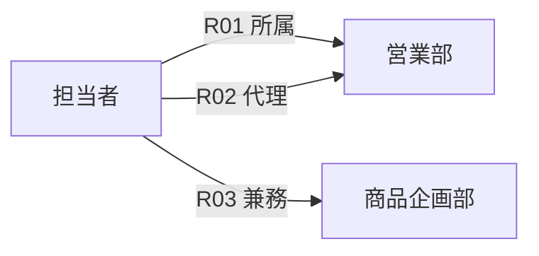
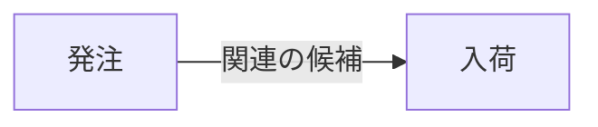
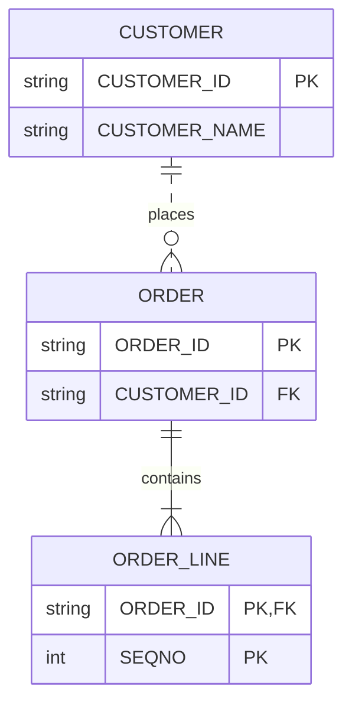

# 標準データ構造の意味的な対応付けと、構文・図解・編集の共通設計

- **状態**：実装前の横断設計・検証計画。正式なSemantic Schema、Grammar IR、公開Plugin ABI、Studio機能、実Provider適合、Ownerの意味受理を主張しない。
- **目的**：JSON Schemaなどの外部構造定義や多様なDSLを、TEIの標準データ構造・意味Role・共通UIへ安全に接続する。同時に、Graph／Tree／Table／時系列などの相互表現に必要な意味保存条件を明示する。
- **最優先事項**：Studio DesktopのStage1→Stage2セルフビルドと、製品Function Entry→実Provider→独立Consumerの縦断を妨げない。文法生成器や新しいRuntimeの構築を先行条件にしない。
- **Owner境界**：[構造・Facet #2495](https://github.com/hat47x/tei-platform/issues/2495)、[演算法則 #2544](https://github.com/hat47x/tei-platform/issues/2544)、[構造Projection #2497](https://github.com/hat47x/tei-platform/issues/2497)、[Language／Operator #988](https://github.com/hat47x/tei-platform/issues/988)、[意味Role・自己記述 #2620](https://github.com/hat47x/tei-platform/issues/2620)、[Studio #1124](https://github.com/hat47x/tei-platform/issues/1124)、[共通UI #1824](https://github.com/hat47x/tei-platform/issues/1824)、[独立Expected #2514](https://github.com/hat47x/tei-platform/issues/2514)。外部資料の取込は#958、Source忠実性は#2621／#2497、開示は#2516、変更影響は#1143、実行権限は#1174に従う。
- **重複させない文書**：[意味TraitのClaim](SEMANTIC_TRAIT_CLAIMS_AND_CONFORMANCE_2026-11.md)、[原子的Trait](TRAIT_ATOMIC_COMPOSITION_AND_FULFILLMENT_2026-11.md)、[Syntax正規化](EVERYTHING_DATA_SYNTAX_NORMAL_FORM_EQUIVALENCE_2026-11.md)、[SourceとRole](EVERYTHING_DATA_INTERPRETATION_AND_SOURCE_BINDING_2026-11.md)、[Studio開放性](GENERIC_STUDIO_OPEN_WORLD_PROJECTION_CONFORMANCE_2026-11.md)、[Source編集](SCRIPT_FIRST_GENERIC_STUDIO_PROJECTION_REFERENCE_2026-11.md)、[DSLとOperator](DSL_OPERATOR_PLUGIN_COMPOSITION_DESIGN.md)、[プログラム実行図](PROGRAM_EXECUTION_MODEL_PROJECTIONS_2026-11.md)。
- **非目標**：第二のCanonical正本、独立Semantic Engine／Resolver／Host／Registry／Gate、あらゆる外部構文を完全に可逆化する万能Grammar、任意のViewからの無条件の原文書戻し、UI操作による権限の自動付与。

## 1. 結論

TEIの標準データ構造は、単にデータの形を共有するためのものではない。構造ごとに「何を同一とみなすか」「どんな関係・順序・時間・数量があるか」「どの操作が成立するか」を、必要な範囲で明示できるようにする。その性質を利用して、**構文、意味、表示、編集、実装を別々に進化させる**。

新設するのは大きな型階層ではなく、既存のMeaning／Facet／Law／Trait／Projection契約をつなぐ、小さな**対応付けの検証票**である。本文の契約項目と識別子は比較用の語彙であり、本番用Schemaや公開APIへの採用案ではない。

利用者には数学的な性質名を前面に出す必要はない。「複数の親を持てる」「循環がある」「同じ関係が複数回現れる」「この編集は原文に戻せない」といった自然な説明へ投影する。Studioの表・図・入力フォームは、独立した意味の正本にはならない。

## 2. 共有する意味特性と、混同してはいけないもの

| 観点 | 明示すること | 取り違えた場合の問題 |
| --- | --- | --- |
| Identity | Stable Subject ID、Occurrence、業務キー、物理PK、Graph Node/Edgeの別 | 同名ノード、多重辺、同名再作成を併合する |
| Relation | 方向、両端の役割、属性、多重性、適用時間 | 所属・先行・参照を同一視する |
| Collection | 集合／多重集合／列、順序、重複、一意性、粒度 | 行数・件数・集計結果が変わる |
| Presence | 存在、明示NULL、欠損、未取得、非開示、空集合 | 「見つからない」を「存在しない」と断定する |
| Quantity | 数量の意味、単位、精度、丸め、測定尺度 | 不適切な加算・平均・比較を許す |
| Time | 有効時点、記録時点、観測時点、ルールの適用版 | 過去の意味や現在の観測を混同する |
| Scope | 母集団、参照範囲、取得完全性、Context、Revision | 部分読取で否定条件を真にする |
| Authority | 受理済みの業務意味、現在Grant、実Effectの別 | 見えているデータを実行許可と誤認する |

これらを一律に全データへ付与することはしない。必要なMeaning Claim／Operator／Consumerに応じて特性を参照し、未宣言は未宣言のまま扱う。型ラベルの一致は、意味的な適格性の証明ではない。

### 三種類の同一性

1. **原文の同一性**：ファイル、byte列、出現箇所、Source Revision、文法／変換器の版。改行、注釈、図の配置も保持対象となる。
2. **構造候補の同一性**：参照が解決された標準データ構造と、対象Claimに必要なRole・順序・識別子・制約。原文が違っても一致し得る。
3. **受理された意味／実際の振舞いの同一性**：OwnerによるMeaning受理、Operator Law、Provider／Target、実観測・受領を含む。構造候補のFingerprintが同じだけでは成立しない。

World Fingerprint、Model Revision、Artifact Revisionも混同しない。Source移動、構文Pluginの更新、生成器の変更、Consumerの取得範囲は、影響するClaimごとに失効条件を定める。

## 3. 構造間の対応付けは「変換できる」だけでは不十分

以下を区別して扱う。

| 関係 | 意味 | 例と注意点 |
| --- | --- | --- |
| 表現上の同値 | 明示した観測について同じ結果になる | 同じDataを表・ツリーで読む。原文一致までは要求しない |
| 埋め込み | 元の要素・関係を失わず別構造へ載せる | Tree→Graph。ただし根・辺属性・順序の保存方法を決める |
| 射影 | 指定した部分だけを取り出す | Graph→隣接表、Table→集計Chart。通常は逆変換できない |
| 集約 | 粒度を変え、情報を要約する | Event→日別集計。個別Eventは復元できない |
| 解釈 | 構造に業務上の役割を与える | Graph→作業先行関係。構造だけでは意味受理されない |
| 近似 | 精度・点数・空間解像度等を意図して落とす | 時系列の間引き。誤差と適用範囲を明記する |

同値の判定は、何を観測するかによって変わる。ある変換 f が、指定した観測 O について O(source)=O(f(source)) を満たしても、原文忠実性・全制約・実行効果まで等しいとは言えない。「無損失」を主張する場合は、対象Scope、構造・属性・参照・順序の保存条件を列挙する。

**Graph→Treeの負例**：二つの同名Node、同じ両端を持つ複数の有向Edge、別の親から入るEdge、循環、Edgeの属性がある世界では、単純なTree表示だけでは元のGraphを一般に復元できない。読み取り専用のTree Viewは許容し得るが、Tree編集から元Graphへの自動書戻しは別判定とする。

**WBSの例**：作業の包含関係と、作業間の先行関係は別の意味Roleとする。階層図とPERT図を同一モデルから派生できても、包含から先行関係を勝手に生成しない。

## 4. 小さな対応付け検証票（正式Schemaではない）

構造変換や表示を評価する際、既存の#2497 Projectionと#2495/#2544のFacet／Lawに、次の観点を照合する。

| 項目 | 最低限の問い |
| --- | --- |
| source / target | 入出力の型、対象Subject、Scope、対象版は何か |
| preconditions | どの構造的・意味的条件で適用できるか |
| preserved / omitted | 何が維持され、何が省略・近似されるか |
| identity / provenance | Node、Edge、行、Source Occurrence、参照先の対応は何か |
| read / edit | 表示できる範囲と、原文へ戻せる編集範囲は何か |
| authority / disclosure | Consumerに何を見せてよいか。実行権限はどこで判定するか |
| evidence / invalidation | どのIndependent Expectedを満たし、何が変われば再検証するか |

例：Graph→Treeで「非循環・根が一つ・各Nodeの親が高々一つ」を必要条件にするときも、Edge IDと属性、子の順序、孤立Nodeなどを別に照合する。適用条件が揃わない場合は「変換不可」または「情報損失ありの読み取り専用表示」とし、成功扱いで捨てない。

同じ契約をOperatorの適用可能性にも使える。たとえばtopologicalSortはGraphという名前ではなく、対象Relationが要求する非循環性・方向性・Scopeを満たすときに適用できる。一方、sum／averageは数量の単位・尺度・NULL・丸め・粒度に依存する。可換・結合・分配などの法則は名前だけで推論せず、#2544の検証可能なClaimに従う。

## 5. JSON Schemaは「Recordの別表記」ではない

最初の外部仕様の実証例としてJSON Schemaを用いる。ただし、JSON Schemaは**JSONインスタンスの妥当性を定める制約言語**であり、Schemaそのものと検証対象のRecordを混同しない。

読み込み時に保持すべきもの：
- 仕様Dialect／Vocabulary、`$schema`、`$id`、参照Scope、原文byte・Occurrence。外部参照は取得元・版・時点・完全性を別に記録する。
- `properties`／`required`／`additionalProperties`などの制約と、注釈・表示用説明の別。
- `$ref`／`$dynamicRef`、`$defs`、再帰参照、`allOf`／`anyOf`／`oneOf`／`not`、`if`／`then`／`else`。
- `unevaluatedProperties`など、評価経路・注釈収集に依存する制約。単純なフィールド一覧へ平坦化して「同等」とは扱わない。
- 真偽値Schema（`true`／`false`）、存在しない属性と明示NULLの違い、`default`などが自動補完・書込みの義務とは限らないこと。

**Studioの基本表示**：項目名、型の候補、必須かどうか、参照、制約の有無をまず示す。複合制約・原文・Dialect・参照解決・検証上の詳細は展開やツールチップに載せる。JSON Schemaが制約から導かないこと（例えば確定した業務キーやDB制約）は追加推論しない。

**編集時**：Source byte範囲、解決済み参照、対象Revision、変更意図が一意の場合だけ候補Patch→差分Preview→再検証へ進む。共有された`$ref`先、複数Schemaの合成、派生した画面では、意図せず広域変更を起こさないよう原則read-onlyまたは明示的に編集対象を選び直す。Schemaの表示・Source編集・JSONインスタンスへの入力・DB Migrationは四つの異なる操作である。

**外部仕様の契約**：Dialect未対応、参照取得不能、部分取得、Vocabulary未解釈は成功した完全解釈にしない。従来どおりplain-dataの構造表示へ退避できる範囲と、検証／編集できない範囲を区別する。

## 6. DSLの自己定義を、専用の巨大なParser基盤にしない

言語ごとに「構文の読み方」と「標準データ候補への対応」を分ける。

```text
Authoritative Source (TEI DSL / Markdown / JSON Schema / DOT / ...)
  → Language Pluginがparse・Source位置・診断を供給
  → plain standard data candidate
  → Role／Operator／参照の解決、制約検証、OwnerのMeaning受理
  → Studio共通View／構文固有View／Generator／Scenario
```

文法は、EBNF／ANTLR／Tree-sitterなどの既存技術を比較対象とする。ただし、**Grammar IRの新設や全言語の共通Parser生成は未採用**。まず#988の既存Language Plugin Referenceから、構文規則、エラー回復、補完候補、Source occurrence、Semantic Bindingのどこまでを共通化できるか測る。

入力支援を三段階に分ける：
1. **構文候補**：次に置ける記号、キーワード、繰返しなど。
2. **意味候補**：Role、型、束縛済み参照、単位、Cardinality、Operatorの適格性。
3. **Context候補**：許可された現在のSubject、Providerが実際に読み取った候補、開示できる値。未取得を空の候補集合と同一視しない。

Studio内のGUIからGrammar／Viewを記述できる方向は維持する。ただし初期の独自Viewは宣言的なレイアウト、型付きBinding、参照ジャンプ、Tooltip、可読な警告を優先する。任意コードの注入や自動実行許可を標準拡張にしない。専門Viewは#951のPlugin契約で追加できる余地を保つ。

自己記述の到達目標は、文法・Role・Viewの一部を標準データとして説明・検証できること。自分自身のParserを完全再生成できたことや、全ターゲットで意味同値であることは別の検収とする。固定された最小Reader／bootstrapと、自己定義を更新する際の互換性・退避経路を保つ。

## 7. Studioでの一貫した操作

同じSubjectを、テキスト、構造ツリー、関係図、表、フォーム、Source Diffで切り替えられることを目標とする。中心は**安定した対象選択**であり、図上の座標や表示Edgeを意味IDにしない。

- 表示は意味未解決でも、開示可能な`path / structural type / disclosed value`へ退避する。
- Tooltipは意味Role、制約、適用範囲、診断、Source位置を見せる。未受理の候補は未受理と表示する。
- 図表と原文のジャンプはSource ID／Occurrence／Revisionに基づく。Sourceの移動やA→B→Aは、構造・編集・受理履歴・Consumerが何を同一視するかに応じて照合する。内容byteが同じことだけで、却下履歴や外部Consumerの資格まで復活させない。
- 編集は`read-only`、`candidate patch`、`explicit source edit`、`supported reversible edit`を分け、後二者も権限・意味受理・実Effectを代替しない。
- 開示の違いから非公開のSubjectの有無・件数・診断が分からないよう、#2516のConsumer別試験に従う。
- Studio内の人間とAIは同じ型付きSelectionとPreviewを使うが、AI候補の生成とOwnerの意味受理を分離する。

新しいDomain Pluginを追加した際の重要指標は、専用のStudio Core分岐を追加せず、既存のText／Property／Tree／Graphへ必要な情報を表示できるかである。Graphや高度な可視化をすべて汎用UIへ押し込むのではなく、専用UIが必要な理由と効果を比較する。

## 8. 反例を先に固定する検証計画

次のケースは**Independent Expectedの候補**であり、本書作成時点で新たな実試験を実施したという意味ではない。既存#2497／#1131／#2514／#1124のScenarioへ割り振り、類似Fixtureを重複新設しない。

| ID | 入力／操作 | 期待する判定 |
| --- | --- | --- |
| SM-01 | Graphに同名Node二つ、同一両端のEdge二つ、属性あり | Node／Edge同一性と多重性を保存。Treeへの無損失書戻しを拒否 |
| SM-02 | Graphに複数親・循環・孤立Node | Tree適格性を個別診断。適切なread-only表示へ退避 |
| SM-03 | WBSの包含辺と先行辺 | 両者の意味を分離。包含だけで依存辺を生成しない |
| SM-04 | Tableのbag、NULL、missing、partial取得 | 件数・否定判定・集計の意味を誤って確定しない |
| SM-05 | 時系列の単位・精度・観測時点を変える | 明示した観測範囲でのみ同値性を判定 |
| SM-06 | JSON Schemaの`oneOf`／`allOf`／`if` | 単なる継承・項目表へ誤変換せず、制約を保持または未対応を表示 |
| SM-07 | 再帰`$ref`／`$dynamicRef`／未取得参照 | 解決状態と適用Scopeを表示。不完全な検証を成功としない |
| SM-08 | 同じ参照先が複数画面で利用されるSchema | 図編集で参照先を勝手に広域変更しない |
| SM-09 | 同じ標準DataがMarkdown、DSL、JSONから導かれる | 構造候補の同一性とSource identityを区別 |
| SM-10 | Grammar／Role／Operatorの版を変更 | 古い意味受理や補完候補を無検証で再利用しない |
| SM-11 | 未知Roleと`trusted-script`という入力値 | plain-data表示に退避し、Action／Grantを昇格しない |
| SM-12 | Viewの部分開示、stale Selection、曖昧な逆写像 | 情報漏えいと誤書戻しを防ぎ、理由を示す |
| SM-13 | `default`注釈や任意プロパティのフォーム表示 | 注釈を強制入力・値の自動確定と誤解しない |
| SM-14 | Sourceのコメント／DOT配置だけ変更 | Source差分は残し、意味差分・Artifact再利用を別判定 |

テストは二段階にする。まずHeadlessで同じSource・正解・Diagnostic・Source Jumpを固定する。次にStudio実画面／CLI／独立Consumerで、同じSubjectと判定を受領できるか検証する。図が描けることを意味保存やTarget適合の証拠にはしない。

## 9. 既存計画へ割り当てる順序

| 順位 | 作業と完了条件 | 既存Owner |
| --- | --- | --- |
| **P0（既存主線を継続）** | Stage1→Stage2 Studio自己再構築。並行して製品Entry→実Provider→実Consumerの資格を独立確認 | #4583／#4495／#2586 |
| **S0（並行・設計のみ）** | 既存のMeaning／Facet／Law／Trait／Projectionと本書のSMケースを対応付け、既存契約で記述できない最小差分だけ列挙 | #2495／#2544／#2497 |
| **S1（Headless）** | Graph／Tree／Tableの二つ以上の相互Viewを、同一ID・Scope・独立Expectedで比較。無損失／損失／readonlyを出し分ける | #2497／#1131／#2514 |
| **S2（外部Schema）** | JSON Schemaの単純例と複合例を読み、Source位置・制約・未対応状態付きで構造表示。編集はまだread-only | #988／#2620／#1124 |
| **S3（Studio限定編集）** | 一意のOccurrenceだけを候補Patch→Preview→再解析。共有参照・古いRevision・未対応Dialectで停止 | #1124／#2497／#2621 |
| **S4（宣言的View）** | 既存の汎用UIで新しいView定義を使い、Sourceジャンプ・Tooltip・入力補完を提供。追加PluginによるStudio固有分岐数を計測 | #1124／#1824／#951 |
| **S5（文法定義・自己記述の比較）** | 既存Language Pluginの不足を実測した後、Grammar規則の共通記述と外部Parser生成技術の採否を比較 | #988／#2620／#1121 |

S1〜S5は**P0の先行Gateにしない**。S0で既存契約だけで十分と判明した項目には新しいSchemaやEngineを導入しない。新しいIssueをむやみに増やさず、まず各既存Ownerへ検証条件と反例を渡す。

## 10. 採用判断

次のすべてを示せた部分だけ、既存契約の拡張候補とする。

1. 誰がMeaningのOwnerか、どのSource／版に帰属するかを説明できる。
2. 同一性・順序・多重性・NULL／missing／partial・Time／Unitなど、対象Claimに必要な意味を欠かさない。
3. 損失のあるProjectionを安全な編集可能Viewと取り違えない。
4. Studio固有処理を増やさず、新しい構文・Schema・意味Roleの少なくとも一例を表示できる。
5. 既存Expectedで正常例と負例が再現でき、Source→View→候補Patch→再解析の範囲が明確である。
6. 実Provider／Target／Consumer／Owner受理の資格を、合成試験や図解の成功と混ぜない。

**判断**：意味特性・構造間写像・構文とViewの拡張性を、TEIの長期的な共通基盤として計画に加える。ただし採用単位は既存契約に対する小さな差分とし、正式なGrammar IR・新Semantic Engine・全面的なSchema双方向編集は、実証結果に基づいて改めて判断する。


## 11. 意味保存を検査する単位を、実際の利用経路に合わせる（2026-11-14追補）

今回追加で確認したのは、**構造間の写像が数学的に正しくても、それだけでは利用者が期待する機能の同値性を保証できない**という点である。構文を読み取る段階、Queryを評価する段階、UIへ描画する段階、編集を原文へ戻す段階で、それぞれ保存すべき観測が異なる。

| 境界 | 対象となる「意味」 | 同値性の主要な観測 |
| --- | --- | --- |
| Syntax → Data candidate | 名前束縛、Literal/Ref、順序、Operator ID、Source位置 | 同一Source・Grammar/Role Pinで同じ候補と診断が得られるか |
| Data/Query → 実Rowset | Relation Path、JOIN粒度、bag、NULL、絞込条件、評価時点 | 同じSource/Query/実Provider、実入力から、対象Scopeの実値・取得範囲が一致するか |
| Data → View | Identity、関係、参照、単位、時間、開示可能な値 | Consumerに必要な情報を維持するか。省略情報を明示できるか |
| View edit → Source patch | 編集対象OccurrenceとRevision、原文忠実性、変更意図 | 対象以外のbyteを不変にし、再読込後の指定された意味だけが変化するか |
| Meaning → Target | Operatorの法則、失敗・副作用、順序、時間、Provider適合 | 独立Expectedと実Target／Consumer観測が一致するか。実Effectは別途確認するか |

**構造同値／評価同値／変更同値の三つを分離する。** 二つのQueryが同じ列の名前と型を返しても、JOINの重複やNULLの解釈、LIMIT、RLS、Top-N、NOT EXISTSの再評価が異なれば評価同値ではない。読み取り結果が一致しても、一方の更新が原文全体を書き換えたり、共有参照先へ意図しない影響を与えたりすれば変更同値ではない。

この分類を別のCore enumに固定せず、既存#2497のProjection、#2544のOperator Law、#2387のQuery、#1143の変更影響、#2514の独立Expectedに対する**Claim別の照合観点**として扱う。

### 11.1 同値性には条件と観測範囲を必ず添える

「元の意味を保つ」という表現は、無条件の保証に使わない。例えば、有限集合上で二つの純粋Operatorの計算結果が一致しても、遅延評価、短絡、失敗、時刻、Effectが異なれば任意のContextで置換可能とはいえない。

同値を主張する前に、少なくとも以下を決める。

- 対象Subject／Relationと時点、母集団、必要な列・辺・属性・単位は何か。
- 元のSource／Plugin／Operator／Meaning／Provider／Toolchainのどの版に依存するか。
- どの観測（値、順序、件数、エラー、Effect、診断、Source byte）が一致すれば十分か。
- 何を確認できなかったか。未取得、部分取得、非開示、未解釈Pluginは、完全な一致の証拠にはしない。
- 変換後のConsumerに必要な情報が、投影結果で本当に充足されたか。

## 12. 編集可能なViewには、双方向変換の法則を参考にする

一般の双方向変換（Lens）の考え方は、#2497の編集契約を検査する際に役立つ。ただし「Lensを新しい本番抽象として採用する」という意味ではない。

読み取りViewを `get(S)`、Viewの更新候補を原文へ反映する操作を `put(S,V)` と書く。

- **Get–Put**：何も変えなかったViewを戻しても、意味上の更新は起こらない。Markdownなどの原文保存では無関係なbyteも変更しない。
- **Put–Get**：許容されたView変更をSourceへ反映して再解析すると、その変更が指定のScopeで再び観測できる。
- **Put–Put**：更新の順序や競合を扱う場合、後から行った変更が以前の更新をどう上書きするかを明示する。一般に全形式で成立すると仮定しない。

これらの法則は、**特定のSource、Revision、操作、Scopeに対する条件付きの検査**である。整形、注釈、共有参照、Macro、外部Schema参照などがある場合、意味上の等価性とSource byteの忠実性は別条件になる。

### 12.1 Studioでの更新経路

```text
固定されたSubject + Source Occurrence + Revision
        → UIが返す型付き編集Intent
        → Preview：元byteと提案Patch、関係する別Viewへの影響
        → Resolve：現在のSource／Role／Operator／参照を再解決
        → Admit：既存Owner／権限／競合条件で採否を判断
        → Commit：許されたSource Patchまたは別途許されたDB更新
        → Observe：独立した再読取りでSource／View／必要な実結果を確認
```

この手順は既存の編集・実行Ownerへ渡す**説明上の接続**であり、共通Commit Engineを新設しない。Sourceへの書戻しとDBへのCommitは別の取引であり、一方の成功を他方の成功と見なさない。

**更新不可として残す条件**：複数のSource occurrenceから同一View要素を導出した場合、原文参照が曖昧な場合、取得範囲が部分的な場合、権限が不確かな場合、対象Revisionが古い場合、意味RoleまたはGrammarが変更された場合、共有されたSchemaの変更範囲が確定できない場合。表示とSourceへのNavigateは、開示可能な範囲で継続できる。

## 13. 情報の有無を表す状態を、構造的な空集合へ畳まない

Graphに表示する辺が0本、SQLのRowsetが0行、JSON Schemaの`required`が空、という事実は、いずれも「業務上その関係・制約・事象が存在しない」ことの証明とは限らない。

| 受け取った状態 | 成立する主張の例 | 成立しない主張の例 |
| --- | --- | --- |
| 完全なScopeで0件を観測 | 明示したScope・時点・Queryでは該当件数0 | 全期間・全Provider・全主体について不存在 |
| 取得件数0、Coverage不明 | この呼出しから0件が返った | 対象が存在しないため0件になった |
| partialなRowset | 返却済みの行と値は観測した | NOT EXISTSが真、集計が全量 |
| Schemaの未宣言属性 | その定義箇所に宣言が見当たらない | 実データに存在しない／禁止されている |
| 非開示のSubject | このConsumerにはその情報を提示できない | 「非公開のものが存在する」と表示してよい |

たとえば`enabled(order.submit) = not exists approval.pending`は、許された範囲に実際の未承認行が1件見つかれば否定できる場合がある。一方、空の返却だけで肯定するには、対象母集団、条件、Snapshot、取得完全性、Providerの制限が必要になる。これは#2582／#2516／#2497の既存境界を再利用する。

新しい未知値の万能enumを作るのではなく、既存のPresence・Coverage・Disclosure・Freshnessの根拠を組み合わせ、**各Consumerが言ってよいことの上限**を明示する。非開示の有無を診断メッセージや補完候補数で漏らさない。

## 14. DB／専門領域との接続を、二つの最小縦断で検証する

### 14.1 外部Schemaの構造表示：JSON Schema → Studio

最初は読取専用に限定する。固定したJSON Schema Sourceについて、Dialect、Source occurrence、参照範囲、型・`required`・条件付き制約・注釈を識別し、項目ツリー／制約詳細／原文ジャンプへ投影する。

**合格条件候補**：
- 同じSourceとPlugin Pinで、Headlessの読み取り結果・診断・Sourceジャンプ先が再現される。
- `oneOf`と`anyOf`、`allOf`と継承、`default`と値の確定、未対応Vocabularyと成功を混同しない。
- `$ref`の共有先・循環・未解決、外部取得のpartial/unavailableを画面から見分けられる。ただし開示不可情報は漏らさない。
- 複合制約を表に展開しきれなくても、制約自体は保持し、Viewが表現した範囲だけを明示する。
- 元のSchemaを編集・保存する前の段階では、Sourceを一切書き換えない。

**仕様に基づく詳細条件**：最初の固定DialectはJSON Schema Draft 2020-12を比較候補とする。同版では`prefixItems`／`items`の配列制約、`$dynamicRef`／`$dynamicAnchor`の実行時の動的Scope、`format-annotation`と`format-assertion`のVocabulary差を、単純な静的フィールド表へ丸めない。特に`$dynamicRef`の解決先は、原文で示された参照URIだけでは十分に確定しない場合がある。出典：[JSON Schema Draft 2020-12](https://json-schema.org/draft/2020-12)、[Core specification](https://json-schema.org/draft/2020-12/json-schema-core)。

**導入を急がない機能**：任意のDialectの完全な検証、すべての制約の自動フォーム変換、双方向Schema Migration、文法生成器の一般化。まず固定Dialect・有限Fixtureで不適合を説明できることを優先する。

### 14.2 実Queryの構造投影：PostgreSQL Read → Table／Aggregate

#2586の製品Read資格を得た後のConsumer検証として、既存の`order_entry`受注読取り等を題材に、**同一の実RowsetからTableと集計Viewを別々に派生**する。実PG読取りそのものはこの設計文書が所有せず、既存Ownerの資格を参照する。

**合格条件候補**：
- Query、引数、Subjectと実Provider、Snapshot、必要なField、粒度、NULL、Row ID、Row Count、制約・取得限界を同一Attemptから照合できる。
- Tableでは行とKeyが保持される。集計では集計単位、条件、NULL・重複の扱いと、失った個別行情報が説明できる。
- LIMIT／RLS／Native SQLの未知条件で全量性が立証されていなければ、集計結果を「対象全件の合計」と表示しない。
- CLIとStudioなど異なるConsumerでは、同じ意味の受領を**それぞれ**検査する。描画の成功とProvider実Call、正しい開示と対象全量取得を混同しない。
- Derived Viewは原則read-only。Row Editを許す場合、Subject Pin、条件付き更新、Commit Receipt、独立Post-commit Readを別経路で受け入れる。

これはData Source Workbench #3270、Query #2387、Function Data Context #2506、Projection #2497、Consumer資格 #2586に対する**同一の受入連鎖**であって、独立したDB抽象や第二のQuery IRを提案しない。RDBとNoSQLの双方へ展開する際も、原文Query、Provider特有の評価、実取得のCoverageを消して共通化しない。

### 14.3 WBS・科学計算は「意味特性の異種検証例」として後続に置く

[専門ツールキット計画](CROSS_DOMAIN_MATH_STATISTICS_PLANNING_TOOLKITS_2026-11.md)／#4660の題材を、共通基盤の適格性を測る対照群として使う。

- **WBS／PERT**：包含と先行の辺を分け、同名Task・多重辺・循環を扱う。単なるGraph表示からクリティカルパスの計算可能性を推定しない。
- **統計／Window**：PARTITION、ORDER、Frame、NULL、行粒度、データ全量性を伴う。SQL方言またぎの見かけの同型を意味同値へ昇格しない。
- **数量・科学計算**：単位、尺度、精度、許容誤差、境界条件、Solver/アルゴリズム版、計算の決定性を明示する。浮動小数点の厳密一致を無条件に要求せず、独立Expectedが指定した誤差・条件で判定する。

専門Toolkitの実装はStage2セルフビルドのP0を止めない。汎用Coreへ追加するのは、複数分野で必要性が実測され、既存Facet/Law/Projectionで表現できない最小要素だけとする。

## 15. 自己記述・差分・Build再利用の境界

GrammarやRoleの自己定義は、[Role Bootstrap設計](ROLE_BOOTSTRAP_AND_SELF_DESCRIPTION_2026-11.md)の有限Seedから始める。`formatVersion`、Language／Parserの版、Role／Operatorの版、Generator／Toolchain、Source Revisionを区別する。文法の自己記述が読めること、生成されたParserが動くこと、TEI自身を再ビルドできることは三つの別成果である。

区別して扱う変更例：

| 変更 | 必ず再評価する対象 | 自動的には変化しないと主張できない対象 |
| --- | --- | --- |
| Markdown注釈、DOTレイアウト | Source byte／Occurrenceと表示差分 | 語彙内の参照、生成対象、受理済みMeaningへの影響 |
| SourceのA→B→A、移動、同名再作成 | Source内容、Occurrence、依存Closure、Decision履歴、Consumer Selectionを主張ごとに照合 | 内容が一致しただけで却下履歴、実Consumerの受領、現在のAuthorityを復活させること |
| Grammar／Language Pluginの更新 | Parse／診断／正規化／補完と、必要なMeaning Claim | 既存の受理済み意味・Target適合 |
| Role／Operator Law更新 | 対象Operationの意味・結果・適格性 | 旧生成物の意味同値・Cacheの正当性 |
| Generator／Toolchain更新 | Artifact生成と実利用資格 | Sourceが同じときのBundle再利用資格 |
| Provider／Scope／Grant更新 | 実Read、開示、Action Authority、Consumer受領 | 過去の合成Fixture PASSの製品資格 |

変更影響は、**affected／scoped-unaffected／unknown**を既存の依存ClosureとClaim別評価へ返す。Unknownをすべて無影響と扱わない一方、無関係な未知を理由に全Sourceを必ず再受理させる必要もない。古いResultや同名のSourceを使って、失効したConsumer・Authority・受理の資格を復活させない。ただし同一byteに対する純粋な候補Patchの適用可能性は、対象Sourceと依存が一致する範囲で改めて判定できる。履歴を理由に無関係な純粋編集まで一律失効させない。

## 16. 追加反例と既存Issueへの引渡し

§8のSM-01〜14を維持し、他チャットとの整合で不足していた反例だけを以下に追加する。すべて**未実行のIndependent Expected候補**であり、新しいScenario台帳を増やす意図はない。

| ID | 検証対象 | 独立した期待結果 | 主な既存Owner |
| --- | --- | --- | --- |
| SM-15 | 同じ列構造でJOIN粒度・bagが異なる二Query | Shape一致でも評価同値と判定しない | #2387／#2497 |
| SM-16 | NOT EXISTSで0件、ただしReadはpartial | 否定条件の真を証明しない | #2582／#2497 |
| SM-17 | ViewからSourceへ同じ値を保存、Markdown書式あり | No-opでは原文byte不変。最小Patch以外の再formatを拒否 | #2621／#2497 |
| SM-18 | 集計Viewで値を変更するIntent | 戻す行が一意でないため自動逆書戻しを止める | #1124／#2497 |
| SM-19 | Grammar版だけ更新、Source byteとRole名は同じ | ParseとMeaningの必要Claimを再評価し、旧受理を自動継承しない | #988／#2620 |
| SM-20 | 同一実RowsetからTableとAggregate、RLS/LIMITあり | 受領した範囲の集計と全件集計を別表示。実Read資格は別 | #2586／#2387 |
| SM-21 | 同じGraphをWBS階層図とPERT図で描く | 包含と先行のRoleを分離し、計算入力の循環を診断する | #2495／#4660 |
| SM-22 | Solver版・精度・単位だけ異なる科学計算結果 | 独立Expectedが定めた適格性と誤差でのみ同値を認める | #2544／#4660 |
| SM-23 | Schema Viewerが非開示の参照先を補完／診断する | Consumer側の公開結果から存在・件数・Source名を推測させない | #2516／#1124 |
| SM-24 | SourceをPreviewした後、Revision／Grantが変化 | Resolve／Admitをやり直し、古い選択でCommitしない | #1124／#1174 |
| SM-25 | Schema／Viewの変更後、実DBの列が消えたように見えるがCoverage不明 | Desired Sourceや受理済み業務意味を自動削除しない | #3270／#1143 |

### 16.1 どの段階で何を成果と呼ぶか

- **S0（設計で確認できる範囲）**：SM-01〜25を既存の契約・Issue・Fixtureへ振り分け、重複・未表現・判断保留を列挙する。ここに書いたことで製品適合とはしない。
- **S1（Headlessの最小実証）**：Graph↔Tree／Tableの同一性と損失判定に加え、SM-17／18で編集可否の差を確認する。Graphの同名Node・多重Edgeは最初から含める。
- **S2（Schema読取専用）**：JSON Schemaの単純・複合・未解決参照・Dialect不適合を同じStudio generic表示へ出す。完全対応率を捏造しない。
- **S3（限定編集）**：Source occurrence／Revision／byte差分を備えた一箇所の合法Patchのみを通し、SM-17／18／24を負例にする。
- **S4（共通View）**：新しいRole／Schemaを追加してもStudio Coreにドメイン分岐を増やさず、表示・Navigate・開示資格の差を確認する。
- **S5（構文定義比較）**：既存Language Pluginの実測結果と必要な支援機能を比較し、Grammar IR／生成技術を採用する十分な根拠が出た場合に限ってOwnerが判断する。
- **製品縦断（既存P0の成果を参照）**：#2586の実Read資格が成立した後、同じAttemptからのTable／Aggregateを独立Consumerで照合する。S0〜S5や専門ToolkitをP0達成の先行Gateにはしない。

**次の着手単位**は、まず既存#2497のProjection／編集契約とSM-01／04／17／18のExpectedを照合し、「新しい型を増やさずに書ける項目」と「本当に不足する項目」を一枚で示すことである。そこにGapが認められない限り、Semantic Registry、Grammar IR、Edit Engine等の新規共通基盤を要求しない。


## 17. 損失のあるProjectionにおける項目・操作別の編集資格（2026-11-14追加）

**補正する判断**：Graph→Treeのように写像全体が非可逆でも、「表示されているNodeの所有属性」のような局所操作まで無条件に拒否する必要はない。一方、ノード移動やEdgeの付替えは、見えない親・並行Edge・Edge IDに依存するため、同じ画面から操作できるように見えても許可できるとは限らない。

これは新しいProjection Engineの要望ではない。[#2497](https://github.com/hat47x/tei-platform/issues/2497)の写像契約を、**全体の情報保存判定と、選択したSlot／操作に限った逆写像判定**に分けて検証する提案である。対応する根拠は[#4533](https://github.com/hat47x/tei-platform/issues/4533)の既存実測と、[Draft #4538](https://github.com/hat47x/tei-platform/pull/4538)のGo Reference。

### 17.1 先に判定する五条件

以下の五条件が成立する範囲だけを「原文へ変更候補を返せる」とする。

1. **対象の一意性**：表示要素から、型付きSubjectと編集対象Occurrence／Slotが一つに解決される。同名ノードでもIDが別なら混同しない。
2. **値の出所**：編集値が当該Subjectの所有する属性に対応し、集計・結合・丸め・換算・多対一変換を通じて生成された値ではない。
3. **局所Patch**：原文中の変更範囲が確定し、依頼されていないコメント、空白、他属性、別のSourceを変更しない。
4. **現時点の対応**：Sourceの内容・対象span・依存・必要なSelectionの現在性を検査する。Sourceの純粋なPatch適用可能性と、Owner受理・Authorityの現在資格は別。
5. **再検証**：Preview→既存review／accept→再parse／再投影で変更が一致する。No-opなら原文byteを変更しない。

これは「編集候補を作れる」ための条件であり、Ownerによる意味受理、Source書込権限、実DB更新、Effect Receiptを与える条件ではない。

| Projection／操作 | 全体の損失 | 局所判断 | 理由 |
| --- | --- | --- | --- |
| Graph→Tree：Node所有の名称変更 | 第二の親・多重Edgeなどが失われる | 一意のSource属性なら候補可能 | 変更対象Slotは写像で消えていない |
| Graph→Tree：Node移動 | 同上 | 非表示辺と関係IDを含めた別検査が必要 | Tree上の親はGraph全辺を表さない |
| Graph→Tree：Edge属性変更 | 同上 | Edge ID・属性所有者が未確定なら拒否 | 同じ端点の別Edgeを誤更新し得る |
| JOIN→集計Chart：数値の直接変更 | 元行・重複・粒度を失う | 自動逆書戻しは拒否 | 集計1点の変更を行へ一意に配分できない |
| 部分取得→Table：読取済みセル編集 | 未取得行がある | 明示Row ID・Revision・条件付き書込を別に確認 | 既知の一行の更新と全件置換は異なる |
| Markdown表→Property：同じ値の保存 | 表記・空白・注釈の損失があり得る | No-opならSource byte不変 | 通常Saveは糖衣構文の再生成ではない |

[#4538](https://github.com/hat47x/tei-platform/pull/4538)の限定Referenceでは、Property/Tableの一属性編集・Source往復と拒否は確認されたが、Graph→Treeの**Node属性Slot**を全体損失から独立に判定する実装はまだ不足する、と報告されている。この具体的なGapを[#4351](https://github.com/hat47x/tei-platform/issues/4351)／#2497へ戻す。Graph一般の安全な書戻しを証明したことにはしない。

### 17.2 SourceのA→B→Aをどう読むか

[#4558](https://github.com/hat47x/tei-platform/issues/4558)の検討から、「A→B→Aなら常に全編集を拒否する」という一律規則は採らない。要求する主張ごとに以下を分ける。

| 主張 | 必要な確認 | A→B→Aで注意する点 |
| --- | --- | --- |
| 純粋なSource内容Patchが適用できる | 現在byte、対象span、依存、再解析 | byteと対象条件が同じなら適用可能性を再評価できる |
| Ownerが以前に却下していない | Decision履歴、同一候補、明示的なsupersedes | 内容が戻っても却下記録は消えない |
| Source書込を現在許可されている | 実施時点のAuthorityと対象Scope | 過去のReview／表示結果はGrantではない |
| 外部Consumerに現在公開してよい | Consumer、Audience、Source／Meaning Pin、開示条件 | Bを受け取ったConsumerの資格をAのbyte一致から回復させない |
| Build成果物を再利用できる | World／Model／ArtifactとToolchain依存 | SourceだけがAに戻っても別の実装・利用資格が必要 |

Decisionの却下履歴を受理時にどう扱うか、過剰なWorkspace全体Revision失効をどこまで局所化するか、Source書込Grantを誰が検査するかは#4558／既存Acceptance Ownerの判断として残す。新しい全体単調カウンタやAuthorityをここから採用しない。

## 18. 「表示できる」と「表示し続けてよい」を分ける

Studioの非同期読取では、Source／Context／Grantの古いResultが後から到着し得る。入力時点の条件が有効でも、**描画を確定する時点（Render Commit）**に同じ情報を公開してよいとは限らない。

既存[Studio open-worldの検証計画](GENERIC_STUDIO_OPEN_WORLD_PROJECTION_CONFORMANCE_2026-11.md)では、Lane単位の失効、全Lane reset、以前描画した値の残留、後着Responseを限定Referenceで検討している。共通のepoch tokenや第二Policy Engineを作るのではなく、この確認をView利用条件へ接続する。

初期表示、非同期更新、選択後のTooltip、補完候補、検索索引、AIに渡すDesign Contextは、それぞれ**当該ConsumerのDisclosureと現在Selectionに相対**である。必要なCurrent Claimがない場合、公開可能なplain-data表示へ退避するか、関連内容を非表示にする。

**重要な反例**：権限変更時にResponse Scopeをresetしても、既に表示したDOM／ARIA／検索候補／Graph Node／AI Contextが消去されたとは限らない。変更通知を受け取れない実Consumerは即時撤回を保証したことにせず、次の利用・描画時点の資格確認と既存内容の再投影・消去の責務を別に検査する。

| 状況 | 表現の判定 | 更新・実行に関する判定 |
| --- | --- | --- |
| 未対応Role、Sourceは公開可能 | plain-dataとしてinspect／Source Navigate可 | 意味を推測する編集・実行は不可 |
| Sourceは読めるが、共有参照の更新範囲が曖昧 | 参照・制約の表示可 | 当該参照先の一括更新は保留 |
| 非開示の参照先が必要 | 公開可能な断片だけ表示 | 参照の存在・件数を漏らす補完／診断は禁止 |
| 古いRead ResultがUIへ到着 | 現在の選択・開示条件を再検査 | 過去のallowを現在のallowへ流用しない |
| Previewの後でAuthority／Sourceが変更 | 既存Previewは履歴として区別 | Resolve／Admitし直すまで適用不可 |

## 19. 既存ReferenceへのFit/Gapと最初の検証票

S0では新しい実装を始める前に、既存の成果を正確に再利用する。既にあるReferenceと今回の提案を混同しないため、次を一枚の対照として扱う。

| 既存Owner／実証 | すでに比較できること | 残る不足 | 本設計から渡すSMケース |
| --- | --- | --- | --- |
| [#4351](https://github.com/hat47x/tei-platform/issues/4351) のFacet Mapping | 12列契約とXMAP負例、情報損失・逆写像のread-only判定 | 操作別Slotの意味損失と実Source編集は別 | SM-01／02／04／18 |
| [Draft #4464](https://github.com/hat47x/tei-platform/pull/4464) の投影Matrix | 4構造×8表現型のうち11セルを限定Go Referenceで評価、未カバー21セルを区別 | 未判定セル、実Renderer、実Provider、Owner受理 | SM-01／05／21 |
| [#4533](https://github.com/hat47x/tei-platform/issues/4533)／[Draft #4538](https://github.com/hat47x/tei-platform/pull/4538) の局所編集 | Property/Table値のSource span／Revision／Preview／再投影の限定往復 | Graph→Tree Node属性Slotの過剰拒否、Source書込Authority、正式Studio | SM-17／18／24 |
| [#4558](https://github.com/hat47x/tei-platform/issues/4558) の履歴・権限 | byte／Review／Decision／Grant／Consumerの現在資格を分離 | 却下後受理、Source書込Grant、全体Revisionによる過剰失効のOwner判断 | SM-19／24 |
| [Studio Open World](GENERIC_STUDIO_OPEN_WORLD_PROJECTION_CONFORMANCE_2026-11.md) | plain-data退避、未知Role、非同期Resultの限定失効対照 | 実DOM／ARIA／補完／AI受領時の再許可と撤回 | SM-11／12／23 |
| [#2586](https://github.com/hat47x/tei-platform/issues/2586)／[RA-0〜RA-3計画](SCRIPT_LAUNCH_ENTRY_TEST_QUALIFICATION_2026-11.md) | 型付きQuery、限定実PG Read、Coverageの区別について既存受入段階を定義 | 通常製品CLI／実Provider／同一Contextの独立二Consumer | SM-15／16／20 |

**S0の成果物はこのFit/Gap表と既存Expectedへの照合**であり、表の行を新しいIssue／Fixture／Validatorとして実装することではない。最初の小さな実装候補は、#4351と#4538が実際に示した「全体はlossyでも一つのNode属性Slotは編集候補になり得る」というGapに限定する。#2497のOwnerが受入条件を確定してから既存Referenceを拡張する。

**合格を示す最短の対**：
- 正例：同じGraph→Tree投影で、安定Node IDと一意Source spanを持つ名称変更が、既存Preview／Acceptance／再投影で成立する。
- 負例：同じ表示からEdge IDなしのNode移動を要求した場合、非表示の辺と多重性を破壊するため拒否する。
- どちらも同じSource／Model／Plugin Pinと独立Expectedを用い、実Graph WriterやGraph専用UIの新設を必要条件にしない。Node属性を編集できてもGraph一般の変換が無損失になったとは報告しない。

### 19.1 過剰な開発範囲を避ける停止条件

「投影できる」という判定にProperty編集・Graph再構築・実DB更新・Stage2セルフビルドの達成をまとめない。既存の12列契約のClaimで区別できるなら新しいSemantic Schemaは不要。別途新しい共通Primitiveを提案するのは、**異なる分野の二例以上で再現可能な不足**があり、既存Facet／Law／Trait／Projectionでは表現不能であると示せた場合に限る。

また、JSON Schemaの読取専用表示、Studio実UIの安全編集、実PostgreSQL→二Consumerの受領はそれぞれ別の段階である。Product P0のStage1→Stage2と実Readを最優先に維持し、本書のS0〜S5を新たなHard Gateへ格上げしない。


## 20. 合成Projectionで失われる意味と、Pluginから公開される表現（2026-11-14横断整理）

既存[合成表現型の適格性 #4122](https://github.com/hat47x/tei-platform/issues/4122)／[設計本文](COMPOSED_REPRESENTATION_MAPPING_QUALIFICATION_2026-11.md)は、D→V→Wの各段が局所成功でも、最後のWについてSubject同一性・完全性・逆編集可能性・現在開示を保証できないことを扱う。本書の役割はその原則を**構文・標準データ・プラグイン公開View・Studio編集へ適用する差分**に限る。第二の合成写像EngineやProjection Contractを追加しない。

### 20.1 例：多重Graph→Tree→Markdown

同じ人物が二部署に属する時点付きGraphをTreeへ変換し、さらにSHO文書内のMarkdown見出しへ変換する。

- 初段のTreeが主所属だけを表示した時点で、兼務を表すEdgeとEdge IdentityはViewから失われ得る。Markdownがきれいに生成されても元Graphの全関係が復元されたとは主張しない。
- Tree上でNode名を編集する操作は一意のSource属性へ対応し得るが、二段目のMarkdown見出しでSource occurrenceやStable Subject IDが失われた場合は、最後の表示からの直接書戻しを許可しない。
- 途中で失われた属性を下流が元Sourceへの資格付きReferenceから取得する場合、その情報は**純粋な合成写像による回復ではなく、新しいRead／Binding／Disclosureを伴う再取得**である。独立した根拠が必要。
- 一つのSourceからTreeとTableを並行に生成しても、両者のSnapshot、取得対象、Consumer資格が同じとは限らない。Viewごとの選択や現在性を明示する。

合成結果に対して問うのは、全構造の無条件の「可逆／不可逆」ではなく、用途が求めるObserver、Slot、操作、SourceとConsumerの必要閉包が最後まで通っているかである。**途中で失われた必要Claimを、後段で保存されたことに書き換えない。**

### 20.2 上位Pluginの図解・意味情報を下位Pluginで再利用する

別チャットで明確になった要件：あるPluginが契約に基づき公開した図解、型付きRelation、Role、注釈、Source位置などを、依存先の別Pluginが継承的に利用できるようにする。

ただし「継承」は、プログラミング言語のクラス継承やSourceの所有権移転を意味しない。**契約で公開された情報を、下流の用途で再解釈・合成・表示する**ことである。[Plugin貢献別合成](PLUGIN_ROLE_COMPOSITION_AND_STUDIO_REENTRY_2026-11.md)と既存#951／#1016／#2497／#2516／#1124へ割り当てる。

| 上位から公開される内容 | 下位で許される利用の例 | 自動的には与えられないもの |
| --- | --- | --- |
| 画像・SVG等の完成した図面 | 説明資料への埋込み、出典へのNavigate | Node/Edgeの全Identity、個別編集権限 |
| 型付きGraph／表現Descriptor | 表／Tree／別図への再投影、既存のGraph IDでの選択同期 | 非開示属性、失われた関係、受理済み業務意味 |
| Role／Constraint／Operator注釈 | 詳細説明、補完候補、領域に応じた専用View | Roleの正式採用、Providerの実適格、Host Grant |
| Source参照／Span／Revision | 原文へ移動、候補Patchの対象確定 | Source所有権、編集後の自動Accept |
| 検証結果／Evidence参照 | 下流の必要Claimに対する既存検証の再利用候補 | 新しいConsumer・Target・Plugin版の合格 |

初期に下流へ渡す**照合情報**は、選択済み上位Contract／Provider IDと版、公開SliceのSubject・Relation・Occurrence／Source位置、Scope・時点・Disclosure、どの意味特性が保存／省略されたか、下位が要求するOperator／Projectionの版、実Consumerと必要なCurrent Claimである。これは既存の型付きReferenceとPlugin選択の束縛情報を組み合わせるものであり、新しい公開ABIの採用案ではない。

下位Pluginが独自の意味Roleや辺を付加する場合、その追加分は**下位側が所有する意味候補**として識別する。上位から得た事実を上書きしない。同じNode IDと表示名でも、所属と先行、記録上の参照と実呼出しを黙って同じRelationへ変えない。複数上位Providerの同名Contributionが競合する場合は、Pluginロード順による勝手な選択をしない。

### 20.3 公開面の段階と退避動作

公開された図面だけが利用可能なら、下流は**図面の閲覧と出典参照**から始める。型付きGraph／Source Anchorがなければ、図形の配置から業務関係を推測して編集可能にしない。

型付きDescriptorと現在のMeaningが解決できる場合は、汎用StudioのProperty／Graph／Tree／Tooltipへの再投影を候補にする。編集は§17のSlot／操作別条件と既存Preview／Acceptanceに戻す。任意の実行Offerは型付きOperation／現在Host Grantと独立に検査する。

上位から非開示の関係を受け取れない下位Pluginが、隠されたEdgeの本数・存在・名前を補完候補や図解注釈で露出させてはならない。また、以前取得した上位の公開Sliceを、Grant失効後のStudio／SHO／AI Consumerへ黙って再掲しない。必要な場面では§18のRender Commit時の資格を取り直す。

## 21. 意味モデルから自然な説明を導出する条件

業務に使う図解は、設計意図と処理の関係を読者に伝えるためのものとする。図形化が必要な関係（Subjectの構造、依存先、時点、状態遷移）は図で示し、集計や式の説明は無条件に処理ノードへ展開しない。式やOperatorの内容に応じて、**表・数式・短い自然文**を選べるようにする。

説明文の生成は、受理済みの意味Role、型付き関係、Operator、条件、失敗・Effect、時点、Source位置など、実際に存在する情報を順に並べ替える処理として扱う。たとえば「対象の受注を条件で絞り、金額を合計する」と説明するなら、対象母集団、述語、NULL、集計粒度、結果の単位が確定している範囲だけを記述する。「全注文を集計する」などの全件性は、Coverageが不明なら補わない。

図解・説明・コード生成・テストが同じ意味IDを参照できるかを検査する。文章が自然であること、AIがもっともらしい説明を生成したことはMeaning Acceptanceの根拠ではない。説明に必要な情報が欠けている箇所は、Sourceへジャンプ可能な未解決事項として表示する。

この方針は[プログラム実行モデルの図解](PROGRAM_EXECUTION_MODEL_PROJECTIONS_2026-11.md)と、業務DSLを元に処理説明・外部部品Mock・独立Expectedへ展開する既存#4198／#988／#1124／#2514の受入へ戻す。すべての図を生成する新しい図面Compilerは導入しない。

## 22. 追加の受入対照と次の一手

この追補は#2497/#4122の合成写像、#951のPlugin Contract、#1124のStudio、#2516のDisclosureが交差する**具体的な検証条件**だけを追加する。以下は既存Expectedへ割り当てる**未実行の候補**であり、新しいテスト正本・番号体系を製品へ固定しない。

| ID | 反例 | 独立に確認すること | Owner |
| --- | --- | --- | --- |
| SM-26 | Graph→Tree→Markdown。兼務Edgeが初段で非表示 | 最終Markdownの成功でGraph全辺保存を主張しない | #2497／#4122 |
| SM-27 | Tree内のNode属性は一意だが、MarkdownではSource occurrenceが二つ | 最終Viewからの自動編集を止め、元Sourceを案内する | #2497／#1124 |
| SM-28 | 上位Pluginが図画像だけを公開、下位PluginがEdge ID編集を要求 | 画像の閲覧は可能だが型付きEdge更新は拒否 | #951／#2497 |
| SM-29 | 上位が型付きGraphと出典を公開、下位は別Roleで補助図を生成 | 公開Subjectと元Graph IDを保ち、追加Roleを下位候補として区別 | #951／#2620 |
| SM-30 | 上位の非開示Edgeを下位Tooltip／AI補完に利用 | 公開結果から非開示の存在・件数を推測できない | #2516／#1124 |
| SM-31 | 上位Pluginの版とSource Pinが変わるが、図の見た目は同じ | 旧Meaning受理・編集／Consumer資格を画面一致だけで継承しない | #951／#1143 |
| SM-32 | 集計図から「対象全件を合計」と説明、実Rowsetはpartial | 実際に確認したScopeだけを説明し、不足を表示する | #2387／#2514 |

**最初の一巡**はGraph→Tree→MarkdownのSM-26／27でよい。既存#4351の写像判定・#4538の属性編集・#4122の合成契約を使い、(a)全Graph情報の喪失、(b)一意のNode属性だけの編集資格、(c)二段目でSource位置が曖昧になった場合の拒否を、同じ独立Expectedから判定する。次にSM-28／29で上位Providerからの**公開図面のみ**と**型付き構造の公開**の差を比較する。プラグインの正式ABI、Stage2 Desktop、実Provider、実SHO ConsumerはこのHeadless検査の合格とは別である。

### 段階計画への割当て

- **S0 Fit/Gap**：#2497／#4122の合成写像と#951の貢献別公開で必要な情報が揃うか確認。重複契約を作らない。
- **S1 Headless**：SM-26／27を既存Referenceの延長として検証。失われた辺、Source occurrence、局所編集の三つを独立判定する。
- **S2 Schema表示**：JSON Schemaの共有`$ref`や複合制約を、上位の型付きSliceが公開できるか評価する。まずread-only。
- **S3 限定編集**：一意SlotのSource-backed Patchのみ実行し、合成後の不明なSource位置で止める。
- **S4 Plugin公開View**：上位が図だけを公開する例と、意味Descriptorまで開示する例を下位の同一Generic Studioで比較。正式な意味採用・開示・Authorityは別。
- **S5 DSL自己記述／生成**：そのViewと型付き契約をTEI Sourceから実際に説明・再生成できるかを確認。Go処理への単純delegateや、図が飾りであるだけの構成をセルフビルド成果とは数えない。

**全体P0は不変**：非Plugin Studio Desktop Stage1→Stage2の実再構築と、通常`tei` CLI→実選択Provider→独立Consumerの実受領を優先する。初期のHeadless合成／公開Viewは並行実証であり、新たなHard Gateではない。

**採否と記録先**：本書はPRレビュー用のFit/Gap整理にとどめる。合成写像の正式判断は#2497／#4122、Plugin開示は#951、Source編集は#1124、受理は各Owner／Issue／ADRを正本とする。日付入り設計文書を意味受理や要件の第二正本としない。

## 23. アプリケーション構造を型付き関係として辿る（2026-11-14横断追補）

他チャットのB2C向け横断的関心事、Lifecycle Graph、Plugin/Studio設計の共通点は、**アプリケーションのどの要素に何を適用するか**を型付きの関係として辿れることにある。ただし、アプリケーション全体の第二正本になる単一巨大Graphは作らない。[#4198](https://github.com/hat47x/tei-platform/issues/4198)のLifecycle Graph、[#1158](https://github.com/hat47x/tei-platform/issues/1158)の共通Application API、[#951](https://github.com/hat47x/tei-platform/issues/951)のPlugin選択、[#1143](https://github.com/hat47x/tei-platform/issues/1143)の変更影響、[#2497](https://github.com/hat47x/tei-platform/issues/2497)の構造Projectionを、**用途別の型付きGraph View**として照合する。

### 23.1 区別すべき三つの視点

| 視点 | 何を表すか | 主な問い | 主張しないこと |
| --- | --- | --- | --- |
| Definition Graph | Sourceに明示されたData／Function／UI／Relation／Operation／Plugin依存 | どの要素が存在し、どの契約を参照するか | すべてのProviderが実際に選択・実行された |
| Effective Composition Graph | 選択されたTarget／Application Profile／Provider／Hookと生成経路 | この構成ではどこに何が接続されるべきか | 生成物への収録、実Call、現在Grantが成立した |
| Observed Trace Graph | Attempt、実Provider Call、Artifact、実Effect、Consumerの受領 | 本当にどの経路を通ったか | 観測されない辺が存在しない、業務意味が正式受理済み |

これらのGraphは、既存Source／型付き参照／Function／Context／Build／Receiptに対するProjectionであり、新しいGraph Storeや中央Authorityを要求しない。実行観測からDefinitionへ「辺を発見」した場合も、Source-backed Observation／Candidateとして扱い、Owner受理なしに正式Relationへ昇格させない。

Graphの辺は最低限、所属・参照・呼出し・必要条件・実装・生成・表示・観測を区別する。例えば「画面がFunctionを参照する」と「そのFunctionが実Providerを呼んだ」は違う。また、Source occurrence、安定したNode／Edge ID、方向・多重辺、対象時点、Relation RoleとSource/Provider/Artifactの版を用途に必要な範囲で保持する。画面上の位置や順路番号を安定IDにしない。

### 23.2 全体Graphの完全性は仮定しない

特に横断拡張では「すべてのページ」「全Request」「あらゆる公開Entry」が対象になり得る。しかし、読み込んだSource集合だけでアプリケーション全体の閉包が確定したとは限らない。

Graphから対象を探索する際は、対象Universe、必要な依存閉包、未読み込み／非開示／動的登録／外部生成Targetの有無を区別する。探索で0件だった場合も、対象が実際に0件なのか、必要なSource／Plugin／Targetをまだ見ていないだけなのかを区別する（#2582／#2516）。重要な否定条件や全件選択では、必要なClosureの完成を根拠とする。

## 24. 横断的拡張はGraphを探索する明示的な規則として扱う

B2Cサイト全体のアクセス計測、監査、リクエストの相関ID、認証前後の検査、共通ヘッダー等は、対象Page／Entry／Operationに横断して適用したい関心事である。AOPの「Join Point／Pointcut／Advice」は比較のための語彙として有用だが、TEIの標準DSLへ採用済みと見なさない。

**設計提案**：既存のPlugin Contribution／Hook／Generatorに対し、次を既存Graph/Contractの参照で指定可能にする。
- **対象**：型付きのPage、Entry、Operation、またはLifecycle Hook。単なるSource文字列やURLパターンだけで実行主体と作用範囲を確定しない。
- **選択条件**：公開済みのMeaning Role、Target、Scope、必要Trait、依存Plugin/Operationの存在。全件条件には探索Universeの完全性を要求する。
- **介入地点**：before／after／on-error／render-timeなど、既存Lifecycle Graphが定義する拡張点だけを使う。任意の内部処理位置へ無制限にコード注入しない。
- **順序と競合**：同一Join Pointへの複数拡張、依存関係、短絡、例外、Effect、再試行の優先関係。未解決の競合はロード順で解決しない。
- **実現と観測**：Source上の宣言、選択したPlugin/Target、生成されたArtifact、実Hostの適用、実Consumerでの効果を別に検査する。

### 24.1 計測タグを全ページへ適用する例

「全ページへ分析タグを入れる」という要件は、**静的Pageの集合を取得できること**、**Web Targetのどの位置に生成するか**、**実ブラウザが条件を満たして読み込むか**、**同意・利用目的・開示要件に適合するか**という別々の問題である。Google Analytics等の計測SDKと広告配信タグは同じものとは限らず、実装方法・目的・同意要件を区別する。

初期実証は外部配信を伴わない**合成の計測Contribution**で行う。Source側に「公開Pageのrender Hookでテスト用マーカーを生成する」という候補を置き、選択済みTargetの二つのPageで生成物を検査する。第三Page追加で必要な対象閉包が変わること、非公開Pageが混入しないことを確認する。

同意・PrivacyやContent Security Policy、実Hostの認可・CSP/Browser動作はTarget／専門Plugin／HostのOwnerとし、Graphの選択に成功しただけで満たしたことにはしない。非同意・未取得・未対応Targetを「タグ挿入済み／稼働済み」と報告しない。Graphは適用候補を示すのであって、政策判断や実Effectの第二正本ではない。

### 24.2 変更影響と再生成を局所化する

新しいPage／Entryが増えた場合は、対象選択に影響するClosureを再評価する。計測Pluginの説明文だけを変更した場合、必要な技術契約・生成入力と分離できるなら実Buildや意味受理を過剰失効させない。Selector条件、Hookの順序、Provider版、Target／Generatorの版が変わった場合は、関連するEffective GraphとArtifact再資格化が必要になり得る。

この判別は既存#1143／#2582／#2600／#3267へ戻す。Static Source差分、Meaning影響、Build Artifact、実Runtime/Consumer効果は別票とし、新しい増分Build Engineを立てない。

## 25. プラグインの説明と依存文書を、同じ契約から辿れるようにする

別チャットで具体化した要求は、各Plugin自身に**短い概要、用途、必要条件、公開するRole／Operator／Hook／View、選択と利用の手順、制約・負例、詳しい文書への参照**を備え、人間と生成AIの両方が、上位・依存Pluginの説明へ自然に辿れることである。

これを別のPlugin Documentation Registryとせず、既存#951のContract／Provider／Dependency、#1016のApplication Profile、#2605のProduct Skill、#1124のStudioとCLI/MCPの既存の型付きInspectに接続する。

| 利用者の問い | 最初に見せる情報 | 詳細へ辿る先 |
| --- | --- | --- |
| このPluginは何か | 一文での目的・主な貢献・採用状態 | 契約、版、対応Target、Source・文書 |
| 何に依存するか | exactな必須Dependencyと任意Contribution | 上位Pluginの公開契約・説明・Pin |
| このデータをどう見せられるか | Public View／対応Facet、必要Role | Projection損失、Source Anchor、図面・操作条件 |
| この操作を実行できるか | 利用可能な型付きOperationと必要入力 | 実選択Provider、Host Grant、効果・失敗契約 |
| なぜ使えないのか | missing／ambiguous／unsupported／withheld等の理由 | 対象Source、依存Closure、必要資格と既存診断 |

文書の継承的な閲覧は**文書の参照関係の辿り方**である。上位の説明を下位へコピーして第二正本にしない。上位の版やContractが変わった場合、表示する説明と生成AIの参照先も選択済みDependency Pinに従う。同名Plugin・同名Roleを自動選択せず、複数の候補は明示的に区別する。

**AI Harness向けSkill入口**は、TEIの基本用語、CLI優先での安全な読取、対象選択、詳細文書を探す経路、Preview／検証／変更提案と実適用の境界を、短い入口文書として提供する。その入口に全Pluginのマニュアルを展開しない。詳しい説明・型・Scenario・適格性は、その場で製品から問い合わせる。実CLIのコマンド名は既存の実装を検査してから記載し、未実装の探索コマンドを実在するものとして案内しない。

図面に表示した要素の選択をAIへ渡す際は、表示文字列や画面座標だけでなく、型付きSubject／Relation／Source occurrence／Revision／Context・開示状態を可能な範囲で固定する。選択結果をAIへ送ったことは編集対象のAcceptや現在Grantの付与ではない。AIが開示できない上位Pluginの文書や非公開Relationを逆探索できないよう、公開可能なSliceをOwnerに従って制限する。

## 26. 最小受入条件と実装順（新たな製品Gateではない）

次の候補を既存#1180／#2514のIndependent Expectedへ引き渡し、#4198／#951／#2497／#1124／#3509に担当を割り当てる。**本書で新しいテストIDを製品固定したり、全TargetのGraph Compiler完成を求めたりしない。**

| ID | 入力・変更 | 独立に期待する判定 | 主なOwner |
| --- | --- | --- | --- |
| SM-33 | 同じ名前の二つのPage／異なるSubject ID | タグ適用先を名前だけで併合しない | #4198／#2497 |
| SM-34 | 静的Page二件、外部に未読込Entry一件 | 「全Page対象」と断定せず、探索Scope／未知を示す | #4198／#2582 |
| SM-35 | Page追加、計測用Contributionは不変 | 有効なSelector Closureに追加Pageを含み、必要Artifactだけ再評価 | #4198／#2600 |
| SM-36 | 同じJoin Pointに競合する二つのHook | 順序／短絡／Effectの衝突を診断し、ロード順で黙って解決しない | #4198／#951 |
| SM-37 | PluginがGraph画像だけを公開、下位がRelation編集要求 | 画像の閲覧だけを可能にし、Edge編集は拒否 | #951／#2497 |
| SM-38 | Pluginが型付きGraphとSource Anchorを公開 | 下位が公開Scopeで再Projection可能。元の意味・IDと追加候補を区別 | #951／#1124 |
| SM-39 | 依存Plugin A@v1→A@v2、同名Role・説明変更 | 選択Pinと文書の参照版を照合し、旧版意味・実適格性を自動継承しない | #951／#2605 |
| SM-40 | AIが図の同名Nodeを指定、Source occurrenceが曖昧 | 候補の一覧とSource Jumpを提示し、編集・実行への自動昇格を止める | #1124／#2516 |
| SM-41 | 非公開の上位文書が依存閉包に存在 | 下位の文書・補完・AI Contextから非公開内容や存在を漏らさない | #951／#2516 |
| SM-42 | Studio表示・Plugin選択は成功、生成ArtifactにHookなし | Definition／Effective／Observedの差を示し、機能実装完了と扱わない | #4198／#2831 |

**次の実証順（AG系列：既存S0〜S5の独立した補助検証）**は次のとおり。

1. **AG-0：既存Owner Fit/Gap**：#4198の型付きGraph、#951のContribution/Dependency、#2497のProjectionと#4122の合成、#2605のSkill、#1124のSelectionの既存契約でSM-33〜42をどこまで書けるか調べる。
2. **AG-1：Headless、読取専用**：同じSourceからDefinition Graphの固定Sliceを抽出し、Page/Operation/Providerの別種Relationを識別。Graphの不完全性や同名別IDを診断する。
3. **AG-2：横断Selectorの限定検証**：合成の二Page＋一動的／未読込Entryに対し、公開PageのHook適用候補を生成。実Targetのタグ配信・Consentはまだ合格としない。
4. **AG-3：Plugin文書ナビゲーション**：二階層の既存Plugin依存を用いて、概要→Contract→依存先の説明／Sourceへ追跡。人間とAIで同じID／版・Disclosureを確認する。
5. **AG-4：Studio／AI選択連携**：共通UIの一要素を型付きSelectionとして取り出し、Source Jumpとreadonly診断を再現。候補Patchは§17の一意Slotに限定する。
6. **AG-5：Build／実Consumer**：既存#2831／#4583のStage2と#1251／#2586のProduct経路が成立した範囲で、実選択Plugin・生成Artifact・実Call／Consumer受領を独立照合する。

AG-0〜AG-4は**Studioセルフビルドと通常CLIの実Readという全体P0の新たな前提条件にしない**。既存の構造・型付き参照・Projection・CLI Inspectで実現できる範囲に留める。新しいUniversal App Graph Store、Graph Compiler、Aspect Engine、文書Registry、別のAI Skill Runtimeを先に導入しない。

**停止条件**：対象Universeが不明なのに「全Pageに適用済み」、Pluginの文書が存在するだけで「実Capability利用可」、合成図から「元関係を完全復元」、上位の説明を見たことで「現在のGrantあり」と主張する実装は、用途に応じて不適格／未検証へ戻す。

## 27. `*.tei.md`をMarkdownとして自然に読めるAuthoring Sourceにする（2026-11-14追加）

**設計基準**：TEIの専用ツールを開かなくても、通常のMarkdownビューアー、特にGitHub上で、文書の目的・構造・主要な関係・処理の流れが理解できることを、構文の採否条件に加える。文書の可読性を確保するためにTEI独自の行内記号を多数付けたり、意味のある情報を不可視のHTMLコメントだけに隠したりしない。

この要件は「任意のMarkdownのすべてをTEIが実行可能な定義として解釈できる」という意味ではない。**GitHub等で読めること／TEIが型付きSourceとして読み取れること／TEI Studioから安全に編集できること**を独立の到達段階とする。

現行の[#4370 Markdown Authoring S9](https://github.com/hat47x/tei-platform/issues/4370)では、`workspace/tei_md_source_guard.go`が管理Root内の`*.tei.md`を`TEI_MD_PARSER_UNBOUND`で停止させる基線と、Markdown Container Reader／表Cell span／Fence byte対応が未実装であることを区別している。移行計画[#3030](https://github.com/hat47x/tei-platform/pull/3030)と、Authoring Owner [#2621](https://github.com/hat47x/tei-platform/issues/2621)が判断する。**ファイル名を`*.tei.md`へ変えるだけでTEI製品が意味を読めるようになったとはしない**。本書は文体・構文の優先順位と、その受入基準を具体化する。

### 27.1 記述の選び方

| 人が表現したいこと | まず使う記法 | TEI側で必要な解釈・境界 |
| --- | --- | --- |
| 目的・背景・処理の説明 | Markdownの見出し、段落、箇条書き | 説明文と受理済み業務規則を区別。本文を自動でExecutable Roleへ昇格しない |
| 対象・項目・規則・テスト | GFM Markdown表 | 一意のID、列の役割、Source Cell span、Reference／Roleの明示解決。表の形だけで宣言としない |
| Graph・Flow・状態図 | GitHub対応のMermaidコードFence | 型付きNode/Edge/Relation/時点の保存範囲と、何が表示上の情報だけかを判定 |
| 数量・式・集計 | Markdown内の数式、表、短い説明 | Operator・単位・精度・入力Scopeは別途意味束縛。数式の見かけから演算を自動確定しない |
| Markdownだけでは読みにくい式・DSL | `tei`等の言語識別付きコードFence | Language Pluginに明示Binding。GitHubではコードとして読み、未受理はそのまま保持 |
| Mermaidにない表現 | 属性表、専門的なSource Fence、必要ならDOT | それ自体はGitHubで図として描画されるとは限らないため、説明・表・Mermaid導出図等の読取経路を添える |

GitHubは`mermaid` fenced code blockをGitHub上のMarkdownで描画する。参照：[GitHub Docs: Creating diagrams](https://docs.github.com/en/get-started/writing-on-github/working-with-advanced-formatting/creating-diagrams)。ただし、GitHubの実際のMermaid版によって利用可能な構文が違う。Mermaidは新しい版でEdge ID付与`e1@-->`等を提供する（[Mermaid Flowchart](https://mermaid.js.org/syntax/flowchart)）が、**GitHubの現行Rendererがその拡張を受け付けることを確認するまでは必須構文にしない**。

TEI固有のRoleやParser選択が必要なら、文書の見出し・表／Fenceの役割・Profileなど、通常Markdownとして読める手掛かりを使う。必要になったときだけ小さな明示Metadataを追加する。表題に`モデル`と書いたこと、`mermaid`や`tei`のFenceがあることだけで意味受理・実行を許可しない。引用中／例示中／通常の`*.md`も自動的な管理対象にしない。

## 28. 複雑なGraphはMermaidと型付き定義を役割分担させる

Mermaidで読みやすい図が作れたとしても、Graphの業務上の同一性・複数Relation・有効期間・属性・完全性を、それだけで表現できるとは限らない。**Mermaidを優先するのは「GitHubで読める表現」としてであって、Mermaidの全構文をTEIの意味定義へ自動昇格させるためではない**。

### 28.1 まず二つのAuthoringモードを区別する

- **図面をSourceとして扱う限定モード**：初回は`erDiagram`／`sequenceDiagram`／限定的な`flowchart`のうち、対応を実証できた構文に絞り、Entity／Relation／参加者・メッセージ／型付きRole／Source位置を解釈できる範囲だけモデル候補へ変換する。たとえばMermaid ERの識別線と`PK, FK`属性は有用な事実だが、親Keyから子Keyへの完全な継承対応を必ずしも確定できない。未対応のSyntax／Featureを黙って削らない。図の表示成功を業務意味の受理や実Operationの証拠にしない。
- **モデル定義から図を導出するモード**：多重辺、時点、業務Role、辺属性、同名Node等の情報が図だけでは不足する場合、**Markdown表または既存の型付きSourceを意味上の唯一の定義元**とし、Mermaidは読取り用の導出図にする。図の変更を直接確定せず、元定義へのChange Proposal／Source Jumpへ戻す。

二つのモードの混在や既存Fileの自動移行はOwner判断とする。**初期の最小実証では、Mermaidを直接SourceにするER図一例と、既存型付きSourceからMermaidへ導出する一例を別々に固定**し、同一の意味を二重正本にしない。どちらを選ぶかは図の表現力と用途による。

### 28.2 GitHubでそのまま読める`*.tei.md`の例（**未採用・Parser未対応の説明用サンプル**）

次の文書は、そのまま通常のMarkdownとして成立する。関係の**定義は表**、Mermaidはその関係から導出した**表示図**とする。図のID・ラベルは読みやすさと追跡のために載せるが、辺の追加／削除や業務上のRoleの確定は、表の定義を変更して既存Ownerの検証を通す。

````markdown
# 担当者と部門の関係

P01は営業部に所属し、商品企画部を兼務しています。
営業部での代理業務は、所属とは別の関係として記録します。

## 関係の定義

| ID | 起点 | 関係 | 終点 | 有効開始日 |
| --- | --- | --- | --- | --- |
| R01 | P01 | 所属 | D01 | 2026-04-01 |
| R02 | P01 | 代理 | D01 | 2026-06-01 |
| R03 | P01 | 兼務 | D02 | 2026-07-01 |

## 関係図（上表から導出した表示）



図ではR01とR02が同じ二点を結びますが、別々の関係です。
表示図だけを編集して関係を確定することはしません。
````

この例で試すのは**GitHub上で読めること**と、将来的なReaderの受入条件である。現在のTEI LoaderがこのMarkdown表を正式Relationに解釈できるとは主張しない。

### 28.3 Graphの同一性とGitHub上の互換性

- Stable Node IDとEdge／Relation IDは、表示ラベルやMermaidの一時的な配置番号とは別。同名Node、同じ端点間の並行Edge、方向、Attribute、Timeを検査し、出典の未取得を「不存在」としない。
- 図へ落とせない属性は、**元の表または型付きSourceに残す**。Mermaidの単純な矢印や補助ラベルを唯一の意味証拠としない。複合Projectionの情報損失は#2497／#4122の既存契約で説明する。
- GitHubとStudio双方で表示した図を比較する場合、図形の座標や並びの完全一致を条件にしない。Node／Edgeの識別と必要なRelationを照合する。版差で描画に失敗したら図面の表示不適合であり、業務意味が無効化されたことにはしない。
- 初回の比較対象は`erDiagram`、`sequenceDiagram`と限定的な`flowchart`。それぞれの図型についてRole／Loss／Source mappingを独立に検査し、図の見た目だけで実行意味に対応させない。`stateDiagram-v2`等は別途用途別の受理条件を要する。
- DOTの高度なLayoutや属性記述を排除しないが、GitHubのMarkdown上ではDOTのCode Fenceは通常図として描画されない。必要ならMermaidへの導出を別途行い、元のDOTを無断で書き換えない。

## 29. Source保持・編集と、説明用コードの誤解釈を防ぐ

Markdownを構文的に扱えることと、Markdownの全要素が実行できることは別である。管理対象の`*.tei.md`内でも、**例示／引用／受理済み定義／導出した図／独立Expected**の用途を区別する。未対応のFenceやMermaid構文はOpaque Sourceとして保持する。自動で既知の別構文へ変換したり、テキストを一から再整形したりしない。

TEI Studioからの編集は、原文のbyte範囲とSyntax Plugin版、正確なSubject／Relation ID、選択したSlot／操作、Source Revision、必要なAuthorityを確認する。既存のPreview→Resolve→Admit→Commit→Observeへ候補を戻し、元の改行、表の空白、注記、関係ないMermaidコードを不必要に変更しない。

**導出Mermaidと元の表の二重編集**は避ける。表が変更された場合、図との不一致を診断し、明示的な「図の再生成」操作の候補を出す。通常の保存で自動更新しないことを既定とし、生成したMermaidに手動変更が混じった場合は上書きせず、差分を提示する。図の再生成時も元表が意味上の唯一の定義である。図の手動編集内容を意味の変更として取り込むには、別途Source-backed Proposalを必要とする。

Markdownの適格性を検証する際は、**GitHubなどの標準的なRendererで読めること**と、**TEI独自の文法・意味検査が通ること**を分ける。Mermaidが描けたからといってSourceの意味が受理されたわけではない。逆にMermaid Rendererが特定機能を解釈できなくても、元の表や文章を読める場合は、受理済み意味を誤って破棄しない。

## 30. 段階計画と既存Expectedへの引渡し

この変更は[#4370](https://github.com/hat47x/tei-platform/issues/4370)／[#2621](https://github.com/hat47x/tei-platform/issues/2621)（Markdown Authoring）、[#3030](https://github.com/hat47x/tei-platform/pull/3030)（`*.tei.md`移行）、[#988](https://github.com/hat47x/tei-platform/issues/988)（Language Plugin）、[#2497](https://github.com/hat47x/tei-platform/issues/2497)（意味保存）、[#1124](https://github.com/hat47x/tei-platform/issues/1124)（Studio）への**設計上の受入差分**である。既存のTM／S9／SF等の試験正本を再定義せず、以下の反例を対応先へ割り当てる。

| ID | 入力・変化 | 独立に期待する結果 | 担当 |
| --- | --- | --- | --- |
| SM-43 | `*.tei.md`をTEIなしでGitHub上に表示 | 見出し・説明・定義表・Mermaid図を読める。図非対応環境でも表から意味の概略が分かる | #2621／#3030 |
| SM-44 | 同じ端点間の異なるR01／R02 | 並行Edgeを同一視せず、関係IDとRole／時点を保持 | #2497／#4370 |
| SM-45 | Mermaidラベルと配置だけを変更 | 表定義を業務意味の正本として保持し、図を明示的に再生成／比較 | #2621／#2497 |
| SM-46 | 図のみ編集して新しい業務Edgeを追加 | 図から自動Acceptせず、定義表への候補編集として扱う | #1124／#2497 |
| SM-47 | Mermaid専用の新機能がGitHubのRendererで非対応 | 表／文章を保全し、描画未対応を業務意味の破損と混同しない | #988／#2621 |
| SM-48 | Mermaidの未知属性・無効なSyntax | 未対応情報を捨てず、Opaque／診断とし、自動書戻ししない | #988／#4370 |
| SM-49 | 説明用`tei` Fence、引用内の図、通常`*.md` | 実行宣言やManaged Sourceへ勝手に取り込まない | #2621／#3030 |
| SM-50 | CRLF／BOM／日本語／表中のパイプ記号／複数Fence | Cell／Fenceの正確なbyte spanを保持。対応不能なら編集を拒否 | #2621／#1124 |
| SM-51 | 原文No-op保存、表の一箇所のみ変更 | No-op byte不変、明示Patchは最小範囲、Mermaidは通常Saveで再整形しない | #2621／#2497 |
| SM-52 | テストケース表を説明用表へ複製 | Header一致や表形状だけで独立Expectedへ採用しない | #2514／#2621 |

**実施順**：MD-0としてGitHub表示を前提にした短いAuthoring Profileと可搬なMermaidサブセットを#2621/#4370でレビューする。MD-1で管理対象`*.tei.md`のSource検出・Fence／表のbyte spanを既存#3030 Reader移行に合わせて検証し、説明用Markdownを実行宣言へ誤解釈しない。MD-2でGraphの型付き表からMermaidを導出・比較し、複数辺と編集拒否をHeadlessで確認する。MD-3で一意のCell/Slotだけを局所編集して元書式を保持し、変更後の図との整合を再検査する。MD-4で通常GitHub表示、Studio、AI/CLIの三つの閲覧経路を、同一Sourceと独立Expectedで照合する。

**優先順位と停止線**：MD-0／MD-1は`*.tei.md`移行の設計・Reader適格性に従属する。MD-2〜MD-4は製品P0の新Hard Gateではない。TEI Studio Stage1→Stage2の実セルフビルドと通常`tei` CLI→実Provider→独立Consumerを優先する。任意のMermaid Parser対応や新Grammar IR、Markdown全ファイル自動正規化、Graph Compiler、図の双方向編集エンジンは先に採用しない。

本追補は**設計案のみ**。GitHub Rendererでの本サンプルの実描画、`*.tei.md`の製品Reader、Studioの実編集、Go/Windows/Consumerの実行、Ownerによる正式構文採用は今回未実施。


## 31. Markdown標準記法を基本にしたファイルの構成（2026-11-14横断追補）

これまでの§27〜30の基準を、具体的なAuthoring選択に落とす。`*.tei.md`は**専用DSLを隠したMarkdownではなく、人間がMarkdownとして自然に読めるモデル文書**である。階層は入れ子リスト、小規模な表はGFM Markdown表、行数や列数が多いデータはCSV／TSVへの相対リンク、章・領域が大きければ`*.tei.md`を分割する。定義や例のためだけに独自ブロック構文を増やさない。

| 対象 | 基本書式 | 分割の判断 |
| --- | --- | --- |
| Tree／機能階層／WBSの包含 | インデントした通常のMarkdownリスト | 階層単位を別の文書へ |
| 少数行の属性・ルール・Case | Markdownテーブル | 巨大な行集合や幅広いデータはCSV／TSVへ |
| 業務説明と仕様 | Markdownの見出しと本文 | 章・機能・Ownerごとにファイル化 |
| ER／シーケンス／フロー | Mermaidの標準コードFence | 図ごとに区切り、必要に応じ別文書へ |
| 表せない高度な意味・演算 | 既存Language PluginのDSL・型付きSource | 近接ファイルへの明示参照 |

例：Markdownの次の入れ子リストは、**見出しが指定した機能の包含**を候補として読める。ただし、リストの子が親に従属することは、子Functionをその順番で実行することや現在Grantが継承されることを意味しない。

````markdown
## 受注管理の機能構成

- 受注受付（`sales.order.receive`）
  - 入力検査（`sales.order.validate`）
  - 受付登録（`sales.order.record`）
- 受注確定（`sales.order.submit`）

詳細： [受注確定](./functions/order-submit.tei.md)

## テストデータ

行数が多いデータは [受注ケース](./cases/order-cases.csv) を参照する。
````

ここでは人間向けの**相対リンク**と、TEIが必要なときに解決する**型付きSubject／Relation参照**を区別する。リンク先への移動だけでCSVの内容が自動的にMeaningへ採用されたり、独立Expectedとなったりしない。CSVの列型、NULL／空欄、文字コード、引用付き改行、行のIdentity、データの完全性・Providerを明示的に検査する。行番号をStable IDとして扱わない。分割したSource間の依存・循環・未読込・権限不足も既存Source Index／Dependencyの診断に委ねる。サイズ別の一律行数しきい値は導入せず、閲覧・レビュー・差分の扱いやすさで選ぶ。


### 31.1 通常のMarkdownを、選択した範囲だけ宣言として読む（2026-11-15構文検討）

**Markdownを読むことと、その記述をTEIの定義として採用することは別**である。`*.tei.md`を人がGitHubで開けば、見出し・文章・箇条書き・表・Mermaid・相対リンクから内容を理解できる。一方、TEIが意味候補を作るのは、**Workspaceで対象SourceとLanguage Plugin／文書Profileが選択され、該当する定義の役割と範囲が特定できたときだけ**とする。見出しの名前だけで意味Roleを推測しない。

| 普通のMarkdownでの表現 | 構文として扱う候補 | 意味を推測してはいけない点 |
| --- | --- | --- |
| 見出し・本文 | 文章・節の所属。必要ならSource範囲をRoleへ紐付ける | `## 規則`という見出しだけで、配下を全て実行可能なRuleにしない |
| インデント付きリスト | 選択済みの領域だけで包含・階層を表す | リスト順を実行順・依存・Grant継承にしない |
| GFMの表 | 選択済みの役割・列契約に従い、行を属性／規則／関係／Expected候補へ変換 | 表の存在だけで「正本」を決めない。列名の類似・表示順からIDを捏造しない |
| `mermaid`のER／Sequence／Flow | 当該図型の対応済み構文・Role・Stable ID・Scopeを満たす部分だけ型付き候補へ | Mermaid描画成功だけでPK継承、業務Effect、完全なGraph同一性を受理しない |
| `tei`等のコードFence | 選択されたLanguageと固定版に適合する明示的な宣言 | 説明用・引用・例示Fenceを無条件にWorkspace Sourceへ取り込まない |
| MarkdownのCSV・SQL・別`*.tei.md`への相対リンク | 人間向けの参照と、明示したSource Bindingを別に解決 | リンクを張るだけでCSV Import、SQL実行、依存閉包の完了、Expected受理とはしない |

文書の表示名・表の行位置・Mermaidの図形IDと、意味上のQualified ID、Sourceのbyte span／occurrenceを分ける。`source path + heading slug`だけを永続的なSubject IDにせず、明示IDと現在Source Revision／選択済みParser版を用いて再解決する。同じ表層が説明と宣言の両方に使えるため、**選択されていない範囲は読めても実行しない**ことを既定とする。

### 31.2 小さな一文書で、データ・規則・独立期待値を隣接させる

以下は**構文候補の比較用Markdown例であり、現行製品Readerが受理する形式ではない**。既存の[#4359](https://github.com/hat47x/tei-platform/issues/4359)／[#4361](https://github.com/hat47x/tei-platform/issues/4361)の同一課題（数量の正数判定）を、自然な文書と一緒に書く。日本語の見出し・説明は表示文であり、実際のSubjectやPredicateのIDは英数字で記す。

````markdown
# 受注明細の定義

受注明細の数量は、0より大きい値とする。
定義と確認例をこの文書にまとめる。

## 定義対象

| Role | ID |
| --- | --- |
| Data | sales.order_line |

## 項目

| ID | Type | Required |
| --- | --- | --- |
| sales.order_line.quantity | std.decimal | yes |
| sales.order_line.line_number | std.integer | yes |

## 規則

| ID | Subject | Predicate |
| --- | --- | --- |
| sales.order_line.quantity_positive | sales.order_line.quantity | positive |

## 確認例（独立した期待値）

| Case | Quantity | Expected | 根拠 |
| --- | --- | --- | --- |
| positive_quantity | 2 | satisfied | 2は正の値 |
| zero_quantity | 0 | not-satisfied | 0は正の値ではない |
| negative_quantity | -1 | not-satisfied | -1は正の値ではない |
````

この例では、表の`Role`や`Predicate`等は**将来選択する文書Profileが解釈する候補列名**であって、正式な新構文や新Core Schemaではない。`positive`は、既存`semantic.Validation`の`positive`へ対応し得る範囲だけを試す。`yes`、表型の型名、値の読み方、単位／丸め、表のRole適用は、それぞれ既存言語契約に照合できない限り未対応とする。Markdownの自然言語文を自動でConstraintにしない。

期待値はこの`positive`の意味に基づく**独立の契約候補**であり、実装結果から生成しない。NULL・未取得・不完全な集合については、`error`／`unverified`／`not-satisfied`を混同せず、当該Scopeと明示Policyに基づく別の試験にする。表をCSVへ分離する場合も、各Case／RuleのIDと版、原Sourceへの相対参照、Expectedの独立性を保つ。

### 31.3 Markdownだけで足りない箇所を短い宣言で補う

次は[#4359](https://github.com/hat47x/tei-platform/issues/4359)の`S1〜S6`で検討中の**低ノイズな`rule`候補**。これを、Goの`func`・`struct`や型パラメータを使う文法へ寄せる必要はない。

```tei
rule sales.order_line.quantity_positive:
  sales.order_line.quantity is positive
```

既存`.tei`の`validation ... positive { attribute ... }`と比較し、**Rule ID・対象Attribute・既存Validation Kind・評価結果の区分が一致する範囲**だけを構文糖衣として認める。新旧両方を同一Subjectの定義元として同時登録しない。同一IDが重複すれば先勝ち／後勝ちではなく診断する。`check ... with std.op.positive@1`は[#4361](https://github.com/hat47x/tei-platform/issues/4361)の比較候補だが、そのままではRule IDが明示されておらず、Operator pinも正式な製品契約とは限らないため、同値を自動主張しない。

高度な式やChainは、**宣言の対象・入力・出力・条件・結果を読める順序で表現し、実際の演算の意味は選択済みOperator契約へ委ねる**。`quantity * unit_price`という記述から金額の単位・桁数・丸め・NULL処理を推測しない。`|>`は現状参照用の解析候補であり、製品Parserの実装済み演算子ではない。

SQLは[#4369](https://github.com/hat47x/tei-platform/issues/4369)のとおりNative SQL原文を正本として保持し、TEIはDataSource／方言／入力／結果の明示Bindingを扱う。2waySQLの場合もtemplateの元byteと実選択Branchを区別する。**TEI Query→SQLの生成、Native SQLの意味解析、SQL→TEIの逆変換は別資格**であり、単なるリンクや糖衣構文を可逆性の証拠にしない。

### 31.4 同じ意味を複数の表層で重複定義しない

Mermaidを直接定義元にできる場合でも、**文書全体を一つの「Mermaid正本」と扱うとは限らない**。どの意味をどのSourceが所有するかを、**Claim／Facetごとに区別**して曖昧な重複を避ける。例えばER図のEntity・端点・多重度をMermaidが担い、そこにない親Key→子Keyの対応を型付き関係表が担う設計は可能である。ただし同じRelation IDとScopeを相互に結べて、両方に矛盾する値がないことを前提とする。図の端点だけからキー継承を復元しない。

| 意味の対象 | 定義元候補 | 二重定義を防ぐ条件 |
| --- | --- | --- |
| 項目ID・型・必須性 | Markdown項目表、既存`data`宣言 | 同じSubjectの同じ属性を両方から独立採用しない |
| 規則の対象と判定 | Markdown規則表、短い`rule` | 同一Rule IDに複数のAuthoritative Sourceを与えない |
| Entity／Relationの端点・多重度 | Mermaid ER、型付きRelation定義 | 対応するStable Relation ID・向き・Sourceを照合 |
| 親Key→子Keyの項目対応 | Key Mapping表・型付きSource | Mermaidが表現できない情報を、暗黙に補完しない |
| 表示用の順序・座標 | Mermaid記述順、Studio Layout Profile／将来のView Hint | 表示変更をData／Function／Businessの意味変更へ昇格しない |
| 期待する評価結果 | Test／Scenarioと独立Expected | Parser／Evaluator／生成Targetの実測値をExpectedとして複写しない |

独立の文書／CSV／SQLに分けた場合、人がクリックする相対リンクと、TEIが解決するRequired Source／型付き依存関係を別に管理する。パスの移動やSourceのA→B→A、Plugin・Operatorの版変更があれば用途別に再資格化する。欠けた参照、未読込、部分集合、未知のMermaid構文を**空集合・関係なし・正常な初期値**として扱わない。

### 31.5 実装順は既存のDSL・Markdown Ownerへ戻す

本節の提案を新しいGrammar／Role Engine／Parser Registryの第二正本にしない。実装・受入順は次のように既存Ownerへ引き渡す。

| 段階 | 最小の実証 | 引渡し先 |
| --- | --- | --- |
| **D0 表層比較・独立Expected** | 旧`validation`、短い`rule`、Markdown表、Operator候補で同じRule ID・正常／0／負／NULL／未取得／重複を比較。独立Oracle・実装互換・Policyの出典を区別 | #4359／#4361／#2514 |
| **D1 狭い新Rule構文** | 既存Lexer／`semantic.Validation`へ限定Lowering。元Sourceと診断のbyte位置を一回のParseで保持、旧構文は維持 | #4362〜#4365／#988 |
| **D2 `*.tei.md` Reader** | 明示選択したSourceだけMarkdownを構造読取し、選択済みの宣言領域・表Cell／Fenceを既存Parser／Roleへ渡す。`TEI_MD_PARSER_UNBOUND`の誤成功防止を維持 | #2621／#4370／#3030／#1018 |
| **D3 文法版・保存・別表層** | `formatVersion`とLanguage／Operator pinを区別。無変更Saveはbyte一致、Formatterは明示操作。Tree／Graph／Mermaid／CSV／SQLは用途別にread-only→限定Writeを判定 | #4366〜#4371／#2497 |
| **D4 実消費・自己拡張** | 同じReaderからSource Index→独立Expected→生成器／Pluginへ実入力を渡し、型付きRule・Relationから実Go生成、Plugin自身のTEI化・定義量の変化を実測。CLI／MCPから開始し、次にStudio Stage2で消費を確認 | #2620／#4536／#4544／#2831／#4583／#1251 |

**採用判断の基準**：比較対象は記述文字数の短さだけでなく、業務専門家が対象→条件→結果を追えるか、曖昧な意味を省略していないか、原文を再現可能か、同じ入力で独立Expectedを満たすか、生成と実Consumerの一致を確認できるかとする。可読性の優劣は利用者評価前に数値的な実証済みと主張しない。D0〜D4は実装前の引渡し順であり、今回のParser実装やStudio画面完成を意味しない。既存P0の**Studio Stage1→Stage2実セルフビルド**および**通常の`tei` CLI→実Provider→独立Consumer**の優先度は変えない。

### 31.6 異なる資料を、同じ宣言的モデルへ結び付ける（2026-11-15追補）

TEIの宣言的構文は、完成済みの仕様を記述するだけの形式ではない。実務では、**ホワイトボードへ描いた三要素分析法の図を撮影して清書する**経路のほか、会議・口頭説明・文字起こし、CSV・Excel、帳票、既存アプリケーションの画面、DB／SQL／コードなど、異質な入力が混在する。各入力からAIが候補を抽出しても、TEIで定義するEntity・Relation・Rule・Task／Function等は、**共通の意味構造**へ対応させる。

ただし「画像が示したこと」「会議で発言されたこと」「データの標本で観測されたこと」「AIが補った推測」「正式に採用された業務仕様」は同じではない。**原資料→観測事実→解釈候補→Markdown上の編集可能な案→既存受理境界→各種View／生成物**を区別する。

```text
ホワイトボード写真／会議音声・文字起こし／CSV・Excel／帳票／画面／SQL等
    ↓ Source・Evidence実体と版／開示／対象範囲を確保
素材別の観測（画像領域・時刻・セル・頁・画面要素・Source byteなど）
    ↓ 観測できた事項と読めなかった事項を記録
AI支援によるData／Function／Business・Rule／Relationの候補と対案
    ↓ 出典・矛盾・欠損・独立Expectedと型／Roleを照合
通常Markdown＋Mermaid＋必要最小限のTEI宣言として編集可能な案
    ↓ 対象Claim・Source・Scope・Revisionを固定したPreview／受理
Accepted Meaning → 渡辺式図／業務フロー／CRUD／SQL・Target／Studio
```

これは処理の論理的な連なりであり、**独立した共通AI Host・Intake Engine・新Graph Storeを作る指定ではない**。外部原典のread-only取込とSource fidelityは[#950](https://github.com/hat47x/tei-platform/issues/950)・[#958](https://github.com/hat47x/tei-platform/issues/958)、逆解析Evidenceの実Productへの入場は[#3394](https://github.com/hat47x/tei-platform/issues/3394)、文書からのCandidate/設計文書は既存MMI／SHO境界、概念の空間的な統合はSUI、専門調査と照合はSEI／TAIが担う。TEIは型付き意味・依存・受理・検証・コード生成を担う。新しい二重Ledger／Authority／Semantic Storeを製品間に設けない。

### 31.7 入力媒体によって、観測できることが違う

| 入力チャネル | 根拠の位置と版 | 初期候補 | 必ず残す不明点 |
| --- | --- | --- | --- |
| **図・ホワイトボード写真** | 画像digest、撮影・更新版、画像内の矩形／線端／重なり | Entity・Actor・処理・文書・関係線・システム境界の下書き | 手書き誤読、消された案、交差線の接続先、画面外、図法の原典未照合 |
| **口頭・音声・会議文字起こし** | 原音声・文字起こし版、発言の時間区間、話者の帰属不確実性 | 業務ルール、例外、担当、順序、未決事項、質問 | 現状／要望／将来案／仮定／採用決定、否定や聞き違い |
| **CSV・Excel等の実データ** | 元ファイルdigest、Sheet・Table・列・行・セル、数式と表示値 | Field・型・単位・見出し明細・キー・関数従属性の候補 | サンプルでの一意性≠業務の一意制約、NULL／空欄、先頭0、欠損行、部分取得、隠し列 |
| **帳票・PDF・紙文書** | 文書版、頁、表・セル・矩形、項目の出典位置 | 帳票項目、見出し明細、計算・承認・受渡し候補 | 印字・手書き・入力・出力の区別、帳票表示とDB永続化の差 |
| **既存画面・操作記録** | 画面版／環境／Role、UI要素範囲、操作時系列 | 入力項目、操作候補、状態遷移・画面遷移 | 見えない分岐、実DB Effect、認可、エラー時挙動、別Roleでの違い |
| **DB・SQL・コード・API** | 環境／Snapshot、定義・ファイルbyte span、実Read／Trace | 物理Schema・Constraint、Query・Function／Operationの候補 | 実装＝業務要件ではない。未実行経路や未観測Effect、環境差 |

これらは**Observationの粒度**であり、画像上の矢印を即業務Relation、発言順を実処理順、GUIボタンを確定済みEffect、サンプルExcelの一意性をPKへ自動昇格させない。旧X-TEAの業務フローでは人・文書・台帳・現物・置き場が混在し、サブシステム別ER図では同一Tableが`CRUD`と`R`で表示されることがある。媒体からの抽出結果も**共通EntityとView相対の役割／使用関係**を分け、三要素分析法の各図へ無理に1対1で対応付けない。

### 31.8 不完全なモデルも、読みやすいMarkdownで表現できる

この例は**候補Authoringの文書例**であり、現行製品の`*.tei.md` Readerが解釈済みの新文法ではない。相対リンクは閲覧用で、元資料をGitへアップロードすることを要求しない。非公開の資料は[#4307](https://github.com/hat47x/tei-platform/issues/4307)のSource／Evidence参照と開示規則によって安全な置き場所に保管する。

````markdown
# 発注から入荷まで（検討中）

## 根拠

| ID | 原資料 | 確認した場所 |
| --- | --- | --- |
| board.01 | ホワイトボード写真 | 「入荷」の箱と周囲の線 |
| meeting.01 | 会議の文字起こし | 12分10秒〜13分00秒 |
| sample.01 | 発注CSV | 発注明細の10行 |

## 観測できたこと

| ID | 観測事項 | 出典 |
| --- | --- | --- |
| obs.01 | 図に「発注」と「入荷」が描かれている | board.01 |
| obs.02 | 会議で「入荷実績は発注に結び付く」と発言された | meeting.01 |

## 関係の候補

| ID | 起点 | 関係 | 終点 | 根拠 | 状態 |
| --- | --- | --- | --- | --- | --- |
| purchase.receipt_link | purchase.order | relates-to | stock.receipt | obs.01, obs.02 | 要確認 |

## 図面案



## 確認したいこと

- 発注と入荷は1対多の関係ですか。
- 入荷はどの発注明細のキーを参照しますか。
- 入荷の記録と業務上の確定は同じ操作ですか。
````

**「関係の候補」表を定義元として採用した場合**、このMermaidはその候補から導出した表示とし、二つ目のRelation正本にしない。`relates-to`は方向・多重度・FK・PK継承を未確定とした**説明用の候補語**であり、正式なCore Relation Typeではない。資料の表に`要確認`と書いても、ParserのAdmission Stateや実行権限を生成しない。AIの出力は元の写真や発話とは別に`derived`の根拠を持ち、AIが同じ内容を三回回答しても独立Sourceが三件あるとは数えない。

### 31.9 媒体固有の根拠位置を、共通Source Indexへ接続する

最小のCandidate Handoffには次の項目が必要となる（**新共有ABIを直ちに固定するのではなく、既存Source／Evidenceで表せる範囲を確認する**）。

| 分類 | 必要な内容 |
| --- | --- |
| **原資料の同一性** | Source ID、digest、取得版・時点・対象Scope、保存場所、必要な閲覧権限 |
| **根拠位置** | 画像の領域と矢印端点、音声・動画の時間区間、Excel Sheet／Cell、PDF頁と範囲、画面要素、SQL・文書byte span |
| **観測** | 原資料から読める最小の主張、読取不能箇所、引用／要約で情報が落ちた箇所 |
| **変換の経路** | Parser／Plugin／AIモデル・版、使用した資料群、候補がどの観測から導かれたか |
| **意味の候補** | 型付きSubject／Relation／Role／Scope、候補同士の競合、Key・Cardinality・時点・単位・Policyの未決 |
| **適格性** | Sourceの完全性、fresh/stale/unavailable/partial等、開示・利用可能範囲、正式受理済みかどうか |

[W3C Web Annotation Data Model](https://www.w3.org/TR/annotation-model/)は画像・文書・動画の一部分を指すSelectorの考え方、[W3C PROV-O](https://www.w3.org/TR/prov-o/)は原資料・導出活動・担当主体の関係を整理する参考になる。ただし**新たなAnnotation Store／RDF Store／PROV全実装は前提にしない**。Source Indexのbyte spanだけでは表せない媒体固有のSelectorを、必要になったPluginから導入し、初期はSource ID＋媒体Selector＋digestの参照で検証する。

版が変わればSelectorも失効し得る。画像の再撮影、会議録の訂正、Excel行挿入、画面更新、SQL Source変更後は旧位置を黙って新しい対象へ付け替えない。必要な原資料が未取得／非開示／partialなら、「関係なし」「制約なし」とは判定しない。

### 31.10 複数チャネルの不一致こそAI支援の対象とする

| 複数資料から見つかった状態 | AIが支援すべき処理 | 禁止する短絡 |
| --- | --- | --- |
| ホワイトボードと会議で同じ関係を示唆 | 同じ意味候補へそれぞれ独立の原資料を紐付け、根拠を提示 | AIの再生成文書を新しい独立Evidenceとして水増し |
| 画面では必須、CSVには空欄 | 適用Scope・時点・旧データ移行・権限制御・入力経路を質問に分解 | 必須条件を勝手に解除、または空欄を必ず不正と断定 |
| 会議で「1件」、DBには同じ番号で複数行 | 明細・履歴・取消・複合キー・時間条件を比較 | 重複削除や即座の一意制約導入 |
| 発言に「将来は自動化」がある | 現行プロセスと将来要望を別Candidateに記録 | 現行Functionの実自動実行として扱う |
| AIが「ORDERがCUSTOMERをFK参照する」と補った | 仮説と理由・反例・確定に必要な資料を提示 | 原資料にFK定義があったと捏造 |
| 一部のRuleだけを専門家が採用 | 受理したClaim／Facetだけを登録し、他を未決のまま残す | 文書・図面を丸ごと正式受理してしまう |

生成AIの信頼度スコアは意味受理やAuthorityの代わりにはならない。確認した資料と範囲、元の独立Source、反例、相反する解釈、検証を通ったContractを示す。Studio／CLI／MCPは**同じ操作対象**を受け取り、根拠を開く→候補を提示→差分を比較→選択対象だけ受理→Viewを再投影する。GUIの範囲選択は画像の選択領域であって、業務上のSubjectをその位置だけから確定させない。

### 31.11 Headless優先の第一縦断と引渡し

**初回の小さい業務例**：発注・入荷・支払のうち発注と入荷のRelation一件を対象にする。架空の非機密資料を3種類用意し、①手描き図風の画像、②会議文字起こし、③発注明細のCSVに**意図的に異なる情報**を置く。各原資料の位置・版を保持し、AIが観測→解釈候補→Markdown表＋Mermaid→質問と反例までを提示する。その時点ではMeaningを受理しない。

次に、業務担当が一つのRelationの多重度とKey mappingを明示的に決めた**独立Expected**を用意し、Candidateから対応するRole／Source／Ruleを選択して、既存Source Acceptanceへ渡す。未解決の別関係は触らない。別のTEI Consumerで同じRelationをReadし、Studioの渡辺式・業務フローでLossやSource Jumpを照合する。**Reader未実装なら実Productで成功したと報告せず**、現行`TEI_MD_PARSER_UNBOUND`を維持する。

- **入口**：[#3394](https://github.com/hat47x/tei-platform/issues/3394)のREA逆解析候補、MMI／SHOの文書候補、[#3270](https://github.com/hat47x/tei-platform/issues/3270)のData Source WorkbenchのSchema/Readを、Source／Evidenceとして使い分ける。SUIは一覧・KJ/Graphの表示／関連付けを提供し、TEIの意味を複写した第二正本にしない。
- **解釈**：[#2621](https://github.com/hat47x/tei-platform/issues/2621)／[#4370](https://github.com/hat47x/tei-platform/issues/4370)でMarkdown Table／Mermaid／短いTEI宣言を選択済みProfileから読み取り、[#2497](https://github.com/hat47x/tei-platform/issues/2497)でLossを検査。AI／Product SkillはParserやAcceptanceの迂回路にしない。
- **実Consumer**：CUI／CLI／MCPから先に一巡し、SHO文書・三要素分析法のStudio View・Plugin／Target生成へ接続する。Studio側の選択→AI相談→原Sourceを開く→限定Patchの経路は既存共通APIとChange Proposalを利用する。
- **検収と圧力試験**：同名の別Entity、写真の交差線、会議の否定、Excelの先頭ゼロ・部分集合、二つの資料の矛盾、根拠切れ、秘密原資料の非開示、AI生成文のEvidence水増し、Raw Sourceの誤受理を負例とする。Second Expected Storeや万能OCR Engineを起こさない。失敗の根拠、構造欠損、候補と受理の違いがそれぞれ確認できることを最低条件とする。

**採用前の境界**：本追補は構文・入力経路・受入条件の設計であり、画像や会議を自動認識する実Plugin、Mermaid Reader、Excel Parser、画面逆解析、外部Evidenceの正式受入、TEI自体の全面セルフビルドを実装したわけではない。#2831のStage1→Stage2セルフビルドと#2586の実Provider→独立Consumerをブロックする新しいP0 Gateは増やさない。

### 31.12 候補の状態を、資料と宣言文書の間で引き継ぐ（2026-11-15横断更新）

宣言的構文と多経路Authoringの最初の成果は、新しい記法の網羅性ではなく、**原資料を読んだところから対象を限定した変更の検証まで、同じ根拠を失わずに進められること**である。AIが出力したMarkdownを「TEIの意味正本」とみなす段階は設けない。既存Source Index、ExternalCandidates、Role、受理・Proposal、Consumerの資格に沿って次を区別する。

| 段階 | 根拠・出力の最小単位 | できる操作 | 主張してはいけないこと |
| --- | --- | --- | --- |
| Raw source／資料 | digest・版・閲覧範囲・媒体別Locator | 選択・閲覧・記録 | 画像や発言が正しい業務仕様である |
| Observation | 原資料の範囲に戻れる最小の事実と読取不能箇所 | 出典へJump・対照 | 観測した線がFKである、文字列一致が同一Subjectである |
| Candidate | 仮の対象IDと型／Role／Relation案、独立Evidence参照、反例・未決 | Markdownに書き出し・比較・分岐 | 正式Canonical ID／受理済み関係／実行Grantが得られた |
| Source-bound Draft | 選択済み`*.tei.md`中の節・行・Fence、Source Revision、Language/Profile pin | 限定的なPreview・構文診断・修復提案 | Parser成功＝Meaning受理、未選択範囲が暗黙に有効 |
| Accepted Meaning | 既存受理境界で確定したSubject/Claim・適用Scope・版 | Headless検証・派生View・生成の適格性照合 | 受理済み＝現在Grant／実Provider／実Effect成立 |
| Consumed／Observed | Consumer ID、取得した版、生成物／実測Receipt | 実Consumerで再照合、影響の確認 | 資料の根拠や欠損が補完された |

**Candidate IDとCanonical Subject IDの関係は「候補が何に対応すると提案しているか」という対応付け**とする。写真の矩形座標やCSVの行番号からCanonical IDを発行しない。既存Subjectへ結び付かない新規候補は仮IDのまま保持し、新規定義の採用時だけOwner境界で識別子を確定する。同名・同表記のEntityが複数ある場合、選択せずに結合しない。

各段階の進み方は単調な成功列ではない。会議録の訂正や画像の再撮影によってObservationが変わり、Candidateの根拠が`stale`になることがある。Accepted Meaningを自動的に巻き戻すのではなく、Source/Evidenceの変更として影響範囲と再確認要否を提示する。

### 31.13 AI支援の最小操作は「固定対象に対する根拠付き提案」

Studioで図のEntity・Field・Relation、Markdownの表行、業務フローの処理を選択してAIへ渡す場面は、既存[#4515](https://github.com/hat47x/tei-platform/issues/4515)のSubject Pin、[#4503](https://github.com/hat47x/tei-platform/issues/4503)のEvidence選択／限定送出、[#2516](https://github.com/hat47x/tei-platform/issues/2516)の用途別Construction Context、[#3419](https://github.com/hat47x/tei-platform/issues/3419)の共通Operationへ接続する。**AI向けの第二操作契約、汎用Prompt Host、許可のない全Workspace送信を追加しない。**

1. **選択**：現在のWorkspace／Source Revision／SubjectあるいはSource範囲を固定する。図面の描画用Edge IDや座標だけなら、意味上のRelationを確定できないことを示す。新規の未解決候補は、既存のSubject Pinと同じ「確定済み」表示にしない。
2. **根拠の選抜**：目的・必要なClaim・ScopeからEvidenceの閉包を決め、必要以上の画像／音声／帳票／顧客情報を外部AIへ渡さない。閲覧資格、AIへの開示資格、正式変更・実行資格は別。未送出の必要資料があれば、AIの回答の適用範囲を`partial／unestablished`として残す。
3. **解釈と質問**：AIは観測事実・解釈候補・反例・聞き直すべき点を区別して返す。たとえば「入荷は発注を参照する」という発言だけからPK継承、Cardinality、実DB列を決めない。否定・条件付き・将来要望を現状の事実と併合しない。
4. **Preview**：どの既存Claim／FacetのどのSource spanを変更する候補か、新規ClaimならどのRole・Namespaceに追加するかを明示する。原資料リンク・Source byte・選択Parser/Plugin版が変わっていたら、古い位置へPatchしない。
5. **適用・再観測**：選択対象だけSource変更→再Parse→既存Validation・Acceptance→別Consumerを通す。拒否・未受理・未検証はUIにも残し、`Preview`の作成やAI回答受領を`Commit`と表示しない。

同一の`*.tei.md`で、人間の表編集、CLI/MCP、AIの変更提案、Studio図面のドラッグから同じSubjectに到達する場合も、**編集元のAuthorityは一つ**であり、Patchの経路を増やして正本を増やさない。限られた対象へのChange Proposalとして受け付け、Sourceを保存する前にReader／Role／対象Revisionの一致を確認する。

### 31.14 構文を簡潔に保ちつつ、不完全な意味を表せること

入力媒体ごとのSource SelectorやAIの推論履歴を、業務専門家が書くすべての規則行へ長い属性列として露出させない。通常の文書には**Subject・内容・未決事項・短い出典参照**を表示し、詳細なFingerprint／Parser版／開示・根拠の閉包は既存Source/Evidence契約を参照する。必要な場合だけ詳細パネルやCLIのInspectionで開く。

同じ課題を次の三つの粒度に分けて試す。

| 用途 | 最も単純な自然表記 | 型付き解釈で必要な追加条件 |
| --- | --- | --- |
| 初期の説明 | 「入荷実績は発注と関係する」 | 関係の候補。業務上の方向・多重度は未確定 |
| 意味候補を確認する表 | `| ID | 起点 | 関係 | 終点 | 根拠 |` | 選択済みRoleと表スキーマ、Stable Relation ID、Source位置 |
| 実行／生成する定義 | 既存`data`・`relation`・`rule`候補等 | Cardinality、キー対応、Null／Partial、Version、Provider／Effectの独立契約 |

「表が短いから採用する」「AIが説明したから正しい」ではなく、**必要な意味が明示でき、どのSourceを編集すべきか一意に分かる形式**を使う。Mermaid／Markdown表／短いDSLは競争相手ではなく、宣言対象に応じた選択肢である。下書き時の仮の関係は`Mermaid flowchart`の候補表示に留め、Key mappingが確定したER図と同等の資格を与えない。

### 31.15 独立検証で最初に落とすべき負例

新しいテスト保管庫を作らず、既存[#4359](https://github.com/hat47x/tei-platform/issues/4359)／[#4361](https://github.com/hat47x/tei-platform/issues/4361)の同一Rule比較、[#3394](https://github.com/hat47x/tei-platform/issues/3394)のREA外部観測、[#4661](https://github.com/hat47x/tei-platform/issues/4661)の独立Consumer、[#1180](https://github.com/hat47x/tei-platform/issues/1180)／[#2514](https://github.com/hat47x/tei-platform/issues/2514)のExpectedへ引き渡す。

| 独立入力の一因子差 | 期待する判定 | 対応Owner |
| --- | --- | --- |
| 同じ図中の二本の線が交差するが接続しない | 線の交差を新Relationへ昇格しない。接続先が不明なら未決を示す | #3394／#1124 |
| 会議では「入荷ごと」、Excelは発注明細に複数行 | 仮説を並列保存。Scope・複合キー・履歴・時点を確認するまでCardinalityを固定しない | #1126／#2514 |
| CSVにサンプル100行の一意性がある | 100行で重複しない観測と、業務制約としての一意性を分ける | #3270／#1126 |
| 同じAIが三回同じRelationを生成する | 派生文書を独立原資料として数えず、根拠は同じまま | #3394／#2516 |
| 図のSource Revisionが変わり旧座標を指す | stale参照を拒否または再解決要求。異対象への暗黙Patch禁止 | #4307／#2621 |
| Subject選択が描画用Edge IDのみ | Qualified Relationを確定したふりをしない。read-onlyの表示／質問へ退避 | #4515／#2497 |
| AIへ渡す資料の一部が非開示 | 限定入力での推論と明記。完全な設計／不存在判断としない | #4503／#2516 |
| `*.tei.md`内の説明例と実Sourceに同じRuleがある | Authoritative Sourceを一意にし、例示を二件目のRuleにしない。対応Parserが無いなら現在は`TEI_MD_PARSER_UNBOUND` | #2621／#4370 |

### 31.16 本体セルフビルドへの接続と段階判断

この構想をすべて実装する前に、**宣言的構文がTEIの実装を実際に簡潔にしているか**を確かめる。まずCLI／MCPでSourceと意味を一件ずつ辿り、同じ契約でHeadless Projector・Plugin Adapter・StudioのViewerまで接続する。StudioがAIに渡す対象は、同じSource／Subjectと固定Revisionで再取得できなければならない。

製品への引渡しで確認すべき実測は次の四点である。

- **自然さと簡潔さ**：既存`.tei`の同一意味をMarkdown表・短いRuleで書けるか。定義行数だけでなく、説明・重複ID・参照・誤診断・変更時の再作業を含めて比較する。利用者評価をしていない段階で改善率を宣言しない。
- **意味と来歴**：Raw→Candidate→Source-bound→Accepted→Consumedの各段階について、Subject・Scope・Source Revision・Plugin/Generatorの版・出典範囲が辿れるか。AI推測がどこで受理されたかを区別する。
- **成果物とConsumer**：Data/Relation/Ruleから、Goの実処理や生成Pluginへ**独立の構造・制約を生成**できるか。単に`*.tei.md`から手書きGo関数を委譲するだけならセルフビルドの成果に数えない。Stage1の生成物がStage2を再生成し、Windows Wails/WebViewの実Consumerへ至る資格は[#2831](https://github.com/hat47x/tei-platform/issues/2831)／[#4583](https://github.com/hat47x/tei-platform/issues/4583)に従う。
- **停止する範囲**：Markdown Readerや外部資料Readerが未対応でも、既存`.tei`／Core／Pluginの合格済み縦断を妨げない。未対応の新Sourceは必要な場合にfail-closedで停止し、無関係のP0フローまで新しいマルチモーダル環境に依存させない。

必要になってから、撮影・音声・Excel・画面等のSource ConnectorをPluginとして増やす。**初回の新しい合成Fixtureは手描き図風の画像＋会議録＋CSVから一件のRelation候補を作る範囲**に限定し、元出典の独立照合→CLIの候補受領→限定Source編集可能性を確認する。Studioの便利なGUIやAIによる一括モデル確定は後続であり、第二Source Index／第二Acceptance／新Web Hostを作らない。

### 31.17 GraphとRuleの実装済み参照例から、宣言的構文の最小契約を固定する（2026-11-15追補）

前節までの横断設計に、**現在の`main`で読める実装の到達点**を接続する。[`reference/tei-md-graph-reader`](../../reference/tei-md-graph-reader/README.md)では、6つの`*.tei.md` Fixtureに対し、限定されたMarkdown表からNode／Edge／Rule候補を読み、元のbyte位置を返す。`GenerateGo`は関係の起点／終点を判定する実Go条件分岐を生成し、テストは別の`go run`で独立Expected候補と照合する。これは**表→限定解釈→Goの実ロジック→独立観測**の局所成立である。

同じ参照実装が行っていないことも明確にする。`ParseCandidate`は、名称を固定した二つの節の表だけを読み、Rule Readerも一つの表・一行に限定される。意味上のIDと表示用Mermaid IDは別であり、Derived Mermaidは表を上書きしない。**製品Workspace Loader、選択されたLanguage Plugin、Canonical Meaning、通常CLI、実Plugin／Provider、Stage1→Stage2セルフビルドには接続していない。** `TEI_MD_PARSER_UNBOUND`を保持しているのは正常な未対応の表明である。

この実証から採用候補にできるのは「新しいGraph DSL」ではなく、次の小さい**Source→意味候補の読取り契約**である。

| 条件 | Readerが確認すべきこと | なぜ必要か |
| --- | --- | --- |
| 選択範囲 | Workspaceが選択したSource、Profile／Language版、定義として読める節・表 | 説明・引用・例の実行化を防ぐ |
| 識別子 | Node／Edge／Ruleごとの独立ID、参照先のQualified ID、重複・曖昧さ | 同名Node、同端点の多重有向Edgeを保持 |
| 原文への対応 | Table cell／Fence／Source span、BOM・CRLF・UTF-8、Source revision | 診断と局所Patchを元byteへ戻す |
| 表現の区別 | 定義元のTable、MermaidのDirect Authoring／Derived View、自然言語の候補 | 図面の表示変更で意味を上書きしない |
| 解釈の資格 | Role、型・Operator契約、必要な依存と入力の完全性 | Parserが読めても意味の採用・実行資格は別 |
| 消費・再利用 | 生成TargetのBuild入力／Generator版、独立Expected、実際に選択されたConsumer | 単体の生成成功を製品セルフビルドと呼ばない |

**Mermaidは一律に派生図とはしない**。このGraph Fixtureでは表が定義元である。一方、ER図やシーケンス図でMermaid自身がRole上必要な意味を表現でき、Sourceへの対応が一意なら、§32〜35に従って直接Authoring候補とできる。どちらの場合も、**同じClaimを二つの編集元から独立採用しない**。

### 31.18 規則・判断・データ操作は同じ構文入口を使い、意味は分ける

BRMS的な機能を持たせる際も、独立したRule Engineの導入を第一目標にしない。Ruleを、用途に応じて**DataのConstraint／Validation、Derivation、FunctionのDecision、BusinessのLifecycle条件、Capability／Effectの前提**へ結び付ける。書式としては小さい判断表をMarkdown表で表し、複雑な条件や式を必要時だけ短い`rule`／Operator宣言で補う。条件付きの処理と実際のCommand／Transactionは別の責務である。

例えば業務上の「受注明細の数量を判定する」は、レビュー面では以下のような表で説明できる。これは**説明用の構文候補**であり、現在の`main`に同じ列名のDecision Parserが実装されているわけではない。

````markdown
## 数量の判定（候補）

判定方式：条件が一つだけ成立すること（Unique）

| ID | 条件 | 結果 |
| --- | --- | --- |
| quantity.positive | 数量が0より大きい | 受理可能 |
| quantity.nonpositive | 数量が0以下 | 受理不可 |

NULL、未取得、非開示、入力の完全性が不明な場合の判定は未定義。
````

**`Unique`を初期比較対象のHit Policy候補**とし、複数行が同時に成立する場合は先に書かれた行を無断で採用せず、競合として示す。条件が成立しない場合、評価に必要な入力が揃わない場合、矛盾した複数の結果が成立する場合を別に扱う。NULL／空集合／部分取得、時点・単位・精度、適用Scope、短絡・順序、明示例外、候補の有効期間はOperator／Function Data Contextと整合させる。判定結果に`受理可能`と書いても、**現在のGrantやOperationの実行を許可したことにはならない**。

この書式の適用可能性は[#2622](https://github.com/hat47x/tei-platform/issues/2622)のData Operations、[#988](https://github.com/hat47x/tei-platform/issues/988)のOperator意味、[#4134](https://github.com/hat47x/tei-platform/issues/4134)のObligation／独立Expected、[#4193](https://github.com/hat47x/tei-platform/issues/4193)の状態表／状態図の同一意味投影に委ねる。特殊な集計やNative SQLの方言は、正本となるSQL Sourceを保持したうえで明示Bindingする。**Decision表の行順と業務上の優先順位を同一視しない**。

### 31.19 三要素分析法とセルフビルドに同じ「読み替え境界」を適用する

図面から得られた内容を宣言する場合、Data・Function・Businessは同じMarkdownファイルに隣接させてもよいが、**「どのRoleのどのClaimか」**を明示する。

- **Data**：Entity・Field・Key／FD・識別／非識別Relation・Subsystem相対のCRUD等。サンプルCSVの重複なしだけで業務上のKeyを受理しない。
- **Function**：Input／Output・Function Data Context・Relation path・Field・粒度・必要な完全性・Rule／Operator／Query binding。Data Relationがあるだけで自動Fetchを増やさない。
- **Business**：担当者・発生契機・業務作業・帳票／現物・受渡し・例外／承認。業務フロー上の作業をすべて実行可能Functionへ変換しない。
- **Projection**：Mermaid／渡辺式ER／業務フロー／CRUD・表・ツリー等。表示可能性、Loss、編集可能範囲とSource権限をそれぞれ示す。

これを行う際、ホワイトボード・会議録・帳票・CSV・既存画面から抽出されたCandidateは、§31.6〜31.16で定義した原資料→観測→候補→Source-bound Draft→受理済みMeaningの経路に留める。**多経路資料のAI解析は、Readerが明示的に束縛されたSourceを読むことの代替ではない**。同じContent・同じ識別子が見えても、異なるScope／版／公開範囲の資料を黙って一件へ統合しない。

**実装順の更新（既存工程の置換候補）**：

| 順 | 具体的に閉じる辺 | 最低限の証拠 |
| --- | --- | --- |
| **A-0 参照実装の再利用** | 現在のGraph/Rule Reader→生成Go実処理の限定テストを固定 | 実Fixture／生成コード／別Processの独立Expected、現在のmainでの実実装範囲を説明 |
| **A-1 正式Reader入口** | Workspace選択とLanguage／Role pin→Markdown内の選択済みTable／Fence→既存Source Index | 元byte範囲、重複ID・未対応節の拒否、`TEI_MD_PARSER_UNBOUND`からの正式移行範囲 |
| **A-2 意味と生成** | 受理されたGraph／Rule／Function Data Context→既存Generator／Target | 型／Key／Ruleの意味差分と生成Go差分、図の配置変更で生成意味不変 |
| **A-3 Pluginの実消費** | TEI由来生成物→選択済みPlugin／通常CLI→独立Consumer | Go委譲のためだけの薄い包装を除き、実Targetの処理と観測を検査 |
| **A-4 自己再構築と専門View** | 同じSource／Build Intent→Stage1／Stage2→Windows Wails Studio・三要素Viewer | 再構築の入力・Generator版・構造生成率・定義量の変化・表示のLossを分離して実測 |

A-0は現`main`に**局所的な参照実装として存在**する。A-1〜A-4を完了したとはみなさない。[#4359](https://github.com/hat47x/tei-platform/issues/4359)／[#2621](https://github.com/hat47x/tei-platform/issues/2621)／[#1018](https://github.com/hat47x/tei-platform/issues/1018)／[#4536](https://github.com/hat47x/tei-platform/issues/4536)／[#4544](https://github.com/hat47x/tei-platform/issues/4544)／[#2831](https://github.com/hat47x/tei-platform/issues/2831)／[#4583](https://github.com/hat47x/tei-platform/issues/4583)にそのまま引き渡し、新しいParser Registry・第二のMeaning Store・Rule Runtime・Studio Hostを作らない。P0の実Studioセルフビルドと通常製品CLI→実Provider／独立Consumerは優先維持する。

### 31.20 宣言的構文の適用は、文書の見た目でなく選択とRoleで決める（2026-11-15横断追補）

現在の`reference/tei-md-graph-reader`は、固定された`## ノードの定義`／`## 関係の定義`／`## 算定規則の定義`だけを候補Readerとして扱う。これは小さなFixtureで正負両方を確認するための**Reference上の制限**であり、TEI標準の見出し名称、日本語DSL、すべてのMarkdownを意味へ変換する規則ではない。

製品化に当たり、次の**二段階の選択**を、既存#1018のWorkspace／Language Plugin選択と#2621のRole Source Bindingに配置する。

1. **どのSourceを読むか**：Workspaceで管理しているFile／Revision／Language・Reader implementation pin／適用範囲を解決する。`*.tei.md`という拡張子やファイルの存在だけで宣言元にはしない。選択Readerがなければ、既存`TEI_MD_PARSER_UNBOUND`を失わせない。
2. **選択Sourceのどの部分を、どのRoleで読むか**：文書Profileまたは明示したBindingが、表／Fence／リスト／Mermaidの具体的範囲を指す。指定がない説明文、引用、テスト例、合成AIの候補表を暗黙のDefinitionにしない。Roleの衝突、同一IDに対する二つの正本、対応していない構文は診断する。

Sourceから取り出す`Node`／`Edge`／`Rule`の**意味ID、使用するOperator、Relation方向／多重性、Source byte span**は分離して扱う。Graph参照例では表がAuthoritative Sourceであり、Mermaidは明示した表示用ID対応から生成した派生図。一方、ER／Sequence等のMermaidがSourceになる場合は**図型ごとに対応意味と欠損を個別に受理**する。図の配置やラベルのみを理由にID・Key mapping・実行条件を再解釈しない。

**初回の構文試験は新しいDSL Keywordを追加せず**、既存6 Fixtureの表に対し「選択した範囲は解釈／引用や未選択範囲は非解釈」の二世界を作る。SourceのBOM／CRLF、同名Node、同端点多重Edge、閉じていないFenceやインデントコード、Markdown表の未対応Escape、同じRule IDの重複を負例にする。既存#4704のMR系列を製品Readerの入口とし、参照Readerを第二の正式Parserに格上げしない。

### 31.21 同じ生成物へ異なる入力を渡すことと、Sourceから再生成することを区別する

現`main`の`reference/tei-md-graph-reader/rule_test.go`には`TestGeneratedBinaryRuntimeNodeQuery`があり、各有効Fixtureの生成Goを**一度だけ`go build`**し、同じ生成バイナリへ全件要求と二つのNode ID、拒否される入力を渡している。明示した空ID・未知ID・余分な位置引数は非ゼロ終了し、バイナリのSHA-256が実行前後で変わらないことも検査する。

これは重要だが、**Referenceプログラムの`-node`引数を製品`tei` CLIの公開APIや選択済みProviderとみなさない**。次の五つの差分を独立に説明する。

| 入力・変更の種類 | 影響を受ける範囲 | 検証する境界 |
| --- | --- | --- |
| **実行時Node IDの変更** | 同じArtifact上のOperation InputとResult | 生成バイナリは同一。入力に依存する結果、未知・空・余分な引数の拒否 |
| **Ruleの起点→終点の変更** | Source／Meaning／生成Goの条件式・独立Expected | 新Sourceを再Parseし、Meaningと生成Artifactの差を照合。旧Artifactのそのままの使い回しはしない |
| **Edgeの向きを反転** | Graphの意味、Ruleによる結果、Generatorの入力 | 表を正本とするFixtureでは派生Mermaidと一致させる。古い図が残っても表の意味を上書きしない |
| **MermaidのLR→TB等、表示だけ変更** | Source bytesとView配置 | Meaningが変わらないことは個別に照合。Source／Worldの版変更があってもArtifact再利用・Evidence再資格化を自動許可しない |
| **Language／Operator／Generator／Target・実Provider版の変更** | 選択資格、意味／成果物再現性、実Consumer | 同じSource hashでも実利用版・Capabilities・Build Intentを再確認。旧Receiptを新資格へ継承しない |

**実装計画の引渡し**は、Source digest／選択Reader・Role／Accepted Meaning／GeneratorとTarget／Build Artifact／Operation Input／Provider・Grant／Result・独立Observationを**一つのAttemptとして辿れること**を求める。§31.12のEvidence段階と、World Fingerprint／Model Revision／Artifact Revisionの用途別比較を接続するが、ここで新しいUniversal HashやHostを定義しない。

### 31.22 多経路AIモデル化は「資料の候補」と「宣言的Source編集」の接点で評価する

ホワイトボード写真、会議録、Excel／CSV、帳票、画面、既存SQLをAIが解析する場合でも、単に美しいTEI図面を出せることを合格基準にしない。**観測に戻れること、必要な意味が欠けたまま残せること、確定すべき一つのClaimだけを選んで正式なAuthoring Sourceへ戻せること**を評価する。

最初のFixtureは「発注―入荷のRelation一件」。画像は二つの箱と不明瞭な接続、会議録は発注と入荷の関連を肯定しつつ多重度を確定しない発言、CSVはある発注番号に複数行が見えるが部分標本という構成とする。観測できた事項、AIの提案、採用候補、未解決のKey mapping／CardinalityをMarkdown表として並べても、Mermaidの見た目が整っただけで業務上のFKやFunctionの操作へ変換しない。

**この一件で実証する操作を固定する**：原資料の限定選択→媒体別位置の確認→AI候補と反例→Source-bound Draftへの最小Patch候補→Source Revisionを固定したPreview→既存受理境界→独立Consumerで再読取。資料の開示条件や古いSelectorに問題がある場合は、編集より前に不成立とする。Studio／CLI／MCP／Harnessは対象とOperationを共有できる範囲で利用するが、Workspace全体の暗黙開示や、AIによる暗黙の業務受理を要求しない。

画像由来の図形と同名Entity、会議の「現在」「将来」「仮に」「〜ではない」、CSVの欠落・重複・先頭ゼロ・型推測、帳票の計算欄、画面から見えないDB Effectを混同した例を、既存#3394／#1124／#2621／#2497の負例へ引き渡す。**候補の重複説明を独立Evidenceとして数えない。**

### 31.23 自然さ・再利用・セルフビルドの検収票を最小化する

構文選択を「短く書けるか」だけで測らない。業務専門家が対象・条件・例外・結果の順に読めるか、Markdownの素の表示で意味が追えるか、Sourceを触らずStudioとCLIで同じSubjectへ戻れるかを比較する。一方で複雑な機械的なProvenanceを本文へ毎回露出させない。

既存[#1180](https://github.com/hat47x/tei-platform/issues/1180)／[#2514](https://github.com/hat47x/tei-platform/issues/2514)／[#2831](https://github.com/hat47x/tei-platform/issues/2831)へ渡す検収は**各作業につき次の五つだけを必須比較票候補**とする（既存のテスト体系を置換する意味ではない）。

| 観点 | 最初に比べるもの |
| --- | --- |
| **意味の同一性** | 旧`.tei`、Markdown表、Mermaid／短いRuleで、どのClaimが同じでどこが未対応か |
| **原文と編集資格** | 元byte・選択Source・Role、局所Patchの対象、無変更Saveでのbyte一致、拒否される未選択範囲 |
| **実行の二種類の変化** | Source変更→再生成で実ロジックが変わること／同じArtifactに入力を変えて結果だけが変わること |
| **実Consumerとの接合** | 正式Reader→受理済み意味→既存Generator／Plugin→通常`tei` CLI→別Consumerで受領の証拠 |
| **自己実装の伸び** | 手書きGoのDelegateだけでない生成ロジック・構造・制約・Plugin自身のTEI化、定義量／編集負担の差、Stage1→Stage2実再生成 |

**受入対象を限定し、失敗時に何が未成立かを正しく報告できること**を優先する。参照ReaderのGoテスト成功と、製品Reader、Builder、Provider、Studioでの成立を一つのPASSにまとめない。

### 31.24 優先順位と並行PRの整合

正式`*.tei.md` Reader／Source Indexへの接合は[#2621](https://github.com/hat47x/tei-platform/issues/2621)・[#1018](https://github.com/hat47x/tei-platform/issues/1018)・[PR #4704](https://github.com/hat47x/tei-platform/pull/4704)の既存Ownerに渡す。Graph/Ruleの限定Referenceと同じBinaryへの入力別実行はmainの`reference/tei-md-graph-reader`を再利用し、新しいParser／Graph Compiler／Rule Engineを作らない。

全体P0の**Studio Stage1→Stage2セルフビルド**と、**通常`tei` CLI→実Provider→独立Consumer**は維持する。複雑なAI画像解析、BRMS Hit Policy全般、X-TEA全図面の完全再現、Studioの自由配置編集は別の製品価値検証として並行可能だが、A-1正式Readerを実装するための必須前提にはしない。

本書の§33〜36と並行の[PR #4694](https://github.com/hat47x/tei-platform/pull/4694)の§37〜42は、渡辺式／三要素分析法の原典忠実性という**別の受入軸**である。同じFileを編集するDraftの先行・後続順を統合前に確定し、§31のAuthoring改善で§33以降の既存Modeler検証を削除したり、Source fidelityを弱めたりしない。**PR順序やmain差分の比較だけで意味受理・回帰試験完了を宣言しない**。

## 32. Mermaidを直接記述するER図・シーケンス図

§28では、複雑なGraphについて型付き表からMermaidを導出する例を優先した。ただし、これを**全Mermaidを読み取り専用にする規則とはしない**。Mermaid自身が対象用途に必要な意味を表せるなら、ER図`erDiagram`、シーケンス図`sequenceDiagram`等を**直接のAuthoring Source候補**として認める。GitHub上で図を読める利点をそのまま生かす。

- **ER図**：エンティティ、属性、PK/FK等のキー注釈、関係と多重度をMermaidに書く。TEIで実際に業務Identity／候補キー／物理PK／関数従属性を採用するには、対応する意味とSource位置の解釈が別途必要。Mermaidに書かれていない制約を推測しない。
- **シーケンス図**：参加者、メッセージ、順序、分岐等をMermaidに書く。メッセージが実際のFunction／Operation Callか、例示・期待動作・観測TraceかをRoleと文書用途で区別する。図を描画できたことは実Callや業務Effectの証拠ではない。
- **フローチャート等**：既存#4198のLifecycle Graphと比較できる範囲で使用。すべてのMermaid図型をTEIのExecutable Graphへ自動変換しない。

MermaidのSourceを唯一の定義元にできる場合、同じ意味をMarkdown表へ無条件に複製しない。逆に、時点・多重Edgeの安定ID・業務Roleなど、Mermaidの記述では足りない情報がある場合は**別の型付きSourceを明示的に定義元**とし、Mermaidを導出Viewにする。どちらを正本とするかは**図ごとに明示**し、同じ意味上の関係が競合する二つの編集元を作らない。

**表示配置と意味の分離**：Mermaidの`erDiagram`には`direction TB`等の方向指定があるが、GitHub／Mermaidのレイアウトエンジンが、Source記述順と厳密に同じ図形座標へ配置するとは保証しない。GitHubでの描画は、GitHubが採用するMermaidの規則に従う。ER図の公式資料：[Mermaid ER diagram](https://mermaid.js.org/syntax/entityRelationshipDiagram)、[Sequence diagram](https://mermaid.js.org/syntax/sequenceDiagram)。新しいMermaidのレイアウト指定やER subgraph等は、GitHub側の実対応を確認してから必要最小限だけ利用する。

## 33. 渡辺式ER図は親を左、子を右に配置する（2026-11-14修正）

**前回の「すべてのエンティティをMermaid記述順に単一縦列へ並べる」は誤りとして撤回する。** 渡辺式ER図では、親ほど左側、子ほど右側に配置し、同じ段階（同じ横位置に属するエンティティ）は上下に揃える。**Mermaidの記述順は、主に同じ列内の上下順を決める材料**とする。TEI Studio専用のViewであるため、GitHub上のMermaid Rendererと表示座標の一致は要求しない。

### 33.1 元のモデルから取り出す二種類の関係

| 関係 | 意味の判定 | 渡辺式での表示・配置 |
| --- | --- | --- |
| **識別関係（PK継承）** | 親の識別子が子のPK構成要素となる。子自身の識別子（例：SEQNO）と組み合わさる場合がある | 親→子を左→右の関係として表示し、**識別関係として明瞭に区別した線**を引く |
| **非識別関係（FK参照）** | 子が親をFKで参照するが、当該FKは子のPKを構成しない | 親→子を左→右に描ける場合も、**識別関係と異なる線**で示す。単なるFKすべてが自動的に配置上の親と決まるわけではない |

Mermaid ER図は`--`でidentifying、`..`でnon-identifyingを表し、属性に`PK`／`FK`／`UK`を指定できる（[公式ER構文](https://mermaid.js.org/syntax/entityRelationshipDiagram)）。**識別／非識別と関係多重度は別**であり、Crow's Footの`o{`等だけで識別関係を判定しない。物理DBの外部キー制約、論理Relation、親子方向、PKの由来がそれぞれ確認できるかを区別する。特に`PK, FK`の宣言だけでは「どの親キーを引き継ぐか」まで完全に確定するとは限らない。

例えばユーザー提示の関係では、**CUSTOMER→ORDERは非識別FK参照**（ORDERの主キーはORDER_ID、CUSTOMER_IDはFK）、**ORDER→ORDER_LINEは識別関係**（ORDER_LINEのPKにORDER_IDを継承し、SEQNOを追加）と解釈できる。したがって**横位置はPK継承の深さだけでは決められない**。両関係は向きを持って表示に参加するが、線種・キー意味を保つ。



この例はMermaidで直接記述できる意味の候補を示す**説明用Source**であり、TEI製品のMermaid Readerが受理済みとは主張しない。Mermaidの図形レイアウトと、渡辺式Viewの横位置はそれぞれのエンジンが決める。

### 33.2 渡辺式の自動配置（実装前候補）

1. Mermaid SourceからEntityの安定ID、属性、PK／FK／UK、関係、Source出現順とRelationの種類を、対応済みの範囲だけ読み取る。同じ名前が異なるScopeのEntityを自動併合しない。
2. **配置用の親→子辺**を抽出する。確認済みの識別関係に加え、業務モデルが「親から子への参照」と認めた非識別FK関係も含む。横位置を支配しない一般の相互参照や自己参照は、意味上の辺としては表示しても配置の依存にはしない。どの辺を配置用と判定したかは説明可能にする。
3. 配置用GraphがDAGで、必要な親方向が決まる範囲では、根を第0列、子を親より一列以上右へ置く。初期候補は、各Entityの列を`column(v)=0`（親なし）、`1+max(column(p))`（配置上の親あり）として決める。複数親なら最も右側の親よりさらに右へ置き、**子の箱の左側に複数の接続線**を引く。
4. 同じ列のEntityは、**独立したEntity宣言行がある場合はそのSource順を優先**し、未宣言のEntityは初出順（関係文中の登場を含む）で補う。独立宣言がない既存図では従来の初出順を利用する。すべての表示対象の独立宣言が揃った状態を、並び順の明示性が高いものとして区別する。列幅はその列の名称・項目の必要幅から決定し、各箱の高さと間隔を反映して重ならないように積む。親から子への線は箱の左右に接続し、複数親・交差・線種を失わせない。
5. 同一Source／解釈済みモデル／Reader／Layout Profile（文字計測・余白・線間隔・アルゴリズム版を含む）で、列・同列順・生成座標・接続を再現できることを検証する。GitHub等のMermaidの出力座標や別フォントのPixel一致は要求しない。
6. 循環した親子関係、親方向不明、意味的に矛盾するPK継承、必要なSourceの未読込があれば黙って配置用Edgeを落とさず、診断と限定的なread-only Viewへ退避する。単なる名称順のfallbackで意味が確定したふりをしない。

**ここで「同じ段階」を示す列は配置用Graphの深さに基づく初期候補**であり、Mermaid上のCrow's Footが表す行の多重度、実際に所有する親の本数、子のPKの項目数とは同じものではない。渡辺式での「多重度」の厳密な分類規則が追加で示された場合は、Viewの配置契約として比較してから採否を決める。多重度の語から業務意味を捏造しない。

### 33.3 エンティティ箱・項目の表記

渡辺式Viewでは**箱内左側にエンティティ名を置き、その右側に項目名をカンマ区切りで並べる**。物理的な配置はSourceの意味とは独立した表示規則であり、項目のIdentityと型付き役割は元のData Modelへ辿れる必要がある。

| 項目の種類 | X-TEA Modelerにならう表示 | 解釈・注意点 |
| --- | --- | --- |
| 主キー項目 | **下線** | 複合PKの全構成要素に適用。親から継承したキーと子独自のキーは元のConstraint／Relationで区別 |
| 二次識別子 | **`{...}`** | 二次識別子のグループを維持。単に個々の`UK`印があれば複合候補キー全体が分かるとは限らない |
| 導出項目・仮想項目 | **`(...)`** | 表示方法が共通でも、導出計算と仮想化／非永続の意味は元の型付き定義で区別 |
| その他の項目 | 通常の項目名 | PKでないFKは通常の項目として表示し、関係線と参照先が確認できるようにする |

今回のASCII例に合わせると、概念上は次のような構成になる。テキストの`__...__`は下線の代用であり、正式な表示記法ではない。

```text
左                                  中                                  右
[CUSTOMER | __CUSTOMER_ID__, CUSTOMER_NAME]
     └── FK参照 ────────────────────> [ORDER | __ORDER_ID__, CUSTOMER_ID]
                                             └══ PK継承 ═════════════> [ORDER_LINE | __ORDER_ID__, __SEQNO__]
```

複数親は、**子の箱の左側へ複数の線を引く**。二つの親から同じ子へ識別関係が入る場合は、双方の継承元キーと子PKの対応が明確でなければならない。通常のFK参照なら、それを勝手に子PKへ含めない。FKを持つだけで主キーが親から継承されたと描画しない。

実際に使う線端・継承記号はX-TEA Modelerの原典や画面に合わせて評価する。**ユーザー提示の`＋`／`∈`等の細部を今回だけで正式Symbol ABIへ固定しない**。まず二関係が表示上明確に区別でき、意味を保っていることを検証する。

### 33.4 GUI移動からMermaid編集へ戻す条件

上下ドラッグで**同じ列のエンティティを並べ替える**場合、Mermaidの独立Entity宣言が存在すれば、まず**その宣言の相対順だけを変える**局所Patch候補を検討する。属性ブロックやRelation文まで移動することを既定にしない。独立宣言がない場合は、現在の初出順に沿って表示できても、その順序を安全に書き戻せるとは限らない。すべての表示対象について独立Entity宣言を追加する候補を明示し、その追加がMermaidとTEIの双方で意味を変えないと検証できた場合に限ってPreview→再Parse→Source差分→独立再Readを通す。Relation文・コメントを無条件で並べ替えない。

親から子を左側へドラッグする、関係線を識別から非識別へ切り替える、親を付け替える、PKの継承元を変えることは**単なる配置変更でない可能性がある**。意味変更かView専用移動かを操作別に明示し、後者ならView専用Hint候補とする。HintをMermaidの標準属性や業務Modelへ無理に混ぜない。縦横の自由配置・線ルーティングなどは、初期はStudio限定の一時Previewでよい。

渡辺式Viewを移動しても、GitHubに表示されるMermaidの座標が同じになる保証はない。Rendererに依存しない意味の保存と、Studioの特定Layout Profile内の再現性を検証する。

## 34. 検証ケースと工程への引渡し

次は既存の[#2621](https://github.com/hat47x/tei-platform/issues/2621)／[#4370](https://github.com/hat47x/tei-platform/issues/4370)／[#2497](https://github.com/hat47x/tei-platform/issues/2497)／[#1124](https://github.com/hat47x/tei-platform/issues/1124)／[#2514](https://github.com/hat47x/tei-platform/issues/2514)へ渡す**独立Expected候補（今回未実行）**とする。SM-43〜52のMarkdown/Mermaid可読性を継続し、重複するTest SSOTは作らない。

| ID | 入力・変化 | 期待する結果 | 担当 |
| --- | --- | --- | --- |
| SM-53 | 二層のMarkdownリスト。親子を入れ替える | 包含・順序を必要に応じて区別。Functionの実行順や権限を推測しない | #2621／#2497 |
| SM-54 | CSVを相対リンクして参照。行を追加・並替えする | Stable IDと行位置を分離し、リンクを自動Import／Acceptとしない | #2621／#3270 |
| SM-55 | Mermaid`erDiagram`のKey／Cardinalityを直接記述 | Supportedな範囲だけ型付き候補とし、未記述制約を推測しない | #4370／#2497 |
| SM-56 | Mermaid`sequenceDiagram`に二つのメッセージ | 表示の時間順と実Function Call・Observed Traceを区別 | #4198／#4370 |
| SM-57 | 親A→子B→孫Cを同じSourceから二度描画 | 同一Source・Layout Profileで左→右の列、箱・接続の位置を再現 | #1124／#2497 |
| SM-58 | 同じ列の兄弟Entityの独立宣言順を入替え、Relationは同じ | 同列の上下順だけを変更。親子の左右、キーと業務意味は不変 | #2621／#2497 |
| SM-59 | 同じSourceをGitHub／Studioで描画 | Entity／Relation意味が揃えば良く、図の物理座標の一致を強制しない | #1124／#2497 |
| SM-60 | 同列のEntityをGUIで上下にドラッグ、Source Patchが一意 | 関係・キー意味を保つ局所並替え候補をPreview→再Parseし、非対象byteを保持 | #1124／#2621 |
| SM-61 | GUIで左へ自由移動、Mermaidに可搬な座標情報なし | 親子／FK／PKを勝手に変更せず、一時Viewか将来の明示Hint候補として扱う | #1124／#2497 |
| SM-62 | ER関係宣言だけで同名・再出現Entityが混在 | IDと親子列を維持し、独立宣言がなければ初出順へ退避。勝手に同名を併合・重複生成しない | #4370／#2497 |
| SM-63 | CUSTOMER→ORDERは非識別FK参照、ORDER→ORDER_LINEは識別PK継承 | CUSTOMER／ORDER／ORDER_LINEは左→右の親子列。参照線と継承線の種類、ORDERの独立PK、ORDER_LINEの複合PKを保持 | #2497／#1124 |
| SM-64 | 一つの子に異なる親二つがあり、それぞれ識別／非識別の関係を持つ | 子を両親より右へ置き、左辺へ複数の関連線を接続。識別／非識別を混同しない | #1124／#2497 |
| SM-65 | 子のFKだけ変更、PKの継承関係は不変 | FK参照線は変わり得るが、識別線と親由来のPKを自動書換えしない | #1126／#2497 |
| SM-66 | 複合PK、二次識別子二項目、導出項目と仮想項目を表示 | PKは下線、二次識別子はグループ付き`{...}`、導出・仮想項目は`(...)`。個々のRoleと出典を保持 | #1124／#2495 |
| SM-67 | 同じ段階の二Entity、Mermaid出現順と項目長さが異なる | 同じ列で上下に配置、箱の幅・高さの差でも重ならず、同じLayout版で再現する | #1124／#2497 |
| SM-68 | 親子配置関係に循環がある | 無理な列割当・任意の辺削除をせず、原因を診断して限定表示 | #2497／#1124 |
| SM-69 | 一般FK参照で親子配置の方向が不明 | 関係を描けても配置親とは自動確定せず、意味・View不足を明示 | #4370／#2497 |
| SM-70 | Key注釈`PK, FK`があるが参照元親Keyが未解決 | Mermaid属性だけで完全なPK継承を受理せず、Source／Relation対応を要求する | #1126／#4370 |

| SM-71 | 同じER Entity独立宣言順のままRelation行だけ入替え | 渡辺式の同列上下順は不変。Relationの意味とIDも不変 | #2621／#1124 |
| SM-72 | 独立Entity宣言を逆順にし、Relationと属性は元どおり | 同列上下の配置だけを変更。親子列・Key・関係は不変 | #1124／#2497 |
| SM-73 | 一部Entityに独立宣言がなく、複数FileにSourceが分散 | 明示順と補助初出順を区別。全体の並び・安全な書戻しを無条件に確定しない | #4370／#2621 |
| SM-74 | GUIで同列Entityを移動、SourceはRelation文のみ | 関係文を無条件に並べ替えず、独立宣言追加を提案できるか判定。不適格ならreadonly | #1124／#2621 |
| SM-75 | 独立宣言順だけ変更、Buildや別Viewが同じSourceを参照 | Source差分を認識しつつMeaning差分とArtifact再利用／Evidence資格を別判定 | #2497／#943 |
| SM-76 | 親子Key変更後、Function Context・CRUD・業務モデルが未読込 | 関連モデルの影響なしと判定せず、対象集合の未完了を表示して書戻し資格を制限 | #1124／#1143 |
| SM-77 | Mermaid上のPK, FK注釈は同じで、物理PKと論理候補キーが異なる | 業務Key、DB制約、Modeler下線の意味を混同しない | #1126／#950 |
| SM-78 | Mermaid直接ER図とData正本の派生Mermaidが同じ形で並ぶ | どちらのSourceがAuthoritativeかを明示し、外観の一致だけで二つの編集元を作らない | #2621／#2497 |

**既存MD系列の更新**：MD-0は入れ子リスト・Markdown表／CSV・Mermaid ER／SequenceのAuthoring Profile、MD-1はSource ReaderとFence／Cell／リンク位置、MD-2は**Mermaid直接Sourceと導出Mermaidの双方**を限定検証し、渡辺式の親子関係→左から右の列、同列での独立宣言順（未宣言は初出順）→上下配置、識別／非識別の描き分け、多親・複合PK・項目表示をHeadlessで照合する。MD-3は唯一のSource Slotの限定Patchに加え、**同列で意味を変えないEntity上下並替えのPreview／Source保存**を検討し、横方向の自由配置はHint検討に留める。MD-4はStudio／GitHub／AI・CLIの異質Consumerを同一意味モデルの用途別Viewとして比較する。新しいMD-5やHard Gateは追加しない。

新Parser／Writer／Layout Engineを先に建てず、既存Source Index・Language Plugin・Projection・Studio Change Proposalを再利用する。**P0のStudio Stage1→Stage2実セルフビルドと、通常CLI→実Provider→独立Consumerの検証は不変**。今回の追補は設計と検証計画のみであり、Mermaidの製品Reader・渡辺式の実Layout・Studio GUIドラッグ編集・GitHub上の実レンダリング・Ownerによる正式構文採用を行ったとは主張しない。


## 35. Mermaid ER図から渡辺式Viewへ渡す意味の最小契約（採用前の実装引渡し）

§33で示した配置規則だけでは、X-TEAの元モデルやTEIのData Modelへ接続できない。**Mermaidという表層、業務モデルの受理、渡辺式Viewの表示**を別の段階として定義する。旧Modelerからの移行は[#950](https://github.com/hat47x/tei-platform/issues/950)のsource-faithful Adapter、Data/Key/FDは[#1126](https://github.com/hat47x/tei-platform/issues/1126)、統合Modelerと原典比較は[#1124](https://github.com/hat47x/tei-platform/issues/1124)、構造写像は[#2497](https://github.com/hat47x/tei-platform/issues/2497)が既存Ownerである。

| Sourceで確認するもの | 型付き意味として必要なもの | Watanabe Viewへ渡すもの | 不足時の扱い |
| --- | --- | --- | --- |
| MermaidのEntity名／属性 | Qualified Entity ID、Field ID、Source occurrence | 箱の名称、項目の並び、Source Jump | 同名別Entityを併合しない |
| `PK`、`FK`、`UK` | 業務識別子・候補キー、物理PK/FK、二次識別子の群の区別 | 下線、`{...}`、一般項目 | Key装飾を表示しても未確認の継承元は確定しない |
| `--`／`..`、両端多重度 | Stable Relation ID、型、向き、参加EntityとCardinality | 識別／非識別の線、端点表示 | 印だけで参照元のKey Field対を推定しない |
| 受理済み親Key→子Keyの対応 | Field-to-Field mapping、複合キー成分、対応Role | 親からの継承を示す関係、子PKの構成 | 未解決なら継承の断定・DDL生成を禁止 |
| DERIVED／仮想／二次識別子の元定義 | 項目ごとのRoleと式／由来・識別子グループ | `(...)`、`{...}` | Mermaid標準属性だけで足りない意味を独立のAuthoritative Sourceに保持 |
| Source順・選択した配置親子辺 | layout input closure、Viewer Profile、表示範囲・版 | 左右段階、同列上下、接続線の経路 | 対象Graphがpartial／循環／親方向不明なら限定表示 |

X-TEA Modelerの元構造には`REFFER`／`FAMILY`／`SUBTYPE`等のRelation区分と、転写時に`ToKeyFields`対応が不足する場合がある。旧種別名をそのままMermaidの実線／破線へ固定しない。**原典のSource construct、読み取れた事実、解釈候補、正式受理済みRelation**を区別し、旧モデルの実例で対応を照合する。既存[#1802](https://github.com/hat47x/tei-platform/issues/1802)の移植仕分け、[#1124](https://github.com/hat47x/tei-platform/issues/1124)の原典忠実性に対する引渡しとし、新Importer／Data Modelの第二実装を作らない。

意味の所有は**項目・関係・制約ごと**に判定する。Mermaidが識別線を描けても、複合キーの各Field対応が未解決なら「図は表示可、継承詳細は未確定、変更・生成は不可」と表示する。同じSourceの別View（ER図・テーブル定義・CRUD・Query・業務フロー）で、確かめられたキーと関係は共通参照できるが、未確認の意味を相互補完して正本へ昇格させない。

### 35.1 複数親のキーと表示の具体例

単一の識別関係だけでなく、二つの親を持つ明細／交差Entityを固定する。例えば部品構成の`PART`と工程`PROCESS`を親とする`ALLOCATION`では、**どの親Keyが、どの子Fieldへ対応するか**が明示される場合だけ、二本の識別線と複合PKを正当に表示できる。二つの親の同名Fieldを単に名前だけでマージしない。

| 親Entity | 親Key | 子Entity | 子PK Field | Relation |
| --- | --- | --- | --- | --- |
| PART | PART_ID | ALLOCATION | PART_ID | 継承を確認した識別関係 |
| PROCESS | PROCESS_ID | ALLOCATION | PROCESS_ID | 継承を確認した識別関係 |

受理された対応なら、`PART`と`PROCESS`を左の同列に置き、`ALLOCATION`を一列右へ置く。子の箱の**左辺に二本の関係線**を接続し、子側の下線は`PART_ID`と`PROCESS_ID`の双方に付ける。すでに別Sourceが受理済みのKey／Relation定義を持つ場合、Mermaidは導出図に留める。

### 35.2 Sourceの出現順と安全な編集を分離する

ER図のEntityを上から並べる場合、次のSource要因に注意する。

- Mermaidの単独Entity行・属性ブロック・Relation宣言は、どれもEntityの「最初の登場」を変え得る。**しかし、独立Entity宣言行がある場合、その相対順を表示順の第一候補とする**。属性ブロックの並べ替えやRelation文の並べ替えは、独立宣言順を変えるための操作ではない。
- GUIからEntityを上下に並べ替えるときは、どのSource範囲が並び順を支配するかを特定し、その範囲を動かしてもRelationと属性の意味が変わらない場合のみ局所Patchを作る。単にSource上の文字列を置換したり、Source全体を再整形したりしない。
- 同一File内の先行出現で完全順序が得られる場合に限って確定配置する。分割したFileの組合せで順序が未定義なら、Readerやファイルシステムの偶然の列挙順に頼らず、明示したSource順／Profileの受理が必要。並びが未確定でもデータの意味が失われたとは扱わない。
- 無変更で保存したときは元Markdownのbyte一致。実際に並びを編集するときも、コメント、Mermaid属性、行末、コードFence等の非対象部分を保持し、変更後に別Readで同じ意味を検査する。

## 36. 第一縦断の固定Fixtureと採否条件

**製品実装へ引き渡す最小の一組**は、(A)`CUSTOMER→ORDER→ORDER_LINE`、(B)二親`PART／PROCESS→ALLOCATION`、(C)未解決／循環／Source並替えの負例である。どれも既存#1131/#1180/#2514に独立Expectedを置き、本書のCase表は引渡し索引に留める。

| 確認する変化 | 事前に固定する独立Expected | 最初の実装先 |
| --- | --- | --- |
| Mermaid直接ER図、`CUSTOMER`に`ORDER`、さらに`ORDER_LINE` | `CUSTOMER`第0列、`ORDER`第1列、`ORDER_LINE`第2列。非識別参照と識別継承を区別 | #4370／#2497／#1124 |
| `PART`・`PROCESS`から二本の識別Relation | 両親第0列、子`ALLOCATION`第1列。二本が子左辺に接続。子PKの二つのField対を区別 | #1126／#1124 |
| Relationは同じ、同列のEntity出現順だけを変更 | 同列の上下順だけ変化。Entity／Relation ID、Key mapping、生成ターゲットの業務意味は不変 | #2497／#2621 |
| Mermaid属性上は`PK, FK`だが親Key→子Keyの対応不明 | 表示と意味・生成適格性を分離し、継承完了と主張しない | #1126／#950 |
| 原典`REFFER`／`FAMILY`／`SUBTYPE`の意味が不確定 | raw constructを保持、正式Relationや線種への自動確定を拒否 | #950／#1124 |
| GUIで兄弟Entityを並替え、Relation文がSource初出を支配 | 属性ブロックの移動だけでは順序が変わらないことを検出。安全な局所Patchか非対応を示す | #2621／#1124 |

**実装の最短順**：まず既存`*.tei.md`移行のReader入口に照合し、`TEI_MD_PARSER_UNBOUND`を通過できると偽らずに、固定Mermaid Fixtureを既存Sourceに対応付けられるか確認する。次に型付きEntity／Relation／Keyの**read-only投影**と、同版SourceでのHeadless配置・独立Expectedを実行する。その後、一意のEntity Slotに限定したGUI選択→Preview→Source Patch→再Parseを試し、通常製品のModeler／Studio実Consumerへ接続する。Mermaid Reader未実装の時点で合成Fixtureを検査しても、それを実製品の正式Reader資格へ読み替えない。

この系列は#1124／#1126／#2497に引き渡す**P1相当の製品価値検証**とし、#2831の**Stage1→Stage2セルフビルド**と#2586の**通常CLI→実Provider→独立Consumer**を新しい前提でブロックしない。Source-faithfulなModeler転写は、製品Stage2の合否とも別に評価する。追加のGraph Compiler、Mermaid専用Meaning Store、Editor Writer、独自Renderer Hostは今回採用しない。

---

<!-- data-forms-product-qualification-20261115 -->
## 37. 標準データ様式から実際の処理・表現へ進む最小の一往復（2026-11-15）

### 37.1 既存の成果を踏まえた実装上の焦点

データ様式の設計は、型の種類を増やす段階から、**受理された意味をどこまで失わずに実装・説明・表示へ渡せるか**を検証する段階へ移す。ここでいうデータ様式は、値の型だけではなく、Identity、構成、関係、多重度、順序、数量、時間、取得状態などを説明するFacetと、その構造をConsumerに渡す写像の契約を指す。Facetの分類は[#2495](https://github.com/hat47x/tei-platform/issues/2495)、演算法則と束縛は[#2544](https://github.com/hat47x/tei-platform/issues/2544)、写像と損失は[#2497](https://github.com/hat47x/tei-platform/issues/2497)が正本を持つ。本節は新しい型体系や意味正本を定めない。

すでに[#4350](https://github.com/hat47x/tei-platform/issues/4350)のS1〜S3はmainへ統合済みで、Facet/Mapping、構造Fit/Gap、15表現型とFunction Data Contextの束縛をread-onlyで検査できる。また、[PR #4758](https://github.com/hat47x/tei-platform/pull/4758)までに、`testdata/tei-md-graph/`の固定6入力を対象に、限定ReaderでGraph/Rule**候補**を読み、条件を実際のGo分岐として生成し、別Processで実行するReferenceがmainに入った。この成果は「図が飾りでないこと」と「Goへの単純委譲ではない処理生成」の限定的な実証である。

ただし、これらを加算しても、製品の`*.tei.md`正式Reader・Semantic Role受理、製品Generator、通常`tei` CLIの実Provider呼出し、独立した第二Consumer、Studio Stage1→Stage2の完成にはならない。現行Workspaceの`TEI_MD_PARSER_UNBOUND`を、Referenceの成功を根拠に解除しない。次の差分は**Reader→受理Meaning→既存Generator/Builder→実Consumer**の欠けた接続を一つずつ埋める作業に限定する。

### 37.2 データ構造・意味解釈・表現の三層を一つの定義から追跡する

| 層 | 記録するもの | 他の層から推定してはいけないもの |
| --- | --- | --- |
| **Data topology** | Node/Edge/Relationの正式ID、向き、重複、キー、時間条件、結果のgrainと取得範囲 | 表示ラベル、行番号、Canvas座標からの業務Identity |
| **Interpretation** | Role、Operator/Rule、演算束縛、入力・出力・条件、意味受理、必要な権限と副作用契約 | Graphの矢印だけからの業務因果、順序、認可、実行許可 |
| **Representation** | Table/Tree/Graph/Markdown/KaTeX/Chart等のSlot・Axis・Selection、表示Scope、情報損失 | 表示上の一意性からの逆編集資格、同一byteからの同一World |

三層を別々のRegistryへ複製しない。Source上のどのOccurrenceがどの候補・意味要素に結び付くかは既存Source IndexとLanguage/Roleの契約を使い、Function Data ContextのScope/grain/Result Sliceを経て表現へ束縛する。構造の「表せる／表せない」と、用途に「適する／適さない」、実Targetで「動いた／動いていない」、操作の「許可された／されない」は別々に判定する。

### 37.3 最初の製品縦断は、既存Graph/Ruleをそのまま使う

既存の6つの固定入力と独立Expected候補を再利用し、新しい実装専用Fixture正本は作らない。

| 対照 | 変わるべきこと | 変わってはいけないこと・停止条件 |
| --- | --- | --- |
| 基準：同じ表示名のNode二つ、同端点のEdge二本 | 別IDのNodeとEdgeを保ち、出辺ID二件を生成処理が返す | 表示名一致をEntity同一性にしない |
| `edge-reversed.tei.md` | 反転したEdgeの所属する出辺集合が変わる | Mermaidの表示から表由来の正式関係を上書きしない |
| `rule-by-target.tei.md` | 「起点」から「終点」へのRule条件変更が生成Goの判定に反映される | 日本語の見出しや説明文を暗黙の実行文法とみなさない |
| `layout-only.tei.md` | Source raw byteと表示用情報には差分が生じる | 意味Graph、生成処理の結果、候補構造指紋は不変 |
| `duplicate-edge-id.tei.md` | 重複IDを元位置付きで拒否する | 黙って一つのEdgeへまとめない |
| `diagram-stale.tei.md` | 図の古さを診断し、差分をPreviewに示す | 表と図のどちらも暗黙に書き換えない |

**入口を二つに区別する。** (a)既存のReference Reader/Go生成・`-node`/候補指紋照会は、候補に対する限定実証として維持する。(b)製品のManifest選択→`*.tei.md` Reader/Source Index→受理済みMeaning/Role→既存Target Generator/Builder→通常CLIの実受領は、別の実装・独立検収とする。同じ生成Reference Binaryを複数の引数で呼んだ結果を、二つの独立した製品Consumerの受領と呼ばない。

### 37.4 処理説明と契約テストを、業務意味の導出物として扱う

人間が読む説明は、対象・前提・条件・計算・結果・例外の順で、受理済みRule/Operationから規則的に生成する。自然言語のもっともらしさは意味適格性の証拠ではない。例えば「指定したNodeから、起点が一致するEdgeのIDを列挙する」という文は、対象Node、比較条件、Edge ID集合、重複の保持という契約をそのまま説明できる場合にだけ、処理説明として提示する。

未知の計算や外部Providerを含む場合は、TEIの型付き入出力・前提・NULL/失敗・精度・副作用契約を残してTODOとし、契約に従うMockで全体のシミュレーションを先に通せるようにする。ただし、Mock成功と実Provider選択・実呼出し・Commit/Receiptは別の検収である。表形式のCaseと独立Expectedを、説明・モック・生成Target・実Providerの共通参照に利用し、Expected自体を生成結果から作らない（#1180/#2514）。

### 37.5 実データを使う第二の一往復は並行して進める

Graph/Ruleのpure生成経路とは独立に、[#2586](https://github.com/hat47x/tei-platform/issues/2586)/[#2506](https://github.com/hat47x/tei-platform/issues/2506)の実Provider Readを、**一つのFunction、固定したScope/Source Revision、同一Attempt**で検証する。Rowset/Document/Graphが別の物理形式でも、Subject、Relation、grain、取得完全性、順序、重複、値のPresence、開示範囲を同じ判断軸で記録する。

最初はRead-onlyのTableとForm、またはCLIと独立した表示Consumerへ投影し、次を確認する。

- NULL、未取得、欠損、非開示、false、0行、部分取得を混同しない。JOINによる行増殖は元Collectionの実体件数へ昇格しない。
- あるConsumerの集計値・表示順・Tree上の重複Nodeから、元Entity/Relationの一意な更新対象を推測しない。
- 二つのConsumerで比較可能なのは、同じSubject・grain・Scope・Snapshot/Revision・Observerを共有するClaimだけとする。表示byteが一致しても同一Worldとは限らない。
- SQL/NoSQLのProviderごとに実行可能な演算と取得限界を示し、Native SQLの逆解析から元のモデル正本を上書きしない。完全性が未証明なら、否定依存の「存在しない」を確定しない。

SUIのCanvas occurrence、SHOの文書出現、StudioのSelectionと、元MeaningのIdentityは分ける。開示権限や実Operation Grantを表現型・上位Pluginの公開説明から継承しない。

### 37.6 変更と再利用は五つの判定に分ける

| 変更 | Raw Source再確認 | 意味の再評価 | 生成/Buildの再実行 | Evidenceの現在資格 | 操作Grant |
| --- | --- | --- | --- | --- | --- |
| Mermaidの配置だけ | 必要 | 意味不変を照合 | 実Consumed Closureで省略候補を判断 | 旧Raw証拠を流用しない | 別途確認 |
| Edgeの向き／Rule条件 | 必要 | 必要 | 影響するTargetを再生成 | 旧意味/生成Evidenceは再審査 | 別途確認 |
| 説明文だけ | 必要 | 影響するRole/Sourceを確認 | 意味不変だけでは省略断定しない | 原文版が変わる | 別途確認 |
| Parser／Generator／Plugin版 | 必要な利用範囲を照合 | 解釈契約に従い判定 | 正確なGenerator/Builder資格を確認 | 同byteでも旧資格を復活しない | 別途確認 |
| Source A→B→A／Context epoch変更 | 必要 | 現行Revisionと受理を確認 | Artifact再利用と実Build省略を分離 | 旧受理・古いReplyは復活しない | 必ず現在値で判定 |

Source byte、Reference候補構造指紋、Model Revision、Artifact Revision、World Fingerprint、実Binary digest、Plugin Lock、Consumerの現在Grantは異なる目的の値である。同一ハッシュや同じ画面から一括して再利用適格と判定しない（#2595/#2600/#2250/#2255）。

### 37.7 既存Ownerへの引渡しと完了条件

| 優先 | 担当する既存領域 | この節で追加して要求する観測 |
| --- | --- | --- |
| **P0-A：CLIの欠けた接続** | #2621/#988（`*.tei.md` Reader/Role）、#2831/#951/#1251（Target Generator/Builder/実Call） | 選択Source→受理Meaning→実生成→通常CLI実Consumerの同一Attemptと、Referenceでないことを示すCall-site |
| **P0-B：実Provider Read** | #2586/#2506/#2497 | 実Provider→Context→独立Consumerの受領。取得範囲と情報損失の独立Expected |
| **P0-C：正式Studioセルフビルド** | #2831/#4583/#1824 | Stage1の実TEI ProcessがStage2のStudio Artifactを再構築し、Windows WebView2 Consumerが受領。CLI限定成果と混同しない |
| **後続：限定編集** | #2500/#1124/#2621 | 一意なSource SlotへのPreview→局所Patch→別Readerによる再読込。非単射・版不一致・不明Grantは停止 |
| **後続：専門領域** | #2495/#2544/#2498およびREA・組織・BRMS・数理の各Owner | Quantityのpoint/delta、所属期間、Ruleの副作用、Named Dimensions、CRS、媒体時間軸等を異質な二用途で比較。共通Core増設はADR判断まで保留 |

**全体の優先順位を変更しない。** Studio Stage1→Stage2の実セルフビルドと、通常CLI→実Provider→独立Consumerが引き続きP0である。A・Bは並行して進められるが、Graphの正式Readerや数理Toolkitの完成を、Studio Desktop検収の新しいHard Gateにしない。新規のType Registry、Graph Compiler、Parser、Projection Engine、Host、Expected正本も設けない。

検収の単位は「どのSource/Revisionの、どのSubjectとOperationが、どのPlugin/Generator/Providerの実Callを通って、どのConsumerへ届き、何を失ったか」という一つのClaimである。既存[#4350](https://github.com/hat47x/tei-platform/issues/4350)のDF-X01〜08と[#1180](https://github.com/hat47x/tei-platform/issues/1180)/[#2514](https://github.com/hat47x/tei-platform/issues/2514)の独立Expectedへ追補し、第二の検査体系にはしない。

**本節の状態**：既存mainのReference成果を踏まえた設計・実装引渡し。ここで正式Reader、製品Codegen/Provider、第二Consumer、GUI編集、Stage2完成を新たに実装・実測したとは主張しない。

---

<!-- data-forms-question-scoped-evidence-20261115 -->
## 38. 問いに必要な根拠と取得範囲を、すべてのデータ様式で保つ（2026-11-15）

### 38.1 継承する成果と、今回加える判断

第37節は、Source→意味解釈→実生成／Provider→Consumerへの接続を扱った。ここでは**保持したデータから何を結論できるか**を明確にする。

11月15日にmainへ統合された[BRMSの決定表設計PR #4765](https://github.com/hat47x/tei-platform/pull/4765)、[組織C1の時間・判断・生成計画PR #4780](https://github.com/hat47x/tei-platform/pull/4780)、[REA一機能のEvidence→設計→生成計画PR #4767](https://github.com/hat47x/tei-platform/pull/4767)、[宣言的構文の製品接続PR #4756](https://github.com/hat47x/tei-platform/pull/4756)を、標準データ様式の同じ比較原則へ結び付ける。

従来の「値・Identity・構造・時間・Source版・MappingのLoss」に加えて、**その問いを成立させる観測がどこまで揃っているか**をConsumerごとのClaimとして追跡する。新しい共通Truth型・Decision Runtime・Coverage Engineを作るのではなく、既存のFunction Data Context、Result Slice、Mapping契約、Source/Evidence、独立Expectedを使う。

### 38.2 肯定できることと、否定・唯一性まで確定できることは非対称

重要なのは、単なる取得行数ではなく、**どの対象範囲に対し、どの条件を確かめ、どこまで結論できるか**である。

- **存在の証拠**：対象と関係の正式Identity、必要な条件、時点が確認された一件のWitnessがあれば、指定したScopeにおける「少なくとも一件」は証明できる。ただし、後にSourceが撤回・改版された場合は現在性を再評価する。
- **複数の証拠**：相異なる正式Identityを持つ二件のWitnessがあれば、部分取得でも「少なくとも二件」は証明できる。一人への二つのMembership／Relation occurrenceを「二人」とは数えない。Graphでは同端点の二Edgeが関係Occurrence二件でも、Nodeは二個体とは限らない。
- **唯一性・不存在の証拠**：「これ以外にない」「一件だけ」「未使用」「No Match」「更新しない」は、必要なDomain・Predicate・Provider能力・時間範囲・非表示の依存Fieldまで閉じていることを要求する。Rowsetが最後まで読まれたことだけでは、元の母集団へのCoverageが完全とはいえない。
- **確定した競合**：Unique決定表で二つの相異なるRule行が必要条件を満たすなら、未取得行があっても二行のConflictは確定する。同じ出力値でもConflictである。一行だけが成立し他行に未取得条件があれば、唯一性は未確定である。
- **適格性・作用資格**：組織上の構造候補が存在しても、承認者・担当者・操作対象として適格かどうかは、Role/責任/委任/適用時点/業務規則と現在Grantを検査して決める。Read Claimが成立しても実行GrantやEffect Receiptは導けない。

これらの判断は、**同じSource Revision・識別規則・Predicate・Domainの範囲内でのみ**比較可能である。別時点の所属、異なるQuery filter、権限の異なるConsumerを暗黙に結合しない。取得情報が増えると既存の陽性Witnessは通常保持できるが、Source改版やIdentityの訂正・意味受理の変更まで単調性を約束するものではない。

### 38.3 一つのFunctionに必要な「問いと根拠」を固定する

新しい永続Schemaを設けず、既存のFunction Data Context／Mapping／Evidenceから次の項目を**検収時の読み取り票**として再構成する。

| 問い | 必ず確認する既存の情報 | 不足時に言ってはいけないこと |
| --- | --- | --- |
| **何についてか** | Semantic Subject／Relation occurrence／grain／Identity、出典のSource Revision | 同名Label、行index、表示Nodeを正式Identityとみなす |
| **どの時点・範囲か** | Domain／Observation time、Query predicate、Scope、Page、Snapshot/Context epoch | 異なる時点や部分集合を「全件」「現在の一人」とみなす |
| **何が実際に分かったか** | 確認済みの陽性Witness、評価済みの条件、未取得・非開示・不明の依存項目 | 未観測をfalse／NULL／不在として扱う |
| **何が失われたか** | Mappingのorder／multiplicity／grain／presence／coverage／loss、合成先の必要Observer | 集計・Tree・Markdown／図の同一表示から元Relationを逆復元する |
| **何が実行できるか** | 正式Meaning/Rule・実Provider／Generator・現在Grant・Effect/Receipt | read-onlyのpreservedやReference PASSを実編集／実Effectの許可とする |
| **誰に示せるか** | ConsumerのAudience／Disclosure／許可されたField・Relation・Count | 非開示件数・Hidden Edge・内部SourceRefを説明やGraphへ漏らす |

内部で陽性Witnessを保持していても、Consumerには「結論を表示する資格がない」場合がある。**観測可能性と開示可能性を別に保ち**、withheldに関する件数・ID・Digest・否定判定から隠れた情報を推測できる表示を避ける。必要な根拠が欠ける場合は、既存の`unknown`／`unqualified`／`partial`等の適切な語彙で表し、新しい公開判定Enumを固定しない。

### 38.4 同じ関係を三つの用途へ投影する最小対照

**対象**は既存のGraph/Rule六入力、組織C1の二時点・兼務、REAの外部Relation二入口、BRMSのUnique決定表とする。新たな巨大Fixtureは作らず、下表の反例を既存の#4350 DF-X01〜08／XMAP、#1180/#2514、各Domain OwnerのExpectedへ引き渡す。

| 用途 | 陽性として言えること | 閉包／意味受理なしには言えないこと | 表現・編集上の失敗例 |
| --- | --- | --- | --- |
| **Graph→Tree／一覧** | 相異なるEdge ID二本と向きが保存されていれば「出辺二本」 | 「相異なるPersonが二人」「表示Treeが元Graphの全辺」 | 二本の関係を端点Mapに畳む。表示Nodeから自動書戻し |
| **組織・承認者の候補** | 二つの独立Person IDへの有効な正のRelation経路があれば候補二人以上 | 「候補はちょうど二人」「唯一の承認者」「現在Grantあり」 | 兼務のRelation occurrenceを人物件数へ加算。異動前後を同一Snapshotとする |
| **REA旧モデル→三要素図** | Source付き外部Relation candidate／occurrenceが個別に存在する | 正式Business Relation受理、Function全Graphの完全性、編集資格 | Candidate ID／modelref Edge／描画線IDを同一視し、平行辺を潰す |
| **決定表Unique** | 必要条件を満たす二行からConflict確定 | 一行のみのUnique／零件からのNo Match、全Rule適用範囲のGapなし | 不完全なInputをfalse扱い。同出力の二行を競合なしと判定 |
| **SQL／NoSQLの負の検索** | 既に読めた陽性行の範囲付き存在 | 閉包なしの`NOT EXISTS`、未使用、全期間0件 | `FullyRead`と母集団Coverageを同義にする |
| **集計／Chart／文書** | 採用済みMappingが明示するgrainの集計値や説明 | 一つの集計値から元行・Source occurrenceの唯一編集先 | 同じ表示byteだから元Worldも同じと認定 |

この比較では、**構造が保存されたか／この問いに十分な証拠があるか／現在のConsumerに開示してよいか／編集・実行できるか**の四つを別に採点する。五語彙のMapping Verdictを一つの総合スコアにして上書きしない。Consumerが違ってもSource・Predicate・grain・Snapshot・Observerが合致するClaimだけを比較し、相違がある場合は「不一致」と「比較不能」を分ける。

### 38.5 製品へ接続する順序と、合格させないもの

1. **第37節のP0はそのまま継続**する。既存`reference/tei-md-graph-reader`のCandidate/生成Go成果と、正式`*.tei.md` Reader→Accepted Meaning→製品Generator/Builder→通常CLI実Callの間にある未接続部分を、#2621/#988/#2831/#951で一辺ずつ検証する。#4751のPinned Source予備試験と#4758の候補指紋・同Binary照会を、正式S0-Aや製品実Callへ昇格しない。
2. **実Readの独立P0を維持**する。#2586/#2506で実Providerが消費したSource・Predicate・Result Sliceと、二つの異質Consumerが受け取った許可済みClaimを突合する。SUI/SHO/Studioの実Consumerはそれぞれ異なる製品受領の証拠が必要である。
3. **問い相対の反例を既存Expectedへ追加**する。部分取得でも陽性二件／Unique二行のConflictを認める正例と、不明な非出力Field／Incomplete Domainで唯一性・No Matchを保留する負例を対にする。異なる二Relation occurrence・同Person、一致する同名Label・別Identity、二時点Revision、開示不可の件数を含める。
4. **Editorは一意な元Source Slotに限定**する。表示で選択した行・Node・Relation候補・集計値からWriter権限を推定せず、逆写像と最新Revision・Owner受理・Grantの条件が欠ければzero-write／Preview止まりとする（#2500/#1124/#2621）。
5. **Self-buildと専門Toolkitを別資格で評価**する。標準Facet・Ruleが実Go判断やPlugin実装を生み、次Stage Builder/Consumerが実際に消費することを#2831/#4583で確認する。説明文・数式・Mock・Referenceの成功やGoへの全面delegateをセルフビルドと数えない。

各Ownerの受入票には、**確認できた陽性事実／必要な全件性／未観測の依存／取得・開示の資格／意味受理／実Consumer／未実行の辺**を別列で記す。既存Reference／Corpus／Expectedの再実装、新しい共通Result Schema、Graph/Rule Runtime、Universal Query Planner、追加Host、全体P0へのHard Gateは作らない。

**検証状況（この節の追加時点）**：#4765/#4780/#4767/#4756の計画はmain統合済み。#4758の限定Reader＋Go生成・実Binary照会もmain統合済み。実Graph/組織/REA/BRMSを同じ製品Function・同一Attemptで連結した証拠、正式`*.tei.md` Reader、横断Consumer、実編集、Studio Stage2、Owner意味受理は、この追補では**NOT RUN／NOT ACCEPTED**。

---

<!-- data-forms-executable-acceptance-packet-20261115 -->
## 39. 共通Source契約と異なるデータ様式を、一つの実行可能な受入手順にまとめる（2026-11-15）

### 39.1 共通化するのはSourceの入場条件であり、GraphとWindowの意味ではない

前節までの「意味保存」「問いに必要な根拠」「実Consumerの資格」を、**既存の固定Fixtureと実製品の不足部分**へ結び付ける。自己記述設計[§46](ROLE_BOOTSTRAP_AND_SELF_DESCRIPTION_2026-11.md)および[宣言的構文の実装計画](../MASTER_PLAN.md)が確認したように、Graph/RuleとWindowは異なるデータ様式だが、製品に取り込む前のSource選択・読取・版固定・位置追跡には同じ契約を利用できる。

- **共通Source契約**：Manifest／管理Rootと選択対象、明示Language／Role／Provider、実Workspace Loaderが同じLoadで読んだraw byte、元Span/Occurrence、Source Indexへの対応、現行Revisionと現在のOwner受理範囲。表示するだけのMarkdown、未選択Draft、派生図、独立Expected候補はMeaningへ自動昇格させない。
- **個別意味契約**：GraphではNode/Edge ID、向き、多重度、Rule条件、表示IDと意味ID。WindowではObservation ID、系列、順序、明示NULL、FrameとROWS/RANGE、集計精度と丸め。共通Readerが両者の意味を統合する必要はない。
- **意味と証拠の利用契約**：正式なOperation/Operator pin、Function Data Contextのgrain・Scope・Coverage・Snapshot、選択Generator/Providerと実Consumed Closure、Result・Disclosure・現在Grant。Reference Candidateの指紋や生成Binary自身の申告だけを製品受理の根拠にしない。

`internal/workspace/tei_md_source_guard.go`の`TEI_MD_PARSER_UNBOUND`は、管理対象の未束縛`*.tei.md`を明示拒否する現行の安全境界である。**S0-P**（Manifest/Pinned Sourceの予備読取）から**S0-A**（選択した正式Frontendが実Workspace.Loadの同じByteを実消費し、Role/Source Indexに結ぶ）へ進むまでは、Reference Readerを試験内で呼んだだけでGuardを解除しない。未対応ファイルでも原文の保存・追跡は可能だが、意味採用と生成への入場を拒否する。

### 39.2 実在する二つの固定Fixtureを、違う役割で使う

| 固定Source／Expected候補 | 現行の実測として使えること | 製品化時に追加する一つの観測 | 失敗を必ず残す対照 |
| --- | --- | --- | --- |
| `testdata/tei-md-graph/baseline.tei.md`（6例の基準） | 限定Graph/Rule Readerが別IDの2 Node・2 Edgeを読み、実Goの分岐へ生成、別Process・同Binaryの入力別実行を照合 | **まずこの一件**をManifest→同一Workspace Load byte→正式Role/Meaning→既存Generator/Builder→通常CLIへ段階接続 | `duplicate-edge-id`を黙認しない。Graph表示ラベルでNode IDを合併しない |
| 同`edge-reversed`／`rule-by-target`／`layout-only`／`diagram-stale` | Source／候補構造／生成実装／派生図の変更影響を限定Referenceで分離 | 製品Meaning版・Generator実入力・実Consumerの変化を**同一Attempt**で独立Expectedと照合 | 図だけの変更でRuleを変えない。古い図から元Relationを自動書換えしない |
| `testdata/tei-md-window/baseline.tei.md`／`frame-narrowed.tei.md` | Window候補の7観測・Frame・明示NULLを独立Expectedで比較。実SQLite表へ候補行をBindしたSQL結果も確認 | Graphと**同じSource入場条件**だけを別の形式で再利用し、Window固有のFrame/NULL/順序は別Operator/Providerで検査 | `A3`のmoving値は基準20、Frame変更後25。派生表や説明で定義を上書きしない |
| 同`layout-only`／`duplicate-observation-id`／`derived-view-stale` | 固定候補の閉包と原文／Expectedの整合をRead-only試験で監査 | 形式上無効なSourceもRoot・原byte・位置の追跡から脱落させず、意味受理／生成は止める | 重複観測ID、古い派生表、B2の明示NULLを欠測・0・正常値へ読み替えない |

**現在の検証範囲**：[Graph/Rule限定Go生成 #4758](https://github.com/hat47x/tei-platform/pull/4758)、候補構造が同じでも旧Source Indexを拒否する[#4759](https://github.com/hat47x/tei-platform/pull/4759)、生成Binaryの候補指紋自己申告を信用できない[#4761](https://github.com/hat47x/tei-platform/pull/4761)、Window SQLの実表値変更（生成SQL不変でも結果が変化）を試す[#4760](https://github.com/hat47x/tei-platform/pull/4760)はmainへ統合済み。ただし、これらは**それぞれ限定したReference／SQLite回帰**であり、正式`*.tei.md` Reader・製品Query/Provider・実CLI Consumerの同一Attemptを証明していない。

WindowのS0-Pは[main統合済みPR #4792](https://github.com/hat47x/tei-platform/pull/4792)によって、基準・Frame変更・説明配置のみ変更・観測ID重複・古い派生表示の固定5入力すべてを、Manifest管理Root／Pinned Source／元byte位置／Source Index失効で検査する段階まで進んだ。不適格な原文もSource追跡から脱落させず、5入力とも製品Workspace.LoadではTEI_MD_PARSER_UNBOUNDを維持する。この成功を正式Reader・Window意味受理・製品Query生成とは呼ばない。期待値JSONはいずれも`adoption=proposal-only`であり、#1180/#2514のOwner正式受理を代替しない。

### 39.3 最初の製品PRの入場・終了条件を狭く固定する

**次の製品縦断で閉じるのはGraphを含むS0-Aの未接続部分**である。mainには[内蔵Rule Markdown Reader（コミット7921b005）](https://github.com/hat47x/tei-platform/commit/7921b005a44d325983d24ca2b8b58b0737dd778d)が入り、Manifestで明示された`tei.rule-authoring/v0`について製品`Workspace.Load`が同じ原byteから既存`semantic.Validation`とSource Indexの元位置まで接続する。一方、Graph固有のNode/Edge/多重辺を読む正式Languageは未接続であり、内蔵Ruleの成功をGraphの受理には流用しない。`reference/dsl-language-plugin/selection.go`の`ParseSelected`も、外部Language Pluginの製品Resolverではない。次の実装は、この**既存内蔵経路との差分**をA0〜A3で明示し、新Parser Registryや万能Markdown Semantic Parserを先行させない（第39.8節・第39.10節）。

1. 管理Rootにある`baseline.tei.md`一件だけを明示選択し、Manifest/Pinned Sourceの版、Reader・Role選択と**実ManagedFile／Loaderが消費したbyte**を対応付ける。別途`os.ReadFile`したfixtureの一致だけでは製品Readの証拠にならない。
2. Node/Edge/Ruleの候補から、正式に適格としたSource SlotだけをSource Indexの元byte Spanへ結ぶ。宣言外の引用・Mermaid・コメントをParserに昇格させず、曖昧なRole、Reader未束縛、同名別ID・重複IDは位置付き診断または明示`unsupported`で止める。
3. **S0-A合格はここまで**とする。Accepted Meaning、生成Go、実Provider／CLI、Stage1→Stage2の資格は、次の既存Generator/Builder/Ownerの試行で追加する。未選択Draftを無理にエラーにせず、選択済み未対応Sourceは従来どおりfail-closedに保つ。

この正例に、(a)管理外Draft、(b)選択済み未束縛Source、(c)同名Nodeと別IDの二Node、(d)ID重複、(e)Source A→B→A、(f)古い派生図を並べる。**Sourceを選べたこと**、**Sourceの意味候補を読めたこと**、**正式Meaningが受理されたこと**を一つのbooleanに畳まない。

### 39.4 第二段階では、変化した入力と結論を分離する

正式Readerを通過した後、製品Generator/Builderの実Consumed Closure、生成Goの判断部分、Artifactの外部測定digest、通常CLIの呼出先と受領値を独立Expectedで照合する。候補Shape Fingerprintの一致やBinaryの自己申告指紋が一致しても、実コードの分岐やToolchain資格は保証されない（#4761）。同様にWindowでは、生成SQLが同じでも**実DB入力値の変更で計算結果が変わる**（#4760）。したがってSource→Artifactの再利用と、実入力→Resultの再利用は別判断にする。

続く実Providerの一Functionでは、**問いが何を要求するか**を最初に固定する。対象Identity・必要Relation・時点・粒度・否定条件・Provider Coverage・開示範囲を明示し、次を区別する。

- **存在の陽性**：確認済み一件のWitnessがあれば、同じScope/時点における「少なくとも一件」は成立し得る。
- **二件の陽性／Conflict**：別IDのWitness二件や条件を満たすUnique決定表の異なる二行は、部分取得でも「少なくとも二件」やConflictを確定できる。
- **唯一・不在・No Match**：一件／0件の観測からは導けない。Domain、Predicate、非出力依存、RLS/Limit/ページング、ReaderとProviderの完全性、Snapshotが閉じて初めて確定できる。
- **業務適格・Effect**：組織の候補PersonやREAの候補Relationが存在することと、正式役割・責任・委任・現行Grant・外部Effectの成功は別Claimである。

組織C1については、同一Read CohortでRoleAssignmentとResponsibilityを実Providerから読み、二つのConsumerに渡す設計は[組織§33](ORGANIZATION_C1_TEMPORAL_DECISION_CONFORMANCE_2026-11.md)を参照する。合成Function Contextの正のPathを検査する[PR #4796](https://github.com/hat47x/tei-platform/pull/4796)は、実SQL／同一DB Snapshot／通常CLI E2Eとは別の限定試験。REAの一Functionで「旧FunctionがDataを実際に読んだか」を答える場合も、構造上の参照があることと実Read観測を分ける（[REA§12](REA_ONE_FUNCTION_EVIDENCE_TO_DESIGN_VERTICAL_SLICE_2026-11.md)）。

### 39.5 各段階で一枚だけ残す検収票と、実装担当

既存Evidenceを参照する**表示上の表**であり、新しい永続Schema、型、受入Runnerは作らない。

| 同一Attemptの要素 | 必ず記録する区別 | Ownerと受入先 |
| --- | --- | --- |
| Source | 実Loaderが消費したbyte、選択Language/Role、raw/Span/Revision、無効・未選択・未対応の別 | #2621/#988/#1018、既存Source Index |
| Meaning | CandidateとAccepted Subject/Edge/Operator、適用Scope、独立Expectedの正式Owner | #2495/#2544/#2497、#1180/#2514 |
| Generator | 実入力のClosureと版、生成判断・生成Artifact、Builder/Toolchainの実消費、外部測定値 | #4544/#951/#1121/#1251/#2600 |
| Provider／Result | 実選択Provider、Query/Args、Snapshot・Coverage・grain、部分失敗と帰属 | #2586/#2506/#4495 |
| Consumer／Operation | 実受領者・開示範囲、同一Claimの比較条件、現在Grant、実Effect/Receipt有無 | #2516/#1124/#4583、各Host Owner |

最初に着手するのは**Graph S0-A一入力の正式Read**であり、Window全五例、一般BRMS決定表、REA/組織の完全性、GUI編集をそのPRの新しいHard Gateにはしない。次にGraph/Ruleの実Generated Function→通常CLI、実Provider Read→Function Data Context→独立Consumer、Studio Stage1→Stage2実Windows WebView2の各Ownerで不足する一辺を順に埋める。Sourceと実Consumerの間で新たな完了Claimを得るまで、`NOT RUN`を成功に書き換えない。

**この節の資格**：main統合済みの限定試験・設計と、進行中のPRを区別した実装引渡し。Graph製品S0-A、Accepted Meaning、製品Codegen／Provider、実二Consumer、Studio Stage2、Writer／Owner正式受理をここで実装・検収したものではない。全体P0と既存Ownerの独立Expected正本は変更しない。

<!-- tei-data-forms-observed-consumer-20261115 -->

### 39.6 Sourceの同一性・観測結果・実Consumerの現在資格を分ける（2026-11-15）

他レーンでmainへ統合された実装から、Sourceを追跡できることと、その情報を実Consumerが正しく使えることの間にある不足を、さらに具体的に判断できるようになった。第二のEvidence Storeや横断Runtimeを設けず、既存のSource Index、候補比較、Plugin Inventory、Studio InspectorとBuildの検収へ返す。

| 実装と現在の資格 | 実際に確認できること | 追加の受入を要すること |
| --- | --- | --- |
| **Window S0-P**：main [#4792](https://github.com/hat47x/tei-platform/pull/4792) | 正常・重複ID・旧派生表示を含む5原文の管理Root選択、Pinned byte、Source位置、Index失効。無効な定義もSource追跡から落とさない | 5例すべてで正式Loaderは未束縛を拒否する。選択Frontend・意味解釈・製品Queryは別検収 |
| **REA候補比較**：main [#4805](https://github.com/hat47x/tei-platform/pull/4805) | 同じCandidate ID・申告Source DigestでもStructuralFactsが変化すれば observed-facts-changed と判定する | 申告digestの一致だけでは意味受理、観測の不変、外部REA全件取得、Current Grantを保証しない |
| **Plugin文書の前提検査**：main [#4800](https://github.com/hat47x/tei-platform/pull/4800) | 実Plugin Inventoryの選択状態、正確な版・Lockの一致と不一致をread-onlyで判別 | exact-version-pinnedでもSource Bindingは未束縛、Disclosureは未確認、readEligibilityは未評価。本文・隠れたID・件数は公開しない |
| **Studio Inspector**：main [#4806](https://github.com/hat47x/tei-platform/pull/4806) | Workbenchの実装SourceでauthorityLimitsの保持・表示、型不正や古いReplyを拒否する処理を追加 | Sourceコードの検査だけでは正規生成Bundle・Wails埋込資産・実Windows WebView2の表示まで保証しない。構成同期の試行[PR #4812](https://github.com/hat47x/tei-platform/pull/4812)は未マージでclosed。配布Bundleと実WebView2受領は引き続き別検収 |
| **Graph/Rule生成**：main [#4758](https://github.com/hat47x/tei-platform/pull/4758)・[#4761](https://github.com/hat47x/tei-platform/pull/4761) | 候補からのGo処理生成と、Binaryが申告する構造指紋だけでは実ロジックの正しさを証明できない負例 | 受理Meaning、実Builderの入力、外部測定Artifact、通常CLIの選択CallとConsumer受領を別に確認 |

#### 39.6.1 統合する五つの負例と担当

既存の独立Expected（#1180/#2514）へ戻す不足条件は次の五つ。別のCase番号体系や製品入場Gateを作らない。

1. **Source追跡成功・意味未受理**：Windowの不正な二候補も原byteと位置を保持したまま、意味Reader未接続なら拒否する。担当は#2621/#988。S0-Aは従前どおりGraph一入力から着手する。
2. **同じID／digestでも観測Factが変化**：REA候補比較では旧Attemptの unchanged 判定や旧Owner受理を自動継承しない。担当はREAの既存Ownerと#2497。
3. **Pluginが選択・Lock済みでも文書は読めない**：出典・Audience・Disclosure・現在資格を別に検査し、隠れた本文・件数・参照を漏らさない。担当は#4714/#2516。
4. **画面ソースが新しくても実Bundleは旧版**：Presenter試験、正規Bundle生成、配布資産のbyte一致、実Wails/WebView2受領を別試行で確認する。担当は#1824/#4583。#4812の完了を先取りしない。
5. **候補構造が同じでも実処理は異なる**：候補の構造指紋や実行ファイルの自己申告ではなく、Generatorが実消費したMeaning、実Builder、生成判断、外部測定Artifact、CLI実結果を比較する。担当は#4544/#2831。

この五例に共通するのは、**ある層の有効な証拠を次の層の受入へ自動昇格させない**ことである。ただしSource、REA、Plugin、UI、Generatorの意味・権限を同じ一つのCore型に押し込まない。第39.3節の正式Graph S0-A、実Provider→独立Consumer、Studio Stage1→Stage2は引き続き別々のP0作業とする。

**当初の状態（2026-11-15、第39.6節追記時点）**：新たな製品E2Eではなく、mainの限定実装と、当時進行中だった#4812を区別した設計・検収の引渡し。実Markdown Reader、受理Meaning→製品Generator/Provider、Wails実Consumer、Stage2、Owner正式受理は本差分では未検収。


<!-- data-forms-presence-carrier-evidence-20261115 -->
### 39.7 同じ結果でも、同じ入力・同じ証拠とは限らない（2026-11-15）

第38節の「問いに必要な根拠」を、mainに統合された[Window実SQLite負例 #4822](https://github.com/hat47x/tei-platform/pull/4822)と[REA原本の二入口回帰 #4816](https://github.com/hat47x/tei-platform/pull/4816)に基づき具体化する。両者に共通する教訓は、**演算結果の一致、入力集合の同一性、原文の同一性、判断に必要な観測の充足は別々に確かめる**ということである。新しい標準型・Query Engine・Evidence Storeを追加しない。

#### 39.7.1 Windowの実入力：NULL・0・行不在を一つの値に畳まない

[固定Window入力と独立Expected候補](../../testdata/tei-md-window/README.md)のB2について、SQLiteの同じ生成SQLを使い、値と行の存在だけを変える。

| B2の入力状態 | 観測行数 | B3の累積RANGE平均 | 意味保存の判定 |
| --- | ---: | ---: | --- |
| **明示NULL** | 7 | 10 | B2のObservation IDと行は存在するが、AVGの数値入力には加わらない |
| **数値0** | 7 | 20/3 | B2は値0を持つ観測であり、NULLではない |
| **B2行なし** | 6 | 10 | 平均値は初期値に戻るが、Observation ID集合と行数が異なる |

同じ値10が得られる最初と最後でも、**集合の構成要素が違う**。この違いはデータ様式のPresence、Identity、Multiplicity、Input Closureの差であり、単なる平均値の差分では検出できない。SQL/NoSQLのResult Slice、Tree/Graphのノード数、組織の人数、BRMSのNo Matchや唯一性でも同じ誤りを避ける。集計対象に必要な行・期間・粒度・非出力依存を宣言し、値に加えて存在・欠損・NULL・0・Coverageを比較する。

#4822は固定JSON候補から実SQLite表に行を渡した**C0のGo回帰**である。正式Markdown Reader、Product Window Query/Provider、通常CLI/独立Consumerへ接続した試験ではない。別のExpected正本に昇格させず、#1180/#2514の既存試験へ「値が一致してもIdentity/Closureが違う」負例を引き渡す。

#### 39.7.2 REAの原本と派生入力：同じ観測対象でもraw byteは別

[main #4816](https://github.com/hat47x/tei-platform/pull/4816)では、保存済みREA 6.8.0のUTF-16LE/BOM原本と、三要素取込み用のUTF-8派生入力を、既存の二つのread-only CLI入口で照合している。**原本のdigestと派生入力のdigestを取り違えたPin要求は拒否**し、意味グラフとアプリケーショングラフ、外部Relation IDと候補ID、同じ端点を持つ二本の辺も区別する。

ただし、同じ保存済みProducer Evidenceを手がかりに二入口を比較できても、二つが同じraw byteを消費したこと、同じ原子的Read Attemptであったこと、Graph全体を取得したこと、Functionが実際にDataを読んだことは証明されない。保存原文→変換入力→候補→正式Meaning→実Consumerは、それぞれ実際に消費したbyte・識別規則・Loss・Attemptで追跡する。modelrefなど下流のCarrierに外部Edge IDを保持できない場合はLossを明示し、並行Relationの個別編集を許可しない。

#4816はCLIのGo handler回帰であり、通常teiバイナリの独立プロセス起動、現在のREA外部再解析、Native WebView2第二Consumer、Ownerの意味受理を含まない。初回の実装を一FunctionのSource/Relationに絞る方針（REA§12〜14、#4661）を維持する。

#### 39.7.3 次に見るべき差分とOwnerへの引渡し

| 差分の種類 | 再評価が必要なClaim | 判定しないこと |
| --- | --- | --- |
| **値だけ変更**（NULL→0） | Presence/値・演算結果、適用するRuleの入力、Consumer表示 | 行集合やSource意味が変わらないから結果も不変、とはみなさない |
| **行を削除**（NULL行→行なし） | Observation/Relation Identity集合、Input Closure・粒度・Coverage、演算結果 | 同じ平均から入力の同一性・全件取得を導かない |
| **原本から別文字コードへ派生** | 原本digest・派生byte・変換契約・Span対応・Source参照位置 | 派生側のPinで原本の版やReader資格を証明したとしない |
| **同じCandidate IDで観測変更** | StructuralFacts・Attempt・現在の受理・Source Revision | ID/申告digest一致だけでunchangedにしない（#4805） |
| **画面上でSource参照を選択** | Locator・現在Root/Revision/Scope・再取得byte・開示権限 | read-only位置表示を、原文の再Read・Source Patch・実編集許可と混同しない（[Desktop #4823](https://github.com/hat47x/tei-platform/pull/4823)） |

最初の製品PRは第39.3節の**Graph一入力のS0-A正式Reader**のまま、Window C0とREAの二入口を新しい着手条件にしない。実Provider→Function Data Context→独立Consumerは#2586/#2506、Source安全編集は#1124/#2500、Studio Stage1→Stage2は#2831/#4583へ、それぞれ既存Expectedを参照して引き渡す。

**検証状態**：#4822/#4816の限定Go回帰はmain統合済み。本節は設計と受入条件への反映のみで、正式Reader・Product Provider・実第二Consumer・Owner意味受理を新たに検証したものではない。先行する[docs PR #4820](https://github.com/hat47x/tei-platform/pull/4820)のexact HEADではCache CIが成功した一方、Repository HealthはPluginのgofmt不一致とWorkbench固定版不一致で失敗した。gofmt修正は[main #4818](https://github.com/hat47x/tei-platform/pull/4818)へ入ったが、その過去HEADのHealthを成功に読み替えない。Workbench修正#4812はclosed/unmergedのため、実配布・実WebView2確認は引き続き未受理である。

---

<!-- data-forms-s0a-rule-input-closure-20261115 -->
### 39.8 最初の製品Readerを選抜から実読取へ分解し、判断の二つの閉包を保つ（2026-11-15）

本節は[自己記述の実装計画 #4834](https://github.com/hat47x/tei-platform/pull/4834)の時点で、製品Markdown Readerが未接続だった状況から作った受入手順である。その後、mainのコミット`7921b005`で`internal/workspace/authoring_language.go`と`rule_authoring_markdown_loader.go`が追加され、**内蔵`tei.rule-authoring/v0`に限るA0〜A2の製品経路が実装された**。旧`internal/workspace/tei_md_source_guard.go`は現mainには存在せず、未選択・不在・曖昧なLanguageの拒否は新しい選択・入場処理が担う。一方、`reference/dsl-language-plugin/selection.go`の`ParseSelected`は依然としてReferenceであり、外部Language Pluginの実Contract/Fingerprint/Lock選抜やGraph意味受理の完成を表さない。詳細な現況と残作業は第39.10節にまとめる。

#### 39.8.1 A0を飛ばしてA1を成功にしない

| 接続 | 最初の実装者が調べる既存のもの | 合格条件・失敗時の扱い |
| --- | --- | --- |
| **A0／選抜** | Workspace Manifestの`languages:`と内蔵Providerの正確なLanguage ID／Contract版、外部Pluginは既存Resolver／Lock（#988/#1018/#2621） | **内蔵Ruleは製品経路で選択実装済み**。未選択Sourceは`TEI_MD_PARSER_UNBOUND`、実装不在は`TEI_LANGUAGE_UNAVAILABLE`、重複実装は`TEI_LANGUAGE_AMBIGUOUS`等で拒否。Graphや外部Languageは契約Fingerprint・実装Pin・Lockとの接続を別検収。拡張子や登録順で補わない |
| **A1／同一Loadで読取** | 実`Workspace.Load`のManagedFile、Pinned RootとReaderが消費したbyte | 選抜済みReader一件が同じLoad Attemptの原byteを消費し、ReaderとSourceを帰属付ける。別途Fixtureを読んで成功したReference試験や`ReadByLoader`だけで意味受理したとしない |
| **A2／元位置** | `sourceindex.NewArtifact`、`RangeFromOffsets`、Source Revision、候補Occurrence | 定義表の元byte Spanと候補IDを対応付ける。正式Subjectが未受理ならArtifactの存在とCandidateだけを報告し、物理`Format=md`からMeaning Roleを推測しない |
| **A3／安全な拒否** | Graph/Rule固定六入力、未選択Draft、旧`*.tei`、不正Fence、重複ID、改版後の旧Index | 不正・未対応・曖昧なSourceを「空のWorld成功」にしない。既存`*.tei` Loaderを破壊せず、拒否の理由と位置を独立Expectedへ返す |

**内蔵RuleはA0〜A2の既存製品経路を再利用し、Graphは選択すべき正確なLanguage契約と実装の有無をA0で確定してからA1〜A3へ進む。** 未対応のGraphを内蔵Ruleへ強引に読み替えたり、Referenceの選択で成功を偽装したりしない。内蔵Ruleの`semantic.Validation`生成も、Ownerの業務意味受理・実Generator／Builder・通常CLI実Provider・Windows Stage2の合格を含まない。

#### 39.8.2 Rule集合の閉包とInputの閉包を別々に確認する

[BRMSの第44〜46節（main #4835）](BRMS_DECISION_ANALYSIS_INTEGRATION_2026-11.md)で成熟した結論を、標準データ様式の受入観点へ接続する。

- **Rule集合の閉包**：どの受理済みSource、Rule ID、版、Scope、Tenant、適用時点を評価対象としたか。未選択文書・未読表・競合Role・未受理候補が残ると、Rule集合全体のUniqueやNo Matchは確定しない。
- **Inputの閉包**：対象Ruleの条件を評価するField／Relation、非出力依存、否定条件、観測時点、Query predicate、ProviderのSnapshot／Coverageを満たしているか。`FullyRead`やCursor EOFだけでは母集団全件を証明しない。
- **局所的に確定する事実**：同一の受理済みDecision／Scopeについて異なる二行が成立した陽性Witnessは、部分観測でもUnique違反の根拠になり得る。ただしそれは「すべてのRuleを確認した」という主張ではない。
- **全体の結論**：唯一一致やNo Matchは、Rule集合と必要Inputの双方が閉じ、条件の適格性・版・対象範囲が確認された場合にだけ対象範囲内で確定できる。NULL、未取得、非開示、評価失敗を単純な不一致へ変換しない。

| Rule集合 | Inputの必要範囲 | 言えること | 確定してはいけないこと |
| --- | --- | --- | --- |
| 未確定 | 充足 | 観測したRuleの局所判定 | Decision全体のUnique、No Match、Gapなし |
| 確定 | 未充足 | 証明済みの陽性や二行Conflict | 未取得条件を含めた唯一性・不存在 |
| 確定 | 充足 | 受理済みScope内の一意／該当なしを検査可能 | 別Tenant・時点・未受理Sourceへの一般化 |
| 未確定 | 未充足 | 候補と未確定理由を示せる範囲 | 業務Decisionや操作可能の確定 |

この二つの閉包を**新しい共通BoolやRule Result Enumにせず**、既存のSource/Role選択・Meaning・Function Data Context／Result Slice・独立Expectedから再構成する。Windowの`NULL→0→行削除`（main #4822）は入力存在・集計の負例であり、Rule集合の閉包を検証したものではない。組織の合成Function Context（main #4796）も、実Providerが同一Read Cohortを成立させた証拠ではない。REA二入口のraw別入力（main #4816）から未解析Functionの不存在は証明しない。

#### 39.8.3 一つの担当へ一つの不足だけを返す

次のGo実装に渡す順序は、**内蔵Rule ReaderのA0〜A2を現在の製品基準として再検証 → Graph固有LanguageのA0選択契約を確定 → Graph一入力のA1同一Load読取 → A2元位置 → A3多重辺・負例・旧形式互換**とする。別レーンの#4544/#1251は受理Meaning→実生成・Builder入力、#2586/#2506は実Query/Provider→独立Consumer、#2831/#4583は非Plugin Studio Stage1→Stage2実Windows Consumerを担当する。

補助的な証拠として[Studio S-LOC試作 #4842](https://github.com/hat47x/tei-platform/pull/4842)のSource位置投影や[Plugin実CLI Discovery試作 #4845](https://github.com/hat47x/tei-platform/pull/4845)を利用する場合も、**現時点では別PRの審査対象**であり、正式Reader／原文の現在再Read／Manual公開／実Consumerの完了には数えない。組織の二時点Query引数とBinderの不一致を修正する[PR #4843](https://github.com/hat47x/tei-platform/pull/4843)も別Ownerの進行中修正であり、別時点・別人物間の意味同一性を保証するものではない。

**本節の資格**：内蔵`tei.rule-authoring/v0`については製品Readerコードがmainに存在する。一方、Graph固有A0〜A3、外部Language Plugin、Ownerの正式Rule集合、Provider二Consumer、Windows実受領の成立は本節の追補だけでは証明しない。独立Expectedは#1180/#2514、最初の製品P0はReader・実Provider・Studioセルフビルドの三系統を維持する。

<!-- tei-data-forms-identity-asof-inspector-conformance-20261115 -->
### 39.9 Sourceの参照先・関係の個別対応・評価時点を、別々に確定する（2026-11-15）

前節までのSource入場（A0〜A3）とRule／Inputの閉包に対し、mainへ統合された[REAの曖昧な仮対応の解消 #4850](https://github.com/hat47x/tei-platform/pull/4850)、[組織の二時点Query契約修正 #4847](https://github.com/hat47x/tei-platform/pull/4847)、[実Capability InspectorのSource位置検査 #4853](https://github.com/hat47x/tei-platform/pull/4853)を接続する。三者は、いずれも識別・選択の欠落を別の手掛かりで埋めてしまうと誤った業務判断へ進むが、**互いに代わりを務める証拠ではない**。

#### 39.9.1 Sourceを指せることと、現在の原文を開けることを分ける

mainの`internal/operations/inspect_capability_source_evidence_test.go`は、実Workspaceの`semantic-capability:sales.order.submit`を`InspectSubject`で読取り、Canonical ID・read-only制限・Source Index fingerprint・`semantic/sales/order.tei`の元byte位置・`TraceSubjectSources`との一致を照合する。存在しないSubjectでは、空のTraceと`SUBJECT_NOT_FOUND`のInspector拒否を区別する。

この回帰は、**現行の`*.tei`で一つのSubjectとSource位置を照合できるというHeadless側の基準**として利用する。正式`*.tei.md`のLanguage選抜（A0）／Reader（A1）や、現在のRoot・Revision・Audience・Grantで原文を再取得するS-OPENを成立させたものではない。相対Path・Source Range・digestを画面へ示すだけでは、原文の再Read、個別RelationのSource Patch、公開・実行を許可しない。

#### 39.9.2 構造が同じでも、個別Relationの対応を捏造しない

mainの`internal/reacandidate/adopt.go`は、同一Candidate IDの比較と、構造キーによるfallbackを分けている。後者では旧側・新側が各一件のときに限り候補として再採番を報告し、**どちらか一方でも二件以上あれば**`ambiguous-structural-match`として個別のbefore/after対応を作らない。旧新のCandidate群は報告できても、相手側のSource／Attemptを任意に埋めたり、配列順で一対一に割り当てたりしない。

| 比較対象 | 読取り専用で示せること | 検証せずに行ってはいけないこと |
| --- | --- | --- |
| 同じCandidate IDの新旧 | 当該候補の観測FactsやSource Revisionの変化 | ID／申告digest一致のみでOwnerの旧受理を再使用 |
| 構造キーが旧一件・新一件 | 構造上の再採番候補（正式Relation IDではない） | Source-backedな同一Occurrence・編集先が確定したと宣言 |
| 旧二件・新二件、旧一件・新二件、旧二件・新一件 | 構造上似ている候補集合と、個別対応が未確定な理由 | いずれかを恣意的にペアにし、旧Source/Attemptから新Edgeへ書戻し |
| Graph→Treeや集計へ投影 | 受理済みIdentity／Multiplicityを明示できる範囲の表示 | 多重辺・同名ノード・同Person複数経路を同一の編集対象へ縮約 |

正式な業務Relation、Graph上の描画線、Source内の出現位置、外部`ExternalOccurrenceID`は同一のID空間ではない。個別Source Slotを特定できないときは、既存のread-only Review／Loss報告のまま止める。新しい自動Matching Engineや逆書戻し権限は作らない。

#### 39.9.3 評価する二時点と、保存行の区間開始を混同しない

main [#4847](https://github.com/hat47x/tei-platform/pull/4847)は、組織C1のNative as-of Queryで、**呼出し入力**の`valid_at`／`known_at`と、**保存された区間開始列**の`valid_from`／`known_from`を区別し、SQL Placeholder・実Binder試験の入力名を宣言へ揃えた。旧区間列名を入力引数に渡したときは、実Provider呼出し前の拒否例にする。

二時点の照合には、Query定義・Callerが渡す引数・Binderが渡した値・Providerが消費したSnapshot／Read Cohort・ResultのPerson／Relation Identityがそれぞれ必要になる。宣言とBinderの一致は重要な前提だが、**二Relationが同じDB Snapshotで読まれたこと、Membershipから正式Person Linkが成立したこと、訂正前後の行を物理的に共存保存できること**を保証しない（[組織C1§35〜36](ORGANIZATION_C1_TEMPORAL_DECISION_CONFORMANCE_2026-11.md)）。この境界は、Ruleの適用時点とInput取得時点を区別する第39.8.2節にも適用する。

#### 39.9.4 最小の検収票を実コードへ戻す

| 既存の検収経路 | 最低限確認する正例と拒否例 | 次に渡す未接続部分 |
| --- | --- | --- |
| **Source参照**：`internal/operations/inspect_capability_source_evidence_test.go` | 実Canonical CapabilityのSource Span一致／不存在SubjectのInspector拒否 | `*.tei.md`正式選抜A0〜A3、StudioのS-OPEN／現在Audience／実Windows受領（#2621/#1824/#4583） |
| **関係候補比較**：`internal/reacandidate/adopt_test.go` | 一対一の候補再採番／多重候補では`ambiguous-structural-match`、個別の相手Sourceを未記入 | 正式Relation IDとSource SlotのOwner受理、限定Writerのゼロ書込み（#2497/#1124/#4661） |
| **二時点Query**：`internal/operations/org_axis_asof_physical_test.go` | 宣言済み`valid_at`／`known_at`のBinder一致／旧`valid_from`／`known_from`入力の事前拒否 | 同一DB Read Cohort、Person Link／履歴共存、独立Consumer（#2586/#2506） |
| **Language境界**：`reference/dsl-language-plugin/workspace_admission_boundary_test.go` | 限定Referenceで候補解析可／同じManaged Sourceの製品`Workspace.Load`は未束縛拒否 | 正式製品Selectionから同一Load byteを読むA0〜A3（#988/#1018/#2621） |

以上の実証は**局所Go回帰の存在・役割を確認したもの**であり、各PRのRepository HealthやWindows/PG試験が一律に成功したと主張するものではない。特に、mainに試験ファイルがあることと、その試験の全体CIが合格したことは別。新しい独立Expected、Schema、Host、Graph Matcher、Temporal Engineは設けず、#1180/#2514の既存Ownerへ正負対照を引き渡す。

初回P0は前節どおりGraphのA0→A1〜A3正式Reader、並行する通常CLI→実Provider→独立Consumer、Studio非Plugin Stage1→Stage2である。REA・組織・Inspectorの横断反例を、Graph一件を実際に読むための新たな必須条件にはしない。


---

<!-- data-forms-builtin-rule-reader-temporal-20261115 -->
### 39.10 内蔵Rule Readerの実装を基準に、異種データ様式の次の一往復を設計する（2026-11-15）

第39.3・39.8節で設計したS0-Aの入口は、main [コミット7921b005](https://github.com/hat47x/tei-platform/commit/7921b005a44d325983d24ca2b8b58b0737dd778d)により**内蔵Rule Authoringに限って製品コードとして前進した**。汎用Graph／Tree／Window Readerが完成したわけではない。拡張する前に、どの契約が再利用でき、どの意味解釈が固有かを次のように固定する。

#### 39.10.1 製品内でつながった箇所を正確に使う

| 接続先 | mainの実コードと確認できる動作 | 残る資格 |
| --- | --- | --- |
| ManifestとLanguage | `imports.go`の`languages:`で`tei.rule-authoring/v0`を明示選択。内蔵`authoring_language.go`の`resolveAuthoringLanguages`／`admitTEIMarkdownSources`は対象Root、拡張子、契約版、実装の一意性を検査。未選択・不在・曖昧なものは拒否 | この選抜は**内蔵実装の契約ID／版に限定**。外部Language PluginのContract Fingerprint／実装Digest／Lockを正式に解決した証拠ではない |
| 実LoadとMeaning構造 | `loader.go`の既存Loadにおいて、同じ管理原byteを選択済みReaderへ渡す。`rule_authoring_markdown_loader.go`が`tei`定義領域のRuleを既存`semantic.Validation`へ変換し、Namespaceへ登録 | Ruleの形が読めたことをOwnerの業務適格性・Rule集合の完全性・生成Targetの実行適格性と同一視しない |
| Source位置と拒否 | 同ReaderのID Spanを`sourceAnchors`に記録し、`BuildSourceIndexFromLoad`は**読み取った元byte**からRangeを作る。複数領域や既存RuleとのID重複、不適格な定義は空Worldとして成功させない | Markdownの説明領域・未知Graphノード・Graph多重辺を暗黙にRule定義として読むものではない |
| 限定編集プレビュー | `internal/syntax/rule_authoring_markdown_edit.go`の`PlanRuleSubjectEdit`／`ApplyTextEdit`はRuleの型付き変更を元byte RangeとFingerprintに束縛し、古い原文に対する適用を拒否 | Byte列を返す操作であり、製品WorkspaceへのSave、Owner受理、現在Grant、実編集後の独立ReReadを実装した証拠ではない |

実際の固定入力は`internal/workspace/testdata/tei-md-rule/`にあり、通常の`order.tei`でDataを宣言し、選択された`order-line-rules.tei.md`の二つのRule（数量正値・受注明細番号一意）を読み込む。説明用の`text` Fenceは定義として扱わない。これは**同じWorkspaceへ異なる表層の意味を取り込む最小の正例**として用いるが、GraphのEdge ID／向き／多重性、SQL Window、REAのRelation IdentityまでRuleの構文へ押し込まない。

#### 39.10.2 次のGraph拡張は、Reader登録の増加ではなく意味損失の検証で判断する

製品Graph一入力のS0-A（#2621/#988/#1018）では、内蔵Ruleがすでに満たした**明示選択、同一Load原byte、Source Index元Span、未束縛拒否**を作り直さない。Graph固有のNode IDと表示Label、別Edge IDの多重有向辺、向き、関係属性、Ruleの評価対象をTyped Candidateへ保ち、既存Meaning/受入Ownerへ渡せるかが本来の差分である。既存`reference/tei-md-graph-reader`の`ParseCandidate`はあくまで候補Readerで、製品のGraph Languageとして無断登録しない。

次の実装PRの合格は、選択済みGraph Source一入力について、(1)正確なLanguage/実装選択、(2)同一Load時byte、(3)Node/Edgeの安定IDとSpan、(4)重複・向き反転・配置のみ変更・Source A→B→Aの診断を、既存#1180/#2514の独立Expectedと照合した範囲に限る。**生成Go／Plugin実消費・通常CLI／実Provider・Stage2は別試行**とする。

#### 39.10.3 共通物理表と履歴版は、論理Identityを物理主キーへ縮約しない

複数モデルが一つの物理表を共有する場合、複合キーの中間表や多段Lookupを、業務Identityと実装方式を混同しないための反証として扱う。TEIでは(1)業務上のObject／Relation occurrence、(2)読取専用Projection、(3)物理表・複合キー・Index、(4)UI表示を区別する。同じ物理行を読む二つのViewから、業務上の二つの正本が存在すると断定しない。逆に複合キーの一部を捨てて結合したり、表示Viewの選択から元Sourceの安全な更新位置を推定したりしない。

組織C1の[隔離PostgreSQL実測（設計§37.4）](ORGANIZATION_C1_TEMPORAL_DECISION_CONFORMANCE_2026-11.md)では、同じMembership IDの訂正版を現行の単独PKへ追加するとSQLSTATE `23505`で拒否され、元の一行が残る。固定HEAD `8cf10feb`の実PG試験は成功しているが、**成功したのは履歴版を保存できないという負例**である。正式なMembership→Person Link、保存Version ID、複合PKか履歴表かの採否は#2386/#1126の意味Ownerに残す。MVR-02の正例は、旧新版を同時保存し、同じ`valid_at`で異なる`known_at`を指定してそれぞれを再Readしたときに初めて成立する。

| 変更・照合 | 同一にしてよいもの | 別の証拠が必要なもの |
| --- | --- | --- |
| Rule Markdownの説明だけ変更 | Ruleの受理済み評価意味は同値の可能性がある | Raw/Span/Source Indexの失効、Edit Planの再作成、現Grant |
| GraphのEdgeを一本追加／方向反転 | Node Labelと見た目の一部 | Edge Occurrence ID・向き・Multiplicity、Rule対象、生成判断 |
| 共有表の読取Viewを追加 | 物理行の参照先 | Logical Subject、Projection Scope、現在Disclosure、元表へのWrite対象 |
| 複合Keyの子を保存 | 親の業務Occurrence | 親キー全成分、子のRelation Key、トランザクション・Receipt |
| Membershipの既知時点を進める | 同じ業務所属の可能性 | 物理版共存・Person Link・Read Cohort・Ownerの時点判断 |

新しい共通Identity Registryや全履歴共通エンジンを作らず、現在のData／Relation／Persistence Mapping、Function Data Context、Provider、Source Indexの契約を使う。ここでの表は**実証条件の引渡し**であり、未受理の物理方式やMVR-02正例をTEIがすでに実装したという主張ではない。

#### 39.10.4 引渡しを短く保つ

製品Readerは**内蔵Ruleという局所達成を再利用し、Graph固有意味の未接続に集中**する（#2621）。その後mainに入った製品二表層の型付き意味比較（#4900）と既存Evaluatorの合成Read要求（#4901）も再利用し、Rule→実Go Generator/Builderへの一往復は#1121/#4544、実Provider→独立Consumerは#2586/#2506、Windows Studio Stage1→Stage2は#2831/#4583へ渡す。共有表／複合キー／履歴版の反例は#2495/#2497/#2386/#1126へ戻す。Ownerの独立Expectedは#1180/#2514を維持する。

**この追補の資格**：mainの内蔵Rule Reader・原文に対する限定編集計画の製品コード、PostgreSQLで確認した履歴版の保存失敗と、物理表・論理Identityの既存契約を照合した計画更新。新しいGraph製品Reader、外部Language Plugin、Graph→Go実生成／CLI実Call、履歴版の正例、Wails Stage2をこのPRで実装・検証したものではない。


---

<!-- data-forms-product-meaning-evaluator-closure-20261115 -->
### 39.11 同じRuleの型付き意味を共通にし、Source・読取要求・生成実行は個別に検収する（2026-11-15）

内蔵Rule Markdown Readerの製品実装に対して、mainに統合された[二表層同値のGo回帰 #4900](https://github.com/hat47x/tei-platform/pull/4900)と[EvaluatorへのRead要求のGo回帰 #4901](https://github.com/hat47x/tei-platform/pull/4901)が追加された。いずれも**実製品Loader／既存Evaluatorのコードを通る限定的な試験**であり、Target生成や実DBからのデータ受領まで通ったわけではない。両者を異なる形式へ広げるための基準として活用する。

#### 39.11.1 意味の同値と、同じ原文を読んだことを混同しない

`internal/workspace/tei_md_rule_surface_equivalence_test.go`では、選択済み`tei.rule-authoring/v0`の実`Workspace.Load`と従来の`validation`を使う別Workspaceの実`Load`を比較する。対象は数量正値`sales.order_line.quantity_positive`と明細番号一意`sales.order.lines.line_number_unique`の二規則である。

- **同値とする範囲**：`semantic.Validation`のID・Symbol・Kind・Attribute・Relationを含む型付き値。単にRule数や計算結果が一致したことを意味同値の根拠にしない。
- **別のまま保持するもの**：Markdown原文と旧`.tei`原文、それぞれの`Source Index`・定義IDのbyte Span・`AuthoringSources`。正規化した意味構造が同じでも、編集位置やReaderの選択資格は共有しない。
- **重複した正本を拒否する例**：同一Workspaceで旧`validation`とMarkdown`rule`に同じIDが現れた場合、登録順で先勝ちにせず拒否する。同じ意味を記したことが二つのAuthoritative Sourceを同時に許す理由にはならない。

これは二つの**限定Fixture**の型付き意味同値であり、すべてのMarkdown記法、Graph、Window、BRMS表現が同値だという主張ではない。評価時点・Function Data Context・実Provider Snapshot・Owner採否は別途確定する。

#### 39.11.2 Ruleを読めた後は、Evaluatorが何を読もうとしたかを検収する

`internal/operations/selected_rule_markdown_evaluator_read_footprint_test.go`では、同じ製品`Workspace.Load`の`semantic.Validation`と`BuildSourceIndexFromLoad`／Inspectorを起点に、既存`validationeval.Evaluate`を実呼出しする。入力源は、要求された`Number(attribute)`または`RelationKeys(relation, attribute)`を一回だけ記録し、予想外の参照先を拒否する**テスト専用の合成Source**である。

| 規則と入力 | 独立Expectedに渡す事実 | 言えないこと |
| --- | --- | --- |
| 数量正値：2／0 | 指定属性`Number`一回と、充足／不充足の判定 | 実DBの入力値・現在認可を読んだこと |
| 数量正値：NULL相当／未取得 | テスト用Sourceからエラーを返し、不明入力を成功の正値にしない | 現行Evaluatorが実ProviderのNULL／欠損をすべて識別できること |
| 明細番号一意：非重複／重複 | 指定Relation／Attributeの`RelationKeys`一回と、充足／違反の判定 | 必要な業務母集団を実Providerから全件取得したこと |
| 明細番号一意：完全と宣言した空集合／未取得Scope | 合成Scopeが完全な空集合と、取得できずエラーになった場合を分離 | 実ProviderのCursor EOF・部分取得で全件性が成立すること |

八ケースの`Read Footprint`は、**Ruleの要求先と合成Inputの観測**を証明するためのもの。元Sourceを読んだこと、実入力が存在すること、評価を実行したこと、実Effectが生じたことは別のClaimとする。未取得を空集合や暗黙のFalseに変換しないことは、第39.7〜39.8節のPresenceと二重閉包の実装側の反証となる。

#### 39.11.3 局所Go生成の到達点と、実Builderによる生成物消費を分ける

本節の原案では、数量正値一規則から判断Goを生成することを最初の未実装課題としていた。その後mainの[PR #4911](https://github.com/hat47x/tei-platform/pull/4911)により、**選択済みRuleの型付き`Validation`を直接`GeneratePositive`へ渡し、比較・分岐を含むGoを別Processで実行する限定R1**が実装された。次は、同じ型付きRule・Source Revision・実際に解決したAttribute型を、**製品の既存Generator/Builder入力**へ接続し、実Artifactと独立Consumerで使用を検収する。既存Evaluatorの八ケースと生成Goの該当ケースを比較し、元Ruleの一因子変更により再Load・再生成・Read Footprint・実行結果が追随することを確認する（具体的な型の制約とR2条件は第39.12節）。

手書き`validationeval.Evaluate`の単なる呼出しWrapper、名前だけの生成Go、自己申告Fingerprint一致を「意味を生成した」と数えない。生成Binaryを実Consumerが呼んだ証拠も、Artifactが生成された証拠とは分ける。後続で実Providerの`Function Data Context`／Coverage、通常製品`tei`の別Process、独立Consumerへ接続するが、最初のGo生成PRを実DB・Wails・Graph Readerの実装でブロックしない。

一方、REAの[Wire投影修正 #4883](https://github.com/hat47x/tei-platform/pull/4883)では、同定できない関係の相手側Sourceを空のJSON Objectとして表さず**キー自体を出さない**回帰がmainに入った。これはデータ様式の「不存在」と「空の値」を混同しない具体例である。新しいResult Enumや第二のEvidence Storeを作るのではなく、個別Producer／Consumerの既存契約と#1180/#2514のExpectedで意味の欠落を検出する。

**現在の資格**：#4900/#4901/#4883に加え、#4911の局所Go生成・別Process実行はmainに統合済み。各PRのexact HEAD CIや実装した範囲を混同しない。正式Graph Reader、Rule生成Goの**製品Builderによる実消費**、実DB／CLI Provider、外部開示、Studio Stage1→Stage2、Owner意味受理は本節で新たに実行していない。各Ownerは#2621/#1121/#4544/#4495/#2586/#2506/#2831/#4583、独立Expectedは#1180/#2514を維持する。


---

<!-- data-forms-r1-local-r2-builder-and-evidence-20261115 -->
### 39.12 局所的な意味付きGo生成から、実Builder消費へ進むための不足を確定する（2026-11-15）

第39.11節の次工程は、main [#4911](https://github.com/hat47x/tei-platform/pull/4911)の実装により一部達成された。同時にmain [#4908](https://github.com/hat47x/tei-platform/pull/4908)・[#4913](https://github.com/hat47x/tei-platform/pull/4913)で、原文のRule対象を変えると**既存EvaluatorのRead先と結果が変わる**ことが、別の固定入力で検査された。これらを「同じ一連の製品Attemptで、生成Goが原文変更に追随した」と合算しない。

#### 39.12.1 R1で実装できたものと、まだ接続していないもの

| 実在するGoの経路 | 確認対象 | この経路だけでは証明しないこと |
| --- | --- | --- |
| `internal/semantic/validationgen/positive.go`の`GeneratePositive` | 正値`semantic.Validation`、属性型`std.decimal`から、`source.Number(attribute)`と`value.Sign() > 0`を含むGo Sourceを生成。既存`validationeval.Source`／`Result`を用い、単なる`validationeval.Evaluate`呼出しへ委譲しない | 全種類のRule、全数値型、外部Language Plugin、製品Target選択・Builder資格 |
| `positive_product_test.go` | 内蔵Ruleの実`Workspace.Load`→同Load Source Indexと原文ID Span→型解決→Go生成→一時ディレクトリの`go run .`で正値・0・負値・NULL相当・未取得の五例を照合。`Number`はそれぞれ一回 | 正規TEI Builder/BuildPlanがそのGo byteを入力にしたこと、署名済みArtifact、通常製品`tei` CLI/Provider/独立Consumerの受領 |
| main #4908／#4913の既存Evaluator回帰 | Rule IDを維持し、`quantity`から`line_number`へ元Markdownを変更。再LoadでSource Indexの失効、型付き参照属性、実EvaluatorのRead先・判断が変化 | この変更を`GeneratePositive`が生成・実行できること、実DB Snapshot／全件性、Ownerの意味受理 |

**重要な型境界**：製品Fixtureの`quantity`は`std.decimal`、`line_number`は`std.integer`、価格属性`unitPrice`は`std.money`である。現`GeneratePositive`は`std.decimal`に限定され、後二者を拒否する。したがってEvaluatorの`quantity→line_number`変更試験を、そのまま「生成Goの変更追随に成功した例」として扱えない。現在のGo生成器は属性型を引数で受け取るため、**呼出し側が実Worldの対象Attribute ID・型・選択Sourceを一つの受理経路から解決すること**が必須である。未解決型を適当な`std.decimal`として渡して生成が成功することは合格としない。

#### 39.12.2 R1の変更追随を一つのWorkspaceから閉じ、R2では生成Byteの消費を立証する

追加する最小の正負対照を二段に分ける。新しいWriterや第二Generatorを設けず、既存Fixtureの**隔離コピー**と`GeneratePositive`、Source Index、既存Builder／独立Expectedを使う。

| 段階 | 同じ入力から得るべき証拠 | やってはいけない代用 |
| --- | --- | --- |
| **R1-M（変更追随）** | 原文のRule ID・Kindと評価用の値集合を固定。隔離FixtureのDataへ別の`std.decimal`属性を**比較前に追加して固定**し、元`quantity`からその属性へRuleの参照だけを一箇所変更。各々実`Workspace.Load`→型解決→生成Go→別Process評価を行い、Read先・生成Byte・期待結果を対にする。旧Source Index／旧Edit Planは失効 | `std.integer`を`std.decimal`と申告する、Generatorに手書き`Validation`だけを渡す、旧Goを実行して新Ruleの結果と呼ぶ |
| **R1-F（拒否）** | 変更先が現行`std.integer`／`std.money`、型未解決、Relation付きRule、別Kindである場合、未対応として拒否し生成物なし | 対応していない意味を数値へ暗黙変換し「実行できた」と扱う |
| **R2（実Builder消費）** | 受理済みTarget／Generator／Toolchain・同じBuild Attemptを明記し、実Builderが消費した生成Go byteのdigest、外から測ったBinary digest、生成した判断部分への実呼出しと独立Expectedを一組で収集。変更後のBuilder再実行も同じ方式で比較 | 生成Goを試験内で`go run`したことだけを正式Builderの実入力やBundleの現在資格に読み替える |
| **R3（通常CLI・Provider）** | 明示選択したProvider実装・版・Invocation・入力Closure／Coverage・独立Consumerの受領を通常製品`tei`別Processで確認 | 合成`validationeval.Source`の五／八ケースを実DB読取・Provider実Invocationの証拠にする |

型付きRuleをScript Launchの公開`semantic-capability`へ自動変換しない。[#4902](https://github.com/hat47x/tei-platform/pull/4902)の同名Capability不存在の負例は別PRの検収対象であり、Rule読取成功からPublic Entryや現在Grantを発行しない。最優先は**R1-M→R2の同一Ruleの実Byte消費**であり、Graph/Window ReaderとWindows Stage1→Stage2を新しいHard Gateで止めない。

#### 39.12.3 Sourceの同じ見かけと、根拠のない比較結果を製品Wireへ流さない

mainの[REA旧CLI修正 #4912](https://github.com/hat47x/tei-platform/pull/4912)では、従来の`rea-intake -before`が過去Reviewを読むだけで`unchanged`を無条件に返していた問題を修正し、**既存Comparatorへ正式接続するまでは`REA_COMPARISON_UNAVAILABLE`で拒否**するようになった。さらに入力byteを可逆な全hex列として`candidateSetFingerprint`へ入れる方式を改め、`sha256:`形式のraw Evidence digestと「Candidateの同一性ではない」というBasisを区別した。

この実例を第39.6〜39.9節のSourceと結果の受入へ戻す。**Source byte digestが一致すること**、**候補のStructure Keyが一致すること**、**同じRelation occurrenceが存在すること**、**意味が受理済みであること**は別。未実装のComparatorや解析できない過去Packetから`unchanged`を創作したり、元Evidenceを可逆にした文字列を公開JSONへ露出させたりしない。検証不能なら明示的な`unavailable`へ止め、秘密性・現在Grant・Owner受理・編集対象確定は別票で扱う。

**今回の受入資格**：mainのR1局所Go生成、既存Evaluatorの原文変更追随、REA実CLIの安全な拒否を実装事実として参照する。#4911のexact HEADではCache成功でもRepository Healthは確認時点で進行中、別のStudio/Issue-to-Design CIは失敗を含む。全体GreenやR2/R3、Graph正式Reader、実Wails Stage2の完了を宣言しない。担当はR1-M/R2が#1121/#4544/#1251、R3が#4495/#2586/#2506、Graphが#2621、Studioが#2831/#4583、独立Expectedが#1180/#2514とする。

## 40. 宣言的な記述を、実際に使える機能までつなぐ（2026-11-19）

本書は、2026年11月15日のブランチ統合で本文全体が文字化けしたため、**統合直前の読める原文（commit `8f3ad7fe1bccdb3c149d38b9aea2ec3458ad633a`）を基に復旧**した。比較調査への不要な固有名詞・削除済み資料へのリンクは戻さず、構造・評価・編集・実行の契約を保持した。既存§1〜39の判断を新たに受理したという意味ではない。以後の進捗は、各製品試験・Issue・設計書の現在版を参照する。

### 40.1 読みやすい文書と、正確な意味の入口を両立する

TEIの宣言は、まず業務専門家が読み取れることを要する。Markdownの説明、定義の小表、短い`tei`宣言、Mermaid／Graphviz／KaTeXなどは、それぞれの適した記法を保つ。すべてを一つの式文法へ変えることや、Goの`struct`・`func`・型引数をDSLへ露出することは目標ではない。

一つの文書には**説明・例・明示的な定義・実行の記録**が同居する。定義として読む範囲は、選択済みLanguage ReaderとSource位置により確定する。見た目が同じ表だからといって、例や取得結果をDataの定義に変えない。受理した意味は既存のData／Rule／Function／Relationへ収め、文書や図面ごとに別の意味正本を作らない。

2026年11月19日のmainには、名前付き**単一入力**のOperatorを製品`Workspace.Load`から読み、Source Indexの位置と版、Ruleの参照属性、評価器の論理Read一回を照合する回帰がある（`internal/workspace/tei_md_named_unary_operator_product_test.go`）。これは入力名の保存であり、二入力・三入力Operatorや任意式の実装ではない。`within(value, low, high)`については、署名・境界・誤った範囲の扱いを[Rule正規形の判断§8](RULE_NORMAL_FORM_AND_OPERATOR_SIGNATURE_DECISION_2026-11.md)に固定し、入力値の複数割当てを既存Meaningへ保持できるようになるまでは未受理とする。

### 40.2 共通化するのは「接続できる理由」であり、図の線ではない

同じCanonical Subjectを、Rule／Query／Node View／設計書／Target生成物に投影できても、それぞれが保持する情報は異なる。ポートの型一致だけでは接続を受理しない。

| 確認する範囲 | 不足しているときの扱い | 主な受入先 |
| --- | --- | --- |
| **対象・構造**：Canonical ID、複合Key、Relation／Edge occurrence、向き・多重度 | 同名ラベルや図面の順序からIdentityを補わず、Lossのある投影は編集不可とする | #2495／#2497／#4198 |
| **値・評価**：型、単位・精度、NULL／未取得、対象粒度、時点 | 見えない値を0やfalseに変えない。未対応のOperatorへ暗黙に切り替えない | #988／#1129／#2514 |
| **Readと全件性**：Query条件、Scope、必要な行集合、取得の根拠 | 部分取得で見つけた違反は保持し、見えない行によって変わり得る成立は保留する | #2506／#2586 |
| **実現方式**：G（生成）／P（汎用評価）／D（外部実装）、選択Implementationと版 | 値が一致しても、別方式の実Call・生成物・副作用を確認済みとしない | #4544／#951／#4495 |
| **編集・受領**：Source occurrence、Revision、Audience、編集Slot、実Consumer | read-only表示や未審査CandidateからSource変更・Grant・受領を推定しない | #1124／#1824／#2831 |

この表は新しい共通Runtimeや検査正本の定義ではない。既存Source Index、Semantic、Provider／Target契約、独立Expectedを、特定のSubjectと問いに沿って横に並べて確認するための判断順序である。

### 40.3 反例を一つの実行試行で確認する

最初の反例は**同じRuleが、見えていない行の存在によって正しい結論を変える場合**とする。例えば四行あるRelationのうち二行だけを実SQLから得たとき、Callerの`complete`という申告やSQLの`LIMIT`不在だけを根拠に全件取得と認定しない。既知の二行に違反があれば、その反例は有効。一方、二行で違反が見つからなくても、残る二行を確認するまで成立を確定しない。

これは[宣言合成契約§33](DECLARATIVE_COMPOSITION_AND_NODE_SURFACE_CONTRACT_2026-11.md)のDC-59／60、および既存DF-P4a／DPC-16aへ引き渡す。今回の文書復旧によって実DBの全件性が検証されたわけではない。最初の製品Caller試験は、実ReadのScopeと取得結果を記録し、同じ型付きRuleを評価する必要がある。

次に、名前付き入力の一因子変更、G／Pの判断同値、Node Viewでの対象・線の可視性、Studioの未審査候補と旧Pinの失効を、それぞれ既存の試験へ追加していく。別々の成功を一つのE2E成功に足し合わせない。編集の操作対象はSource位置と現在版に戻って確定し、生成の結果は実Builder入力と最終Artifact、実行は選択Providerの実Call、納品は独立Consumerで確認する。

### 40.4 最優先事項と完了条件

**P0の優先順位は変えない。** 通常製品入口から実Providerへ到達し、必要なRead／Effectと独立Consumerの結果を検証すること、ならびにTEI StudioがStage1からStage2を実際に再構築してWindows WebView2で起動することを、並行して進める。

次に各Ownerへ渡すのは、構文候補の一覧ではなく、**同一Subject・現在Source・必要Read・実選択・観測結果・失効理由**を一件で説明できる証拠である。今回の完了範囲は、文字化けした計画文書の復旧、現行設計への参照整理、文書品質回帰の追加までとする。新しいParser、意味モデル、Graph Runner、Writer、Host、Expected Storeは設けない。
