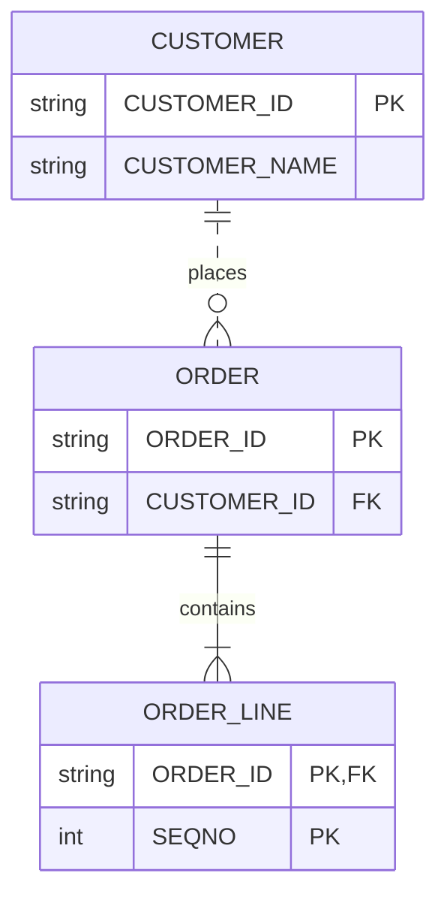

# 標準データ構造の意味皁E��対応付けと、構文・図解・編雁E�E共通設訁E
- **状慁E*�E�実裁E��の横断設計�E検証計画。正式なSemantic Schema、Grammar IR、�E開Plugin ABI、Studio機�E、実Provider適合、Ownerの意味受理を主張しなぁE��E- **目皁E*�E�JSON Schemaなどの外部構造定義めE��様なDSLを、TEIの標準データ構造・意味Role・共通UIへ安�Eに接続する。同時に、Graph�E�Tree�E�Table�E�時系列などの相互表現に忁E��な意味保存条件を�E示する、E- **最優先事頁E*�E�Studio DesktopのStage1→Stage2セルフビルドと、製品Function Entry→実Provider→独立Consumerの縦断を妨げなぁE��文法生成器めE��しいRuntimeの構築を先行条件にしなぁE��E- **Owner墁E��**�E�[構造・Facet #2495](https://github.com/hat47x/tei-platform/issues/2495)、[演算法則 #2544](https://github.com/hat47x/tei-platform/issues/2544)、[構造Projection #2497](https://github.com/hat47x/tei-platform/issues/2497)、[Language�E�Operator #988](https://github.com/hat47x/tei-platform/issues/988)、[意味Role・自己記述 #2620](https://github.com/hat47x/tei-platform/issues/2620)、[Studio #1124](https://github.com/hat47x/tei-platform/issues/1124)、[共通UI #1824](https://github.com/hat47x/tei-platform/issues/1824)、[独立Expected #2514](https://github.com/hat47x/tei-platform/issues/2514)。外部賁E��の取込は#958、Source忠実性は#2621�E�E2497、E��示は#2516、変更影響は#1143、実行権限�E#1174に従う、E- **重褁E��せなぁE��書**�E�[意味TraitのClaim](SEMANTIC_TRAIT_CLAIMS_AND_CONFORMANCE_2026-11.md)、[原子的Trait](TRAIT_ATOMIC_COMPOSITION_AND_FULFILLMENT_2026-11.md)、[Syntax正規化](EVERYTHING_DATA_SYNTAX_NORMAL_FORM_EQUIVALENCE_2026-11.md)、[SourceとRole](EVERYTHING_DATA_INTERPRETATION_AND_SOURCE_BINDING_2026-11.md)、[Studio開放性](GENERIC_STUDIO_OPEN_WORLD_PROJECTION_CONFORMANCE_2026-11.md)、[Source編雁E(SCRIPT_FIRST_GENERIC_STUDIO_PROJECTION_REFERENCE_2026-11.md)、[DSLとOperator](DSL_OPERATOR_PLUGIN_COMPOSITION_DESIGN.md)、[プログラム実行図](PROGRAM_EXECUTION_MODEL_PROJECTIONS_2026-11.md)、E- **非目樁E*�E�第二�ECanonical正本、独立Semantic Engine�E�Resolver�E�Host�E�Registry�E�Gate、あらゆる外部構文を完�Eに可送E��する丁E�EGrammar、任意�EViewからの無条件の原文書戻し、UI操作による権限�E自動付与、E
## 1. 結諁E
TEIの標準データ構造は、単にチE�Eタの形を�E有するため�Eも�EではなぁE��構造ごとに「何を同一とみなすか」「どんな関係�E頁E���E時間・数量があるか」「どの操作が成立するか」を、忁E��な篁E��で明示できるようにする。その性質を利用して、E*構文、意味、表示、編雁E��実裁E��別、E��進化させる**、E
新設するのは大きな型階層ではなく、既存�EMeaning�E�Facet�E�Law�E�Trait�E�Projection契紁E��つなぐ、小さな**対応付けの検証票**である。本斁E�E契紁E��E��と識別子�E比輁E��の語彙であり、本番用SchemaめE�E開APIへの採用案ではなぁE��E
利用老E��は数学皁E��性質名を前面に出す忁E���EなぁE��「褁E��の親を持てる」「循環がある」「同じ関係が褁E��回現れる」「この編雁E�E原文に戻せなぁE��とぁE��た�E然な説明へ投影する。Studioの表・図・入力フォームは、独立した意味の正本にはならなぁE��E
## 2. 共有する意味特性と、混同してはぁE��なぁE��の

| 観点 | 明示すること | 取り違えた場合�E問顁E|
| --- | --- | --- |
| Identity | Stable Subject ID、Occurrence、業務キー、物琁EK、Graph Node/Edgeの別 | 同名ノ�Eド、多重辺、同名�E作�Eを併合すめE|
| Relation | 方向、両端の役割、属性、多重性、E��用時間 | 所属�E先行�E参�Eを同一視すめE|
| Collection | 雁E���E�多重雁E���E��E、E��E��、E��褁E��一意性、粒度 | 行数・件数・雁E��結果が変わめE|
| Presence | 存在、�E示NULL、欠損、未取得、E��開示、空雁E�� | 「見つからなぁE��を「存在しなぁE��と断定すめE|
| Quantity | 数量�E意味、単位、精度、丸め、測定尺度 | 不適刁E��加算�E平坁E�E比輁E��許ぁE|
| Time | 有効時点、記録時点、観測時点、ルールの適用牁E| 過去の意味めE��在の観測を混同すめE|
| Scope | 母集団、参照篁E��、取得完�E性、Context、Revision | 部刁E��取で否定条件を真にする |
| Authority | 受理済みの業務意味、現在Grant、実Effectの別 | 見えてぁE��チE�Eタを実行許可と誤認すめE|

これらを一律に全チE�Eタへ付与することはしなぁE��忁E��なMeaning Claim�E�Operator�E�Consumerに応じて特性を参照し、未宣言は未宣言のまま扱ぁE��型ラベルの一致は、意味皁E��適格性の証明ではなぁE��E
### 三種類�E同一性

1. **原文の同一性**�E�ファイル、byte列、�E現箁E��、Source Revision、文法／変換器の版。改行、注釈、図の配置も保持対象となる、E2. **構造候補�E同一性**�E�参照が解決された標準データ構造と、対象Claimに忁E��なRole・頁E���E識別子�E制紁E��原斁E��違っても一致し得る、E3. **受理された意味�E�実際の振舞いの同一性**�E�OwnerによるMeaning受理、Operator Law、Provider�E�Target、実観測・受領を含む。構造候補�EFingerprintが同じだけでは成立しなぁE��E
World Fingerprint、Model Revision、Artifact Revisionも混同しなぁE��Source移動、構文Pluginの更新、生成器の変更、Consumerの取得篁E��は、影響するClaimごとに失効条件を定める、E
## 3. 構造間�E対応付けは「変換できる」だけでは不十刁E
以下を区別して扱ぁE��E
| 関俁E| 意味 | 例と注意点 |
| --- | --- | --- |
| 表現上�E同値 | 明示した観測につぁE��同じ結果になめE| 同じDataを表・チE��ーで読む。原斁E��致までは要求しなぁE|
| 埋め込み | 允E�E要素・関係を失わず別構造へ載せめE| Tree→Graph。ただし根・辺属性・頁E���E保存方法を決める |
| 封E�� | 持E��した部刁E��けを取り出ぁE| Graph→隣接表、Table→集訁Ehart。通常は送E��換できなぁE|
| 雁E��E| 粒度を変え、情報を要紁E��めE| Event→日別雁E��。個別Eventは復允E��きなぁE|
| 解釁E| 構造に業務上�E役割を与えめE| Graph→作業先行関係。構造だけでは意味受理されなぁE|
| 近似 | 精度・点数・空間解像度等を意図して落とぁE| 時系列�E間引き。誤差と適用篁E��を�E記すめE|

同値の判定�E、何を観測するかによって変わる。ある変換 f が、指定した観測 O につぁE�� O(source)=O(f(source)) を満たしても、原斁E��実性・全制紁E�E実行効果まで等しぁE��は言えなぁE��「無損失」を主張する場合�E、対象Scope、構造・属性・参�E・頁E���E保存条件を�E挙する、E
**Graph→Treeの負侁E*�E�二つの同名Node、同じ両端を持つ褁E��の有向Edge、別の親から入るEdge、循環、Edgeの属性がある世界では、単純なTree表示だけでは允E�EGraphを一般に復允E��きなぁE��読み取り専用のTree Viewは許容し得るが、Tree編雁E��ら�EGraphへの自動書戻し�E別判定とする、E
**WBSの侁E*�E�作業の匁E��関係と、作業間�E先行関係�E別の意味Roleとする。階層図とPERT図を同一モチE��から派生できても、包含から先行関係を勝手に生�EしなぁE��E
## 4. 小さな対応付け検証票�E�正式SchemaではなぁE��E
構造変換めE��示を評価する際、既存�E#2497 Projectionと#2495/#2544のFacet�E�Lawに、次の観点を�E合する、E
| 頁E�� | 最低限の問い |
| --- | --- |
| source / target | 入出力�E型、対象Subject、Scope、対象版�E何か |
| preconditions | どの構造皁E�E意味皁E��件で適用できるぁE|
| preserved / omitted | 何が維持され、何が省略・近似されるか |
| identity / provenance | Node、Edge、行、Source Occurrence、参照先�E対応�E何か |
| read / edit | 表示できる篁E��と、原斁E��戻せる編雁E��E��は何か |
| authority / disclosure | Consumerに何を見せてよいか。実行権限�Eどこで判定するか |
| evidence / invalidation | どのIndependent Expectedを満たし、何が変われ�E再検証するぁE|

例：Graph→Treeで「非循環・根が一つ・各Nodeの親が高、E��つ」を忁E��条件にするときも、Edge IDと属性、子�E頁E��、孤立Nodeなどを別に照合する。適用条件が揃わなぁE��合�E「変換不可」また�E「情報損失ありの読み取り専用表示」とし、�E功扱ぁE��捨てなぁE��E
同じ契紁E��Operatorの適用可能性にも使える。たとえ�EtopologicalSortはGraphとぁE��名前ではなく、対象Relationが要求する非循環性・方向性・Scopeを満たすときに適用できる。一方、sum�E�averageは数量�E単位�E尺度・NULL・丸め�E粒度に依存する。可換�E結合・刁E�Eなどの法則は名前だけで推論せず、E2544の検証可能なClaimに従う、E
## 5. JSON Schemaは「Recordの別表記」ではなぁE
最初�E外部仕様�E実証例としてJSON Schemaを用ぁE��。ただし、JSON Schemaは**JSONインスタンスの妥当性を定める制紁E��誁E*であり、Schemaそ�Eも�Eと検証対象のRecordを混同しなぁE��E
読み込み時に保持すべきもの�E�E- 仕様Dialect�E�Vocabulary、`$schema`、`$id`、参照Scope、原文byte・Occurrence。外部参�Eは取得�E・版�E時点・完�E性を別に記録する、E- `properties`�E�`required`�E�`additionalProperties`などの制紁E��、注釈�E表示用説明�E別、E- `$ref`�E�`$dynamicRef`、`$defs`、�E帰参�E、`allOf`�E�`anyOf`�E�`oneOf`�E�`not`、`if`�E�`then`�E�`else`、E- `unevaluatedProperties`など、評価経路・注釈収雁E��依存する制紁E��単純なフィールド一覧へ平坦化して「同等」とは扱わなぁE��E- 真偽値Schema�E�Etrue`�E�`false`�E�、存在しなぁE��性と明示NULLの違い、`default`などが�E動補完�E書込みの義務とは限らなぁE��と、E
**Studioの基本表示**�E�頁E��名、型の候補、忁E��かどぁE��、参照、制紁E�E有無をまず示す。褁E��制紁E�E原文・Dialect・参�E解決・検証上�E詳細は展開めE��ールチップに載せる、ESON Schemaが制紁E��ら導かなぁE��と�E�例えば確定した業務キーやDB制紁E���E追加推論しなぁE��E
**編雁E��**�E�Source byte篁E��、解決済み参�E、対象Revision、変更意図が一意�E場合だけ候補Patch→差刁Ereview→�E検証へ進む。�E有された`$ref`先、褁E��Schemaの合�E、派生した画面では、意図せず庁E��変更を起こさなぁE��ぁE��則read-onlyまた�E明示皁E��編雁E��象を選び直す。Schemaの表示・Source編雁E�EJSONインスタンスへの入力�EDB Migrationは四つの異なる操作である、E
**外部仕様�E契紁E*�E�Dialect未対応、参照取得不�E、E��刁E��得、Vocabulary未解釈�E成功した完�E解釈にしなぁE��従来どおりplain-dataの構造表示へ退避できる篁E��と、検証�E�編雁E��きなぁE��E��を区別する、E
## 6. DSLの自己定義を、専用の巨大なParser基盤にしなぁE
言語ごとに「構文の読み方」と「標準データ候補への対応」を刁E��る、E
```text
Authoritative Source (TEI DSL / Markdown / JSON Schema / DOT / ...)
  ↁELanguage Pluginがparse・Source位置・診断を供給
  ↁEplain standard data candidate
  ↁERole�E�Operator�E�参照の解決、制紁E��証、OwnerのMeaning受理
  ↁEStudio共通View�E�構文固有View�E�Generator�E�Scenario
```

斁E���E、EBNF�E�ANTLR�E�Tree-sitterなどの既存技術を比輁E��象とする。ただし、E*Grammar IRの新設めE�E言語�E共通Parser生�Eは未採用**。まぁE988の既存Language Plugin Referenceから、構文規則、エラー回復、補完候補、Source occurrence、Semantic Bindingのどこまでを�E通化できるか測る、E
入力支援を三段階に刁E��る！E1. **構文候裁E*�E�次に置ける記号、キーワード、繰返しなど、E2. **意味候裁E*�E�Role、型、束縛済み参�E、単位、Cardinality、Operatorの適格性、E3. **Context候裁E*�E�許可された現在のSubject、Providerが実際に読み取った候補、E��示できる値。未取得を空の候補集合と同一視しなぁE��E
Studio冁E�EGUIからGrammar�E�Viewを記述できる方向�E維持する。ただし�E期�E独自Viewは宣言皁E��レイアウト、型付きBinding、参照ジャンプ、Tooltip、可読な警告を優先する。任意コード�E注入めE�E動実行許可を標準拡張にしなぁE��専門Viewは#951のPlugin契紁E��追加できる余地を保つ、E
自己記述の到達目標�E、文法�ERole・Viewの一部を標準データとして説明�E検証できること。�E刁E�E身のParserを完�E再生成できたことめE���EターゲチE��で意味同値であることは別の検収とする。固定された最小Reader�E�bootstrapと、�E己定義を更新する際�E互換性・退避経路を保つ、E
## 7. Studioでの一貫した操佁E
同じSubjectを、テキスト、構造チE��ー、E��係図、表、フォーム、Source Diffで刁E��替えられることを目標とする。中忁E�E**安定した対象選抁E*であり、図上�E座標や表示Edgeを意味IDにしなぁE��E
- 表示は意味未解決でも、E��示可能な`path / structural type / disclosed value`へ退避する、E- Tooltipは意味Role、制紁E��E��用篁E��、診断、Source位置を見せる。未受理の候補�E未受理と表示する、E- 図表と原文のジャンプ�ESource ID�E�Occurrence�E�Revisionに基づく。Sourceの移動やA→B→Aは、構造・編雁E�E受理履歴・Consumerが何を同一視するかに応じて照合する。�E容byteが同じことだけで、却下履歴めE��部Consumerの賁E��まで復活させなぁE��E- 編雁E�E`read-only`、`candidate patch`、`explicit source edit`、`supported reversible edit`を�Eけ、後二老E��権限�E意味受理・実Effectを代替しなぁE��E- 開示の違いから非�E開�ESubjectの有無・件数・診断が�EからなぁE��ぁE��E2516のConsumer別試験に従う、E- Studio冁E�E人間とAIは同じ型付きSelectionとPreviewを使ぁE��、AI候補�E生�EとOwnerの意味受理を�E離する、E
新しいDomain Pluginを追加した際�E重要指標�E、専用のStudio Core刁E��を追加せず、既存�EText�E�Property�E�Tree�E�Graphへ忁E��な惁E��を表示できるかである、EraphめE��度な可視化をすべて汎用UIへ押し込むのではなく、専用UIが忁E��な琁E��と効果を比輁E��る、E
## 8. 反例を先に固定する検証計画

次のケースは**Independent Expectedの候裁E*であり、本書作�E時点で新たな実試験を実施したとぁE��意味ではなぁE��既孁E2497�E�E1131�E�E2514�E�E1124のScenarioへ割り振り、E��似Fixtureを重褁E��設しなぁE��E
| ID | 入力／操佁E| 期征E��る判宁E|
| --- | --- | --- |
| SM-01 | Graphに同名Node二つ、同一両端のEdge二つ、属性あり | Node�E�Edge同一性と多重性を保存。Treeへの無損失書戻しを拒否 |
| SM-02 | Graphに褁E��親・循環・孤立Node | Tree適格性を個別診断。適刁E��read-only表示へ退避 |
| SM-03 | WBSの匁E��辺と先行辺 | 両老E�E意味を�E離。包含だけで依存辺を生成しなぁE|
| SM-04 | Tableのbag、NULL、missing、partial取征E| 件数・否定判定�E雁E���E意味を誤って確定しなぁE|
| SM-05 | 時系列�E単位�E精度・観測時点を変えめE| 明示した観測篁E��でのみ同値性を判宁E|
| SM-06 | JSON Schemaの`oneOf`�E�`allOf`�E�`if` | 単なる継承・頁E��表へ誤変換せず、制紁E��保持また�E未対応を表示 |
| SM-07 | 再帰`$ref`�E�`$dynamicRef`�E�未取得参照 | 解決状態と適用Scopeを表示。不完�Eな検証を�E功としなぁE|
| SM-08 | 同じ参�E先が褁E��画面で利用されるSchema | 図編雁E��参�E先を勝手に庁E��変更しなぁE|
| SM-09 | 同じ標準DataがMarkdown、DSL、JSONから導かれる | 構造候補�E同一性とSource identityを区別 |
| SM-10 | Grammar�E�Role�E�Operatorの版を変更 | 古ぁE��味受理めE��完候補を無検証で再利用しなぁE|
| SM-11 | 未知Roleと`trusted-script`とぁE��入力値 | plain-data表示に退避し、Action�E�Grantを�E格しなぁE|
| SM-12 | Viewの部刁E��示、stale Selection、曖昧な送E�E僁E| 惁E��漏えぁE��誤書戻しを防ぎ、理由を示ぁE|
| SM-13 | `default`注釈や任意�Eロパティのフォーム表示 | 注釈を強制入力�E値の自動確定と誤解しなぁE|
| SM-14 | Sourceのコメント／DOT配置だけ変更 | Source差刁E�E残し、意味差刁E�EArtifact再利用を別判宁E|

チE��ト�E二段階にする。まずHeadlessで同じSource・正解・Diagnostic・Source Jumpを固定する。次にStudio実画面�E�CLI�E�独立Consumerで、同じSubjectと判定を受領できるか検証する。図が描けることを意味保存やTarget適合�E証拠にはしなぁE��E
## 9. 既存計画へ割り当てる頁E��E
| 頁E��E| 作業と完亁E��件 | 既存Owner |
| --- | --- | --- |
| **P0�E�既存主線を継続！E* | Stage1→Stage2 Studio自己再構築。並行して製品Entry→実Provider→実Consumerの賁E��を独立確誁E| #4583�E�E4495�E�E2586 |
| **S0�E�並行�E設計�Eみ�E�E* | 既存�EMeaning�E�Facet�E�Law�E�Trait�E�Projectionと本書のSMケースを対応付け、既存契紁E��記述できなぁE��小差刁E��け�E持E| #2495�E�E2544�E�E2497 |
| **S1�E�Eeadless�E�E* | Graph�E�Tree�E�Tableの二つ以上�E相互Viewを、同一ID・Scope・独立Expectedで比輁E��無損失�E�損失�E�readonlyを�Eし�Eける | #2497�E�E1131�E�E2514 |
| **S2�E�外部Schema�E�E* | JSON Schemaの単純例と褁E��例を読み、Source位置・制紁E�E未対応状態付きで構造表示。編雁E�Eまだread-only | #988�E�E2620�E�E1124 |
| **S3�E�Etudio限定編雁E��E* | 一意�EOccurrenceだけを候補Patch→Preview→�E解析。�E有参照・古いRevision・未対応Dialectで停止 | #1124�E�E2497�E�E2621 |
| **S4�E�宣言的View�E�E* | 既存�E汎用UIで新しいView定義を使ぁE��Sourceジャンプ�ETooltip・入力補完を提供。追加PluginによるStudio固有�E岐数を計測 | #1124�E�E1824�E�E951 |
| **S5�E�文法定義・自己記述の比輁E��E* | 既存Language Pluginの不足を実測した後、Grammar規則の共通記述と外部Parser生�E技術�E採否を比輁E| #988�E�E2620�E�E1121 |

S1〜S5は**P0の先行GateにしなぁE*。S0で既存契紁E��けで十�Eと判明した頁E��には新しいSchemaやEngineを導�EしなぁE��新しいIssueを�EめE��に増やさず、まず各既存Ownerへ検証条件と反例を渡す、E
## 10. 採用判断

次のすべてを示せた部刁E��け、既存契紁E�E拡張候補とする、E
1. 誰がMeaningのOwnerか、どのSource�E�版に帰属するかを説明できる、E2. 同一性・頁E���E多重性・NULL�E�missing�E�partial・Time�E�Unitなど、対象Claimに忁E��な意味を欠かさなぁE��E3. 損失のあるProjectionを安�Eな編雁E��能Viewと取り違えなぁE��E4. Studio固有�E琁E��増やさず、新しい構文・Schema・意味Roleの少なくとも一例を表示できる、E5. 既存Expectedで正常例と負例が再現でき、Source→View→候補Patch→�E解析�E篁E��が�E確である、E6. 実Provider�E�Target�E�Consumer�E�Owner受理の賁E��を、合成試験や図解の成功と混ぜなぁE��E
**判断**�E�意味特性・構造間�E像�E構文とViewの拡張性を、TEIの長期的な共通基盤として計画に加える。ただし採用単位�E既存契紁E��対する小さな差刁E��し、正式なGrammar IR・新Semantic Engine・全面皁E��Schema双方向編雁E�E、実証結果に基づぁE��改めて判断する、E

## 11. 意味保存を検査する単位を、実際の利用経路に合わせる�E�E026-11-14追補！E
今回追加で確認した�Eは、E*構造間�E写像が数学皁E��正しくても、それだけでは利用老E��期征E��る機�Eの同値性を保証できなぁE*とぁE��点である。構文を読み取る段階、Queryを評価する段階、UIへ描画する段階、編雁E��原文へ戻す段階で、それぞれ保存すべき観測が異なる、E
| 墁E�� | 対象となる「意味、E| 同値性の主要な観測 |
| --- | --- | --- |
| Syntax ↁEData candidate | 名前束縛、Literal/Ref、E��E��、Operator ID、Source位置 | 同一Source・Grammar/Role Pinで同じ候補と診断が得られるぁE|
| Data/Query ↁE実Rowset | Relation Path、JOIN粒度、bag、NULL、絞込条件、評価時点 | 同じSource/Query/実Provider、実�E力から、対象Scopeの実値・取得篁E��が一致するぁE|
| Data ↁEView | Identity、E��係、参照、単位、時間、E��示可能な値 | Consumerに忁E��な惁E��を維持するか。省略惁E��を�E示できるぁE|
| View edit ↁESource patch | 編雁E��象OccurrenceとRevision、原斁E��実性、変更意図 | 対象以外�Ebyteを不変にし、�E読込後�E持E��された意味だけが変化するぁE|
| Meaning ↁETarget | Operatorの法則、失敗�E副作用、E��E��、時間、Provider適吁E| 独立Expectedと実Target�E�Consumer観測が一致するか。実Effectは別途確認するか |

**構造同値�E�評価同値�E�変更同値の三つを�E離する、E* 二つのQueryが同じ�Eの名前と型を返しても、JOINの重褁E��NULLの解釈、LIMIT、RLS、Top-N、NOT EXISTSの再評価が異なれ�E評価同値ではなぁE��読み取り結果が一致しても、一方の更新が原斁E�E体を書き換えたり、�E有参照先へ意図しなぁE��響を与えたりすれば変更同値ではなぁE��E
こ�E刁E��を別のCore enumに固定せず、既孁E2497のProjection、E2544のOperator Law、E2387のQuery、E1143の変更影響、E2514の独立Expectedに対する**Claim別の照合観点**として扱ぁE��E
### 11.1 同値性には条件と観測篁E��を忁E��添える

「�Eの意味を保つ」とぁE��表現は、無条件の保証に使わなぁE��例えば、有限集合上で二つの純粋Operatorの計算結果が一致しても、E��延評価、短絡、失敗、時刻、Effectが異なれ�E任意�EContextで置換可能とはぁE��なぁE��E
同値を主張する前に、少なくとも以下を決める、E
- 対象Subject�E�Relationと時点、母集団、忁E��な列�E辺・属性・単位�E何か、E- 允E�ESource�E�Plugin�E�Operator�E�Meaning�E�Provider�E�Toolchainのどの版に依存するか、E- どの観測�E�値、E��E��、件数、エラー、Effect、診断、Source byte�E�が一致すれば十�Eか、E- 何を確認できなかったか。未取得、E��刁E��得、E��開示、未解釁Eluginは、完�Eな一致の証拠にはしなぁE��E- 変換後�EConsumerに忁E��な惁E��が、投影結果で本当に允E��されたか、E
## 12. 編雁E��能なViewには、双方向変換の法則を参老E��する

一般の双方向変換�E�Eens�E��E老E��方は、E2497の編雁E��紁E��検査する際に役立つ。ただし「Lensを新しい本番抽象として採用する」とぁE��意味ではなぁE��E
読み取りViewめE`get(S)`、Viewの更新候補を原文へ反映する操作を `put(S,V)` と書く、E
- **Get–Put**�E�何も変えなかったViewを戻しても、意味上�E更新は起こらなぁE��Earkdownなどの原文保存では無関係なbyteも変更しなぁE��E- **Put–Get**�E�許容されたView変更をSourceへ反映して再解析すると、その変更が指定�EScopeで再�E観測できる、E- **Put–Put**�E�更新の頁E��や競合を扱ぁE��合、後から行った変更が以前�E更新をどぁE��書きするかを�E示する。一般に全形式で成立すると仮定しなぁE��E
これら�E法則は、E*特定�ESource、Revision、操作、Scopeに対する条件付きの検査**である。整形、注釈、�E有参照、Macro、外部Schema参�Eなどがある場合、意味上�E等価性とSource byteの忠実性は別条件になる、E
### 12.1 Studioでの更新経路

```text
固定されたSubject + Source Occurrence + Revision
        ↁEUIが返す型付き編雁Entent
        ↁEPreview�E��Ebyteと提桁Eatch、E��係する別Viewへの影響
        ↁEResolve�E�現在のSource�E�Role�E�Operator�E�参照を�E解決
        ↁEAdmit�E�既存Owner�E�権限／競合条件で採否を判断
        ↁECommit�E�許されたSource Patchまた�E別途許されたDB更新
        ↁEObserve�E�独立した�E読取りでSource�E�View�E�忁E��な実結果を確誁E```

こ�E手頁E�E既存�E編雁E�E実行Ownerへ渡ぁE*説明上�E接綁E*であり、�E通Commit Engineを新設しなぁE��Sourceへの書戻しとDBへのCommitは別の取引であり、一方の成功を他方の成功と見なさなぁE��E
**更新不可として残す条件**�E�褁E��のSource occurrenceから同一View要素を導�Eした場合、原斁E��照が曖昧な場合、取得篁E��が部刁E��な場合、権限が不確かな場合、対象Revisionが古ぁE��合、意味Roleまた�EGrammarが変更された場合、�E有されたSchemaの変更篁E��が確定できなぁE��合。表示とSourceへのNavigateは、E��示可能な篁E��で継続できる、E
## 13. 惁E��の有無を表す状態を、構造皁E��空雁E��へ畳まなぁE
Graphに表示する辺ぁE本、SQLのRowsetぁE行、JSON Schemaの`required`が空、とぁE��事実�E、いずれも「業務上その関係�E制紁E�E事象が存在しなぁE��ことの証明とは限らなぁE��E
| 受け取った状慁E| 成立する主張の侁E| 成立しなぁE��張の侁E|
| --- | --- | --- |
| 完�EなScopeで0件を観測 | 明示したScope・時点・Queryでは該当件数0 | 全期間・全Provider・全主体につぁE��不存在 |
| 取得件数0、Coverage不�E | こ�E呼出しかめE件が返っぁE| 対象が存在しなぁE��めE件になっぁE|
| partialなRowset | 返却済みの行と値は観測した | NOT EXISTSが真、E��計が全釁E|
| Schemaの未宣言属性 | そ�E定義箁E��に宣言が見当たらなぁE| 実データに存在しなぁE��禁止されてぁE�� |
| 非開示のSubject | こ�EConsumerにはそ�E惁E��を提示できなぁE| 「非公開�Eも�Eが存在する」と表示してよい |

たとえ�E`enabled(order.submit) = not exists approval.pending`は、許された篁E��に実際の未承認行が1件見つかれば否定できる場合がある。一方、空の返却だけで肯定するには、対象母集団、条件、Snapshot、取得完�E性、Providerの制限が忁E��になる。これ�E#2582�E�E2516�E�E2497の既存墁E��を�E利用する、E
新しい未知値の丁E�Eenumを作るのではなく、既存�EPresence・Coverage・Disclosure・Freshnessの根拠を絁E��合わせ、E*各Consumerが言ってよいことの上限**を�E示する。非開示の有無を診断メチE��ージめE��完候補数で漏らさなぁE��E
## 14. DB�E�専門領域との接続を、二つの最小縦断で検証する

### 14.1 外部Schemaの構造表示�E�JSON Schema ↁEStudio

最初�E読取専用に限定する。固定したJSON Schema SourceにつぁE��、Dialect、Source occurrence、参照篁E��、型・`required`・条件付き制紁E�E注釈を識別し、E��E��チE��ー�E�制紁E��細�E�原斁E��ャンプへ投影する、E
**合格条件候裁E*�E�E- 同じSourceとPlugin Pinで、Headlessの読み取り結果・診断・Sourceジャンプ�Eが�E現される、E- `oneOf`と`anyOf`、`allOf`と継承、`default`と値の確定、未対応Vocabularyと成功を混同しなぁE��E- `$ref`の共有�E・循環・未解決、外部取得�Epartial/unavailableを画面から見�Eけられる。ただし開示不可惁E��は漏らさなぁE��E- 褁E��制紁E��表に展開しきれなくても、制紁E�E体�E保持し、Viewが表現した篁E��だけを明示する、E- 允E�ESchemaを編雁E�E保存する前の段階では、Sourceを一刁E��き換えなぁE��E
**仕様に基づく詳細条件**�E�最初�E固定DialectはJSON Schema Draft 2020-12を比輁E��補とする。同版では`prefixItems`�E�`items`の配�E制紁E��`$dynamicRef`�E�`$dynamicAnchor`の実行時の動的Scope、`format-annotation`と`format-assertion`のVocabulary差を、単純な静的フィールド表へ丸めなぁE��特に`$dynamicRef`の解決先�E、原斁E��示された参照URIだけでは十�Eに確定しなぁE��合がある。�E典�E�[JSON Schema Draft 2020-12](https://json-schema.org/draft/2020-12)、[Core specification](https://json-schema.org/draft/2020-12/json-schema-core)、E
**導�Eを急がなぁE���E**�E�任意�EDialectの完�Eな検証、すべての制紁E�E自動フォーム変換、双方向Schema Migration、文法生成器の一般化。まず固定Dialect・有限Fixtureで不適合を説明できることを優先する、E
### 14.2 実Queryの構造投影�E�PostgreSQL Read ↁETable�E�Aggregate

#2586の製品Read賁E��を得た後�EConsumer検証として、既存�E`order_entry`受注読取り等を題材に、E*同一の実RowsetからTableと雁E��Eiewを別、E��派甁E*する。実PG読取りそ�Eも�Eはこ�E設計文書が所有せず、既存Ownerの賁E��を参照する、E
**合格条件候裁E*�E�E- Query、引数、Subjectと実Provider、Snapshot、忁E��なField、粒度、NULL、Row ID、Row Count、制紁E�E取得限界を同一Attemptから照合できる、E- Tableでは行とKeyが保持される。集計では雁E��単位、条件、NULL・重褁E�E扱ぁE��、失った個別行情報が説明できる、E- LIMIT�E�RLS�E�Native SQLの未知条件で全量性が立証されてぁE��ければ、E��計結果を「対象全件の合計」と表示しなぁE��E- CLIとStudioなど異なるConsumerでは、同じ意味の受領を**それぞれ**検査する。描画の成功とProvider実Call、正しい開示と対象全量取得を混同しなぁE��E- Derived Viewは原則read-only。Row Editを許す場合、Subject Pin、条件付き更新、Commit Receipt、独立Post-commit Readを別経路で受け入れる、E
これはData Source Workbench #3270、Query #2387、Function Data Context #2506、Projection #2497、Consumer賁E�� #2586に対する**同一の受�E連鎁E*であって、独立したDB抽象めE��二�EQuery IRを提案しなぁE��RDBとNoSQLの双方へ展開する際も、原文Query、Provider特有�E評価、実取得�ECoverageを消して共通化しなぁE��E
### 14.3 WBS・科学計算�E「意味特性の異種検証例」として後続に置ぁE
[専門チE�EルキチE��計画](CROSS_DOMAIN_MATH_STATISTICS_PLANNING_TOOLKITS_2026-11.md)�E�E4660の題材を、�E通基盤の適格性を測る対照群として使ぁE��E
- **WBS�E�PERT**�E�包含と先行�E辺を�Eけ、同名Task・多重辺・循環を扱ぁE��単なるGraph表示からクリチE��カルパスの計算可能性を推定しなぁE��E- **統計／Window**�E�PARTITION、ORDER、Frame、NULL、行粒度、データ全量性を伴ぁE��SQL方言またぎの見かけ�E同型を意味同値へ昁E��しなぁE��E- **数量�E科学計箁E*�E�単位、尺度、精度、許容誤差、墁E��条件、Solver/アルゴリズム版、計算�E決定性を�E示する。浮動小数点の厳寁E��致を無条件に要求せず、独立Expectedが指定した誤差・条件で判定する、E
専門Toolkitの実裁E�EStage2セルフビルド�EP0を止めなぁE��汎用Coreへ追加するのは、褁E��刁E��で忁E��性が実測され、既存Facet/Law/Projectionで表現できなぁE��小要素だけとする、E
## 15. 自己記述・差刁E�EBuild再利用の墁E��

GrammarやRoleの自己定義は、[Role Bootstrap設訁E(ROLE_BOOTSTRAP_AND_SELF_DESCRIPTION_2026-11.md)の有限Seedから始める。`formatVersion`、Language�E�Parserの版、Role�E�Operatorの版、Generator�E�Toolchain、Source Revisionを区別する。文法�E自己記述が読めること、生成されたParserが動くこと、TEI自身を�Eビルドできることは三つの別成果である、E
区別して扱ぁE��更例！E
| 変更 | 忁E��再評価する対象 | 自動的には変化しなぁE��主張できなぁE��象 |
| --- | --- | --- |
| Markdown注釈、DOTレイアウチE| Source byte�E�Occurrenceと表示差刁E| 語彙�Eの参�E、生成対象、受琁E��みMeaningへの影響 |
| SourceのA→B→A、移動、同名�E作�E | Source冁E��、Occurrence、依存Closure、Decision履歴、Consumer Selectionを主張ごとに照吁E| 冁E��が一致しただけで却下履歴、実Consumerの受領、現在のAuthorityを復活させること |
| Grammar�E�Language Pluginの更新 | Parse�E�診断�E�正規化�E�補完と、忁E��なMeaning Claim | 既存�E受理済み意味・Target適吁E|
| Role�E�Operator Law更新 | 対象Operationの意味・結果・適格性 | 旧生�E物の意味同値・Cacheの正当性 |
| Generator�E�Toolchain更新 | Artifact生�Eと実利用賁E�� | Sourceが同じとき�EBundle再利用賁E�� |
| Provider�E�Scope�E�Grant更新 | 実Read、E��示、Action Authority、Consumer受頁E| 過去の合�EFixture PASSの製品賁E�� |

変更影響は、E*affected�E�scoped-unaffected�E�unknown**を既存�E依存ClosureとClaim別評価へ返す。Unknownをすべて無影響と扱わなぁE��方、無関係な未知を理由に全Sourceを忁E��再受琁E��せる忁E��もなぁE��古いResultめE��名�ESourceを使って、失効したConsumer・Authority・受理の賁E��を復活させなぁE��ただし同一byteに対する純粋な候補Patchの適用可能性は、対象Sourceと依存が一致する篁E��で改めて判定できる。履歴を理由に無関係な純粋編雁E��で一律失効させなぁE��E
## 16. 追加反例と既存Issueへの引渡ぁE
§8のSM-01、E4を維持し、他チャチE��との整合で不足してぁE��反例だけを以下に追加する。すべて**未実行�EIndependent Expected候裁E*であり、新しいScenario台帳を増やす意図はなぁE��E
| ID | 検証対象 | 独立した期征E��果 | 主な既存Owner |
| --- | --- | --- | --- |
| SM-15 | 同じ列構造でJOIN粒度・bagが異なる二Query | Shape一致でも評価同値と判定しなぁE| #2387�E�E2497 |
| SM-16 | NOT EXISTSで0件、ただしReadはpartial | 否定条件の真を証明しなぁE| #2582�E�E2497 |
| SM-17 | ViewからSourceへ同じ値を保存、Markdown書式あめE| No-opでは原文byte不変。最小Patch以外�E再formatを拒否 | #2621�E�E2497 |
| SM-18 | 雁E��Eiewで値を変更するIntent | 戻す行が一意でなぁE��め�E動送E��戻しを止める | #1124�E�E2497 |
| SM-19 | Grammar版だけ更新、Source byteとRole名�E同じ | ParseとMeaningの忁E��Claimを�E評価し、旧受理を�E動継承しなぁE| #988�E�E2620 |
| SM-20 | 同一実RowsetからTableとAggregate、RLS/LIMITあり | 受領した篁E��の雁E��と全件雁E��を別表示。実Read賁E��は別 | #2586�E�E2387 |
| SM-21 | 同じGraphをWBS階層図とPERT図で描く | 匁E��と先行�ERoleを�E離し、計算�E力�E循環を診断する | #2495�E�E4660 |
| SM-22 | Solver版�E精度・単位だけ異なる科学計算結果 | 独立Expectedが定めた適格性と誤差でのみ同値を認めめE| #2544�E�E4660 |
| SM-23 | Schema Viewerが非開示の参�E先を補完／診断する | Consumer側の公開結果から存在・件数・Source名を推測させなぁE| #2516�E�E1124 |
| SM-24 | SourceをPreviewした後、Revision�E�Grantが変化 | Resolve�E�Admitをやり直し、古ぁE��択でCommitしなぁE| #1124�E�E1174 |
| SM-25 | Schema�E�Viewの変更後、実DBの列が消えたよぁE��見えるがCoverage不�E | Desired SourceめE��琁E��み業務意味を�E動削除しなぁE| #3270�E�E1143 |

### 16.1 どの段階で何を成果と呼ぶぁE
- **S0�E�設計で確認できる篁E���E�E*�E�SM-01、E5を既存�E契紁E�EIssue・Fixtureへ振り�Eけ、E��褁E�E未表現・判断保留を�E挙する。ここに書ぁE��ことで製品E��合とはしなぁE��E- **S1�E�Eeadlessの最小実証�E�E*�E�Graph↔Tree�E�Tableの同一性と損失判定に加え、SM-17�E�E8で編雁E��否の差を確認する、Eraphの同名Node・多重Edgeは最初から含める、E- **S2�E�Echema読取専用�E�E*�E�JSON Schemaの単純�E褁E��・未解決参�E・Dialect不適合を同じStudio generic表示へ出す。完�E対応率を捏造しなぁE��E- **S3�E�限定編雁E��E*�E�Source occurrence�E�Revision�E�byte差刁E��備えた一箁E��の合法Patchのみを通し、SM-17�E�E8�E�E4を負例にする、E- **S4�E��E通View�E�E*�E�新しいRole�E�Schemaを追加してもStudio Coreにドメイン刁E��を増やさず、表示・Navigate・開示賁E��の差を確認する、E- **S5�E�構文定義比輁E��E*�E�既存Language Pluginの実測結果と忁E��な支援機�Eを比輁E��、Grammar IR�E�生成技術を採用する十�Eな根拠が�Eた場合に限ってOwnerが判断する、E- **製品縦断�E�既存P0の成果を参照�E�E*�E�E2586の実Read賁E��が�E立した後、同じAttemptからのTable�E�Aggregateを独立Consumerで照合する。S0〜S5めE��門ToolkitをP0達�Eの先行GateにはしなぁE��E
**次の着手単佁E*は、まず既孁E2497のProjection�E�編雁E��紁E��SM-01�E�E4�E�E7�E�E8のExpectedを�E合し、「新しい型を増やさずに書ける頁E��」と「本当に不足する頁E��」を一枚で示すことである。そこにGapが認められなぁE��り、Semantic Registry、Grammar IR、Edit Engine等�E新規�E通基盤を要求しなぁE��E

## 17. 損失のあるProjectionにおける頁E��・操作別の編雁E��E���E�E026-11-14追加�E�E
**補正する判断**�E�Graph→Treeのように写像全体が非可送E��も、「表示されてぁE��Nodeの所有属性」�Eような局所操作まで無条件に拒否する忁E���EなぁE��一方、ノード移動やEdgeの付替え�E、見えなぁE��・並行Edge・Edge IDに依存するため、同じ画面から操作できるように見えても許可できるとは限らなぁE��E
これは新しいProjection Engineの要望ではなぁE��E#2497](https://github.com/hat47x/tei-platform/issues/2497)の写像契紁E��、E*全体�E惁E��保存判定と、E��択したSlot�E�操作に限った送E�E像判宁E*に刁E��て検証する提案である。対応する根拠は[#4533](https://github.com/hat47x/tei-platform/issues/4533)の既存実測と、[Draft #4538](https://github.com/hat47x/tei-platform/pull/4538)のGo Reference、E
### 17.1 先に判定する五条件

以下�E五条件が�E立する篁E��だけを「原斁E��変更候補を返せる」とする、E
1. **対象の一意性**�E�表示要素から、型付きSubjectと編雁E��象Occurrence�E�Slotが一つに解決される。同名ノードでめEDが別なら混同しなぁE��E2. **値の出所**�E�編雁E��が当該Subjectの所有する属性に対応し、E��計�E結合・丸め�E換算�E多対一変換を通じて生�Eされた値ではなぁE��E3. **局所Patch**�E�原斁E��の変更篁E��が確定し、依頼されてぁE��ぁE��メント、空白、他属性、別のSourceを変更しなぁE��E4. **現時点の対忁E*�E�Sourceの冁E��・対象span・依存�E忁E��なSelectionの現在性を検査する。Sourceの純粋なPatch適用可能性と、Owner受理・Authorityの現在賁E��は別、E5. **再検証**�E�Preview→既存review�E�accept→�Eparse�E��E投影で変更が一致する、Eo-opなら原文byteを変更しなぁE��E
これは「編雁E��補を作れる」ため�E条件であり、Ownerによる意味受理、Source書込権限、実DB更新、Effect Receiptを与える条件ではなぁE��E
| Projection�E�操佁E| 全体�E損失 | 局所判断 | 琁E�� |
| --- | --- | --- | --- |
| Graph→Tree�E�Node所有�E名称変更 | 第二�E親・多重Edgeなどが失われめE| 一意�ESource属性なら候補可能 | 変更対象Slotは写像で消えてぁE��ぁE|
| Graph→Tree�E�Node移勁E| 同丁E| 非表示辺と関俁EDを含めた別検査が忁E��E| Tree上�E親はGraph全辺を表さなぁE|
| Graph→Tree�E�Edge属性変更 | 同丁E| Edge ID・属性所有老E��未確定なら拒否 | 同じ端点の別Edgeを誤更新し得る |
| JOIN→集訁Ehart�E�数値の直接変更 | 允E���E重褁E�E粒度を失ぁE| 自動送E��戻し�E拒否 | 雁E��E点の変更を行へ一意に配�EできなぁE|
| 部刁E��得�ETable�E�読取済みセル編雁E| 未取得行がある | 明示Row ID・Revision・条件付き書込を別に確誁E| 既知の一行�E更新と全件置換�E異なめE|
| Markdown表→Property�E�同じ値の保孁E| 表記�E空白・注釈�E損失があり得る | No-opならSource byte不夁E| 通常Saveは糖衣構文の再生成ではなぁE|

[#4538](https://github.com/hat47x/tei-platform/pull/4538)の限定Referenceでは、Property/Tableの一属性編雁E�ESource往復と拒否は確認されたが、Graph→Treeの**Node属性Slot**を�E体損失から独立に判定する実裁E�Eまだ不足する、と報告されてぁE��。この具体的なGapを[#4351](https://github.com/hat47x/tei-platform/issues/4351)�E�E2497へ戻す、Eraph一般の安�Eな書戻しを証明したことにはしなぁE��E
### 17.2 SourceのA→B→AをどぁE��むぁE
[#4558](https://github.com/hat47x/tei-platform/issues/4558)の検討から、「A→B→Aなら常に全編雁E��拒否する」とぁE��一律規則は採らなぁE��要求する主張ごとに以下を刁E��る、E
| 主張 | 忁E��な確誁E| A→B→Aで注意する点 |
| --- | --- | --- |
| 純粋なSource冁E��Patchが適用できる | 現在byte、対象span、依存、�E解极E| byteと対象条件が同じなら適用可能性を�E評価できる |
| Ownerが以前に却下してぁE��ぁE| Decision履歴、同一候補、�E示皁E��supersedes | 冁E��が戻っても却下記録は消えなぁE|
| Source書込を現在許可されてぁE�� | 実施時点のAuthorityと対象Scope | 過去のReview�E�表示結果はGrantではなぁE|
| 外部Consumerに現在公開してよい | Consumer、Audience、Source�E�Meaning Pin、E��示条件 | Bを受け取ったConsumerの賁E��をAのbyte一致から回復させなぁE|
| Build成果物を�E利用できる | World�E�Model�E�ArtifactとToolchain依孁E| SourceだけがAに戻っても別の実裁E�E利用賁E��が忁E��E|

Decisionの却下履歴を受琁E��にどぁE��ぁE��、E��剰なWorkspace全体Revision失効をどこまで局所化するか、Source書込Grantを誰が検査するか�E#4558�E�既存Acceptance Ownerの判断として残す。新しい全体単調カウンタやAuthorityをここから採用しなぁE��E
## 18. 「表示できる」と「表示し続けてよい」を刁E��めE
Studioの非同期読取では、Source�E�Context�E�Grantの古いResultが後から到着し得る。�E力時点の条件が有効でも、E*描画を確定する時点�E�Eender Commit�E�E*に同じ惁E��を�E開してよいとは限らなぁE��E
既存[Studio open-worldの検証計画](GENERIC_STUDIO_OPEN_WORLD_PROJECTION_CONFORMANCE_2026-11.md)では、Lane単位�E失効、�ELane reset、以前描画した値の残留、後着Responseを限定Referenceで検討してぁE��。�E通�Eepoch tokenめE��二Policy Engineを作るのではなく、この確認をView利用条件へ接続する、E
初期表示、E��同期更新、E��択後�ETooltip、補完候補、検索索引、AIに渡すDesign Contextは、それぞめE*当該ConsumerのDisclosureと現在Selectionに相対**である。忁E��なCurrent ClaimがなぁE��合、�E開可能なplain-data表示へ退避するか、E��連冁E��を非表示にする、E
**重要な反侁E*�E�権限変更時にResponse Scopeをresetしても、既に表示したDOM�E�ARIA�E�検索候補／Graph Node�E�AI Contextが消去されたとは限らなぁE��変更通知を受け取れなぁE��Consumerは即時撤回を保証したことにせず、次の利用・描画時点の賁E��確認と既存�E容の再投影・消去の責務を別に検査する、E
| 状況E| 表現の判宁E| 更新・実行に関する判宁E|
| --- | --- | --- |
| 未対応Role、Sourceは公開可能 | plain-dataとしてinspect�E�Source Navigate可 | 意味を推測する編雁E�E実行�E不可 |
| Sourceは読めるが、�E有参照の更新篁E��が曖昧 | 参�E・制紁E�E表示可 | 当該参�E先�E一括更新は保留 |
| 非開示の参�E先が忁E��E| 公開可能な断牁E��け表示 | 参�Eの存在・件数を漏らす補完／診断は禁止 |
| 古いRead ResultがUIへ到着 | 現在の選択�E開示条件を�E検査 | 過去のallowを現在のallowへ流用しなぁE|
| Previewの後でAuthority�E�Sourceが変更 | 既存Previewは履歴として区別 | Resolve�E�Admitし直すまで適用不可 |

## 19. 既存ReferenceへのFit/Gapと最初�E検証票

S0では新しい実裁E��始める前に、既存�E成果を正確に再利用する。既にあるReferenceと今回の提案を混同しなぁE��め、次を一枚�E対照として扱ぁE��E
| 既存Owner�E�実証 | すでに比輁E��きること | 残る不足 | 本設計から渡すSMケース |
| --- | --- | --- | --- |
| [#4351](https://github.com/hat47x/tei-platform/issues/4351) のFacet Mapping | 12列契紁E��XMAP負例、情報損失・送E�E像�Eread-only判宁E| 操作別Slotの意味損失と実Source編雁E�E別 | SM-01�E�E2�E�E4�E�E8 |
| [Draft #4464](https://github.com/hat47x/tei-platform/pull/4464) の投影Matrix | 4構造ÁE表現型�EぁE��11セルを限定Go Referenceで評価、未カバ�E21セルを区別 | 未判定セル、実Renderer、実Provider、Owner受理 | SM-01�E�E5�E�E1 |
| [#4533](https://github.com/hat47x/tei-platform/issues/4533)�E�[Draft #4538](https://github.com/hat47x/tei-platform/pull/4538) の局所編雁E| Property/Table値のSource span�E�Revision�E�Preview�E��E投影の限定往復 | Graph→Tree Node属性Slotの過剰拒否、Source書込Authority、正式Studio | SM-17�E�E8�E�E4 |
| [#4558](https://github.com/hat47x/tei-platform/issues/4558) の履歴・権陁E| byte�E�Review�E�Decision�E�Grant�E�Consumerの現在賁E��を�E離 | 却下後受琁E��Source書込Grant、�E体Revisionによる過剰失効のOwner判断 | SM-19�E�E4 |
| [Studio Open World](GENERIC_STUDIO_OPEN_WORLD_PROJECTION_CONFORMANCE_2026-11.md) | plain-data退避、未知Role、E��同期Resultの限定失効対照 | 実DOM�E�ARIA�E�補完／AI受領時の再許可と撤囁E| SM-11�E�E2�E�E3 |
| [#2586](https://github.com/hat47x/tei-platform/issues/2586)�E�[RA-0〜RA-3計画](SCRIPT_LAUNCH_ENTRY_TEST_QUALIFICATION_2026-11.md) | 型付きQuery、E��定実PG Read、Coverageの区別につぁE��既存受入段階を定義 | 通常製品CLI�E�実Provider�E�同一Contextの独立二Consumer | SM-15�E�E6�E�E0 |

**S0の成果物はこ�EFit/Gap表と既存Expectedへの照吁E*であり、表の行を新しいIssue�E�Fixture�E�Validatorとして実裁E��ることではなぁE��最初�E小さな実裁E��補�E、E4351と#4538が実際に示した「�E体�Elossyでも一つのNode属性Slotは編雁E��補になり得る」とぁE��Gapに限定する、E2497のOwnerが受入条件を確定してから既存Referenceを拡張する、E
**合格を示す最短の対**�E�E- 正例：同じGraph→Tree投影で、安定Node IDと一意Source spanを持つ名称変更が、既存Preview�E�Acceptance�E��E投影で成立する、E- 負例：同じ表示からEdge IDなし�ENode移動を要求した場合、E��表示の辺と多重性を破壊するため拒否する、E- どちらも同じSource�E�Model�E�Plugin Pinと独立Expectedを用ぁE��実Graph WriterやGraph専用UIの新設を忁E��条件にしなぁE��Eode属性を編雁E��きてめEraph一般の変換が無損失になったとは報告しなぁE��E
### 19.1 過剰な開発篁E��を避ける停止条件

「投影できる」とぁE��判定にProperty編雁E�EGraph再構築�E実DB更新・Stage2セルフビルド�E達�EをまとめなぁE��既存�E12列契紁E�EClaimで区別できるなら新しいSemantic Schemaは不要。別途新しい共通Primitiveを提案する�Eは、E*異なる�E野�E二例以上で再現可能な不足**があり、既存Facet�E�Law�E�Trait�E�Projectionでは表現不�Eであると示せた場合に限る、E
また、JSON Schemaの読取専用表示、Studio実UIの安�E編雁E��実PostgreSQL→二Consumerの受領�Eそれぞれ別の段階である。Product P0のStage1→Stage2と実Readを最優先に維持し、本書のS0〜S5を新たなHard Gateへ格上げしなぁE��E

## 20. 合�EProjectionで失われる意味と、Pluginから公開される表現�E�E026-11-14横断整琁E��E
既存[合�E表現型�E適格性 #4122](https://github.com/hat47x/tei-platform/issues/4122)�E�[設計本文](COMPOSED_REPRESENTATION_MAPPING_QUALIFICATION_2026-11.md)は、D→V→Wの吁E��が局所成功でも、最後�EWにつぁE��Subject同一性・完�E性・送E��雁E��能性・現在開示を保証できなぁE��とを扱ぁE��本書の役割はそ�E原則めE*構文・標準データ・プラグイン公開View・Studio編雁E��適用する差刁E*に限る。第二�E合�E写像EngineやProjection Contractを追加しなぁE��E
### 20.1 例：多重Graph→Tree→Markdown

同じ人物が二部署に属する時点付きGraphをTreeへ変換し、さらにSHO斁E��冁E�EMarkdown見�Eしへ変換する、E
- 初段のTreeが主所属だけを表示した時点で、�E務を表すEdgeとEdge IdentityはViewから失われ得る、Earkdownがきれいに生�Eされても�EGraphの全関係が復允E��れたとは主張しなぁE��E- Tree上でNode名を編雁E��る操作�E一意�ESource属性へ対応し得るが、二段目のMarkdown見�EしでSource occurrenceやStable Subject IDが失われた場合�E、最後�E表示からの直接書戻しを許可しなぁE��E- 途中で失われた属性を下流が元Sourceへの賁E��付きReferenceから取得する場合、その惁E��は**純粋な合�E写像による回復ではなく、新しいRead�E�Binding�E�Disclosureを伴ぁE�E取征E*である。独立した根拠が忁E��、E- 一つのSourceからTreeとTableを並行に生�Eしても、両老E�ESnapshot、取得対象、Consumer賁E��が同じとは限らなぁE��Viewごとの選択や現在性を�E示する、E
合�E結果に対して問うのは、�E構造の無条件の「可送E��不可送E��ではなく、用途が求めるObserver、Slot、操作、SourceとConsumerの忁E��E��匁E��最後まで通ってぁE��かである、E*途中で失われた忁E��Claimを、後段で保存されたことに書き換えなぁE��E*

### 20.2 上位Pluginの図解・意味惁E��を下位Pluginで再利用する

別チャチE��で明確になった要件�E�あるPluginが契紁E��基づき�E開した図解、型付きRelation、Role、注釈、Source位置などを、依存�Eの別Pluginが継承皁E��利用できるようにする、E
ただし「継承」�E、�Eログラミング言語�Eクラス継承やSourceの所有権移転を意味しなぁE��E*契紁E��公開された惁E��を、下流�E用途で再解釈�E合�E・表示する**ことである、EPlugin貢献別合�E](PLUGIN_ROLE_COMPOSITION_AND_STUDIO_REENTRY_2026-11.md)と既孁E951�E�E1016�E�E2497�E�E2516�E�E1124へ割り当てる、E
| 上位から�E開される冁E�� | 下位で許される利用の侁E| 自動的には与えられなぁE��の |
| --- | --- | --- |
| 画像�ESVG等�E完�Eした図面 | 説明賁E��への埋込み、�E典へのNavigate | Node/Edgeの全Identity、個別編雁E��陁E|
| 型付きGraph�E�表現Descriptor | 表�E�Tree�E�別図への再投影、既存�EGraph IDでの選択同朁E| 非開示属性、失われた関係、受琁E��み業務意味 |
| Role�E�Constraint�E�Operator注釁E| 詳細説明、補完候補、E��域に応じた専用View | Roleの正式採用、Providerの実適格、Host Grant |
| Source参�E�E�Span�E�Revision | 原文へ移動、候補Patchの対象確宁E| Source所有権、編雁E���E自動Accept |
| 検証結果�E�Evidence参�E | 下流�E忁E��Claimに対する既存検証の再利用候裁E| 新しいConsumer・Target・Plugin版�E合格 |

初期に下流へ渡ぁE*照合情報**は、E��択済み上位Contract�E�Provider IDと版、�E開SliceのSubject・Relation・Occurrence�E�Source位置、Scope・時点・Disclosure、どの意味特性が保存／省略されたか、下位が要求するOperator�E�Projectionの版、実Consumerと忁E��なCurrent Claimである。これ�E既存�E型付きReferenceとPlugin選択�E束縛情報を絁E��合わせるも�Eであり、新しい公開ABIの採用案ではなぁE��E
下位Pluginが独自の意味RoleめE��を付加する場合、その追加刁E�E**下位�Eが所有する意味候裁E*として識別する。上位から得た事実を上書きしなぁE��同じNode IDと表示名でも、所属と先行、記録上�E参�Eと実呼出しを黙って同じRelationへ変えなぁE��褁E��上位Providerの同名Contributionが競合する場合�E、Pluginロード頁E��よる勝手な選択をしなぁE��E
### 20.3 公開面の段階と退避動佁E
公開された図面だけが利用可能なら、下流�E**図面の閲覧と出典参�E**から始める。型付きGraph�E�Source Anchorがなければ、図形の配置から業務関係を推測して編雁E��能にしなぁE��E
型付きDescriptorと現在のMeaningが解決できる場合�E、汎用StudioのProperty�E�Graph�E�Tree�E�Tooltipへの再投影を候補にする。編雁E�E§17のSlot�E�操作別条件と既存Preview�E�Acceptanceに戻す。任意�E実行Offerは型付きOperation�E�現在Host Grantと独立に検査する、E
上位から非開示の関係を受け取れなぁE��位Pluginが、E��されたEdgeの本数・存在・名前を補完候補や図解注釈で露出させてはならなぁE��また、以前取得した上位�E公開Sliceを、Grant失効後�EStudio�E�SHO�E�AI Consumerへ黙って再掲しなぁE��忁E��な場面では§18のRender Commit時�E賁E��を取り直す、E
## 21. 意味モチE��から自然な説明を導�Eする条件

業務に使ぁE��解は、設計意図と処琁E�E関係を読老E��伝えるため�Eも�Eとする。図形化が忁E��な関係！Eubjectの構造、依存�E、時点、状態�E移�E��E図で示し、E��計や式�E説明�E無条件に処琁E��ードへ展開しなぁE��式やOperatorの冁E��に応じて、E*表・数式�E短ぁE�E然斁E*を選べるよぁE��する、E
説明文の生�Eは、受琁E��みの意味Role、型付き関係、Operator、条件、失敗�EEffect、時点、Source位置など、実際に存在する惁E��を頁E��並べ替える処琁E��して扱ぁE��たとえ�E「対象の受注を条件で絞り、E��額を合計する」と説明するなら、対象母集団、述語、NULL、E��計粒度、結果の単位が確定してぁE��篁E��だけを記述する。「�E注斁E��雁E��する」などの全件性は、Coverageが不�Eなら補わなぁE��E
図解・説明�Eコード生成�EチE��トが同じ意味IDを参照できるかを検査する。文章が�E然であること、AIがもっともらしい説明を生�EしたことはMeaning Acceptanceの根拠ではなぁE��説明に忁E��な惁E��が欠けてぁE��箁E��は、Sourceへジャンプ可能な未解決事頁E��して表示する、E
こ�E方針�E[プログラム実行モチE��の図解](PROGRAM_EXECUTION_MODEL_PROJECTIONS_2026-11.md)と、業務DSLを�Eに処琁E��明�E外部部品Mock・独立Expectedへ展開する既孁E4198�E�E988�E�E1124�E�E2514の受�Eへ戻す。すべての図を生成する新しい図面Compilerは導�EしなぁE��E
## 22. 追加の受�E対照と次の一扁E
こ�E追補�E#2497/#4122の合�E写像、E951のPlugin Contract、E1124のStudio、E2516のDisclosureが交差する**具体的な検証条件**だけを追加する。以下�E既存Expectedへ割り当てめE*未実行�E候裁E*であり、新しいチE��ト正本・番号体系を製品へ固定しなぁE��E
| ID | 反侁E| 独立に確認すること | Owner |
| --- | --- | --- | --- |
| SM-26 | Graph→Tree→Markdown。�E務Edgeが�E段で非表示 | 最絁Earkdownの成功でGraph全辺保存を主張しなぁE| #2497�E�E4122 |
| SM-27 | Tree冁E�ENode属性は一意だが、MarkdownではSource occurrenceが二つ | 最終Viewからの自動編雁E��止め、�ESourceを案�Eする | #2497�E�E1124 |
| SM-28 | 上位Pluginが図画像だけを公開、下位PluginがEdge ID編雁E��要汁E| 画像�E閲覧は可能だが型付きEdge更新は拒否 | #951�E�E2497 |
| SM-29 | 上位が型付きGraphと出典を�E開、下位�E別Roleで補助図を生戁E| 公開Subjectと元Graph IDを保ち、追加Roleを下位候補として区別 | #951�E�E2620 |
| SM-30 | 上位�E非開示Edgeを下位Tooltip�E�AI補完に利用 | 公開結果から非開示の存在・件数を推測できなぁE| #2516�E�E1124 |
| SM-31 | 上位Pluginの版とSource Pinが変わるが、図の見た目は同じ | 旧Meaning受理・編雁E��Consumer賁E��を画面一致だけで継承しなぁE| #951�E�E1143 |
| SM-32 | 雁E��図から「対象全件を合計」と説明、実Rowsetはpartial | 実際に確認したScopeだけを説明し、不足を表示する | #2387�E�E2514 |

**最初�E一巡**はGraph→Tree→MarkdownのSM-26�E�E7でよい。既孁E4351の写像判定�E#4538の属性編雁E�E#4122の合�E契紁E��使ぁE��Ea)全Graph惁E��の喪失、Eb)一意�ENode属性だけ�E編雁E��E��、Ec)二段目でSource位置が曖昧になった場合�E拒否を、同じ独立Expectedから判定する。次にSM-28�E�E9で上位Providerからの**公開図面のみ**と**型付き構造の公閁E*の差を比輁E��る。�Eラグインの正式ABI、Stage2 Desktop、実Provider、実SHO Consumerはこ�EHeadless検査の合格とは別である、E
### 段階計画への割当て

- **S0 Fit/Gap**�E�E2497�E�E4122の合�E写像と#951の貢献別公開で忁E��な惁E��が揃ぁE��確認。重褁E��紁E��作らなぁE��E- **S1 Headless**�E�SM-26�E�E7を既存Referenceの延長として検証。失われた辺、Source occurrence、局所編雁E�E三つを独立判定する、E- **S2 Schema表示**�E�JSON Schemaの共有`$ref`めE��E��制紁E��、上位�E型付きSliceが�E開できるか評価する。まずread-only、E- **S3 限定編雁E*�E�一意SlotのSource-backed Patchのみ実行し、合成後�E不�EなSource位置で止める、E- **S4 Plugin公開View**�E�上位が図だけを公開する例と、意味Descriptorまで開示する例を下位�E同一Generic Studioで比輁E��正式な意味採用・開示・Authorityは別、E- **S5 DSL自己記述�E�生戁E*�E�そのViewと型付き契紁E��TEI Sourceから実際に説明�E再生成できるかを確認、Eo処琁E��の単純delegateめE��図が飾りであるだけ�E構�Eをセルフビルド�E果とは数えなぁE��E
**全体P0は不夁E*�E�非Plugin Studio Desktop Stage1→Stage2の実�E構築と、E��常`tei` CLI→実選択Provider→独立Consumerの実受領を優先する。�E期�EHeadless合�E�E��E開Viewは並行実証であり、新たなHard GateではなぁE��E
**採否と記録允E*�E�本書はPRレビュー用のFit/Gap整琁E��とどめる。合成�E像�E正式判断は#2497�E�E4122、Plugin開示は#951、Source編雁E�E#1124、受琁E�E各Owner�E�Issue�E�ADRを正本とする。日付�Eり設計文書を意味受理めE��件の第二正本としなぁE��E
## 23. アプリケーション構造を型付き関係として辿る！E026-11-14横断追補！E
他チャチE��のB2C向け横断皁E��忁E��、Lifecycle Graph、Plugin/Studio設計�E共通点は、E*アプリケーションのどの要素に何を適用するぁE*を型付きの関係として辿れることにある。ただし、アプリケーション全体�E第二正本になる単一巨大Graphは作らなぁE��E#4198](https://github.com/hat47x/tei-platform/issues/4198)のLifecycle Graph、[#1158](https://github.com/hat47x/tei-platform/issues/1158)の共通Application API、[#951](https://github.com/hat47x/tei-platform/issues/951)のPlugin選択、[#1143](https://github.com/hat47x/tei-platform/issues/1143)の変更影響、[#2497](https://github.com/hat47x/tei-platform/issues/2497)の構造Projectionを、E*用途別の型付きGraph View**として照合する、E
### 23.1 区別すべき三つの視点

| 視点 | 何を表すか | 主な問い | 主張しなぁE��と |
| --- | --- | --- | --- |
| Definition Graph | Sourceに明示されたData�E�Function�E�UI�E�Relation�E�Operation�E�Plugin依孁E| どの要素が存在し、どの契紁E��参�EするぁE| すべてのProviderが実際に選択�E実行された |
| Effective Composition Graph | 選択されたTarget�E�Application Profile�E�Provider�E�Hookと生�E経路 | こ�E構�Eではどこに何が接続されるべきか | 生�E物への収録、実Call、現在Grantが�E立しぁE|
| Observed Trace Graph | Attempt、実Provider Call、Artifact、実Effect、Consumerの受頁E| 本当にどの経路を通ったか | 観測されなぁE��が存在しなぁE��業務意味が正式受琁E��み |

これら�EGraphは、既存Source�E�型付き参�E�E�Function�E�Context�E�Build�E�Receiptに対するProjectionであり、新しいGraph StoreめE��央Authorityを要求しなぁE��実行観測からDefinitionへ「辺を発見」した場合も、Source-backed Observation�E�Candidateとして扱ぁE��Owner受理なしに正式Relationへ昁E��させなぁE��E
Graphの辺は最低限、所属�E参�E・呼出し�E忁E��条件・実裁E�E生�E・表示・観測を区別する。例えば「画面がFunctionを参照する」と「そのFunctionが実Providerを呼んだ」�E違う。また、Source occurrence、安定したNode�E�Edge ID、方向�E多重辺、対象時点、Relation RoleとSource/Provider/Artifactの版を用途に忁E��な篁E��で保持する。画面上�E位置めE��E��番号を安定IDにしなぁE��E
### 23.2 全体Graphの完�E性は仮定しなぁE
特に横断拡張では「すべてのペ�Eジ」「�ERequest」「あらゆる�E開Entry」が対象になり得る。しかし、読み込んだSource雁E��だけでアプリケーション全体�E閉包が確定したとは限らなぁE��E
Graphから対象を探索する際�E、対象Universe、忁E��な依存閉匁E��未読み込み�E�非開示�E�動皁E��録�E�外部生�ETargetの有無を区別する。探索で0件だった場合も、対象が実際に0件なのか、忁E��なSource�E�Plugin�E�Targetをまだ見てぁE��ぁE��けなのかを区別する�E�E2582�E�E2516�E�。重要な否定条件めE�E件選択では、忁E��なClosureの完�Eを根拠とする、E
## 24. 横断皁E��張はGraphを探索する明示皁E��規則として扱ぁE
B2Cサイト�E体�Eアクセス計測、監査、リクエスト�E相関ID、認証前後�E検査、�E通�EチE��ー等�E、対象Page�E�Entry�E�Operationに横断して適用したぁE��忁E��である、EOPの「Join Point�E�Pointcut�E�Advice」�E比輁E�Eための語彙として有用だが、TEIの標準DSLへ採用済みと見なさなぁE��E
**設計提桁E*�E�既存�EPlugin Contribution�E�Hook�E�Generatorに対し、次を既存Graph/Contractの参�Eで持E��可能にする、E- **対象**�E�型付きのPage、Entry、Operation、また�ELifecycle Hook。単なるSource斁E���EやURLパターンだけで実行主体と作用篁E��を確定しなぁE��E- **選択条件**�E��E開済みのMeaning Role、Target、Scope、忁E��Trait、依存Plugin/Operationの存在。�E件条件には探索Universeの完�E性を要求する、E- **介�E地点**�E�before�E�after�E�on-error�E�render-timeなど、既存Lifecycle Graphが定義する拡張点だけを使ぁE��任意�E冁E��処琁E��置へ無制限にコード注入しなぁE��E- **頁E��と競吁E*�E�同一Join Pointへの褁E��拡張、依存関係、短絡、例外、Effect、�E試行�E優先関係。未解決の競合�Eロード頁E��解決しなぁE��E- **実現と観測**�E�Source上�E宣言、E��択したPlugin/Target、生成されたArtifact、実Hostの適用、実Consumerでの効果を別に検査する、E
### 24.1 計測タグを�Eペ�Eジへ適用する侁E
「�Eペ�Eジへ刁E��タグを�Eれる」とぁE��要件は、E*静的Pageの雁E��を取得できること**、E*Web Targetのどの位置に生�EするぁE*、E*実ブラウザが条件を満たして読み込むぁE*、E*同意・利用目皁E�E開示要件に適合するか**とぁE��別、E�E問題である、Eoogle Analytics等�E計測SDKと庁E��配信タグは同じも�Eとは限らず、実裁E��法�E目皁E�E同意要件を区別する、E
初期実証は外部配信を伴わなぁE*合�Eの計測Contribution**で行う。Source側に「�E開Pageのrender HookでチE��ト用マ�Eカーを生成する」とぁE��候補を置き、E��択済みTargetの二つのPageで生�E物を検査する。第三Page追加で忁E��な対象閉包が変わること、E��公開Pageが混入しなぁE��とを確認する、E
同意・PrivacyやContent Security Policy、実Hostの認可・CSP/Browser動作�ETarget�E�専門Plugin�E�HostのOwnerとし、Graphの選択に成功しただけで満たしたことにはしなぁE��非同意・未取得�E未対応Targetを「タグ挿入済み�E�稼働済み」と報告しなぁE��Eraphは適用候補を示す�Eであって、政策判断めE��Effectの第二正本ではなぁE��E
### 24.2 変更影響と再生成を局所化すめE
新しいPage�E�Entryが増えた場合�E、対象選択に影響するClosureを�E評価する。計測Pluginの説明文だけを変更した場合、忁E��な技術契紁E�E生�E入力と刁E��できるなら実BuildめE��味受理を過剰失効させなぁE��Selector条件、Hookの頁E��、Provider版、Target�E�Generatorの版が変わった場合�E、E��連するEffective GraphとArtifact再賁E��化が忁E��になり得る、E
こ�E判別は既孁E1143�E�E2582�E�E2600�E�E3267へ戻す。Static Source差刁E��Meaning影響、Build Artifact、実Runtime/Consumer効果�E別票とし、新しい増�EBuild Engineを立てなぁE��E
## 25. プラグインの説明と依存文書を、同じ契紁E��ら辿れるようにする

別チャチE��で具体化した要求�E、各Plugin自身に**短ぁE��要、用途、忁E��条件、�E開するRole�E�Operator�E�Hook�E�View、E��択と利用の手頁E��制紁E�E負例、詳しい斁E��への参�E**を備え、人間と生�EAIの両方が、上位�E依存Pluginの説明へ自然に辿れることである、E
これを別のPlugin Documentation Registryとせず、既孁E951のContract�E�Provider�E�Dependency、E1016のApplication Profile、E2605のProduct Skill、E1124のStudioとCLI/MCPの既存�E型付きInspectに接続する、E
| 利用老E�E問い | 最初に見せる情報 | 詳細へ辿る�E |
| --- | --- | --- |
| こ�EPluginは何か | 一斁E��の目皁E�E主な貢献・採用状慁E| 契紁E��版、対応Target、Source・斁E�� |
| 何に依存するか | exactな忁E��Eependencyと任意Contribution | 上位Pluginの公開契紁E�E説明�EPin |
| こ�EチE�EタをどぁE��せられるか | Public View�E�対応Facet、忁E��Role | Projection損失、Source Anchor、図面・操作条件 |
| こ�E操作を実行できるぁE| 利用可能な型付きOperationと忁E���E劁E| 実選択Provider、Host Grant、効果�E失敗契紁E|
| なぜ使えなぁE�EぁE| missing�E�ambiguous�E�unsupported�E�withheld等�E琁E�� | 対象Source、依存Closure、忁E��賁E��と既存診断 |

斁E��の継承皁E��閲覧は**斁E��の参�E関係�E辿り方**である。上位�E説明を下位へコピ�Eして第二正本にしなぁE��上位�E版やContractが変わった場合、表示する説明と生�EAIの参�E先も選択済みDependency Pinに従う。同名Plugin・同名Roleを�E動選択せず、褁E��の候補�E明示皁E��区別する、E
**AI Harness向けSkill入口**は、TEIの基本用語、CLI優先での安�Eな読取、対象選択、詳細斁E��を探す経路、Preview�E�検証�E�変更提案と実適用の墁E��を、短ぁE�E口斁E��として提供する。その入口に全Pluginのマニュアルを展開しなぁE��詳しい説明�E型�EScenario・適格性は、その場で製品から問ぁE��わせる。実CLIのコマンド名は既存�E実裁E��検査してから記載し、未実裁E�E探索コマンドを実在するも�Eとして案�EしなぁE��E
図面に表示した要素の選択をAIへ渡す際は、表示斁E���EめE��面座標だけでなく、型付きSubject�E�Relation�E�Source occurrence�E�Revision�E�Context・開示状態を可能な篁E��で固定する。選択結果をAIへ送ったことは編雁E��象のAcceptめE��在Grantの付与ではなぁE��EIが開示できなぁE��位Pluginの斁E��めE��公開Relationを送E��索できなぁE��ぁE���E開可能なSliceをOwnerに従って制限する、E
## 26. 最小受入条件と実裁E��E��新たな製品GateではなぁE��E
次の候補を既孁E1180�E�E2514のIndependent Expectedへ引き渡し、E4198�E�E951�E�E2497�E�E1124�E�E3509に拁E��を割り当てる、E*本書で新しいチE��チEDを製品固定したり、�ETargetのGraph Compiler完�Eを求めたりしなぁE��E*

| ID | 入力�E変更 | 独立に期征E��る判宁E| 主なOwner |
| --- | --- | --- | --- |
| SM-33 | 同じ名前の二つのPage�E�異なるSubject ID | タグ適用先を名前だけで併合しなぁE| #4198�E�E2497 |
| SM-34 | 静的Page二件、外部に未読込Entry一件 | 「�EPage対象」と断定せず、探索Scope�E�未知を示ぁE| #4198�E�E2582 |
| SM-35 | Page追加、計測用Contributionは不夁E| 有効なSelector Closureに追加Pageを含み、忁E��Artifactだけ�E評価 | #4198�E�E2600 |
| SM-36 | 同じJoin Pointに競合する二つのHook | 頁E��／短絡�E�Effectの衝突を診断し、ロード頁E��黙って解決しなぁE| #4198�E�E951 |
| SM-37 | PluginがGraph画像だけを公開、下位がRelation編雁E��汁E| 画像�E閲覧だけを可能にし、Edge編雁E�E拒否 | #951�E�E2497 |
| SM-38 | Pluginが型付きGraphとSource Anchorを�E閁E| 下位が公開Scopeで再Projection可能。�Eの意味・IDと追加候補を区別 | #951�E�E1124 |
| SM-39 | 依存Plugin A@v1→A@v2、同名Role・説明変更 | 選択Pinと斁E��の参�E版を照合し、旧版意味・実適格性を�E動継承しなぁE| #951�E�E2605 |
| SM-40 | AIが図の同名Nodeを指定、Source occurrenceが曖昧 | 候補�E一覧とSource Jumpを提示し、編雁E�E実行への自動�E格を止める | #1124�E�E2516 |
| SM-41 | 非�E開�E上位文書が依存閉匁E��存在 | 下位�E斁E��・補完�EAI Contextから非�E開�E容めE��在を漏らさなぁE| #951�E�E2516 |
| SM-42 | Studio表示・Plugin選択�E成功、生成ArtifactにHookなぁE| Definition�E�Effective�E�Observedの差を示し、機�E実裁E��亁E��扱わなぁE| #4198�E�E2831 |

**次の実証頁E��EG系列：既存S0〜S5の独立した補助検証�E�E*は次のとおり、E
1. **AG-0�E�既存Owner Fit/Gap**�E�E4198の型付きGraph、E951のContribution/Dependency、E2497のProjectionと#4122の合�E、E2605のSkill、E1124のSelectionの既存契紁E��SM-33、E2をどこまで書けるか調べる、E2. **AG-1�E�Headless、読取専用**�E�同じSourceからDefinition Graphの固定Sliceを抽出し、Page/Operation/Providerの別種Relationを識別、Eraphの不完�E性めE��名別IDを診断する、E3. **AG-2�E�横断Selectorの限定検証**�E�合成�E二Page�E�一動的�E�未読込Entryに対し、�E開PageのHook適用候補を生�E。実Targetのタグ配信・Consentはまだ合格としなぁE��E4. **AG-3�E�Plugin斁E��ナビゲーション**�E�二階層の既存Plugin依存を用ぁE��、概要�EContract→依存�Eの説明／Sourceへ追跡。人間とAIで同じID�E�版・Disclosureを確認する、E5. **AG-4�E�Studio�E�AI選択連携**�E��E通UIの一要素を型付きSelectionとして取り出し、Source Jumpとreadonly診断を�E現。候補Patchは§17の一意Slotに限定する、E6. **AG-5�E�Build�E�実Consumer**�E�既孁E2831�E�E4583のStage2と#1251�E�E2586のProduct経路が�E立した篁E��で、実選択Plugin・生�EArtifact・実Call�E�Consumer受領を独立�E合する、E
AG-0〜AG-4は**Studioセルフビルドと通常CLIの実ReadとぁE��全体P0の新たな前提条件にしなぁE*。既存�E構造・型付き参�E・Projection・CLI Inspectで実現できる篁E��に留める。新しいUniversal App Graph Store、Graph Compiler、Aspect Engine、文書Registry、別のAI Skill Runtimeを�Eに導�EしなぁE��E
**停止条件**�E�対象Universeが不�Eなのに「�EPageに適用済み」、Pluginの斁E��が存在するだけで「実Capability利用可」、合成図から「�E関係を完�E復允E��、上位�E説明を見たことで「現在のGrantあり」と主張する実裁E�E、用途に応じて不適格�E�未検証へ戻す、E
## 27. `*.tei.md`をMarkdownとして自然に読めるAuthoring Sourceにする�E�E026-11-14追加�E�E
**設計基溁E*�E�TEIの専用チE�Eルを開かなくても、E��常のMarkdownビューアー、特にGitHub上で、文書の目皁E�E構造・主要な関係�E処琁E�E流れが理解できることを、構文の採否条件に加える。文書の可読性を確保するためにTEI独自の行�E記号を多数付けたり、意味のある惁E��を不可視�EHTMLコメントだけに隠したりしなぁE��E
こ�E要件は「任意�EMarkdownのすべてをTEIが実行可能な定義として解釈できる」とぁE��意味ではなぁE��E*GitHub等で読めること�E�TEIが型付きSourceとして読み取れること�E�TEI Studioから安�Eに編雁E��きること**を独立�E到達段階とする、E
現行�E[#4370 Markdown Authoring S9](https://github.com/hat47x/tei-platform/issues/4370)では、`workspace/tei_md_source_guard.go`が管琁Eoot冁E�E`*.tei.md`を`TEI_MD_PARSER_UNBOUND`で停止させる基線と、Markdown Container Reader�E�表Cell span�E�Fence byte対応が未実裁E��あることを区別してぁE��。移行計画[#3030](https://github.com/hat47x/tei-platform/pull/3030)と、Authoring Owner [#2621](https://github.com/hat47x/tei-platform/issues/2621)が判断する、E*ファイル名を`*.tei.md`へ変えるだけでTEI製品が意味を読めるようになったとはしなぁE*。本書は斁E���E構文の優先頁E��と、その受�E基準を具体化する、E
### 27.1 記述の選び方

| 人が表現したぁE��と | まず使ぁE��況E| TEI側で忁E��な解釈�E墁E�� |
| --- | --- | --- |
| 目皁E�E背景・処琁E�E説昁E| Markdownの見�Eし、段落、箁E��書ぁE| 説明文と受理済み業務規則を区別。本斁E��自動でExecutable Roleへ昁E��しなぁE|
| 対象・頁E��・規則・チE��チE| GFM Markdown表 | 一意�EID、�Eの役割、Source Cell span、Reference�E�Roleの明示解決。表の形だけで宣言としなぁE|
| Graph・Flow・状態図 | GitHub対応�EMermaidコードFence | 型付きNode/Edge/Relation/時点の保存篁E��と、何が表示上�E惁E��だけかを判宁E|
| 数量�E式�E雁E��E| Markdown冁E�E数式、表、短ぁE��昁E| Operator・単位�E精度・入力Scopeは別途意味束縛。数式�E見かけから演算を自動確定しなぁE|
| Markdownだけでは読みにくい式�EDSL | `tei`等�E言語識別付きコードFence | Language Pluginに明示Binding、EitHubではコードとして読み、未受理はそ�Eまま保持 |
| MermaidになぁE��現 | 属性表、専門皁E��Source Fence、忁E��ならDOT | それ自体�EGitHubで図として描画されるとは限らなぁE��め、説明�E表・Mermaid導�E図等�E読取経路を添える |

GitHubは`mermaid` fenced code blockをGitHub上�EMarkdownで描画する。参照�E�[GitHub Docs: Creating diagrams](https://docs.github.com/en/get-started/writing-on-github/working-with-advanced-formatting/creating-diagrams)。ただし、GitHubの実際のMermaid版によって利用可能な構文が違ぁE��Eermaidは新しい版でEdge ID付与`e1@-->`等を提供する！EMermaid Flowchart](https://mermaid.js.org/syntax/flowchart)�E�が、E*GitHubの現行Rendererがその拡張を受け付けることを確認するまでは忁E��構文にしなぁE*、E
TEI固有�ERoleやParser選択が忁E��なら、文書の見�Eし�E表�E�Fenceの役割・Profileなど、E��常Markdownとして読める手掛かりを使ぁE��忁E��になったときだけ小さな明示Metadataを追加する。表題に`モチE��`と書ぁE��こと、`mermaid`や`tei`のFenceがあることだけで意味受理・実行を許可しなぁE��引用中�E�例示中�E�通常の`*.md`も�E動的な管琁E��象にしなぁE��E
## 28. 褁E��なGraphはMermaidと型付き定義を役割刁E��させめE
Mermaidで読みめE��ぁE��が作れたとしても、Graphの業務上�E同一性・褁E��Relation・有効期間・属性・完�E性を、それだけで表現できるとは限らなぁE��E*Mermaidを優先する�Eは「GitHubで読める表現」としてであって、Mermaidの全構文をTEIの意味定義へ自動�E格させるためではなぁE*、E
### 28.1 まず二つのAuthoringモードを区別する

- **図面をSourceとして扱ぁE��定モーチE*�E��E回�E`erDiagram`�E�`sequenceDiagram`�E�限定的な`flowchart`のぁE��、対応を実証できた構文に絞り、Entity�E�Relation�E�参加老E�EメチE��ージ�E�型付きRole�E�Source位置を解釈できる篁E��だけモチE��候補へ変換する。たとえ�EMermaid ERの識別線と`PK, FK`属性は有用な事実だが、親Keyから子Keyへの完�Eな継承対応を忁E��しも確定できなぁE��未対応�ESyntax�E�Featureを黙って削らなぁE��図の表示成功を業務意味の受理めE��Operationの証拠にしなぁE��E- **モチE��定義から図を導�EするモーチE*�E�多重辺、時点、業務Role、辺属性、同名Node等�E惁E��が図だけでは不足する場合、E*Markdown表また�E既存�E型付きSourceを意味上�E唯一の定義允E*とし、Mermaidは読取り用の導�E図にする。図の変更を直接確定せず、�E定義へのChange Proposal�E�Source Jumpへ戻す、E
二つのモード�E混在めE��存Fileの自動移行�EOwner判断とする、E*初期の最小実証では、Mermaidを直接SourceにするER図一例と、既存型付きSourceからMermaidへ導�Eする一例を別、E��固宁E*し、同一の意味を二重正本にしなぁE��どちらを選ぶか�E図の表現力と用途による、E
### 28.2 GitHubでそ�Eまま読める`*.tei.md`の例！E*未採用・Parser未対応�E説明用サンプル**�E�E
次の斁E��は、そのまま通常のMarkdownとして成立する。関係�E**定義は表**、Mermaidはそ�E関係から導�Eした**表示図**とする。図のID・ラベルは読みめE��さと追跡のために載せるが、辺の追加�E�削除めE��務上�ERoleの確定�E、表の定義を変更して既存Ownerの検証を通す、E
````markdown
# 拁E��老E��部門の関俁E
P01は営業部に所属し、商品企画部を�E務してぁE��す、E営業部での代琁E��務�E、所属とは別の関係として記録します、E
## 関係�E定義

| ID | 起点 | 関俁E| 終点 | 有効開始日 |
| --- | --- | --- | --- | --- |
| R01 | P01 | 所屁E| D01 | 2026-04-01 |
| R02 | P01 | 代琁E| D01 | 2026-06-01 |
| R03 | P01 | 兼勁E| D02 | 2026-07-01 |

## 関係図�E�上表から導�Eした表示�E�E
```mermaid
flowchart LR
    P01["拁E��老E] -->|R01 所属| D01["営業部"]
    P01 -->|R02 代琁E D01
    P01 -->|R03 兼務| D02["啁E��企画部"]
```

図ではR01とR02が同じ二点を結�Eますが、別、E�E関係です、E表示図だけを編雁E��て関係を確定することはしません、E````

こ�E例で試す�Eは**GitHub上で読めること**と、封E��皁E��Readerの受�E条件である。現在のTEI LoaderがこのMarkdown表を正式Relationに解釈できるとは主張しなぁE��E
### 28.3 Graphの同一性とGitHub上�E互換性

- Stable Node IDとEdge�E�Relation IDは、表示ラベルやMermaidの一時的な配置番号とは別。同名Node、同じ端点間�E並行Edge、方向、Attribute、Timeを検査し、�E典の未取得を「不存在」としなぁE��E- 図へ落とせなぁE��性は、E*允E�E表また�E型付きSourceに残す**、Eermaidの単純な矢印めE��助ラベルを唯一の意味証拠としなぁE��褁E��Projectionの惁E��損失は#2497�E�E4122の既存契紁E��説明する、E- GitHubとStudio双方で表示した図を比輁E��る場合、図形の座標や並びの完�E一致を条件にしなぁE��Eode�E�Edgeの識別と忁E��なRelationを�E合する。版差で描画に失敗したら図面の表示不適合であり、業務意味が無効化されたことにはしなぁE��E- 初回の比輁E��象は`erDiagram`、`sequenceDiagram`と限定的な`flowchart`。それぞれ�E図型につぁE��Role�E�Loss�E�Source mappingを独立に検査し、図の見た目だけで実行意味に対応させなぁE��`stateDiagram-v2`等�E別途用途別の受理条件を要する、E- DOTの高度なLayoutめE��性記述を排除しなぁE��、GitHubのMarkdown上ではDOTのCode Fenceは通常図として描画されなぁE��忁E��ならMermaidへの導�Eを別途行い、�EのDOTを無断で書き換えなぁE��E
## 29. Source保持・編雁E��、説明用コード�E誤解釈を防ぁE
Markdownを構文皁E��扱えることと、Markdownの全要素が実行できることは別である。管琁E��象の`*.tei.md`冁E��も、E*例示�E�引用�E�受琁E��み定義�E�導�Eした図�E�独立Expected**の用途を区別する。未対応�EFenceやMermaid構文はOpaque Sourceとして保持する。�E動で既知の別構文へ変換したり、テキストを一から再整形したりしなぁE��E
TEI Studioからの編雁E�E、原斁E�Ebyte篁E��とSyntax Plugin版、正確なSubject�E�Relation ID、E��択したSlot�E�操作、Source Revision、忁E��なAuthorityを確認する。既存�EPreview→Resolve→Admit→Commit→Observeへ候補を戻し、�Eの改行、表の空白、注記、E��係ないMermaidコードを不忁E��に変更しなぁE��E
**導�EMermaidと允E�E表の二重編雁E*は避ける。表が変更された場合、図との不一致を診断し、�E示皁E��「図の再生成」操作�E候補を出す。通常の保存で自動更新しなぁE��とを既定とし、生成したMermaidに手動変更が混じった場合�E上書きせず、差刁E��提示する。図の再生成時も�E表が意味上�E唯一の定義である。図の手動編雁E�E容を意味の変更として取り込むには、別途Source-backed Proposalを忁E��とする、E
Markdownの適格性を検証する際�E、E*GitHubなどの標準的なRendererで読めること**と、E*TEI独自の斁E���E意味検査が通ること**を�Eける、Eermaidが描けたからとぁE��てSourceの意味が受琁E��れたわけではなぁE��送E��Mermaid Rendererが特定機�Eを解釈できなくても、�Eの表めE��章を読める場合�E、受琁E��み意味を誤って破棁E��なぁE��E
## 30. 段階計画と既存Expectedへの引渡ぁE
こ�E変更は[#4370](https://github.com/hat47x/tei-platform/issues/4370)�E�[#2621](https://github.com/hat47x/tei-platform/issues/2621)�E�Earkdown Authoring�E�、[#3030](https://github.com/hat47x/tei-platform/pull/3030)�E�E*.tei.md`移行）、[#988](https://github.com/hat47x/tei-platform/issues/988)�E�Eanguage Plugin�E�、[#2497](https://github.com/hat47x/tei-platform/issues/2497)�E�意味保存）、[#1124](https://github.com/hat47x/tei-platform/issues/1124)�E�Etudio�E�への**設計上�E受�E差刁E*である。既存�ETM�E�S9�E�SF等�E試験正本を�E定義せず、以下�E反例を対応�Eへ割り当てる、E
| ID | 入力�E変化 | 独立に期征E��る結果 | 拁E��E|
| --- | --- | --- | --- |
| SM-43 | `*.tei.md`をTEIなしでGitHub上に表示 | 見�Eし�E説明�E定義表・Mermaid図を読める。図非対応環墁E��も表から意味の概略が�Eかる | #2621�E�E3030 |
| SM-44 | 同じ端点間�E異なるR01�E�R02 | 並行Edgeを同一視せず、E��俁EDとRole�E�時点を保持 | #2497�E�E4370 |
| SM-45 | Mermaidラベルと配置だけを変更 | 表定義を業務意味の正本として保持し、図を�E示皁E��再生成／比輁E| #2621�E�E2497 |
| SM-46 | 図のみ編雁E��て新しい業務Edgeを追加 | 図から自動Acceptせず、定義表への候補編雁E��して扱ぁE| #1124�E�E2497 |
| SM-47 | Mermaid専用の新機�EがGitHubのRendererで非対忁E| 表�E�文章を保�Eし、描画未対応を業務意味の破損と混同しなぁE| #988�E�E2621 |
| SM-48 | Mermaidの未知属性・無効なSyntax | 未対応情報を捨てず、Opaque�E�診断とし、�E動書戻ししなぁE| #988�E�E4370 |
| SM-49 | 説明用`tei` Fence、引用冁E�E図、E��常`*.md` | 実行宣言やManaged Sourceへ勝手に取り込まなぁE| #2621�E�E3030 |
| SM-50 | CRLF�E�BOM�E�日本語／表中のパイプ記号�E�褁E��Fence | Cell�E�Fenceの正確なbyte spanを保持。対応不�Eなら編雁E��拒否 | #2621�E�E1124 |
| SM-51 | 原文No-op保存、表の一箁E��のみ変更 | No-op byte不変、�E示Patchは最小篁E��、Mermaidは通常Saveで再整形しなぁE| #2621�E�E2497 |
| SM-52 | チE��トケース表を説明用表へ褁E�� | Header一致めE��形状だけで独立Expectedへ採用しなぁE| #2514�E�E2621 |

**実施頁E*�E�MD-0としてGitHub表示を前提にした短いAuthoring Profileと可搬なMermaidサブセチE��めE2621/#4370でレビューする、ED-1で管琁E��象`*.tei.md`のSource検�E・Fence�E�表のbyte spanを既孁E3030 Reader移行に合わせて検証し、説明用Markdownを実行宣言へ誤解釈しなぁE��ED-2でGraphの型付き表からMermaidを導�E・比輁E��、褁E��辺と編雁E��否をHeadlessで確認する、ED-3で一意�ECell/Slotだけを局所編雁E��て允E��式を保持し、変更後�E図との整合を再検査する、ED-4で通常GitHub表示、Studio、AI/CLIの三つの閲覧経路を、同一Sourceと独立Expectedで照合する、E
**優先頁E��と停止緁E*�E�MD-0�E�MD-1は`*.tei.md`移行�E設計�EReader適格性に従属する、ED-2〜MD-4は製品P0の新Hard GateではなぁE��TEI Studio Stage1→Stage2の実セルフビルドと通常`tei` CLI→実Provider→独立Consumerを優先する。任意�EMermaid Parser対応や新Grammar IR、Markdown全ファイル自動正規化、Graph Compiler、図の双方向編雁E��ンジンは先に採用しなぁE��E
本追補�E**設計案�Eみ**、EitHub Rendererでの本サンプルの実描画、`*.tei.md`の製品Reader、Studioの実編雁E��Go/Windows/Consumerの実行、Ownerによる正式構文採用は今回未実施、E

## 31. Markdown標準記法を基本にしたファイルの構�E�E�E026-11-14横断追補！E
これまでの§27、E0の基準を、�E体的なAuthoring選択に落とす。`*.tei.md`は**専用DSLを隠したMarkdownではなく、人間がMarkdownとして自然に読めるモチE��斁E��**である。階層は入れ子リスト、小規模な表はGFM Markdown表、行数めE�E数が多いチE�EタはCSV�E�TSVへの相対リンク、章・領域が大きけれ�E`*.tei.md`を�E割する。定義めE���Eためだけに独自ブロチE��構文を増やさなぁE��E
| 対象 | 基本書弁E| 刁E��の判断 |
| --- | --- | --- |
| Tree�E�機�E階層�E�WBSの匁E�� | インチE��トした通常のMarkdownリスチE| 階層単位を別の斁E��へ |
| 少数行�E属性・ルール・Case | MarkdownチE�Eブル | 巨大な行集合や幁E��E��チE�EタはCSV�E�TSVへ |
| 業務説明と仕槁E| Markdownの見�Eしと本斁E| 章・機�E・Ownerごとにファイル匁E|
| ER�E�シーケンス�E�フロー | Mermaidの標準コードFence | 図ごとに区刁E��、忁E��に応じ別斁E��へ |
| 表せなぁE��度な意味・演箁E| 既存Language PluginのDSL・型付きSource | 近接ファイルへの明示参�E |

例：Markdownの次の入れ子リスト�E、E*見�Eしが持E��した機�Eの匁E��**を候補として読める。ただし、リスト�E子が親に従属することは、子Functionをその頁E��で実行することめE��在Grantが継承されることを意味しなぁE��E
````markdown
## 受注管琁E�E機�E構�E

- 受注受付！Esales.order.receive`�E�E  - 入力検査�E�Esales.order.validate`�E�E  - 受付登録�E�Esales.order.record`�E�E- 受注確定！Esales.order.submit`�E�E
詳細�E�E[受注確定](./functions/order-submit.tei.md)

## チE��トデータ

行数が多いチE�Eタは [受注ケース](./cases/order-cases.csv) を参照する、E````

ここでは人間向け�E**相対リンク**と、TEIが忁E��なときに解決する**型付きSubject�E�Relation参�E**を区別する。リンク先への移動だけでCSVの冁E��が�E動的にMeaningへ採用されたり、独立ExpectedとなったりしなぁE��ESVの列型、NULL�E�空欁E��文字コード、引用付き改行、行�EIdentity、データの完�E性・Providerを�E示皁E��検査する。行番号をStable IDとして扱わなぁE���E割したSource間�E依存�E循環・未読込・権限不足も既存Source Index�E�Dependencyの診断に委�Eる。サイズ別の一律行数しきぁE��は導�Eせず、E��覧・レビュー・差刁E�E扱ぁE��すさで選ぶ、E

### 31.1 通常のMarkdownを、E��択した篁E��だけ宣言として読む�E�E026-11-15構文検討！E
**Markdownを読むことと、その記述をTEIの定義として採用することは別**である。`*.tei.md`を人がGitHubで開けば、見�Eし�E斁E��・箁E��書き�E表・Mermaid・相対リンクから冁E��を理解できる。一方、TEIが意味候補を作るのは、E*Workspaceで対象SourceとLanguage Plugin�E�文書Profileが選択され、該当する定義の役割と篁E��が特定できたときだぁE*とする。見�Eし�E名前だけで意味Roleを推測しなぁE��E
| 普通�EMarkdownでの表現 | 構文として扱ぁE��裁E| 意味を推測してはぁE��なぁE�� |
| --- | --- | --- |
| 見�Eし�E本斁E| 斁E��・節の所属。忁E��ならSource篁E��をRoleへ紐付けめE| `## 規則`とぁE��見�Eしだけで、E�E下を全て実行可能なRuleにしなぁE|
| インチE��ト付きリスチE| 選択済みの領域だけで匁E��・階層を表ぁE| リスト頁E��実行頁E�E依存�EGrant継承にしなぁE|
| GFMの表 | 選択済みの役割・列契紁E��従い、行を属性�E�規則�E�関係／Expected候補へ変換 | 表の存在だけで「正本」を決めなぁE���E名�E類似・表示頁E��らIDを捏造しなぁE|
| `mermaid`のER�E�Sequence�E�Flow | 当該図型�E対応済み構文・Role・Stable ID・Scopeを満たす部刁E��け型付き候補へ | Mermaid描画成功だけでPK継承、業務Effect、完�EなGraph同一性を受琁E��なぁE|
| `tei`等�EコードFence | 選択されたLanguageと固定版に適合する�E示皁E��宣言 | 説明用・引用・例示Fenceを無条件にWorkspace Sourceへ取り込まなぁE|
| MarkdownのCSV・SQL・別`*.tei.md`への相対リンク | 人間向け�E参�Eと、�E示したSource Bindingを別に解決 | リンクを張るだけでCSV Import、SQL実行、依存閉匁E�E完亁E��Expected受理とはしなぁE|

斁E��の表示名�E表の行位置・Mermaidの図形IDと、意味上�EQualified ID、Sourceのbyte span�E�occurrenceを�Eける。`source path + heading slug`だけを永続的なSubject IDにせず、�E示IDと現在Source Revision�E�選択済みParser版を用ぁE��再解決する。同じ表層が説明と宣言の両方に使えるため、E*選択されてぁE��ぁE��E��は読めても実行しなぁE*ことを既定とする、E
### 31.2 小さな一斁E��で、データ・規則・独立期征E��を隣接させめE
以下�E**構文候補�E比輁E��Markdown例であり、現行製品Readerが受琁E��る形式ではなぁE*。既存�E[#4359](https://github.com/hat47x/tei-platform/issues/4359)�E�[#4361](https://github.com/hat47x/tei-platform/issues/4361)の同一課題（数量�E正数判定）を、�E然な斁E��と一緒に書く。日本語�E見�Eし�E説明�E表示斁E��あり、実際のSubjectやPredicateのIDは英数字で記す、E
````markdown
# 受注明細の定義

受注明細の数量�E、Eより大きい値とする、E定義と確認例をこ�E斁E��にまとめる、E
## 定義対象

| Role | ID |
| --- | --- |
| Data | sales.order_line |

## 頁E��

| ID | Type | Required |
| --- | --- | --- |
| sales.order_line.quantity | std.decimal | yes |
| sales.order_line.line_number | std.integer | yes |

## 規則

| ID | Subject | Predicate |
| --- | --- | --- |
| sales.order_line.quantity_positive | sales.order_line.quantity | positive |

## 確認例（独立した期征E���E�E
| Case | Quantity | Expected | 根拠 |
| --- | --- | --- | --- |
| positive_quantity | 2 | satisfied | 2は正の値 |
| zero_quantity | 0 | not-satisfied | 0は正の値ではなぁE|
| negative_quantity | -1 | not-satisfied | -1は正の値ではなぁE|
````

こ�E例では、表の`Role`や`Predicate`等�E**封E��選択する文書Profileが解釈する候補�E吁E*であって、正式な新構文めE��Core SchemaではなぁE��`positive`は、既存`semantic.Validation`の`positive`へ対応し得る篁E��だけを試す。`yes`、表型�E型名、値の読み方、単位／丸め、表のRole適用は、それぞれ既存言語契紁E��照合できなぁE��り未対応とする、Earkdownの自然言語文を�E動でConstraintにしなぁE��E
期征E��はこ�E`positive`の意味に基づぁE*独立�E契紁E��裁E*であり、実裁E��果から生�EしなぁE��EULL・未取得�E不完�Eな雁E��につぁE��は、`error`�E�`unverified`�E�`not-satisfied`を混同せず、当該Scopeと明示Policyに基づく別の試験にする。表をCSVへ刁E��する場合も、各Case�E�RuleのIDと版、原Sourceへの相対参�E、Expectedの独立性を保つ、E
### 31.3 Markdownだけで足りなぁE��E��を短ぁE��言で補う

次は[#4359](https://github.com/hat47x/tei-platform/issues/4359)の`S1〜S6`で検討中の**低ノイズな`rule`候裁E*。これを、Goの`func`・`struct`めE��パラメータを使ぁE��法へ寁E��る忁E���EなぁE��E
```tei
rule sales.order_line.quantity_positive:
  sales.order_line.quantity is positive
```

既存`.tei`の`validation ... positive { attribute ... }`と比輁E��、E*Rule ID・対象Attribute・既存Validation Kind・評価結果の区刁E��一致する篁E��**だけを構文糖衣として認める。新旧両方を同一Subjectの定義允E��して同時登録しなぁE��同一IDが重褁E��れ�E先勝ち�E�後勝ちではなく診断する。`check ... with std.op.positive@1`は[#4361](https://github.com/hat47x/tei-platform/issues/4361)の比輁E��補だが、そのままではRule IDが�E示されておらず、Operator pinも正式な製品契紁E��は限らなぁE��め、同値を�E動主張しなぁE��E
高度な式やChainは、E*宣言の対象・入力�E出力�E条件・結果を読める頁E��で表現し、実際の演算�E意味は選択済みOperator契紁E��委�EめE*。`quantity * unit_price`とぁE��記述から金額�E単位�E桁数・丸め�ENULL処琁E��推測しなぁE��`|>`は現状参�E用の解析候補であり、製品Parserの実裁E��み演算子ではなぁE��E
SQLは[#4369](https://github.com/hat47x/tei-platform/issues/4369)のとおりNative SQL原文を正本として保持し、TEIはDataSource�E�方言�E��E力／結果の明示Bindingを扱ぁE��EwaySQLの場合もtemplateの元byteと実選択Branchを区別する、E*TEI Query→SQLの生�E、Native SQLの意味解析、SQL→TEIの送E��換は別賁E��**であり、単なるリンクめE��衣構文を可送E��の証拠にしなぁE��E
### 31.4 同じ意味を褁E��の表層で重褁E��義しなぁE
Mermaidを直接定義允E��できる場合でも、E*斁E��全体を一つの「Mermaid正本」と扱ぁE��は限らなぁE*。どの意味をどのSourceが所有するかを、E*Claim�E�Facetごとに区別**して曖昧な重褁E��避ける。例えばER図のEntity・端点・多重度をMermaidが担ぁE��そこになぁE��Key→子Keyの対応を型付き関係表が担ぁE��計�E可能である。ただし同じRelation IDとScopeを相互に結べて、両方に矛盾する値がなぁE��とを前提とする。図の端点だけからキー継承を復允E��なぁE��E
| 意味の対象 | 定義允E��裁E| 二重定義を防ぐ条件 |
| --- | --- | --- |
| 頁E��ID・型�E忁E��性 | Markdown頁E��表、既存`data`宣言 | 同じSubjectの同じ属性を両方から独立採用しなぁE|
| 規則の対象と判宁E| Markdown規則表、短い`rule` | 同一Rule IDに褁E��のAuthoritative Sourceを与えなぁE|
| Entity�E�Relationの端点・多重度 | Mermaid ER、型付きRelation定義 | 対応するStable Relation ID・向き・Sourceを�E吁E|
| 親Key→子Keyの頁E��対忁E| Key Mapping表・型付きSource | Mermaidが表現できなぁE��報を、暗黙に補完しなぁE|
| 表示用の頁E���E座樁E| Mermaid記述頁E��Studio Layout Profile�E�封E��のView Hint | 表示変更をData�E�Function�E�Businessの意味変更へ昁E��しなぁE|
| 期征E��る評価結果 | Test�E�Scenarioと独立Expected | Parser�E�Evaluator�E�生成Targetの実測値をExpectedとして褁E�EしなぁE|

独立�E斁E���E�CSV�E�SQLに刁E��た場合、人がクリチE��する相対リンクと、TEIが解決するRequired Source�E�型付き依存関係を別に管琁E��る。パスの移動やSourceのA→B→A、Plugin・Operatorの版変更があれ�E用途別に再賁E��化する。欠けた参�E、未読込、E��刁E��合、未知のMermaid構文めE*空雁E��・関係なし�E正常な初期値**として扱わなぁE��E
### 31.5 実裁E��E�E既存�EDSL・Markdown Ownerへ戻ぁE
本節の提案を新しいGrammar�E�Role Engine�E�Parser Registryの第二正本にしなぁE��実裁E�E受�E頁E�E次のように既存Ownerへ引き渡す、E
| 段隁E| 最小�E実証 | 引渡し�E |
| --- | --- | --- |
| **D0 表層比輁E�E独立Expected** | 旧`validation`、短い`rule`、Markdown表、Operator候補で同じRule ID・正常�E�E�E�負�E�NULL�E�未取得／重褁E��比輁E��独立Oracle・実裁E��換・Policyの出典を区別 | #4359�E�E4361�E�E2514 |
| **D1 狭ぁE��Rule構文** | 既存Lexer�E�`semantic.Validation`へ限定Lowering。�ESourceと診断のbyte位置を一回�EParseで保持、旧構文は維持E| #4362、E4365�E�E988 |
| **D2 `*.tei.md` Reader** | 明示選択したSourceだけMarkdownを構造読取し、E��択済みの宣言領域・表Cell�E�Fenceを既存Parser�E�Roleへ渡す。`TEI_MD_PARSER_UNBOUND`の誤成功防止を維持E| #2621�E�E4370�E�E3030�E�E1018 |
| **D3 斁E��版・保存�E別表層** | `formatVersion`とLanguage�E�Operator pinを区別。無変更Saveはbyte一致、Formatterは明示操作。Tree�E�Graph�E�Mermaid�E�CSV�E�SQLは用途別にread-only→限定Writeを判宁E| #4366、E4371�E�E2497 |
| **D4 実消費・自己拡張** | 同じReaderからSource Index→独立Expected→生成器�E�Pluginへ実�E力を渡し、型付きRule・Relationから実Go生�E、Plugin自身のTEI化�E定義量�E変化を実測、ELI�E�MCPから開始し、次にStudio Stage2で消費を確誁E| #2620�E�E4536�E�E4544�E�E2831�E�E4583�E�E1251 |

**採用判断の基溁E*�E�比輁E��象は記述斁E��数の短さだけでなく、業務専門家が対象→条件→結果を追えるか、曖昧な意味を省略してぁE��ぁE��、原斁E��再現可能か、同じ�E力で独立Expectedを満たすか、生成と実Consumerの一致を確認できるかとする。可読性の優劣は利用老E��価前に数値皁E��実証済みと主張しなぁE��E0〜D4は実裁E��の引渡し頁E��あり、今回のParser実裁E��Studio画面完�Eを意味しなぁE��既存P0の**Studio Stage1→Stage2実セルフビルチE*および**通常の`tei` CLI→実Provider→独立Consumer**の優先度は変えなぁE��E
### 31.6 異なる賁E��を、同じ宣言皁E��チE��へ結�E付ける！E026-11-15追補！E
TEIの宣言皁E��文は、完�E済みの仕様を記述するだけ�E形式ではなぁE��実務では、E*ホワイト�Eードへ描いた三要素刁E��法�E図を撮影して渁E��する**経路のほか、会議・口頭説明�E斁E��起こし、CSV・Excel、帳票、既存アプリケーションの画面、DB�E�SQL�E�コードなど、異質な入力が混在する。各入力からAIが候補を抽出しても、TEIで定義するEntity・Relation・Rule・Task�E�Function等�E、E*共通�E意味構造**へ対応させる、E
ただし「画像が示したこと」「会議で発言されたこと」「データの標本で観測されたこと」「AIが補った推測」「正式に採用された業務仕様」�E同じではなぁE��E*原賁E��→観測事実�E解釈候補�EMarkdown上�E編雁E��能な案�E既存受琁E��E��→各種View�E�生成物**を区別する、E
```text
ホワイト�Eード�E真／会議音声・斁E��起こし�E�CSV・Excel�E�帳票�E�画面�E�SQL筁E    ↁESource・Evidence実体と版／開示�E�対象篁E��を確俁E素材別の観測�E�画像領域・時刻・セル・頁�E画面要素・Source byteなど�E�E    ↁE観測できた事頁E��読めなかった事頁E��記録
AI支援によるData�E�Function�E�Business・Rule�E�Relationの候補と対桁E    ↁE出典・矛盾・欠損�E独立Expectedと型／Roleを�E吁E通常Markdown�E�Mermaid�E�忁E��最小限のTEI宣言として編雁E��能な桁E    ↁE対象Claim・Source・Scope・Revisionを固定したPreview�E�受琁EAccepted Meaning ↁE渡辺式図�E�業務フロー�E�CRUD�E�SQL・Target�E�Studio
```

これは処琁E�E論理皁E��連なりであり、E*独立した�E通AI Host・Intake Engine・新Graph Storeを作る持E��ではなぁE*。外部原�Eのread-only取込とSource fidelityは[#950](https://github.com/hat47x/tei-platform/issues/950)・[#958](https://github.com/hat47x/tei-platform/issues/958)、E��E��析Evidenceの実Productへの入場は[#3394](https://github.com/hat47x/tei-platform/issues/3394)、文書からのCandidate/設計文書は既存MMI�E�SHO墁E��、概念の空間的な統合�ESUI、専門調査と照合�ESEI�E�TAIが担ぁE��TEIは型付き意味・依存�E受理・検証・コード生成を拁E��。新しい二重Ledger�E�Authority�E�Semantic Storeを製品E��に設けなぁE��E
### 31.7 入力媒体によって、観測できることが違ぁE
| 入力チャネル | 根拠の位置と牁E| 初期候裁E| 忁E��残す不�E点 |
| --- | --- | --- | --- |
| **図・ホワイト�Eード�E省E* | 画像digest、撮影・更新版、画像�Eの矩形�E�線端�E�重なめE| Entity・Actor・処琁E�E斁E��・関係線�EシスチE��墁E��の下書ぁE| 手書き誤読、消された案、交差線�E接続�E、画面外、図法�E原�E未照吁E|
| **口頭・音声・会議斁E��起こし** | 原音声・斁E��起こし版、発言の時間区間、話老E�E帰属不確実性 | 業務ルール、例外、担当、E��E��、未決事頁E��質啁E| 現状�E�要望�E�封E��案／仮定／採用決定、否定や聞き違い |
| **CSV・Excel等�E実データ** | 允E��ァイルdigest、Sheet・Table・列�E行�Eセル、数式と表示値 | Field・型�E単位�E見�Eし�E細・キー・関数従属性の候裁E| サンプルでの一意性≠業務�E一意制紁E��NULL�E�空欁E���E頭0、欠損行、E��刁E��得、E��し�E |
| **帳票・PDF・紙文書** | 斁E��版、E��、表・セル・矩形、E��E��の出典位置 | 帳票頁E��、見�Eし�E細、計算�E承認�E受渡し候裁E| 印字�E手書き�E入力�E出力�E区別、帳票表示とDB永続化の差 |
| **既存画面・操作記録** | 画面版／環墁E��Role、UI要素篁E��、操作時系刁E| 入力頁E��、操作候補、状態�E移・画面遷移 | 見えなぁE�E岐、実DB Effect、認可、エラー時挙動、別Roleでの違い |
| **DB・SQL・コード�EAPI** | 環墁E��Snapshot、定義・ファイルbyte span、実Read�E�Trace | 物琁Echema・Constraint、Query・Function�E�Operationの候裁E| 実裁E��業務要件ではなぁE��未実行経路めE��観測Effect、環墁E�� |

これら�E**Observationの粒度**であり、画像上�E矢印を即業務Relation、発言頁E��実�E琁E��E��GUIボタンを確定済みEffect、サンプルExcelの一意性をPKへ自動�E格させなぁE��旧X-TEAの業務フローでは人・斁E��・台帳・現物・置き場が混在し、サブシスチE��別ER図では同一Tableが`CRUD`と`R`で表示されることがある。媒体から�E抽出結果めE*共通EntityとView相対の役割�E�使用関俁E*を�Eけ、三要素刁E��法�E吁E��へ無琁E��1対1で対応付けなぁE��E
### 31.8 不完�EなモチE��も、読みめE��いMarkdownで表現できる

こ�E例�E**候補Authoringの斁E��侁E*であり、現行製品�E`*.tei.md` Readerが解釈済みの新斁E��ではなぁE��相対リンクは閲覧用で、�E賁E��をGitへアチE�Eロードすることを要求しなぁE��非公開�E賁E��は[#4307](https://github.com/hat47x/tei-platform/issues/4307)のSource�E�Evidence参�Eと開示規則によって安�Eな置き場所に保管する、E
````markdown
# 発注から入荷まで�E�検討中�E�E
## 根拠

| ID | 原賁E�� | 確認した場所 |
| --- | --- | --- |
| board.01 | ホワイト�Eード�E省E| 「�E荷」�E箱と周囲の緁E|
| meeting.01 | 会議の斁E��起こし | 12刁E0秒、E3刁E0私E|
| sample.01 | 発注CSV | 発注明細の10衁E|

## 観測できたこと

| ID | 観測事頁E| 出典 |
| --- | --- | --- |
| obs.01 | 図に「発注」と「�E荷」が描かれてぁE�� | board.01 |
| obs.02 | 会議で「�E荷実績は発注に結�E付く」と発言されぁE| meeting.01 |

## 関係�E候裁E
| ID | 起点 | 関俁E| 終点 | 根拠 | 状慁E|
| --- | --- | --- | --- | --- | --- |
| purchase.receipt_link | purchase.order | relates-to | stock.receipt | obs.01, obs.02 | 要確誁E|

## 図面桁E


## 確認したいこと

- 発注と入荷は1対多�E関係ですか、E- 入荷はどの発注明細のキーを参照しますか、E- 入荷の記録と業務上�E確定�E同じ操作ですか、E````

**「関係�E候補」表を定義允E��して採用した場吁E*、このMermaidはそ�E候補から導�Eした表示とし、二つ目のRelation正本にしなぁE��`relates-to`は方向�E多重度・FK・PK継承を未確定とした**説明用の候補誁E*であり、正式なCore Relation TypeではなぁE��賁E��の表に`要確認`と書ぁE��も、ParserのAdmission StateめE��行権限を生�EしなぁE��EIの出力�E允E�E写真めE��話とは別に`derived`の根拠を持ち、AIが同じ�E容を三回回答しても独立Sourceが三件あるとは数えなぁE��E
### 31.9 媒体固有�E根拠位置を、�E通Source Indexへ接続すめE
最小�ECandidate Handoffには次の頁E��が忁E��となる！E*新共有ABIを直ちに固定する�Eではなく、既存Source�E�Evidenceで表せる篁E��を確認すめE*�E�、E
| 刁E��E| 忁E��な冁E�� |
| --- | --- |
| **原賁E��の同一性** | Source ID、digest、取得版・時点・対象Scope、保存場所、忁E��な閲覧権陁E|
| **根拠位置** | 画像�E領域と矢印端点、E��声・動画の時間区間、Excel Sheet�E�Cell、PDF頁と篁E��、画面要素、SQL・斁E��byte span |
| **観測** | 原賁E��から読める最小�E主張、読取不�E箁E��、引用�E�要紁E��惁E��が落ちた箁E�� |
| **変換の経路** | Parser�E�Plugin�E�AIモチE��・版、使用した賁E��群、候補がどの観測から導かれたぁE|
| **意味の候裁E* | 型付きSubject�E�Relation�E�Role�E�Scope、候補同士の競合、Key・Cardinality・時点・単位�EPolicyの未決 |
| **適格性** | Sourceの完�E性、fresh/stale/unavailable/partial等、E��示・利用可能篁E��、正式受琁E��みかどぁE�� |

[W3C Web Annotation Data Model](https://www.w3.org/TR/annotation-model/)は画像�E斁E��・動画の一部刁E��持E��Selectorの老E��方、[W3C PROV-O](https://www.w3.org/TR/prov-o/)は原賁E��・導�E活動�E拁E��主体�E関係を整琁E��る参老E��なる。ただぁE*新たなAnnotation Store�E�RDF Store�E�PROV全実裁E�E前提にしなぁE*。Source Indexのbyte spanだけでは表せなぁE��体固有�ESelectorを、忁E��になったPluginから導�Eし、�E期�ESource ID�E�媒体Selector�E�digestの参�Eで検証する、E
版が変われ�ESelectorも失効し得る。画像�E再撮影、会議録の訂正、Excel行挿入、画面更新、SQL Source変更後�E旧位置を黙って新しい対象へ付け替えなぁE��忁E��な原賁E��が未取得／非開示�E�partialなら、「関係なし」「制紁E��し」とは判定しなぁE��E
### 31.10 褁E��チャネルの不一致こそAI支援の対象とする

| 褁E��賁E��から見つかった状慁E| AIが支援すべき�E琁E| 禁止する短絡 |
| --- | --- | --- |
| ホワイト�Eードと会議で同じ関係を示唁E| 同じ意味候補へそれぞれ独立�E原賁E��を紐付け、根拠を提示 | AIの再生成文書を新しい独立Evidenceとして水増し |
| 画面では忁E��、CSVには空欁E| 適用Scope・時点・旧チE�Eタ移行�E権限制御・入力経路を質問に刁E�� | 忁E��条件を勝手に解除、また�E空欁E��忁E��不正と断宁E|
| 会議で、E件」、DBには同じ番号で褁E��衁E| 明細・履歴・取消�E褁E��キー・時間条件を比輁E| 重褁E��除めE��座の一意制紁E���E |
| 発言に「封E��は自動化」がある | 現行�Eロセスと封E��要望を別Candidateに記録 | 現行Functionの実�E動実行として扱ぁE|
| AIが「ORDERがCUSTOMERをFK参�Eする」と補っぁE| 仮説と琁E��・反例�E確定に忁E��な賁E��を提示 | 原賁E��にFK定義があったと捏造 |
| 一部のRuleだけを専門家が採用 | 受理したClaim�E�Facetだけを登録し、他を未決のまま残す | 斁E��・図面を丸ごと正式受琁E��てしまぁE|

生�EAIの信頼度スコアは意味受理やAuthorityの代わりにはならなぁE��確認した賁E��と篁E��、�Eの独立Source、反例、相反する解釈、検証を通ったContractを示す。Studio�E�CLI�E�MCPは**同じ操作対象**を受け取り、根拠を開く�E候補を提示→差刁E��比輁E�E選択対象だけ受琁E�EViewを�E投影する、EUIの篁E��選択�E画像�E選択領域であって、業務上�ESubjectをその位置だけから確定させなぁE��E
### 31.11 Headless優先�E第一縦断と引渡ぁE
**初回の小さぁE��務侁E*�E�発注・入荷・支払�EぁE��発注と入荷のRelation一件を対象にする。架空の非機寁E��E��めE種類用意し、①手描き図風の画像、②会議斁E��起こし、③発注明細のCSVに**意図皁E��異なる情報**を置く。各原賁E��の位置・版を保持し、AIが観測→解釈候補�EMarkdown表�E�Mermaid→質問と反例までを提示する。その時点ではMeaningを受琁E��なぁE��E
次に、業務担当が一つのRelationの多重度とKey mappingを�E示皁E��決めた**独立Expected**を用意し、Candidateから対応するRole�E�Source�E�Ruleを選択して、既存Source Acceptanceへ渡す。未解決の別関係�E触らなぁE��別のTEI Consumerで同じRelationをReadし、Studioの渡辺式�E業務フローでLossやSource Jumpを�E合する、E*Reader未実裁E��ら実Productで成功したと報告せぁE*、現行`TEI_MD_PARSER_UNBOUND`を維持する、E
- **入口**�E�[#3394](https://github.com/hat47x/tei-platform/issues/3394)のREA送E��析候補、MMI�E�SHOの斁E��候補、[#3270](https://github.com/hat47x/tei-platform/issues/3270)のData Source WorkbenchのSchema/Readを、Source�E�Evidenceとして使ぁE�Eける。SUIは一覧・KJ/Graphの表示�E�関連付けを提供し、TEIの意味を褁E�Eした第二正本にしなぁE��E- **解釁E*�E�[#2621](https://github.com/hat47x/tei-platform/issues/2621)�E�[#4370](https://github.com/hat47x/tei-platform/issues/4370)でMarkdown Table�E�Mermaid�E�短いTEI宣言を選択済みProfileから読み取り、[#2497](https://github.com/hat47x/tei-platform/issues/2497)でLossを検査、EI�E�Product SkillはParserやAcceptanceの迂回路にしなぁE��E- **実Consumer**�E�CUI�E�CLI�E�MCPから先に一巡し、SHO斁E��・三要素刁E��法�EStudio View・Plugin�E�Target生�Eへ接続する。Studio側の選択�EAI相諁E�E原Sourceを開く�E限定Patchの経路は既存�E通APIとChange Proposalを利用する、E- **検収と圧力試騁E*�E�同名�E別Entity、�E真�E交差線、会議の否定、Excelの先頭ゼロ・部刁E��合、二つの賁E��の矛盾、根拠刁E��、秘寁E��賁E��の非開示、AI生�E斁E�EEvidence水増し、Raw Sourceの誤受理を負例とする。Second Expected StoreめE��E�EOCR Engineを起こさなぁE��失敗�E根拠、構造欠損、候補と受理の違いがそれぞれ確認できることを最低条件とする、E
**採用前�E墁E��**�E�本追補�E構文・入力経路・受�E条件の設計であり、画像や会議を�E動認識する実Plugin、Mermaid Reader、Excel Parser、画面送E��析、外部Evidenceの正式受入、TEI自体�E全面セルフビルドを実裁E��たわけではなぁE��E2831のStage1→Stage2セルフビルドと#2586の実Provider→独立ConsumerをブロチE��する新しいP0 Gateは増やさなぁE��E
### 31.12 候補�E状態を、賁E��と宣言斁E��の間で引き継ぐ�E�E026-11-15横断更新�E�E
宣言皁E��文と多経路Authoringの最初�E成果は、新しい記法�E網羁E��ではなく、E*原賁E��を読んだところから対象を限定した変更の検証まで、同じ根拠を失わずに進められること**である、EIが�E力したMarkdownを「TEIの意味正本」とみなす段階�E設けなぁE��既存Source Index、ExternalCandidates、Role、受琁E�EProposal、Consumerの賁E��に沿って次を区別する、E
| 段隁E| 根拠・出力�E最小単佁E| できる操佁E| 主張してはぁE��なぁE��と |
| --- | --- | --- | --- |
| Raw source�E�賁E�� | digest・版�E閲覧篁E��・媒体別Locator | 選択�E閲覧・記録 | 画像や発言が正しい業務仕様である |
| Observation | 原賁E��の篁E��に戻れる最小�E事実と読取不�E箁E�� | 出典へJump・対照 | 観測した線がFKである、文字�E一致が同一Subjectである |
| Candidate | 仮の対象IDと型／Role�E�Relation案、独立Evidence参�E、反例�E未決 | Markdownに書き�Eし�E比輁E�E刁E��E| 正式Canonical ID�E�受琁E��み関係／実行Grantが得られた |
| Source-bound Draft | 選択済み`*.tei.md`中の節・行�EFence、Source Revision、Language/Profile pin | 限定的なPreview・構文診断・修復提桁E| Parser成功�E�Meaning受理、未選択篁E��が暗黙に有効 |
| Accepted Meaning | 既存受琁E��E��で確定したSubject/Claim・適用Scope・牁E| Headless検証・派生View・生�Eの適格性照吁E| 受理済み�E�現在Grant�E�実Provider�E�実Effect成竁E|
| Consumed�E�Observed | Consumer ID、取得した版、生成物�E�実測Receipt | 実Consumerで再�E合、影響の確誁E| 賁E��の根拠めE��損が補完された |

**Candidate IDとCanonical Subject IDの関係�E「候補が何に対応すると提案してぁE��か」とぁE��対応付け**とする。�E真�E矩形座標やCSVの行番号からCanonical IDを発行しなぁE��既存Subjectへ結�E付かなぁE��規候補�E仮IDのまま保持し、新規定義の採用時だけOwner墁E��で識別子を確定する。同名�E同表記�EEntityが褁E��ある場合、E��択せずに結合しなぁE��E
吁E��階�E進み方は単調な成功列ではなぁE��会議録の訂正めE��像�E再撮影によってObservationが変わり、Candidateの根拠が`stale`になることがある、Eccepted Meaningを�E動的に巻き戻す�Eではなく、Source/Evidenceの変更として影響篁E��と再確認要否を提示する、E
### 31.13 AI支援の最小操作�E「固定対象に対する根拠付き提案、E
Studioで図のEntity・Field・Relation、Markdownの表行、業務フローの処琁E��選択してAIへ渡す場面は、既存[#4515](https://github.com/hat47x/tei-platform/issues/4515)のSubject Pin、[#4503](https://github.com/hat47x/tei-platform/issues/4503)のEvidence選択／限定送�E、[#2516](https://github.com/hat47x/tei-platform/issues/2516)の用途別Construction Context、[#3419](https://github.com/hat47x/tei-platform/issues/3419)の共通Operationへ接続する、E*AI向けの第二操作契紁E��汎用Prompt Host、許可のなぁE�EWorkspace送信を追加しなぁE��E*

1. **選抁E*�E�現在のWorkspace�E�Source Revision�E�SubjectあるぁE�ESource篁E��を固定する。図面の描画用Edge IDめE��標だけなら、意味上�ERelationを確定できなぁE��とを示す。新規�E未解決候補�E、既存�ESubject Pinと同じ「確定済み」表示にしなぁE��E2. **根拠の選抁E*�E�目皁E�E忁E��なClaim・ScopeからEvidenceの閉包を決め、忁E��以上�E画像／音声�E�帳票�E�顧客惁E��を外部AIへ渡さなぁE��閲覧賁E��、AIへの開示賁E��、正式変更・実行賁E��は別。未送�Eの忁E��賁E��があれ�E、AIの回答�E適用篁E��を`partial�E�unestablished`として残す、E3. **解釈と質啁E*�E�AIは観測事実�E解釈候補�E反例�E聞き直すべき点を区別して返す。たとえ�E「�E荷は発注を参照する」とぁE��発言だけからPK継承、Cardinality、実DB列を決めなぁE��否定�E条件付き・封E��要望を現状の事実と併合しなぁE��E4. **Preview**�E�どの既存Claim�E�FacetのどのSource spanを変更する候補か、新規ClaimならどのRole・Namespaceに追加するかを明示する。原賁E��リンク・Source byte・選択Parser/Plugin版が変わってぁE��ら、古ぁE��置へPatchしなぁE��E5. **適用・再観測**�E�選択対象だけSource変更→�EParse→既存Validation・Acceptance→別Consumerを通す。拒否・未受理・未検証はUIにも残し、`Preview`の作�EやAI回答受領を`Commit`と表示しなぁE��E
同一の`*.tei.md`で、人間�E表編雁E��CLI/MCP、AIの変更提案、Studio図面のドラチE��から同じSubjectに到達する場合も、E*編雁E�EのAuthorityは一つ**であり、Patchの経路を増やして正本を増やさなぁE��限られた対象へのChange Proposalとして受け付け、Sourceを保存する前にReader�E�Role�E�対象Revisionの一致を確認する、E
### 31.14 構文を簡潔に保ちつつ、不完�Eな意味を表せること

入力媒体ごとのSource SelectorやAIの推論履歴を、業務専門家が書くすべての規則行へ長ぁE��性列として露出させなぁE��通常の斁E��には**Subject・冁E��・未決事頁E�E短ぁE�E典参�E**を表示し、詳細なFingerprint�E�Parser版／開示・根拠の閉包は既存Source/Evidence契紁E��参�Eする。忁E��な場合だけ詳細パネルやCLIのInspectionで開く、E
同じ課題を次の三つの粒度に刁E��て試す、E
| 用送E| 最も単純な自然表訁E| 型付き解釈で忁E��な追加条件 |
| --- | --- | --- |
| 初期の説昁E| 「�E荷実績は発注と関係する、E| 関係�E候補。業務上�E方向�E多重度は未確宁E|
| 意味候補を確認する表 | `| ID | 起点 | 関俁E| 終点 | 根拠 |` | 選択済みRoleと表スキーマ、Stable Relation ID、Source位置 |
| 実行／生成する定義 | 既存`data`・`relation`・`rule`候補筁E| Cardinality、キー対応、Null�E�Partial、Version、Provider�E�Effectの独立契紁E|

「表が短ぁE��ら採用する」「AIが説明したから正しい」ではなく、E*忁E��な意味が�E示でき、どのSourceを編雁E��べきか一意に刁E��る形弁E*を使ぁE��Eermaid�E�Markdown表�E�短いDSLは競争相手ではなく、宣言対象に応じた選択肢である。下書き時の仮の関係�E`Mermaid flowchart`の候補表示に留め、Key mappingが確定したER図と同等�E賁E��を与えなぁE��E
### 31.15 独立検証で最初に落とすべき負侁E
新しいチE��ト保管庫を作らず、既存[#4359](https://github.com/hat47x/tei-platform/issues/4359)�E�[#4361](https://github.com/hat47x/tei-platform/issues/4361)の同一Rule比輁E��[#3394](https://github.com/hat47x/tei-platform/issues/3394)のREA外部観測、[#4661](https://github.com/hat47x/tei-platform/issues/4661)の独立Consumer、[#1180](https://github.com/hat47x/tei-platform/issues/1180)�E�[#2514](https://github.com/hat47x/tei-platform/issues/2514)のExpectedへ引き渡す、E
| 独立�E力�E一因子差 | 期征E��る判宁E| 対応Owner |
| --- | --- | --- |
| 同じ図中の二本の線が交差するが接続しなぁE| 線�E交差を新Relationへ昁E��しなぁE��接続�Eが不�Eなら未決を示ぁE| #3394�E�E1124 |
| 会議では「�E荷ごと」、Excelは発注明細に褁E��衁E| 仮説を並列保存。Scope・褁E��キー・履歴・時点を確認するまでCardinalityを固定しなぁE| #1126�E�E2514 |
| CSVにサンプル100行�E一意性があめE| 100行で重褁E��なぁE��測と、業務制紁E��しての一意性を�Eける | #3270�E�E1126 |
| 同じAIが三回同じRelationを生成すめE| 派生文書を独立原賁E��として数えず、根拠は同じまま | #3394�E�E2516 |
| 図のSource Revisionが変わり旧座標を持E�� | stale参�Eを拒否また�E再解決要求。異対象への暗黙Patch禁止 | #4307�E�E2621 |
| Subject選択が描画用Edge IDのみ | Qualified Relationを確定した�EりをしなぁE��read-onlyの表示�E�質問へ退避 | #4515�E�E2497 |
| AIへ渡す賁E��の一部が非開示 | 限定�E力での推論と明記。完�Eな設計／不存在判断としなぁE| #4503�E�E2516 |
| `*.tei.md`冁E�E説明例と実Sourceに同じRuleがあめE| Authoritative Sourceを一意にし、例示を二件目のRuleにしなぁE��対応Parserが無ぁE��ら現在は`TEI_MD_PARSER_UNBOUND` | #2621�E�E4370 |

### 31.16 本体セルフビルドへの接続と段階判断

こ�E構想をすべて実裁E��る前に、E*宣言皁E��文がTEIの実裁E��実際に簡潔にしてぁE��ぁE*を確かめる。まずCLI�E�MCPでSourceと意味を一件ずつ辿り、同じ契紁E��Headless Projector・Plugin Adapter・StudioのViewerまで接続する。StudioがAIに渡す対象は、同じSource�E�Subjectと固定Revisionで再取得できなければならなぁE��E
製品への引渡しで確認すべき実測は次の四点である、E
- **自然さと簡潔さ**�E�既存`.tei`の同一意味をMarkdown表・短いRuleで書けるか。定義行数だけでなく、説明�E重複ID・参�E・誤診断・変更時�E再作業を含めて比輁E��る。利用老E��価をしてぁE��ぁE��階で改喁E��を宣言しなぁE��E- **意味と来歴**�E�Raw→Candidate→Source-bound→Accepted→Consumedの吁E��階につぁE��、Subject・Scope・Source Revision・Plugin/Generatorの版�E出典篁E��が辿れるか、EI推測がどこで受理されたかを区別する、E- **成果物とConsumer**�E�Data/Relation/Ruleから、Goの実�E琁E��生�EPluginへ**独立�E構造・制紁E��生�E**できるか。単に`*.tei.md`から手書きGo関数を委譲するだけならセルフビルド�E成果に数えなぁE��Stage1の生�E物がStage2を�E生�Eし、Windows Wails/WebViewの実Consumerへ至る賁E��は[#2831](https://github.com/hat47x/tei-platform/issues/2831)�E�[#4583](https://github.com/hat47x/tei-platform/issues/4583)に従う、E- **停止する篁E��**�E�Markdown ReaderめE��部賁E��Readerが未対応でも、既存`.tei`�E�Core�E�Pluginの合格済み縦断を妨げなぁE��未対応�E新Sourceは忁E��な場合にfail-closedで停止し、無関係�EP0フローまで新しいマルチモーダル環墁E��依存させなぁE��E
忁E��になってから、撮影・音声・Excel・画面等�ESource ConnectorをPluginとして増やす、E*初回の新しい合�EFixtureは手描き図風の画像＋会議録�E�CSVから一件のRelation候補を作る篁E��**に限定し、�E出典の独立�E合�ECLIの候補受領�E限定Source編雁E��能性を確認する。Studioの便利なGUIやAIによる一括モチE��確定�E後続であり、第二Source Index�E�第二Acceptance�E�新Web Hostを作らなぁE��E
### 31.17 GraphとRuleの実裁E��み参�E例から、宣言皁E��文の最小契紁E��固定する！E026-11-15追補！E
前節までの横断設計に、E*現在の`main`で読める実裁E�E到達点**を接続する、E`reference/tei-md-graph-reader`](../../reference/tei-md-graph-reader/README.md)では、Eつの`*.tei.md` Fixtureに対し、E��定されたMarkdown表からNode�E�Edge�E�Rule候補を読み、�Eのbyte位置を返す。`GenerateGo`は関係�E起点�E�終点を判定する実Go条件刁E��を生�Eし、テスト�E別の`go run`で独立Expected候補と照合する。これ�E**表→限定解釈�EGoの実ロジチE��→独立観測**の局所成立である、E
同じ参�E実裁E��行ってぁE��ぁE��とも�E確にする。`ParseCandidate`は、名称を固定した二つの節の表だけを読み、Rule Readerも一つの表・一行に限定される。意味上�EIDと表示用Mermaid IDは別であり、Derived Mermaidは表を上書きしなぁE��E*製品Workspace Loader、E��択されたLanguage Plugin、Canonical Meaning、E��常CLI、実Plugin�E�Provider、Stage1→Stage2セルフビルドには接続してぁE��ぁE��E* `TEI_MD_PARSER_UNBOUND`を保持してぁE��のは正常な未対応�E表明である、E
こ�E実証から採用候補にできるのは「新しいGraph DSL」ではなく、次の小さぁE*Source→意味候補�E読取り契紁E*である、E
| 条件 | Readerが確認すべきこと | なぜ忁E��か |
| --- | --- | --- |
| 選択篁E�� | Workspaceが選択したSource、Profile�E�Language版、定義として読める節・表 | 説明�E引用・例�E実行化を防ぁE|
| 識別孁E| Node�E�Edge�E�Ruleごとの独立ID、参照先�EQualified ID、E��褁E�E曖昧ぁE| 同名Node、同端点の多重有向Edgeを保持 |
| 原文への対忁E| Table cell�E�Fence�E�Source span、BOM・CRLF・UTF-8、Source revision | 診断と局所Patchを�Ebyteへ戻ぁE|
| 表現の区別 | 定義允E�ETable、MermaidのDirect Authoring�E�Derived View、�E然言語�E候裁E| 図面の表示変更で意味を上書きしなぁE|
| 解釈�E賁E�� | Role、型・Operator契紁E��忁E��な依存と入力�E完�E性 | Parserが読めても意味の採用・実行賁E��は別 |
| 消費・再利用 | 生�ETargetのBuild入力／Generator版、独立Expected、実際に選択されたConsumer | 単体�E生�E成功を製品セルフビルドと呼ばなぁE|

**Mermaidは一律に派生図とはしなぁE*。このGraph Fixtureでは表が定義允E��ある。一方、ER図めE��ーケンス図でMermaid自身がRole上忁E��な意味を表現でき、Sourceへの対応が一意なら、E�32、E5に従って直接Authoring候補とできる。どちら�E場合も、E*同じClaimを二つの編雁E�Eから独立採用しなぁE*、E
### 31.18 規則・判断・チE�Eタ操作�E同じ構文入口を使ぁE��意味は刁E��めE
BRMS皁E��機�Eを持たせる際も、独立したRule Engineの導�Eを第一目標にしなぁE��Ruleを、用途に応じて**DataのConstraint�E�Validation、Derivation、FunctionのDecision、BusinessのLifecycle条件、Capability�E�Effectの前提**へ結�E付ける。書式としては小さぁE��断表をMarkdown表で表し、褁E��な条件めE��を忁E��時だけ短い`rule`�E�Operator宣言で補う。条件付きの処琁E��実際のCommand�E�Transactionは別の責務である、E
例えば業務上�E「受注明細の数量を判定する」�E、レビュー面では以下�Eような表で説明できる。これ�E**説明用の構文候裁E*であり、現在の`main`に同じ列名のDecision Parserが実裁E��れてぁE��わけではなぁE��E
````markdown
## 数量�E判定（候補！E
判定方式：条件が一つだけ�E立すること�E�Enique�E�E
| ID | 条件 | 結果 |
| --- | --- | --- |
| quantity.positive | 数量が0より大きい | 受理可能 |
| quantity.nonpositive | 数量が0以丁E| 受理不可 |

NULL、未取得、E��開示、�E力�E完�E性が不�Eな場合�E判定�E未定義、E````

**`Unique`を�E期比輁E��象のHit Policy候裁E*とし、褁E��行が同時に成立する場合�E先に書かれた行を無断で採用せず、競合として示す。条件が�E立しなぁE��合、評価に忁E��な入力が揁E��なぁE��合、矛盾した褁E��の結果が�E立する場合を別に扱ぁE��EULL�E�空雁E���E�部刁E��得、時点・単位�E精度、E��用Scope、短絡・頁E��、�E示例外、候補�E有効期間はOperator�E�Function Data Contextと整合させる。判定結果に`受理可能`と書ぁE��も、E*現在のGrantやOperationの実行を許可したことにはならなぁE*、E
こ�E書式�E適用可能性は[#2622](https://github.com/hat47x/tei-platform/issues/2622)のData Operations、[#988](https://github.com/hat47x/tei-platform/issues/988)のOperator意味、[#4134](https://github.com/hat47x/tei-platform/issues/4134)のObligation�E�独立Expected、[#4193](https://github.com/hat47x/tei-platform/issues/4193)の状態表�E�状態図の同一意味投影に委�Eる。特殊な雁E��やNative SQLの方言は、正本となるSQL Sourceを保持したぁE��で明示Bindingする、E*Decision表の行頁E��業務上�E優先頁E��を同一視しなぁE*、E
### 31.19 三要素刁E��法とセルフビルドに同じ「読み替え墁E��」を適用する

図面から得られた冁E��を宣言する場合、Data・Function・Businessは同じMarkdownファイルに隣接させてもよぁE��、E*「どのRoleのどのClaimか、E*を�E示する、E
- **Data**�E�Entity・Field・Key�E�FD・識別�E�非識別Relation・Subsystem相対のCRUD等。サンプルCSVの重褁E��しだけで業務上�EKeyを受琁E��なぁE��E- **Function**�E�Input�E�Output・Function Data Context・Relation path・Field・粒度・忁E��な完�E性・Rule�E�Operator�E�Query binding、Eata Relationがあるだけで自動Fetchを増やさなぁE��E- **Business**�E�担当老E�E発生契機�E業務作業・帳票�E�現物・受渡し�E例外／承認。業務フロー上�E作業をすべて実行可能Functionへ変換しなぁE��E- **Projection**�E�Mermaid�E�渡辺式ER�E�業務フロー�E�CRUD・表・チE��ー等。表示可能性、Loss、編雁E��能篁E��とSource権限をそれぞれ示す、E
これを行う際、�Eワイト�Eード�E会議録・帳票・CSV・既存画面から抽出されたCandidateは、E�31.6、E1.16で定義した原賁E��→観測→候補�ESource-bound Draft→受琁E��みMeaningの経路に留める、E*多経路賁E��のAI解析�E、Readerが�E示皁E��束縛されたSourceを読むことの代替ではなぁE*。同じContent・同じ識別子が見えても、異なるScope�E�版�E��E開篁E��の賁E��を黙って一件へ統合しなぁE��E
**実裁E��E�E更新�E�既存工程�E置換候補！E*�E�E
| 頁E| 具体的に閉じる辺 | 最低限の証拠 |
| --- | --- | --- |
| **A-0 参�E実裁E�E再利用** | 現在のGraph/Rule Reader→生成Go実�E琁E�E限定テストを固宁E| 実Fixture�E�生成コード／別Processの独立Expected、現在のmainでの実実裁E��E��を説昁E|
| **A-1 正式Reader入口** | Workspace選択とLanguage�E�Role pin→Markdown冁E�E選択済みTable�E�Fence→既存Source Index | 元byte篁E��、E��複ID・未対応節の拒否、`TEI_MD_PARSER_UNBOUND`からの正式移行篁E�� |
| **A-2 意味と生�E** | 受理されたGraph�E�Rule�E�Function Data Context→既存Generator�E�Target | 型／Key�E�Ruleの意味差刁E��生�EGo差刁E��図の配置変更で生�E意味不夁E|
| **A-3 Pluginの実消費** | TEI由来生�E物→選択済みPlugin�E�通常CLI→独立Consumer | Go委譲のためだけ�E薁E��匁E��E��除き、実Targetの処琁E��観測を検査 |
| **A-4 自己再構築と専門View** | 同じSource�E�Build Intent→Stage1�E�Stage2→Windows Wails Studio・三要素Viewer | 再構築�E入力�EGenerator版�E構造生�E玁E�E定義量�E変化・表示のLossを�E離して実測 |

A-0は現`main`に**局所皁E��参�E実裁E��して存在**する、E-1〜A-4を完亁E��たとはみなさなぁE��E#4359](https://github.com/hat47x/tei-platform/issues/4359)�E�[#2621](https://github.com/hat47x/tei-platform/issues/2621)�E�[#1018](https://github.com/hat47x/tei-platform/issues/1018)�E�[#4536](https://github.com/hat47x/tei-platform/issues/4536)�E�[#4544](https://github.com/hat47x/tei-platform/issues/4544)�E�[#2831](https://github.com/hat47x/tei-platform/issues/2831)�E�[#4583](https://github.com/hat47x/tei-platform/issues/4583)にそ�Eまま引き渡し、新しいParser Registry・第二�EMeaning Store・Rule Runtime・Studio Hostを作らなぁE��P0の実Studioセルフビルドと通常製品CLI→実Provider�E�独立Consumerは優先維持する、E
### 31.20 宣言皁E��文の適用は、文書の見た目でなく選択とRoleで決める�E�E026-11-15横断追補！E
現在の`reference/tei-md-graph-reader`は、固定された`## ノ�Eド�E定義`�E�`## 関係�E定義`�E�`## 算定規則の定義`だけを候補Readerとして扱ぁE��これ�E小さなFixtureで正負両方を確認するため�E**Reference上�E制陁E*であり、TEI標準�E見�Eし名称、日本語DSL、すべてのMarkdownを意味へ変換する規則ではなぁE��E
製品化に当たり、次の**二段階�E選抁E*を、既孁E1018のWorkspace�E�Language Plugin選択と#2621のRole Source Bindingに配置する、E
1. **どのSourceを読むぁE*�E�Workspaceで管琁E��てぁE��File�E�Revision�E�Language・Reader implementation pin�E�適用篁E��を解決する。`*.tei.md`とぁE��拡張子やファイルの存在だけで宣言允E��はしなぁE��選択Readerがなければ、既存`TEI_MD_PARSER_UNBOUND`を失わせなぁE��E2. **選択Sourceのどの部刁E��、どのRoleで読むぁE*�E�文書Profileまた�E明示したBindingが、表�E�Fence�E�リスト／Mermaidの具体的篁E��を指す。指定がなぁE��明文、引用、テスト例、合成AIの候補表を暗黙�EDefinitionにしなぁE��Roleの衝突、同一IDに対する二つの正本、対応してぁE��ぁE��文は診断する、E
Sourceから取り出す`Node`�E�`Edge`�E�`Rule`の**意味ID、使用するOperator、Relation方向／多重性、Source byte span**は刁E��して扱ぁE��Eraph参�E例では表がAuthoritative Sourceであり、Mermaidは明示した表示用ID対応から生成した派生図。一方、ER�E�Sequence等�EMermaidがSourceになる場合�E**図型ごとに対応意味と欠損を個別に受理**する。図の配置めE��ベルのみを理由にID・Key mapping・実行条件を�E解釈しなぁE��E
**初回の構文試験�E新しいDSL Keywordを追加せず**、既孁E Fixtureの表に対し「選択した篁E��は解釈／引用めE��選択篁E��は非解釈」�E二世界を作る。SourceのBOM�E�CRLF、同名Node、同端点多重Edge、E��じてぁE��いFenceめE��ンチE��トコード、Markdown表の未対応Escape、同じRule IDの重褁E��負例にする。既孁E4704のMR系列を製品Readerの入口とし、参照Readerを第二�E正式Parserに格上げしなぁE��E
### 31.21 同じ生�E物へ異なる�E力を渡すことと、Sourceから再生成することを区別する

現`main`の`reference/tei-md-graph-reader/rule_test.go`には`TestGeneratedBinaryRuntimeNodeQuery`があり、各有効Fixtureの生�EGoめE*一度だけ`go build`**し、同じ生成バイナリへ全件要求と二つのNode ID、拒否される�E力を渡してぁE��。�E示した空ID・未知ID・余�Eな位置引数は非ゼロ終亁E��、バイナリのSHA-256が実行前後で変わらなぁE��とも検査する、E
これは重要だが、E*Referenceプログラムの`-node`引数を製品`tei` CLIの公開APIめE��択済みProviderとみなさなぁE*。次の五つの差刁E��独立に説明する、E
| 入力�E変更の種顁E| 影響を受ける篁E�� | 検証する墁E�� |
| --- | --- | --- |
| **実行時Node IDの変更** | 同じArtifact上�EOperation InputとResult | 生�Eバイナリは同一。�E力に依存する結果、未知・空・余�Eな引数の拒否 |
| **Ruleの起点→終点の変更** | Source�E�Meaning�E�生成Goの条件式�E独立Expected | 新Sourceを�EParseし、Meaningと生�EArtifactの差を�E合。旧Artifactのそ�Eままの使ぁE��し�EしなぁE|
| **Edgeの向きを反転** | Graphの意味、Ruleによる結果、Generatorの入劁E| 表を正本とするFixtureでは派生Mermaidと一致させる。古ぁE��が残っても表の意味を上書きしなぁE|
| **MermaidのLR→TB等、表示だけ変更** | Source bytesとView配置 | Meaningが変わらなぁE��とは個別に照合。Source�E�Worldの版変更があってめErtifact再利用・Evidence再賁E��化を自動許可しなぁE|
| **Language�E�Operator�E�Generator�E�Target・実Provider版�E変更** | 選択賁E��、意味�E��E果物再現性、実Consumer | 同じSource hashでも実利用版�ECapabilities・Build Intentを�E確認。旧Receiptを新賁E��へ継承しなぁE|

**実裁E��画の引渡ぁE*は、Source digest�E�選択Reader・Role�E�Accepted Meaning�E�GeneratorとTarget�E�Build Artifact�E�Operation Input�E�Provider・Grant�E�Result・独立ObservationめE*一つのAttemptとして辿れること**を求める。§31.12のEvidence段階と、World Fingerprint�E�Model Revision�E�Artifact Revisionの用途別比輁E��接続するが、ここで新しいUniversal HashやHostを定義しなぁE��E
### 31.22 多経路AIモチE��化�E「賁E��の候補」と「宣言的Source編雁E���E接点で評価する

ホワイト�Eード�E真、会議録、Excel�E�CSV、帳票、画面、既存SQLをAIが解析する場合でも、単に美しいTEI図面を�Eせることを合格基準にしなぁE��E*観測に戻れること、忁E��な意味が欠けたまま残せること、確定すべき一つのClaimだけを選んで正式なAuthoring Sourceへ戻せること**を評価する、E
最初�EFixtureは「発注―�E荷のRelation一件」。画像�E二つの箱と不�E瞭な接続、会議録は発注と入荷の関連を肯定しつつ多重度を確定しなぁE��言、CSVはある発注番号に褁E��行が見えるが部刁E��本とぁE��構�Eとする。観測できた事頁E��AIの提案、採用候補、未解決のKey mapping�E�CardinalityをMarkdown表として並べても、Mermaidの見た目が整っただけで業務上�EFKやFunctionの操作へ変換しなぁE��E
**こ�E一件で実証する操作を固定すめE*�E�原賁E��の限定選択�E媒体別位置の確認�EAI候補と反例�ESource-bound Draftへの最小Patch候補�ESource Revisionを固定したPreview→既存受琁E��E��→独立Consumerで再読取。賁E��の開示条件めE��いSelectorに問題がある場合�E、編雁E��り前に不�E立とする。Studio�E�CLI�E�MCP�E�Harnessは対象とOperationを�E有できる篁E��で利用するが、Workspace全体�E暗黙開示めE��AIによる暗黙�E業務受琁E��要求しなぁE��E
画像由来の図形と同名Entity、会議の「現在」「封E��」「仮に」「〜ではなぁE��、CSVの欠落・重褁E�E先頭ゼロ・型推測、帳票の計算欁E��画面から見えないDB Effectを混同した例を、既孁E3394�E�E1124�E�E2621�E�E2497の負例へ引き渡す、E*候補�E重褁E��明を独立Evidenceとして数えなぁE��E*

### 31.23 自然さ�E再利用・セルフビルド�E検収票を最小化する

構文選択を「短く書けるか」だけで測らなぁE��業務専門家が対象・条件・例外�E結果の頁E��読めるか、Markdownの素の表示で意味が追えるか、Sourceを触らずStudioとCLIで同じSubjectへ戻れるかを比輁E��る。一方で褁E��な機械皁E��Provenanceを本斁E��毎回露出させなぁE��E
既存[#1180](https://github.com/hat47x/tei-platform/issues/1180)�E�[#2514](https://github.com/hat47x/tei-platform/issues/2514)�E�[#2831](https://github.com/hat47x/tei-platform/issues/2831)へ渡す検収は**吁E��業につき次の五つだけを忁E��比輁E��候裁E*とする�E�既存�EチE��ト体系を置換する意味ではなぁE��、E
| 観点 | 最初に比べるもの |
| --- | --- |
| **意味の同一性** | 旧`.tei`、Markdown表、Mermaid�E�短いRuleで、どのClaimが同じでどこが未対応か |
| **原文と編雁E��E��** | 元byte・選択Source・Role、局所Patchの対象、無変更Saveでのbyte一致、拒否される未選択篁E�� |
| **実行�E二種類�E変化** | Source変更→�E生�Eで実ロジチE��が変わること�E�同じArtifactに入力を変えて結果だけが変わること |
| **実Consumerとの接吁E* | 正式Reader→受琁E��み意味→既存Generator�E�Plugin→通常`tei` CLI→別Consumerで受領�E証拠 |
| **自己実裁E�E伸び** | 手書きGoのDelegateだけでなぁE��成ロジチE��・構造・制紁E�EPlugin自身のTEI化、定義量／編雁E��拁E�E差、Stage1→Stage2実�E生�E |

**受�E対象を限定し、失敗時に何が未成立かを正しく報告できること**を優先する。参照ReaderのGoチE��ト�E功と、製品Reader、Builder、Provider、Studioでの成立を一つのPASSにまとめなぁE��E
### 31.24 優先頁E��と並行PRの整吁E
正式`*.tei.md` Reader�E�Source Indexへの接合�E[#2621](https://github.com/hat47x/tei-platform/issues/2621)・[#1018](https://github.com/hat47x/tei-platform/issues/1018)・[PR #4704](https://github.com/hat47x/tei-platform/pull/4704)の既存Ownerに渡す、Eraph/Ruleの限定Referenceと同じBinaryへの入力別実行�Emainの`reference/tei-md-graph-reader`を�E利用し、新しいParser�E�Graph Compiler�E�Rule Engineを作らなぁE��E
全体P0の**Studio Stage1→Stage2セルフビルチE*と、E*通常`tei` CLI→実Provider→独立Consumer**は維持する。褁E��なAI画像解析、BRMS Hit Policy全般、X-TEA全図面の完�E再現、Studioの自由配置編雁E�E別の製品価値検証として並行可能だが、A-1正式Readerを実裁E��るため�E忁E��前提にはしなぁE��E
本書の§33、E6と並行�E[PR #4694](https://github.com/hat47x/tei-platform/pull/4694)の§37、E2は、渡辺式／三要素刁E��法�E原�E忠実性とぁE��**別の受�E軸**である。同じFileを編雁E��るDraftの先行�E後続頁E��統合前に確定し、E�31のAuthoring改喁E��§33以降�E既存Modeler検証を削除したり、Source fidelityを弱めたりしなぁE��E*PR頁E��やmain差刁E�E比輁E��けで意味受理・回帰試験完亁E��宣言しなぁE*、E
## 32. Mermaidを直接記述するER図・シーケンス図

§28では、褁E��なGraphにつぁE��型付き表からMermaidを導�Eする例を優先した。ただし、これを**全Mermaidを読み取り専用にする規則とはしなぁE*、Eermaid自身が対象用途に忁E��な意味を表せるなら、ER図`erDiagram`、シーケンス図`sequenceDiagram`等を**直接のAuthoring Source候裁E*として認める、EitHub上で図を読める利点をそのまま生かす、E
- **ER図**�E�エンチE��チE��、属性、PK/FK等�Eキー注釈、E��係と多重度をMermaidに書く。TEIで実際に業務Identity�E�候補キー�E�物琁EK�E�関数従属性を採用するには、対応する意味とSource位置の解釈が別途忁E��、Eermaidに書かれてぁE��ぁE��紁E��推測しなぁE��E- **シーケンス図**�E�参加老E��メチE��ージ、E��E��、�E岐等をMermaidに書く。メチE��ージが実際のFunction�E�Operation Callか、例示・期征E��作�E観測TraceかをRoleと斁E��用途で区別する。図を描画できたことは実CallめE��務Effectの証拠ではなぁE��E- **フローチャート筁E*�E�既孁E4198のLifecycle Graphと比輁E��きる篁E��で使用。すべてのMermaid図型をTEIのExecutable Graphへ自動変換しなぁE��E
MermaidのSourceを唯一の定義允E��できる場合、同じ意味をMarkdown表へ無条件に褁E��しなぁE��送E��、時点・多重Edgeの安定ID・業務Roleなど、Mermaidの記述では足りなぁE��報がある場合�E**別の型付きSourceを�E示皁E��定義允E*とし、Mermaidを導�EViewにする。どちらを正本とするか�E**図ごとに明示**し、同じ意味上�E関係が競合する二つの編雁E�Eを作らなぁE��E
**表示配置と意味の刁E��**�E�Mermaidの`erDiagram`には`direction TB`等�E方向指定があるが、GitHub�E�Mermaidのレイアウトエンジンが、Source記述頁E��厳寁E��同じ図形座標へ配置するとは保証しなぁE��EitHubでの描画は、GitHubが採用するMermaidの規則に従う、ER図の公式賁E���E�[Mermaid ER diagram](https://mermaid.js.org/syntax/entityRelationshipDiagram)、[Sequence diagram](https://mermaid.js.org/syntax/sequenceDiagram)。新しいMermaidのレイアウト指定やER subgraph等�E、GitHub側の実対応を確認してから忁E��最小限だけ利用する、E
## 33. 渡辺式ER図は親を左、子を右に配置する�E�E026-11-14修正�E�E
**前回の「すべてのエンチE��チE��をMermaid記述頁E��単一縦列へ並べる」�E誤りとして撤回する、E* 渡辺式ER図では、親ほど左側、子ほど右側に配置し、同じ段階（同じ横位置に属するエンチE��チE���E��E上下に揁E��る、E*Mermaidの記述頁E�E、主に同じ列�Eの上下頁E��決める材料**とする。TEI Studio専用のViewであるため、GitHub上�EMermaid Rendererと表示座標�E一致は要求しなぁE��E
### 33.1 允E�EモチE��から取り出す二種類�E関俁E
| 関俁E| 意味の判宁E| 渡辺式での表示・配置 |
| --- | --- | --- |
| **識別関係！EK継承�E�E* | 親の識別子が子�EPK構�E要素となる。子�E身の識別子（例：SEQNO�E�と絁E��合わさる場合がある | 親→子を左→右の関係として表示し、E*識別関係として明瞭に区別した緁E*を引く |
| **非識別関係！EK参�E�E�E* | 子が親をFKで参�Eするが、当該FKは子�EPKを構�EしなぁE| 親→子を左→右に描ける場合も、E*識別関係と異なる緁E*で示す。単なるFKすべてが�E動的に配置上�E親と決まるわけではなぁE|

Mermaid ER図は`--`でidentifying、`..`でnon-identifyingを表し、属性に`PK`�E�`FK`�E�`UK`を指定できる�E�E公式ER構文](https://mermaid.js.org/syntax/entityRelationshipDiagram)�E�、E*識別�E�非識別と関係多重度は別**であり、Crow's Footの`o{`等だけで識別関係を判定しなぁE��物琁EBの外部キー制紁E��論理Relation、親子方向、PKの由来がそれぞれ確認できるかを区別する。特に`PK, FK`の宣言だけでは「どの親キーを引き継ぐか」まで完�Eに確定するとは限らなぁE��E
例えばユーザー提示の関係では、E*CUSTOMER→ORDERは非識別FK参�E**�E�ERDERの主キーはORDER_ID、CUSTOMER_IDはFK�E�、E*ORDER→ORDER_LINEは識別関俁E*�E�ERDER_LINEのPKにORDER_IDを継承し、SEQNOを追加�E�と解釈できる。したがって**横位置はPK継承の深さだけでは決められなぁE*。両関係�E向きを持って表示に参加するが、線種・キー意味を保つ、E


こ�E例�EMermaidで直接記述できる意味の候補を示ぁE*説明用Source**であり、TEI製品�EMermaid Readerが受琁E��みとは主張しなぁE��Eermaidの図形レイアウトと、渡辺式Viewの横位置はそれぞれのエンジンが決める、E
### 33.2 渡辺式�E自動�E置�E�実裁E��候補！E
1. Mermaid SourceからEntityの安定ID、属性、PK�E�FK�E�UK、E��係、Source出現頁E��Relationの種類を、対応済みの篁E��だけ読み取る。同じ名前が異なるScopeのEntityを�E動併合しなぁE��E2. **配置用の親→子辺**を抽出する。確認済みの識別関係に加え、業務モチE��が「親から子への参�E」と認めた非識別FK関係も含む。横位置を支配しなぁE��般の相互参照めE�E己参�Eは、意味上�E辺としては表示しても�E置の依存にはしなぁE��どの辺を�E置用と判定したかは説明可能にする、E3. 配置用GraphがDAGで、忁E��な親方向が決まる篁E��では、根を第0列、子を親より一列以上右へ置く。�E期候補�E、各Entityの列を`column(v)=0`�E�親なし）、`1+max(column(p))`�E��E置上�E親あり�E�として決める。褁E��親なら最も右側の親よりさらに右へ置き、E*子�E箱の左側に褁E��の接続緁E*を引く、E4. 同じ列�EEntityは、E*独立したEntity宣言行がある場合�Eそ�ESource頁E��優允E*し、未宣言のEntityは初�E頁E��関係文中の登場を含む�E�で補う。独立宣言がなぁE��存図では従来の初�E頁E��利用する。すべての表示対象の独立宣言が揃った状態を、並び頁E�E明示性が高いも�Eとして区別する。�E幁E�Eそ�E列�E名称・頁E��の忁E��幁E��ら決定し、各箱の高さと間隔を反映して重ならなぁE��ぁE��積�E。親から子への線�E箱の左右に接続し、褁E��親・交差・線種を失わせなぁE��E5. 同一Source�E�解釈済みモチE���E�Reader�E�Layout Profile�E�文字計測・余白・線間隔�Eアルゴリズム版を含む�E�で、�E・同�E頁E�E生�E座標�E接続を再現できることを検証する、EitHub等�EMermaidの出力座標や別フォント�EPixel一致は要求しなぁE��E6. 循環した親子関係、親方向不�E、意味皁E��矛盾するPK継承、忁E��なSourceの未読込があれ�E黙って配置用Edgeを落とさず、診断と限定的なread-only Viewへ退避する。単なる名称頁E�Efallbackで意味が確定した�EりをしなぁE��E
**ここで「同じ段階」を示す�Eは配置用Graphの深さに基づく�E期候裁E*であり、Mermaid上�ECrow's Footが表す行�E多重度、実際に所有する親の本数、子�EPKの頁E��数とは同じも�EではなぁE��渡辺式での「多重度」�E厳寁E��刁E��規則が追加で示された場合�E、Viewの配置契紁E��して比輁E��てから採否を決める。多重度の語から業務意味を捏造しなぁE��E
### 33.3 エンチE��チE��箱・頁E��の表訁E
渡辺式Viewでは**箱冁E��側にエンチE��チE��名を置き、その右側に頁E��名をカンマ区刁E��で並べめE*。物琁E��な配置はSourceの意味とは独立した表示規則であり、E��E��のIdentityと型付き役割は允E�EData Modelへ辿れる忁E��がある、E
| 頁E��の種顁E| X-TEA Modelerにならう表示 | 解釈�E注意点 |
| --- | --- | --- |
| 主キー頁E�� | **下緁E* | 褁E��PKの全構�E要素に適用。親から継承したキーと子独自のキーは允E�EConstraint�E�Relationで区別 |
| 二次識別孁E| **`{...}`** | 二次識別子�Eグループを維持。単に個、E�E`UK`印があれ�E褁E��候補キー全体が刁E��るとは限らなぁE|
| 導�E頁E��・仮想頁E�� | **`(...)`** | 表示方法が共通でも、導�E計算と仮想化／非永続�E意味は允E�E型付き定義で区別 |
| そ�E他�E頁E�� | 通常の頁E��吁E| PKでないFKは通常の頁E��として表示し、E��係線と参�E先が確認できるようにする |

今回のASCII例に合わせると、概念上�E次のような構�Eになる。テキスト�E`__...__`は下線�E代用であり、正式な表示記法ではなぁE��E
```text
左                                  中                                  右
[CUSTOMER | __CUSTOMER_ID__, CUSTOMER_NAME]
     └── FK参�E ────────────────────> [ORDER | __ORDER_ID__, CUSTOMER_ID]
                                             └═╁EPK継承 ════════════╁E [ORDER_LINE | __ORDER_ID__, __SEQNO__]
```

褁E��親は、E*子�E箱の左側へ褁E��の線を引く**。二つの親から同じ子へ識別関係が入る場合�E、双方の継承允E��ーと子PKの対応が明確でなければならなぁE��通常のFK参�Eなら、それを勝手に子PKへ含めなぁE��EKを持つだけで主キーが親から継承されたと描画しなぁE��E
実際に使ぁE��端・継承記号はX-TEA Modelerの原�EめE��面に合わせて評価する、E*ユーザー提示の`�E�`�E�`∁E等�E細部を今回だけで正式Symbol ABIへ固定しなぁE*。まず二関係が表示上�E確に区別でき、意味を保ってぁE��ことを検証する、E
### 33.4 GUI移動からMermaid編雁E��戻す条件

上下ドラチE��で**同じ列�EエンチE��チE��を並べ替える**場合、Mermaidの独立Entity宣言が存在すれば、まぁE*そ�E宣言の相対頁E��けを変えめE*局所Patch候補を検討する。属性ブロチE��やRelation斁E��で移動することを既定にしなぁE��独立宣言がなぁE��合�E、現在の初�E頁E��沿って表示できても、その頁E��を安�Eに書き戻せるとは限らなぁE��すべての表示対象につぁE��独立Entity宣言を追加する候補を明示し、その追加がMermaidとTEIの双方で意味を変えなぁE��検証できた場合に限ってPreview→�EParse→Source差刁E�E独立�EReadを通す。Relation斁E�Eコメントを無条件で並べ替えなぁE��E
親から子を左側へドラチE��する、E��係線を識別から非識別へ刁E��替える、親を付け替える、PKの継承允E��変えることは**単なる�E置変更でなぁE��能性があめE*。意味変更かView専用移動かを操作別に明示し、後老E��らView専用Hint候補とする、EintをMermaidの標準属性めE��務Modelへ無琁E��混ぜなぁE��縦横の自由配置・線ルーチE��ングなどは、�E期�EStudio限定�E一時Previewでよい、E
渡辺式Viewを移動しても、GitHubに表示されるMermaidの座標が同じになる保証はなぁE��Rendererに依存しなぁE��味の保存と、Studioの特定Layout Profile冁E�E再現性を検証する、E
## 34. 検証ケースと工程への引渡ぁE
次は既存�E[#2621](https://github.com/hat47x/tei-platform/issues/2621)�E�[#4370](https://github.com/hat47x/tei-platform/issues/4370)�E�[#2497](https://github.com/hat47x/tei-platform/issues/2497)�E�[#1124](https://github.com/hat47x/tei-platform/issues/1124)�E�[#2514](https://github.com/hat47x/tei-platform/issues/2514)へ渡ぁE*独立Expected候補（今回未実行！E*とする。SM-43、E2のMarkdown/Mermaid可読性を継続し、E��褁E��るTest SSOTは作らなぁE��E
| ID | 入力�E変化 | 期征E��る結果 | 拁E��E|
| --- | --- | --- | --- |
| SM-53 | 二層のMarkdownリスト。親子を入れ替える | 匁E��・頁E��を忁E��に応じて区別、Eunctionの実行頁E��権限を推測しなぁE| #2621�E�E2497 |
| SM-54 | CSVを相対リンクして参�E。行を追加・並替えすめE| Stable IDと行位置を�E離し、リンクを�E動Import�E�AcceptとしなぁE| #2621�E�E3270 |
| SM-55 | Mermaid`erDiagram`のKey�E�Cardinalityを直接記述 | Supportedな篁E��だけ型付き候補とし、未記述制紁E��推測しなぁE| #4370�E�E2497 |
| SM-56 | Mermaid`sequenceDiagram`に二つのメチE��ージ | 表示の時間頁E��実Function Call・Observed Traceを区別 | #4198�E�E4370 |
| SM-57 | 親A→子B→孫Cを同じSourceから二度描画 | 同一Source・Layout Profileで左→右の列、箱・接続�E位置を�E現 | #1124�E�E2497 |
| SM-58 | 同じ列�E允E��Entityの独立宣言頁E��入替え、Relationは同じ | 同�Eの上下頁E��けを変更。親子�E左右、キーと業務意味は不夁E| #2621�E�E2497 |
| SM-59 | 同じSourceをGitHub�E�Studioで描画 | Entity�E�Relation意味が揃え�E良く、図の物琁E��標�E一致を強制しなぁE| #1124�E�E2497 |
| SM-60 | 同�EのEntityをGUIで上下にドラチE��、Source Patchが一愁E| 関係�Eキー意味を保つ局所並替え候補をPreview→�EParseし、E��対象byteを保持 | #1124�E�E2621 |
| SM-61 | GUIで左へ自由移動、Mermaidに可搬な座標情報なぁE| 親子／FK�E�PKを勝手に変更せず、一時Viewか封E��の明示Hint候補として扱ぁE| #1124�E�E2497 |
| SM-62 | ER関係宣言だけで同名・再�E現Entityが混在 | IDと親子�Eを維持し、独立宣言がなければ初�E頁E��退避。勝手に同名を併合�E重褁E��成しなぁE| #4370�E�E2497 |
| SM-63 | CUSTOMER→ORDERは非識別FK参�E、ORDER→ORDER_LINEは識別PK継承 | CUSTOMER�E�ORDER�E�ORDER_LINEは左→右の親子�E。参照線と継承線�E種類、ORDERの独立PK、ORDER_LINEの褁E��PKを保持 | #2497�E�E1124 |
| SM-64 | 一つの子に異なる親二つがあり、それぞれ識別�E�非識別の関係を持つ | 子を両親より右へ置き、左辺へ褁E��の関連線を接続。識別�E�非識別を混同しなぁE| #1124�E�E2497 |
| SM-65 | 子�EFKだけ変更、PKの継承関係�E不夁E| FK参�E線�E変わり得るが、識別線と親由来のPKを�E動書換えしなぁE| #1126�E�E2497 |
| SM-66 | 褁E��PK、二次識別子二頁E��、導�E頁E��と仮想頁E��を表示 | PKは下線、二次識別子�Eグループ付き`{...}`、導�E・仮想頁E��は`(...)`。個、E�ERoleと出典を保持 | #1124�E�E2495 |
| SM-67 | 同じ段階�E二Entity、Mermaid出現頁E��頁E��長さが異なめE| 同じ列で上下に配置、箱の幁E�E高さの差でも重ならず、同じLayout版で再現する | #1124�E�E2497 |
| SM-68 | 親子�E置関係に循環があめE| 無琁E��列割当�E任意�E辺削除をせず、原因を診断して限定表示 | #2497�E�E1124 |
| SM-69 | 一般FK参�Eで親子�E置の方向が不�E | 関係を描けても�E置親とは自動確定せず、意味・View不足を�E示 | #4370�E�E2497 |
| SM-70 | Key注釁EPK, FK`があるが参�E允E��Keyが未解決 | Mermaid属性だけで完�EなPK継承を受琁E��ず、Source�E�Relation対応を要求すめE| #1126�E�E4370 |

| SM-71 | 同じER Entity独立宣言頁E�EままRelation行だけ�E替ぁE| 渡辺式�E同�E上下頁E�E不変。Relationの意味とIDも不夁E| #2621�E�E1124 |
| SM-72 | 独立Entity宣言を送E��E��し、Relationと属性は允E��おり | 同�E上下�E配置だけを変更。親子�E・Key・関係�E不夁E| #1124�E�E2497 |
| SM-73 | 一部Entityに独立宣言がなく、褁E��FileにSourceが�E散 | 明示頁E��補助初�E頁E��区別。�E体�E並び・安�Eな書戻しを無条件に確定しなぁE| #4370�E�E2621 |
| SM-74 | GUIで同�EEntityを移動、SourceはRelation斁E�Eみ | 関係文を無条件に並べ替えず、独立宣言追加を提案できるか判定。不適格ならreadonly | #1124�E�E2621 |
| SM-75 | 独立宣言頁E��け変更、BuildめE��Viewが同じSourceを参照 | Source差刁E��認識しつつMeaning差刁E��Artifact再利用�E�Evidence賁E��を別判宁E| #2497�E�E943 |
| SM-76 | 親子Key変更後、Function Context・CRUD・業務モチE��が未読込 | 関連モチE��の影響なしと判定せず、対象雁E��の未完亁E��表示して書戻し賁E��を制陁E| #1124�E�E1143 |
| SM-77 | Mermaid上�EPK, FK注釈�E同じで、物琁EKと論理候補キーが異なめE| 業務Key、DB制紁E��Modeler下線�E意味を混同しなぁE| #1126�E�E950 |
| SM-78 | Mermaid直接ER図とData正本の派生Mermaidが同じ形で並ぶ | どちら�ESourceがAuthoritativeかを明示し、外観の一致だけで二つの編雁E�Eを作らなぁE| #2621�E�E2497 |

**既存MD系列�E更新**�E�MD-0は入れ子リスト�EMarkdown表�E�CSV・Mermaid ER�E�SequenceのAuthoring Profile、MD-1はSource ReaderとFence�E�Cell�E�リンク位置、MD-2は**Mermaid直接Sourceと導�EMermaidの双方**を限定検証し、渡辺式�E親子関係�E左から右の列、同列での独立宣言頁E��未宣言は初�E頁E���E上下�E置、識別�E�非識別の描き刁E��、多親・褁E��PK・頁E��表示をHeadlessで照合する、ED-3は唯一のSource Slotの限定Patchに加え、E*同�Eで意味を変えないEntity上下並替え�EPreview�E�Source保孁E*を検討し、横方向�E自由配置はHint検討に留める、ED-4はStudio�E�GitHub�E�AI・CLIの異質Consumerを同一意味モチE��の用途別Viewとして比輁E��る。新しいMD-5やHard Gateは追加しなぁE��E
新Parser�E�Writer�E�Layout Engineを�Eに建てず、既存Source Index・Language Plugin・Projection・Studio Change Proposalを�E利用する、E*P0のStudio Stage1→Stage2実セルフビルドと、E��常CLI→実Provider→独立Consumerの検証は不夁E*。今回の追補�E設計と検証計画のみであり、Mermaidの製品Reader・渡辺式�E実Layout・Studio GUIドラチE��編雁E�EGitHub上�E実レンダリング・Ownerによる正式構文採用を行ったとは主張しなぁE��E

## 35. Mermaid ER図から渡辺式Viewへ渡す意味の最小契紁E��採用前�E実裁E��渡し！E
§33で示した配置規則だけでは、X-TEAの允E��チE��やTEIのData Modelへ接続できなぁE��E*MermaidとぁE��表層、業務モチE��の受理、渡辺式Viewの表示**を別の段階として定義する。旧Modelerからの移行�E[#950](https://github.com/hat47x/tei-platform/issues/950)のsource-faithful Adapter、Data/Key/FDは[#1126](https://github.com/hat47x/tei-platform/issues/1126)、統吁Eodelerと原�E比輁E�E[#1124](https://github.com/hat47x/tei-platform/issues/1124)、構造写像は[#2497](https://github.com/hat47x/tei-platform/issues/2497)が既存Ownerである、E
| Sourceで確認するもの | 型付き意味として忁E��なも�E | Watanabe Viewへ渡すもの | 不足時�E扱ぁE|
| --- | --- | --- | --- |
| MermaidのEntity名／属性 | Qualified Entity ID、Field ID、Source occurrence | 箱の名称、E��E��の並び、Source Jump | 同名別Entityを併合しなぁE|
| `PK`、`FK`、`UK` | 業務識別子�E候補キー、物琁EK/FK、二次識別子�E群の区別 | 下線、`{...}`、一般頁E�� | Key裁E��を表示しても未確認�E継承允E�E確定しなぁE|
| `--`�E�`..`、両端多重度 | Stable Relation ID、型、向き、参加EntityとCardinality | 識別�E�非識別の線、端点表示 | 印だけで参�E允E�EKey Field対を推定しなぁE|
| 受理済み親Key→子Keyの対忁E| Field-to-Field mapping、褁E��キー成�E、対応Role | 親からの継承を示す関係、子PKの構�E | 未解決なら継承の断定�EDDL生�Eを禁止 |
| DERIVED�E�仮想�E�二次識別子�E允E��義 | 頁E��ごとのRoleと式／由来・識別子グルーチE| `(...)`、`{...}` | Mermaid標準属性だけで足りなぁE��味を独立�EAuthoritative Sourceに保持 |
| Source頁E�E選択した�E置親子辺 | layout input closure、Viewer Profile、表示篁E��・牁E| 左右段階、同列上下、接続線�E経路 | 対象Graphがpartial�E�循環�E�親方向不�Eなら限定表示 |

X-TEA Modelerの允E��造には`REFFER`�E�`FAMILY`�E�`SUBTYPE`等�ERelation区刁E��、転写時に`ToKeyFields`対応が不足する場合がある。旧種別名をそ�EままMermaidの実線／破線へ固定しなぁE��E*原�EのSource construct、読み取れた事実、解釈候補、正式受琁E��みRelation**を区別し、旧モチE��の実例で対応を照合する。既存[#1802](https://github.com/hat47x/tei-platform/issues/1802)の移植仕�Eけ、[#1124](https://github.com/hat47x/tei-platform/issues/1124)の原�E忠実性に対する引渡しとし、新Importer�E�Data Modelの第二実裁E��作らなぁE��E
意味の所有�E**頁E��・関係�E制紁E��と**に判定する、Eermaidが識別線を描けても、褁E��キーの各Field対応が未解決なら「図は表示可、継承詳細は未確定、変更・生�Eは不可」と表示する。同じSourceの別View�E�ER図・チE�Eブル定義・CRUD・Query・業務フロー�E�で、確かめられたキーと関係�E共通参照できるが、未確認�E意味を相互補完して正本へ昁E��させなぁE��E
### 35.1 褁E��親のキーと表示の具体侁E
単一の識別関係だけでなく、二つの親を持つ明細�E�交差Entityを固定する。例えば部品構�Eの`PART`と工程`PROCESS`を親とする`ALLOCATION`では、E*どの親Keyが、どの子Fieldへ対応するか**が�E示される場合だけ、二本の識別線と褁E��PKを正当に表示できる。二つの親の同名Fieldを単に名前だけでマ�EジしなぁE��E
| 親Entity | 親Key | 子Entity | 子PK Field | Relation |
| --- | --- | --- | --- | --- |
| PART | PART_ID | ALLOCATION | PART_ID | 継承を確認した識別関俁E|
| PROCESS | PROCESS_ID | ALLOCATION | PROCESS_ID | 継承を確認した識別関俁E|

受理された対応なら、`PART`と`PROCESS`を左の同�Eに置き、`ALLOCATION`を一列右へ置く。子�E箱の**左辺に二本の関係緁E*を接続し、子�Eの下線�E`PART_ID`と`PROCESS_ID`の双方に付ける。すでに別Sourceが受琁E��みのKey�E�Relation定義を持つ場合、Mermaidは導�E図に留める、E
### 35.2 Sourceの出現頁E��安�Eな編雁E��刁E��する

ER図のEntityを上から並べる場合、次のSource要因に注意する、E
- Mermaidの単独Entity行�E属性ブロチE��・Relation宣言は、どれもEntityの「最初�E登場」を変え得る、E*しかし、独立Entity宣言行がある場合、その相対頁E��表示頁E�E第一候補とする**。属性ブロチE��の並べ替えやRelation斁E�E並べ替え�E、独立宣言頁E��変えるため�E操作ではなぁE��E- GUIからEntityを上下に並べ替えるとき�E、どのSource篁E��が並び頁E��支配するかを特定し、その篁E��を動かしてもRelationと属性の意味が変わらなぁE��合�Eみ局所Patchを作る。単にSource上�E斁E���Eを置換したり、Source全体を再整形したりしなぁE��E- 同一File冁E�E先行�E現で完�E頁E��が得られる場合に限って確定�E置する。�E割したFileの絁E��せで頁E��が未定義なら、ReaderめE��ァイルシスチE��の偶然の列挙頁E��頼らず、�E示したSource頁E��Profileの受理が忁E��。並びが未確定でもデータの意味が失われたとは扱わなぁE��E- 無変更で保存したとき�E元Markdownのbyte一致。実際に並びを編雁E��るときも、コメント、Mermaid属性、行末、コードFence等�E非対象部刁E��保持し、変更後に別Readで同じ意味を検査する、E
## 36. 第一縦断の固定Fixtureと採否条件

**製品実裁E��引き渡す最小�E一絁E*は、EA)`CUSTOMER→ORDER→ORDER_LINE`、EB)二親`PART�E�PROCESS→ALLOCATION`、EC)未解決�E�循環�E�Source並替え�E負例である。どれも既孁E1131/#1180/#2514に独立Expectedを置き、本書のCase表は引渡し索引に留める、E
| 確認する変化 | 事前に固定する独立Expected | 最初�E実裁E�E |
| --- | --- | --- |
| Mermaid直接ER図、`CUSTOMER`に`ORDER`、さらに`ORDER_LINE` | `CUSTOMER`第0列、`ORDER`第1列、`ORDER_LINE`第2列。非識別参�Eと識別継承を区別 | #4370�E�E2497�E�E1124 |
| `PART`・`PROCESS`から二本の識別Relation | 両親第0列、子`ALLOCATION`第1列。二本が子左辺に接続。子PKの二つのField対を区別 | #1126�E�E1124 |
| Relationは同じ、同列�EEntity出現頁E��けを変更 | 同�Eの上下頁E��け変化、Entity�E�Relation ID、Key mapping、生成ターゲチE��の業務意味は不夁E| #2497�E�E2621 |
| Mermaid属性上�E`PK, FK`だが親Key→子Keyの対応不�E | 表示と意味・生�E適格性を�E離し、継承完亁E��主張しなぁE| #1126�E�E950 |
| 原�E`REFFER`�E�`FAMILY`�E�`SUBTYPE`の意味が不確宁E| raw constructを保持、正式RelationめE��種への自動確定を拒否 | #950�E�E1124 |
| GUIで允E��Entityを並替え、Relation斁E��Source初�Eを支酁E| 属性ブロチE��の移動だけでは頁E��が変わらなぁE��とを検�E。安�Eな局所Patchか非対応を示ぁE| #2621�E�E1124 |

**実裁E�E最短頁E*�E�まず既存`*.tei.md`移行�EReader入口に照合し、`TEI_MD_PARSER_UNBOUND`を通過できると偽らずに、固定Mermaid Fixtureを既存Sourceに対応付けられるか確認する。次に型付きEntity�E�Relation�E�Keyの**read-only投影**と、同牁EourceでのHeadless配置・独立Expectedを実行する。その後、一意�EEntity Slotに限定したGUI選択�EPreview→Source Patch→�EParseを試し、E��常製品�EModeler�E�Studio実Consumerへ接続する、Eermaid Reader未実裁E�E時点で合�EFixtureを検査しても、それを実製品�E正式Reader賁E��へ読み替えなぁE��E
こ�E系列�E#1124�E�E1126�E�E2497に引き渡ぁE*P1相当�E製品価値検証**とし、E2831の**Stage1→Stage2セルフビルチE*と#2586の**通常CLI→実Provider→独立Consumer**を新しい前提でブロチE��しなぁE��Source-faithfulなModeler転写�E、製品Stage2の合否とも別に評価する。追加のGraph Compiler、Mermaid専用Meaning Store、Editor Writer、独自Renderer Hostは今回採用しなぁE��E
---

<!-- data-forms-product-qualification-20261115 -->
## 37. 標準データ様式から実際の処琁E�E表現へ進む最小�E一往復�E�E026-11-15�E�E
### 37.1 既存�E成果を踏まえた実裁E���E焦点

チE�Eタ様式�E設計�E、型の種類を増やす段階から、E*受理された意味をどこまで失わずに実裁E�E説明�E表示へ渡せるぁE*を検証する段階へ移す。ここでぁE��チE�Eタ様式�E、値の型だけではなく、Identity、構�E、E��係、多重度、E��E��、数量、時間、取得状態などを説明するFacetと、その構造をConsumerに渡す�E像�E契紁E��持E��、Eacetの刁E���E[#2495](https://github.com/hat47x/tei-platform/issues/2495)、演算法則と束縛�E[#2544](https://github.com/hat47x/tei-platform/issues/2544)、�E像と損失は[#2497](https://github.com/hat47x/tei-platform/issues/2497)が正本を持つ。本節は新しい型体系めE��味正本を定めなぁE��E
すでに[#4350](https://github.com/hat47x/tei-platform/issues/4350)のS1〜S3はmainへ統合済みで、Facet/Mapping、構造Fit/Gap、E5表現型とFunction Data Contextの束縛をread-onlyで検査できる。また、[PR #4758](https://github.com/hat47x/tei-platform/pull/4758)までに、`testdata/tei-md-graph/`の固宁E入力を対象に、E��定ReaderでGraph/Rule**候裁E*を読み、条件を実際のGo刁E��として生�Eし、別Processで実行するReferenceがmainに入った。この成果は「図が飾りでなぁE��と」と「Goへの単純委譲ではなぁE�E琁E��成」�E限定的な実証である、E
ただし、これらを加算しても、製品�E`*.tei.md`正式Reader・Semantic Role受理、製品Generator、E��常`tei` CLIの実Provider呼出し、独立した第二Consumer、Studio Stage1→Stage2の完�EにはならなぁE��現行Workspaceの`TEI_MD_PARSER_UNBOUND`を、Referenceの成功を根拠に解除しなぁE��次の差刁E�E**Reader→受琁Eeaning→既存Generator/Builder→実Consumer**の欠けた接続を一つずつ埋める作業に限定する、E
### 37.2 チE�Eタ構造・意味解釈�E表現の三層を一つの定義から追跡する

| 層 | 記録するも�E | 他�E層から推定してはぁE��なぁE��の |
| --- | --- | --- |
| **Data topology** | Node/Edge/Relationの正式ID、向き、E��褁E��キー、時間条件、結果のgrainと取得篁E�� | 表示ラベル、行番号、Canvas座標から�E業務Identity |
| **Interpretation** | Role、Operator/Rule、演算束縛、�E力�E出力�E条件、意味受理、忁E��な権限と副作用契紁E| Graphの矢印だけから�E業務因果、E��E��、認可、実行許可 |
| **Representation** | Table/Tree/Graph/Markdown/KaTeX/Chart等�ESlot・Axis・Selection、表示Scope、情報損失 | 表示上�E一意性からの送E��雁E��E��、同一byteからの同一World |

三層を別、E�ERegistryへ褁E��しなぁE��Source上�EどのOccurrenceがどの候補�E意味要素に結�E付くか�E既存Source IndexとLanguage/Roleの契紁E��使ぁE��Function Data ContextのScope/grain/Result Sliceを経て表現へ束縛する。構造の「表せる�E�表せなぁE��と、用途に「適する�E�適さなぁE��、実Targetで「動ぁE���E�動ぁE��ぁE��ぁE��、操作�E「許可された／されなぁE���E別、E��判定する、E
### 37.3 最初�E製品縦断は、既存Graph/Ruleをそのまま使ぁE
既存�E6つの固定�E力と独立Expected候補を再利用し、新しい実裁E��用Fixture正本は作らなぁE��E
| 対照 | 変わるべきこと | 変わってはぁE��なぁE��と・停止条件 |
| --- | --- | --- |
| 基準：同じ表示名�ENode二つ、同端点のEdge二本 | 別IDのNodeとEdgeを保ち、�E辺ID二件を生成�E琁E��返す | 表示名一致をEntity同一性にしなぁE|
| `edge-reversed.tei.md` | 反転したEdgeの所属する�E辺雁E��が変わめE| Mermaidの表示から表由来の正式関係を上書きしなぁE|
| `rule-by-target.tei.md` | 「起点」から「終点」へのRule条件変更が生成Goの判定に反映されめE| 日本語�E見�Eしや説明文を暗黙�E実行文法とみなさなぁE|
| `layout-only.tei.md` | Source raw byteと表示用惁E��には差刁E��生じめE| 意味Graph、生成�E琁E�E結果、候補構造持E���E不夁E|
| `duplicate-edge-id.tei.md` | 重複IDを�E位置付きで拒否する | 黙って一つのEdgeへまとめなぁE|
| `diagram-stale.tei.md` | 図の古さを診断し、差刁E��Previewに示ぁE| 表と図のどちらも暗黙に書き換えなぁE|

**入口を二つに区別する、E* (a)既存�EReference Reader/Go生�E・`-node`/候補指紋�E会�E、候補に対する限定実証として維持する、Eb)製品�EManifest選択�E`*.tei.md` Reader/Source Index→受琁E��みMeaning/Role→既存Target Generator/Builder→通常CLIの実受領�E、別の実裁E�E独立検収とする。同じ生成Reference Binaryを褁E��の引数で呼んだ結果を、二つの独立した製品Consumerの受領と呼ばなぁE��E
### 37.4 処琁E��明と契紁E��ストを、業務意味の導�E物として扱ぁE
人間が読む説明�E、対象・前提・条件・計算�E結果・例外�E頁E��、受琁E��みRule/Operationから規則皁E��生�Eする。�E然言語�Eもっともらしさは意味適格性の証拠ではなぁE��例えば「指定したNodeから、起点が一致するEdgeのIDを�E挙する」とぁE��斁E�E、対象Node、比輁E��件、Edge ID雁E��、E��褁E�E保持とぁE��契紁E��そ�Eまま説明できる場合にだけ、�E琁E��明として提示する、E
未知の計算や外部Providerを含む場合�E、TEIの型付き入出力�E前提・NULL/失敗�E精度・副作用契紁E��残してTODOとし、契紁E��従うMockで全体�Eシミュレーションを�Eに通せるよぁE��する。ただし、Mock成功と実Provider選択�E実呼出し�ECommit/Receiptは別の検収である。表形式�ECaseと独立Expectedを、説明�EモチE��・生�ETarget・実Providerの共通参照に利用し、Expected自体を生�E結果から作らなぁE��E1180/#2514�E�、E
### 37.5 実データを使ぁE��二�E一往復は並行して進める

Graph/Ruleのpure生�E経路とは独立に、[#2586](https://github.com/hat47x/tei-platform/issues/2586)/[#2506](https://github.com/hat47x/tei-platform/issues/2506)の実Provider Readを、E*一つのFunction、固定したScope/Source Revision、同一Attempt**で検証する。Rowset/Document/Graphが別の物琁E��式でも、Subject、Relation、grain、取得完�E性、E��E��、E��褁E��値のPresence、E��示篁E��を同じ判断軸で記録する、E
最初�ERead-onlyのTableとForm、また�ECLIと独立した表示Consumerへ投影し、次を確認する、E
- NULL、未取得、欠損、E��開示、false、E行、E��刁E��得を混同しなぁE��EOINによる行増殖�E元Collectionの実体件数へ昁E��しなぁE��E- あるConsumerの雁E��値・表示頁E�ETree上�E重複Nodeから、�EEntity/Relationの一意な更新対象を推測しなぁE��E- 二つのConsumerで比輁E��能なのは、同じSubject・grain・Scope・Snapshot/Revision・Observerを�E有するClaimだけとする。表示byteが一致しても同一Worldとは限らなぁE��E- SQL/NoSQLのProviderごとに実行可能な演算と取得限界を示し、Native SQLの送E��析から�EのモチE��正本を上書きしなぁE��完�E性が未証明なら、否定依存�E「存在しなぁE��を確定しなぁE��E
SUIのCanvas occurrence、SHOの斁E��出現、StudioのSelectionと、�EMeaningのIdentityは刁E��る。開示権限や実Operation Grantを表現型�E上位Pluginの公開説明から継承しなぁE��E
### 37.6 変更と再利用は五つの判定に刁E��めE
| 変更 | Raw Source再確誁E| 意味の再評価 | 生�E/Buildの再実衁E| Evidenceの現在賁E�� | 操作Grant |
| --- | --- | --- | --- | --- | --- |
| Mermaidの配置だぁE| 忁E��E| 意味不変を照吁E| 実Consumed Closureで省略候補を判断 | 旧Raw証拠を流用しなぁE| 別途確誁E|
| Edgeの向き�E�Rule条件 | 忁E��E| 忁E��E| 影響するTargetを�E生�E | 旧意味/生�EEvidenceは再審査 | 別途確誁E|
| 説明文だぁE| 忁E��E| 影響するRole/Sourceを確誁E| 意味不変だけでは省略断定しなぁE| 原文版が変わめE| 別途確誁E|
| Parser�E�Generator�E�Plugin牁E| 忁E��な利用篁E��を�E吁E| 解釈契紁E��従い判宁E| 正確なGenerator/Builder賁E��を確誁E| 同byteでも旧賁E��を復活しなぁE| 別途確誁E|
| Source A→B→A�E�Context epoch変更 | 忁E��E| 現行Revisionと受理を確誁E| Artifact再利用と実Build省略を�E離 | 旧受理・古いReplyは復活しなぁE| 忁E��現在値で判宁E|

Source byte、Reference候補構造持E��、Model Revision、Artifact Revision、World Fingerprint、実Binary digest、Plugin Lock、Consumerの現在Grantは異なる目皁E�E値である。同一ハッシュめE��じ画面から一括して再利用適格と判定しなぁE��E2595/#2600/#2250/#2255�E�、E
### 37.7 既存Ownerへの引渡しと完亁E��件

| 優允E| 拁E��する既存領域 | こ�E節で追加して要求する観測 |
| --- | --- | --- |
| **P0-A�E�CLIの欠けた接綁E* | #2621/#988�E�E*.tei.md` Reader/Role�E�、E2831/#951/#1251�E�Earget Generator/Builder/実Call�E�E| 選択Source→受琁Eeaning→実生成�E通常CLI実Consumerの同一Attemptと、ReferenceでなぁE��とを示すCall-site |
| **P0-B�E�実Provider Read** | #2586/#2506/#2497 | 実Provider→Context→独立Consumerの受領。取得篁E��と惁E��損失の独立Expected |
| **P0-C�E�正式StudioセルフビルチE* | #2831/#4583/#1824 | Stage1の実TEI ProcessがStage2のStudio Artifactを�E構築し、Windows WebView2 Consumerが受領、ELI限定�E果と混同しなぁE|
| **後続：限定編雁E* | #2500/#1124/#2621 | 一意なSource SlotへのPreview→局所Patch→別Readerによる再読込。非単封E�E版不一致・不�EGrantは停止 |
| **後続：専門領域** | #2495/#2544/#2498およびREA・絁E���EBRMS・数琁E�E各Owner | Quantityのpoint/delta、所属期間、Ruleの副作用、Named Dimensions、CRS、媒体時間軸等を異質な二用途で比輁E���E通Core増設はADR判断まで保留 |

**全体�E優先頁E��を変更しなぁE��E* Studio Stage1→Stage2の実セルフビルドと、E��常CLI→実Provider→独立Consumerが引き続きP0である、E・Bは並行して進められるが、Graphの正式ReaderめE��琁Eoolkitの完�Eを、Studio Desktop検収の新しいHard GateにしなぁE��新規�EType Registry、Graph Compiler、Parser、Projection Engine、Host、Expected正本も設けなぁE��E
検収の単位�E「どのSource/Revisionの、どのSubjectとOperationが、どのPlugin/Generator/Providerの実Callを通って、どのConsumerへ届き、何を失ったか」とぁE��一つのClaimである。既存[#4350](https://github.com/hat47x/tei-platform/issues/4350)のDF-X01、E8と[#1180](https://github.com/hat47x/tei-platform/issues/1180)/[#2514](https://github.com/hat47x/tei-platform/issues/2514)の独立Expectedへ追補し、第二�E検査体系にはしなぁE��E
**本節の状慁E*�E�既存mainのReference成果を踏まえた設計�E実裁E��渡し。ここで正式Reader、製品Codegen/Provider、第二Consumer、GUI編雁E��Stage2完�Eを新たに実裁E�E実測したとは主張しなぁE��E
---

<!-- data-forms-question-scoped-evidence-20261115 -->
## 38. 問いに忁E��な根拠と取得篁E��を、すべてのチE�Eタ様式で保つ�E�E026-11-15�E�E
### 38.1 継承する成果と、今回加える判断

第37節は、Source→意味解釈�E実生成／Provider→Consumerへの接続を扱った。ここでは**保持したチE�Eタから何を結論できるぁE*を�E確にする、E
11朁E5日にmainへ統合された[BRMSの決定表設訁ER #4765](https://github.com/hat47x/tei-platform/pull/4765)、[絁E��C1の時間・判断・生�E計画PR #4780](https://github.com/hat47x/tei-platform/pull/4780)、[REA一機�EのEvidence→設計�E生�E計画PR #4767](https://github.com/hat47x/tei-platform/pull/4767)、[宣言皁E��文の製品接続PR #4756](https://github.com/hat47x/tei-platform/pull/4756)を、標準データ様式�E同じ比輁E��剁E��結�E付ける、E
従来の「値・Identity・構造・時間・Source版�EMappingのLoss」に加えて、E*そ�E問いを�E立させる観測がどこまで揁E��てぁE��ぁE*をConsumerごとのClaimとして追跡する。新しい共通Truth型�EDecision Runtime・Coverage Engineを作るのではなく、既存�EFunction Data Context、Result Slice、Mapping契紁E��Source/Evidence、独立Expectedを使ぁE��E
### 38.2 肯定できることと、否定�E唯一性まで確定できることは非対称

重要なのは、単なる取得行数ではなく、E*どの対象篁E��に対し、どの条件を確かめ、どこまで結論できるぁE*である、E
- **存在の証拠**�E�対象と関係�E正式Identity、忁E��な条件、時点が確認された一件のWitnessがあれ�E、指定したScopeにおける「少なくとも一件」�E証明できる。ただし、後にSourceが撤回�E改版された場合�E現在性を�E評価する、E- **褁E��の証拠**�E�相異なる正式Identityを持つ二件のWitnessがあれ�E、E��刁E��得でも「少なくとも二件」�E証明できる。一人への二つのMembership�E�Relation occurrenceを「二人」とは数えなぁE��Eraphでは同端点の二Edgeが関係Occurrence二件でも、Nodeは二個体とは限らなぁE��E- **唯一性・不存在の証拠**�E�「これ以外になぁE��「一件だけ」「未使用」「No Match」「更新しなぁE���E、忁E��なDomain・Predicate・Provider能力�E時間篁E��・非表示の依存Fieldまで閉じてぁE��ことを要求する。Rowsetが最後まで読まれたことだけでは、�Eの母集団へのCoverageが完�EとはぁE��なぁE��E- **確定した競吁E*�E�Unique決定表で二つの相異なるRule行が忁E��条件を満たすなら、未取得行があっても二行�EConflictは確定する。同じ�E力値でめEonflictである。一行だけが成立し他行に未取得条件があれ�E、唯一性は未確定である、E- **適格性・作用賁E��**�E�絁E��上�E構造候補が存在しても、承認老E�E拁E��老E�E操作対象として適格かどぁE��は、Role/責任/委任/適用時点/業務規則と現在Grantを検査して決める。Read Claimが�E立しても実行GrantやEffect Receiptは導けなぁE��E
これら�E判断は、E*同じSource Revision・識別規則・Predicate・Domainの篁E��冁E��のみ**比輁E��能である。別時点の所属、異なるQuery filter、権限�E異なるConsumerを暗黙に結合しなぁE��取得情報が増えると既存�E陽性Witnessは通常保持できるが、Source改版やIdentityの訂正・意味受理の変更まで単調性を紁E��するも�EではなぁE��E
### 38.3 一つのFunctionに忁E��な「問ぁE��根拠」を固定すめE
新しい永続Schemaを設けず、既存�EFunction Data Context�E�Mapping�E�Evidenceから次の頁E��めE*検収時�E読み取り票**として再構�Eする、E
| 問い | 忁E��確認する既存�E惁E�� | 不足時に言ってはぁE��なぁE��と |
| --- | --- | --- |
| **何につぁE��ぁE* | Semantic Subject�E�Relation occurrence�E�grain�E�Identity、�E典のSource Revision | 同名Label、行index、表示Nodeを正式IdentityとみなぁE|
| **どの時点・篁E��ぁE* | Domain�E�Observation time、Query predicate、Scope、Page、Snapshot/Context epoch | 異なる時点めE��刁E��合を「�E件」「現在の一人」とみなぁE|
| **何が実際に刁E��ったか** | 確認済みの陽性Witness、評価済みの条件、未取得�E非開示・不�Eの依存頁E�� | 未観測をfalse�E�NULL�E�不在として扱ぁE|
| **何が失われたか** | Mappingのorder�E�multiplicity�E�grain�E�presence�E�coverage�E�loss、合成�Eの忁E��Observer | 雁E���ETree・Markdown�E�図の同一表示から元Relationを送E��允E��めE|
| **何が実行できるぁE* | 正式Meaning/Rule・実Provider�E�Generator・現在Grant・Effect/Receipt | read-onlyのpreservedやReference PASSを実編雁E��実Effectの許可とする |
| **誰に示せるぁE* | ConsumerのAudience�E�Disclosure�E�許可されたField・Relation・Count | 非開示件数・Hidden Edge・冁E��SourceRefを説明やGraphへ漏らぁE|

冁E��で陽性Witnessを保持してぁE��も、Consumerには「結論を表示する賁E��がなぁE��場合がある、E*観測可能性と開示可能性を別に保ち**、withheldに関する件数・ID・Digest・否定判定から隠れた惁E��を推測できる表示を避ける。忁E��な根拠が欠ける場合�E、既存�E`unknown`�E�`unqualified`�E�`partial`等�E適刁E��語彙で表し、新しい公開判定Enumを固定しなぁE��E
### 38.4 同じ関係を三つの用途へ投影する最小対照

**対象**は既存�EGraph/Rule六入力、絁E��C1の二時点・兼務、REAの外部Relation二�E口、BRMSのUnique決定表とする。新たな巨大Fixtureは作らず、下表の反例を既存�E#4350 DF-X01、E8�E�XMAP、E1180/#2514、各Domain OwnerのExpectedへ引き渡す、E
| 用送E| 陽性として言えること | 閉包�E�意味受理なしには言えなぁE��と | 表現・編雁E���E失敗侁E|
| --- | --- | --- | --- |
| **Graph→Tree�E�一覧** | 相異なるEdge ID二本と向きが保存されてぁE��ば「�E辺二本、E| 「相異なるPersonが二人」「表示Treeが�EGraphの全辺、E| 二本の関係を端点Mapに畳む。表示Nodeから自動書戻ぁE|
| **絁E���E承認老E�E候裁E* | 二つの独立Person IDへの有効な正のRelation経路があれ�E候補二人以丁E| 「候補�EちめE��ど二人」「唯一の承認老E��「現在Grantあり、E| 兼務�ERelation occurrenceを人物件数へ加算。異動前後を同一Snapshotとする |
| **REA旧モチE��→三要素図** | Source付き外部Relation candidate�E�occurrenceが個別に存在する | 正式Business Relation受理、Function全Graphの完�E性、編雁E��E�� | Candidate ID�E�modelref Edge�E�描画線IDを同一視し、平行辺を潰ぁE|
| **決定表Unique** | 忁E��条件を満たす二行からConflict確宁E| 一行�EみのUnique�E�零件からのNo Match、�ERule適用篁E��のGapなぁE| 不完�EなInputをfalse扱ぁE��同出力�E二行を競合なしと判宁E|
| **SQL�E�NoSQLの負の検索** | 既に読めた陽性行�E篁E��付き存在 | 閉包なし�E`NOT EXISTS`、未使用、�E期間0件 | `FullyRead`と母集団Coverageを同義にする |
| **雁E��／Chart�E�文書** | 採用済みMappingが�E示するgrainの雁E��値めE��昁E| 一つの雁E��値から允E���ESource occurrenceの唯一編雁E�E | 同じ表示byteだから元Worldも同じと認宁E|

こ�E比輁E��は、E*構造が保存されたか／この問いに十�Eな証拠があるか�E�現在のConsumerに開示してよいか／編雁E�E実行できるぁE*の四つを別に採点する。五語彙�EMapping Verdictを一つの総合スコアにして上書きしなぁE��Eonsumerが違ってもSource・Predicate・grain・Snapshot・Observerが合致するClaimだけを比輁E��、相違がある場合�E「不一致」と「比輁E���E」を刁E��る、E
### 38.5 製品へ接続する頁E��と、合格させなぁE��の

1. **第37節のP0はそ�Eまま継綁E*する。既存`reference/tei-md-graph-reader`のCandidate/生�EGo成果と、正式`*.tei.md` Reader→Accepted Meaning→製品Generator/Builder→通常CLI実Callの間にある未接続部刁E��、E2621/#988/#2831/#951で一辺ずつ検証する、E4751のPinned Source予備試験と#4758の候補指紋�E同Binary照会を、正式S0-AめE��品実Callへ昁E��しなぁE��E2. **実Readの独立P0を維持E*する、E2586/#2506で実Providerが消費したSource・Predicate・Result Sliceと、二つの異質Consumerが受け取った許可済みClaimを突合する。SUI/SHO/Studioの実Consumerはそれぞれ異なる製品受領�E証拠が忁E��である、E3. **問い相対の反例を既存Expectedへ追加**する。部刁E��得でも陽性二件�E�Unique二行�EConflictを認める正例と、不�Eな非�E力Field�E�Incomplete Domainで唯一性・No Matchを保留する負例を対にする。異なる二Relation occurrence・同Person、一致する同名Label・別Identity、二時点Revision、E��示不可の件数を含める、E4. **Editorは一意な元Source Slotに限宁E*する。表示で選択した行�ENode・Relation候補�E雁E��値からWriter権限を推定せず、E��E�E像と最新Revision・Owner受理・Grantの条件が欠ければzero-write�E�Preview止まりとする�E�E2500/#1124/#2621�E�、E5. **Self-buildと専門Toolkitを別賁E��で評価**する。標準Facet・Ruleが実Go判断やPlugin実裁E��生み、次Stage Builder/Consumerが実際に消費することめE2831/#4583で確認する。説明文・数式�EMock・Referenceの成功やGoへの全面delegateをセルフビルドと数えなぁE��E
各Ownerの受�E票には、E*確認できた陽性事実／忁E��な全件性�E�未観測の依存／取得�E開示の賁E���E�意味受理�E�実Consumer�E�未実行�E辺**を別列で記す。既存Reference�E�Corpus�E�Expectedの再実裁E��新しい共通Result Schema、Graph/Rule Runtime、Universal Query Planner、追加Host、�E体P0へのHard Gateは作らなぁE��E
**検証状況E��この節の追加時点�E�E*�E�E4765/#4780/#4767/#4756の計画はmain統合済み、E4758の限定Reader�E�Go生�E・実Binary照会もmain統合済み。実Graph/絁E��EREA/BRMSを同じ製品Function・同一Attemptで連結した証拠、正式`*.tei.md` Reader、横断Consumer、実編雁E��Studio Stage2、Owner意味受理は、この追補では**NOT RUN�E�NOT ACCEPTED**、E
---

<!-- data-forms-executable-acceptance-packet-20261115 -->
## 39. 共通Source契紁E��異なるデータ様式を、一つの実行可能な受�E手頁E��まとめる�E�E026-11-15�E�E
### 39.1 共通化するのはSourceの入場条件であり、GraphとWindowの意味ではなぁE
前節までの「意味保存」「問ぁE��忁E��な根拠」「実Consumerの賁E��」を、E*既存�E固定Fixtureと実製品�E不足部刁E*へ結�E付ける。�E己記述設訁E§46](ROLE_BOOTSTRAP_AND_SELF_DESCRIPTION_2026-11.md)および[宣言皁E��文の実裁E��画](../MASTER_PLAN.md)が確認したよぁE��、Graph/RuleとWindowは異なるデータ様式だが、製品に取り込む前�ESource選択�E読取�E版固定�E位置追跡には同じ契紁E��利用できる、E
- **共通Source契紁E*�E�Manifest�E�管琁Eootと選択対象、�E示Language�E�Role�E�Provider、実Workspace Loaderが同じLoadで読んだraw byte、�ESpan/Occurrence、Source Indexへの対応、現行Revisionと現在のOwner受理篁E��。表示するだけ�EMarkdown、未選択Draft、派生図、独立Expected候補�EMeaningへ自動�E格させなぁE��E- **個別意味契紁E*�E�GraphではNode/Edge ID、向き、多重度、Rule条件、表示IDと意味ID。WindowではObservation ID、系列、E��E��、�E示NULL、FrameとROWS/RANGE、E��計精度と丸め。�E通Readerが両老E�E意味を統合する忁E���EなぁE��E- **意味と証拠の利用契紁E*�E�正式なOperation/Operator pin、Function Data Contextのgrain・Scope・Coverage・Snapshot、E��択Generator/Providerと実Consumed Closure、Result・Disclosure・現在Grant。Reference Candidateの持E��や生�EBinary自身の申告だけを製品受琁E�E根拠にしなぁE��E
`internal/workspace/tei_md_source_guard.go`の`TEI_MD_PARSER_UNBOUND`は、管琁E��象の未束縛`*.tei.md`を�E示拒否する現行�E安�E墁E��である、E*S0-P**�E�Eanifest/Pinned Sourceの予備読取）かめE*S0-A**�E�選択した正式Frontendが実Workspace.Loadの同じByteを実消費し、Role/Source Indexに結�E�E�へ進むまでは、Reference Readerを試験�Eで呼んだだけでGuardを解除しなぁE��未対応ファイルでも原斁E�E保存�E追跡は可能だが、意味採用と生�Eへの入場を拒否する、E
### 39.2 実在する二つの固定Fixtureを、E��ぁE��割で使ぁE
| 固定Source�E�Expected候裁E| 現行�E実測として使えること | 製品化時に追加する一つの観測 | 失敗を忁E��残す対照 |
| --- | --- | --- | --- |
| `testdata/tei-md-graph/baseline.tei.md`�E�E例�E基準！E| 限定Graph/Rule Readerが別IDの2 Node・2 Edgeを読み、実Goの刁E��へ生�E、別Process・同Binaryの入力別実行を照吁E| **まずこの一件**をManifest→同一Workspace Load byte→正式Role/Meaning→既存Generator/Builder→通常CLIへ段階接綁E| `duplicate-edge-id`を黙認しなぁE��Eraph表示ラベルでNode IDを合併しなぁE|
| 同`edge-reversed`�E�`rule-by-target`�E�`layout-only`�E�`diagram-stale` | Source�E�候補構造�E�生成実裁E��派生図の変更影響を限定Referenceで刁E�� | 製品Meaning版�EGenerator実�E力�E実Consumerの変化めE*同一Attempt**で独立Expectedと照吁E| 図だけ�E変更でRuleを変えなぁE��古ぁE��から元Relationを�E動書換えしなぁE|
| `testdata/tei-md-window/baseline.tei.md`�E�`frame-narrowed.tei.md` | Window候補�E7観測・Frame・明示NULLを独立Expectedで比輁E��実SQLite表へ候補行をBindしたSQL結果も確誁E| Graphと**同じSource入場条件**だけを別の形式で再利用し、Window固有�EFrame/NULL/頁E���E別Operator/Providerで検査 | `A3`のmoving値は基溁E0、Frame変更征E5。派生表めE��明で定義を上書きしなぁE|
| 同`layout-only`�E�`duplicate-observation-id`�E�`derived-view-stale` | 固定候補�E閉包と原文�E�Expectedの整合をRead-only試験で監査 | 形式上無効なSourceもRoot・原byte・位置の追跡から脱落させず、意味受理�E�生成�E止める | 重褁E��測ID、古ぁE��生表、B2の明示NULLを欠測・0・正常値へ読み替えなぁE|

**現在の検証篁E��**�E�[Graph/Rule限定Go生�E #4758](https://github.com/hat47x/tei-platform/pull/4758)、候補構造が同じでも旧Source Indexを拒否する[#4759](https://github.com/hat47x/tei-platform/pull/4759)、生成Binaryの候補指紋�E己申告を信用できない[#4761](https://github.com/hat47x/tei-platform/pull/4761)、Window SQLの実表値変更�E�生成SQL不変でも結果が変化�E�を試す[#4760](https://github.com/hat47x/tei-platform/pull/4760)はmainへ統合済み。ただし、これらは**それぞれ限定したReference�E�SQLite回帰**であり、正式`*.tei.md` Reader・製品Query/Provider・実CLI Consumerの同一Attemptを証明してぁE��ぁE��E
WindowのS0-Pは[main統合済みPR #4792](https://github.com/hat47x/tei-platform/pull/4792)によって、基準�EFrame変更・説明�E置のみ変更・観測ID重褁E�E古ぁE��生表示の固宁E入力すべてを、Manifest管琁Eoot�E�Pinned Source�E��Ebyte位置�E�Source Index失効で検査する段階まで進んだ。不適格な原文もSource追跡から脱落させず、E入力とも製品Workspace.LoadではTEI_MD_PARSER_UNBOUNDを維持する。この成功を正式Reader・Window意味受理・製品Query生�Eとは呼ばなぁE��期征E��JSONはぁE��れも`adoption=proposal-only`であり、E1180/#2514のOwner正式受琁E��代替しなぁE��E
### 39.3 最初�E製品PRの入場・終亁E��件を狭く固定すめE
**次の製品縦断で閉じる�EはGraphを含むS0-Aの未接続部刁E*である。mainには[冁E��Rule Markdown Reader�E�コミッチE921b005�E�](https://github.com/hat47x/tei-platform/commit/7921b005a44d325983d24ca2b8b58b0737dd778d)が�Eり、Manifestで明示された`tei.rule-authoring/v0`につぁE��製品`Workspace.Load`が同じ原byteから既存`semantic.Validation`とSource Indexの允E��置まで接続する。一方、Graph固有�ENode/Edge/多重辺を読む正式Languageは未接続であり、�E蔵Ruleの成功をGraphの受理には流用しなぁE��`reference/dsl-language-plugin/selection.go`の`ParseSelected`も、外部Language Pluginの製品ResolverではなぁE��次の実裁E�E、この**既存�E蔵経路との差刁E*をA0〜A3で明示し、新Parser RegistryめE��E�EMarkdown Semantic Parserを�E行させなぁE��第39.8節・第39.10節�E�、E
1. 管琁Eootにある`baseline.tei.md`一件だけを明示選択し、Manifest/Pinned Sourceの版、Reader・Role選択と**実ManagedFile�E�Loaderが消費したbyte**を対応付ける。別途`os.ReadFile`したfixtureの一致だけでは製品Readの証拠にならなぁE��E2. Node/Edge/Ruleの候補から、正式に適格としたSource SlotだけをSource Indexの元byte Spanへ結�E。宣言外�E引用・Mermaid・コメントをParserに昁E��させず、曖昧なRole、Reader未束縛、同名別ID・重複IDは位置付き診断また�E明示`unsupported`で止める、E3. **S0-A合格はここまで**とする、Eccepted Meaning、生成Go、実Provider�E�CLI、Stage1→Stage2の賁E��は、次の既存Generator/Builder/Ownerの試行で追加する。未選択Draftを無琁E��エラーにせず、E��択済み未対応Sourceは従来どおりfail-closedに保つ、E
こ�E正例に、Ea)管琁E��Draft、Eb)選択済み未束縛Source、Ec)同名Nodeと別IDの二Node、Ed)ID重褁E��Ee)Source A→B→A、Ef)古ぁE��生図を並べる、E*Sourceを選べたこと**、E*Sourceの意味候補を読めたこと**、E*正式Meaningが受琁E��れたこと**を一つのbooleanに畳まなぁE��E
### 39.4 第二段階では、変化した入力と結論を刁E��する

正式Readerを通過した後、製品Generator/Builderの実Consumed Closure、生成Goの判断部刁E��Artifactの外部測定digest、E��常CLIの呼出先と受領値を独立Expectedで照合する。候補Shape Fingerprintの一致やBinaryの自己申告指紋が一致しても、実コード�E刁E��やToolchain賁E��は保証されなぁE��E4761�E�。同様にWindowでは、生成SQLが同じでめE*実DB入力値の変更で計算結果が変わめE*�E�E4760�E�。したがってSource→Artifactの再利用と、実�E力�EResultの再利用は別判断にする、E
続く実Providerの一Functionでは、E*問いが何を要求するか**を最初に固定する。対象Identity・忁E��Relation・時点・粒度・否定条件・Provider Coverage・開示篁E��を�E示し、次を区別する、E
- **存在の陽性**�E�確認済み一件のWitnessがあれ�E、同じScope/時点における「少なくとも一件」�E成立し得る、E- **二件の陽性�E�Conflict**�E�別IDのWitness二件めE��件を満たすUnique決定表の異なる二行�E、E��刁E��得でも「少なくとも二件」やConflictを確定できる、E- **唯一・不在・No Match**�E�一件�E�E件の観測からは導けなぁE��Eomain、Predicate、E��出力依存、RLS/Limit/ペ�Eジング、ReaderとProviderの完�E性、Snapshotが閉じて初めて確定できる、E- **業務適格・Effect**�E�絁E���E候補PersonやREAの候補Relationが存在することと、正式役割・責任・委任・現行Grant・外部Effectの成功は別Claimである、E
絁E��C1につぁE��は、同一Read CohortでRoleAssignmentとResponsibilityを実Providerから読み、二つのConsumerに渡す設計�E[絁E��§33](ORGANIZATION_C1_TEMPORAL_DECISION_CONFORMANCE_2026-11.md)を参照する。合成Function Contextの正のPathを検査する[PR #4796](https://github.com/hat47x/tei-platform/pull/4796)は、実SQL�E�同一DB Snapshot�E�通常CLI E2Eとは別の限定試験。REAの一Functionで「旧FunctionがDataを実際に読んだか」を答える場合も、構造上�E参�Eがあることと実Read観測を�Eける�E�EREA§12](REA_ONE_FUNCTION_EVIDENCE_TO_DESIGN_VERTICAL_SLICE_2026-11.md)�E�、E
### 39.5 吁E��階で一枚だけ残す検収票と、実裁E��彁E
既存Evidenceを参照する**表示上�E表**であり、新しい永続Schema、型、受入Runnerは作らなぁE��E
| 同一Attemptの要素 | 忁E��記録する区別 | Ownerと受�E允E|
| --- | --- | --- |
| Source | 実Loaderが消費したbyte、E��択Language/Role、raw/Span/Revision、無効・未選択�E未対応�E別 | #2621/#988/#1018、既存Source Index |
| Meaning | CandidateとAccepted Subject/Edge/Operator、E��用Scope、独立Expectedの正式Owner | #2495/#2544/#2497、E1180/#2514 |
| Generator | 実�E力�EClosureと版、生成判断・生�EArtifact、Builder/Toolchainの実消費、外部測定値 | #4544/#951/#1121/#1251/#2600 |
| Provider�E�Result | 実選択Provider、Query/Args、Snapshot・Coverage・grain、E��刁E��敗と帰屁E| #2586/#2506/#4495 |
| Consumer�E�Operation | 実受領老E�E開示篁E��、同一Claimの比輁E��件、現在Grant、実Effect/Receipt有無 | #2516/#1124/#4583、各Host Owner |

最初に着手する�Eは**Graph S0-A一入力�E正式Read**であり、Window全五例、一般BRMS決定表、REA/絁E���E完�E性、GUI編雁E��そ�EPRの新しいHard GateにはしなぁE��次にGraph/Ruleの実Generated Function→通常CLI、実Provider Read→Function Data Context→独立Consumer、Studio Stage1→Stage2実Windows WebView2の各Ownerで不足する一辺を頁E��埋める。Sourceと実Consumerの間で新たな完亁Elaimを得るまで、`NOT RUN`を�E功に書き換えなぁE��E
**こ�E節の賁E��**�E�main統合済みの限定試験�E設計と、E��行中のPRを区別した実裁E��渡し、Eraph製品S0-A、Accepted Meaning、製品Codegen�E�Provider、実二Consumer、Studio Stage2、Writer�E�Owner正式受琁E��ここで実裁E�E検収したも�EではなぁE���E体P0と既存Ownerの独立Expected正本は変更しなぁE��E
<!-- tei-data-forms-observed-consumer-20261115 -->

### 39.6 Sourceの同一性・観測結果・実Consumerの現在賁E��を�Eける�E�E026-11-15�E�E
他レーンでmainへ統合された実裁E��ら、Sourceを追跡できることと、その惁E��を実Consumerが正しく使えることの間にある不足を、さらに具体的に判断できるようになった。第二�EEvidence StoreめE��断Runtimeを設けず、既存�ESource Index、候補比輁E��Plugin Inventory、Studio InspectorとBuildの検収へ返す、E
| 実裁E��現在の賁E�� | 実際に確認できること | 追加の受�Eを要すること |
| --- | --- | --- |
| **Window S0-P**�E�main [#4792](https://github.com/hat47x/tei-platform/pull/4792) | 正常・重複ID・旧派生表示を含む5原文の管琁Eoot選択、Pinned byte、Source位置、Index失効。無効な定義もSource追跡から落とさなぁE| 5例すべてで正式Loaderは未束縛を拒否する。選択Frontend・意味解釈�E製品Queryは別検収 |
| **REA候補比輁E*�E�main [#4805](https://github.com/hat47x/tei-platform/pull/4805) | 同じCandidate ID・申告Source DigestでもStructuralFactsが変化すれば observed-facts-changed と判定すめE| 申告digestの一致だけでは意味受理、観測の不変、外部REA全件取得、Current Grantを保証しなぁE|
| **Plugin斁E��の前提検査**�E�main [#4800](https://github.com/hat47x/tei-platform/pull/4800) | 実Plugin Inventoryの選択状態、正確な版�ELockの一致と不一致をread-onlyで判別 | exact-version-pinnedでもSource Bindingは未束縛、Disclosureは未確認、readEligibilityは未評価。本斁E�E隠れたID・件数は公開しなぁE|
| **Studio Inspector**�E�main [#4806](https://github.com/hat47x/tei-platform/pull/4806) | Workbenchの実裁EourceでauthorityLimitsの保持・表示、型不正めE��いReplyを拒否する処琁E��追加 | Sourceコード�E検査だけでは正規生成Bundle・Wails埋込賁E��・実Windows WebView2の表示まで保証しなぁE��構�E同期の試行[PR #4812](https://github.com/hat47x/tei-platform/pull/4812)は未マ�Eジでclosed。�E布Bundleと実WebView2受領�E引き続き別検収 |
| **Graph/Rule生�E**�E�main [#4758](https://github.com/hat47x/tei-platform/pull/4758)・[#4761](https://github.com/hat47x/tei-platform/pull/4761) | 候補から�EGo処琁E��成と、Binaryが申告する構造持E��だけでは実ロジチE��の正しさを証明できなぁE��侁E| 受理Meaning、実Builderの入力、外部測定Artifact、E��常CLIの選択CallとConsumer受領を別に確誁E|

#### 39.6.1 統合する五つの負例と拁E��E
既存�E独立Expected�E�E1180/#2514�E�へ戻す不足条件は次の五つ。別のCase番号体系めE��品�E場Gateを作らなぁE��E
1. **Source追跡成功・意味未受理**�E�Windowの不正な二候補も原byteと位置を保持したまま、意味Reader未接続なら拒否する。担当�E#2621/#988。S0-Aは従前どおりGraph一入力から着手する、E2. **同じID�E�digestでも観測Factが変化**�E�REA候補比輁E��は旧Attemptの unchanged 判定や旧Owner受理を�E動継承しなぁE��担当�EREAの既存Ownerと#2497、E3. **Pluginが選択�ELock済みでも文書は読めなぁE*�E��E典・Audience・Disclosure・現在賁E��を別に検査し、E��れた本斁E�E件数・参�Eを漏らさなぁE��担当�E#4714/#2516、E4. **画面ソースが新しくても実Bundleは旧牁E*�E�Presenter試験、正規Bundle生�E、E�E币E��E��のbyte一致、実Wails/WebView2受領を別試行で確認する。担当�E#1824/#4583、E4812の完亁E��先取りしなぁE��E5. **候補構造が同じでも実�E琁E�E異なめE*�E�候補�E構造持E��や実行ファイルの自己申告ではなく、Generatorが実消費したMeaning、実Builder、生成判断、外部測定Artifact、CLI実結果を比輁E��る。担当�E#4544/#2831、E
こ�E五例に共通する�Eは、E*ある層の有効な証拠を次の層の受�Eへ自動�E格させなぁE*ことである。ただしSource、REA、Plugin、UI、Generatorの意味・権限を同じ一つのCore型に押し込まなぁE��第39.3節の正式Graph S0-A、実Provider→独立Consumer、Studio Stage1→Stage2は引き続き別、E�EP0作業とする、E
**当�Eの状態！E026-11-15、第39.6節追記時点�E�E*�E�新たな製品E2Eではなく、mainの限定実裁E��、当時進行中だっぁE4812を区別した設計�E検収の引渡し。実Markdown Reader、受琁Eeaning→製品Generator/Provider、Wails実Consumer、Stage2、Owner正式受琁E�E本差刁E��は未検収、E

<!-- data-forms-presence-carrier-evidence-20261115 -->
### 39.7 同じ結果でも、同じ�E力�E同じ証拠とは限らなぁE��E026-11-15�E�E
第38節の「問ぁE��忁E��な根拠」を、mainに統合された[Window実SQLite負侁E#4822](https://github.com/hat47x/tei-platform/pull/4822)と[REA原本の二�E口回帰 #4816](https://github.com/hat47x/tei-platform/pull/4816)に基づき�E体化する。両老E��共通する教訓�E、E*演算結果の一致、�E力集合�E同一性、原斁E�E同一性、判断に忁E��な観測の允E��は別、E��確かめめE*とぁE��ことである。新しい標準型・Query Engine・Evidence Storeを追加しなぁE��E
#### 39.7.1 Windowの実�E力：NULL・0・行不在を一つの値に畳まなぁE
[固定Window入力と独立Expected候補](../../testdata/tei-md-window/README.md)のB2につぁE��、SQLiteの同じ生�ESQLを使ぁE��値と行�E存在だけを変える、E
| B2の入力状慁E| 観測行数 | B3の累積RANGE平坁E| 意味保存�E判宁E|
| --- | ---: | ---: | --- |
| **明示NULL** | 7 | 10 | B2のObservation IDと行�E存在するが、AVGの数値入力には加わらなぁE|
| **数値0** | 7 | 20/3 | B2は値0を持つ観測であり、NULLではなぁE|
| **B2行なぁE* | 6 | 10 | 平坁E��は初期値に戻るが、Observation ID雁E��と行数が異なめE|

同じ値10が得られる最初と最後でも、E*雁E��の構�E要素が違ぁE*。この違いはチE�Eタ様式�EPresence、Identity、Multiplicity、Input Closureの差であり、単なる平坁E��の差刁E��は検�EできなぁE��SQL/NoSQLのResult Slice、Tree/Graphのノ�Eド数、絁E���E人数、BRMSのNo MatchめE��一性でも同じ誤りを避ける。集計対象に忁E��な行�E期間・粒度・非�E力依存を宣言し、値に加えて存在・欠損�ENULL・0・Coverageを比輁E��る、E
#4822は固定JSON候補から実SQLite表に行を渡した**C0のGo回帰**である。正式Markdown Reader、Product Window Query/Provider、E��常CLI/独立Consumerへ接続した試験ではなぁE��別のExpected正本に昁E��させず、E1180/#2514の既存試験へ「値が一致してめEdentity/Closureが違ぁE��負例を引き渡す、E
#### 39.7.2 REAの原本と派生�E力：同じ観測対象でもraw byteは別

[main #4816](https://github.com/hat47x/tei-platform/pull/4816)では、保存済みREA 6.8.0のUTF-16LE/BOM原本と、三要素取込み用のUTF-8派生�E力を、既存�E二つのread-only CLI入口で照合してぁE��、E*原本のdigestと派生�E力�Edigestを取り違えたPin要求�E拒否**し、意味グラフとアプリケーショングラフ、外部Relation IDと候補ID、同じ端点を持つ二本の辺も区別する、E
ただし、同じ保存済みProducer Evidenceを手がかりに二�E口を比輁E��きても、二つが同じraw byteを消費したこと、同じ原子的Read Attemptであったこと、Graph全体を取得したこと、Functionが実際にDataを読んだことは証明されなぁE��保存原斁E�E変換入力�E候補�E正式Meaning→実Consumerは、それぞれ実際に消費したbyte・識別規則・Loss・Attemptで追跡する。modelrefなど下流�ECarrierに外部Edge IDを保持できなぁE��合�ELossを�E示し、並行Relationの個別編雁E��許可しなぁE��E
#4816はCLIのGo handler回帰であり、E��常teiバイナリの独立�Eロセス起動、現在のREA外部再解析、Native WebView2第二Consumer、Ownerの意味受理を含まなぁE���E回�E実裁E��一FunctionのSource/Relationに絞る方針！EEA§12、E4、E4661�E�を維持する、E
#### 39.7.3 次に見るべき差刁E��Ownerへの引渡ぁE
| 差刁E�E種顁E| 再評価が忁E��なClaim | 判定しなぁE��と |
| --- | --- | --- |
| **値だけ変更**�E�EULLↁE�E�E| Presence/値・演算結果、E��用するRuleの入力、Consumer表示 | 行集合やSource意味が変わらなぁE��ら結果も不変、とはみなさなぁE|
| **行を削除**�E�EULL行�E行なし！E| Observation/Relation Identity雁E��、Input Closure・粒度・Coverage、演算結果 | 同じ平坁E��ら�E力�E同一性・全件取得を導かなぁE|
| **原本から別斁E��コードへ派甁E* | 原本digest・派生byte・変換契紁E�ESpan対応�ESource参�E位置 | 派生�EのPinで原本の版やReader賁E��を証明したとしなぁE|
| **同じCandidate IDで観測変更** | StructuralFacts・Attempt・現在の受理・Source Revision | ID/申告digest一致だけでunchangedにしなぁE��E4805�E�E|
| **画面上でSource参�Eを選抁E* | Locator・現在Root/Revision/Scope・再取得byte・開示権陁E| read-only位置表示を、原斁E�E再Read・Source Patch・実編雁E��可と混同しなぁE��EDesktop #4823](https://github.com/hat47x/tei-platform/pull/4823)�E�E|

最初�E製品PRは第39.3節の**Graph一入力�ES0-A正式Reader**のまま、Window C0とREAの二�E口を新しい着手条件にしなぁE��実Provider→Function Data Context→独立Consumerは#2586/#2506、Source安�E編雁E�E#1124/#2500、Studio Stage1→Stage2は#2831/#4583へ、それぞれ既存Expectedを参照して引き渡す、E
**検証状慁E*�E�E4822/#4816の限定Go回帰はmain統合済み。本節は設計と受�E条件への反映のみで、正式Reader・Product Provider・実第二Consumer・Owner意味受理を新たに検証したも�EではなぁE���E行する[docs PR #4820](https://github.com/hat47x/tei-platform/pull/4820)のexact HEADではCache CIが�E功した一方、Repository HealthはPluginのgofmt不一致とWorkbench固定版不一致で失敗した。gofmt修正は[main #4818](https://github.com/hat47x/tei-platform/pull/4818)へ入ったが、その過去HEADのHealthを�E功に読み替えなぁE��Workbench修正#4812はclosed/unmergedのため、実�E币E�E実WebView2確認�E引き続き未受理である、E
---

<!-- data-forms-s0a-rule-input-closure-20261115 -->
### 39.8 最初�E製品Readerを選抜から実読取へ刁E��し、判断の二つの閉包を保つ�E�E026-11-15�E�E
本節は[自己記述の実裁E��画 #4834](https://github.com/hat47x/tei-platform/pull/4834)の時点で、製品Markdown Readerが未接続だった状況から作った受入手頁E��ある。その後、mainのコミッチE7921b005`で`internal/workspace/authoring_language.go`と`rule_authoring_markdown_loader.go`が追加され、E*冁E��`tei.rule-authoring/v0`に限るA0〜A2の製品経路が実裁E��れた**。旧`internal/workspace/tei_md_source_guard.go`は現mainには存在せず、未選択�E不在・曖昧なLanguageの拒否は新しい選択�E入場処琁E��拁E��。一方、`reference/dsl-language-plugin/selection.go`の`ParseSelected`は依然としてReferenceであり、外部Language Pluginの実Contract/Fingerprint/Lock選抜やGraph意味受理の完�Eを表さなぁE��詳細な現況と残作業は第39.10節にまとめる、E
#### 39.8.1 A0を飛�EしてA1を�E功にしなぁE
| 接綁E| 最初�E実裁E��E��調べる既存�Eも�E | 合格条件・失敗時の扱ぁE|
| --- | --- | --- |
| **A0�E�選抁E* | Workspace Manifestの`languages:`と冁E��Providerの正確なLanguage ID�E�Contract版、外部Pluginは既存Resolver�E�Lock�E�E988/#1018/#2621�E�E| **冁E��Ruleは製品経路で選択実裁E��み**。未選択Sourceは`TEI_MD_PARSER_UNBOUND`、実裁E��在は`TEI_LANGUAGE_UNAVAILABLE`、E��褁E��裁E�E`TEI_LANGUAGE_AMBIGUOUS`等で拒否、EraphめE��部Languageは契約Fingerprint・実裁Ein・Lockとの接続を別検収。拡張子や登録頁E��補わなぁE|
| **A1�E�同一Loadで読叁E* | 実`Workspace.Load`のManagedFile、Pinned RootとReaderが消費したbyte | 選抜済みReader一件が同じLoad Attemptの原byteを消費し、ReaderとSourceを帰属付ける。別途Fixtureを読んで成功したReference試験や`ReadByLoader`だけで意味受理したとしなぁE|
| **A2�E��E位置** | `sourceindex.NewArtifact`、`RangeFromOffsets`、Source Revision、候補Occurrence | 定義表の元byte Spanと候補IDを対応付ける。正式Subjectが未受理ならArtifactの存在とCandidateだけを報告し、物琁EFormat=md`からMeaning Roleを推測しなぁE|
| **A3�E�安�Eな拒否** | Graph/Rule固定�E入力、未選択Draft、旧`*.tei`、不正Fence、E��複ID、改版後�E旧Index | 不正・未対応�E曖昧なSourceを「空のWorld成功」にしなぁE��既存`*.tei` Loaderを破壊せず、拒否の琁E��と位置を独立Expectedへ返す |

**冁E��RuleはA0〜A2の既存製品経路を�E利用し、Graphは選択すべき正確なLanguage契紁E��実裁E�E有無をA0で確定してからA1〜A3へ進む、E* 未対応�EGraphを�E蔵Ruleへ強引に読み替えたり、Referenceの選択で成功を偽裁E��たりしなぁE���E蔵Ruleの`semantic.Validation`生�Eも、Ownerの業務意味受理・実Generator�E�Builder・通常CLI実Provider・Windows Stage2の合格を含まなぁE��E
#### 39.8.2 Rule雁E��の閉包とInputの閉包を別、E��確認すめE
[BRMSの第44、E6節�E�Eain #4835�E�](BRMS_DECISION_ANALYSIS_INTEGRATION_2026-11.md)で成�Eした結論を、標準データ様式�E受�E観点へ接続する、E
- **Rule雁E��の閉包**�E�どの受理済みSource、Rule ID、版、Scope、Tenant、E��用時点を評価対象としたか。未選択文書・未読表・競吁Eole・未受理候補が残ると、Rule雁E��全体�EUniqueやNo Matchは確定しなぁE��E- **Inputの閉包**�E�対象Ruleの条件を評価するField�E�Relation、E��出力依存、否定条件、観測時点、Query predicate、ProviderのSnapshot�E�Coverageを満たしてぁE��か。`FullyRead`やCursor EOFだけでは母集団全件を証明しなぁE��E- **局所皁E��確定する事宁E*�E�同一の受理済みDecision�E�ScopeにつぁE��異なる二行が成立した陽性Witnessは、E��刁E��測でもUnique違反の根拠になり得る。ただしそれ�E「すべてのRuleを確認した」とぁE��主張ではなぁE��E- **全体�E結諁E*�E�唯一一致やNo Matchは、Rule雁E��と忁E��Inputの双方が閉じ、条件の適格性・版�E対象篁E��が確認された場合にだけ対象篁E��冁E��確定できる、EULL、未取得、E��開示、評価失敗を単純な不一致へ変換しなぁE��E
| Rule雁E�� | Inputの忁E��篁E�� | 言えること | 確定してはぁE��なぁE��と |
| --- | --- | --- | --- |
| 未確宁E| 允E�� | 観測したRuleの局所判宁E| Decision全体�EUnique、No Match、GapなぁE|
| 確宁E| 未允E�� | 証明済みの陽性めE��行Conflict | 未取得条件を含めた唯一性・不存在 |
| 確宁E| 允E�� | 受理済みScope冁E�E一意／該当なしを検査可能 | 別Tenant・時点・未受理Sourceへの一般匁E|
| 未確宁E| 未允E�� | 候補と未確定理由を示せる篁E�� | 業務DecisionめE��作可能の確宁E|

こ�E二つの閉包めE*新しい共通BoolやRule Result Enumにせず**、既存�ESource/Role選択�EMeaning・Function Data Context�E�Result Slice・独立Expectedから再構�Eする。Windowの`NULLↁE→行削除`�E�Eain #4822�E��E入力存在・雁E���E負例であり、Rule雁E��の閉包を検証したも�EではなぁE��絁E���E合�EFunction Context�E�Eain #4796�E�も、実Providerが同一Read Cohortを�E立させた証拠ではなぁE��REA二�E口のraw別入力！Eain #4816�E�から未解析Functionの不存在は証明しなぁE��E
#### 39.8.3 一つの拁E��へ一つの不足だけを返す

次のGo実裁E��渡す頁E���E、E*冁E��Rule ReaderのA0〜A2を現在の製品基準として再検証 ↁEGraph固有LanguageのA0選択契紁E��確宁EↁEGraph一入力�EA1同一Load読叁EↁEA2允E��置 ↁEA3多重辺・負例�E旧形式互換**とする。別レーンの#4544/#1251は受理Meaning→実生成�EBuilder入力、E2586/#2506は実Query/Provider→独立Consumer、E2831/#4583は非Plugin Studio Stage1→Stage2実Windows Consumerを担当する、E
補助皁E��証拠として[Studio S-LOC試佁E#4842](https://github.com/hat47x/tei-platform/pull/4842)のSource位置投影や[Plugin実CLI Discovery試佁E#4845](https://github.com/hat47x/tei-platform/pull/4845)を利用する場合も、E*現時点では別PRの審査対象**であり、正式Reader�E�原斁E�E現在再Read�E�Manual公開／実Consumerの完亁E��は数えなぁE��絁E���E二時点Query引数とBinderの不一致を修正する[PR #4843](https://github.com/hat47x/tei-platform/pull/4843)も別Ownerの進行中修正であり、別時点・別人物間�E意味同一性を保証するも�EではなぁE��E
**本節の賁E��**�E��E蔵`tei.rule-authoring/v0`につぁE��は製品Readerコードがmainに存在する。一方、Graph固有A0〜A3、外部Language Plugin、Ownerの正式Rule雁E��、Provider二Consumer、Windows実受領�E成立�E本節の追補だけでは証明しなぁE��独立Expectedは#1180/#2514、最初�E製品P0はReader・実Provider・Studioセルフビルド�E三系統を維持する、E
<!-- tei-data-forms-identity-asof-inspector-conformance-20261115 -->
### 39.9 Sourceの参�E先�E関係�E個別対応�E評価時点を、別、E��確定する！E026-11-15�E�E
前節までのSource入場�E�E0〜A3�E�とRule�E�Inputの閉包に対し、mainへ統合された[REAの曖昧な仮対応�E解涁E#4850](https://github.com/hat47x/tei-platform/pull/4850)、[絁E���E二時点Query契紁E��正 #4847](https://github.com/hat47x/tei-platform/pull/4847)、[実Capability InspectorのSource位置検査 #4853](https://github.com/hat47x/tei-platform/pull/4853)を接続する。三老E�E、いずれも識別・選択�E欠落を別の手掛かりで埋めてしまぁE��誤った業務判断へ進むが、E*互いに代わりを務める証拠ではなぁE*、E
#### 39.9.1 Sourceを指せることと、現在の原文を開けることを�Eける

mainの`internal/operations/inspect_capability_source_evidence_test.go`は、実Workspaceの`semantic-capability:sales.order.submit`を`InspectSubject`で読取り、Canonical ID・read-only制限�ESource Index fingerprint・`semantic/sales/order.tei`の元byte位置・`TraceSubjectSources`との一致を�E合する。存在しないSubjectでは、空のTraceと`SUBJECT_NOT_FOUND`のInspector拒否を区別する、E
こ�E回帰は、E*現行�E`*.tei`で一つのSubjectとSource位置を�E合できるとぁE��Headless側の基溁E*として利用する。正式`*.tei.md`のLanguage選抜！E0�E�／Reader�E�E1�E�や、現在のRoot・Revision・Audience・Grantで原文を�E取得するS-OPENを�E立させたも�EではなぁE��相対Path・Source Range・digestを画面へ示すだけでは、原斁E�E再Read、個別RelationのSource Patch、�E開�E実行を許可しなぁE��E
#### 39.9.2 構造が同じでも、個別Relationの対応を捏造しなぁE
mainの`internal/reacandidate/adopt.go`は、同一Candidate IDの比輁E��、構造キーによるfallbackを�EけてぁE��。後老E��は旧側・新側が各一件のときに限り候補として再採番を報告し、E*どちらか一方でも二件以上あれ�E**`ambiguous-structural-match`として個別のbefore/after対応を作らなぁE��旧新のCandidate群は報告できても、相手�EのSource�E�Attemptを任意に埋めたり、E�E列頁E��一対一に割り当てたりしなぁE��E
| 比輁E��象 | 読取り専用で示せること | 検証せずに行ってはぁE��なぁE��と |
| --- | --- | --- |
| 同じCandidate IDの新旧 | 当該候補�E観測FactsやSource Revisionの変化 | ID�E�申告digest一致のみでOwnerの旧受理を�E使用 |
| 構造キーが旧一件・新一件 | 構造上�E再採番候補（正式Relation IDではなぁE��E| Source-backedな同一Occurrence・編雁E�Eが確定したと宣言 |
| 旧二件・新二件、旧一件・新二件、旧二件・新一件 | 構造上似てぁE��候補集合と、個別対応が未確定な琁E�� | ぁE��れかを恣意的にペアにし、旧Source/Attemptから新Edgeへ書戻ぁE|
| Graph→TreeめE��計へ投影 | 受理済みIdentity�E�Multiplicityを�E示できる篁E��の表示 | 多重辺・同名ノ�Eド�E同Person褁E��経路を同一の編雁E��象へ縮紁E|

正式な業務Relation、Graph上�E描画線、Source冁E�E出現位置、外部`ExternalOccurrenceID`は同一のID空間ではなぁE��個別Source Slotを特定できなぁE��き�E、既存�Eread-only Review�E�Loss報告�Eまま止める。新しい自動Matching EngineめE��E��戻し権限�E作らなぁE��E
#### 39.9.3 評価する二時点と、保存行�E区間開始を混同しなぁE
main [#4847](https://github.com/hat47x/tei-platform/pull/4847)は、絁E��C1のNative as-of Queryで、E*呼出し�E劁E*の`valid_at`�E�`known_at`と、E*保存された区間開始�E**の`valid_from`�E�`known_from`を区別し、SQL Placeholder・実Binder試験�E入力名を宣言へ揁E��た。旧区間�E名を入力引数に渡したとき�E、実Provider呼出し前の拒否例にする、E
二時点の照合には、Query定義・Callerが渡す引数・Binderが渡した値・Providerが消費したSnapshot�E�Read Cohort・ResultのPerson�E�Relation Identityがそれぞれ忁E��になる。宣言とBinderの一致は重要な前提だが、E*二Relationが同じDB Snapshotで読まれたこと、Membershipから正式Person Linkが�E立したこと、訂正前後�E行を物琁E��に共存保存できること**を保証しなぁE��E絁E��C1§35、E6](ORGANIZATION_C1_TEMPORAL_DECISION_CONFORMANCE_2026-11.md)�E�。この墁E��は、Ruleの適用時点とInput取得時点を区別する第39.8.2節にも適用する、E
#### 39.9.4 最小�E検収票を実コードへ戻ぁE
| 既存�E検収経路 | 最低限確認する正例と拒否侁E| 次に渡す未接続部刁E|
| --- | --- | --- |
| **Source参�E**�E�`internal/operations/inspect_capability_source_evidence_test.go` | 実Canonical CapabilityのSource Span一致�E�不存在SubjectのInspector拒否 | `*.tei.md`正式選抜A0〜A3、StudioのS-OPEN�E�現在Audience�E�実Windows受領！E2621/#1824/#4583�E�E|
| **関係候補比輁E*�E�`internal/reacandidate/adopt_test.go` | 一対一の候補�E採番�E�多重候補では`ambiguous-structural-match`、個別の相手Sourceを未記�E | 正式Relation IDとSource SlotのOwner受理、E��定Writerのゼロ書込み�E�E2497/#1124/#4661�E�E|
| **二時点Query**�E�`internal/operations/org_axis_asof_physical_test.go` | 宣言済み`valid_at`�E�`known_at`のBinder一致�E�旧`valid_from`�E�`known_from`入力�E事前拒否 | 同一DB Read Cohort、Person Link�E�履歴共存、独立Consumer�E�E2586/#2506�E�E|
| **Language墁E��**�E�`reference/dsl-language-plugin/workspace_admission_boundary_test.go` | 限定Referenceで候補解析可�E�同じManaged Sourceの製品`Workspace.Load`は未束縛拒否 | 正式製品Selectionから同一Load byteを読むA0〜A3�E�E988/#1018/#2621�E�E|

以上�E実証は**局所Go回帰の存在・役割を確認したもの**であり、各PRのRepository HealthやWindows/PG試験が一律に成功したと主張するも�EではなぁE��特に、mainに試験ファイルがあることと、その試験�E全体CIが合格したことは別。新しい独立Expected、Schema、Host、Graph Matcher、Temporal Engineは設けず、E1180/#2514の既存Ownerへ正負対照を引き渡す、E
初回P0は前節どおりGraphのA0→A1〜A3正式Reader、並行する通常CLI→実Provider→独立Consumer、Studio非Plugin Stage1→Stage2である。REA・絁E���EInspectorの横断反例を、Graph一件を実際に読むための新たな忁E��条件にはしなぁE��E

---

<!-- data-forms-builtin-rule-reader-temporal-20261115 -->
### 39.10 冁E��Rule Readerの実裁E��基準に、異種チE�Eタ様式�E次の一往復を設計する！E026-11-15�E�E
第39.3・39.8節で設計したS0-Aの入口は、main [コミッチE921b005](https://github.com/hat47x/tei-platform/commit/7921b005a44d325983d24ca2b8b58b0737dd778d)により**冁E��Rule Authoringに限って製品コードとして前進した**。汎用Graph�E�Tree�E�Window Readerが完�EしたわけではなぁE��拡張する前に、どの契紁E��再利用でき、どの意味解釈が固有かを次のように固定する、E
#### 39.10.1 製品�Eでつながった箁E��を正確に使ぁE
| 接続�E | mainの実コードと確認できる動佁E| 残る賁E�� |
| --- | --- | --- |
| ManifestとLanguage | `imports.go`の`languages:`で`tei.rule-authoring/v0`を�E示選択。�E蔵`authoring_language.go`の`resolveAuthoringLanguages`�E�`admitTEIMarkdownSources`は対象Root、拡張子、契紁E��、実裁E�E一意性を検査。未選択�E不在・曖昧なも�Eは拒否 | こ�E選抜�E**冁E��実裁E�E契約ID�E�版に限宁E*。外部Language PluginのContract Fingerprint�E�実裁Eigest�E�Lockを正式に解決した証拠ではなぁE|
| 実LoadとMeaning構造 | `loader.go`の既存Loadにおいて、同じ管琁E��byteを選択済みReaderへ渡す。`rule_authoring_markdown_loader.go`が`tei`定義領域のRuleを既存`semantic.Validation`へ変換し、Namespaceへ登録 | Ruleの形が読めたことをOwnerの業務適格性・Rule雁E��の完�E性・生�ETargetの実行適格性と同一視しなぁE|
| Source位置と拒否 | 同ReaderのID Spanを`sourceAnchors`に記録し、`BuildSourceIndexFromLoad`は**読み取った�Ebyte**からRangeを作る。褁E��領域めE��存RuleとのID重褁E��不適格な定義は空Worldとして成功させなぁE| Markdownの説明領域・未知Graphノ�Eド�EGraph多重辺を暗黙にRule定義として読むも�EではなぁE|
| 限定編雁E�Eレビュー | `internal/syntax/rule_authoring_markdown_edit.go`の`PlanRuleSubjectEdit`�E�`ApplyTextEdit`はRuleの型付き変更を�Ebyte RangeとFingerprintに束縛し、古ぁE��斁E��対する適用を拒否 | Byte列を返す操作であり、製品WorkspaceへのSave、Owner受理、現在Grant、実編雁E���E独立ReReadを実裁E��た証拠ではなぁE|

実際の固定�E力�E`internal/workspace/testdata/tei-md-rule/`にあり、E��常の`order.tei`でDataを宣言し、E��択された`order-line-rules.tei.md`の二つのRule�E�数量正値・受注明細番号一意）を読み込む。説明用の`text` Fenceは定義として扱わなぁE��これ�E**同じWorkspaceへ異なる表層の意味を取り込む最小�E正侁E*として用ぁE��が、GraphのEdge ID�E�向き／多重性、SQL Window、REAのRelation IdentityまでRuleの構文へ押し込まなぁE��E
#### 39.10.2 次のGraph拡張は、Reader登録の増加ではなく意味損失の検証で判断する

製品Graph一入力�ES0-A�E�E2621/#988/#1018�E�では、�E蔵Ruleがすでに満たしぁE*明示選択、同一Load原byte、Source Index元Span、未束縛拒否**を作り直さなぁE��Eraph固有�ENode IDと表示Label、別Edge IDの多重有向辺、向き、E��係属性、Ruleの評価対象をTyped Candidateへ保ち、既存Meaning/受�EOwnerへ渡せるかが本来の差刁E��ある。既存`reference/tei-md-graph-reader`の`ParseCandidate`はあくまで候補Readerで、製品�EGraph Languageとして無断登録しなぁE��E
次の実裁ERの合格は、E��択済みGraph Source一入力につぁE��、E1)正確なLanguage/実裁E��択、E2)同一Load時byte、E3)Node/Edgeの安定IDとSpan、E4)重褁E�E向き反転・配置のみ変更・Source A→B→Aの診断を、既孁E1180/#2514の独立Expectedと照合した篁E��に限る、E*生�EGo�E�Plugin実消費・通常CLI�E�実Provider・Stage2は別試衁E*とする、E
#### 39.10.3 共通物琁E��と履歴版�E、論理Identityを物琁E��キーへ縮紁E��なぁE
[Wagby 11の比輁E��計§3.1.1、E.2](WAGBY11_CAPABILITY_GAP_AND_TEI_INTEGRATION_2026-11.md)は、褁E��モチE��で共有する物琁E��、褁E��キーの中間表、多段Lookupを、実務上�E反証としてぁE��。TEIでは(1)業務上�EObject�E�Relation occurrence、E2)読取専用Projection、E3)物琁E��・褁E��キー・Index、E4)UI表示を区別する。同じ物琁E��を読む二つのViewから、業務上�E二つの正本が存在すると断定しなぁE��送E��褁E��キーの一部を捨てて結合したり、表示Viewの選択から�ESourceの安�Eな更新位置を推定したりしなぁE��E
絁E��C1の[隔離PostgreSQL実測�E�設計§37.4�E�](ORGANIZATION_C1_TEMPORAL_DECISION_CONFORMANCE_2026-11.md)では、同じMembership IDの訂正版を現行�E単独PKへ追加するとSQLSTATE `23505`で拒否され、�Eの一行が残る。固定HEAD `8cf10feb`の実PG試験�E成功してぁE��が、E*成功したのは履歴版を保存できなぁE��ぁE��負侁E*である。正式なMembership→Person Link、保存Version ID、褁E��PKか履歴表か�E採否は#2386/#1126の意味Ownerに残す、EVR-02の正例�E、旧新版を同時保存し、同じ`valid_at`で異なる`known_at`を指定してそれぞれを�EReadしたときに初めて成立する、E
| 変更・照吁E| 同一にしてよいも�E | 別の証拠が忁E��なも�E |
| --- | --- | --- |
| Rule Markdownの説明だけ変更 | Ruleの受理済み評価意味は同値の可能性があめE| Raw/Span/Source Indexの失効、Edit Planの再作�E、現Grant |
| GraphのEdgeを一本追加�E�方向反転 | Node Labelと見た目の一部 | Edge Occurrence ID・向き・Multiplicity、Rule対象、生成判断 |
| 共有表の読取Viewを追加 | 物琁E���E参�E允E| Logical Subject、Projection Scope、現在Disclosure、�E表へのWrite対象 |
| 褁E��Keyの子を保孁E| 親の業務Occurrence | 親キー全成�E、子�ERelation Key、トランザクション・Receipt |
| Membershipの既知時点を進める | 同じ業務所属�E可能性 | 物琁E��共存�EPerson Link・Read Cohort・Ownerの時点判断 |

新しい共通Identity RegistryめE�E履歴共通エンジンを作らず、現在のData�E�Relation�E�Persistence Mapping、Function Data Context、Provider、Source Indexの契紁E��使ぁE��ここでの表は**実証条件の引渡ぁE*であり、Wagbyの機�EやMVR-02正例をTEIがすでに実裁E��たとぁE��主張ではなぁE��E
#### 39.10.4 引渡しを短く保つ

製品Readerは**冁E��RuleとぁE��局所達�Eを�E利用し、Graph固有意味の未接続に雁E��**する�E�E2621�E�。その後mainに入った製品二表層の型付き意味比輁E��E4900�E�と既存Evaluatorの合�ERead要求！E4901�E�も再利用し、Rule→実Go Generator/Builderへの一往復は#1121/#4544、実Provider→独立Consumerは#2586/#2506、Windows Studio Stage1→Stage2は#2831/#4583へ渡す。�E有表�E�褁E��キー�E�履歴版�E反例�E#2495/#2497/#2386/#1126へ戻す。Ownerの独立Expectedは#1180/#2514を維持する、E
**こ�E追補�E賁E��**�E�mainの冁E��Rule Reader・原文に対する限定編雁E��画の製品コード、Wagby比輁E��書、PostgreSQLの失敗実証を�E合した計画更新。新しいGraph製品Reader、外部Language Plugin、Graph→Go実生成／CLI実Call、履歴版�E正例、Wails Stage2をこのPRで実裁E�E検証したも�EではなぁE��E

---

<!-- data-forms-product-meaning-evaluator-closure-20261115 -->
### 39.11 同じRuleの型付き意味を�E通にし、Source・読取要求�E生�E実行�E個別に検収する�E�E026-11-15�E�E
冁E��Rule Markdown Readerの製品実裁E��対して、mainに統合された[二表層同値のGo回帰 #4900](https://github.com/hat47x/tei-platform/pull/4900)と[EvaluatorへのRead要求�EGo回帰 #4901](https://github.com/hat47x/tei-platform/pull/4901)が追加された。いずれめE*実製品Loader�E�既存Evaluatorのコードを通る限定的な試騁E*であり、Target生�EめE��DBからのチE�Eタ受領まで通ったわけではなぁE��両老E��異なる形式へ庁E��るため�E基準として活用する、E
#### 39.11.1 意味の同値と、同じ原斁E��読んだことを混同しなぁE
`internal/workspace/tei_md_rule_surface_equivalence_test.go`では、E��択済み`tei.rule-authoring/v0`の実`Workspace.Load`と従来の`validation`を使ぁE��Workspaceの実`Load`を比輁E��る。対象は数量正値`sales.order_line.quantity_positive`と明細番号一意`sales.order.lines.line_number_unique`の二規則である、E
- **同値とする篁E��**�E�`semantic.Validation`のID・Symbol・Kind・Attribute・Relationを含む型付き値。単にRule数めE��算結果が一致したことを意味同値の根拠にしなぁE��E- **別のまま保持するも�E**�E�Markdown原文と旧`.tei`原文、それぞれ�E`Source Index`・定義IDのbyte Span・`AuthoringSources`。正規化した意味構造が同じでも、編雁E��置やReaderの選択賁E��は共有しなぁE��E- **重褁E��た正本を拒否する侁E*�E�同一Workspaceで旧`validation`とMarkdown`rule`に同じIDが現れた場合、登録頁E��先勝ちにせず拒否する。同じ意味を記したことが二つのAuthoritative Sourceを同時に許す理由にはならなぁE��E
これは二つの**限定Fixture**の型付き意味同値であり、すべてのMarkdown記法、Graph、Window、BRMS表現が同値だとぁE��主張ではなぁE��評価時点・Function Data Context・実Provider Snapshot・Owner採否は別途確定する、E
#### 39.11.2 Ruleを読めた後�E、Evaluatorが何を読もうとしたかを検収する

`internal/operations/selected_rule_markdown_evaluator_read_footprint_test.go`では、同じ製品`Workspace.Load`の`semantic.Validation`と`BuildSourceIndexFromLoad`�E�Inspectorを起点に、既存`validationeval.Evaluate`を実呼出しする。�E力源�E、要求された`Number(attribute)`また�E`RelationKeys(relation, attribute)`を一回だけ記録し、予想外�E参�E先を拒否する**チE��ト専用の合�ESource**である、E
| 規則と入劁E| 独立Expectedに渡す事宁E| 言えなぁE��と |
| --- | --- | --- |
| 数量正値�E�E�E�E | 持E��属性`Number`一回と、�E足�E�不�E足の判宁E| 実DBの入力値・現在認可を読んだこと |
| 数量正値�E�NULL相当／未取征E| チE��ト用Sourceからエラーを返し、不�E入力を成功の正値にしなぁE| 現行Evaluatorが実ProviderのNULL�E�欠損をすべて識別できること |
| 明細番号一意：非重褁E��重褁E| 持E��Relation�E�Attributeの`RelationKeys`一回と、�E足�E�違反�E判宁E| 忁E��な業務母集団を実Providerから全件取得したこと |
| 明細番号一意：完�Eと宣言した空雁E���E�未取得Scope | 合�EScopeが完�Eな空雁E��と、取得できずエラーになった場合を刁E�� | 実ProviderのCursor EOF・部刁E��得で全件性が�E立すること |

八ケースの`Read Footprint`は、E*Ruleの要求�Eと合�EInputの観測**を証明するため�Eも�E。�ESourceを読んだこと、実�E力が存在すること、評価を実行したこと、実Effectが生じたことは別のClaimとする。未取得を空雁E��めE��黙�EFalseに変換しなぁE��とは、第39.7、E9.8節のPresenceと二重閉包の実裁E�Eの反証となる、E
#### 39.11.3 局所Go生�Eの到達点と、実Builderによる生�E物消費を�Eける

本節の原案では、数量正値一規則から判断Goを生成することを最初�E未実裁E��題としてぁE��。その後mainの[PR #4911](https://github.com/hat47x/tei-platform/pull/4911)により、E*選択済みRuleの型付き`Validation`を直接`GeneratePositive`へ渡し、比輁E�E刁E��を含むGoを別Processで実行する限定R1**が実裁E��れた。次は、同じ型付きRule・Source Revision・実際に解決したAttribute型を、E*製品�E既存Generator/Builder入劁E*へ接続し、実Artifactと独立Consumerで使用を検収する。既存Evaluatorの八ケースと生�EGoの該当ケースを比輁E��、�ERuleの一因子変更により再Load・再生成�ERead Footprint・実行結果が追随することを確認する（�E体的な型�E制紁E��R2条件は第39.12節�E�、E
手書き`validationeval.Evaluate`の単なる呼出しWrapper、名前だけ�E生�EGo、�E己申告Fingerprint一致を「意味を生成した」と数えなぁE��生成Binaryを実Consumerが呼んだ証拠も、Artifactが生成された証拠とは刁E��る。後続で実Providerの`Function Data Context`�E�Coverage、E��常製品`tei`の別Process、独立Consumerへ接続するが、最初�EGo生�EPRを実DB・Wails・Graph Readerの実裁E��ブロチE��しなぁE��E
一方、REAの[Wire投影修正 #4883](https://github.com/hat47x/tei-platform/pull/4883)では、同定できなぁE��係�E相手�ESourceを空のJSON Objectとして表さず**キー自体を出さなぁE*回帰がmainに入った。これ�EチE�Eタ様式�E「不存在」と「空の値」を混同しなぁE�E体例である。新しいResult EnumめE��二�EEvidence Storeを作るのではなく、個別Producer�E�Consumerの既存契紁E��#1180/#2514のExpectedで意味の欠落を検�Eする、E
**現在の賁E��**�E�E4900/#4901/#4883に加え、E4911の局所Go生�E・別Process実行�Emainに統合済み。各PRのexact HEAD CIめE��裁E��た篁E��を混同しなぁE��正式Graph Reader、Rule生�EGoの**製品Builderによる実消費**、実DB�E�CLI Provider、外部開示、Studio Stage1→Stage2、Owner意味受理は本節で新たに実行してぁE��ぁE��各Ownerは#2621/#1121/#4544/#4495/#2586/#2506/#2831/#4583、独立Expectedは#1180/#2514を維持する、E

---

<!-- data-forms-r1-local-r2-builder-and-evidence-20261115 -->
### 39.12 局所皁E��意味付きGo生�Eから、実Builder消費へ進むための不足を確定する！E026-11-15�E�E
第39.11節の次工程�E、main [#4911](https://github.com/hat47x/tei-platform/pull/4911)の実裁E��より一部達�Eされた。同時にmain [#4908](https://github.com/hat47x/tei-platform/pull/4908)・[#4913](https://github.com/hat47x/tei-platform/pull/4913)で、原斁E�ERule対象を変えると**既存EvaluatorのRead先と結果が変わめE*ことが、別の固定�E力で検査された。これらを「同じ一連の製品Attemptで、生成Goが原斁E��更に追随した」と合算しなぁE��E
#### 39.12.1 R1で実裁E��きたも�Eと、まだ接続してぁE��ぁE��の

| 実在するGoの経路 | 確認対象 | こ�E経路だけでは証明しなぁE��と |
| --- | --- | --- |
| `internal/semantic/validationgen/positive.go`の`GeneratePositive` | 正値`semantic.Validation`、属性型`std.decimal`から、`source.Number(attribute)`と`value.Sign() > 0`を含むGo Sourceを生成。既存`validationeval.Source`�E�`Result`を用ぁE��単なる`validationeval.Evaluate`呼出しへ委譲しなぁE| 全種類�ERule、�E数値型、外部Language Plugin、製品Target選択�EBuilder賁E�� |
| `positive_product_test.go` | 冁E��Ruleの実`Workspace.Load`→同Load Source Indexと原文ID Span→型解決→Go生�E→一時ディレクトリの`go run .`で正値・0・負値・NULL相当�E未取得�E五例を照合。`Number`はそれぞれ一囁E| 正規TEI Builder/BuildPlanがそのGo byteを�E力にしたこと、署名済みArtifact、E��常製品`tei` CLI/Provider/独立Consumerの受頁E|
| main #4908�E�E4913の既存Evaluator回帰 | Rule IDを維持し、`quantity`から`line_number`へ元Markdownを変更。�ELoadでSource Indexの失効、型付き参�E属性、実EvaluatorのRead先�E判断が変化 | こ�E変更を`GeneratePositive`が生成�E実行できること、実DB Snapshot�E��E件性、Ownerの意味受理 |

**重要な型墁E��**�E�製品Fixtureの`quantity`は`std.decimal`、`line_number`は`std.integer`、価格属性`unitPrice`は`std.money`である。現`GeneratePositive`は`std.decimal`に限定され、後二老E��拒否する。したがってEvaluatorの`quantity→line_number`変更試験を、そのまま「生成Goの変更追随に成功した例」として扱えなぁE��現在のGo生�E器は属性型を引数で受け取るため、E*呼出し�Eが実Worldの対象Attribute ID・型�E選択Sourceを一つの受理経路から解決すること**が忁E��である。未解決型を適当な`std.decimal`として渡して生�Eが�E功することは合格としなぁE��E
#### 39.12.2 R1の変更追随を一つのWorkspaceから閉じ、R2では生�EByteの消費を立証する

追加する最小�E正負対照を二段に刁E��る。新しいWriterめE��二Generatorを設けず、既存Fixtureの**隔離コピ�E**と`GeneratePositive`、Source Index、既存Builder�E�独立Expectedを使ぁE��E
| 段隁E| 同じ入力から得るべき証拠 | めE��てはぁE��なぁE��用 |
| --- | --- | --- |
| **R1-M�E�変更追随！E* | 原文のRule ID・Kindと評価用の値雁E��を固定。隔離FixtureのDataへ別の`std.decimal`属性めE*比輁E��に追加して固宁E*し、�E`quantity`からそ�E属性へRuleの参�Eだけを一箁E��変更。各、E��`Workspace.Load`→型解決→生成Go→別Process評価を行い、Read先�E生�EByte・期征E��果を対にする。旧Source Index�E�旧Edit Planは失効 | `std.integer`を`std.decimal`と申告する、Generatorに手書き`Validation`だけを渡す、旧Goを実行して新Ruleの結果と呼ぶ |
| **R1-F�E�拒否�E�E* | 変更先が現行`std.integer`�E�`std.money`、型未解決、Relation付きRule、別Kindである場合、未対応として拒否し生成物なぁE| 対応してぁE��ぁE��味を数値へ暗黙変換し「実行できた」と扱ぁE|
| **R2�E�実Builder消費�E�E* | 受理済みTarget�E�Generator�E�Toolchain・同じBuild Attemptを�E記し、実Builderが消費した生�EGo byteのdigest、外から測ったBinary digest、生成した判断部刁E��の実呼出しと独立Expectedを一絁E��収集。変更後�EBuilder再実行も同じ方式で比輁E| 生�EGoを試験�Eで`go run`したことだけを正式Builderの実�E力やBundleの現在賁E��に読み替える |
| **R3�E�通常CLI・Provider�E�E* | 明示選択したProvider実裁E�E版�EInvocation・入力Closure�E�Coverage・独立Consumerの受領を通常製品`tei`別Processで確誁E| 合�E`validationeval.Source`の五／�Eケースを実DB読取�EProvider実Invocationの証拠にする |

型付きRuleをScript Launchの公開`semantic-capability`へ自動変換しなぁE��E#4902](https://github.com/hat47x/tei-platform/pull/4902)の同名Capability不存在の負例�E別PRの検収対象であり、Rule読取�E功からPublic EntryめE��在Grantを発行しなぁE��最優先�E**R1-M→R2の同一Ruleの実Byte消費**であり、Graph/Window ReaderとWindows Stage1→Stage2を新しいHard Gateで止めなぁE��E
#### 39.12.3 Sourceの同じ見かけと、根拠のなぁE��輁E��果を製品Wireへ流さなぁE
mainの[REA旧CLI修正 #4912](https://github.com/hat47x/tei-platform/pull/4912)では、従来の`rea-intake -before`が過去Reviewを読むだけで`unchanged`を無条件に返してぁE��問題を修正し、E*既存Comparatorへ正式接続するまでは`REA_COMPARISON_UNAVAILABLE`で拒否**するようになった。さらに入力byteを可送E��全hex列として`candidateSetFingerprint`へ入れる方式を改め、`sha256:`形式�Eraw Evidence digestと「Candidateの同一性ではなぁE��とぁE��Basisを区別した、E
こ�E実例を第39.6、E9.9節のSourceと結果の受�Eへ戻す、E*Source byte digestが一致すること**、E*候補�EStructure Keyが一致すること**、E*同じRelation occurrenceが存在すること**、E*意味が受琁E��みであること**は別。未実裁E�EComparatorめE��析できなぁE��去Packetから`unchanged`を創作したり、�EEvidenceを可送E��した斁E���Eを�E開JSONへ露出させたりしなぁE��検証不�Eなら�E示皁E��`unavailable`へ止め、秘寁E��・現在Grant・Owner受理・編雁E��象確定�E別票で扱ぁE��E
**今回の受�E賁E��**�E�mainのR1局所Go生�E、既存Evaluatorの原文変更追随、REA実CLIの安�Eな拒否を実裁E��実として参�Eする、E4911のexact HEADではCache成功でもRepository Healthは確認時点で進行中、別のStudio/Issue-to-Design CIは失敗を含む。�E体GreenやR2/R3、Graph正式Reader、実Wails Stage2の完亁E��宣言しなぁE��担当�ER1-M/R2ぁE1121/#4544/#1251、R3ぁE4495/#2586/#2506、GraphぁE2621、StudioぁE2831/#4583、独立ExpectedぁE1180/#2514とする、E
