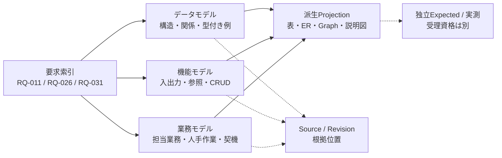
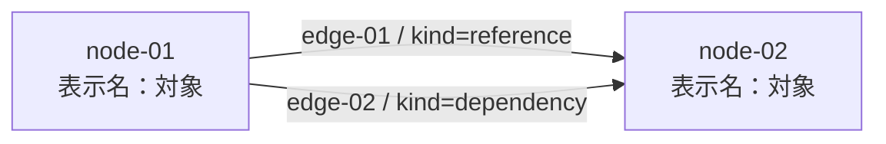
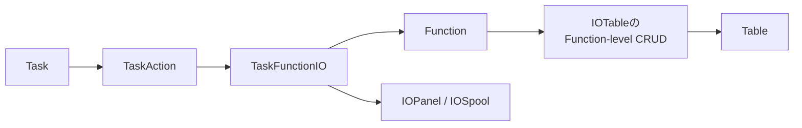

# TEI自己記述の第一縦断：三要素モデル・具体例・図面レビュー（2026-11-17）

> **位置づけ：設計・実証準備。** [三要素Method §33](THREE_ELEMENT_METHOD_DIAGRAM_CONTRACT_2026-10.md#33-tei自身の要件全体をモデルとしてレビューする三要素method標準構造インスタンスx-tea移植2026-11-17設計統合)の最小実行票。図とデータはレビュー用の説明例であり、TEIの正式DSL・採用済みMeaning・X-TEA原典実測ではない。ここに示すSDMケースの製品試験・GUI試験・Owner受理は **NOT RUN / NOT ACCEPTED**。

## 1. 何を一続きでレビューするか

TEIの要件のうち、まず [RQ-011](../../requirements/TEI_PRODUCT_REQUIREMENTS.md)（複数Projection）、RQ-026（三要素分析法のモデルによる相互検証）、RQ-031（特定のMethodをCoreで特権化しない）の三つを選ぶ。これらは**対象となる実在の要求項目**である。一方、下図に示す設計者のレビュー業務、図面の組み合わせ、Graphの例示インスタンスは、今後の実証候補であって実装済みの機能を示さない。

この一件を「要件索引 → データモデル／機能モデル／業務モデル → モデル定義 → 具体例 → Source → 検証結果」の順で追えることを第一縦断の目的とする。全要件を一枚の図で表示することは求めない。三要素分析法は原典に忠実な**Authoring Method**とし、TEI固有のMeta・標準表現型・Generator・Provider・Evidenceへのリンクを、原典と区別した派生Projectionで重ねる。三つのモデルをCoreの三つの固定クラスへ変換する意味ではない。

### 図A：三要素とTEI固有のレビュー情報

この矢印はレビュー時の**参照経路**の例であって、Canonical Relationの定義でも、業務アクションが実際にデータを書き換えた証拠でもない。正式な関係と派生経路、描画の線を区別して保つ。

## 2. データモデルとインスタンスを並べて示す

標準Graphの例は、型の説明と実際の値を混同しないため、次の二つの記録を別々に扱う。

| 区分 | この例で確かめる内容 | モデル上で残す情報 |
| --- | --- | --- |
| モデル定義 | ノードと有向辺に独立した識別子があり、同じ端点間に複数の辺を持てる | 型、ID、source/target、辺属性、多重性、制約 |
| インスタンス | 同じ表示名の二つのノードと二本の異なる辺 | 各要素ID、関係ID、向き、属性値、Source/版 |
| 表現型 | 同じ実例をGraph図と表で表示する | 表示対象、描画IDと意味IDの対応、省略・集約・表示順 |
| 検証 | どちらの図面でも同じ四要素を区別できる | 保存した意味、不明・失われた意味、独立期待値との照合 |

### 図B：同名ノードと平行有向辺（説明用の小例）

| 要素ID | 種別 | 表示名または端点 | 例示属性 |
| --- | --- | --- | --- |
| node-01 | Node | 対象 | role = source |
| node-02 | Node | 対象 | role = target |
| edge-01 | directed Edge | node-01 → node-02 | kind = reference |
| edge-02 | directed Edge | node-01 → node-02 | kind = dependency |

図が二本の辺を重ねて描画しても、一覧では **edge-01とedge-02が別要素**であると分かる必要がある。ここでのIDは説明例のIDであり、表示Occurrence IDや描画エンジンのEdge IDではない。表示名でnode-01とnode-02を統合しない。候補Relationと受理済みRelationを混在させる場合は、さらにAuthority/Provenanceを分離する（SDM-07）。

### 値の有無を扱う別の小例

| 例示ID | 属性／集合 | 値の状態 | レビュー時の意味 |
| --- | --- | --- | --- |
| presence-01 | note | `null` | 取得済み・明示的NULL |
| presence-02 | note | 欠損 | 項目が与えられていない |
| presence-03 | lines | `[]` | 取得済みの空集合 |
| presence-04 | lines | 未取得 | 完全性を主張できない |

これらは同一フィールドに対する単一の型表記ではなく、異なるインスタンスの**状態の比較例**である。許される状態は対象モデルと取得Scopeに依存する。未取得を空集合、欠損をNULLに自動変換してはならない。X-TEAの自由なInstance TextやSlide順を、根拠なしに型付きデータ・実時刻・実Effectへ変換しない（#1131）。

## 3. 機能モデル・業務モデルとの関係は帰属の強さを表示する

X-TEAとの最初の照合対象は、#1031で観測対象にしている次の経路である。

- **原典の明示関係**：Task、TaskAction、TaskFunctionIO、Function、IOTableのSource上の参照を、それぞれ出典位置・版とともに表示する。
- **派生経路**：ActionからFunctionを経てTableへ到達できることと、ActionがTableへCUDを実行することは異なる。Function-level CRUDをAction固有の実Effectへ自動昇格させない。
- **人手・外部手順**：Functionを呼ばないTaskActionは正当な業務モデルの要素になり得る。未接続Functionの自動補完や業務実行の成功判定は行わない。
- **TEI固有の表示**：型付きI/O、Operator、標準表現型、実呼出しの証拠は、原典の図法そのものではなく追加の情報として表示する。

**第一段階はread-only**。Cross-viewの参照候補と正式Relation、表示上のEdgeを同一視しない。実GUIの編集はSubject・Source Span・Revision・被参照の確認を経て、現在開いている原Sourceへ明示保存し、再読込後に再投影する（#1124、#3788）。第二のMeaning正本は作らない。

## 4. レビュー用の一件票

図面を見るだけでは判断できないため、対象ごとに次の情報を伴わせる。既存のSource Index、Projection、独立Expected、Evidenceを**組み合わせて表示**するための項目であり、新しい永続Schemaや管理サービスの提案ではない。

| 項目 | 最初の一件で必要な判断 |
| --- | --- |
| 対象・Scope | どの要求・Source版・Method Profile・開示範囲について判定するか |
| 対象集合の完全性 | Data / Function / Businessごとの対象総数、観測数、未観測・unsupported・unfetchedの理由。0件と未調査を分ける |
| 型・関係・例 | Model定義とInstanceが対応するか。実例は説明例／独立Expected／実観測のどれか |
| Projectionの忠実度 | 元構造に対して保存・省略・集約したIdentity、向き、多重性、順序、Presence、単位、時点 |
| 出典と帰属 | Source位置、Revision、導出規則、正式関係／派生経路／候補の区別 |
| 変更時の扱い | read-only、明示保存可能、非一意のため変更不可、のいずれか |
| 資格・判定 | 定義の読取り、図面表示、独立期待値の一致、実Consumer、DB Effect、Owner受理を別々に記録 |

この第一縦断において、「RQ-011を図で探せた」だけではRQ-011の適合もRQ-026の網羅も認めない。逆に、Function/BusinessのReaderが未対応であれば、**未対応と報告すること自体が正しい検証結果**となる。分母を確定できないCoverageを100%と表示しない。

## 5. 実装担当への具体的な引渡し

| 順序 | 既存の担当・試験 | 最小成果と停止条件 |
| --- | --- | --- |
| **1：read-only基線** | #1124 / #1031 / #1126、SDM-01・SDM-03・SDM-06・SDM-08 | Source版付きでデータモデルと三要素参照を表示し、同名異ID・Function未観測・原文Instanceの未型付けを壊さない |
| **2：型付き例の照合** | #1131 / #2497、SDM-02・SDM-12 | GraphとPresenceの例で、表／図の間の意味保存・表示損失を説明できる |
| **3：独立判定** | #1180 / #2514、既存Scenario/Expected | 正例・一因子負例を実装とは独立に用意し、Source版・対象集合・観測範囲に合う場合だけ結果を認定する |
| **4：Sourceへの変更** | #1124 / #3788、SDM-04・SDM-05・SDM-11 | 一意な編集対象と現在のRevisionが確定する場合のみPreview → Save → Re-read → Re-project。曖昧・古い版は拒否 |
| **5：実利用の別検収** | #2586 / #2831 / #4583、SDM-09・SDM-10 | 通常製品CLIの実ProviderとStage1→Stage2の実Windows Consumerは別P0。図面の成功を実DB更新・セルフビルド成功にしない |

**この文書による実施結果**：上記は設計と照合用の具体例である。SDMケース実行、原典GUIとの画面比較、XeadDriver/正式Provider/DB実験、Stage2実Windows起動、CI、Owner意味受理は行っていない。既存のP0へ新しいHard Gateを追加せず、作業は各IssueのOwnerの範囲で進める。

## 6. 三要素クロスリファレンスの最初のコード検証：複数操作を一つのセルへ

[三要素Method §33](THREE_ELEMENT_METHOD_DIAGRAM_CONTRACT_2026-10.md)の「複数Projectionから同じ意味を確認する」を、既存の `internal/threeelement` に対する小さな回帰として具体化する。これは**read-onlyの参照モデル**であり、X-TEA原典の対応表をすべて忠実に再現したことや、受理済みTEI Worldの正式なCRUDを意味しない。

### 表の粒度と意味

| 出力 | 一行の粒度 | 同一Function/Dataへの複数宣言 |
| --- | --- | --- |
| `GenerateCRUDTable` | Function ID × Data ID | 重複行を生成せず、Function.Operationsの操作集合をC/R/U/Dで統合する |
| `GenerateFunctionDataCrossReference` | Function ID × Data ID | 同じ操作集合を表示。CRUDDefinitionがあるときは採用表示値と別に`DerivedOperations`を残す |
| `GenerateBusinessFunctionCrossReference` | Business ID × Activity ID × Function ID | BusinessがFunctionを利用する参照であり、上記CRUDの実行責任／実Effectを帰属させない |

**最小の独立期待**：Data=`order`、Function=`submit`に`R`と`U`を別々に記載した場合、CRUD／Function-Data双方で**一行・操作`RU`**となる。同名のBusiness `order` はData名の解決先にならない。元のFunction.Operationsを逆順にしても表は変わらない。明示CRUDが`R`で機能宣言が`RU`なら、表示値`R`とは別に派生意図`RU`を残す。明示`C`と派生`RU`が相互に対立する場合は、両者とConflictを確認できること。

### 適用する既存試験

- `TestMultipleFunctionOperationsFormOneCRUDCell`：重複行なし、R/Uの双方を保持、異なるElementKindの同名IDを誤解決しない、操作順に依存しない。
- `TestMultipleFunctionOperationsRemainVisibleUnderExplicitCRUD`：明示CRUDの投影と派生意図を両方表示し、相互に対立する場合はConflictを維持する。

この狭い成果は#1124（Modelerの実表示）・#1126（Data/ER/CRUD）・#2514（独立Expected）へ引き渡す。最小の試験が通っても、モデルの読み取り対象集合、原典Data/Function/Business全体の一致、実Sourceの資格、Modelerの画面操作、旧Driverの副作用、Windows Studioの受入には昇格させない。五種類の旧対応表の名称・軸・セル意味・導出条件についても、元資料の固定版とSourceを確認するまで正式な互換宣言をしない。

## 7. 集約した対応セルから元宣言へ戻る：モデル内出現位置の検証（2026-11-17）

第6節では、同じFunction/Dataに複数の`FunctionOperation`があるとき、それらを`RU`などの一つの表示セルへ集約した。しかし、**集約した結果だけでは、元の宣言が何件あり、どの宣言が食い違うかを確認できない**。図面でのレビューには、集約結果と個々の宣言を往復できることが必要となる。

既存の`internal/threeelement`に、読み取り専用の`GenerateCRUDCellOrigins`を置く。これはCRUD表や正本とは別に、同じFunction/Dataの組を構成した`FunctionOperation`と`CRUDDefinition`を**省略せず列挙**するための補助Projectionである。表示セルの一つと実行された書き込み一回を対応させるものではない。

| 調べる対象 | 集約した表示 | 元の宣言の確認 |
| --- | --- | --- |
| `submit` → `order` | 一組の`RU`セル | `FunctionOperation`の`r`、`U`、`R`を各1件として保持。表記と宣言件数を失わない |
| 明示CRUDと派生意図 | 既存の明示優先表示と`DerivedOperations` | `CRUDDefinition`ごとのID、位置、操作、自己申告されたSourceラベルを区別 |
| 同じ組への相反する明示定義 | 既存のConflict表示 | 対立する両方の宣言を残す。最後の宣言が表示に選ばれても他方を消さない |
| 未解決のデータ参照 | 対象名は確定できない | 元のData IDと宣言は残す。参照先不在の確証や実行可能性は主張しない |

### 位置情報の資格

`functionPosition`、`operationPosition`、`definitionPosition`は**入力モデルの配列内の1始まりの位置**であり、そのモデルのSnapshotを限定した参照にすぎない。これらをX-TEAの永続ID、`*.tei.md`のSource Span、正式なQualified Ref、許可済み編集対象として使用しない。原典上の文書位置・ファイル版・Source tokenへの照合は既存#950/#1031/#1124のReaderとSelection契約で別途行う。旧SourceのSortKeyや業務の実行順序をこの配列位置から導出しない。

同じFunction/Dataの複数操作を一つのセルへ集約することは、**表示の粒度の選択**である。データ更新の回数、トランザクション、業務ActionごとのEffect、Primary Data Owner、独立した業務上の操作単位はこの表から確定できない。この補助Projectionも、受理前の説明・レビュー用途に限り、正式な意味正本、Runner、Core schema、第二のSource Indexを新設しない。

### 独立した検証の入口

- `TestCRUDCellOriginsRetainEveryOperationBehindOneCell`：一つの`RU`表示セルに元の三宣言が残ること、読み取りでモデルを変更しないこと、異なるKindの同名要素を混ぜないこと。
- `TestCRUDCellOriginsKeepConflictingDefinitionsAndModelPositions`：明示CRUDが二件対立しても両方を列挙し、モデル内の並べ替えで出現位置だけが変わること。
- `TestCRUDCellOriginsPreserveUnresolvedPairsForReview`：参照先が未定義の組も黙って消さないこと。

以上は**`internal/threeelement`の局所Reference契約**である。次の段階では、#1031の複数source tokenと#1124のQualified Selectionに接続して出典位置まで進め、その後に型付きインスタンス（#1131）と標準表現型（#2497）を照合する。実X-TEA Modeler/Driver、正式TEI Sourceへの逆編集、実Provider/DB、Windows Studioの実Consumer、Ownerの意味受理は独立した検収のまま維持する。
