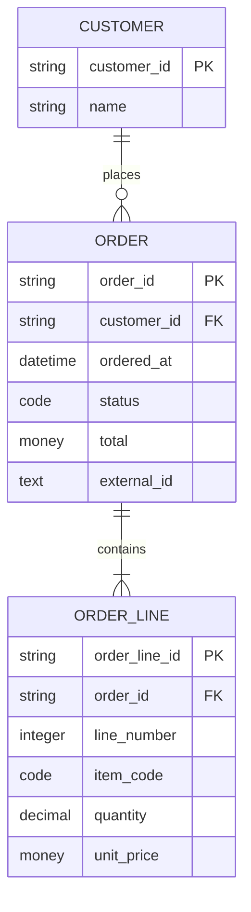
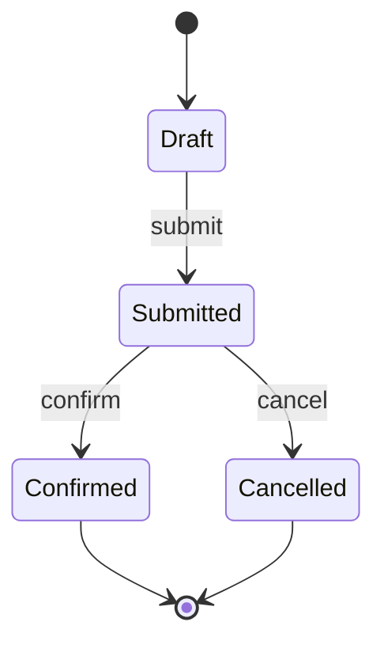
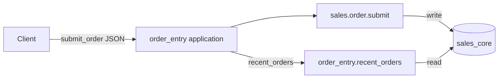

# order_entry ドメイン知識サンプル（P1-B 合成サンプル）

> **この文書の位置づけ**: [TEI_MD_DOMAIN_DIAGRAM_TO_BUILD_LOWERING_2026-11.md](../../../plan/design/TEI_MD_DOMAIN_DIAGRAM_TO_BUILD_LOWERING_2026-11.md) の **P1-B** に対応する**合成サンプル**である。
>
> - これは **Raw Draft** であり、実Source消費・Meaning受理・Build資格を主張しない。
> - `reference/candidates/` は Workspace の宣言されたSource Root（`plugins`/`bundles`/`semantic`/`applications`/`databases`/`environments`/`releases`）の**外**である。よって現行Loaderはこの文書をManaged Sourceとして読まない。
> - Reader未接続の間は、表示・原文保全のみを確認する（P1-Bの受入）。`*.tei.md` の実Parserは [#3030](https://github.com/hat47x/tei-platform/pull/3030) M2/M3 の既存Owner。
> - 参照した意味の正本は `reference/workspace/` の旧 `*.tei` である。本書はその**図表投影の候補**であり、第二の意味正本を作らない。

## 0. 全体ナビゲーション（概観と現在地）

利用者が事前知識なしに「全体として何をするか・何が起きるか・どこを変えられるか」を把握できるよう、各図表は全体の中の現在地を持つ。詳細を開いても概観へ戻れる。

| 節 | 図表 | 対応する生成物（P2-C以降の候補） | 参照する意味正本 |
| --- | --- | --- | --- |
| 1 | ER図（対象構造） | `models.go` | `semantic/sales/order.tei`, `semantic/customer/customer.tei` |
| 2 | 状態遷移図 | `migrations.go` の起動順序・Guard | `databases/sales-core/database.tei` |
| 3 | DFD（業務Flow） | `commands.go`, `queries.go` | `applications/order-entry/` |
| 4 | 業務ルール表 | `validations.go` | `applications/order-entry/application.tei` |
| 5 | クエリ表 | `queries.go` | `applications/order-entry/queries/recent_orders.tei` |
| 6 | マイグレーション表 | `migrations.go` | `databases/sales-core/migrations/20260826_001/migration.tei` |
| 7 | 標準／Custom区分 matrix | （投影のみ） | RQ-036 の要件 |

## 1. ER図（対象構造）

Order・OrderLine・Customer の対象構造。Relation は論理キーと物理FKを別扱いする。

**Subject集合（独立Expected候補）**: `customer.customer`, `sales.order`, `sales.order_line`。Relation: `sales.order.customer`（one）、`sales.order.lines`（many）。

**Lowering map（候補）**:

| 図表要素 | 生成コンテキスト | 生成物 |
| --- | --- | --- |
| Entity `Order` | `DataModel{GoTypeName:"Order"}` | `models.go` の struct |
| Attribute `orderId` | `DataField{GoFieldName:"OrderId", GoType:"string"}` | struct field |
| Relation `lines`（many） | Relation Storage / 外部キー | `models.go` + `queries.go` |
| Relation `customer`（one） | 外部キー + 論理キー | `models.go` |

## 2. 状態遷移図（Order status）

状態遷移は「何が起きるか」を説明する。遷移順序とGuardは独立Expectedで検証する。

**不変条件（候補）**: `Draft` のみが `submit` を実行できる。`Cancelled` は終端。`status IS NULL` は不正（マイグレーション `20260826_001` の data SQL が `UNKNOWN` へ補完するのは PostgreSQL 方言での話であり、SQLite では実行されない — K-07）。

## 3. DFD（業務Flow：submit_order）

Task→Function→Data の導出線から、Task自身のC/R/U/Dや実行時Effectを捏造しない。

**標準／Custom区分**: `sales.order.submit` は標準固定のCapability Contract。`order_entry.submit_order` は application pattern（差し込み個所）。実効フローは両者の合成。

## 4. 業務ルール表

| Rule ID | 対象 | 条件 | 独立Expected |
| --- | --- | --- | --- |
| `sales.order_line.quantity_positive` | OrderLine.quantity | quantity > 0 | `{"quantity":"2","lineNumber":1}` → ok |
| `sales.order_line.line_number_positive` | OrderLine.lineNumber | lineNumber > 0 | 負値 → validation error |
| `sales.order.lines.line_number_unique` | Order.lines | lineNumber 一意 | 重複 → validation error |

**Lowering map（候補）**: `Validation{ID, GoFunctionName, InputType, Rules}` → `validations.go`。

## 5. クエリ表

| Query ID | Datasource | 方言 | 結果Column |
| --- | --- | --- | --- |
| `order_entry.recent_orders` | sales | postgres | order_id, customer_id, ordered_at, status, total_amount |
| `order_entry.customer_reference` | customer | postgres | customer_id, name |

**Lowering map（候補）**: `Query{ID, SQL, AppID}` → `queries.go`。SQL は raw literal で保持。

## 6. マイグレーション表

| Migration ID | Database | Recovery | Dialect | Schema | Data | Verify |
| --- | --- | --- | --- | --- | --- | --- |
| `20260826_001` | sales_core | forward-fix | postgres | CREATE INDEX orders_customer_idx ON public.orders (customer_id) | UPDATE public.orders SET status='UNKNOWN' WHERE status IS NULL | SELECT COUNT(*) FROM public.orders WHERE status IS NULL |

**Lowering map（候補）**: `Migration{ID, Database, Recovery, SchemaSQL, DataSQL, VerifySQL}` → `migrations.go`。P0-A で独立Expected照合済み。

## 7. 標準／Custom区分 matrix（RQ-036）

| 要素 | 標準固定 | 設定可能な既定 | Extension Slot/Hook | 案件置換可能 | 観測のみ |
| --- | --- | --- | --- | --- | --- |
| Capability Contract `sales.order.submit` | ○（意味・Guard） | | | | |
| Application pattern `order_entry.submit_order` | | | ○ | ○（binding） | |
| Query `order_entry.recent_orders` | | | | ○（SQL） | |
| Migration `20260826_001` | | | | ○（方言） | |
| Validation `quantity_positive` | ○（Rule closure） | | | | |

## 8. この文書の受入（P1-B）

| 受入項目 | 内容 |
| --- | --- |
| 原文保全 | Markdownとして表示・保存可能。byte 不変 |
| Subject集合 | §1 の Subject 集合が意味正本と対応 |
| 説明／定義の境界 | frontmatter・prose・Mermaid・表・fence の役割が明示 |
| 禁止 | 本書の存在を実Source消費・Meaning受理・Build資格と読み替えない |
