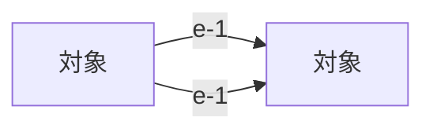

# 出辺を調べる最小Graph

この文書は、TEIでのGraph／Rule生成を検証するための入力候補です。関係の定義元は次のMarkdown表であり、Mermaidは確認用の図です。現時点では、ファイルの存在をもってTEIの意味受理やコード生成の成功とはみなしません。

## ノードの定義

| ID | 表示名 |
| --- | --- |
| n-1 | 対象 |
| n-2 | 対象 |

## 関係の定義

| Edge ID | 起点 | 終点 |
| --- | --- | --- |
| e-1 | n-1 | n-2 |
| e-1 | n-1 | n-2 |

## 確認する規則

指定したノードの出辺は、「関係の定義」の起点がそのノードIDと一致する行から求めます。返すEdge IDは昇順で並べます。同じ端点を結ぶ辺でも、Edge IDが異なれば別の辺として数えます。Edge IDが重複する場合は、一本にまとめず定義の不備として拒否します。

## 関係図（表から導出した表示）

MermaidのN1とN2はそれぞれn-1とn-2の表示用の別名です。図のレイアウトやラベルの変更によって、表のNode ID・Edge ID・向きが変わることはありません。
